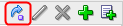

## Before You Begin

This 15-minute tutorial shows you how to create a new project, a workflow and add the necessary data sources to the workflow. Rather than use the Data Miner sample data, you will use the Sales History schema data.

### Background

Generalized Linear Models provide great transparency, which may be achieved at the expense of accuracy. With the introduction of a feature selection and generation capability, GLMs can maintain a high degree of accuracy without sacrificing transparency (the ability to explain the predictions made by the model).

- *Feature Selection* is the process of selecting the most meaningful attributes. With feature selection, GLMs can be created with fewer predictors, leading to smaller models and faster scoring.
- *Feature Generation* is the process of combining attributes into new features. With feature generation, GLMs use non-linear terms (up to cubic terms), leading to more powerful models and increased transparency.

### Scenario

Here, you focus on a business problem that can be solved by applying a Classification model. In our scenario, ABC Company wants to know which customer attributes are most significant in predicting the gender of a customer. The new feature selection / generation enhancements are used as part of this mining exercise.

In this new workflow, you:

- Identify and select two new data sources from the Oracle Database sample SH schema: the SALES and CUSTOMERS tables.
- Summarize the QUANTITY_SOLD and AMOUNT_SOLD measures from the SALES table by Customer and Product, over the Promotion and Channel dimensions.
- Place the summarized data into a new table.
- Join the summarized sales data with customer data to provide a pool of data for the Classification model.
- Apply the Feature Selection / Generation option with a GLM algorithm and examine the results.

The completed workflow looks like this:

<figure>

<figcaption>Description of the illustration completed-workflow.gif</figcaption>
</figure>

### What Do You Need?

- Oracle Database 19c Enterprise Edition
- [Oracle SQL Developer version 19.x](https://www.oracle.com/tools/downloads/sqldev-downloads.html)
- Oracle Data Miner User Account
- Access to the Sales History sample schema
- SELECT permissions to DMUSER on the SH schema

------------------------------------------------------------------------

## Create a New Data Miner Project

This is an unnumbered paragraph before a procedure.

1.  Select the **Data Miner** tab. The PDB1-DMUSER connection that you previously created appears
2.  In the Create Project window, enter **SH Schema** as the project name and then click **OK**.

------------------------------------------------------------------------

## Create a Workflow and Add Data Sources

1.  Right-click the SH Schema project and select **New Workflow** from the menu.

2.  In the Create Workflow window, enter **Predicting Customer Gender** as the name and click **OK**.

3.  In the Component Palette, open the Data category, then drag/drop a Data Source node to the workflow pane.

4.  In Step 1 of the Wizard:

5.  - Select the Include Tables from Other Schemas option.
    - Click YES in the Edit Schema List information box.
    - In the Edit Schema List dialog, move **SH** from the Available Schemas list to the Selected Schemas list and click **OK**.
    - In the Define Data Source wizard, select **SH.CUSTOMERS** from the Available Tables/Views list and click **FINISH**.

6.  Add a second Data Source node to the workflow, select the **SH.SALES** table, and click **Finish**.

7.  Click the **Save All** tool in the SQL Developer toolbar.

------------------------------------------------------------------------

## Aggregate the Data

The Transforms node group contains a number of tools that enable you to transform data for use within a workflow.

1.  Open the Transforms group, and then drag and drop the Aggregate node to the workflow.

2.  Connect the SALES data source node to the Aggregate node, by doing the following:
    - Right-click the SALES node
    - Select **Connect** from the pop-up menu.
    - Drag the pointer to the Aggregate node and release.

3.  Double-click the **Aggregate** node to display to display the Edit Aggregation window.

4.  Select a "Group By" attribute for the aggregation by performing the following:
    - Click **Edit** to open the Edit Group By window.
    - With Column selected as the Type value, move **CUST_ID** from the Available Attributes list to the Selected Attributes list, and then click **OK.**

5.  Click the Aggregation Wizard tool () to launch the wizard.

6.  In the Define Aggregation Wizard:
    - In Step 1 of the Define Aggregation wizard, select **COUNT (DISTINCT())**, **SUM()**, **MAX()**, **MEDIAN()**, and **AVG()** as the numerical functions, and then click **Next**.
    - In Step 2 of the wizard, move **AMOUNT_SOLD** and **QUANTITY_SOLD** to the Selected Attributes list and click **Next**.
    - In Step 3 of the wizard, move **PROD_ID** to the Selected Attributes list and then click **Finish**.

7.  In the Edit Aggregation window, click **OK** to save the aggregation rules.

8.  Right-click on the Aggregate SALES node and select **Run** to run the aggregation.

    <figure>
    
    <figcaption>Description of the illustration sales-aggregate.jpg</figcaption>
    </figure>

    The Aggregate node is executed and the process creates a nested table that can be used for data mining.

9.  In the Components tab, open on the Data group and drag a Create Table or View node to the workflow.

10. Connect the Aggregate node to OUTPUT node, and then rename the OUTPUT node to "Create Table".

11. Double-click the **Create Table** node and in the Edit Create Table or View Node window, perform the following:
    - De-select the **Auto Input Columns Selection** option.
    - Select the **Index** option for the CUST_ID column.
    - Click **OK**.
      <figure>
      
      <figcaption>Description of the illustration create-table.png</figcaption>
      </figure>

------------------------------------------------------------------------

## Add a Join Node to the Workflow

1.  From the Transforms group, drag and drop a **Join** node to the workflow.

2.  Connect the Create Table node to Join node, and the CUSTOMERS node to the Join node.

3.  Double-click the **Join** node to display the Edit Join Node window. The Join tab is displayed by default. Then, click the **Add** (green "+" icon).

4.  In the Edit Join Column window:
    - Select **CUSTOMERS** as Source 1, and **Create Table** as Source 2.
    - Select the **CUST_ID** column from both sources.
    - Click the **Add** button to define the Join Columns.
    - Click **OK**.
      <figure>
      
      <figcaption>Description of the illustration edit-join-column.png</figcaption>
      </figure>

5.  Select the Columns tab of the Edit Join Node window, and remove the CUST_ID column from the Create Table source by performing the following:
    - Deselect the **Automatic Settings** option.
    - Select the **CUST_ID** column from the **Create Table** node.
    - Click the **Remove** tool (red "x" icon).
    - Click **Yes** in the Warning window.

6.  Click **OK** in the Edit Join Node window.

    <figure>
    
    <figcaption>Description of the illustration workflow-after-join.png</figcaption>
    </figure>

    Your workflow should look similar.

------------------------------------------------------------------------

## Next Tutorial

In the next tutorial, you'll build and compare logisitic regression classification models.

------------------------------------------------------------------------
