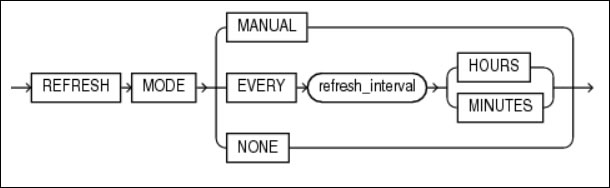
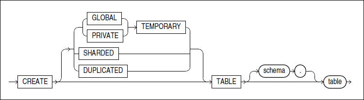
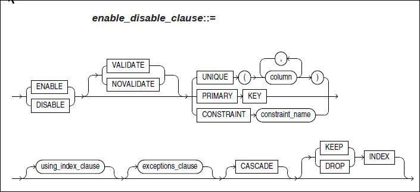

## Before You Begin

This 15-minute tutorial shows you how to read graphic syntax diagrams in the SQL reference manual and other Oracle Database manuals.

### Background

The syntax rules and functionality of a SQL statement is specified in Backus-Naur Form (BNF). BNF is simply a way to describe syntax.

Each graphic syntax diagram has a text description, which appears as a link below the graphic.

<figure>

</figure>

### What You Need

- An understanding of the symbols used in BNF notation. See the links provided at the end.

------------------------------------------------------------------------

## BNF Specification of the pdb_refresh_mode_clause

The BNF specification of the pdb_refresh_mode_clause:

       REFRESH MODE ( (MANUAL) | (EVERY "refresh_interval" (HOURS | MINUTES)) | (NONE) )

------------------------------------------------------------------------

## How to Read the BNF Specification

You read the BNF representation from left to right. The representation follows these notation rules:

1.  Oracle keywords and commands are capitalized and and specified as they are. In the pdb_refresh_mode_clause the Oracle keywords are REFRESH, MODE, EVERY, HOURS, MINUTES, NONE, and SWITCHOVER.
2.  Parentheses are used to group items. Grouping makes the syntax easier to read. For example, the options MANUAL, EVERY, and NONE are grouped within parentheses. The grouping of the options HOURS and MINUTES makes it clear that they belong to the option EVERY.
3.  Square brackets (\[\]) enclose optional items.
4.  Items within a grouping separated by vertical bars means that only one of the items is required at a given time.
5.  User defined input like parameters and clauses are enclosed within double quotes. For example, "refresh_interval" in the pdb_refresh_mode_clause.
6.  Punctuation marks are enclosed within double quotes. The double quotes means that punctuation marks are interpreted as strings.
7.  The forward slash character ("/") before a punctuation mark means that the punctuation mark will NOT be interpreted as a string. For example, /"," after a syntactic element means that the syntactic element can repeat.

------------------------------------------------------------------------

## The Graphic Syntax Diagram of the pdb_refresh_mode_clause

There are tools that generate the syntax diagram from a BNF representation.

Here is the syntax diagram of the pdb_refresh_mode_clause:

------------------------------------------------------------------------

## Read a Syntax Diagram of the pdb_refresh_mode_clause

The syntax diagram is read from left to right in the direction of the arrows. The rules:

1.  Oracle keywords and commands appear in uppercase inside rectangles. They should be typed exactly as shown in the rectangles. In the pdb_refresh_mode_clause these are REFRESH, MODE, EVERY, HOURS, MINUTES, NONE, and SWITCHOVER.
2.  The required keywords like REFRESH and MODE appear singly on the the main path, which is the horizontal line you are traveling.
3.  The required parameters MANUAL, EVERY, and NONE appear in a vertical list of alternate paths that intersect the main path. You must choose one of the options to complete the statement.
4.  The parameter refresh_interval is required for the EVERY option. It appears in lowercase within an oval.

The following statements are valid:

- REFRESH MODE MANUAL
- REFRESH MODE EVERY "refresh_interval" HOURS
- REFRESH MODE EVERY "refresh_interval" MINUTES
- REFRESH MODE NONE

------------------------------------------------------------------------

## Read a Syntax Diagram - Optional Keywords and Parameters

Optional keywords and parameters appear in a vertical list above the main path.

Here is the first part of the create_table syntax diagram:

The optional keywords DUPLICATED, SHARDED, PRIVATE, and GLOBAL appear above of the main path in a vertical list. You are not required to use these keywords. You can bypass them and continue along the main path.

The following statements are valid:

- CREATE TABLE total_sales
- CREATE GLOBAL TEMPORARY TABLE demo
- CREATE SHARDED TABLE revenue_01

------------------------------------------------------------------------

## Read a Syntax Diagram - Punctuation and Loops

Punctuation marks, operators, and delimiters are enclosed within double quotes in the BNF specification and appear within circles in the graphic syntax diagram.

Example: enable_disable_clause of ALTER TABLE statement.

BNF specification:

                                    (ENABLE|DISABLE) [VALIDATE|NOVALIDATE]
                                    ( (UNIQUE "(" "column"/"," ")" ) | PRIMARY KEY | CONSTRAINT "constraint_name")
                                    ["using_index_clause"] ["exceptions_clause"] [CASCADE] [(KEEP | DROP) INDEX]

Note the forward slash before the comma which means that the item before it can repeat.

Here is the graphic syntax diagram of the enable_disable_clause of ALTER TABLE:

The comma after item 'column' means that column can repeat as many times as needed.

------------------------------------------------------------------------

## Text Descriptions of Graphic Syntax Diagrams

Every graphic syntax diagram in the HTML output has a text description of the graphic in a link just below the graphic syntax diagram.

The text description is similar to the BNF specification with two differences:

1\. Braces enclose items, of which only one item is required.

The text description of the pdb_refresh_mode_clause :

    REFRESH MODE { MANUAL | EVERY refresh_interval { HOURS | MINUTES } | NONE }

2\. Ellipsis points ("...") after a syntactic element mean that the element can be repeated.

The text description of the enable_disable_clause:

                                  { ENABLE | DISABLE }
                                  [ VALIDATE | NOVALIDATE ]
                                  { UNIQUE (column [, column ]...)
                                  | PRIMARY KEY
                                  | CONSTRAINT constraint_name
                                  }
                                  [ using_index_clause ]
                                  [ exceptions_clause ]
                                  [ CASCADE ]
                                  [ { KEEP | DROP } INDEX ]

------------------------------------------------------------------------

## Useful Links

- [How to Read Syntax Diagrams](https://docs.oracle.com/en/database/oracle/oracle-database/18/sqlrf/How-to-Read-Syntax-Diagrams.html#GUID-6DFBA035-DBCB-4F37-984D-37E9EBC1038B)
- [EBNF Notation](https://www.w3.org/TR/xquery-30/#EBNFNotation)

------------------------------------------------------------------------
