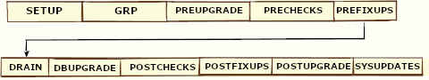

## About AutoUpgrade Processing Modes

The four AutoUpgrade processing modes (Analyze, Fixup, Deploy, and Upgrade) characterize the actions that AutoUpgrade performs as it runs.

- Preparations for Running AutoUpgrade Processing Modes
  You must complete preparations before you can run an AutoUpgrade processing mode.
- About the AutoUpgrade Analyze Processing Mode
  The AutoUpgrade Analyze (`analyze`) processing mode checks your database to see if it is ready for upgrade.
- About the AutoUpgrade Fixups Processing Mode
  The AutoUpgrade Fixups (`fixups`) processing mode analyzes your database, and performs fixups of items that must be corrected before you can perform an upgrade.
- About the AutoUpgrade Deploy Processing Mode
  The AutoUpgrade Deploy (`deploy`) processing mode performs the actual upgrade of the database, and performs any pending fixups.
- About the AutoUpgrade Upgrade Processing Mode
  The AutoUpgrade Upgrade (`upgrade`) processing mode enables you to upgrade either the source or target Oracle home.

**Parent topic:** [Using AutoUpgrade for Oracle Database Upgrades](using-autoupgrade-oracle-database-upgrades.md)

### Preparations for Running AutoUpgrade Processing Modes

You must complete preparations before you can run an AutoUpgrade processing mode.

Before you can use an AutoUpgrade processing mode, confirm that you meet the following requirements:

- You have created a user configuration file.

- The source Oracle Database release is up and running in the original Oracle home. In case of a restart of AutoUpgrade, you must start the database in the Oracle home that corresponds to the phase in the upgrade flow.

- The server on which the database is running is registered on the server hosts file (for example, `/etc/hosts`), or on a domain name server (DNS).

  If you are logged in to the server on which the target database is located, and the database is running either on `localhost`, or where AutoUpgrade is running, then remove the hostname parameter from the AutoUpgrade `config` file.

- On container databases (CDBs), if you want to upgrade a subset of pluggable databases (PDBs), then the PDBs on which you want to run the upgrade are open, and they are configured in the user configuration file, using the AutoUpgrade local parameter `pdbs`. If you do not specify a list of PDBs, then AutoUpgrade upgrades all PDBs on the CDB.

- You have the AutoUpgrade jar file (`autoupgrade.jar`) downloaded or available, and you are able to run it using a Java 8 distribution.

- If you want to run AutoUpgrade in a batch or script , then you have called AutoUpgrade using the `noconsole` parameter in the command.

In Oracle Database 19c (19.3) and later target Oracle homes, the `autoupgrade.jar` file exists by default. However, before you use AutoUpgrade, Oracle strongly recommends that you download the latest version, which is available form My Oracle Support Document 2485457.1.

**Related Topics**

- [My Oracle Support Document 2485457.1](https://support.oracle.com/rs?type=doc&id=2485457.1)

**Parent topic:** About AutoUpgrade Processing Modes

### About the AutoUpgrade Analyze Processing Mode

The AutoUpgrade Analyze (`analyze`) processing mode checks your database to see if it is ready for upgrade.

AutoUpgrade utility in Analyze mode runs `SELECT` statements in the database. It does not perform insert, update, or delete operations. However, be aware that if the database is opened in Read Write mode, then Oracle background processes can be writing to the database to support necessary database functionality. You can run AutoUpgrade using the Analyze mode during normal business hours. You can run AutoUpgrade in Analyze mode on your source Oracle Database home before you have set up your target release Oracle Database home.

You start AutoUpgrade in Analyze mode using the following syntax, where `Java-8-home` is the location of your Java 8 distribution, or the environment variable set for the Java 8 home, and `path/yourconfig.txt` is the path and filename of your configuration file:

    Java-8-home/bin/java -jar autoupgrade.jar -config /path/yourconfig.txt -mode analyze

For example, suppose you have copied the most recent AutoUpgrade release to the new release Oracle home under rdbms/admin, and set an environment variable for that home to `21CHOME`, and copied the configuration file under the Oracle user home, under the directory `/scripts`, and called it `21config.cfg`, you then enter the following command:

    java -jar $21CHOME/rdbms/admin/autoupgrade.jar -config /scratch/scripts/21config.cfg -mode analyze -mode analyze

Oracle Database Release 12.2 (12.2.0.1) or newer Oracle homes have a valid java version by default.

[Description of the illustration autoupgrade-analyze-flow.eps](img_text/autoupgrade-analyze-flow.md)

The AutoUpgrade Analyze mode produces two output files, which are given the name of the system identifier (`SID`) of the database that you check:

- `SID``.html`: View this file using a web browser.

<!-- -->

- `SID``_preupgrade.log`: View this file using a text editor.

Each report identifies upgrade errors that would occur if you do not correct them, either by running an automatic fixup script, or by manual correction. If errors occur, then they are reported in the user log file, and also in the `status.json` file.

The Analyze mode also generates a status directory in the path `cfgtoollogs/upgrade/auto/status`. This directory contains files that indicate if the analysis was successful or failed. This directory has two JSON files, `status.json` and `progress.json`:

- `status.json `: A high-level status JSON file that contains the final status of the upgrade.
- `progress.json`: A JSON file that contains the current progress of all upgrades being performed on behalf of the configuration file. If errors occur, then they are reported in the log file of the user running AutoUpgrade, and also in the `status.json` file.

If your target database Oracle home is not available on the server, then in your configuration file, you must set the source Oracle home parameters to the same path, so that the AutoUpgrade analyze processing mode can run. For example:

    #
    # Source Home
    #
    sales3.source_home=d:\app\oracle\product\12.2.0\dbhome_1
    #
    # Target Oracle Home
    #
    sales3.target_home=d:\app\oracle\product\21.0.0\dbhome_1

Earlier releases of AutoUpgrade required you to set `target_home`. In later releases of AutoUpgrade, this restriction has been lifted for both Analyze and Fixups modes.

**Parent topic:** About AutoUpgrade Processing Modes

### About the AutoUpgrade Fixups Processing Mode

The AutoUpgrade Fixups (`fixups`) processing mode analyzes your database, and performs fixups of items that must be corrected before you can perform an upgrade.

When you run AutoUpgrade in Fixups mode, AutoUpgrade performs the checks that it also performs in Analyze mode. After completing these checks, AutoUpgrade then performs all automated fixups that are required to fix before you start an upgrade. When you plan to move your database to a different platform, using the Fixups mode prepares the database for upgrade.

**Caution:**

Oracle recommends that you run AutoUpgrade in Analyze mode separately before running AutoUpgrade in Fixups mode. Fixup mode can make changes to the source database.

As part of upgrade preparation, if the source database requires corrections for conditions that would cause errors during an upgrade, then AutoUpgrade run in Fixups mode performs automated fixes to the source database. Because running AutoUpgrade in Fixups mode is a step that you perform as you are moving to another system, it does not create a guaranteed restore point. Oracle recommends that you run this mode outside of normal business hours.

You start AutoUpgrade in Fixups mode using the following syntax, where `Java-8-home` is the location of your Java 8 distribution, or the environment variable set for the Java 8 home:

    Java-8-home/bin/java -jar autoupgrade.jar -config yourconfig.txt -mode fixups

If Java 8 is in your source Oracle home, then start AutoUpgrade in Fixups mode using the following syntax, where `Oracle_home` is the Oracle home directory, or the environment variable set for the Oracle home, and `yourconfig.txt` is your configuration file:

    Oracle_home/jdk/bin/java -jar autoupgrade.jar -config yourconfig.txt -mode fixups

[Description of the illustration autoupgrade-fixup-flow.eps](img_text/autoupgrade-fixup-flow.md)

As AutoUpgrade runs in Fixups mode, it starts out by running the same prechecks that are run in Analyze mode. It then runs automated fixups in the source database in preparation for upgrade, and generates a high-level status file that indicates the success or failure of fixup operations. If errors occur, then they are reported in the log file of the user running AutoUpgrade.

**Caution:**

AutoUpgrade in Fixups mode does not create a guaranteed restore point. Before starting AutoUpgrade in Fixups mode, ensure that your database is backed up.

**Parent topic:** About AutoUpgrade Processing Modes

### About the AutoUpgrade Deploy Processing Mode

The AutoUpgrade Deploy (`deploy`) processing mode performs the actual upgrade of the database, and performs any pending fixups.

Before you run Deploy, you must have the target Oracle home already installed, and you must have a backup plan in place, in addition to the backup plan run as part of the AutoUpgrade script.

You start AutoUpgrade in Deploy mode using the following syntax, where` ``Oracle_home` is the Oracle home directory, or the environment variable set for the Oracle home, and `yourconfig.txt` is your configuration file:

    Oracle_home/jdk/bin/java -jar autoupgrade.jar -config yourconfig.txt -mode deploy

[Description of the illustration autoupgrade-deploy-flow.eps](img_text/autoupgrade-deploy-flow.md)

When you run AutoUpgrade in Deploy mode, AutoUpgrade runs all upgrade operations on the database, from preupgrade source database analysis to post-upgrade checks. Each operation prepares for the next operation. If errors occur, then the operation is stopped. All errors are logged to relevant log files, and to the console, if enabled. A high level status file is generated for each operation, which shows the success or failure of the operation. If there are fixups that are still pending (for example, if you run AutoUpgrade in Deploy mode without running AutoUpgrade first in Analyze and Fixups mode) then AutoUpgrade can complete fixups during the Deploy mode.

**Parent topic:** About AutoUpgrade Processing Modes

### About the AutoUpgrade Upgrade Processing Mode

The AutoUpgrade Upgrade (`upgrade`) processing mode enables you to upgrade either the source or target Oracle home.

You can use the Upgrade mode to divide an upgrade into two parts:

1.  (Strongly Recommended) Run the Prefixups mode on the source database running on its Oracle home.

2.  (Optional) Move the source database to a new Oracle home on a different system.

3.  Perform the upgrade of the database using the Upgrade mode.

    **Note:**

    When run in the source Oracle home, AutoUpgrade will start processing the upgrade immediately after skipping the PRECHECKS and PREFIXUPS stages. All other stages (except `POSTUPGRADE`) typically run during a `DEPLOY` will be run.

To use the Upgrade mode, the database must be up and running in either the source or the target Oracle home before you run AutoUpgrade in Upgrade mode. This option is particularly of value when you have moved your Oracle Database to a different system from the original source system, so that you cannot use the AutoUpgrade Deploy mode.

This procedure runs the upgrade, and postfixups operations on the database in the new Oracle home location.

#### Upgrading PDBs with Upgrade Mode

To upgrade a PDB, the folllowing requirements must be met:

- The PDB must already be added to the CDB.
- The PDB must already be opened in Upgrade mode.
- If you ran a manual Non-CDB to PDB or Unplug-Plug procedure, these processes must be fully completed before you run AutoUpgrade.
- When the PDB was not previously added to the CDB, and that PDB had a Transparent Data Encryption (TDE) configuration, you must reimport the TDE after the upgrade is completed.

#### AutoUpgrade Upgrade Mode in Target Oracle Home

In a CDB, when `CDB$ROOT` is in a major version (first numeral), we can use Autoupgrade to upgrade the PDBs that are in a lower version. The process for each PDB that you upgrade is as follows:

[Description of the illustration autoupgrade-upgrade-flow.eps](img_text/autoupgrade-upgrade-flow.md)

As AutoUpgrade runs in Upgrade mode, errors are logged to the log file of the user running the AutoUpgrade script. A high level status file is generated for each operation, which shows the success or failure of the operation.

**Note:**

When you run AutoUpgrade in Upgrade mode, PDBs must already be open in migration mode. There is no automated backup option for this configuration. In this scenario, postupgrade operations are not performed, so you must complete those steps separately later. For example, the following postupgrade operations are not performed:

- Copy of network files (`tnsnames.ora`, `sqlnet.ora`, `listener.ora` and other listener files, LDAP files, `oranfstab`
- Removal of the guaranteed restore point (GRP) created during the upgrade
- Final restart of an Oracle Real Application Clusters database

#### AutoUpgrade Upgrade Mode in Source Oracle Home

When the database in open in the source Oracle home, the stages run in the upgrade home depend on whether Fixups have been run on the source Oracle home before you start AutoUpgrade in Upgrade mode:

- If Fixups have already been run on the Source Oracle home, then all of the stages of a typical Deploy mode are run, except for Prechecks and Prefixups.

  Use this option if you can run the Prechecks and Prefixups separately, because AutoUpgrade bypasses running the Prechecks and Prefixups stages during the upgrade itself, which reduces your downtime.

- If fixups on the source Oracle home have not been run within the previous 3 days, then Upgrade mode includes those stages. The result is that running AutoUpgrade in Upgrade mode on the source Oracle home is exactly the same as running AutoUpgrade in Deploy mode, because the Prechecks and Prefixups stages are run as part of the Upgrade mode.

Example 3-1 Running AutoUpgrade in the Target Home After Moving the Database to a New Location

Where `dbname` is the name of your database, you run AutoUpgrade using the following steps:

1.  - If you ran AutoUpgrade with the Prefixups mode:
      1.  Copy the `during_upgrade_pfile_``dbname``.ora` file to the default location in the target Oracle home with the default name (`init``SID``.ora`).

          The `during_upgrade_pfile_``dbname``.ora` file is located under the `temp` directory in the log path used to run AutoUpgrade.

      2.  (Optional) You can connect to SQL\*Plus and create an SPFILE using `during_upgrade_pfile_``dbname``.ora` in the `temp` directory. For example:

              SQL> create spfile from pfile='/u01/autoupgrade/au21/CDBUP/temp/during_upgrade_pfile_cdbupg.ora';
    - If you did not run AutoUpgrade with the Prefixups mode:
      1.  Copy the initialization file (`init.ora` or `spfile``SID``.ora` from the source Oracle home to the target Oracle home location.

2.  Run AutoUpgrade in Upgrade mode using the following syntax, where `Oracle_home` is the Oracle home directory path, or the environment variable set for the Oracle home, and `yourconfig.txt` is your configuration file:

        Oracle_home/jdk/bin/java -jar autoupgrade.jar -config yourconfig.txt -mode upgrade

    This command runs the upgrade operations on the database.

**Parent topic:** About AutoUpgrade Processing Modes
