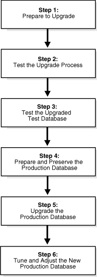

## Major Steps in the Upgrade Process for Oracle Database

Oracle Database upgrades consist of six major steps.

### Upgrade Steps Workflow

The following figure summarizes the major procedures performed during the upgrade process:

Figure 1-1 Upgrade Steps Workflow for Oracle Database

[Description of "Figure 1-1 Upgrade Steps Workflow for Oracle Database"](img_text/upgrd001.md)

### Step 1: Prepare to Upgrade Oracle Database

- Become familiar with the features of the new release of Oracle Database.

- Determine the upgrade path to the new release.

- Select an upgrade method.

- Select an Oracle home directory for the new release.

- Develop a testing plan.

- Prepare a backup strategy.

- Follow preupgrade recommendations.

- Run preupgrade fixup scripts, or carry out manual preupgrade system updates.

**Note:**

During the upgrade, consider running multiple releases of the database software, so that you can use the existing release as your production environment while you test the new release.

Consider completing a software-only installation to the new Oracle Database release. In a software-only installation, you install the Oracle Database software but do not create a database as part of the installation process.

### Step 2: Test the Upgrade Process for Oracle Database

- Perform a test upgrade using a test database. Conduct the test upgrade in an environment created for testing that does not interfere with the production database. Oracle recommends that your test environment is on a server that is, as much as possible, a replica of your production environment. For example: Oracle recommends that the server not only uses the same operating system, but that runs the same patch level, with the same packages, and matches other details of your production system configuration.

### Step 3: Test the Upgraded Test Oracle Database

- Perform the tests that you planned in Step 1 on the test database that you upgraded to the new release of Oracle Database.

- Review the results, noting anomalies in the tests.

- Investigate ways to correct any anomalies that you find and then implement the corrections.

- Repeat Step 1, Step 2, and the first parts of Step 3, as necessary, until the test upgrade is successful and works with any required applications.

- To test for anomalies and determine potential support questions, carry out SQL plan management. SQL plan management includes the following steps:

  1.  Before the upgrade, capture baselines and plans on the earlier release Oracle Database, and store those plans.

      Oracle recommends that you store the plans on staging tables, and then run the Data Pump Export utility `expdp` for those tables.

  2.  After the upgrade, in the event of a regression or a performance issue, apply (load/accept/evolve) an old plan that you know is good, based on the plans you captured from the previous release Oracle Database.

**See Also:**

- [Oracle Database SQL Tuning Guide](../tgsql/managing-sql-plan-baselines.md) for more information about SQL plan management

- Document 1948958.1 Patches to Consider for 11.2.0.3 to Avoid Problems with SQL Plan Management (SPM)

- Document 2034706.1 Patches to Consider for 11.2.0.4 to Avoid Problems with SQL Plan Management (SPM)

- Document 2035897.1 Patches to Consider When Upgrading From 12.1.0.1 to Avoid Problems with SQL Plan Management (SPM)

### Step 4: Prepare and Preserve the Production Oracle Database

Complete these tasks before you upgrade your existing production database:

- Prepare the current production database as appropriate to ensure that the upgrade to the new release of Oracle Database is successful.

- Schedule the downtime required for backing up and upgrading the production database.

- Back up the current production database.

  Before you carry out a major change to a system, Oracle recommends that you make sure that you have a fallback strategy implemented. Oracle recommends that your fallback strategy includes the following preparations:

  - Test your backup strategy, and ensure that it works.

  - If you need a backup strategy, then plan for the time required to apply it during your maintenance window.

  - To perform plan stability checks in preparation for upgrade, carry out SQL plan management. Raise a service request if you need assistance.

**Note:**

A database upgrade that installs a new optimizer version usually results in plan changes for a small percentage of SQL statements.

Most plan changes result in either improvement or no performance change. However, some plan changes may cause performance regressions. SQL plan baselines significantly minimize potential regressions resulting from an upgrade.

When you upgrade, the database only uses plans from the plan baseline. The database puts new plans that are not in the current baseline into a holding area, and later evaluates them to determine whether they use fewer resources than the current plan in the baseline. If the plans perform better, then the database promotes them into the baseline; otherwise, the database does not promote them.

**See Also:**

[Oracle Database SQL Tuning Guide](../tgsql/overview-of-sql-plan-management.md)

### Step 5: Upgrade the Production Oracle Database

- Upgrade the production database to the new release of Oracle Database.

- After the upgrade, perform a full backup of the production database and perform other post-upgrade tasks.

### Step 6: Tune and Adjust the New Production Oracle Database

- Tune the new production database for the new release. Typically, the new production Oracle Database performs to the same standards, or better, than the database before the upgrade.

- Determine which features of the new Oracle Database release that you want to use, and update your applications accordingly.

- Develop new database administration procedures as needed.

- Do not upgrade your production Oracle Database release to the new release until all applications you must use in the upgraded database have been tested and operate properly.

**Related Topics**

- <https://support.oracle.com/epmos/faces/DocumentDisplay?cmd=show&type=NOT&id=1948958.1>
- <https://support.oracle.com/epmos/faces/DocumentDisplay?cmd=show&type=NOT&id=2034706.1>
- <https://support.oracle.com/epmos/faces/DocumentDisplay?cmd=show&type=NOT&id=2035897.1>

**Parent topic:** [Introduction to Upgrading Oracle Database](intro-to-upgrading-oracle-database.md)
