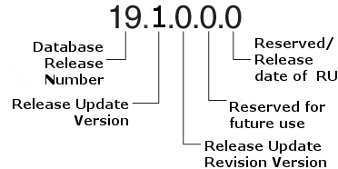

## About Oracle Database Release Numbers

Oracle Database releases are categorized by five numeric segments that indicate release information.

**Note:**

Oracle provides quarterly updates in the form of Release Updates (Updates, or RU) and Release Update Revisions (Revisions, or RUR). Oracle no longer releases patch sets or bundle patch sets. For more information, see My Oracle Support Note 2285040.1.

Oracle Database releases are released in `version` and `version_full` releases.

The `version` release is designated in the form `major release version``.0.0.0.0`. The major release version is based on the last two digits of the year in which an Oracle Database version is released for the first time. For example, the Oracle Database version released for the first time in the year 2018 has the major release version of 18, and thus its `version` release is `18.0.0.0.0`.

The `version_full` release is an update of a `version` release and is designated based on the major release version, the quarterly release update version (Update), and the quarterly release update revision version (Revision). The `version_full` releases are categorized by five numeric segments separated by periods as shown in the following example:

Figure 1-2 Example of an Oracle Database Release Number

[Description of "Figure 1-2 Example of an Oracle Database Release Number"](img_text/upgrd004.md)

- First numeral: This numeral indicates the major release version. It also denotes the last two digits of the year in which the Oracle Database version was released for the first time.

- Second numeral: This numeral indicates the release update version (Update, or RU).

- Third numeral: This numeral indicates the release update revision version (Revision, or RUR).

- Fourth numeral: This numeral is reserved for future use. Currently it is always set to 0.

- Fifth numeral: Although only the first three fields are commonly used, the fifth field can show a numerical value that redundantly clarifies the release date of a release update (RU), such as 19.7.0.0.200414.

**Note:**

The first three numerals mainly identify an Oracle Database release.

**Caution:**

Oracle strongly recommends that you apply the most recent Release Update to your target databases before starting an upgrade, and before starting a downgrade. If possible, also ensure that your source environment is patched. Release updates are cumulative. If you are also updating an Oracle Grid Infrastructure environment, then always apply the latest Release Update to the Grid environment first before updating Oracle Database Oracle homes. For more information about updates, refer to My Oracle Support note 2118136.2.

**Related Topics**

- [My Oracle Support note 2285040.1](https://support.oracle.com/rs?type=doc&id=2285040.1)
- [My Oracle Support note 2118136.2](https://support.oracle.com/rs?type=doc&amp;id=2285040.1)

**Parent topic:** [Compatibility and Interoperability Between Oracle Database Releases](compatibility-interoperability-between-database-releases.md)
