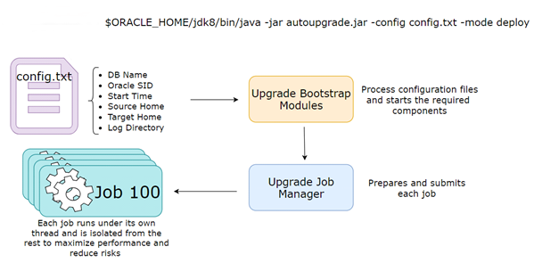
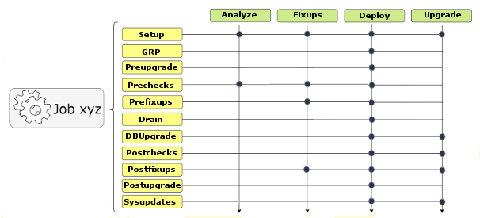

## Understanding AutoUpgrade Workflows and Stages

The AutoUpgrade workflow automates each step of a typical upgrade process. The stages that run depend on the processing mode that you select.

AutoUpgrade is designed to enable you to perform an upgrade with as little human intervention as possible. When you start AutoUpgrade, the configuration file you identify with the command is passed to the AutoUpgrade job manager. The job manager creates the required jobs for the processing mode that you selected, and passes the data structures required for the mode to the dispatcher. The dispatcher then starts lower-level modules that perform each individual task.

### AutoUpgrade Processing Mode Workflow Processing

To understand how AutoUpgrade processes a workflow mode, review the following figure, which shows how a deploy processing mode is processed:

[Description of the illustration autoupgrade-workflow.eps](img_text/autoupgrade-workflow.md)

### AutoUpgrade Processing Mode Stages

The stages that AutoUpgrade runs for an upgrade job depends on the processing mode that you select.

[Description of the illustration autoupgrade-options.eps](img_text/autoupgrade-options.md)

There are four AutoUpgrade modes. For each mode, AutoUpgrade steps are performed in sequence. Note the differences in steps for each mode

- **Analyze** Mode: Setup, Prechecks.

- **Fixups** Mode: Setup, Prechecks, and Prefixups.

- **Deploy** Mode: Setup, Guaranteed Restore Point (GRP), Preupgrade, Prechecks, Prefixups, Drain, DB (database) Upgrade, Postchecks, Postfixups, Postupgrade, and Sysupdates. You can run your own scripts before the upgrade (Preupgrade stage) or after the upgrade (Postupgrade stage), or both before and after the upgrade.

- **Upgrade** Mode: Setup, DB (database) Upgrade, Postchecks, Postfixups, and Sysupdates.

**Note:**

There can be variations in stage order and names (for example, `NONCDBTOPDB` for non-CDB databases upgraded to PDBs, and `UNPLUGWORK` for PDB upgrades), and some variations between AutoUpgrade versions. However the primary processing mode stages are similar to this overview.

**Parent topic:** [Using AutoUpgrade for Oracle Database Upgrades](using-autoupgrade-oracle-database-upgrades.md)
