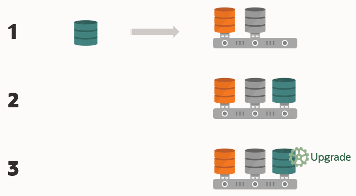

## Understanding Non-CDB to PDB Upgrades with AutoUpgrade

You can upgrade and convert a non-CDB to a PDB in a new CDB in a single operation, or upgrade and then convert a Non-CDB database to a PDB in a pre-existing CDB.

Starting with Oracle Database 21c, all upgrades must use the multitenant architecture. Use of the non-CDB Oracle Database architecture is desupported. When you migrate your database from the non-CDB architecture to PDBs, you obtain up to three user-configurable PDBs in a container database (CDB), without requiring a multitenant license. If you choose to configure four or more PDBs, then a multitenant license is required.

The non-CDB to PDB feature of the AutoUpgrade utility provides you flexible options to control how you upgrade your earlier release non-CDB Oracle Database when you upgrade and convert to the multitenant architecture. To perform an upgrade and conversion of the non-CDB to a PDB, you provide information about your non-CDB in the AutoUpgrade configuration file. If you prefer, you can also choose to convert your non-CDB Oracle Database to a PDB in the source release, and then plug in the PDB to a target release CDB, where the upgrade is performed when you plug in the PDB. Alternatively, copy the data files on plug-in to preserve the original database as rollback option.

**Caution:**

Before you run AutoUpgrade to complete the conversion and upgrade. Oracle strongly recommends that you create a full backup of your source database, and complete thorough testing of the upgrade. There is no option to roll back to the non-CDB Oracle Database state after AutoUpgrade starts this procedure.

Figure 3-1 Converting a Non-CDB to a PDB and Upgrading the PDB Using AutoUpgrade

In the following illustration, a non-CDB Oracle Database goes through the following steps:

1.  AutoUpgrade uses the information you provide in the configuration file to move the non-CDB source release database to the target release Oracle Database.
2.  The source database is converted to a PDB on the target release.
3.  The source database (now a PDB) is upgraded to the target release.

[Description of "Figure 3-1 Converting a Non-CDB to a PDB and Upgrading the PDB Using AutoUpgrade"](img_text/noncdb-pdb.md)

### Requirements for Source Non-CDB and Target CDB

Requirements on the source non-CDB and target CDB to perform upgrades and conversions to PDBs are as follows:

- The target CDB must be created in advance of performing the upgrade with AutoUpgrade.
- The PDB created from the non-CDB must continue to use the source non-CDB name. You cannot change the name of the database.
- The set of Oracle Database options in the target database must be either be the same as in the source database, or a superset of the options in the source database.
- The endian format of the source non-CDB and target CDB are identical.
- The source non-CDB and target CDB have compatible character sets and national character sets.
- The source non-CDB Oracle Database release and operating system platform must be supported for direct upgrade to the target CDB release.
- Operating system authentication is enabled for the source non-CDB and target CDB.

The minimum `COMPATIBLE` parameter setting for the source database must be at least 12.2.0. If the `COMPATIBLE` setting is a lower version, then during the conversion and upgrade process, `COMPATIBLE` is set to 12.2.0. During the conversion, the original datafiles are retained. They are not copied to create the new PDB. To enable AutoUpgrade to perform the upgrade, edit the AutoUpgrade configuration file to set the AutoUpgrade parameters `target_version `to the target CDB release, and identify the CDB to which the upgraded database is placed using `target_cdb`. During the conversion and upgrade process, AutoUpgrade uses that information to complete the upgrade to the target CDB.

Example 3-2 AutoUpgrade Configuration File for Non-CDB to PDB Conversion

To use the non-CDB to PDB option, you must set the parameters `target_cdb` in the AutoUpgrade configuration file. The `target_cdb` parameter value defines the Oracle system identifier (SID) of the container database into which you are plugging the non-CDB Oracle Database. For example:

    global.autoupg_log_dir=/home/oracle/autoupg
    upg1.sid=s12201
    upg1.source_home=/u01/product/12.2.0/dbhome_1
    upg1.log_dir=/home/oracle/autoupg
    upg1.target_home=/u01/product/21.1.0/dbhome_1
    upg1.target_cdb=cdb21x

During plug-in, you can choose to copy the data files. When you copy the data files, the process requires additional disk space, and takes more time to complete. By copying the data files during plug-in, you preserve the original database,so that you can use the original database for rollback, if needed.

To plug-in and copy the data files, add the following to your config file:

    upg1.target_pdb_copy_option.s12201=file_name_convert=('f1', 'r1', 'f2', 'r2', 'f3', 'r3'...)

Altertively, if you want to use Oracle Managed Files (OMF) or Oracle Automatic Storage Management (ASM), add the following:

    upg1.target_pdb_copy_option.s12201=file_name_convert=none

By specifying a target_pdb_copy_option you're instructing AutoUpgrade to copy the data files on plug-in.

You can see a more detailed example of a non-CDB to PDB upgrade from Oracle Database 12c (12.2) to Oracle Database 19c using the multitenant architecture in the blog post "Unplug / Plug / Upgrade with AutoUpgrade," in Mike Dietrich's Blog, Upgrade Your Database Now!, and also a demonstration of the noncdb_to_pdb.sql automatic feature using AutoUpgrade, in AutoUpgrade to Oracle Database 19c - and plug into a CDB.

**Related Topics**

- [Can I convert a non-CDB into a CDB? in Mike Dietrich Upgrade Your Database Now](https://mikedietrichde.com/2024/11/28/can-i-convert-a-non-cdb-into-a-cdb/)
- [Unplug / Plug / Upgrade with AutoUpgrade in Mike Dietrich, Upgrade Your Database Now](https://mikedietrichde.com/2021/06/07/unplug-plug-upgrade-with-autoupgrade/)
- [AutoUpgrade to Oracle Database 19c - and plug into a CDB](https://www.youtube.com/watch?v=NQAGKbIhb3Q)
- [Permitted Features, Options, and Management Packs by Oracle Database Offering](../dblic/Licensing-Information.md)

**Parent topic:** [Using AutoUpgrade for Oracle Database Upgrades](using-autoupgrade-oracle-database-upgrades.md)
