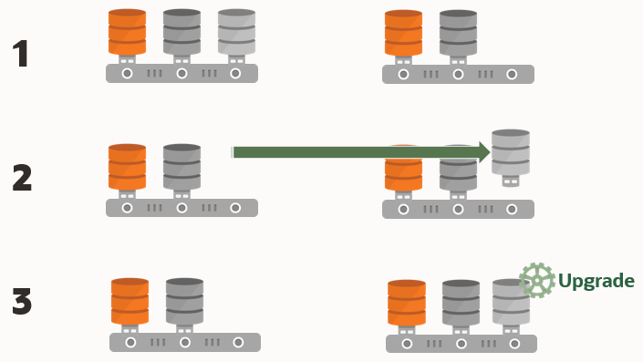

## Understanding Unplug-Plug Upgrades with AutoUpgrade

AutoUpgrade can perform an unplug of a pluggable database (PDB) from an earlier release source container database (CDB), plug it into a later release target CDB, and then complete all the steps required to upgrade the PDB to the target CDB release.

There are two workflows for unplug-plug PDB upgrades using AutoUpgrade, depending on how you configure the upgrade:

- You unplug one or more pluggable databases from one source CDB, and plug them into a new release target CDB
- You unplug multiple pluggable databases from different source CDBs, and plug them into a new release target CDB

In addition, for unplug-plug operations, AutoUpgrade now supports moving the default state of a PDB from the source PDB to the target PDB. If you set `alter pluggable database save state` on a source PDB, then that state is transferred to the target PDB, so that the PDB is automatically opened when CDB\$ROOT is opened. You can also control whether AutoUpgrade keeps or discards the database state by using the AutoUpgrade configuration file local parameter `keep_pdb_save_state`.

**Caution:**

As with any other change to the database, before you run AutoUpgrade to complete the conversion and upgrade, Oracle strongly recommends that you implement a reliable backup strategy to prevent unexpected data loss. There is no option to roll back an unplug-plug PDB upgrade after AutoUpgrade starts this procedure. Flashback Database also does not work across the PDB conversion, and is not reversible. Backups are the only fallback strategy.

The following illustration shows the unplug-plug operation, in this case of a single PDB:

1.  There is one source Oracle Database, and one target release Oracle Database. At this stage, create your configuration file and run AutoUpgrade in Analyze mode (`autoupgrade.jar -mode analyze`) to check your readiness for upgrade, and to correct any issues that are reported.
2.  You run AutoUpgrade in Deploy mode (autoupgrade.jar -mode deploy). AutoUpgrade uses the information you provide in the configuration file to move the PDB to the target release, and plug in the PDB.
3.  AutoUpgrade runs prefixups, and then upgrades the PDB to the target release.

Figure 3-2 Unplug-Plug Upgrades from Source to Target

[Description of "Figure 3-2 Unplug-Plug Upgrades from Source to Target"](img_text/unplug-plug-upgrade.md)

### Requirements for Source and Target CDBs

To perform an unplug-plug upgrade, your source and target CDBs must meet the following conditions:

- You have created the target release CDB, and opened the CDB before starting the unplug-plug upgrade.
- The endian format of the source and target CDBs are identical.
- The set of Oracle Database components configured for the target release CDB include all of the components available on the source CDB.
- The source and target CDBs have compatible character sets and national character sets
- The source CDB release must be supported for direct upgrade to the target CDB release.
- External authentication (operating system authentication) is enabled for the source and target CDBs
- The Oracle APEX installation type on the source CDBs should match the installation type on the target CDB.
- There should be no existing guaranteed restore point (GRP) on the non-CDB Oracle Database that you want to plug in to the CDB.

**Note:**

With AutoUpgrade 22 and later updates, you can now use AutoUpgrade to plug into an Oracle Data Guard configuration. AutoUpgrade creates the PDB with the `STANDBYS=NONE` clause. After the upgrade, you can re-establish standbys by recovering the data files on the standby databases.

### Features of Unplug-Plug Upgrades

When you select an unplug-plug upgrade, depending on how you configure the AutoUpgrade configuration file, you can use AutoUpgrade to perform the following options during the upgrade:

- You can either keep the PDB name that you have in the source CDB, or you can change the PDB name.
- You can make a copy of the data files to the target CDB, while preserving all of the old files.
- You can copy the data files to the target location, and then delete the old files on the source CDB
- You can process one PDB, or you can link to an inclusion list and process many PDBs in one upgrade procedure; the only limit for the number of PDBs you can process are the server limits, and the limits for PDBS on the CDB.

Example 3-3 AutoUpgrade Configuration File for Unplug-Plug Upgrades

To use the unplug-plug PDB upgrade option, you must identify the following values in the AutoUpgrade configuration file:

- The system identifier parameters for the source CDB (parameter `sid`).
- The target CDB (parameter `target_cdb`).
- The name of the PDB in the source CDB, and, if you want to convert it, the target conversion name.

For example, where the source CDB is `CDB122`, the target CDB is `cdb21x`, the name of the PDB in the source CDB is `pdb2`, and the conversion name for the PDB that you want on the target CDB is `depsales`:

    global.autoupg log_dir=/home/oracle/autoupg
    upg1.sid=CDB122
    upg1.source_home=/u01/app/oracle/product/12.2.0/dbhome_1
    upg1.target_home=/u01/app/oracle/product/19.1.0/dbhome_1
    upg1.target_cdb=cdb21x
    upg1.pdbs=pdb_2
    upg1.target_pdb_name.pdb_2=depsales
    upg1.target_pdb_copy_option.pdb_2=file_name_convert=('pdb_2','depsales')

**Parent topic:** [Using AutoUpgrade for Oracle Database Upgrades](using-autoupgrade-oracle-database-upgrades.md)
