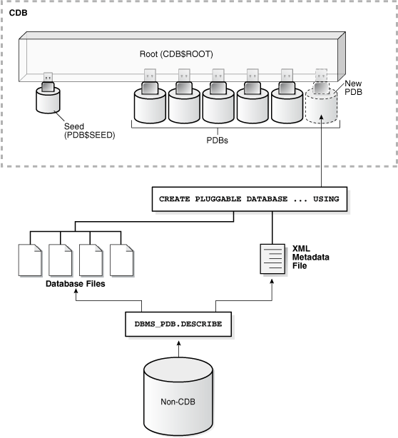

## Upgrade Scenarios for Non-CDB Oracle Databases

Review these topics to understand the upgrade scenarios and procedures for non-CDB Oracle Databases

**Note:**

Starting with Oracle Database 12c, release 1 (12.1), non-CDB architecture is deprecated. It can be desupported in a future release. Oracle Database deployed with the multitenant architecture is the default configuration option. All Oracle Database releases earlier than Oracle Database 12c release 1 (12.1.0.1) use non-CDB architecture.

**Caution:**

You cannot downgrade a database after you have set the compatible initialization parameter to 12.1.0.2. A pluggable database (PDB) downgrade is possible only if the compatibility is set to 12.1.0.1. There can be additional restrictions on downgrading.

Before starting an upgrade or a downgrade, Oracle strongly recommends that you upgrade your source and target databases to the most recent Quarterly Release Update (Update), Release Update Revision (Revision), bundle patch, or patch set update (BP or PSU).

- Download the Latest AutoUpgrade Utility
  To ensure that you obtain the most recent updates to checks to help to ensure a smooth upgrade, download the most recent AutoUpgrade Utility.
- About Adopting a Non-CDB as a PDB Using a PDB Plugin
  To manually adopt a non-CDB as a PDB, you generate an XML file that describes a non-CDB, and use the `DBMS_PDB.DESCRIBE` procedure. Afterward, plug in the non-CDB, just as you plug in an unplugged PDB.
- Adopting a Non-CDB as a PDB
  You can adopt (move) a non-CDB into a PDB by using the `DBMS_PDB.DESCRIBE` procedure.
- Oracle Label Security Integration in a Multitenant Environment
  You can use Oracle Label Security in a multitenant environment.
- Manually Upgrading Non-CDB Architecture Oracle Databases
  This procedure provides steps for upgrading non-CDB architecture Oracle Databases.
- Upgrading Oracle Database Using Fleet Patching and Provisioning
  In Oracle Database 12c release 2 (12.2) and later releases, you can use Fleet Patching and Provisioning to upgrade an earlier release Oracle Database.

**Parent topic:** [Upgrading Oracle Database Manually Using Parallel Upgrade Utility](upgrading-oracle-database-parallel-upgrade-utiility-replay-upgrade.md)

### Download the Latest AutoUpgrade Utility

To ensure that you obtain the most recent updates to checks to help to ensure a smooth upgrade, download the most recent AutoUpgrade Utility.

The AutoUpgrade Utility continues to be developed after the initial software release. Oracle recommends that you always download the most recent version from My Oracle Support note 2485457.1

**Related Topics**

- [My Oracle Support note 2485457.1](https://support.oracle.com/rs?type=doc&id=2485457.1)

**Parent topic:** Upgrade Scenarios for Non-CDB Oracle Databases

### About Adopting a Non-CDB as a PDB Using a PDB Plugin

To manually adopt a non-CDB as a PDB, you generate an XML file that describes a non-CDB, and use the `DBMS_PDB.DESCRIBE` procedure. Afterward, plug in the non-CDB, just as you plug in an unplugged PDB.

If you choose not to use the Capture Replay method of automatically adopting and upgrading a non-CDB to a PDB, then you can use the manual procedure of describing the non-CDB, and then adopting the non-CDB to a PDB. Create the PDB with the `CREATE PLUGGABLE DATABASE ... USING` statement. When the non-CDB is plugged in to a CDB, it is a new PDB, but not usable until the data dictionary is converted, using the `ORACLE_HOME``/rdbms/admin/noncdb_to_pdb.sql` script.

Figure 4-1 Plug In a Non-CDB Using the DBMS_PDB.DESCRIBE Procedure

[Description of "Figure 4-1 Plug In a Non-CDB Using the DBMS_PDB.DESCRIBE Procedure"](img_text/admin098.md)

You can use the same technique to create a new application PDB in an application container.

**Parent topic:** Upgrade Scenarios for Non-CDB Oracle Databases

### Adopting a Non-CDB as a PDB

You can adopt (move) a non-CDB into a PDB by using the `DBMS_PDB.DESCRIBE` procedure.

This procedure enables you to update your non-CDB Oracle Database to a PDB on a CDB. To use this procedure, you must first install a new Oracle Database release with a CDB.

1.  Create the CDB if it does not exist.

2.  Ensure that the non-CDB is in a transactionally-consistent state.

3.  Place the non-CDB in read-only mode.

4.  Connect to the non-CDB, and run the `DBMS_PDB.DESCRIBE` procedure to construct an XML file that describes the non-CDB.

    The current user must have `SYSDBA` administrative privilege. The user must exercise the privilege using `AS SYSDBA` at connect time.

    For example, to generate an XML file named `ncdb.xml` in the `/disk1/oracle` directory, run the following procedure:

        BEGIN
          DBMS_PDB.DESCRIBE(
            pdb_descr_file => '/disk1/oracle/ncdb.xml');
        END;
        /

    After the procedure completes successfully, you can use the XML file and the non-CDB database files to plug the non-CDB into a CDB.

5.  Run the `DBMS_PDB.CHECK_PLUG_COMPATIBILITY` function to determine whether the non-CDB is compatible with the CDB.

    When you run the function, set the following parameters:

    - `pdb_descr_file` - Set this parameter to the full path to the XML file.

    - `pdb_name` - Specify the name of the new PDB. If this parameter is omitted, then the PDB name in the XML file is used.

    For example, to determine whether a non-CDB described by the `/disk1/oracle/ncdb.xml` file is compatible with the current CDB, run the following PL/SQL block:

        SET SERVEROUTPUT ON
        DECLARE
          compatible CONSTANT VARCHAR2(3) :=
            CASE DBMS_PDB.CHECK_PLUG_COMPATIBILITY(
                   pdb_descr_file => '/disk1/oracle/ncdb.xml',
                   pdb_name       => 'NCDB')
            WHEN TRUE THEN 'YES'
            ELSE 'NO'
        END;
        BEGIN
          DBMS_OUTPUT.PUT_LINE(compatible);
        END;
        /

    If the output is `YES`, then the non-CDB is compatible, and you can continue with the next step. If the output is `NO`, then the non-CDB is not compatible, and you can check the `PDB_PLUG_IN_VIOLATIONS` view to see why it is not compatible. All violations must be corrected before you continue. For example, any version or patch mismatches should be resolved by running an upgrade or the datapatch utility. After correcting the violations, run `DBMS_PDB.CHECK_PLUG_COMPATIBILITY` again to ensure that the non-CDB is compatible with the CDB.

6.  Shut down the non-CDB.

7.  Plug in the non-CDB.

    For example, the following SQL statement plugs in a non-CDB, copies its files to a new location, and includes only the `tbs3` user tablespace from the non-CDB:

        CREATE PLUGGABLE DATABASE ncdb USING '/disk1/oracle/ncdb.xml'
          COPY
          FILE_NAME_CONVERT = ('/disk1/oracle/dbs/', '/disk2/oracle/ncdb/')
          USER_TABLESPACES=('tbs3');

    If there are no violations, then do not open the new PDB. You will open it in the following step.

    The `USER_TABLESPACES` clause enables you to separate data that was used for multiple tenants in a non-CDB into different PDBs. You can use multiple `CREATE PLUGGABLE DATABASE` statements with this clause to create other PDBs that include the data from other tablespaces that existed in the non-CDB.

8.  Run the `ORACLE_HOME``/rdbms/admin/noncdb_to_pdb.sql` script. This script must be run before the PDB can be opened for the first time.

    If the PDB was not a non-CDB, then running the `noncdb_to_pdb.sql` script is not required. To run the `noncdb_to_pdb.sql` script, complete the following steps:

    1.  Access the PDB.

        The current user must have `SYSDBA` administrative privilege, and the privilege must be either commonly granted or locally granted in the PDB. The user must exercise the privilege using `AS SYSDBA` at connect time.

    2.  Run the `noncdb_to_pdb.sql` script:

            @$ORACLE_HOME/rdbms/admin/noncdb_to_pdb.sql

    The script opens the PDB, performs changes, and closes the PDB when the changes are complete.

9.  Open the new PDB in read/write mode.

    You must open the new PDB in read/write mode for Oracle Database to complete the integration of the new PDB into the CDB. An error is returned if you attempt to open the PDB in read-only mode. After the PDB is opened in read/write mode, its status is `NORMAL`.

10. Back up the PDB.

    A PDB cannot be recovered unless it is backed up.

    **Note:**

    If an error is returned during PDB creation, then the PDB being created can be in an `UNUSABLE` state. To check the state of a PDB, query the `CDB_PDBS` or `DBA_PDBS` view. You can learn more about PDB creation errors by checking the alert log. An unusable PDB can only be dropped. You must drop an unusable PDB before you try to create a PDB with the same name as the unusable PDB can be created.

**Parent topic:** Upgrade Scenarios for Non-CDB Oracle Databases

### Oracle Label Security Integration in a Multitenant Environment

You can use Oracle Label Security in a multitenant environment.

In a multitenant environment, pluggable databases (PDBs) can be plugged in and out of a multitenant container database (CDB) or an application container.

Note the following:

- Each PDB has its own Oracle Label Security metadata, such as policies, labels, and user authorizations. The `LBACSYS` schema is a common user schema.

- Before you plug a PDB into a CDB, if the database does not have Oracle Label Security installed, then ensure that you have run the `$ORACLE_HOME/rdbms/admin/catols.sql` script on the database to install the label-based framework, data dictionary, data types, and packages. This script creates the `LBACSYS` account.

- Because Oracle Label Security policies are scoped to individual PDBs, you can create individual policies for each PDB. A policy defined for a PDB can be enforced on the local tables and schema objects contained in the PDB.

- In a single CDB, there can be multiple PDBs, each configured with Oracle Label Security.

- You cannot create Oracle Label Security policies in the CDB root or the application root.

- You cannot enforce a local Oracle Label Security policy on a common CDB object or a common application object.

- You cannot assign Oracle Label Security policy labels and privileges to common users and application common users in a pluggable database.

- You cannot assign Oracle Label Security privileges to common procedures or functions and application common procedures or functions in a pluggable database.

- If you are configuring Oracle Label Security with Oracle Internet Directory, then be aware that the same configuration must be used throughout with all PDBs contained in the CDB. You can determine if your database is configured for Oracle Internet Directory by querying the `DBA_OLS_STATUS` data dictionary view as follows from within any PDB:

      SELECT STATUS FROM DBA_OLS_STATUS WHERE NAME = 'OLS_DIRECTORY_STATUS';

  If it returns `TRUE`, then Oracle Label Security is Internet Directory-enabled. Otherwise, it returns `FALSE`.

**Related Topics**

- [Oracle Database Security Guide](../dbseg/configuring-privilege-and-role-authorization.md)

**Parent topic:** Upgrade Scenarios for Non-CDB Oracle Databases

### Manually Upgrading Non-CDB Architecture Oracle Databases

This procedure provides steps for upgrading non-CDB architecture Oracle Databases.

**Note:**

Starting with Oracle Database 12c Release 1 (12.1), non-CDB architecture is deprecated. It can be desupported in a future release.

Before using this procedure, complete the following steps:

- Install the Oracle Database software

- Prepare the new Oracle home

- Run AutoUpgrade with the preupgrade parameter

Steps:

1.  If you have not done so, run the Pre-Upgrade Information Tool. Review the Pre-Upgrade Information Tool output and correct all issues noted in the output before proceeding.

    For example, on Linux or Unix systems:

         $ORACLE_HOME/jdk/bin/java -jar /opt/oracle/product/19.0.0/rdbms/admin/preupgrade.jar FILE TEXT

2.  Ensure that you have a proper backup strategy in place.

3.  If you have not done so, prepare the new Oracle home.

4.  (Conditional) For Oracle RAC environments only, enter the following commands to set the initialization parameter value for CLUSTER_DATABASE to FALSE:

        ALTER SYSTEM SET CLUSTER_DATABASE=FALSE SCOPE=SPFILE;

5.  Shut down the database. For example:
        SQL> SHUTDOWN IMMEDIATE

6.  If your operating system is Windows, then complete the following steps:

    1.  Stop the `OracleService``SID` Oracle service of the database you are upgrading, where `SID` is the instance name. For example, if your `SID` is `ORCL`, then enter the following at a command prompt:

            C:\> NET STOP OracleServiceORCL

    2.  Delete the Oracle service at a command prompt using `ORADIM`. Refer to your platform guide for a complete list of the `ORADIM` syntax and commands.

        For example, if your `SID` is `ORCL`, then enter the following command.

            C:\> ORADIM -DELETE -SID ORCL

    3.  Create the service for the new release Oracle Database at a command prompt using the `ORADIM` command of the new Oracle Database release.

        Use the following syntax, where `SID` is your database SID, `PASSWORD` is your system password, `USERS` is the value you want to set for maximum number of users, and `ORACLE_HOME` is your Oracle home:

            C:\> ORADIM -NEW -SID SID -SYSPWD PASSWORD -MAXUSERS USERS
                 -STARTMODE AUTO -PFILE ORACLE_HOME\DATABASE\INITSID.ORA

        Most Oracle Database services log on to the system using the privileges of the Oracle software installation owner. The service runs with the privileges of this user. The `ORADIM` command prompts you to provide the password to this user account. You can specify other options using `ORADIM`.

        In the following example, if your `SID` is `ORCL`, your `password` (`SYSPWD`) is `TWxy5791`, the maximum number of users (`MAXUSERS`) is 10, and the Oracle home path is `C:\ORACLE\PRODUCT\19.0.0\DB`, then enter the following command:

            C:\> ORADIM -NEW -SID ORCL -SYSPWD TWxy5791 -MAXUSERS 10
            -STARTMODE AUTO -PFILE C:\ORACLE\PRODUCT\19.0.0\DB\DATABASE\INITORCL.ORA

        `ORADIM` writes a log file to the `ORACLE_HOME\database` directory.

        **Note:**

        If you use an Oracle Home User account to own the Oracle home, then the ORADIM command prompts you for that user name and password.

7.  If your operating system is Linux or UNIX, then perform the following checks:

    1.  Your `ORACLE_SID` is set correctly

    2.  The `oratab` file points to the new Oracle home

    3.  The following environment variables point to the new Oracle Database directories:

        - `ORACLE_HOME`

        - `PATH`

    4.  Any scripts that clients use to set the `$ORACLE_HOME` environment variable must point to the new Oracle home.

    **Note:**

    If you are upgrading an Oracle Real Application Clusters database, then perform these checks on all Oracle Grid Infrastructure nodes where the Oracle Real Application Clusters database has instances configured.

8.  Log in to the system as the Oracle installation owner for the new Oracle Database release.

9.  Start SQL\*Plus in the new Oracle home from the admin directory in the new Oracle home directory.

    For example:

        $ cd $ORACLE_HOME/rdbms/admin
        $ pwd
        /u01/app/oracle/product/19.0.0/dbhome_1/rdbms/admin
        $ sqlplus

10. Copy the SPFILE.ORA or INIT.ORA file from the old Oracle home to the new Oracle home.

11. Connect to the database that you want to upgrade using an account with SYSDBA privileges:
        SQL> connect / as sysdba

12. Start the non-CDB Oracle Database in upgrade mode:

        SQL> startup upgrade

    If errors appear listing desupported initialization parameters, then make a note of the desupported initialization parameters and continue with the upgrade. Remove the desupported initialization parameters the next time you shut down the database.

    **Note:**

    Starting up the database in `UPGRADE` mode enables you to open a database based on an earlier Oracle Database release. It also restricts log-ins to `AS SYSDBA` sessions, disables system triggers, and performs additional operations that prepare the environment for the upgrade.

13. Exit SQL\*Plus.

    For example:

        SQL> EXIT

14. Run the Parallel Upgrade Utility (`catctl.pl`) script, using the upgrade options that you require for your upgrade.

    You can run the Parallel Upgrade Utility as a command-line shell command by using the `dbupgrade` shell command, which is located in `Oracle_home``/bin`. If you set the PATH environment variable to include `Oracle_home/bin`, then you can run the command directly from your command line. For example:

        $ dbupgrade

    **Note:**

    - When you run the Parallel Upgrade Utility command, you can use the` -l` option to specify the directory that you want to use for spool log files.

15. The database is shut down after a successful upgrade. Restart the instance so that you reinitialize the system parameters for normal operation. For example:

        SQL> STARTUP

    This restart, following the database shutdown, flushes all caches, clears buffers, and performs other housekeeping activities. These measures are an important final step to ensure the integrity and consistency of the upgraded Oracle Database software.

    **Note:**

    If you encountered a message listing desupported initialization parameters when you started the database, then remove the desupported initialization parameters from the parameter file before restarting it. If necessary, convert the `SPFILE` to a `PFILE`, so that you can edit the file to delete parameters.

16. Run `catcon.pl` to start `utlrp.sql`, and to recompile any remaining invalid objects.

    For example:

        $ORACLE_HOME/perl/bin/perl catcon.pl -n 1 -e -b utlrp -d '''.''' utlrp.sql

    Because you run the command using `-b utlrp`, the log file `utlrp0.log` is generated as the script is run. The log file provides results of the recompile.

17. Run `postupgrade_fixups.sql`. For example:

        SQL> @postupgrade_fixups.sql

    **Note:**

    If you did not specify to place the script in a different location, then it is in the default path `Oracle_base``/cfgtoollogs/``SID``/preupgrade`, where `Oracle_base` is your Oracle base home path, and `SID` is your unique database name.

18. Run `utlusts.sql`. The script verifies that all issues are fixed.

    For example:

        SQL> @$ORACLE_HOME/rdbms/admin/utlusts.sql

    The log file `utlrp0.log` is generated as the script is run, which provides the upgrade results. You can also review the upgrade report in `upg_summary.log`.

    To see information about the state of the database, run `utlusts.sql` as many times as you want, at any time after the upgrade is completed. If the `utlusts.sql` script returns errors, or shows components that do not have the status `VALID`, or if the version listed for the component is not the most recent release, then refer to the troubleshooting section in this guide.

19. Ensure that the time zone data files are current by using the `DBMS_DST PL/SQL` package to upgrade the time zone file. You can also adjust the time zone data files after the upgrade.

20. Exit from SQL\*Plus

    For example:

        SQL> EXIT

21. (Conditional) If you are upgrading an Oracle Real Application Clusters database, then use the following command syntax to upgrade the database configuration in Oracle Clusterware:

        srvctl upgrade database -db db-unique-name -oraclehome oraclehome

    In this syntax example, `db-unique-name` is the database name (not the instance name), and `oraclehome` is the Oracle home location in which the database is being upgraded. The `SRVCTL` utility supports long GNU-style options, in addition to short command-line interface (CLI) options used in earlier releases.

22. (Conditional) For Oracle RAC environments only, after you have upgraded all nodes, enter the following commands to set the initialization parameter value for CLUSTER_DATABASE to TRUE, and start the database, where `db_unique_name` is the name of the Oracle RAC database:

        ALTER SYSTEM SET CLUSTER_DATABASE=TRUE SCOPE=SPFILE;
        srvctl start database -db db_unique_name

Your database is now upgraded. You are ready to complete post-upgrade procedures.

**Caution:**

If you retain the old Oracle software, then never start the upgraded database with the old software. Only start Oracle Database using the start command in the new Oracle Database home.

Before you remove the old Oracle environment, relocate any data files in that environment to the new Oracle Database environment.

**See Also:**

[Oracle Database Administrator’s Guide](../admin/managing-data-files-and-temp-files.md) for information about relocating data files

**Parent topic:** Upgrade Scenarios for Non-CDB Oracle Databases

### Upgrading Oracle Database Using Fleet Patching and Provisioning

In Oracle Database 12c release 2 (12.2) and later releases, you can use Fleet Patching and Provisioning to upgrade an earlier release Oracle Database.

You upgrade a database with Fleet Patching and Provisioning by creating a copy of the new Oracle Database release, and using the command `rhpctl upgrade database` to upgrade the earlier release Oracle Database. The upgrade is an out-of-place upgrade. After the upgrade is complete, listeners and other initialization variables are set to point to the new Oracle home. Refer to Oracle Clusterware Administration and Deployment Guide for more information about how to create Fleet Patching and Provisioning images.

Use this overview of the steps to understand how to upgrade an earlier Oracle Database release by using Fleet Patching and Provisioning:

1.  Install a new Oracle Database release.

2.  Patch, test, and configure the database to your specifications for a standard operating environment (SOE).

3.  Create a Fleet Patching and Provisioning Gold Image from the SOE release Oracle Database home.

4.  Complete an upgrade to a new Oracle Grid Infrastructure release on the servers where the databases you want to upgrade are located. You can complete this upgrade by using Fleet Patching and Provisioning. (Note: Your Oracle Grid Infrastraucture software must always be the same or a more recent release than Oracle Database software.)

5.  Deploy a copy of the new release Oracle Database Fleet Patching and Provisioning gold image to the servers with earlier release Oracle Databases that you want to upgrade.

6.  Run the Fleet Patching and Provisioning command `rhpctl upgrade database`. This command use the new release Fleet Patching and Provisioning gold image to upgrade the earlier release databases. You can upgrade one, many or all of the earlier release Oracle Database instances on the servers provisioned with the new release Oracle Database gold image.

**Related Topics**

- [Fleet Patching and Provisioning](../fppad/fleet-patching-provisioning.md)

**Parent topic:** Upgrade Scenarios for Non-CDB Oracle Databases
