## C Upgrading with Oracle Database Upgrade Assistant (DBUA)

Database Upgrade Assistant (DBUA) provides a graphical user interface to guide you through the upgrade of Oracle Database.

- Requirements for Using DBUA
  Review this topic to use Database Upgrade Assistant (DBUA) for multitenant architecture and non-CDB Oracle Database upgrades.
- About Stopping DBUA When Upgrading
  You must complete an upgrade manually if you stop DBUA.
- How DBUA Processes the Upgrade for Oracle Database
  You can start DBUA as part of the database software installation, or you can start it manually after installing the software.
- Upgrade Scripts Started by DBUA
  During the upgrade, DBUA automatically runs the appropriate upgrade scripts to automate the upgrade and minimize downtime.
- Moving a Database from an Existing Oracle Home
  Use this procedure to migrate Oracle Databases to another Oracle Database 18c or later home.
- Using DBUA to Upgrade the Database on Linux, Unix, and Windows Systems
  To upgrade a database using the DBUA graphical user interface, perform these steps from within the new Oracle home.
- Using DBUA in Silent Mode to Upgrade Oracle Database
  You can DBUA with the `-silent` command line option to carry out noninteractive (“silent”) upgrades using DBUA.

### Requirements for Using DBUA

Review this topic to use Database Upgrade Assistant (DBUA) for multitenant architecture and non-CDB Oracle Database upgrades.

If Oracle Database Vault is enabled, then review the topic “Requirement for Upgrading Oracle Databases That Use Oracle Database Vault”.

So that DBUA can perform preupgrade checks, you must download and install the most recent AutoUpgrade utility.

**Note:**

Oracle Database 19c is the terminal release for non-CDB architecture.

**Note:**

You cannot upgrade a database using Database Upgrade Assistant (DBUA) when the source and target Oracle homes are owned by different users. Attempting to do so returns error `PRKH-1014`. Either ensure that the source and target databases have the same owner, or perform a manual upgrade.

You can use DBUA to upgrade multitenant architecture container databases (CDB), pluggable databases (PDBs), and non-CDB databases. The procedures are the same, but the choices you must make and the behavior of DBUA are different, depending on the type of upgrade:

- Download the latest `preupgrade.jar` version from My Oracle Support Document 884522.1. Download the file into the Oracle Database 19c Oracle home, under `Oracle_home``/rdbms/admin`, and unzip the file in that location. Then follow the instructions in this guide, in "Pre-Upgrade Information Tool (`preupgrade.jar`) Command"

- To use guaranteed restore points, ensure that the database ARCHIVE LOG and FLASHBACK modes are on during upgrade. You can confirm that they are on by entering the following SQL command:
      SQL> select log_mode,flashback_on from v$database;

- If the database instance is not running, then DBUA tries to start the instance. If the instance is up and running, then DBUA connects to it.

- If you restore your database manually (not using DBUA), then before starting DBUA, remove the `Welcome_`SID`.txt` file, which is located in the directory `ORACLE_HOME``/cfgtoollogs/dbua/logs/`. If DBUA finds this file, then DBUA starts in a re-run operation.

- Restore scripts generally enable you to restore your database (Non-CDB single instance, high availability, or Oracle RAC) back to the earlier release and earlier Oracle home location. However, if you have registered your database with Oracle Internet Directory (OID), then the restore script cannot unregister Oracle Internet Directory. You must log in as an authorized user, and unregister the later release database manually.

**Related Topics**

- [My Oracle Support note 884522.1](https://support.oracle.com/rs?type=doc&id=884522.1)
- [Pre-Upgrade Information Tool (preupgrade.jar) Command](using-preupgrade-information-tool-for-oracle-database.md)
- [My Oracle Support note 2485457.1](https://support.oracle.com/rs?type=doc&id=2485457.1)
- [Requirements for Upgrading Databases That Use Oracle Label Security and Oracle Database Vault](requirements-upgrading-databases-that-use-oracle-label-security-and-oracle-database-vault.md)

**Parent topic:** Upgrading with Oracle Database Upgrade Assistant (DBUA)

### About Stopping DBUA When Upgrading

You must complete an upgrade manually if you stop DBUA.

If you stop the upgrade, but do not restore the database, then you cannot continue to upgrade using DBUA. You must instead continue the upgrade using the manual (command line) upgrade procedure. You cannot go back to the original Oracle Database server unless you restore your database.

**Related Topics**

- [Manually Upgrading a Multitenant Container Oracle Database (CDB)](manual-upgrade-scenarios-multitenant-architecture-oracle-databases.md)

**Parent topic:** Upgrading with Oracle Database Upgrade Assistant (DBUA)

### How DBUA Processes the Upgrade for Oracle Database

You can start DBUA as part of the database software installation, or you can start it manually after installing the software.

If you install the new Oracle Database software, and you specify that you are upgrading an existing Oracle database, then DBUA starts automatically. You can also start DBUA independently after the installation is completed.

While the upgrade is in process, DBUA shows the upgrade progress for each component. DBUA writes detailed trace and log files and produces a complete HTML report for later reference. To enhance security, DBUA automatically locks new user accounts in the upgraded database. DBUA then proceeds to create new configuration files (parameter and listener files) in the new Oracle home.

DBUA does not begin the upgrade process until all the pre-upgrade steps are completed.

**Related Topics**

- [Rerunning Upgrades for Oracle Database](rerunning-upgrades-oracle-database.md)
- [Tasks to Prepare for Oracle Database Upgrades](tasks-to-prepare-for-oracle-database-upgrades.md)

**Parent topic:** Upgrading with Oracle Database Upgrade Assistant (DBUA)

### Upgrade Scripts Started by DBUA

During the upgrade, DBUA automatically runs the appropriate upgrade scripts to automate the upgrade and minimize downtime.

During the prerequisite phase, DBUA runs AutoUpgrade using the preupgrade parameter `(autoupgrade.jar -preupgrade -mode`), which runs database checks and preupgrade fixups that fix most issues before you start an upgrade.

DBUA uses the following logic to modify or create new required tablespaces:

- If the data files are auto-extensible and have enough disk space to grow, then DBUA continues with the upgrade.
- If the data files are not auto-extensible, then DBUA prompts you and makes the files auto-extensible.
- If the tablespaces are auto-extensible and the `MAXSIZE` initialization parameter needs adjustment, then DBUA prompts you to for this adjustment, and adjusts the `MAXSIZE` parameter.
- If there is not enough disk space to grow, then DBUA prompts you to create space by adding more data files. DBUA does not automatically add new data files, because DBUA cannot determine where to create the files.

DBUA addresses many issues found during the prerequisite phase. For example, DBUA can ensure that the correct time zone file is used, and make ACL adjustments for network access control lists.

During the upgrade phase, DBUA runs `catctl.pl`, which runs the upgrade processes in parallel instead of serially. Parallel runs optimize utilization of CPU resources to hasten the upgrade and minimize downtime.

**Related Topics**

- [preupgrade](autoupgrade-command-line-parameters.md)

**Parent topic:** Upgrading with Oracle Database Upgrade Assistant (DBUA)

### Moving a Database from an Existing Oracle Home

Use this procedure to migrate Oracle Databases to another Oracle Database 18c or later home.

**Note:**

Oracle recommends using AutoUpgrade for database upgrades.

To improve the reliability and support for Oracle Database upgrades, Oracle is deprecating Database Upgrade Assistant (DBUA), and manual upgrades using the Parallel Upgrade Utility (`catctl.pl`) , and the database upgrade scripts `dbupgrade` and `dbupgrade.cmd` in Oracle Database 19c. Use AutoUpgrade for Oracle Database upgrades. These obsolete upgrade methods can be removed in a future release update. Deprecating obsolete upgrade methods enables Oracle to focus on improving and extending the features and manageability of the AutoUpgrade utility.

With Oracle Database 18c and later releases, you can use Database Upgrade Assistant (DBUA) to migrate Oracle Database databases from an existing Oracle home to another Oracle home.

1.  Start DBUA.

    DBUA opens the Select Database window.

    All databases on the server are listed. DBUA indicates the type of operation that you can perform for each database (upgrade, move, in place), depending on the database release and location.

    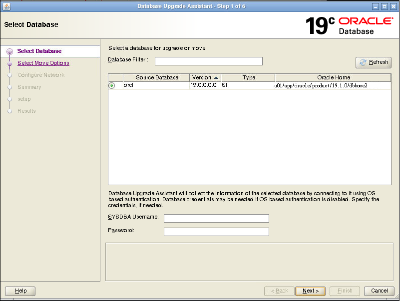
    [Description of the illustration dbua_11.png](img_text/dbua_11.md)
    Select a database that you want to move to the new Oracle home. If you have not enabled operating system authentication for the database, then provide the SYSDBA user name and password for the database that you select.

    Click Next. The Move Database Options window appears.

2.  In the Select Move Options window, you can specify custom SQL scripts that you want to run after moving the database, and identify where the files are located.
    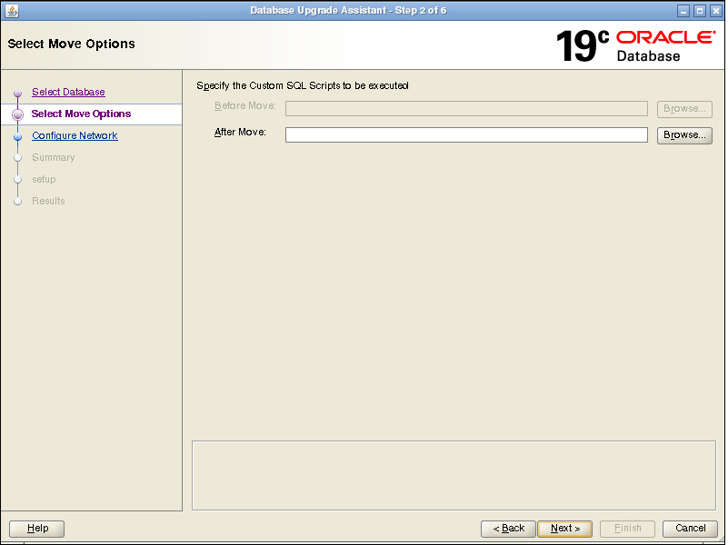
    [Description of the illustration dbua_12.png](img_text/dbua_12.md)
    Click Next. The Configure Network window appears.

3.  On single-instance systems, you can either select an existing listener, or create a new listener. If you create a new listener, then you must provide a listener name, and a port number for the listener.

    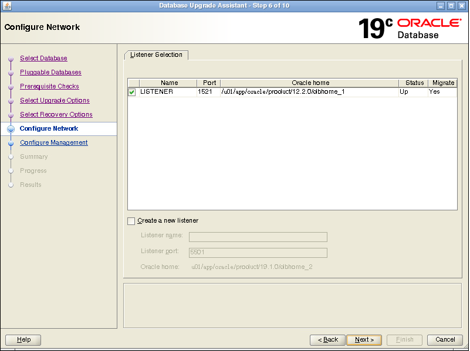
    [Description of the illustration dbua3mvnetwork.png](img_text/dbua3mvnetwork.md)
    Click Next. The Database Move Summary window appears.

4.  Review the summary for the move operation and click Next.

5.  The Setup window appears, which shows DBUA processes as it moves the database.

6.  When the move operation completes, click Finish.

7.  The Results window appears. You can review the source and target database information, and check move steps, or check log files. When you are finished with your review, click Close.

**Parent topic:** Upgrading with Oracle Database Upgrade Assistant (DBUA)

### Using DBUA to Upgrade the Database on Linux, Unix, and Windows Systems

To upgrade a database using the DBUA graphical user interface, perform these steps from within the new Oracle home.

**Note:**

Oracle recommends using AutoUpgrade for database upgrades.

To improve the reliability and support for Oracle Database upgrades, Oracle is deprecating Database Upgrade Assistant (DBUA), and manual upgrades using the Parallel Upgrade Utility (`catctl.pl`) , and the database upgrade scripts `dbupgrade` and `dbupgrade.cmd` in Oracle Database 19c. Use AutoUpgrade for Oracle Database upgrades. These obsolete upgrade methods can be removed in a future release update. Deprecating obsolete upgrade methods enables Oracle to focus on improving and extending the features and manageability of the AutoUpgrade utility.

On Microsoft Windows systems (Windows), run DBUA either as an Oracle Database administrative user (a user with the operating system-assigned `ORA_DBA` role), or as the Oracle installation owner account.

1.  Start Oracle Database Upgrade Assistant (DBUA) from the Oracle home where the new database software is installed. The `dbua` executable is located in the directory path `ORACLE_HOME``/bin`.

    - On Linux or Unix platforms, log in as a user with SYSDBA privileges, and enter the following command at a system prompt in the new home for Oracle Database 19c:

          ./dbua

    - On Windows operating systems, select Start, then Programs, then Oracle HOME_NAME, then Configuration and Migration Tools, and then Database Upgrade Assistant.

2.  The Select Database window displays. If you have earlier release Oracle Database installations, then these installations are listed as available to upgrade.

    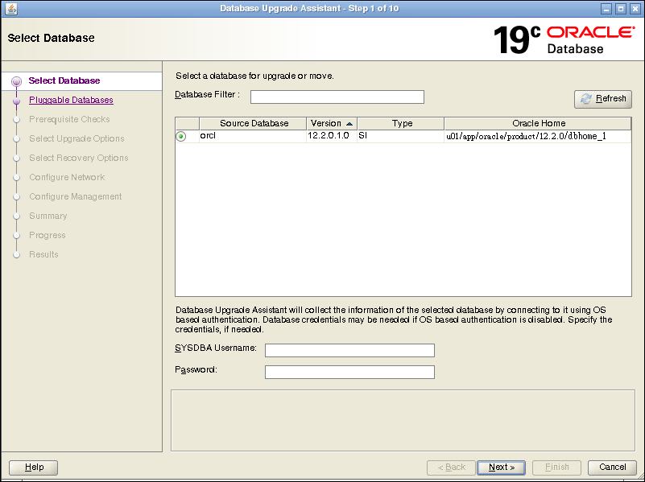
    [Description of the illustration dbua_1.png](img_text/dbua_1.md)
    If you need help on any DBUA window, or if you want to consult more documentation about DBUA, then click Help to open the online help.

    If needed, enter the SYSDBA user name and password for the database that you select.

    If you run DBUA from a user account that does not have `SYSDBA` privileges, or if the source database does not have operating system authentication, then you must enter the user name and password credentials to enable `SYSDBA` privileges for the selected database. If the user account you use has SYSDBA privileges, or you used operating system authentication, then you do not need to enter the user name and password.

    Click Next after making your selection.

    **Note:**

    - You can select only one database at a time.

    - With single-instance upgrades, if the database does not appear in the list, then check to see if an entry with the database name exists in `/etc/oratab`. If the database is not listed there, then direct DBUA to upgrade particular databases:

      - If your single-instance database is not listed in `/etc/oratab`, and DBUA can connect to the database, then you can direct DBUA to upgrade that database explicitly by starting DBUA using the command-line arguments `-sid ``Oracle_SID`, `-oracleHome ``Oracle_home``, and ``sysDBAPassword ``password` as a command-line argument. For example:

            dbua -sid Oracle_SID –oracleHome /u01/app/oracle/18.1.0/dbhome1 -sysDBAUserName SYS -sysDBAPassword password

    - If your account does not have SYSDBA privileges, or you do not have operating system authentication set up, then you can use the following syntax to connect, where `mydb` is your Oracle Database SID, `username` is a user name with SYSDBA privileges, and `password` is that user name’s password:
          dbua -sid mydb –oracleHome /u01/app/oracle/18.1.0/dbhome1 -sysDBAUserName - username -sysDBAPassword - password

    - Oracle Real Application Clusters (Oracle RAC) upgrades: If the database does not appear on the list, then enter the following `crsctl` command to check for Oracle RAC instances:

      `crsctl status resource -t`

      You can also enter the following command to check for a particular Oracle RAC database, where `db_name` is the Oracle RAC database name:

      `crsctl status resource ora.``db_name``.db`

    - On Microsoft Windows, the following security changes affect authentication and user accounts:

      - For security reasons, Windows NTS authentication using the NTLM protocol is no longer supported. Kerberos authentication is the only supported authentication. In this release, NTS does not work either in Windows NT domains, or in domains with Windows NT controllers.

      - Oracle uses standard Microsoft Windows user accounts instead of the Windows `LocalSystem` account to run Oracle database services. Reducing the account access privileges for the Oracle installation owner provides better security on Microsoft Windows.

3.  If the selected database is a multitenant container database (CDB), then DBUA displays the Pluggable Databases window. The Pluggable Databases window lists the pluggable databases contained in the CDB. The listed PDBs are upgraded as part of the upgrade for the selected CDB.

    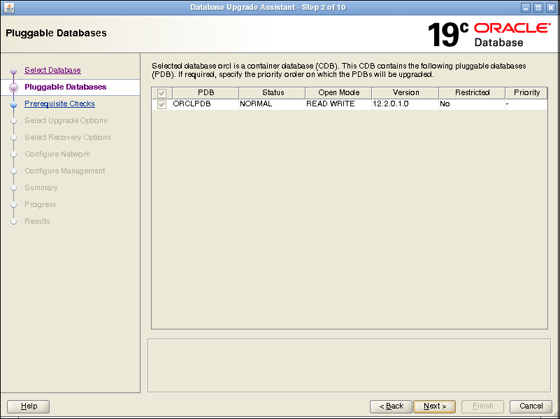
    [Description of the illustration dbua_2.png](img_text/dbua_2.md)
    You can select the upgrade priority for PDBs. Click in the priority column for each PDB, and enter a numeric value for upgrade priority, where 1 is upgraded first, 2 is upgraded second, and so on.

    By default, `CDB$ROOT`, `PDB$SEED`, and all PDBs that are plugged into the CDB are upgraded. If you do not want some PDBs to be upgraded now, then unplug those PDBs.

    When you have completed selecting PDBs and upgrade priorities, click Next.

4.  Windows platforms only: If the upgrade target home is a secure home that is associated with an Oracle home user, then the Specify Oracle Home User Password window opens. For other platforms, proceed to the next step.

    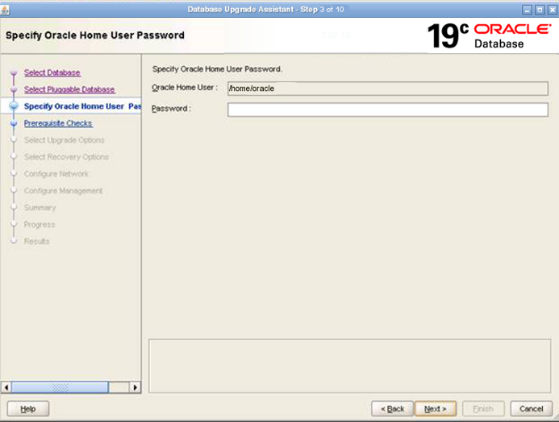
    [Description of the illustration dbua3a-win.png](img_text/dbua3a-win.md)
    Provide the Oracle home user name, and provide the password for this user account, and click Next.

5.  The Prerequisite Checks window opens. DBUA analyzes the databases, performing preupgrade checks and displaying warnings as necessary. The following is a list of examples of DBUA checks, and of actions that DBUA performs on the database:

    - Empty database recycle bin.

    - Identify invalid objects.

    - Identify deprecated and desupported initialization parameters.

    - Identify time zone data file version.

    The analysis takes several minutes to complete.

    When DBUA finishes its analysis, the Prerequisite Checks window displays again, showing the results of the checks.

    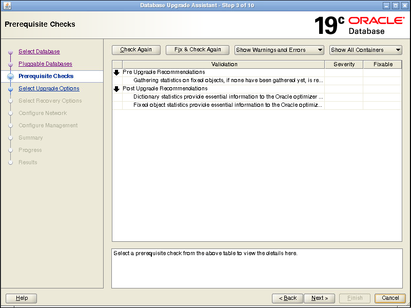
    [Description of the illustration dbua_3.png](img_text/dbua_3.md)
    The Prerequisite Checks window shows the checks that DBUA has completed, and the severity of any errors discovered. When DBUA finds errors, it indicates which errors are fixable, and what action you can take to correct the error.

    Select Fix & Check Again if any errors that DBUA can fix appear.

    If DBUA detects errors that it cannot correct, then fix the cause of the error manually, and select Check Again.

    If DBUA finds no errors or warnings, then the DBUA automatically bypasses this window and proceeds to the next window.

    When you have fixed detected errors, click Next.

6.  The Select Upgrade Options window displays.

    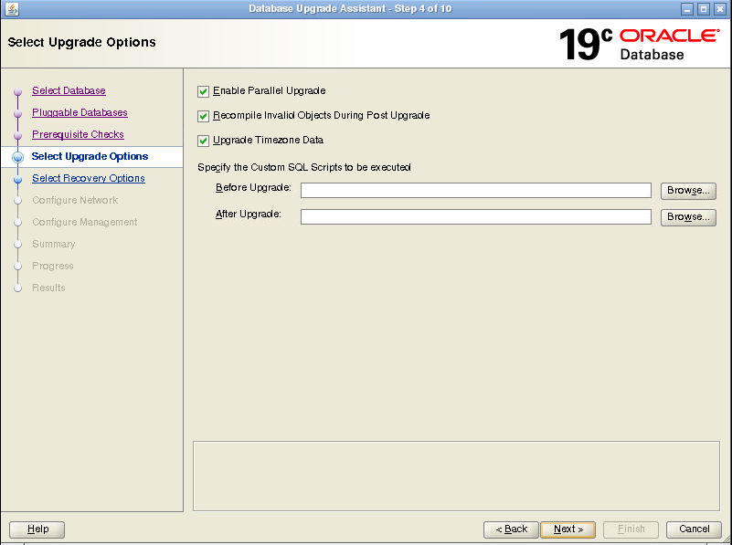
    [Description of the illustration dbua_4.png](img_text/dbua_4.md)
    This window provides the following options:

    Enable Parallel Upgrade

    Select this option if you want to enable parallelism during the upgrade process. Running upgrade processes in parallel reduces the time required to perform the upgrade, based on the number of CPUs available to handle the running of scripts and processes simultaneously.

    Recompile Invalid Objects During Post Upgrade

    This option recompiles all invalid PL/SQL modules after the upgrade is complete. If you do not have DBUA recompile invalid objects in its post-upgrade phase, then you must manually recompile invalid objects after the database is upgraded.

    Upgrade Time Zone Data

    This option updates the time zone data file for this release. If you do not select this option, then you must update the time zone configuration file manually after the upgrade.

    Specify custom SQL scripts to be executed.

    If you want to run custom SQL scripts as part of your upgrade, then select this option. As needed, click Browse for the Before Upgrade or After Upgrade input fields. Navigate to the location where your custom SQL scripts are located.

    When you have made your selections, click Next.

7.  The Select Recovery Options window appears. To recover the database if a failure occurs during upgrade, select from one of the following options:

    - Use Flashback and Guaranteed Restore Point.

      You can create a new Guaranteed Restore Point, or use an existing one. If you use an existing restore point, then click the selection field to select the restore point that you want to use.

      **Note:**

      If the database that you are upgrading has Oracle Data Guard physical standbys, then you must first create a guaranteed restore point on each standby before you create one on the primary database. If you do not create restore points on each standby first, then you must recreate all standby databases again after using the guaranteed restore point to downgrade the primary database. After the upgrade is successful, you must manually drop all guaranteed restore points on the standbys.

    - Use RMAN Backup

      Select among the following RMAN backup options:

      - Create a new Offline RMAN backup. If you select this option, then provide a path where you want to place the backup.
      - Create a New Partial Offline RMAN Backup with User Tablespace. If you select this option, then user tablespaces are placed into read-only mode during the upgrade.
      - Use the Latest Available Full RMAN Backup. If you select this option, then click View/Edit Restore Script to select the backup that you want to use.

    - I have my own backup and restore strategy.

      Select this option only if you have a third-party backup solution in place for your existing database.

    When you have made your selections, click Next.

8.  For single-instance database installations, the Configure Network window opens. Select one or more listeners from the source Oracle home that you want to migrate to the new upgraded Oracle home, or create a new listener during installation.

    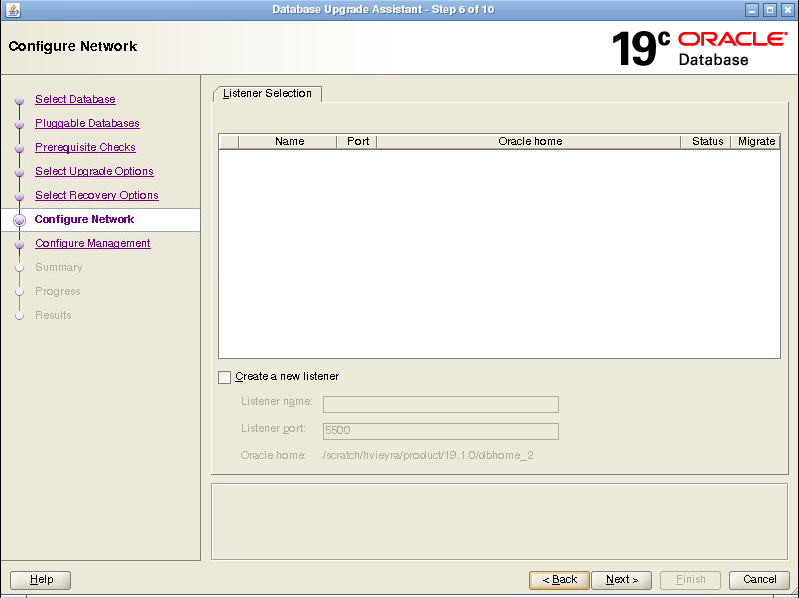
    [Description of the illustration dbua_6.png](img_text/dbua_6.md)
    The Listener Selection area of the Network Configuration window shows a table with the following columns:

    - Select column. Select the listeners that you want to update.

    - Name This column shows listener names.

    - Port This column shows the ports on which listeners are configured.

    - Oracle Home This column shows the Oracle home where listeners are configured.

    - Status This column shows the listener status (up or down).

    - Migrate Select this column, and choose Yes to migrate, or No if you do not want to migrate.

    You can also select to create a new listener. If you create a new listener, then provide the listener name, the Oracle home where you want it placed, and the port that you want to configure the listener to monitor.

    After you make your choices, DBUA completes the following steps for any listeners that you migrate:

    1.  DBUA adds the selected listener to the `listener.ora` file of the target Oracle home, and starts it.

    2.  DBUA removes the entry of the upgraded database from the old (source) `listener.ora` file.

    3.  DBUA reloads the `listener.ora` file in both the source and target Oracle Database environments.

    **Note:**

    If there are other databases registered with the same listener, then their new client connection requests can be affected during listener migration.

    Click Next when you have completed your choices.

9.  The Configure Management window appears. In the Configure Management window, select the management options:

    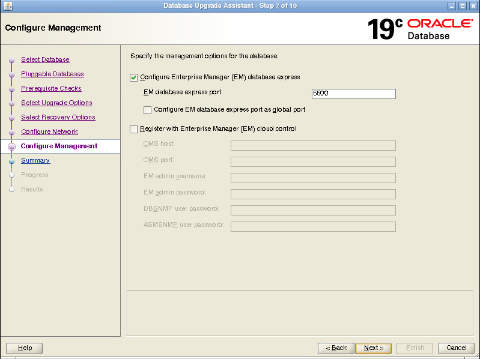
    [Description of the illustration dbua_7.png](img_text/dbua_7.md)
    - Configure Enterprise Manager (EM) database express

      Oracle Enterprise Manager Database Express is a web-based database management application that is built into Oracle Database. EM Express replaces the DB Control component that was available in earlier releases. If you select to configure Enterprise Manager Database Express, then Enter the EM Database Express Port number. For example: 5500. You can also select the check box to configure the express port as the global port.

    - Register with Enterprise Manager (EM) Cloud Control

      Registering with Oracle Enterprise Manager Cloud Control adds the database and its related entities, such as Listener, Oracle ASM disk groups, and Oracle Clusterware, as targets that you can manage with EM Cloud Control.

      If you select this option, then you must provide information in the following fields:

      - OMS Host

      - OMS Port

      - EM Admin Username

      - EM Admin Password

      - DBSNMP User Password

      - ASMSNMP User Password

    When you have completed entering information, click Next.

10. The Summary window opens. The Summary window shows the information that you have provided for the upgrade. Scroll down the list to review the information. The summary includes information such as the following:

    - Source Database

    - Target Database

    - Pluggable Databases

    - Pre-Upgrade Checks

    - Initialization Parameters changes

    - Timezone Upgrade

    Check your selections. Then, either select a link to the item that you want to change, or click Back to go to earlier pages, or select Finish:

    - If you see information in the Summary window that you want to correct, then click a link on an item that you want to update, or click Back to navigate backward through the DBUA configuration interview.

    - Click Finish if the information that you see in the Summary window is correct. The upgrade begins after you select Finish.

    The Progress window displays with the progress bar, as DBUA begins the upgrade. The Progress window displays a table that shows the steps DBUA is completing during the upgrade. This table shows the time duration, and the upgrade steps status as the upgrade proceeds. DBUA provides a Stop button in case you must cancel the upgrade at this point.

    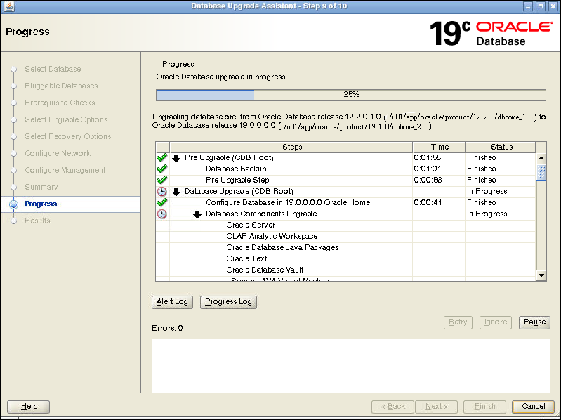
    [Description of the illustration dbua_9.png](img_text/dbua_9.md)
    When the upgrade has progressed through finishing the upgrade of the CDB root and each PDB seed, the Progress window marks the status as Finished.

11. After the upgrade is complete, the Results window opens. The Results window displays information about the original database, and about the upgraded database. The Upgrade Results report also shows changes that DBUA made to the initialization parameters. If you are upgrading a multitenant architecture database, then the Results window also shows pluggable databases, and the directory where log files are stored after the upgrade. Scroll down to see more details about preupgrade checks. If the upgrade is successful, then the Upgrade Results field reports the results, and you do not see warning messages. If the upgrade was unsuccessful, then the Restore Database button is displayed on the lower right corner below the display field. You can click this button to start a database restoration.

    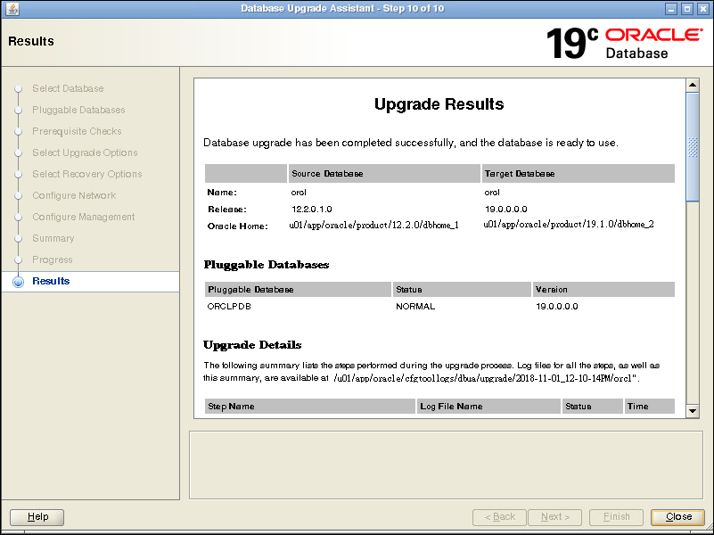
    [Description of the illustration dbua_10.png](img_text/dbua_10.md)

12. Optional: Examine the log files to obtain more details about the upgrade process. If the Oracle base environment variable is set, then the DBUA log files are located in the path `/``ORACLE_BASE``/cfgtoollogs/dbua/upgradesession_``timestamp``/``SID`. If Oracle base is not set, then the DBUA log files are located in the path `/``ORACLE_HOME``/cfgtoollogs/dbua/upgradesession_``timestamp``/``SID`

    **Note:**

    An HTML version of the Upgrade Results window is also saved in the log files directory. You can click the links in this HTML window to view the log windows in your browser.

    If you are satisfied with the upgrade results, then click Close to quit DBUA.

13. After your upgrade is completed, carry out post-upgrade procedures described in this book. When you have completed post-upgrade procedures, your upgraded database is ready to use.

**Caution:**

To prevent unauthorized use of the database, Oracle recommends that you change all user passwords immediately after you upgrade your database.

If the default security settings for Oracle Database 12c and later releases are in place, then passwords must be at least eight characters. Passwords such as `welcome` and `oracle` are not allowed.

**Parent topic:** Upgrading with Oracle Database Upgrade Assistant (DBUA)

### Using DBUA in Silent Mode to Upgrade Oracle Database

You can DBUA with the `-silent` command line option to carry out noninteractive (“silent”) upgrades using DBUA.

. In silent mode, DBUA does not present a user interface. DBUA writes messages (including information, errors, and warnings) to a log file in `ORACLE_HOME``/cfgtools/dbua/upgrade``session_timestamp`, where `session_timestamp` represents the timestamp for the upgrade that DBUA has run. Oracle strongly recommends that you read the resulting DBUA log files to ensure a successful upgrade.

**Note:**

Oracle recommends using AutoUpgrade for database upgrades.

To improve the reliability and support for Oracle Database upgrades, Oracle is deprecating Database Upgrade Assistant (DBUA), and manual upgrades using the Parallel Upgrade Utility (`catctl.pl`) , and the database upgrade scripts `dbupgrade` and `dbupgrade.cmd` in Oracle Database 19c. Use AutoUpgrade for Oracle Database upgrades. These obsolete upgrade methods can be removed in a future release update. Deprecating obsolete upgrade methods enables Oracle to focus on improving and extending the features and manageability of the AutoUpgrade utility.

- Running DBUA in Silent Mode
  Use this procedure to start DBUA in noninteractive (or “silent”) mode.
- DBUA Command-Line Syntax for Active and Silent Mode
  Use this syntax to run Database Upgrade Assistant (DBUA) either interactively, or by using the `-silent` option.

**Parent topic:** Upgrading with Oracle Database Upgrade Assistant (DBUA)

#### Running DBUA in Silent Mode

Use this procedure to start DBUA in noninteractive (or “silent”) mode.

1.  To start DBUA in silent mode, enter the `dbua -silent -sid` command. The command starts DBUA in silent mode, and identifies the database that you want to upgrade.

    For example, enter the following command, where the database name is ORCL:

        dbua -silent -sid ORCL &

**Parent topic:** Using DBUA in Silent Mode to Upgrade Oracle Database

#### DBUA Command-Line Syntax for Active and Silent Mode

Use this syntax to run Database Upgrade Assistant (DBUA) either interactively, or by using the `-silent` option.

##### Purpose

When you run DBUA by using the command-line option, you can specify all valid DBUA options in a script form. The script form enables you to avoid entering configuration information in a graphic user interface dialog.

##### File Path

`$ORACLE_HOME``/directory_name`

##### Syntax

Usage: dbua \[flag\] \[option\]

##### Flags

`-createPartialBackup`  Flag to create a new offline partial RMAN backup by setting the user tablespaces in Read-Only mode.
        `-backupLocation`  Flag to identify the path for the RMAN backup.
        `-disableParallelUpgrade`  Flag to disable the parallel execution of database upgrade.
        `-executePreReqs`  Flag to run the preupgrade checks alone for the specified database.
                `-sid | -dbName`
                `-sid`
                `-dbName`
        `-help `- Shows this usage help.
        `-ignorePreReqs` Ignore error conditions in preupgrade checks.
        `-silent` Runs configuration in silent mode.
                `-sid | -dbName`
                `-sid`
                `-dbName`
        `-skipListenersMigration` Flag to bypass the listener migration process as part of the database upgrade.

##### Options

The DBUA command line options are as follows:

`[-asmsnmpPassword - ``ASMSNMP user password`\]
        `[-backupLocation - ``Directory-where-you-want-to-back-up-your-database-before-starting-upgrade`
       ` [-createGRP - [True | false] `Create a guaranteed restore point when database is in archive log and flashback mode.
        `[-createListener - [true [listenrName:lsnrPort] | false]]` Create a listener in later release Oracle home. If true, then add: `listenerName``:``lsnrPort`
        `[-dbName - ``database-name``]`
                `[-oracleHome - ``Oracle-home-path-of-database``]`
                `[-sysDBAUserName - ``User-name-with-SYSDBA-privileges``]`
                        `[-sysDBAPassword - ``Password-for-sysDBAUserName-user-name``]`
       ` [-dbsnmpPassword - ``DBSNMP-user-password``]`
        `[-disableUpgradeScriptLogging - [true | false]] `This command disables the detailed log generation for running SQL scripts during the upgrade process. By default this is enabled. To enable the log generation, don't specify this command.
        `[-emConfiguration - [DBEXPRESS | CENTRAL | BOTH | NONE]` Specifies Enterprise Manager information.
                `[-dbsnmpPassword - ``DBSNMP-user password``]`
                `[-emPassword - ``Enterprise-Manager-administration-user-password``]`
                `[-emUser - ``Enterprise-Manager-Administration-username-to-add-or-modify-targets``]`
                `[-emExpressPort - ``port-for-EM-Express``]`
                `[-omsHost - ``Enterprise-Manager-management-server-host-name``]`
               ` [-omsPort - ``Enterprise-Manager-management-server-port-number``]`
                `[-asmsnmpPassword - ``ASMSNMP-user-password``]`
        `[-ignoreScriptErrors - [true | false]] `Specify this flag for ignoring ORA errors during custom scripts.
        `[-initParam - ``name=value,name=value,...``] `Specify a comma separated list of initialization parameter values of the
                       format name=value,name=value
                `[-initParamsEscapeChar - [``escape character``] `Escape character for comma when a specific initParam has multiple values. If the escape character is not specified, then backslash (`\`) is the default escape
        `[-excludeInitParams - ``comma-delimited-list-of-initialization-parameters-to-exclude``]`
        `[-keepDeprecatedParams - [true | false]]` Retain (or not) deprecated parameters during database upgrade.
        `[-localListenerWithoutAlias]` Sets LOCAL_LISTENER without TNS Alias.
        `[-listeners ``listenerName:Oracle Home, listenerName:Oracle Home, …``]` Registers the database with existing listeners. Specify listeners by comma-delimited list in the form listenerName:Oracle Home. Listeners from earlier release Oracle homes are migrated to newer release,lsnrName2 or -listeners lsnrName1:Oracle home path,-listeners lsnrName2:Oracle home path. DBUA searches specified listeners from the Grid Infrastructure home (if configured), the target home, and source home.
        `[-localRacSid - ``local-System-Identifier-of-cluster-database``]` Use if if the cluster database is not registered in the Oracle Cluster Registry (OCR).
        `[-logDir - ``Path-to-a-custom-log-directory``]`
       ` [-newGlobalDbName - ``New Global Database Name``] `This option can only be used for Oracle Express Edition upgrades
        `[-newSid - ``New System Identifier``]` This option can only be used for Oracle Express Edition upgrades
        `[-newInitParam - ``name=value,name=value,...``] `Specify a comma-delimited list of initialization parameter values of the format `name=value,name=value`. Use this option to specify parameters that are allowed only on the target Oracle home.
                `[-initParamsEscapeChar - ``escape character``]` Specify an escape character for comma when a specific initParam has multiple values. If the escape character is not specified, then backslash (\\ is the default escape.
        `[-oracleHomeUserPassword - ``Oracle-Home-user-password``]`
        `[-pdbs - [All | NONE | ``pdb``, ``pdb``,…]]` Specify `ALL` to select all PDBs, `NONE` to select no PDBs, or provide a comma-delimited list with
                       the names of the pluggable databases (PDBs) that you want upgraded.
                `-sid | -``dbName`
                `-sid - ``System Identifier`
                        `[-oracleHome - ``Oracle home path of the database``]`
                        `[-sysDBAUserName - ``User-name-with-SYSDBA-privileges``]`
                                `[-sysDBAPassword - ``Password-for-sysDBAUserName-user-name``]`
                `-dbName - ``Database-Name`
                        `[-oracleHome - ``Oracle-home-path-of-database``]`
                        `[-sysDBAUserName - ``User-name-with-SYSDBA-privileges``]`
                                `[-sysDBAPassword - ``Password-for-sysDBAUserName-user-name``]`
        `[-pdbsWithPriority - ``pdb:priority, pdb:priority, pdb:priority,...``]` Specify a comma-delimited list of pluggable databases (PDB) that you want upgraded, including their corresponding priorities (1 the top priority).
                `-sid | -``dbName`
                `-sid - ``system-identifier`
                        `[-oracleHome - ``Oracle-home-path-of-database`
                        `[-sysDBAUserName - ``User-name-with-SYSDBA-privileges``]`
                                `[-sysDBAPassword - ``Password-for-sysDBAUserName-user-name``]`
                `-dbName - ``database-name`
                        `[-oracleHome - ``Oracle-home-path-of-the-database``]`
                        `[-sysDBAUserName - ``User-name-with-SYSDBA-privileges``]`
                                `[-sysDBAPassword - ``Password-for-sysDBAUserName-user-name``]`
        `[-performFixUp - [true | false] `Enable or disable fixups for the silent upgrade mode.
       `[-postUpgradeScripts - ``SQLscript, SQLscript,…``]` Specify a comma-delimited list of SQL scripts with their complete pathnames. After the upgrade completes, these SQL scripts are run.
        `[-preUpgradeScripts - ``SQLscript, SQLscript,…``]`Specify a comma-delimited list of SQL scripts with their complete pathnames. Before the upgrade starts, these SQL scripts are run.
        `[-recompile_invalid_objects - [true | false]]` If true, then recompiles invalid objects as part of the upgrade.
        `[-upgrade_parallelism - ``number``]` Numeric value for the number of CPUs that you want to use for parallel upgrade.
        `[-upgradeTimezone - [true | false]]` If true, then upgrades the timezone files of the database during the upgrade.
        `[-upgradeXML - ``Path-to-existing-preupgrade-XML-file``] `This option only applies to in-place database upgrades.
        `[-useExistingBackup - [true | false]]` Use to enable restoration of the database using existing RMAN backup.
        `[-useGRP - ``Name-of-existing-guaranteed-restore-point``]` Use to enable restoration of the database using a specified guaranteed restore point.

Example C-1 Selecting a Database for Upgrade with DBUA

The following command selects the database `orcl` for upgrade:

    dbua -sid orcl

**Note:**

You can use DBUA commands to set passwords. If the default Oracle Database security settings are in place, then passwords must be at least eight characters, and passwords such as `welcome` and `oracle` are not allowed.

Example C-2 Selecting a Database for Upgrade with DBUA Using Noninteractive ("Silent") Option

The following command selects the database `orcl` for upgrade using the noninteractive ("silent") option:

    dbua -silent -sid orcl

Example C-3 Use Cases for Running DBUA in Noninteractive (”Silent") Mode

The examples that follow illustrate how you can use DBUA with the noninteractive (”silent") option to carry out a variety of upgrade scenarios.

    dbua -silent -sid sidb112 -backupLocation /u01/sidb1123/backup -sysDBAUserName sys -sysDBAPassword r3aDy2upg -oracleHome /u01/app/product/11.2.0/dbhome_1 -upgradeTimezone true dbua -silent -sid sidb1123 -backupLocation /u01/sidb1123/backup -sysDBAUserName sys -sysDBAPassword r3aDy2upg -oracleHome /u01/app/product/11.2.0/dbhome_1 -upgrade_parallelism 1 -upgradeTimezone true

    dbua -silent -sid db1124 -backupLocation /u01/sidb1123/backup -sysDBAUserName sys -sysDBAPassword r3aDy2upg -performFixUp true -upgradeTimezone true

    dbua -silent -dbName rdbcdb -oracleHome /u01/app/product/11.2.0/dbhome_1 -sysDBAUserName sys -sysDBAPassword r3aDy2upg -backupLocation /u01/sidb1123/backup -recompile_invalid_objects true -upgradeTimezone true

    dbua -silent -dbName amdb -oracleHome /u01/app/product/11.2.0/dbhome_1 -sysDBAUserName sys -sysDBAPassword r3aDy2upg -recompile_invalid_objects true -useGRP GRP_20170620bfupgrade -upgradeTimezone true

    dbua -silent -dbName rdb12 -oracleHome /u01/app/product/12.2.0/dbhome_2 -sysDBAUserName sys -sysDBAPassword r3aDy2upg -backupLocation /u01/sidb12/backup -recompile_invalid_objects true -upgradeTimezone true

    dbua -silent -dbName ronedb -oracleHome /u01/app/product/12.2.0/dbhome_2 -sysDBAUserName sys -sysDBAPassword r3aDy2upg -recompile_invalid_objects true -upgradeTimezone true -createGRP true

**Note:**

Refer to Oracle Database Security Guide for information about security best practices.

**Related Topics**

- [Oracle Database Security Guide](../dbseg/keeping-your-oracle-database-secure.md)

**Parent topic:** Using DBUA in Silent Mode to Upgrade Oracle Database
