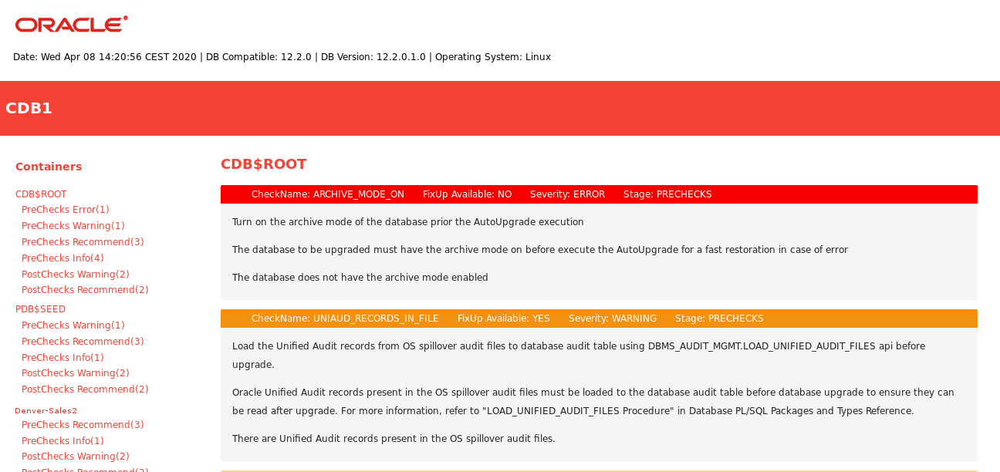

## Performing Preupgrade Checks Using AutoUpgrade

The AutoUpgrade Utility is a Java JAR file provided by Oracle that helps to ensure that your upgrade completes successfully.

- About AutoUpgrade Utility System Checks
  To help ensure that your upgrade is successful, Oracle strongly recommends that you check your system using the AutoUpgrade Utility in Analyze mode.
- Example of Running AutoUpgrade Prechecks Using Analyze Mode
  To see how you can use AutoUpgrade to check a non-CDB Oracle Database before an upgrade, use this example to understand the procedure.
- Checking the Upgrade Checks Overview File
  Learn how to use the AutoUpgrade Upgrade Checks Overview file to prepare for your upgrade.
- Creating a Configuration File to Run AutoUpgrade Prechecks On a CDB
  See how you can control how AutoUpgrade performs upgrade prechecks to include or exclude PDBs on a multitenant architecture Oracle Database.
- Running AutoUpgrade Fixups on the Earlier Release Oracle Database
  Use this example to see how to run the AutoUpgrade Fixups that the Analyze mode generates for your system.

**Parent topic:** [Preparing to Upgrade Oracle Database](tasks-prepare-upgrade-oracle-database.md)

### About AutoUpgrade Utility System Checks

To help ensure that your upgrade is successful, Oracle strongly recommends that you check your system using the AutoUpgrade Utility in Analyze mode.

To use the AutoUpgrade Utility for your upgrade, you must first run AutoUpgrade in Analyze Mode.

**Note:**

The AutoUpgrade Utility requires Java 8. To ensure that the correct Java version is available, Oracle recommends that you run AutoUpgrade using the Java version in the target Oracle Database Oracle home. The path to the Java version in the Oracle home is `Oracle-home``/jdk/bin/java`, where `Oracle-home` is the target Oracle Database Oracle home. To check the Oracle home has Java 8, you can run the following command:

    $ORACLE_HOME/jdk/bin/java -version
    java version "1.8.0_211"
    Java(TM) SE Runtime Environment (build 1.8.0_211-b12)
    Java HotSpot(TM) 64-Bit Server VM (build 25.211-b12, mixed mode)

#### AutoUpgrade and the Analyze Mode

The AutoUpgrade Utility includes extensive system checks that can help to prevent many issues that can arise during an upgrade. The utility is located in the new Oracle Database binary home. However, to obtain the latest updates, Oracle strongly recommends that you download the most recent version of the tool from My Oracle Support Document 2485457.1. You can place the downloaded file in any directory. To run Analyze to check readiness of the database for upgrade to the new release while your database is running on your earlier release you must specify the target version manually in your configuration file, using the `target_version` parameter. For example: `upg1.target_version=19`.

When you run AutoUpgrade in Analyze mode, AutoUpgrade only reads data from the database, and does not perform any updates to the database. You can run AutoUpgrade using the Analyze mode during normal business hours. You can run AutoUpgrade in Analyze mode on your source Oracle Database home before you have set up your target release Oracle Database home.

**Related Topics**

- [My Oracle Support Note 2485457.1](https://support.oracle.com/rs?type=doc&id=2485457.1)

**Parent topic:** Performing Preupgrade Checks Using AutoUpgrade

### Example of Running AutoUpgrade Prechecks Using Analyze Mode

To see how you can use AutoUpgrade to check a non-CDB Oracle Database before an upgrade, use this example to understand the procedure.

To use AutoUpgrade, you must have Java 8 installed. Oracle Database Release 12.1 (12.1.0.2) or newer Oracle homes have a valid java version by default. Start AutoUpgrade in Analyze mode using the following syntax, where `Oracle_home` is the Oracle home directory, or the environment variable set for the Oracle home, and `yourconfig.txt` is your configuration file:

    java -jar autoupgrade.jar -config yourconfig.txt -mode analyze

While AutoUpgrade is running, if you want to obtain an overview of the progress, you can enter the command `lsj` on Linux and Unix systems. When all checks are completed the tool will write the and write the Preupgrade Fixup HTML File, which provides a report on system readiness, display the status of jobs run to the screen, and exit. If all jobs are listed as "finished successfully," then it means that you can go ahead and upgrade the database. However, to see if there are recommendations that you want to follow before starting the upgrade, Oracle still recommends that you look at the Preupgrade Fixup HTML File. If any job is listed as "failed," then it means that there is an error that prevents the upgrade from starting.

Example 2-4 Using AutoUpgrade in Analyze Mode to Check an Oracle Database 12c Non-CDB System

This example shows running AutoUpgrade using a configuration file for upgrading from a Non-CDB Oracle Database 12c Release 2 (12.2) system to a new Oracle Database release, with AutoUpgrade downloaded to the folder `/tmp`:

    java -jar /tmp/autoupgrade.jar -config 122-to-new.txt -mode analyze

The configuration file called for this check (`122-to.new.txt`) is as follows:

    #12.2-to-19c config file
    #
    global.autoupg_log_dir=/home/oracle/autoupgrade
    upg1.source_home=/u01/app.oracle/product/12.2.0.1
    upg1.target_home=/u01/app/oracle/product/19
    upg1.sid=dbsales
    upg1.start_time=now
    upg1.log_dir=/home/oracle/autoupgrade/dbsales
    upg1.upgrade_node=localhost

Note that the `pdbs` parameter is not specified. You only need to specify the `pdbs` parameter when you want to indicate specific PDBs that you want to check, and exclude other PDBs on the CDB. The value you specify for `log_dir` is the location where AutoUpgrade places the Preupgrade Fixup HTML File. The file is written using the following format, where `log-path` is the path you specify for log files, `sid` is the Oracle Database system identifier, and `job-number` is the AutoUpgrade job number:

    /log-path/sid/job-number/prechecks

When you run AutoUpgrade, the output appears as follows:

    AutoUpgrade tool launched with default options
    +--------------------------------+
    | Starting AutoUpgrade execution |
    +--------------------------------+
    1 databases will be analyzed
    Type 'help' to list console commands
    upg>
    .
    .
    .
    Job 100 completed
    ------------------- Final Summary -------------------
    Number of databases            [1]

    Jobs finished successfuly      [1]
    Jobs failed                    [0]
    Jobs pending                   [0]
    ------------- JOBS FINISHED SUCCESSFULLY -------------
    Job 100 FOR DB12

In this case, the configuration file specifies that you want the log file placed in the path `/home/oracle/autoupgrade`. Because the Oracle Database system identifier (SID) is `CDB1`, and the AutoUpgrade Job is `100`, the Upgrade Checks Overview file for this job is placed in the path `/home/oracle/autoupgrade/dbsales/100/prechecks`.

Review the Upgrade Checks Overview file, and correct any errors that are reported before proceeding with the upgrade. You can run AutoUpgrade in Fixup mode to correct many errors.

With CDBs, you can use the same procedure and the same configuration file.

**Note:**

When you run AutoUpgrade in Analyze or Fixup mode on a CDB, AutoUpgrade opens all PDBs in the CDB to complete the action. If a PDB is closed, then AutoUpgrade opens the PDB, and leaves it in an OPEN state after the analysis or fixup is completed. If you want to leave PDBs closed, and not perform checks or fixups, then you can specify that only particular PDBs are checked or fixed by using the configuration file parameter `pdb` to list the PDBs that you want AutoUpgrade to check.

**Parent topic:** Performing Preupgrade Checks Using AutoUpgrade

### Checking the Upgrade Checks Overview File

Learn how to use the AutoUpgrade Upgrade Checks Overview file to prepare for your upgrade.

When the AutoUpgrade Analyze mode is complete, it places files in the directory that you specify with the configuration file `log_dir` parameter. The file is written using the following format, where `log-path` is the path you specify for log files, `sid` is the Oracle Database system identifier (SID), and `job-number` is the AutoUpgrade job number:

    /log-path/sid/job-number/prechecks

For example, with the log directory specified as /home/oracle/autoupgrade/DB12, with the database SID `DB12`, and with the job number 100:

    /home/oracle/autoupgrade/DB12/DB12/100/prechecks

Review the Upgrade Checks Overview file, and correct any errors that are reported before proceeding with the upgrade. You can also run AutoUpgrade in Fixup mode to correct many errors.

Figure 2-1 Example of the Upgrade Checks Overview File

[Description of "Figure 2-1 Example of the Upgrade Checks Overview File"](img_text/preupgrade-analyze-result-file.md)

In the topic area of the file the results file example shows two report messages for `CDB$ROOT`, which show the name of the check, whether or not a fixup is available that can be run using AutoUpgrade in Fixup mode, the severity of the issue, and the stage of AutoUpgrade that is being run.

**Parent topic:** Performing Preupgrade Checks Using AutoUpgrade

### Creating a Configuration File to Run AutoUpgrade Prechecks On a CDB

See how you can control how AutoUpgrade performs upgrade prechecks to include or exclude PDBs on a multitenant architecture Oracle Database.

To check Oracle Database servers configured with multitenant container databases (CDBs) and pluggable databases (PDBs), you can use the same procedure and configuration file that you use with a non-CDB Oracle Database. As AutoUpgrade runs checks during an Analyze or Fixup mode run, all of the PDBs in the CDB are opened. If you run AutoUpgrade on a CDB, and a PDB is closed, then AutoUpgrade opens the PDB, and AutoUpgrade leaves it open after Analyze checks or Fixup actions.

If you want to manage which PDBs are opened for checks, so that you can keep some PDBs closed, then you can use the configuration file option `pdbs` to provide a list that includes only the PDBs that you want to be checked. When you provide a list of PDBs to check, AutoUpgrade checks `CDB$ROOT`, `PDB$SEED`, and all of the PDBs that you specify in the list. In this example, the PDB named `denver-sales2` is specified.

Example 2-5 AutoUpgrade Configuration File for a CDB and PDBs

The following example specifies that only the PDB named `denver-sales2` is opened and analyzed.

    global.autoupg_log_dir=/home/oracle/autoupgrade
    upg1.source_home=/u01/app/oracle/product/12.2.0
    upg1.target_home=/u01/app/oracle/product/19
    upg1.sid=CDB1
    upg1.start_time=now
    upg1.log_dir=/home/oracle/autoupgrade/CDB1
    upg1.pdbs=denver-sales2

**Parent topic:** Performing Preupgrade Checks Using AutoUpgrade

### Running AutoUpgrade Fixups on the Earlier Release Oracle Database

Use this example to see how to run the AutoUpgrade Fixups that the Analyze mode generates for your system.

When you run AutoUpgrade in Fixup mode, AutoUpgrade performs the checks that it also performs in Analyze mode. After completing these checks, AutoUpgrade then performs all automated fixups that are required for the new release before you start an upgrade. When you plan to move your database to a new release, using the Fixup mode prepares the database for upgrade.

**Caution:**

Oracle recommends that you run AutoUpgrade in Analyze mode separately before running AutoUpgrade in Fixup mode. Fixup mode can make changes to the source database.

As part of upgrade preparation, if the source database requires corrections for conditions that would cause errors during an upgrade, then AutoUpgrade run in Fixup mode performs automated fixes to the source database. Because running AutoUpgrade in Fixup mode is a step that you perform as you are moving to another system, it does not create a guaranteed restore point. Oracle recommends that you run this mode outside of normal business hours.

If Java 8 is in your source Oracle home, then start AutoUpgrade in Fixup mode using the following syntax, where `Oracle_home` is the Oracle home directory, or the environment variable set for the Oracle home, and `yourconfig.txt` is your configuration file:

    $ java -jar autoupgrade.jar -config yourconfig.txt -mode fixup

**Parent topic:** Performing Preupgrade Checks Using AutoUpgrade
