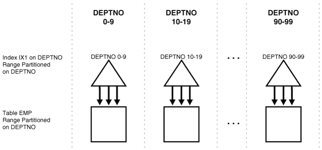
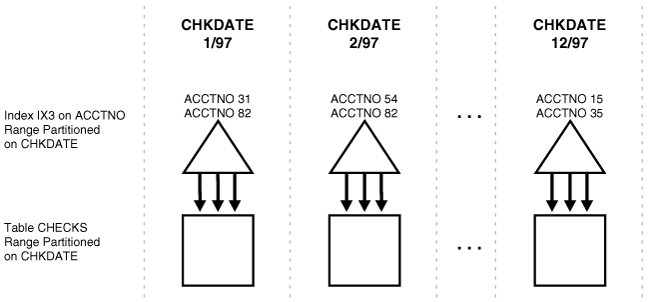
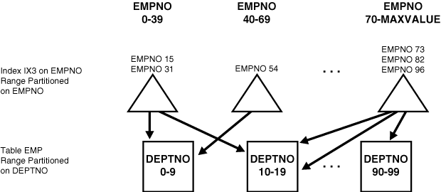

Partitioning indexes has recommendations and considerations in common with partitioning tables.

The rules for partitioning indexes are similar to those for tables:

- An index can be partitioned unless:

  - The index is a cluster index.

  - The index is defined on a clustered table.

- You can mix partitioned and nonpartitioned indexes with partitioned and nonpartitioned tables:

  - A partitioned table can have partitioned or nonpartitioned indexes.

  - A nonpartitioned table can have partitioned or nonpartitioned indexes.

- Bitmap indexes on nonpartitioned tables cannot be partitioned.

- A bitmap index on a partitioned table must be a local index.

However, partitioned indexes are more complicated than partitioned tables because there are three types of partitioned indexes:

- Local prefixed

- Local nonprefixed

- Global prefixed

Oracle Database supports all three types. However, there are some restrictions. For example, a key cannot be an expression when creating a local unique index on a partitioned table.

The following topics are discussed:

- Local Partitioned Indexes

- Global Partitioned Indexes

- Summary of Partitioned Index Types

- The Importance of Nonprefixed Indexes

- Performance Implications of Prefixed and Nonprefixed Indexes

- Advanced Index Compression With Partitioned Indexes

- Guidelines for Partitioning Indexes

- Physical Attributes of Index Partitions

**See Also:**

[Oracle Database Reference](../refrn/about-static-data-dictionary-views.md) for information about the `DBA_INDEXES`, `DBA_IND_PARTITIONS`, `DBA_IND_SUBPARTITIONS`, and `DBA_PART_INDEXES` views.

### 3.3.1 Local Partitioned Indexes

In a local index, all keys in a particular index partition refer only to rows stored in a single underlying table partition.

A local index is created by specifying the `LOCAL` attribute. Oracle constructs the local index so that it is equipartitioned with the underlying table. Oracle partitions the index on the same columns as the underlying table, creates the same number of partitions or subpartitions, and gives them the same partition bounds as corresponding partitions of the underlying table.

Oracle also maintains the index partitioning automatically when partitions in the underlying table are added, dropped, merged, or split, or when hash partitions or subpartitions are added or coalesced. This ensures that the index remains equipartitioned with the table.

A local index can be created `UNIQUE` if the partitioning columns form a subset of the index columns. This restriction guarantees that rows with identical index keys always map into the same partition, where uniqueness violations can be detected.

Local indexes have the following advantages:

- Only one index partition must be rebuilt when a maintenance operation other than `SPLIT` `PARTITION` or `ADD` `PARTITION` is performed on an underlying table partition.

- The duration of a partition maintenance operation remains proportional to partition size if the partitioned table has only local indexes.

- Local indexes support partition independence.

- Local indexes support smooth roll-out of old data and roll-in of new data in historical tables.

- Oracle can take advantage of the fact that a local index is equipartitioned with the underlying table to generate better query access plans.

- Local indexes simplify the task of tablespace incomplete recovery. To recover a partition or subpartition of a table to a point in time, you must also recover the corresponding index entries to the same point in time. The only way to accomplish this is with a local index. Then you can recover the corresponding table and index partitions or subpartitions.

The following topics are discussed:

- Local Prefixed Indexes

- Local Nonprefixed Indexes

**See Also:**

[Oracle Database PL/SQL Packages and Types Reference](../arpls/DBMS_PCLXUTIL.md) for a description of the `DBMS_PCLXUTIL` package

#### 3.3.1.1 Local Prefixed Indexes

A local index is prefixed if it is partitioned on a left prefix of the index columns and the subpartioning key is included in the index key. Local prefixed indexes can be unique or nonunique.

For example, if the `sales` table and its local index `sales_ix` are partitioned on the `week_num` column, then index `sales_ix` is local prefixed if it is defined on the columns (`week_num`, `xaction_num`). On the other hand, if index `sales_ix` is defined on column `product_num` then it is not prefixed.

Figure 3-4 illustrates another example of a local prefixed index.

Figure 3-4 Local Prefixed Index

[Description of "Figure 3-4 Local Prefixed Index"](img_text/vldbg019.md)

#### 3.3.1.2 Local Nonprefixed Indexes

A local index is nonprefixed if it is not partitioned on a left prefix of the index columns or if the index key does not include the subpartitioning key.

You cannot have a unique local nonprefixed index unless the partitioning key is a subset of the index key.

Figure 3-5 illustrates an example of a local nonprefixed index.

Figure 3-5 Local Nonprefixed Index

[Description of "Figure 3-5 Local Nonprefixed Index"](img_text/vldbg018.md)

### 3.3.2 Global Partitioned Indexes

In a global partitioned index, the keys in a particular index partition may refer to rows stored in multiple underlying table partitions or subpartitions.

A global index can be range or hash partitioned, though it can be defined on any type of partitioned table. A global index is created by specifying the `GLOBAL` attribute. The database administrator is responsible for defining the initial partitioning of a global index at creation and for maintaining the partitioning over time. Index partitions can be merged or split as necessary.

Normally, a global index is not equipartitioned with the underlying table. There is nothing to prevent an index from being equipartitioned with the underlying table, but Oracle does not take advantage of the equipartitioning when generating query plans or executing partition maintenance operations. So an index that is equipartitioned with the underlying table should be created as `LOCAL`.

A global partitioned index contains a single B-tree with entries for all rows in all partitions. Each index partition may contain keys that refer to many different partitions or subpartitions in the table.

The highest partition of a global index must have a partition bound that includes all values that are `MAXVALUE`. This insures that all rows in the underlying table can be represented in the index.

The following topics are discussed:

- Prefixed and Nonprefixed Global Partitioned Indexes

- Management of Global Partitioned Indexes

#### 3.3.2.1 Prefixed and Nonprefixed Global Partitioned Indexes

A global partitioned index is prefixed if it is partitioned on a left prefix of the index columns.

A global partitioned index is nonprefixed if it is not partitioned on a left prefix of the index columns. Oracle does not support global nonprefixed partitioned indexes. See Figure 3-6 for an example.

Global prefixed partitioned indexes can be unique or nonunique. Nonpartitioned indexes are treated as global prefixed nonpartitioned indexes.

#### 3.3.2.2 Management of Global Partitioned Indexes

Management of global partitioned indexes presents several challenges.

Global partitioned indexes are harder to manage than local indexes because of the following:

- When the data in an underlying table partition is moved or removed (`SPLIT`, `MOVE`, `DROP`, or `TRUNCATE`), all partitions of a global index are affected. Consequently global indexes do not support partition independence.

- When an underlying table partition or subpartition is recovered to a point in time, all corresponding entries in a global index must be recovered to the same point in time. Because these entries may be scattered across all partitions or subpartitions of the index, mixed with entries for other partitions or subpartitions that are not being recovered, there is no way to accomplish this except by re-creating the entire global index.

Figure 3-6 Global Prefixed Partitioned Index

[Description of "Figure 3-6 Global Prefixed Partitioned Index"](img_text/vldbg020.md)

### 3.3.3 Summary of Partitioned Index Types

A summary of partitioned index types is provided in this topic.

Table 3-1 summarizes the types of partitioned indexes that Oracle supports. The key points are:

- If an index is local, then it is equipartitioned with the underlying table. Otherwise, it is global.

- A prefixed index is partitioned on a left prefix of the index columns. Otherwise, it is nonprefixed.

Table 3-1 Types of Partitioned Indexes

| Type of Index                               | Index Equipartitioned with Table | Index Partitioned on Left Prefix of Index Columns | UNIQUE Attribute Allowed | Example: Table Partitioning Key | Example: Index Columns | Example: Index Partitioning Key |
|:--------------------------------------------|:---------------------------------|:--------------------------------------------------|:-------------------------|:--------------------------------|:-----------------------|:--------------------------------|
| Local Prefixed (any partitioning method)    | Yes                              | Yes                                               | Yes                      | A                               | A, B                   | A                               |
| Local Nonprefixed (any partitioning method) | Yes                              | No                                                | YesFoot 1     | A                               | B, A                   | A                               |
| Global Prefixed (range partitioning only)   | NoFoot 2              | Yes                                               | Yes                      | A                               | B                      | B                               |

Footnote 1

For a unique local nonprefixed index, the partitioning key must be a subset of the index key and cannot be a partial index.

Footnote 2

Although a global partitioned index may be equipartitioned with the underlying table, Oracle does not take advantage of the partitioning or maintain equipartitioning after partition maintenance operations such as DROP or SPLIT PARTITION.

### 3.3.4 The Importance of Nonprefixed Indexes

Nonprefixed indexes are important because they are particularly useful in historical databases.

In a table containing historical data, it is common for an index to be defined on one column to support the requirements of fast access by that column. However, the index can also be partitioned on another column (the same column as the underlying table) to support the time interval for rolling out old data and rolling in new data.

Consider a `sales` table partitioned by week. It contains a year's worth of data, divided into 13 partitions. It is range partitioned on `week_no`, four weeks to a partition. You might create a nonprefixed local index `sales_ix` on `sales`. The `sales_ix` index is defined on `acct_no` because there are queries that need fast access to the data by account number. However, it is partitioned on `week_no` to match the `sales` table. Every four weeks, the oldest partitions of `sales` and `sales_ix` are dropped and new ones are added.

### 3.3.5 Performance Implications of Prefixed and Nonprefixed Indexes

There are performance implications of prefixed and nonprefixed indexes.

With a prefixed index, the likelihood to get partition pruning is much higher than with a non-prefixed index. If a column is part of an index, then you can assume that the column is used as a filter predicate, which automatically means some level of pruning when a filtered column is a prefixed column. This result suggests that it is usually less expensive to probe into a prefixed index than to probe into a nonprefixed index. If an index is prefixed (either local or global) and Oracle is presented with a predicate involving the index columns, then partition pruning can restrict application of the predicate to a subset of the index partitions.

For example, in Figure 3-4, if the predicate is `deptno=15`, the optimizer knows to apply the predicate only to the second partition of the index. (If the predicate involves a bind variable, the optimizer does not know exactly which partition but it may still know there is only one partition involved, in which case at run time, only one index partition is accessed.)

When an index is nonprefixed, Oracle often has to apply a predicate involving the index columns to all `N` index partitions. This is required to look up a single key, or to do an index range scan. For a range scan, Oracle must also combine information from `N` index partitions. For example, in Figure 3-5, a local index is partitioned on `chkdate` with an index key on `acctno`. If the predicate is `acctno=31`, Oracle probes all 12 index partitions.

Of course, if there is also a predicate on the partitioning columns, then multiple index probes might not be necessary. Oracle takes advantage of the fact that a local index is equipartitioned with the underlying table to prune partitions based on the partition key. For example, if the predicate in Figure 3-5 is `chkdate<3/97`, Oracle only has to probe two partitions.

So for a nonprefixed index, if the partition key is a part of the `WHERE` clause but not of the index key, then the optimizer determines which index partitions to probe based on the underlying table partition.

When many queries and DML statements using keys of local, nonprefixed, indexes have to probe all index partitions, this effectively reduces the degree of partition independence provided by such indexes.

Table 3-2 Comparing Prefixed Local, Nonprefixed Local, and Global Indexes

| Index Characteristics | Prefixed Local | Nonprefixed Local | Global                                                                              |
|:----------------------|:---------------|:------------------|:------------------------------------------------------------------------------------|
| Unique possible?      | Yes            | Yes               | Yes. Must be global if using indexes on columns other than the partitioning columns |
| Manageability         | Easy to manage | Easy to manage    | Harder to manage                                                                    |
| OLTP                  | Good           | Bad               | Good                                                                                |
| Long Running (DSS)    | Good           | Good              | Not Good                                                                            |

### 3.3.6 Advanced Index Compression With Partitioned Indexes

Advanced index compression with partitioned indexes can reduce the storage requirements for indexes.

Creating an index using advanced index compression reduces the size of all supported unique and non-unique indexes. Advanced index compression improves the compression ratios significantly while still providing efficient access to the indexes. Advanced compression works well on all supported indexes, including those indexes that are not good candidates for prefix compression.

For a partitioned index, you can specify the compression type on a partition by partition basis. You can also specify advanced index compression on index partitions even when the parent index is not compressed.

The following example shows a mixture of compression attributes on the partition indexes.

    CREATE INDEX my_test_idx ON test(a, b) COMPRESS ADVANCED HIGH LOCAL
       (PARTITION p1 COMPRESS ADVANCED LOW,
        PARTITION p2 COMPRESS,
        PARTITION p3,
        PARTITION p4 NOCOMPRESS);

The following example shows advanced index compression support on partitions where the parent index is not compressed.

    CREATE INDEX my_test_idx ON test(a, b) NOCOMPRESS LOCAL
       (PARTITION p1 COMPRESS ADVANCED LOW,
        PARTITION p2 COMPRESS ADVANCED HIGH,
        PARTITION p3);

**See Also:**

[Oracle Database Administrator’s Guide](../admin/managing-tables.md) for information about advanced index compression

### 3.3.7 Guidelines for Partitioning Indexes

There are several guidelines for partitioning indexes.

When deciding how to partition indexes on a table, consider the mix of applications that must access the table. There is a trade-off between performance and availability and manageability. Here are some guidelines you should consider:

- For OLTP applications:

  - Global indexes and local prefixed indexes provide better performance than local nonprefixed indexes because they minimize the number of index partition probes.

  - Local indexes support more availability when there are partition or subpartition maintenance operations on the table. Local nonprefixed indexes are very useful for historical databases.

- For DSS applications, local nonprefixed indexes can improve performance because many index partitions can be scanned in parallel by range queries on the index key.

  For example, a query using the predicate "`acctno` between 40 and 45" on the table `checks` of Figure 3-5 causes parallel scans of all the partitions of the nonprefixed index `ix3`. On the other hand, a query using the predicate `deptno BETWEEN 40 AND 45` on the table `deptno` of Figure 3-4 cannot be parallelized because it accesses a single partition of the prefixed index `ix1`.

- For historical tables, indexes should be local if possible. This limits the effect of regularly scheduled drop partition operations.

- Unique indexes on columns other than the partitioning columns must be global because unique local nonprefixed indexes whose keys do not contain the partitioning key are not supported.

- Unusable indexes do not consume space.

  **See Also:**

  [Oracle Database Administrator’s Guide](../admin/managing-tables.md) for information about guidelines for managing tables

### 3.3.8 Physical Attributes of Index Partitions

The physical attributes of index partitions are described in this topic.

Default physical attributes are initially specified when a `CREATE` `INDEX` statement creates a partitioned index. Because there is no segment corresponding to the partitioned index itself, these attributes are only used in derivation of physical attributes of member partitions. Default physical attributes can later be modified using `ALTER` `INDEX` `MODIFY` `DEFAULT` `ATTRIBUTES`.

Physical attributes of partitions created by `CREATE` `INDEX` are determined as follows:

- Values of physical attributes specified (explicitly or by default) for the index are used whenever the value of a corresponding partition attribute is not specified. Handling of the `TABLESPACE` attribute of partitions of a `LOCAL` index constitutes an important exception to this rule in that without a user-specified `TABLESPACE` value (at both partition and index levels), the value of the physical attribute of the corresponding partition of the underlying table is used.

- Physical attributes (other than `TABLESPACE`, as explained in the preceding) of partitions of local indexes created during processing `ALTER` `TABLE` `ADD` `PARTITION` are set to the default physical attributes of each index.

Physical attributes (other than `TABLESPACE`) of index partitions created by `ALTER` `TABLE` `SPLIT` `PARTITION` are determined as follows:

- Values of physical attributes of the index partition being split are used.

Physical attributes of an existing index partition can be modified by `ALTER` `INDEX MODIFY` `PARTITION` and `ALTER` `INDEX` `REBUILD` `PARTITION`. Resulting attributes are determined as follows:

- Values of physical attributes of the partition before the statement was issued are used whenever a new value is not specified. The `ALTER` `INDEX` `REBUILD PARTITION` SQL statement can change the tablespace in which a partition resides.

Physical attributes of global index partitions created by `ALTER` `INDEX` `SPLIT PARTITION` are determined as follows:

- Values of physical attributes of the partition being split are used whenever a new value is not specified.

- Physical attributes of all partitions of an index (along with default values) may be modified by `ALTER` `INDEX`, for example, `ALTER` `INDEX` `indexname` `NOLOGGING` changes the logging mode of all partitions of `indexname` to `NOLOGGING`.

**See Also:**

[Partition Administration](partition-admin.md) for more detailed examples of adding partitions and examples of rebuilding indexes
