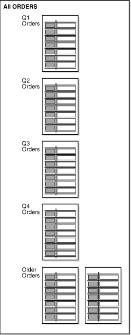
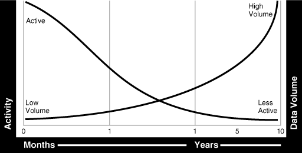
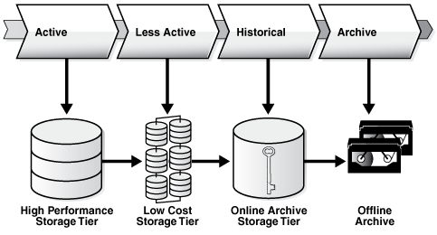

With Information Lifecycle Management (ILM), you can manage data in Oracle Database using rules and regulations that apply to that data.

Information today comes in a wide variety of types, for example an e-mail message, a photograph, or an order in an Online Transaction Processing (OLTP) System. After you know the type of data and how it is used, you have an understanding of what its evolution and final disposition is likely to be.

One challenge facing each organization is to understand how its data evolves and grows, monitor how its usage changes over time, and decide how long it should survive, while adhering to all the rules and regulations that now apply to that data. Information Lifecycle Management (ILM) is designed to address these issues, with a combination of processes, policies, software, and hardware so that the appropriate technology can be used for each stage in the lifecycle of the data.

This section contains the following topics:

- About Oracle Database for ILM

- Implementing ILM Using Oracle Database

### 5.1.1 About Oracle Database for ILM

Oracle Database provides the ideal platform for implementing an ILM solution.

The Oracle Database platform offers the following:

- Application Transparency

  Application transparency is very important in ILM because it means that there is no need to customize applications and it also enables various changes to be made to the data without any effect on the applications that are using that data. Data can easily be moved at the different stages of its lifecycle and access to the data can be optimized with the database. Another important benefit is that application transparency offers the flexibility required to quickly adapt to any new regulatory requirements, again without any impact on the existing applications.

- Fine-grained data

  Oracle can view data at a very fine-grained level and group related data, whereas storage devices only see bytes and blocks.

- Low-Cost Storage

  With so much data to retain, using low cost storage is a key factor in implementing ILM. Because Oracle can take advantage of many types of storage devices, the maximum amount of data can be held for the lowest possible cost.

- Enforceable Compliance Policies

  When information is kept for compliance reasons, it is imperative to show to regulatory bodies that data is being retained and managed in accordance with the regulations. Within Oracle Database, it is possible to define security and audit policies, which enforce and log all access to data.

This section contains the following topics:

- Oracle Database Manages All Types of Data

- Regulatory Requirements

- The Benefits of an Online Archive

#### 5.1.1.1 Oracle Database Manages All Types of Data

Information Lifecycle Management is concerned with all data in an organization.

This data includes not just structured data, such as orders in an OLTP system or a history of sales in a data warehouse, but also unstructured data, such as e-mail, documents, and images. Oracle Database supports the storing of unstructured data with BLOBs and Oracle SecureFiles, a sophisticated document management system is available in Oracle Text.

If all of the information in your organization is contained in Oracle Database, then you can take advantage of the features and functionality provided by the database to manage and move the data as it evolves during its lifetime, without having to manage multiple types of data stores.

#### 5.1.1.2 Regulatory Requirements

Many organizations must retain specific data for a specific time period. Failure to follow these regulations could result in organizations having to pay very heavy fines.

Around the world various regulatory requirements, such as Sarbanes-Oxley, HIPAA, DOD5015.2-STD in the US and the European Data Privacy Directive in the European Union, are changing how organizations manage their data. These regulations specify what data must be retained, whether it can be changed, and for how long it must be retained, which could be for a period of 30 years or longer.

These regulations frequently demand that electronic data is secure from unauthorized access and changes, and that there is an audit trail of all changes to data and by whom. Oracle Database can retain huge quantities of data without impacting application performance. It also contains the features required to restrict access and prevent unauthorized changes to data, and can be further enhanced with Oracle Audit Vault and Database Firewall. Oracle Database also provides cryptographic functions that can demonstrate that a highly privileged user has not intentionally modified data. Using Flashback Data Technology, you can store all the versions of a row during its lifetime in a tamper proof historical archive.

#### 5.1.1.3 The Benefits of an Online Archive

There are multiple benefits of an online archive.

There usually comes a point during the lifecycle of the data when it is no longer being regularly accessed and is considered eligible for archiving. Traditionally, the data would have been removed from the database and stored on tape, where you can store vast quantities of information for a very low cost. Today, it is no longer necessary to archive that data to tape, instead it can remain in the database, or be transferred to a central online archive database. All this information can be stored using low-cost storage devices whose cost per gigabyte is very close to that of tape.

There are multiple benefits to keeping all of the data in an Oracle Database for archival purposes. The most important benefit is that the data always be instantly available. Therefore, time is not wasted locating the tapes where the data was archived and determining whether the tape is readable and still in a format that can be loaded into the database.

If the data has been archived for many years, then development time may also be needed to write a program to reload the data into the database from the tape archive. This could prove to be expensive and time consuming, especially if the data is extremely old. If the data is retained in the database, then this is not a problem, because it is online, and in the latest database format.

Holding the historical data in the database no longer impacts the time required to backup the database and the size of the backup. When RMAN is used to back up the database, it only includes in the backup the data that has changed. Because historical data is less likely to change, after that data has been backed up, it is not backed up again.

Another important factor to consider is how the data is to be physically removed from the database, especially if it is to be transferred from a production system to a central database archive. Oracle provides the capability to move this data rapidly between databases by using transportable tablespaces or partitions, which moves the data as a complete unit.

When it is time to remove data from the database, the fastest way is to remove a set of data. This is achieved by keeping the data in its own partition. The partition can be dropped, which is a very fast operation. However, if this approach is not possible because data relationships must be maintained, then a conventional SQL delete statement must be issued. You should not underestimate the time required to issue the delete statement.

If there is a requirement to remove data from the database and there is a possibility that the data may need to be returned to the database in the future, then consider removing the data in a database format such as a transportable tablespace, or use the XML capability of Oracle Database to extract the information in an open format.

Consider an online archive of your data into Oracle Database for the following reasons:

- The cost of disk is approaching that of tape, so you can eliminate the time to find the tape that contains the data and the cost of restoring that data

- Data remains online when needed, providing you faster access to meet business requirements

- Data online means immediate access, so fines by regulatory body for failing to produce data are less likely

- The current application can be used to access the data, so you do not need to waste resources to build a new application

### 5.1.2 Implementing ILM Using Oracle Database

Building an Information Lifecycle Management solution using Oracle Database is quite straightforward.

An ILM solution can be completed by following these four simple steps, although Step 4 is optional if ILM is not being implemented for compliance:

- Step 1: Define the Data Classes

- Step 2: Create Storage Tiers for the Data Classes

- Step 3: Create Data Access and Migration Policies

- Step 4: Define and Enforce Compliance Policies

#### 5.1.2.1 Step 1: Define the Data Classes

To make effective use of Information Lifecycle Management, first review all the data in your organization before implementing an Information Lifecycle Management solution.

After reviewing the data, determine the following:

- What data is important, where is it stored, and what must be retained

- How this data flows within the organization

- What happens to this data over time and whether it is still required

- The degree of data availability and protection that is needed

- Data retention for legal and business requirements

After there is an understanding of how the data is used, the data can then be classified on this basis. The most common type of classification is by age or date, but other types are possible, such as by product or privacy. A hybrid classification could also be used, such as by privacy and age.

To treat the data classes differently, the data must be physically separated. When information is first created, the information is often frequently accessed, but then over time it may be referenced very infrequently. For instance, when a customer places an order, they regularly look at the order to see its status and whether the order has been shipped. After the order arrives, they may never reference that order again. This order would also be included in regular reports that are run to see what goods are being ordered, but, over time, would not figure in any of the reports and may only be referenced in the future if someone does a detailed analysis that involves this data. For example, orders could be classified by the Financial Quarters Q1, Q2, Q3, and Q4, and as Historical Orders.

The advantage of using this approach is that when the data is grouped at the row level by its class, which in this example would be the date of the order, all orders for Q1 can be managed as a self contained unit, where as the orders for Q2 would reside in a different class. This can be achieved by using partitioning. Because partitions are transparent to the application, the data is physically separated but the application still locates all the orders.

##### 5.1.2.1.1 Partitioning for ILM

Partitioning involves physically placing data according to a data value, and a frequently used technique is to partition information by date.

Figure 5-1 illustrates a scenario where the orders for Q1, Q2, Q3, and Q4 are stored in individual partitions and the orders for previous years are stored in other partitions.

Figure 5-1 Allocating Data Classes to a Partition

[Description of "Figure 5-1 Allocating Data Classes to a Partition"](img_text/vldbg021.md)

Oracle offers several different partitioning methods. Range partitioning is one frequently used partitioning method for ILM. Interval and reference partitioning are also particularly suited for use in an ILM environment.

There are multiple benefits to partitioning data. Partitioning provides an easy way to distribute the data across appropriate storage devices depending on its usage, while still keeping the data online and stored on the most cost-effective device. Because partitioning is transparent to anyone accessing the data, no application changes are required, thus partitioning can be implemented at any time. When new partitions are required, they are simply added using the `ADD PARTITION` clause or they are created automatically if interval partitioning is being used.

Among other benefits, each partition can have its own local index. When the optimizer uses partition pruning, queries only access the relevant partitions instead of all partitions, thus improving query response times.

##### 5.1.2.1.2 The Lifecycle of Data

An analysis of your data is likely to reveal that initially, it is accessed and updated on a very frequent basis. As the age of the data increases, its access frequency diminishes to almost negligible, if any.

Most organizations find themselves in the situation where many users are accessing current data while very few users are accessing older data, as illustrated in Figure 5-2. Data is considered to be: active, less active, historical, or ready to be archived.

With so much data being held, during its lifetime the data should be moved to different physical locations. Depending on where the data is in its lifecycle, it must be located on the most appropriate storage device.

Figure 5-2 Data Usage Over Time

[Description of "Figure 5-2 Data Usage Over Time"](img_text/vldbg024.md)

#### 5.1.2.2 Step 2: Create Storage Tiers for the Data Classes

Because Oracle Database can take advantage of many different storage options, the second step in implementing an Information Lifecycle Management solution is to establish the required storage tiers.

Although you can create as many storage tiers as you require, a suggested starting point are the following tiers:

- High Performance

  The high performance storage tier is where all the important and frequently accessed data, such as the partition holding our Q1 orders, is stored. This tier uses smaller, faster disks on high performance storage devices.

- Low Cost

  The low cost storage tier is where the less frequently accessed data is stored, such as the partitions holding the orders for Q2, Q3, and Q4. This tier is built using large capacity disks, such as those found in modular storage arrays or low costs ATA disks, which offer the maximum amount of inexpensive storage.

- Online Archive

  The online archive storage tier is where all the data that is seldom accessed or modified is stored. This storage tier is likely to be extremely large and to store the maximum quantity of data. You can use various techniques to compress the data. Stored on low cost storage devices, such as ATA drives, the data would still be online and available, for a cost that is only slightly higher than storing this information on tape, without the disadvantages that come with archiving data to tape. If the Online Archive storage tier is identified as read-only, then it would be impossible to change the data and subsequent backups would not be required after the initial database backup.

- Offline Archive (optional)

  The offline archive storage tier is an optional tier because it is only used when there is a requirement to remove data from the database and store it in some other format, such as XML on tape.

Figure 5-2 illustrates how data is used over a time interval. Using this information, it can be determined that to retain all this information, several storage tiers are required to hold all of the data, which also has the benefit of significantly reducing total storage costs.

After the storage tiers have been created, the data classes identified in Step 1: Define the Data Classes are physically implemented inside the database using partitions. This approach provides an easy way to distribute the data across the appropriate storage devices depending on its usage, while still keeping the data online and readily available, and stored on the most cost-effective device.

You can also use Oracle Automatic Storage Management (Oracle ASM) to manage the data across the storage tiers. Oracle ASM is a high-performance, ease-of-management storage solution for Oracle Database files. Oracle ASM is a volume manager and provides a file system designed exclusively for use by the database. To use Oracle ASM, you allocate partitioned disks for Oracle Database with preferences for striping and mirroring. Oracle ASM manages the disk space, distributing the I/O load across all available resources to optimize performance while removing the need for manual I/O tuning. For example, you can increase the size of the disk for the database or move parts of the database to new devices without having to shut down the database.

##### 5.1.2.2.1 Assigning Classes to Storage Tiers

After the storage tiers have been defined, the data classes (partitions) identified in Step 1 can be assigned to the appropriate storage tiers.

This assignment provides an easy way to distribute the data across the appropriate storage devices depending on its usage, keeping the data online and available, and stored on the most cost-effective device. In Figure 5-3 data identified to be active, less active, historical, or ready to be archived is assigned to the high performance tier, low cost storage tier, online archive storage tier, and offline archive respectively. Using this approach, no application changes are required because the data is still visible.

Figure 5-3 Data Lifecycle

[Description of "Figure 5-3 Data Lifecycle"](img_text/vldbg025.md)

##### 5.1.2.2.2 The Costs Savings of Using Tiered Storage

One benefit of implementing an ILM strategy is the cost savings that can result from using multiple tiered storage.

Assume that there is 3 TB of data to store, comprising of 200 GB on High Performance, 800 GB on Low Cost, and 2 TB on Online Archive. Assume the cost per GB is \$72 on the High Performance tier, \$14 on the Low Cost tier, and \$7 on the Online Archive tier.

Table 5-1 illustrates the possible cost savings using tiered storage, rather than storing all data on one class of storage. As you can see, the cost savings can be quite significant and, if the data is suitable for OLTP and HCC database compression, then even further cost savings are possible.

Table 5-1 Cost Savings Using Tiered Storage

| Storage Tier              | Single Tier using High Performance Disks | Multiple Storage Tiers | Multiple Tiers with Database Compression |
|:--------------------------|:-----------------------------------------|:-----------------------|:-----------------------------------------|
| High Performance (200 GB) | \$14,400                                 | \$14,400               | \$14,400                                 |
| Low Cost (800 GB)         | \$57,600                                 | \$11,200               | \$11,200                                 |
| Online Archive (2 TB)     | \$144,000                                | \$14,000               | \$5,600                                  |
| Total of each column      | \$216,000                                | \$39,600               | \$31,200                                 |

#### 5.1.2.3 Step 3: Create Data Access and Migration Policies

The third step in implementing an Information Lifecycle Management solution is to ensure that only authorized users have access to the data and to specify how to move the data during its lifetime.

As the data ages, there are multiple techniques that can migrate the data between the storage tiers.

##### 5.1.2.3.1 Controlling Access to Data

The security of your data is another very important part of Information Lifecycle Management because the access rights to the data may change during its lifetime.

In addition, there may be regulatory requirements that place exacting demands on how the data can be accessed.

The data in Oracle Database can be secured using database features, such as:

- Database Security

- Views

- Virtual Private Database

Virtual Private Database (VPD) defines a very fine-grained level of access to the database. Security policies determine which rows may be viewed and the columns that are visible. Multiple policies can be defined so that different users and applications see different views of the same data. For example, the majority of users could see the information for Q1, Q2, Q3, and Q4, while only authorized users would be able to view the historical data.

A security policy is defined at the database level and is transparently applied to all database users. The benefit of this approach is that it provides a secure and controlled environment for accessing the data, which cannot be overridden and can be implemented without requiring any application changes. In addition, read-only tablespaces can be defined which ensures that the data does not change.

##### 5.1.2.3.2 Moving Data using Partitioning

During its lifetime, data must be moved and partitioning is a technique that can be used.

Moving data may occur for the following reasons:

- For performance, only a limited number of orders are held on high performance disks

- Data is no longer frequently accessed and is using valuable high performance storage, and must be moved to a low-cost storage device

- Legal requirements demand that the information is always available for a given time interval, and it must be held safely for the lowest possible cost

There are multiple ways that data can be physically moved in Oracle Database to take advantage of the different storage tiers. For example, if the data is partitioned, then a partition containing the orders for Q2 could be moved online from the high performance storage tier to the low cost storage tier. Because the data is being moved within the database, it can be physically moved, without affecting the applications that require it or causing disruption to regular users.

Sometimes individual data items, rather than a group of data, must be moved. For example, suppose data was classified according to a level of privacy and a report, which had been secret, is now to be made available to the public. If the classification changed from secret to public and the data was partitioned on its privacy classification, then the row would automatically move to the partition containing public data.

Whenever data is moved from its original source, it is very important to ensure that the process selected adheres to any regulatory requirements, such as, the data cannot be altered, is secure from unauthorized access, easily readable, and stored in an approved location.

#### 5.1.2.4 Step 4: Define and Enforce Compliance Policies

The fourth step in an Information Lifecycle Management solution is the creation of policies for compliance.

When data is decentralized and fragmented, compliance policies have to be defined and enforced in every data location, which could easily result in a compliance policy being overlooked. However, using Oracle Database to provide a central location for storing data means that it is very easy to enforce compliance policies because they are all managed and enforced from one central location.

When defining compliance policies, consider the following areas:

- Data Retention

- Immutability

- Privacy

- Auditing

- Expiration

##### 5.1.2.4.1 Data Retention

The retention policy describes how the data is to be retained, how long it must be kept, and what happens after data life.

An example of a retention policy is a record must be stored in its original form, no modifications are allowed, it must be kept for seven years, and then it may be deleted. Using Oracle Database security, it is possible to ensure that data remains unchanged and that only authorized processes can remove the data at the appropriate time. Retention policies can also be defined through a lifecycle definition in the ILM Assistant.

##### 5.1.2.4.2 Immutability

Immutability is concerned with proving to an external party that data is complete and has not been modified.

Cryptographic or digital signatures can be generated by Oracle Database and retained either inside or outside of the database, to show that data has not been altered.

##### 5.1.2.4.3 Privacy

Oracle Database provides several ways to ensure data privacy.

Access to data can be strictly controlled with security policies defined using Virtual Private Database (VPD). In addition, individual columns can be encrypted so that anyone looking at the raw data cannot see its contents.

##### 5.1.2.4.4 Auditing

Oracle Database can track all access and changes to data.

These auditing capabilities can be defined either at the table level or through fine-grained auditing, which specifies the criteria for when an audit record is generated. Auditing can be further enhanced using Oracle Audit Vault and Database Firewall.

**See Also:**

Oracle Audit Vault and Database Firewall Administrator's Guide for information about Oracle Audit Vault and Database Firewall

##### 5.1.2.4.5 Expiration

Ultimately, data may expire for business or regulatory reasons and must be removed from the database.

Oracle Database can remove data very quickly and efficiently by simply dropping the partition which contains the information identified for removal.
