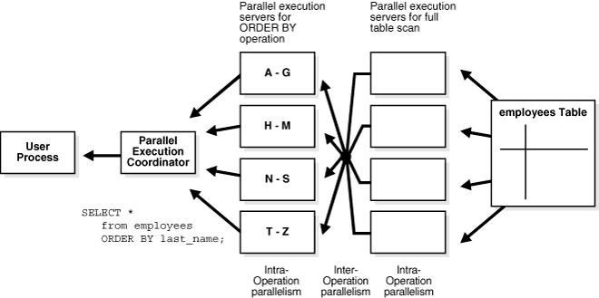
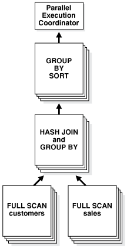
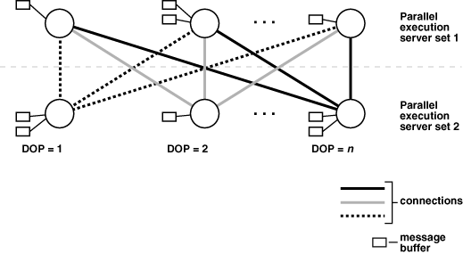

Parallel execution enables the application of multiple CPU and I/O resources to the execution of a single SQL statement.

Parallel execution dramatically reduces response time for data-intensive operations on large databases typically associated with a decision support system (DSS) and data warehouses. You can also implement parallel execution on an online transaction processing (OLTP) system for batch processing or schema maintenance operations, such as index creations.

Parallel execution is sometimes called parallelism. Parallelism is the idea of breaking down a task so that, instead of one process doing all of the work in a query, many processes do part of the work at the same time. An example of this is when four processes combine to calculate the total sales for a year, each process handles one quarter of the year instead of a single process handling all four quarters by itself. The improvement in performance can be quite significant.

Parallel execution improves processing for:

- Queries requiring large table scans, joins, or partitioned index scans

- Creation of large indexes

- Creation of large tables, including materialized views

- Bulk insertions, updates, merges, and deletions

This section contains the following topics:

- When to Implement Parallel Execution

- When Not to Implement Parallel Execution

- Fundamental Hardware Requirements

- How Parallel Execution Works

- Parallel Execution Server Pool

- Balancing the Workload to Optimize Performance

- Multiple Parallelizers

- Parallel Execution on Oracle RAC

### 8.1.1 When to Implement Parallel Execution

Parallel execution is used to reduce the execution time of queries by exploiting the CPU and I/O capabilities in the hardware.

Parallel execution is a better choice than serial execution when:

- The query references a large data set.

- There is low concurrency.

- Elapsed time is important.

Parallel execution enables many processes working together to execute single operation, such as a SQL query. Parallel execution benefits systems with all of the following characteristics:

- Symmetric multiprocessors (SMPs), clusters, or massively parallel systems

- Sufficient I/O bandwidth

- Underutilized or intermittently used CPUs (for example, systems where CPU usage is typically less than 30%)

- Sufficient memory to support additional memory-intensive processes, such as sorting, hashing, and I/O buffers

If your system lacks any of these characteristics, parallel execution might not significantly improve performance. In fact, parallel execution may reduce system performance on overutilized systems or systems with small I/O bandwidth.

The benefits of parallel execution can be observed in DSS and data warehouse environments. OLTP systems can also benefit from parallel execution during batch processing and during schema maintenance operations such as creation of indexes. The average simple DML or `SELECT` statements that characterize OLTP applications would not experience any benefit from being executed in parallel.

### 8.1.2 When Not to Implement Parallel Execution

Serial execution is different than parallel execution in that only one process executes a single database operation, such as a SQL query.

Serial execution is a better choice than parallel execution when:

- The query references a small data set.

- There is high concurrency.

- Efficiency is important.

Parallel execution is not typically useful for:

- Environments in which the typical query or transaction is very short (a few seconds or less).

  This includes most online transaction systems. Parallel execution is not useful in these environments because there is a cost associated with coordinating the parallel execution servers; for short transactions, the cost of this coordination may outweigh the benefits of parallelism.

- Environments in which the CPU, memory, or I/O resources are heavily used.

  Parallel execution is designed to exploit additional available hardware resources; if no such resources are available, then parallel execution does not yield any benefits and indeed may be detrimental to performance.

### 8.1.3 Fundamental Hardware Requirements

Parallel execution is designed to effectively use multiple CPUs and disks to answer queries quickly.

It is very I/O intensive by nature. To achieve optimal performance, each component in the hardware configuration must be sized to sustain the same level of throughput: from the CPUs and the Host Bus Adapters (HBAs) in the compute nodes, to the switches, and on into the I/O subsystem, including the storage controllers and the physical disks. If the system is an Oracle Real Application Clusters (Oracle RAC) system, then the interconnection also has to be sized appropriately. The weakest link is going to limit the performance and scalability of operations in a configuration.

It is recommended to measure the maximum I/O performance that a hardware configuration can achieve without Oracle Database. You can use this measurement as a baseline for the future system performance evaluations. Remember, it is not possible for parallel execution to achieve better I/O throughput than the underlying hardware can sustain. Oracle Database provides a free calibration tool called Orion, which is designed to measure the I/O performance of a system by simulating Oracle I/O workloads. A parallel execution typically performs large random I/Os.

**See Also:**

[Oracle Database Performance Tuning Guide](../tgdba/IO-configuration-and-design.md) for information about I/O configuration and design

### 8.1.4 How Parallel Execution Works

Parallel execution breaks down a task so that, instead of one process doing all of the work in a query, many processes do part of the work at the same time.

This section contains the following topics:

- Parallel Execution of SQL Statements

- Producer/Consumer Model

- Granules of Parallelism

- Distribution Methods Between Producers and Consumers

- How Parallel Execution Servers Communicate

#### 8.1.4.1 Parallel Execution of SQL Statements

Each SQL statement undergoes an optimization and parallelization process when it is parsed.

If the statement is determined to be executed in parallel, then the following steps occur in the execution plan:

1.  The user session or shadow process takes on the role of a coordinator, often called the query coordinator (QC) or the parallel execution (PX) coordinator. The QC is the session that initiates the parallel SQL statement.

2.  The PX coordinator obtains the necessary number of processes called parallel execution (PX) servers. The PX servers are the individual processes that perform work in parallel on behalf of the initiating session.

3.  The SQL statement is executed as a sequence of operations, such as a full table scan or an `ORDER BY` clause. Each operation is performed in parallel if possible.

4.  When the PX servers are finished executing the statement, the PX coordinator performs any portion of the work that cannot be executed in parallel. For example, a parallel query with a `SUM()` operation requires adding the individual subtotals calculated by each PX server.

5.  Finally, the PX coordinator returns the results to the user.

#### 8.1.4.2 Producer/Consumer Model

Parallel execution uses the producer/consumer model.

A parallel execution plan is carried out as a series of producer/consumer operations. Parallel execution (PX) servers that produce data for subsequent operations are called producers, PX servers that require the output of other operations are called consumers. Each producer or consumer parallel operation is performed by a set of PX servers called PX server sets. The number of PX servers in PX server set is called Degree of Parallelism (DOP). The basic unit of work for a PX server set is called a data flow operation (DFO).

A PX coordinator can have multiple levels of producer/consumer operations (multiple DFOs), but the number of PX servers sets for a PX coordinator is limited to two. Therefore, at one point in time only two PX server sets can be active for a PX coordinator. As a result, there is parallelism in both the operations in a DFO and between DFOs. The parallelism of an individual DFO is called intra-operation parallelism and the parallelism between DFOs is called inter-operation parallelism. To illustrate intra- and inter-operation parallelism, consider the following statement:

    SELECT * FROM employees ORDER BY last_name;

The execution plan implements a full scan of the `employees` table. This operation is followed by a sorting of the retrieved rows, based on the value of the `last_name` column. For the sake of this example, assume the `last_name` column is not indexed. Also assume that the DOP for the query is set to `4`, which means that four parallel execution servers can be active for any given operation.

Figure 8-1 illustrates the parallel execution of the example query.

Figure 8-1 Inter-operation Parallelism and Dynamic Partitioning

[Description of "Figure 8-1 Inter-operation Parallelism and Dynamic Partitioning"](img_text/vldbg013.md)

As illustrated in Figure 8-1, there are actually eight PX servers involved in the query even though the DOP is `4`. This is because a producer and consumer operator can be performed at the same time (inter-operation parallelism).

Also all of the PX servers involved in the scan operation send rows to the appropriate PX server performing the `SORT` operation. If a row scanned by a PX server contains a value for the `last_name` column between `A` and `G`, that row is sent to the first `ORDER` `BY` parallel execution server. When the scan operation is complete, the sorting processes can return the sorted results to the query coordinator, which returns the complete query results to the user.

#### 8.1.4.3 Granules of Parallelism

The basic unit of work in parallelism is a called a granule.

Oracle Database divides the operation executed in parallel, such as a table scan or index creation, into granules. Parallel execution (PX) servers execute the operation one granule at a time. The number of granules and their sizes correlate with the degree of parallelism (DOP). The number of granules also affect how well the work is balanced across PX servers.

##### 8.1.4.3.1 Block Range Granules

Block range granules are the basic unit of most parallel operations, even on partitioned tables. From an Oracle Database perspective, the degree of parallelism is not related to the number of partitions.

Block range granules are ranges of physical blocks from a table. Oracle Database computes the number and the size of the granules during run-time to optimize and balance the work distribution for all affected parallel execution (PX) servers. The number and size of granules are dependent upon the size of the object and the DOP. Block range granules do not depend on static preallocation of tables or indexes. During the computation of the granules, Oracle Database takes the DOP into account and tries to assign granules from different data files to each of the PX servers to avoid contention whenever possible. Additionally, Oracle Database considers the disk affinity of the granules on massive parallel processing (MPP) systems to take advantage of the physical proximity between PX servers and disks.

##### 8.1.4.3.2 Partition Granules

When partition granules are used, a parallel execution (PX) server works on an entire partition or subpartition of a table or index.

Because partition granules are statically determined by the structure of the table or index when a table or index is created, partition granules do not give you the flexibility in executing an operation in parallel that block granules do. The maximum allowable degree of parallelism (DOP) is the number of partitions. This might limit the utilization of the system and the load balancing across PX servers.

When partition granules are used for parallel access to a table or index, you should use a relatively large number of partitions, ideally three times the DOP, so that Oracle Database can effectively balance work across the PX servers.

Partition granules are the basic unit of parallel index range scans, joins between two equipartitioned tables where the query optimizer has chosen to use partition-wise joins, and parallel operations that modify multiple partitions of a partitioned object. These operations include parallel creation of partitioned indexes, and parallel creation of partitioned tables.

You can tell which types of granules were used by looking at the execution plan of a statement. The line `PX` `BLOCK` `ITERATOR` above the table or index access indicates that block range granules have been used. In the following example, you can see this on line 7 of the explain plan output just above the `TABLE` `FULL` `ACCESS` on the `SALES` table.

    -------------------------------------------------------------------------------------------------
    |Id|      Operation          |  Name  |Rows|Bytes|Cost%CPU|  Time  |Pst|Pst|  TQ |INOUT|PQDistri|
    -------------------------------------------------------------------------------------------------
    | 0|SELECT STATEMENT         |        |  17| 153 |565(100)|00:00:07|   |   |     |     |        |
    | 1| PX COORDINATOR          |        |    |     |        |        |   |   |     |     |        |
    | 2|  PX SEND QC(RANDOM)     |:TQ10001|  17| 153 |565(100)|00:00:07|   |   |Q1,01|P->S |QC(RAND)|
    | 3|   HASH GROUP BY         |        |  17| 153 |565(100)|00:00:07|   |   |Q1,01|PCWP |        |
    | 4|    PX RECEIVE           |        |  17| 153 |565(100)|00:00:07|   |   |Q1,01|PCWP |        |
    | 5|     PX SEND HASH        |:TQ10000|  17| 153 |565(100)|00:00:07|   |   |Q1,00|P->P | HASH   |
    | 6|      HASH GROUP BY      |        |  17| 153 |565(100)|00:00:07|   |   |Q1,00|PCWP |        |
    | 7|       PX BLOCK ITERATOR |        | 10M| 85M | 60(97) |00:00:01| 1 | 16|Q1,00|PCWC |        |
    |*8|        TABLE ACCESS FULL|  SALES | 10M| 85M | 60(97) |00:00:01| 1 | 16|Q1,00|PCWP |        |
    -------------------------------------------------------------------------------------------------

    Predicate Information (identified by operation id):
    ---------------------------------------------------
    8 - filter("CUST_ID"<=22810 AND "CUST_ID">=22300)

When partition granules are used, you see the line `PX` `PARTITION` `RANGE` above the table or index access in the explain plan output. On line 6 of the example that follows, the plan has `PX` `PARTITION` `RANGE` `ALL` because this statement accesses all of the 16 partitions in the table. If not all of the partitions are accessed, it simply shows `PX` `PARTITION` `RANGE`.

    ---------------------------------------------------------------------------------------------------------
    |Id|      Operation                    |  Name    |Rows|Byte|Cost%CPU|  Time  |Ps|Ps|  TQ |INOU|PQDistri|
    ---------------------------------------------------------------------------------------------------------
    | 0|SELECT STATEMENT                   |          |  17| 153|   2(50)|00:00:01|  |  |     |    |        |
    | 1| PX COORDINATOR                    |          |    |    |        |        |  |  |     |    |        |
    | 2|  PX SEND QC(RANDOM)               |:TQ10001  |  17| 153|   2(50)|00:00:01|  |  |Q1,01|P->S|QC(RAND)|
    | 3|   HASH GROUP BY                   |          |  17| 153|   2(50)|00:00:01|  |  |Q1,01|PCWP|        |
    | 4|    PX RECEIVE                     |          |  26| 234|    1(0)|00:00:01|  |  |Q1,01|PCWP|        |
    | 5|     PX SEND HASH                  |:TQ10000  |  26| 234|    1(0)|00:00:01|  |  |Q1,00|P->P| HASH   |
    | 6|      PX PARTITION RANGE ALL       |          |  26| 234|    1(0)|00:00:01|  |  |Q1,00|PCWP|        |
    | 7|       TABLEACCESSLOCAL INDEX ROWID|SALES     |  26| 234|    1(0)|00:00:01| 1|16|Q1,00|PCWC|        |
    |*8|        INDEX RANGE SCAN           |SALES_CUST|  26|    |    1(0)|00:00:01| 1|16|Q1,00|PCWP|        |
    ---------------------------------------------------------------------------------------------------------

    Predicate Information (identified by operation id):
    ---------------------------------------------------
    8 - access("CUST_ID"<=22810 AND "CUST_ID">=22300)

#### 8.1.4.4 Distribution Methods Between Producers and Consumers

A distribution method is the method by which data is sent (or redistributed) from one parallel execution (PX) server set to another.

The following are the most commonly used distribution methods in parallel execution.

- Hash Distribution

  The hash distribution method uses a hash function on one or more columns in the row which then determines the consumer where the producer should send the row. This distribution attempts to divide the work equally among consumers based on hash values.

- Broadcast Distribution

  In the broadcast distribution method, each producer sends all rows to all consumers. This method is used when the result set of the left side in a join operation is small and the cost of broadcasting all rows is not high. The result set from the right side of the join does not need to be distributed in this case; consumer PX servers assigned to the join operation can scan the right side and perform the join.

- Range Distribution

  Range distribution is mostly used in parallel sort operations. In this method each producer sends rows that have a range of values to the same consumer. This is the method used in Figure 8-1.

- Hybrid Hash Distribution

  Hybrid hash is an adaptive distribution method used in join operations. The actual distribution method is decided at runtime by the optimizer depending on the size of the result set of the left side of the join. The number of rows returned from the left side is counted and checked against a threshold value. When the number of rows is less than or equal to the threshold value, broadcast distribution is used for the left side of the join, and the right side is not distributed as the same consumer PX servers assigned to the join operation scan the right side and perform the join. When the number of rows returned from the left side is higher than the threshold value, hash distribution is used for both sides of the join.

To determine the distribution method, the parallel execution (PX) coordinator examines each operation in a SQL statement's execution plan and then determines the way in which the rows operated on by the operation must be redistributed among the PX servers. As an example of parallel query, consider the query in Example 8-1. Figure 8-2 illustrates the data flow or query plan for the query in Example 8-1, and Example 8-2 shows the explain plan output for the same query.

The query plan shows that an adaptive distribution methods was picked by the PX coordinator. Assuming the optimizer picks hash distribution at runtime, the execution proceeds as follows: two sets of PX servers, SS1 and SS2, are allocated for the query, each server set has four PX servers because of the `PARALLEL` hint that specifies the DOP of the statement.

PX set SS1 first scans the table `customers` and sends rows to SS2, which builds a hash table on the rows. In other words, the consumers in SS2 and the producers in SS1 work concurrently: one in scanning `customers` in parallel, the other is consuming rows and building the hash table to enable the hash join in parallel. This is an example of inter-operation parallelism.

After a PX server process in SS1 scans a row from the customers table, which PX server process in SS2 should it send it to? In this case, the redistribution of rows flowing up from SS1 performing the parallel scan of customers into SS2 performing the parallel hash-join is done by hash distribution on the join column. That is, a PX server process scanning customers computes a hash function on the value of the column customers.cust_id to decide which PX server process in SS2 to send it to. The redistribution method used is explicitly shown in the Distrib column in the `EXPLAIN` `PLAN` of the query. In Figure 8-2, this can be seen on lines 5, 9, and 14 of the `EXPLAIN` `PLAN`.

After SS1 has finished scanning the entire `customers` table, it scans the `sales` table in parallel. It sends its rows to PX servers in SS2, which then perform the probes to finish the hash join in parallel. These PX servers also perform a `GROUP` `BY` operation after the join. After SS1 has scanned the `sales` table in parallel and sent the rows to SS2, it switches to performing the final group by operation in parallel. At this point the PX servers in SS2 send their rows using hash distribution to PX servers on SS1 for the group by operation. This is how two server sets run concurrently to achieve inter-operation parallelism across various operators in the query tree.

Figure 8-2 Data Flow Diagram for Joining Tables

[Description of "Figure 8-2 Data Flow Diagram for Joining Tables"](img_text/vldbg004b.md)

Example 8-1 Running an Explain Plan for a Query on Customers and Sales

    EXPLAIN PLAN FOR
    SELECT /*+ PARALLEL(4) */ customers.cust_first_name, customers.cust_last_name,
      MAX(QUANTITY_SOLD), AVG(QUANTITY_SOLD)
      FROM sales, customers
      WHERE sales.cust_id=customers.cust_id
      GROUP BY customers.cust_first_name, customers.cust_last_name;

    Explained.

Example 8-2 Explain Plan Output for a Query on Customers and Sales

    PLAN_TABLE_OUTPUT
    ---------------------------------------------------------------------------------------------------------------------------------------
    Plan hash value: 3260900439
    ---------------------------------------------------------------------------------------------------------------------------------------
    |Id  |Operation                      |Name     |Rows  | Bytes |TempSpc|Cost (%CPU)| Time     |Pstart|Pstop |   TQ  |IN-OUT|PQ Distrib |
    ---------------------------------------------------------------------------------------------------------------------------------------
    |  0 |SELECT STATEMENT               |         |  960 | 26880 |       |    6  (34)| 00:00:01 |      |      |       |      |           |
    |  1 | PX COORDINATOR                |         |      |       |       |           |          |      |      |       |      |           |
    |  2 |  PX SEND QC (RANDOM)          |:TQ10003 |  960 | 26880 |       |    6  (34)| 00:00:01 |      |      | Q1,03 | P->S |QC (RAND)  |
    |  3 |   HASH GROUP BY               |         |  960 | 26880 | 50000 |    6  (34)| 00:00:01 |      |      | Q1,03 | PCWP |           |
    |  4 |    PX RECEIVE                 |         |  960 | 26880 |       |    6  (34)| 00:00:01 |      |      | Q1,03 | PCWP |           |
    |  5 |     PX SEND HASH              |:TQ10002 |  960 | 26880 |       |    6  (34)| 00:00:01 |      |      | Q1,02 | P->P |HASH       |
    |  6 |      HASH GROUP BY            |         |  960 | 26880 | 50000 |    6  (34)| 00:00:01 |      |      | Q1,02 | PCWP |           |
    |* 7 |       HASH JOIN               |         |  960 | 26880 |       |    5  (20)| 00:00:01 |      |      | Q1,02 | PCWP |           |
    |  8 |        PX RECEIVE             |         |  630 | 12600 |       |    2   (0)| 00:00:01 |      |      | Q1,02 | PCWP |           |
    |  9 |         PX SEND HYBRID HASH   |:TQ10000 |  630 | 12600 |       |    2   (0)| 00:00:01 |      |      | Q1,00 | P->P |HYBRID HASH|
    | 10 |          STATISTICS COLLECTOR |         |      |       |       |           |          |      |      | Q1,00 | PCWC |           |
    | 11 |           PX BLOCK ITERATOR   |         |  630 | 12600 |       |    2   (0)| 00:00:01 |      |      | Q1,00 | PCWC |           |
    | 12 |            TABLE ACCESS FULL  |CUSTOMERS|  630 | 12600 |       |    2   (0)| 00:00:01 |      |      | Q1,00 | PCWP |           |
    | 13 |        PX RECEIVE             |         |  960 |  7680 |       |    2   (0)| 00:00:01 |      |      | Q1,02 | PCWP |           |
    | 14 |         PX SEND HYBRID HASH   |:TQ10001 |  960 |  7680 |       |    2   (0)| 00:00:01 |      |      | Q1,01 | P->P |HYBRID HASH|
    | 15 |          PX BLOCK ITERATOR    |         |  960 |  7680 |       |    2   (0)| 00:00:01 |    1 |   16 | Q1,01 | PCWC |           |
    | 16 |           TABLE ACCESS FULL   |SALES    |  960 |  7680 |       |    2   (0)| 00:00:01 |    1 |   16 | Q1,01 | PCWP |           |
    ---------------------------------------------------------------------------------------------------------------------------------------
    Predicate Information (identified by operation id):
    ---------------------------------------------------
    7 - access("SALES"."CUST_ID"="CUSTOMERS"."CUST_ID")
    Note
    -----
       - Degree of Parallelism is 4 because of hint

#### 8.1.4.5 How Parallel Execution Servers Communicate

To execute a query in parallel, Oracle Database generally creates a set of producer parallel execution servers and a set of consumer parallel execution servers.

The producer server retrieves rows from tables and the consumer server performs operations such as join, sort, DML, and DDL on these rows. Each server in the producer set has a connection to each server in the consumer set. The number of virtual connections between parallel execution servers increases as the square of the degree of parallelism.

Each communication channel has at least one, and sometimes up to four memory buffers, which are allocated from the shared pool. Multiple memory buffers facilitate asynchronous communication among the parallel execution servers.

A single-instance environment uses at most three buffers for each communication channel. An Oracle Real Application Clusters environment uses at most four buffers for each channel. Figure 8-3 illustrates message buffers and how producer parallel execution servers connect to consumer parallel execution servers.

Figure 8-3 Parallel Execution Server Connections and Buffers

[Description of "Figure 8-3 Parallel Execution Server Connections and Buffers"](img_text/vldbg015.md)

When a connection is between two processes on the same instance, the servers communicate by passing the buffers back and forth in memory (in the shared pool). When the connection is between processes in different instances, the messages are sent using external high-speed network protocols over the interconnect. In Figure 8-3, the DOP equals the number of parallel execution servers, which in this case is n. Figure 8-3 does not show the parallel execution coordinator. Each parallel execution server actually has an additional connection to the parallel execution coordinator. It is important to size the shared pool adequately when using parallel execution. If there is not enough free space in the shared pool to allocate the necessary memory buffers for a parallel server, it fails to start.

### 8.1.5 Parallel Execution Server Pool

When an instance starts, Oracle Database creates a pool of parallel execution servers, which are available for any parallel operation.

The initialization parameter `PARALLEL_MIN_SERVERS` specifies the number of parallel execution servers that Oracle Database creates at instance startup.

When executing a parallel operation, the parallel execution coordinator obtains parallel execution servers from the pool and assigns them to the operation. If necessary, Oracle Database can create additional parallel execution servers for the operation. These parallel execution servers remain with the operation throughout execution. After the statement has been processed, the parallel execution servers return to the pool.

If the number of parallel operations increases, Oracle Database creates additional parallel execution servers to handle incoming requests. However, Oracle Database never creates more parallel execution servers for an instance than the value specified by the initialization parameter `PARALLEL_MAX_SERVERS`.

If the number of parallel operations decreases, Oracle Database terminates any parallel execution servers that have been idle for a threshold interval. Oracle Database does not reduce the size of the pool less than the value of `PARALLEL_MIN_SERVERS`, no matter how long the parallel execution servers have been idle.

#### 8.1.5.1 Processing without Enough Parallel Execution Servers

Oracle Database can process a parallel operation with fewer than the requested number of processes.

If all parallel execution servers in the pool are occupied and the maximum number of parallel execution servers has been started, the parallel execution coordinator switches to serial processing.

**See Also:**

- [Tuning General Parameters for Parallel Execution](parameters-parallel-exec.md) for information about the `PARALLEL_MIN_PERCENT` and `PARALLEL_MAX_SERVERS` initialization parameters

- [Oracle Database Reference](../refrn/PARALLEL_MIN_PERCENT.md) for information about using the initialization parameter `PARALLEL_MIN_PERCENT`

### 8.1.6 Balancing the Workload to Optimize Performance

To optimize performance, all parallel execution servers should have equal workloads.

For SQL statements run in parallel by block range or by parallel execution servers, the workload is dynamically divided among the parallel execution servers. This minimizes workload skewing, which occurs when some parallel execution servers perform significantly more work than the other processes.

For the relatively few SQL statements executed in parallel by partitions, if the workload is evenly distributed among the partitions, you can optimize performance by matching the number of parallel execution servers to the number of partitions or by choosing a DOP in which the number of partitions is a multiple of the number of processes. This applies to partition-wise joins and parallel DML on tables created before Oracle9i. Refer to [Limitation on the Degree of Parallelism](parallel-exec-tips.md) for more information.

For example, suppose a table has 16 partitions, and a parallel operation divides the work evenly among them. You can use 16 parallel execution servers (DOP equals 16) to do the work in approximately one-tenth the time that one process would take. You might also use five processes to do the work in one-fifth the time, or two processes to do the work in one-half the time.

If, however, you use 15 processes to work on 16 partitions, the first process to finish its work on one partition then begins work on the 16th partition; and as the other processes finish their work, they become idle. This configuration does not provide good performance when the work is evenly divided among partitions. When the work is unevenly divided, the performance varies depending on whether the partition that is left for last has more or less work than the other partitions.

Similarly, suppose you use six processes to work on 16 partitions and the work is evenly divided. In this case, each process works on a second partition after finishing its first partition, but only four of the processes work on a third partition while the other two remain idle.

In general, you cannot assume that the time taken to perform a parallel operation on a given number of partitions (N) with a given number of parallel execution servers (P) equals N divided by P. This formula does not consider the possibility that some processes might have to wait while others finish working on the last partitions. By choosing an appropriate DOP, however, you can minimize the workload skew and optimize performance.

### 8.1.7 Multiple Parallelizers

Each parallel execution (PX) coordinator in an execution plan is called a parallelizer.

The number of PX servers used by a SQL statement is determined by the statement degree of parallelism (DOP) and the number of parallelizers. Because the number of PX server sets for a parallelizer is limited to two, the number of PX servers for most statements is DOP\*2. Some statements can have more than one parallelizer. Because each parallelizer can use two PX server sets, the number of PX servers for these statements can be more than DOP\*2. You can identify these statements by looking at the `EXPLAIN` `PLAN`. If the plan has multiple PX coordinators it means the statement has multiple parallelizers.

A few example cases where SQL statements use multiple parallelizers are subquery factoring, grouping sets, star queries, in-memory aggregation, and noncorrelated subqueries.

Multiple parallelizers in a SQL statement can be active concurrently or one after the other depending on the execution plan.

A statement with a single parallelizer allocates the required number of PX servers at the start of execution and holds these allocated PX servers without releasing until the statement completes. This ensures that the number of PX servers throughout the execution is constant. Statements with multiple parallelizers are different as they allocate PX servers when each parallelizer starts. Because parallelizers can start at different times during the execution, each parallelizer may be running with a different number of PX servers based on the number of available processes in the system.

If multiple parallelizers are executed concurrently the statement can use more PX servers than DOP\*2.

The view `V$PQ_SESSTAT` shows the number of parallelizers in the `STATISTIC` column. The data flow operation statistic,`DFO Trees` , shows the number of parallelizers. The `Server Threads` statistic shows the maximum number of PX servers used concurrently for a SQL statement.

**See Also:**

[Oracle Database Reference](../refrn/dynamic-performance-views.md) for information about `V$PQ_SESSTAT` and other dynamic views

### 8.1.8 Parallel Execution on Oracle RAC

By default in an Oracle RAC environment, a SQL statement executed in parallel can run across all the nodes in the cluster.

For this cross-node or inter-node parallel execution to perform, the interconnect in the Oracle RAC environment must be sized appropriately because inter-node parallel execution may result in heavy interconnect traffic. Inter-node parallel execution does not scale with an undersized interconnect.

#### Limiting the Number of Available Instances

In an Oracle RAC environment, you can use services to limit the number of instances that participate in the execution of a parallel SQL statement. The default service includes all available instances. You can create any number of services, each consisting of one or more instances. When a user connects to the database using a service, only PX servers on the instances that are members of the service can participate in the execution of a parallel statement.

To limit parallel execution to a single node, you can set the `PARALLEL_FORCE_LOCAL` initialization parameter to `TRUE`. In this case, only PX servers on the instance that a session connects to is used to execute parallel statements from that session. Note that when this parameter is set to `TRUE`, all parallel statements running on that instance are executed locally, whether the session connects to the instance directly or connects using a service.

#### Parallel Execution on Flex Clusters

Parallel statements executed on flex clusters can use both hub and leaf nodes. As user sessions are only allowed to connect to the hub nodes, the coordinator process (Query Coordinator or PX Coordinator) resides on hub nodes and can use PX server processes from any node in the cluster. For parallel queries any PX server on any node can participate in the execution of the statement. For parallel DML operations only PX servers on hub nodes can participate in the execution of the DML part of the statement as only hub nodes are allowed to perform DML operations.

When there is data distribution from the leaf nodes to the hub nodes for DML operations, the execution plan indicates this distribution. In the following example, data is distributed to hub nodes in line `Id 5`, indicating the load operation in line `Id 3` is executed only on hub nodes.

    --------------------------------------------------------
    | Id  | Operation                          | Name      |
    --------------------------------------------------------
    |   0 | CREATE TABLE STATEMENT             |           |
    |   1 |  PX COORDINATOR                    |           |
    |   2 |   PX SEND QC (RANDOM)              | :TQ10001  |
    |   3 |    LOAD AS SELECT (HYBRID TSM/HWMB)| SALESTEMP |
    |   4 |     PX RECEIVE                     |           |
    |   5 |      PX SEND ROUND-ROBIN (HUB)     | :TQ10000  |
    |   6 |       PX BLOCK ITERATOR            |           |
    |   7 |        TABLE ACCESS FULL           | SALES     |
    --------------------------------------------------------

**See Also:**

- [Oracle Clusterware Administration and Deployment Guide](../cwadd/oracle-flex-clusters.md) for information about nodes in hub, leaf, and flex cluster architecture

- [Oracle Grid Infrastructure Installation and Upgrade Guide for Linux](../cwlin/installing-oracle-grid-infrastructure.md) for information about cluster installation options for Grid Infrastructure

- [Oracle Real Application Clusters Administration and Deployment Guide](../racad/administering-database-instances-and-cluster-databases.md) for more information about instance groups
