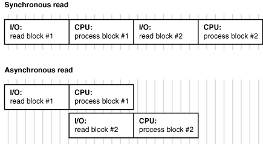

You can use parameters to initialize and tune parallel execution.

Oracle Database computes defaults for the parallel execution parameters based on the value at database startup of `CPU_COUNT` and `PARALLEL_THREADS_PER_CPU`. The parameters can also be manually tuned, increasing or decreasing their values to suit specific system configurations or performance goals. For example, on systems where parallel execution is never used, `PARALLEL_MAX_SERVERS` can be set to zero.

You can also manually tune parallel execution parameters. Parallel execution is enabled by default.

Initializing and tuning parallel execution is discussed in the following topics:

- Default Parameter Settings

- Forcing Parallel Execution for a Session

- Tuning General Parameters for Parallel Execution

### 8.6.1 Default Parameter Settings

Oracle Database automatically sets parallel execution parameters by default.

The parallel execution parameters are shown in Table 8-3.

Table 8-3 Parameters and Their Defaults

| Parameter                         | Default                                                                                | Comments                                                                                                                                                                                                                                                                                                                                                                                                                                                                                                   |
|:----------------------------------|:---------------------------------------------------------------------------------------|:-----------------------------------------------------------------------------------------------------------------------------------------------------------------------------------------------------------------------------------------------------------------------------------------------------------------------------------------------------------------------------------------------------------------------------------------------------------------------------------------------------------|
| `PARALLEL_ADAPTIVE_MULTI_USER`    | `FALSE`                                                                                | Causes parallel execution SQL to throttle degree of parallelism (DOP) requests to prevent system overload. `PARALLEL_ADAPTIVE_MULTI_USER` is deprecated in Oracle Database 12c Release 2 (12.2.0.1) to be desupported in a future release. Oracle recommends using parallel statement queuing instead.                                                                                                                                                                                                  |
| `PARALLEL_DEGREE_LIMIT`           | `CPU`                                                                                  | Controls the maximum DOP a statement can have when automatic DOP is in use. The maximum DOP is `SUM(CPU_COUNT)*PARALLEL_THREADS_PER_CPU` The value `AUTO` for `PARALLEL_DEGREE_LIMIT` has the same functionality as the value `CPU`.                                                                                                                                                                                                                                                                 |
| `PARALLEL_DEGREE_POLICY`          | `MANUAL`                                                                               | Controls whether auto DOP, parallel statement queuing and in-memory parallel execution are used. By default, all of these features are disabled.                                                                                                                                                                                                                                                                                                                                                           |
| `PARALLEL_EXECUTION_MESSAGE_SIZE` | 16 KB                                                                                  | Specifies the size of the buffers used by the parallel execution servers to communicate among themselves and with the query coordinator. These buffers are allocated out of the shared pool.                                                                                                                                                                                                                                                                                                               |
| `PARALLEL_FORCE_LOCAL`            | `FALSE`                                                                                | Restricts parallel execution to the current Oracle RAC instance.                                                                                                                                                                                                                                                                                                                                                                                                                                           |
| `PARALLEL_INSTANCE_GROUP`         | None. By default, parallel execution is enabled across all currently active instances. | Lets you restrict parallel query operations to a limited number of instances. Used in conjunction with services and also with the deprecated parameter `INSTANCE_GROUPS`.                                                                                                                                                                                                                                                                                                                                  |
| `PARALLEL_MAX_ SERVERS`           | See PARALLEL_MAX_SERVERS.                                                              | Specifies the maximum number of parallel execution processes and parallel recovery processes for an instance. As demand increases, Oracle Database increases the number of processes from the number created at instance startup up to this value. If you set this parameter too low, some queries may not have a parallel execution process available to them during query processing. If you set it too high, memory resource shortages may occur during peak periods, which can degrade performance. |
| `PARALLEL_MIN_DEGREE`             | `1`                                                                                    | Controls the minimum degree of parallelism computed by automatic degree of parallelism.                                                                                                                                                                                                                                                                                                                                                                                                                    |
| `PARALLEL_MIN_SERVERS`            | `CPU_COUNT * PARALLEL_THREADS_PER_CPU * 2`                                             | Specifies the number of parallel execution processes to be started and reserved for parallel operations, when Oracle Database is started up. Increasing this setting can help balance the startup cost of a parallel statement, but requires greater memory usage as these parallel execution processes are not removed until the database is shut down.                                                                                                                                                   |
| `PARALLEL_MIN_PERCENT`            | 0                                                                                      | Specifies the minimum percentage of requested parallel execution processes required for parallel execution. With the default value of 0, a parallel statement executes serially if no parallel server processes are available.                                                                                                                                                                                                                                                                             |
| `PARALLEL_MIN_TIME_THRESHOLD`     | `AUTO`                                                                                 | Specifies the execution time, as estimated by the optimizer, above which a statement is considered for automatic parallel query and automatic derivation of DOP. Note that the interpretation of `AUTO` is dependent on whether or not Database In-Memory is used.                                                                                                                                                                                                                                         |
| `PARALLEL_SERVERS_TARGET`         | See PARALLEL_SERVERS_TARGET.                                                           | Specifies the number of parallel execution server processes available to run queries before parallel statement queuing is used. Note that parallel statement queuing is only active if `PARALLEL_DEGREE_POLICY` is set to `AUTO`.                                                                                                                                                                                                                                                                          |
| `PARALLEL_THREADS_PER_CPU`        | 1                                                                                      | Describes the number of parallel execution processes or threads that a CPU can handle during parallel execution.                                                                                                                                                                                                                                                                                                                                                                                           |

You can set some parameters in such a way that Oracle Database is constrained. For example, if you set `PROCESSES` to 20, you are not be able to get 25 child processes.

**See Also:**

[Oracle Database Reference](../refrn/initialization-parameters.md) for more information about initialization parameters

### 8.6.2 Forcing Parallel Execution for a Session

Youu can force parallelism for a session.

If you are sure you want to execute in parallel and want to avoid setting the DOP for a table or modifying the queries involved, you can force parallelism with the following statement:

    ALTER SESSION FORCE PARALLEL QUERY;

All subsequent queries are executed in parallel provided no restrictions are violated. You can also force DML and DDL statements. This clause overrides any parallel clause specified in subsequent statements in the session, but is overridden by a parallel hint.

In typical OLTP environments, for example, the tables are not set parallel, but nightly batch scripts may want to collect data from these tables in parallel. By setting the DOP in the session, the user avoids altering each table in parallel and then altering it back to serial when finished.

### 8.6.3 Tuning General Parameters for Parallel Execution

The discussion about tuning general parameters for parallel execution is introduced in the topic.

This section discusses the following topics:

- Parameters Establishing Resource Limits for Parallel Operations

- Parameters Affecting Resource Consumption

- Parameters Related to I/O

#### 8.6.3.1 Parameters Establishing Resource Limits for Parallel Operations

You can set initialization parameters to determine resource limits.

The parameters that establish resource limits are discussed in the following topics:

- PARALLEL_FORCE_LOCAL

- PARALLEL_MAX_SERVERS

- PARALLEL_MIN_PERCENT

- PARALLEL_MIN_SERVERS

- PARALLEL_MIN_TIME_THRESHOLD

- PARALLEL_SERVERS_TARGET

- SHARED_POOL_SIZE

- Additional Memory Requirements for Message Buffers

- Monitor Memory Usage After Processing Begins

**See Also:**

[Oracle Database Reference](../refrn/initialization-parameters.md) for information about initialization parameters

##### 8.6.3.1.1 PARALLEL_FORCE_LOCAL

The `PARALLEL_FORCE_LOCAL` parameter specifies whether a SQL statement executed in parallel is restricted to a single instance in an Oracle RAC environment.

By setting this parameter to `TRUE`, you restrict the scope of the parallel server processed to the single Oracle RAC instance where the query coordinator is running.

The recommended value for the `PARALLEL_FORCE_LOCAL` parameter is `FALSE`.

**See Also:**

[Oracle Database Reference](../refrn/PARALLEL_FORCE_LOCAL.md) for information about the `PARALLEL_FORCE_LOCAL` initialization parameter

##### 8.6.3.1.2 PARALLEL_MAX_SERVERS

The `PARALLEL_MAX_SERVERS` parameter specifies the maximum number of parallel execution processes and parallel recovery processes for an instance.

As demand increases, Oracle Database increases the number of processes from the number created at instance startup up to this value.

For example, setting the value to 64 enables you to run four parallel queries simultaneously, if each query is using two worker sets with a DOP of `8` for each set.

##### When Users Have Too Many Processes

When concurrent users have too many query server processes, memory contention (paging), I/O contention, or excessive context switching can occur.

This contention can reduce system throughput to a level lower than if parallel execution were not used. Increase the `PARALLEL_MAX_SERVERS` value only if the system has sufficient memory and I/O bandwidth for the resulting load.

You can use performance monitoring tools of the operating system to determine how much memory, swap space and I/O bandwidth are free. Look at the run queue lengths for both your CPUs and disks, and the service time for I/O operations on the system. Verify that the system has sufficient swap space to add more processes. Limiting the total number of query server processes might restrict the number of concurrent users who can execute parallel operations, but system throughput tends to remain stable.

##### When to Limit the Number of Resources for a User using a Consumer Group

When necessary, you can limit the amount of parallelism available to a given user by establishing a resource consumer group for the user.

Do this to limit the number of sessions, concurrent logons, and the number of parallel processes that any one user or group of users can have.

Each query server process working on a parallel execution statement is logged on with a session ID. Each process counts against the user's limit of concurrent sessions. For example, to limit a user to 10 parallel execution processes, set the user's limit to 11. One process is for the parallel execution coordinator and the other 10 consist of two sets of query servers. This would allow one session for the parallel execution coordinator and 10 sessions for the parallel execution processes.

**See Also:**

- [Oracle Database Reference](../refrn/PARALLEL_MAX_SERVERS.md) for information about the `PARALLEL_MAX_SERVERS` initialization parameter

- [Oracle Database Administrator’s Guide](../admin/managing-users-and-securing-the-database.md) for more information about managing resources with user profiles

- [Oracle Real Application Clusters Administration and Deployment Guide](../racad/introduction-to-oracle-rac.md) for more information about querying `GV$` views

##### 8.6.3.1.3 PARALLEL_MIN_PERCENT

The `PARALLEL_MIN_PERCENT` parameter enables users to wait for an acceptable DOP, depending on the application in use.

The recommended value for the `PARALLEL_MIN_PERCENT` parameter is 0 (zero). Setting this parameter to values other than 0 (zero) causes Oracle Database to return an error when the requested DOP cannot be satisfied by the system at a given time. For example, if you set `PARALLEL_MIN_PERCENT` to 50, which translates to 50 percent, and the DOP is reduced by 50 percent or greater because of the adaptive algorithm or because of a resource limitation, then Oracle Database returns `ORA-12827`. For example:

    SELECT /*+ FULL(e) PARALLEL(e, 8) */ d.department_id, SUM(SALARY)
      FROM employees e, departments d WHERE e.department_id = d.department_id
      GROUP BY d.department_id ORDER BY d.department_id;

Oracle Database responds with this message:

    ORA-12827: insufficient parallel query slaves available

**See Also:**

[Oracle Database Reference](../refrn/PARALLEL_MIN_PERCENT.md) for information about the `PARALLEL_MIN_PERCENT` initialization parameter

##### 8.6.3.1.4 PARALLEL_MIN_SERVERS

The `PARALLEL_MIN_SERVERS` parameter specifies the number of processes to be started in a single instance that are reserved for parallel operations.

Setting `PARALLEL_MIN_SERVERS` balances the startup cost against memory usage. Processes started using `PARALLEL_MIN_SERVERS` do not exit until the database is shut down. This way, when a query is issued, the processes are likely to be available.

**See Also:**

[Oracle Database Reference](../refrn/PARALLEL_MIN_SERVERS.md) for information about the `PARALLEL_MIN_SERVERS` initialization parameter

##### 8.6.3.1.5 PARALLEL_MIN_TIME_THRESHOLD

The `PARALLEL_MIN_TIME_THRESHOLD` parameter specifies the minimum execution time a statement should have before the statement is considered for automatic degree of parallelism.

**See Also:**

[Oracle Database Reference](../refrn/PARALLEL_MIN_TIME_THRESHOLD.md) for information about the `PARALLEL_MIN_TIME_THRESHOLD` initialization parameter

##### 8.6.3.1.6 PARALLEL_SERVERS_TARGET

The `PARALLEL_DEGREE_POLICY` parameter specifies the number of parallel server processes allowed to run parallel statements before statement queuing is used.

When `PARALLEL_DEGREE_POLICY` is set to `AUTO`, statements that require parallel execution are queued if the number of parallel processes currently in use on the system equals or is greater than `PARALLEL_SERVERS_TARGET`. This is not the maximum number of parallel server processes allowed on a system (that is controlled by `PARALLEL_MAX_SERVERS`). However, `PARALLEL_SERVERS_TARGET` and parallel statement queuing is used to ensure that each statement that requires parallel execution is allocated the necessary parallel server resources and the system is not flooded with too many parallel server processes.

**See Also:**

[Oracle Database Reference](../refrn/PARALLEL_SERVERS_TARGET.md) for information about the `PARALLEL_SERVERS_TARGET` initialization parameter

##### 8.6.3.1.7 SHARED_POOL_SIZE

The `SHARED_POOL_SIZE` parameter specifies the memory size of the shared pool.

Parallel execution requires memory resources in addition to those required by serial SQL execution. Additional memory is used for communication and passing data between query server processes and the query coordinator.

Oracle Database allocates memory for query server processes from the shared pool. Tune the shared pool as follows:

- Allow for other clients of the shared pool, such as shared cursors and stored procedures.

- Remember that larger values improve performance in multiuser systems, but smaller values use less memory.

- You can then monitor the number of buffers used by parallel execution and compare the `shared` `pool` `PX` `msg` `pool` to the current high water mark reported in output from the view `V$PX_PROCESS_SYSSTAT`.

  **Note:**

  If you do not have enough memory available, error message 12853 occurs (insufficient memory for PX buffers: current stringK, max needed stringK). This is caused by having insufficient SGA memory available for PX buffers. You must reconfigure the SGA to have at least (`MAX` - `CURRENT`) bytes of additional memory.

By default, Oracle Database allocates parallel execution buffers from the shared pool.

If Oracle Database displays the following error on startup, you should reduce the value for `SHARED_POOL_SIZE` low enough so your database starts:

    ORA-27102: out of memory
    SVR4 Error: 12: Not enough space

After reducing the value of `SHARED_POOL_SIZE`, you might see the error:

    ORA-04031: unable to allocate 16084 bytes of shared memory
       ("SHARED pool","unknown object","SHARED pool heap","PX msg pool")

If so, execute the following query to determine why Oracle Database could not allocate the 16,084 bytes:

    SELECT NAME, SUM(BYTES) FROM V$SGASTAT WHERE UPPER(POOL)='SHARED POOL'
      GROUP BY ROLLUP (NAME);

Your output should resemble the following:

    NAME                       SUM(BYTES)
    -------------------------- ----------
    PX msg pool                   1474572
    free memory                    562132
                                  2036704

If you specify `SHARED_POOL_SIZE` and the amount of memory you specify to reserve is bigger than the pool, Oracle Database does not allocate all the memory it can get. Instead, it leaves some space. When the query runs, Oracle Database tries to get what it needs. Oracle Database uses the 560 KB and needs another 16 KB when it fails. The error does not report the cumulative amount that is needed. The best way of determining how much more memory is needed is to use the formulas in Additional Memory Requirements for Message Buffers.

To resolve the problem in the current example, increase the value for `SHARED_POOL_SIZE`. As shown in the sample output, the `SHARED_POOL_SIZE` is about 2 MB. Depending on the amount of memory available, you could increase the value of `SHARED_POOL_SIZE` to 4 MB and attempt to start your database. If Oracle Database continues to display an `ORA-4031` message, gradually increase the value for `SHARED_POOL_SIZE` until startup is successful.

**See Also:**

[Oracle Database Reference](../refrn/SHARED_POOL_SIZE.md) for information about the `SHARED_POOL_SIZE` initialization parameter

##### 8.6.3.1.8 Additional Memory Requirements for Message Buffers

Additional memory requirements for message buffers and cursors when using parallel execution plans are discussed in this topic.

After you determine the initial setting for the shared pool, you must calculate additional memory requirements for message buffers and determine how much additional space you need for cursors.

##### Required Memory for Message Buffers

You must increase the value for the `SHARED_POOL_SIZE` parameter to accommodate message buffers. The message buffers allow query server processes to communicate with each other.

Oracle Database uses a fixed number of buffers for each virtual connection between producer query servers and consumer query servers. Connections increase as the square of the DOP increases. For this reason, the maximum amount of memory used by parallel execution is bound by the highest DOP allowed on your system. You can control this value by using either the `PARALLEL_MAX_SERVERS` parameter or by using policies and profiles.

To calculate the amount of memory required, use one of the following formulas:

- For SMP systems:

      mem in bytes = (3 x size x users x groups x connections)

- For Oracle Real Application Clusters and MPP systems:

      mem in bytes = ((3 x local) + (2 x remote)) x (size x users x groups)
        / instances

Each instance uses the memory computed by the formula.

The terms are:

- `SIZE` = `PARALLEL_EXECUTION_MESSAGE_SIZE`

- `USERS` = the number of concurrent parallel execution users that you expect to have running with the optimal DOP

- `GROUPS` = the number of query server process groups used for each query

  A simple SQL statement requires only one group. However, if your queries involve subqueries which are processed in parallel, then Oracle Database uses an additional group of query server processes.

- `CONNECTIONS` = (DOP2 + 2 x DOP)

  If your system is a cluster or MPP, then you should account for the number of instances because this increases the DOP. In other words, using a DOP of 4 on a two-instance cluster results in a DOP of 8. A value of `PARALLEL_MAX_SERVERS` times the number of instances divided by four is a conservative estimate to use as a starting point.

- `LOCAL` = `CONNECTIONS`/`INSTANCES`

- `REMOTE` = `CONNECTIONS` - `LOCAL`

Add this amount to your original setting for the shared pool. However, before setting a value for either of these memory structures, you must also consider additional memory for cursors, as explained in the following section.

##### Additional Memory for Cursors

Parallel execution plans consume more space in the SQL area than serial execution plans. You should regularly monitor shared pool resource use to ensure that the memory used by both messages and cursors can accommodate your system's processing requirements.

##### 8.6.3.1.9 Monitor Memory Usage After Processing Begins

Whether you are using automated or manual tuning, you should monitor usage on an on-going basis to ensure the size of memory is not too large or too small.

The formulas in this section are just starting points. To ensure the correct memory size, tune the shared pool using the following query:

    SELECT POOL, NAME, SUM(BYTES) FROM V$SGASTAT WHERE POOL LIKE '%pool%'
      GROUP BY ROLLUP (POOL, NAME);

Your output should resemble the following:

    POOL        NAME                       SUM(BYTES)
    ----------- -------------------------- ----------
    shared pool Checkpoint queue                38496
    shared pool KGFF heap                        1964
    shared pool KGK heap                         4372
    shared pool KQLS heap                     1134432
    shared pool LRMPD SGA Table                 23856
    shared pool PLS non-lib hp                   2096
    shared pool PX subheap                     186828
    shared pool SYSTEM PARAMETERS               55756
    shared pool State objects                 3907808
    shared pool character set memory            30260
    shared pool db_block_buffers               200000
    shared pool db_block_hash_buckets           33132
    shared pool db_files                       122984
    shared pool db_handles                      52416
    shared pool dictionary cache               198216
    shared pool dlm shared memory             5387924
    shared pool event statistics per sess      264768
    shared pool fixed allocation callback        1376
    shared pool free memory                  26329104
    shared pool gc_*                            64000
    shared pool latch nowait fails or sle       34944
    shared pool library cache                 2176808
    shared pool log_buffer                      24576
    shared pool log_checkpoint_timeout          24700
    shared pool long op statistics array        30240
    shared pool message pool freequeue         116232
    shared pool miscellaneous                  267624
    shared pool processes                       76896
    shared pool session param values            41424
    shared pool sessions                       170016
    shared pool sql area                      9549116
    shared pool table columns                  148104
    shared pool trace_buffers_per_process     1476320
    shared pool transactions                    18480
    shared pool trigger inform                  24684
    shared pool                              52248968
                                             90641768

Evaluate the memory used as shown in your output, and alter the setting for `SHARED_POOL_SIZE` based on your processing needs.

To obtain more memory usage statistics, execute the following query:

    SELECT * FROM V$PX_PROCESS_SYSSTAT WHERE STATISTIC LIKE 'Buffers%';

Your output should resemble the following:

    STATISTIC                           VALUE
    -------------------                 -----
    Buffers Allocated                   23225
    Buffers Freed                       23225
    Buffers Current                         0
    Buffers HWM                          3620

The amount of memory used appears in the `Buffers` `Current` and `Buffers` `HWM` statistics. Calculate a value in bytes by multiplying the number of buffers by the value for `PARALLEL_EXECUTION_MESSAGE_SIZE`. Compare the high water mark to the parallel execution message pool size to determine if you allocated too much memory. For example, in the first output, the value for large pool as shown in `px` `msg` `pool` is 38,092,812 or 38 MB. The `Buffers` `HWM` from the second output is 3,620, which when multiplied by a parallel execution message size of 4,096 is 14,827,520, or approximately 15 MB. In this case, the high water mark has reached approximately 40 percent of its capacity.

#### 8.6.3.2 Parameters Affecting Resource Consumption

The parameters affecting resource consumption are discussed in the topic.

**Note:**

Before considering the following section, you should read the descriptions of the `MEMORY_TARGET` and `MEMORY_MAX_TARGET` initialization parameters for details. The `PGA_AGGREGATE_TARGET` initialization parameter need not be set as `MEMORY_TARGET` autotunes the SGA and PGA components.

The first group of parameters discussed in this section affects memory and resource consumption for all parallel operations, in particular, for parallel execution. These parameters are:

- PGA_AGGREGATE_TARGET

- PARALLEL_EXECUTION_MESSAGE_SIZE

A second subset of parameters are discussed in Parameters Affecting Resource Consumption for Parallel DML and Parallel DDL.

To control resource consumption, you should configure memory at two levels:

- At the database level, so the system uses an appropriate amount of memory from the operating system.

- At the operating system level for consistency.

  On some platforms, you might need to set operating system parameters that control the total amount of virtual memory available, totalled across all processes.

A large percentage of the memory used in data warehousing operations (compared to OLTP) is more dynamic. This memory comes from Process Global Area (PGA), and both the size of process memory and the number of processes can vary greatly. Use the `PGA_AGGREGATE_TARGET` initialization parameter to control both the process memory and the number of processes in such cases. Explicitly setting `PGA_AGGREGATE_TARGET` along with `MEMORY_TARGET` ensures that autotuning still occurs but `PGA_AGGREGATE_TARGET` is not tuned below the specified value.

**See Also:**

- [Oracle Database Performance Tuning Guide](../tgdba/database-memory-allocation.md) for descriptions of the `MEMORY_TARGET` and `MEMORY_MAX_TARGET` initialization parameters

- [Oracle Database Administrator’s Guide](../admin/managing-memory.md) for additional information about the use of the `MEMORY_TARGET` and `MEMORY_MAX_TARGET` initialization parameters

##### 8.6.3.2.1 PGA_AGGREGATE_TARGET

You can enable automatic PGA memory management with the setting of initialization parameters, such as `PGA_AGGREGATE_TARGET`.

You can simplify and improve the way PGA memory is allocated by enabling automatic PGA memory management. In this mode, Oracle Database dynamically adjusts the size of the portion of the PGA memory dedicated to work areas, based on an overall PGA memory target explicitly set by the DBA. To enable automatic PGA memory management, you must set the initialization parameter `PGA_AGGREGATE_TARGET`. For new installations, `PGA_AGGREGATE_TARGET` and `SGA_TARGET` are set automatically by the database configuration assistant (DBCA), and `MEMORY_TARGET` is zero. That is, automatic memory management is disabled. Therefore, automatic tuning of the aggregate PGA is enabled by default. However, the aggregate PGA does not grow unless you enable automatic memory management by setting `MEMORY_TARGET` to a nonzero value.

**See Also:**

- [Oracle Database Reference](../refrn/PGA_AGGREGATE_TARGET.md) for more information about the `PGA_AGGREGATE_TARGET` initialization parameter

- [Oracle Database Performance Tuning Guide](../tgdba/tuning-program-global-area.md) for descriptions of how to use `PGA_AGGREGATE_TARGET` in different scenarios

###### 8.6.3.2.1.1 HASH_AREA_SIZE

This parameter has been deprecated.

`HASH_AREA_SIZE` has been deprecated and you should use `PGA_AGGREGATE_TARGET` instead. For information, refer to PGA_AGGREGATE_TARGET.

###### 8.6.3.2.1.2 SORT_AREA_SIZE

This parameter has been deprecated.

`SORT_AREA_SIZE` has been deprecated and you should use `PGA_AGGREGATE_TARGET` instead. For information, refer to PGA_AGGREGATE_TARGET.

##### 8.6.3.2.2 PARALLEL_EXECUTION_MESSAGE_SIZE

The `PARALLEL_EXECUTION_MESSAGE_SIZE` parameter specifies the size of the buffer used for parallel execution messages.

The default value of `PARALLEL_EXECUTION_MESSAGE_SIZE` is operating system-specific, but is typically 16 K. This value should be adequate for most applications.

**See Also:**

[Oracle Database Reference](../refrn/PARALLEL_EXECUTION_MESSAGE_SIZE.md) for information about the `PARALLEL_EXECUTION_MESSAGE_TIME` initialization parameter

##### 8.6.3.2.3 Parameters Affecting Resource Consumption for Parallel DML and Parallel DDL

The parameters affecting resource consumption for parallel DML and parallel DDL operations are introduced in this topic.

The parameters that affect parallel DML and parallel DDL resource consumption are:

- TRANSACTIONS

- FAST_START_PARALLEL_ROLLBACK

- DML_LOCKS

Parallel insert, update, and delete operations require more resources than serial DML operations. Similarly, `PARALLEL` `CREATE` `TABLE` `AS` `SELECT` and `PARALLEL` `CREATE` `INDEX` can require more resources. For this reason, you may need to increase the value of several additional initialization parameters. These parameters do not affect resources for queries.

**See Also:**

[Oracle Database Reference](../refrn/initialization-parameters.md) for information about initialization parameters

###### 8.6.3.2.3.1 TRANSACTIONS

The `TRANSACTIONS` parameter affects the number of transactions under parallel DML and DDL.

For parallel DML and DDL, each query server process starts a transaction. The parallel execution coordinator uses the two-phase commit protocol to commit transactions; therefore, the number of transactions being processed increases by the DOP. Consequently, you might need to increase the value of the `TRANSACTIONS` initialization parameter.

The `TRANSACTIONS` parameter specifies the maximum number of concurrent transactions. The default value of `TRANSACTIONS` assumes no parallelism. For example, if you have a DOP of 20, you have 20 more new server transactions (or 40, if you have two server sets) and 1 coordinator transaction. In this case, you should increase `TRANSACTIONS` by 21 (or 41) if the transactions are running in the same instance. If you do not set this parameter, Oracle Database sets it to a value equal to 1.1 x `SESSIONS`. This discussion does not apply if you are using server-managed undo.

###### 8.6.3.2.3.2 FAST_START_PARALLEL_ROLLBACK

If a system fails when there are uncommitted parallel DML or DDL transactions, you can speed up transaction recovery during startup by using the `FAST_START_PARALLEL_ROLLBACK` parameter.

The `FAST_START_PARALLEL_ROLLBACK` parameter controls the DOP used when recovering terminated transactions. Terminated transactions are transactions that are active before a system failure. By default, the DOP is chosen to be at most two times the value of the `CPU_COUNT` parameter.

If the default DOP is insufficient, set the parameter to `HIGH`. This gives a maximum DOP of at most four times the value of the `CPU_COUNT` parameter. This feature is available by default.

###### 8.6.3.2.3.3 DML_LOCKS

The `DML_LOCKS` parameter should be set to account for the number of locks held by a parallel DML operation.

The `DML_LOCKS` parameter specifies the maximum number of DML locks. Its value should equal the total number of locks on all tables referenced by all users. A parallel DML operation's lock requirement is very different from serial DML. Parallel DML holds many more locks, so you should increase the value of the `DML_LOCKS` parameter by equal amounts.

**Note:**

Parallel DML operations are not performed when the table lock of the target table is disabled.

Table 8-4 shows the types of locks acquired by coordinator and parallel execution server processes for different types of parallel DML statements. Using this information, you can determine the value required for these parameters.

Table 8-4 Locks Acquired by Parallel DML Statements

| Type of Statement                                                                                                        | Coordinator Process Acquires:                                                                                                                    | Each Parallel Execution Server Acquires:                                                                                                                                                                                                                                       |
|:-------------------------------------------------------------------------------------------------------------------------|:-------------------------------------------------------------------------------------------------------------------------------------------------|:-------------------------------------------------------------------------------------------------------------------------------------------------------------------------------------------------------------------------------------------------------------------------------|
| Parallel `UPDATE` or `DELETE` into partitioned table; `WHERE` clause pruned to a subset of partitions or subpartitions   | 1 table lock SX 1 partition lock X for each pruned partition or subpartition                                                                  | 1 table lock SX 1 partition lock `NULL` for each pruned partition or subpartition owned by the query server process 1 partition-wait lock S for each pruned partition or subpartition owned by the query server process                                                  |
| Parallel row-migrating `UPDATE` into partitioned table; `WHERE` clause pruned to a subset of partitions or subpartitions | 1 table lock SX 1 partition X lock for each pruned partition or subpartition 1 partition lock SX for all other partitions or subpartitions | 1 table lock SX 1 partition lock `NULL` for each pruned partition or subpartition owned by the query server process 1 partition-wait lock S for each pruned partition owned by the query server process 1 partition lock SX for all other partitions or subpartitions |
| Parallel `UPDATE`, `MERGE`, `DELETE`, or `INSERT` into partitioned table                                                 | 1 table lock SX Partition locks X for all partitions or subpartitions                                                                         | 1 table lock SX 1 partition lock `NULL` for each partition or subpartition 1 partition-wait lock S for each partition or subpartition                                                                                                                                    |
| Parallel `INSERT` into partitioned table; destination table with partition or subpartition clause                        | 1 table lock SX 1 partition lock X for each specified partition or subpartition                                                               | 1 table lock SX 1 partition lock `NULL` for each specified partition or subpartition 1 partition-wait lock S for each specified partition or subpartition                                                                                                                |
| Parallel `INSERT` into nonpartitioned table                                                                              | 1 table lock X                                                                                                                                   | None                                                                                                                                                                                                                                                                           |

**Note:**

Table, partition, and partition-wait DML locks all appear as TM locks in the `V$LOCK` view.

Consider a table with 600 partitions running with a DOP of 100. Assume all partitions are involved in a parallel `UPDATE` or `DELETE` statement with no row-migrations.

The coordinator acquires:

- 1 table lock SX

- 600 partition locks X

Total server processes acquire:

- 100 table locks SX

- 600 partition locks NULL

- 600 partition-wait locks S

#### 8.6.3.3 Parameters Related to I/O

The parameters that affect I/O are introduced in this topic:

The parameters that affect I/O are:

- DB_CACHE_SIZE

- DB_BLOCK_SIZE

- DB_FILE_MULTIBLOCK_READ_COUNT

- DISK_ASYNCH_IO and TAPE_ASYNCH_IO

These parameters also affect the optimizer, which ensures optimal performance for parallel execution of I/O operations.

**See Also:**

[Oracle Database Reference](../refrn/initialization-parameters.md) for information about initialization parameters

##### 8.6.3.3.1 DB_CACHE_SIZE

The `DB_CACHE_SIZE` parameter sets the size of the `DEFAULT` buffer pool for buffers with the primary block size.

When you perform parallel update, merge, and delete operations, the buffer cache behavior is very similar to any OLTP system running a high volume of updates.

##### 8.6.3.3.2 DB_BLOCK_SIZE

The `DB_BLOCK_SIZE` parameter sets the size of Oracle database blocks.

The recommended value for this parameter is 8 KB or 16 KB.

Set the database block size when you create the database. If you are creating a new database, use a large block size such as 8 KB or 16 KB.

##### 8.6.3.3.3 DB_FILE_MULTIBLOCK_READ_COUNT

The `DB_FILE_MULTIBLOCK_READ_COUNT` parameter determines how many database blocks are read with a single operating system `READ` call.

The default value of this parameter is a value that corresponds to the maximum I/O size that can be performed efficiently. The maximum I/O size value is platform-dependent and is 1 MB for most platforms. If you set `DB_FILE_MULTIBLOCK_READ_COUNT` to an excessively high value, your operating system lowers the value to the highest allowable level when you start your database.

##### 8.6.3.3.4 DISK_ASYNCH_IO and TAPE_ASYNCH_IO

The `DISK_ASYNCH_IO` and `TAPE_ASYNCH_IO` parameters enable or disable the operating system's asynchronous I/O facility.

The recommended value for the both `DISK_ASYNCH_IO` and `TAPE_ASYNCH_IO`parameters is `TRUE`. These parameters enable query server processes to overlap I/O requests with processing when performing table scans. If the operating system supports asynchronous I/O, leave these parameters at the default value of `TRUE`. Figure 8-6 illustrates how asynchronous read works.

Figure 8-6 Asynchronous Read

[Description of "Figure 8-6 Asynchronous Read"](img_text/vldbg016.md)

Asynchronous operations are currently supported for parallel table scans, hash joins, sorts, and serial table scans. However, this feature can require operating system-specific configuration and may not be supported on all platforms.
