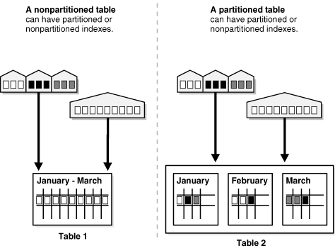
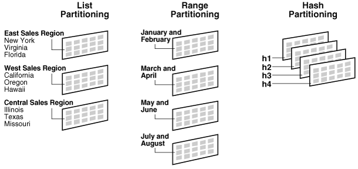
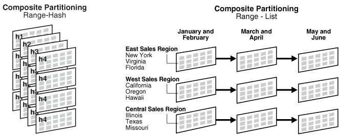
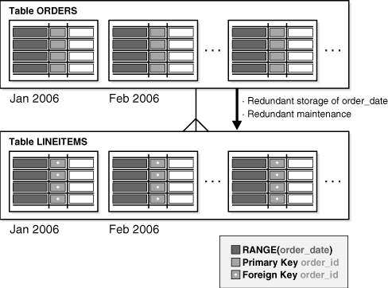
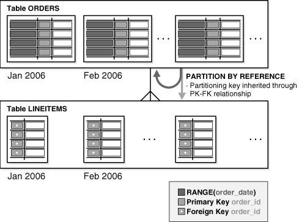
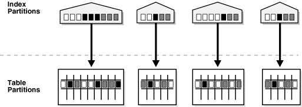
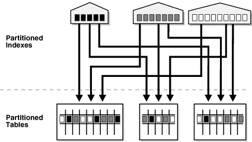
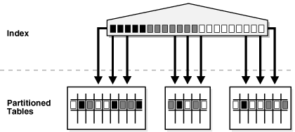

Partitioning enhances the performance, manageability, and availability of a wide variety of applications and helps reduce the total cost of ownership for storing large amounts of data.

Partitioning allows tables, indexes, and index-organized tables to be subdivided into smaller pieces, enabling these database objects to be managed and accessed at a finer level of granularity. Oracle provides a rich variety of partitioning strategies and extensions to address every business requirement. Because it is entirely transparent, partitioning can be applied to almost any application without the need for potentially expensive and time consuming application changes.

This chapter contains the following sections:

- Partitioning Overview

- Benefits of Partitioning

- Partitioning Strategies

- Partitioning Extensions

- Indexing on Partitioned Tables

### 2.1 Partitioning Overview

Partitioning provides a technique to subdivide objects into smaller pieces.

Partitioning allows a table, index, or index-organized table to be subdivided into smaller pieces, where each piece of such a database object is called a partition. Each partition has its own name, and may optionally have its own storage characteristics.

The following topics are discussed:

- Basics of Partitioning

- Partitioning Key

- Partitioned Tables

- Partitioned Index-Organized Tables

- System Partitioning

- Partitioning for Information Lifecycle Management

- Range Partitioning for Hash Clusters

- Partitioning and LOB Data

- Partitioning on External Tables

- Hybrid Partitioned Tables

- Collections in XMLType and Object Data

#### 2.1.1 Basics of Partitioning

Partitioning enables administration of an object either collectively or individually.

From the perspective of a database administrator, a partitioned object has multiple pieces that can be managed either collectively or individually. This gives an administrator considerable flexibility in managing partitioned objects. However, from the perspective of the application, a partitioned table is identical to a nonpartitioned table; no modifications are necessary when accessing a partitioned table using SQL queries and DML statements.

Figure 2-1 offers a graphical view of how partitioned tables differ from nonpartitioned tables.

Figure 2-1 Views of Partitioned and Nonpartitioned Tables

[Description of "Figure 2-1 Views of Partitioned and Nonpartitioned Tables"](img_text/vldbg008.md)

**Note:**

All partitions of a partitioned object must reside in tablespaces of the same block size.

**See Also:**

- [Oracle Database Concepts](../cncpt/logical-storage-structures.md) for more information about multiple block sizes

- [Oracle Database SQL Language Reference](../sqlrf/CREATE-TABLE.md) for general restrictions on partitioning, the exact syntax of the partitioning clauses for creating and altering partitioned tables and indexes, any restrictions on their use, and specific privileges required for creating and altering tables

#### 2.1.2 Partitioning Key

Each row in a partitioned table is unambiguously assigned to a single partition using a key.

The partitioning key consists of one or more columns that determine the partition where each row is stored. Oracle automatically directs insert, update, and delete operations to the appropriate partition with the partitioning key.

##### Validating Partition Content

You can identify whether rows in a partition are conformant to the partition definition or whether the partition key of the row is violating the partition definition with the `ORA_PARTITION_VALIDATION` SQL function. The SQL function takes a rowid as input and returns `1` if the row is in the correct partition and `0` otherwise. The function is applicable for internal, external, and hybrid partitioned tables for both internal and external partitions and subpartitions.

For example:

    SQL>  CREATE TABLE test1 (column1 NUMBER)
                 PARTITION BY RANGE(column1)
                 (PARTITION p1 VALUES LESS THAN (10),
                  PARTITION p2 VALUES LESS THAN (20));

    SQL> CREATE TABLE test2 (column1 NUMBER);

    SQL> INSERT INTO test1 VALUES (1);

    SQL> INSERT INTO test2 VALUES (99);

    SQL> ALTER TABLE test1 EXCHANGE PARTITION p2 WITH TABLE test2 WITHOUT VALIDATION;

    SQL> SELECT test1.*, ORA_PARTITION_VALIDATION(rowid) FROM test1;

    COL1       ORA_PARTITION_VALIDATION(ROWID)
    ---------- -------------------------------
             1                               1
            99                               0

**See Also:**

- [Oracle Database SQL Language Reference](../sqlrf/Functions.md) for information about SQL functions

#### 2.1.3 Partitioned Tables

Most tables can be partitioned.

Any table can be partitioned up to a million separate partitions except those tables containing columns with `LONG` or `LONG` `RAW` data types. You can, however, use tables containing columns with `CLOB` or `BLOB` data types.

The following topics are discussed:

- When to Partition a Table

- When to Partition an Index

**Note:**

To reduce disk and memory usage (specifically, the buffer cache), you can store tables and partitions of a partitioned table in a compressed format inside the database. This often improves scaleup for read-only operations. Table compression can also speed up query execution. There is, however, a slight cost in CPU overhead.

**See Also:**

[Oracle Database Administrator’s Guide](../admin/managing-tables.md) for information about guidelines for managing tables

##### 2.1.3.1 When to Partition a Table

There are certain situations when you would want to partition a table.

Here are some suggestions for situations when you should consider partitioning a table:

- Tables that are greater than 2 GB.

  These tables should always be considered as candidates for partitioning.

- Tables that contain historical data, in which new data is added into the newest partition.

  A typical example is a historical table where only the current month's data is updatable and the other 11 months are read only.

- Tables whose contents must be distributed across different types of storage devices.

##### 2.1.3.2 When to Partition an Index

There are certain situations when you would want to partition an index.

Here are some suggestions for when to consider partitioning an index:

- Avoid index maintenance when data is removed.

- Perform maintenance on parts of the data without invalidating the entire index.

- Reduce the effect of index skew caused by an index on a column with a monotonically increasing value.

#### 2.1.4 Partitioned Index-Organized Tables

Partitioned index-organized tables are very useful for providing improved performance, manageability, and availability for index-organized tables.

For partitioning an index-organized table:

- Partition columns must be a subset of the primary key columns.

- Secondary indexes can be partitioned (both locally and globally).

- `OVERFLOW` data segments are always equipartitioned with the table partitions.

**See Also:**

[Oracle Database Concepts](../cncpt/indexes-and-index-organized-tables.md) for more information about index-organized tables

#### 2.1.5 System Partitioning

System partitioning enables application-controlled partitioning without having the database controlling the data placement.

The database simply provides the ability to break down a table into partitions without knowing what the individual partitions are going to be used for. All aspects of partitioning have to be controlled by the application. For example, an attempt to insert into a system partitioned table without the explicit specification of a partition fails.

System partitioning provides the well-known benefits of partitioning (scalability, availability, and manageability), but the partitioning and actual data placement are controlled by the application.

**See Also:**

[Oracle Database Data Cartridge Developer's Guide](../addci/building-domain-indexes.md) for more information about system partitioning

#### 2.1.6 Partitioning for Information Lifecycle Management

Information Lifecycle Management (ILM) is concerned with managing data during its lifetime.

Partitioning plays a key role in ILM because it enables groups of data (that is, partitions) to be distributed across different types of storage devices and managed individually.

**See Also:**

[Managing and Maintaining Time-Based Information](time-based-info.md) for more information about Information Lifecycle Management

#### 2.1.7 Range Partitioning for Hash Clusters

Partitioned hash clusters are supported in Oracle Database.

Only single-level range partitioning is supported for partitioned hash clusters.

**See Also:**

[Oracle Database Reference](../sqlrf/ALTER-CLUSTER.md) for information about partitioned hash clusters.

#### 2.1.8 Partitioning and LOB Data

Unstructured data, such as images and documents, which is stored in a LOB column in a database can also be partitioned.

When a table is partitioned, all of the columns reside in the tablespace for that partition, except LOB columns, which can be stored in their own tablespace.

This technique is very useful when a table consists of large LOBs because they can be stored separately from the main data. This can be beneficial if the main data is being frequently updated but the LOB data is not. For example, an employee record may contain a photo which is unlikely to change frequently. However, the employee personnel details (such as address, department, manager, and so on) could change. This approach also means that you can use less expensive storage for storing the LOB data and more expensive, faster storage can be used for the employee record.

#### 2.1.9 Partitioning on External Tables

Partitioning is supported on external tables.

This functionality enables optimizations, such as static partition pruning, dynamic pruning, and partition wise join for queries over partitioned external tables. This functionality also provides incremental, partition-based statistics collection for each external table partition, which enables better optimizer plans.

**Tip:**

For data sources in the Cloud, you can create external tables manually, but Oracle recommends that you use the `DBMS_CLOUD` package to do so.

**See Also:**

- [Oracle Database Utilities](../sutil/oracle-external-tables-concepts.md) for information about external tables

- [Database PL/SQL Packages and Types Reference](../arpls/DBMS_CLOUD.md) for a complete description of the `DBMS_CLOUD` PL/SQL package.

#### 2.1.10 Hybrid Partitioned Tables

Oracle hybrid partitioned tables combine classical internal partitioned tables with Oracle external partitioned tables to form a more general partitioning called hybrid partitioned tables.

Hybrid partitioned tables enable you to easily integrate internal partitions and external partitions (those residing on sources outside the database) into a single partition table. Using this feature also enables you to easily move non-active partitions to external files for a cheaper storage solution.

Partitions of hybrid partitioned tables can reside on both Oracle tablespaces and external sources, such as Linux files with comma-separated values (CSV) records, files on Hadoop Distributed File System (HDFS) with Java server or Object Store on Cloud. Hybrid partitioned tables support all existing external table types for external partitions: `ORACLE_DATAPUMP`, `ORACLE_LOADER`, `ORACLE_HDFS`, `ORACLE_HIVE`. External table types for external partitions use the following access driver types:

- `ORACLE_DATAPUMP`

- `ORACLE_LOADER`

- `ORACLE_HDFS`

- `ORACLE_HIVE`

For external partitions of `ORACLE_LOADER` and `ORACLE_DATAPUMP` access driver type, you must grant the following privileges to the user:

- READ privileges on directories with data files

- WRITE privileges on directories with logging and bad files

- EXECUTE privileges on directories with pre-processor programs

Table-level external parameters apply to all external partitions of hybrid partitioned tables. For example, the `DEFAULT` `DIRECTORY` value defined in the `EXTERNAL` `PARTITION` `ATTRIBUTES` clause is the default location for data files and logging and bad files. You can override the default directory location with a `DEFAULT` `DIRECTORY` value in a partition clause. For external partitions of `ORACLE_HIVE` and `ORACLE_HDFS` access driver type, the `DEFAULT` `DIRECTORY` is only used to store specifications for log files.

Enforcement of constraints is not supported on data stored in external partitions because the constraints apply to the entire table. For example, primary or foreign key constraints cannot be enforced on a hybrid partitioned table. Only constraints in the `RELY` `DISABLE` mode, such as `NOT` `NULL`, primary key, unique, and foreign-primary key are supported on hybrid partitioned tables. To activate optimizations based on these constraints, set the session parameter `QUERY_REWRITE_INTEGRITY` to `TRUSTED` or `STALE_TOLERATED`.

Hybrid partitioned tables can use partition-based optimizations across internal and external partitions. Partition-based optimizations include the following across internal and external data sources:

- Static partition pruning

- Dynamic partition pruning

- Bloom pruning

Hybrid partitioned tables provide users with the capability to move data between internal and external partitions for cost effective purposes. However, Automatic Data Optimization (ADO) defined on the table level only has an effect on internal partitions of the table.

##### Supported Operations on Hybrid Partitioned Tables

The following are operations supported on hybrid partitioned tables.

- Creating single level `RANGE` and `LIST` partitioning methods

- Using `ALTER` `TABLE` .. DDLs such as `ADD`, `DROP`, and `RENAME` partitions

- Modifying for external partitions the location of the external data sources at the partition level

- Altering an existing partitioned internal table to a hybrid partitioned table containing both internal and external partitions

- Changing the existing location to an empty location resulting in an empty external partition

- Creating global partial non-unique indexes on internal partitions

- Creating materialized views on internal partitions

- Creating materialized views that include external partitions in `QUERY_REWRITE_INTEGRITY` stale tolerated mode only

- Full partition wise refreshing on external partitions

- DML trigger operations on a hybrid partitioned table on internal partitions

- Validating with `ANALYZE` `TABLE` ... `VALIDATE` `STRUCTURE` on internal partitions only on hybrid partitioned tables

- Altering an existing hybrid partitioned table with no external partitions to a partitioned table with internal partitions only

- An external partition can be exchanged with an external nonpartitioned table. Also, an internal partition can be exchanged with an internal nonpartitioned table.

##### Restrictions on Hybrid Partitioned Tables

The following are restrictions and limitations on hybrid partitioned tables.

- Restrictions that apply to external tables also apply to hybrid partitioned tables unless explicitly noted

- No support for `REFERENCE` and `SYSTEM` partitioning methods

- Only single level `LIST` and `RANGE` partitioning are supported.

- No unique indexes or global unique indexes. Only partial indexes are allowed and unique indexes cannot be partial.

- Only single level list partitioning is supported for `HIVE`.

- Attribute clustering (`CLUSTERING` clause) is not allowed.

- DML operations only on internal partitions of a hybrid partitioned table (external partitions are treated as read-only partitions)

- In-memory defined on the table level only has an effect on internal partitions of the hybrid partitioned table.

- No column default value

- Invisible columns are not allowed.

- The `CELLMEMORY` clause is not allowed.

- `SPLIT`, `MERGE`, and `MOVE` maintenance operations are not allowed on external partitions.

- LOB, LONG, and ADT types are not allowed.

- Only `RELY` constraints are allowed

**See Also:**

- [Managing Hybrid Partitioned Tables](manage_hypt.md) for information about administering hybrid partitioned tables

- [Oracle Database Administrator’s Guide](../admin/managing-tables.md) for information about hybrid partitioned external tables

- [Oracle Database Concepts](../cncpt/partitions-views-and-other-schema-objects.md) for conceptual information about partitioned tables

- [Oracle Database In-Memory Guide](../inmem/concepts-for-the-im-column-store.md) for information about the In-Memory Column Store and hybrid partition tables

- [Oracle Database SQL Tuning Guide](../tgsql/sql-performance-fundamentals.md) for information about optimizations for hybrid partitioned tables

- [Oracle Database SQL Language Reference](../sqlrf/CREATE-TABLE.md) for information about creating and altering hybrid partitioned tables using the `CREATE` `TABLE` and `ALTER` `TABLE` SQL commands

- Oracle Database Utilities for information about [using SQL\*Loader with hybrid partitioned tables](../sutil/oracle-sql-loader-concepts.md), [using Oracle Data Pump with hybrid partitioned tables](../sutil/oracle-data-pump-overview.md), and [managing external tables](../sutil/oracle-external-tables-concepts.md)

- [Oracle Database PL/SQL Packages and Types Reference](../arpls/DBMS_HADOOP.md) for information about the using PL/SQL with hybrid partitioned tables, including the `CREATE_HYBRID_PARTNED_TABLE` procedure in the DBMS_HADOOP package

- [Oracle Database Reference](../refrn/static-data-dictionary-views.md) for information about hybrid partition tables in data dictionary views, including the external family of data dictionary views and \*\_TABLES views

- [Oracle Database Data Warehousing Guide](../dwhsg/part-optimizing-dw.md) for information about materialized views and hybrid partitioned tables

#### 2.1.11 Collections in XMLType and Object Data

Partitioning when using `XMLType` and object tables and columns offers the standard advantages of partitioning, such as enabling tables and indexes to be subdivided into smaller pieces, thus enabling these database objects to be managed and accessed at a finer level of granularity.

When you partition an `XMLType` table or a table with an `XMLType` column using list, range, or hash partitioning, any ordered collection tables (OCTs) within the data are automatically partitioned accordingly, by default. This equipartitioning means that the partitioning of an OCT follows the partitioning scheme of its parent (base) table. There is a corresponding collection-table partition for each partition of the base table. A child element is stored in the collection-table partition that corresponds to the base-table partition of its parent element.

If you partition a table that has a nested table, then Oracle Database uses the partitioning scheme of the original base table as the basis for how the nested table is partitioned. This partitioning of one base table partition for each nested table partition is called equipartitioning. By default, nested tables are automatically partitioned when the base table is partitioned. Note, however, that composite partitioning is not supported for OCTs or nested tables.

**See Also:**

- [Partitioning of Collections in XMLType and Objects](partition-create-tables-indexes.md) for information about partitioning an `XMLType` table

- [Oracle Database SQL Language Reference](../sqlrf/CREATE-TABLE.md) for syntax of nested tables

- [Oracle Database Object-Relational Developer's Guide](../adobj/partitioning-table-that-contain-oracle-objects.md)

### 2.2 Benefits of Partitioning

Partitioning can provide tremendous benefit to a wide variety of applications by improving performance, manageability, and availability.

It is not unusual for partitioning to greatly improve the performance of certain queries or maintenance operations. Moreover, partitioning can greatly simplify common administration tasks.

Partitioning also enables database designers and administrators to solve some difficult problems posed by cutting-edge applications. Partitioning is a key tool for building multi-terabyte systems or systems with extremely high availability requirements.

The following topics are discussed:

- Partitioning for Performance

- Partitioning for Manageability

- Partitioning for Availability

#### 2.2.1 Partitioning for Performance

You can use partitioning to improve performance.

By limiting the amount of data to be examined or operated on, and by providing data distribution for parallel execution, partitioning provides multiple performance benefits. Partitioning features include:

- Partition Pruning for Performance

- Partition-Wise Joins for Performance

##### 2.2.1.1 Partition Pruning for Performance

Partition pruning is the simplest and also the most substantial means to improve performance using partitioning.

Partition pruning can often improve query performance by several orders of magnitude. For example, suppose an application contains an `Orders` table containing a historical record of orders, and that this table has been partitioned by week. A query requesting orders for a single week would only access a single partition of the `Orders` table. If the `Orders` table had 2 years of historical data, then this query would access one partition instead of 104 partitions. This query could potentially execute 100 times faster simply because of partition pruning.

Partition pruning works with all of Oracle performance features. Oracle uses partition pruning with any indexing or join technique, or parallel access method.

##### 2.2.1.2 Partition-Wise Joins for Performance

Partitioning can also improve the performance of multi-table joins by using a technique known as partition-wise joins.

Partition-wise joins can be applied when two tables are being joined and both tables are partitioned on the join key, or when a reference partitioned table is joined with its parent table. Partition-wise joins break a large join into smaller joins that occur between each of the partitions, completing the overall join in less time. This offers significant performance benefits both for serial and parallel execution.

#### 2.2.2 Partitioning for Manageability

Partitioning enables you to partition tables and indexes into smaller, more manageable units, providing database administrators with the ability to pursue a divide and conquer approach to data management.

With partitioning, maintenance operations can be focused on particular portions of tables. For example, you could back up a single partition of a table, rather than back up the entire table. For maintenance operations across an entire database object, it is possible to perform these operations on a per-partition basis, thus dividing the maintenance process into more manageable chunks.

A typical usage of partitioning for manageability is to support a rolling window load process in a data warehouse. Suppose that you load new data into a table on a weekly basis. That table could be partitioned so that each partition contains one week of data. The load process is simply the addition of a new partition using a partition exchange load. Adding a single partition is much more efficient than modifying the entire table, because you do not need to modify any other partitions.

#### 2.2.3 Partitioning for Availability

Partitioned database objects provide partition independence. This characteristic of partition independence can be an important part of a high-availability strategy.

For example, if one partition of a partitioned table is unavailable, then all of the other partitions of the table remain online and available. The application can continue to execute queries and transactions against the available partitions for the table, and these database operations can run successfully, provided they do not need to access the unavailable partition.

The database administrator can specify that each partition be stored in a separate tablespace; the most common scenario is having these tablespaces stored on different storage tiers. Storing different partitions in different tablespaces enables you to do backup and recovery operations on each individual partition, independent of the other partitions in the table. Thus allowing the active parts of the database to be made available sooner so access to the system can continue, while the inactive data is still being restored. Moreover, partitioning can reduce scheduled downtime. The performance gains provided by partitioning may enable you to complete maintenance operations on large database objects in relatively small batch windows.

### 2.3 Partitioning Strategies

Oracle Partitioning offers three fundamental data distribution methods as basic partitioning strategies that control how data is placed into individual partitions.

These strategies are:

- Range

- Hash

- List

Using these data distribution methods, a table can either be partitioned as a single-level or as a composite-partitioned table:

- Single-Level Partitioning

- Composite Partitioning

Each partitioning strategy has different advantages and design considerations. Thus, each strategy is more appropriate for a particular situation.

#### 2.3.1 Single-Level Partitioning

Single-level partitioning includes range, hash, and list partitioning.

A table is defined by specifying one of the following data distribution methodologies, using one or more columns as the partitioning key:

- Range Partitioning

- Hash Partitioning

- List Partitioning

For example, consider a table with a column of type `NUMBER` as the partitioning key and two partitions less_than_five_hundred and less_than_one_thousand. The less_than_one_thousand partition contains rows where the following condition is true:

    500 <= partitioning key < 1000

Figure 2-2 offers a graphical view of the basic partitioning strategies for a single-level partitioned table.

Figure 2-2 List, Range, and Hash Partitioning

[Description of "Figure 2-2 List, Range, and Hash Partitioning"](img_text/vldbg005.md)

##### 2.3.1.1 Range Partitioning

Range partitioning maps data to partitions based on ranges of values of the partitioning key that you establish for each partition.

Range partitioning is the most common type of partitioning and is often used with dates. For a table with a date column as the partitioning key, the January-2017 partition would contain rows with partitioning key values from 01-Jan-2017 to 31-Jan-2017.

Each partition has a `VALUES` `LESS` `THAN` clause, that specifies a non-inclusive upper bound for the partitions. Any values of the partitioning key equal to or higher than this literal are added to the next higher partition. All partitions, except the first, have an implicit lower bound specified by the `VALUES` `LESS` `THAN` clause of the previous partition.

A `MAXVALUE` literal can be defined for the highest partition. `MAXVALUE` represents a virtual infinite value that sorts higher than any other possible value for the partitioning key, including the NULL value.

##### 2.3.1.2 Hash Partitioning

Hash partitioning maps data to partitions based on a hashing algorithm that Oracle applies to the partitioning key that you identify.

The hashing algorithm evenly distributes rows among partitions, giving partitions approximately the same size.

Hash partitioning is the ideal method for distributing data evenly across devices. Hash partitioning is also an easy-to-use alternative to range partitioning, especially when the data to be partitioned is not historical or has no obvious partitioning key.

**Note:**

You cannot change the hashing algorithms used by partitioning.

##### 2.3.1.3 List Partitioning

List partitioning enables you to explicitly control how rows map to partitions by specifying a list of discrete values for the partitioning key in the description for each partition.

The advantage of list partitioning is that you can group and organize unordered and unrelated sets of data in a natural way. For a table with a region column as the partitioning key, the East Sales Region partition might contain values New York, Virginia, and Florida.

The `DEFAULT` partition enables you to avoid specifying all possible values for a list-partitioned table by using a default partition, so that all rows that do not map to any other partition do not generate an error.

#### 2.3.2 Composite Partitioning

Composite partitioning is a combination of the basic data distribution methods.

With composite partitioning, a table is partitioned by one data distribution method and then each partition is further subdivided into subpartitions using a second data distribution method. All subpartitions for a given partition represent a logical subset of the data.

Composite partitioning supports historical operations, such as adding new range partitions, but also provides higher degrees of potential partition pruning and finer granularity of data placement through subpartitioning. Figure 2-3 offers a graphical view of range-hash and range-list composite partitioning, as an example.

Figure 2-3 Composite Range—List Partitioning

[Description of "Figure 2-3 Composite Range—List Partitioning"](img_text/vldbg009.md)

The types of composite partitioning are:

- Composite Range-Range Partitioning

- Composite Range-Hash Partitioning

- Composite Range-List Partitioning

- Composite List-Range Partitioning

- Composite List-Hash Partitioning

- Composite List-List Partitioning

- Composite Hash-Hash Partitioning

- Composite Hash-List Partitioning

- Composite Hash-Range Partitioning

##### 2.3.2.1 Composite Range-Range Partitioning

Composite range-range partitioning enables logical range partitioning along two dimensions.

An example of composite range-range partitioning is partition by `order_date` and range subpartition by `shipping_date`.

##### 2.3.2.2 Composite Range-Hash Partitioning

Composite range-hash partitioning partitions data using the range method, and within each partition, subpartitions it using the hash method.

Composite range-hash partitioning provides the improved manageability of range partitioning and the data placement, striping, and parallelism advantages of hash partitioning.

##### 2.3.2.3 Composite Range-List Partitioning

Composite range-list partitioning partitions data using the range method, and within each partition, subpartitions it using the list method.

Composite range-list partitioning provides the manageability of range partitioning and the explicit control of list partitioning for the subpartitions.

##### 2.3.2.4 Composite List-Range Partitioning

Composite list-range partitioning enables logical range subpartitioning within a given list partitioning strategy.

An example of composite list-range partitioning is list partition by `country_id` and range subpartition by `order_date`.

##### 2.3.2.5 Composite List-Hash Partitioning

Composite list-hash partitioning enables hash subpartitioning of a list-partitioned object.

A composite list-hash partitioning, is useful to enable partition-wise joins.

##### 2.3.2.6 Composite List-List Partitioning

Composite list-list partitioning enables logical list partitioning along two dimensions.

An example of composite list-list partitioning is list partition by `country_id` and list subpartition by `sales_channel`.

##### 2.3.2.7 Composite Hash-Hash Partitioning

Composite hash-hash partitioning enables hash partitioning along two dimensions.

The composite hash-hash partitioning technique is beneficial to enable partition-wise joins along two dimensions.

##### 2.3.2.8 Composite Hash-List Partitioning

Composite hash-list partitioning is introduced in this topic.

Composite hash-list partitioning enables hash partitioning along two dimensions.

##### 2.3.2.9 Composite Hash-Range Partitioning

Composite hash-range partitioning is introduced in this topic.

Composite hash-range partitioning enables hash partitioning along two dimensions.

### 2.4 Partitioning Extensions

In addition to the basic partitioning strategies, Oracle Database provides partitioning extensions.

Oracle Database provides the following types of partitioning extensions:

- Manageability Extensions

- Partitioning Key Extensions

#### 2.4.1 Manageability Extensions

Manageability extensions for partitioning are introduced in this topic.

The following extensions significantly enhance the manageability of partitioned tables:

- Interval Partitioning

- Partition Advisor

##### 2.4.1.1 Interval Partitioning

Interval partitioning is an extension of range partitioning .

Interval partitioning instructs the database to automatically create partitions of a specified interval when data inserted into the table exceeds all of the existing range partitions. You must specify at least one range partition. The range partitioning key value determines the high value of the range partitions, which is called the transition point, and the database creates interval partitions for data with values that are beyond that transition point. The lower boundary of every interval partition is the non-inclusive upper boundary of the previous range or interval partition.

For example, if you create an interval partitioned table with monthly intervals and you set the transition point at January 1, 2007, then the lower boundary for the January 2007 interval is January 1, 2007. The lower boundary for the July 2007 interval is July 1, 2007, regardless of whether the June 2007 partition was created.

You can create single-level interval partitioned tables and the following composite partitioned tables:

- Interval-range

- Interval-hash

- Interval-list

Interval partitioning supports a subset of the capabilities of range partitioning.

**See Also:**

[Oracle Database SQL Language Reference](../sqlrf/CREATE-TABLE.md) for information about restrictions when using interval partitioning

##### 2.4.1.2 Partition Advisor

The Partition Advisor is part of the SQL Access Advisor.

The Partition Advisor can recommend a partitioning strategy for a table based on a supplied workload of SQL statements which can be supplied by the SQL Cache, a SQL Tuning set, or be defined by the user.

#### 2.4.2 Partitioning Key Extensions

Extensions to partitioning keys are introduced in this topic.

The following extensions extend the flexibility in defining partitioning keys:

- Reference Partitioning

- Virtual Column-Based Partitioning

##### 2.4.2.1 Reference Partitioning

Reference partitioning enables the partitioning of two tables that are related to one another by referential constraints.

The partitioning key is resolved through an existing parent-child relationship, enforced by enabled and active primary key and foreign key constraints.

The benefit of this extension is that tables with a parent-child relationship can be logically equipartitioned by inheriting the partitioning key from the parent table without duplicating the key columns. The logical dependency also automatically cascades partition maintenance operations, thus making application development easier and less error-prone.

An example of reference partitioning is the `Orders` and `LineItems` tables related to each other by a referential constraint `orderid_refconstraint`. Namely, `LineItems.order_id` references `Orders.order_id`. The `Orders` table is range partitioned on `order_date`. Reference partitioning on `orderid_refconstraint` for `LineItems` leads to creation of the following partitioned table, which is equipartitioned on the `Orders` table, as shown in Figure 2-4 and Figure 2-5.

Figure 2-4 Before Reference Partitioning

[Description of "Figure 2-4 Before Reference Partitioning"](img_text/vldbg001.md)

Figure 2-5 With Reference Partitioning

[Description of "Figure 2-5 With Reference Partitioning"](img_text/vldbg002.md)

All basic partitioning strategies are available for reference partitioning. Interval partitioning can also be used with reference partitioning.

**Note:**

Reference partitioning is not supported with the online redefinition package (`DBMS_REDEFINITION`).

##### 2.4.2.2 Virtual Column-Based Partitioning

Oracle partitioning includes a partitioning strategy defined on virtual columns.

Virtual columns enable the partitioning key to be defined by an expression, using one or more existing columns of a table. The expression is stored as metadata only. For example, a ten-digit account ID can include account branch information as the leading three digits. With the extension of virtual column based partitioning, an `ACCOUNTS` table containing an `ACCOUNT_ID` column can be extended with a virtual (derived) column `ACCOUNT_BRANCH`. `ACCOUNT_BRANCH` is derived from the first three digits of the `ACCOUNT_ID` column, which becomes the partitioning key for this table.

Virtual column-based partitioning is supported with all basic partitioning strategies, including reference partitioning, and interval and interval-\* composite partitioning.

### 2.5 Indexing on Partitioned Tables

Indexes on partitioned tables can either be nonpartitioned or partitioned.

As with partitioned tables, partitioned indexes improve manageability, availability, performance, and scalability. They can either be partitioned independently (global indexes) or automatically linked to a table's partitioning method (local indexes). In general, you should use global indexes for OLTP applications and local indexes for data warehousing or decision support systems (DSS) applications.

The following topics are discussed:

- Deciding on the Type of Partitioned Index to Use

- Local Partitioned Indexes

- Global Partitioned Indexes

- Global Nonpartitioned Indexes

- Miscellaneous Information about Creating Indexes on Partitioned Tables

- Partial Indexes for Partitioned Tables

- Partitioned Indexes on Composite Partitions

#### 2.5.1 Deciding on the Type of Partitioned Index to Use

The type of partitioned index to use should be chosen after reviewing various factors.

When deciding what kind of partitioned index to use, you should consider the following guidelines in this order:

1.  If the table partitioning column is a subset of the index keys, then use a local index. If this is the case, then you are finished. If this is not the case, then continue to guideline 2.

2.  If the index is unique and does not include the partitioning key columns, then use a global index. If this is the case, then you are finished. Otherwise, continue to guideline 3.

3.  If your priority is manageability, then consider a local index. If this is the case, then you are finished. If this is not the case, continue to guideline 4.

4.  If the application is an OLTP type and users need quick response times, then use a global index. If the application is a DSS type and users are more interested in throughput, then use a local index.

**See Also:**

- [Using Partitioning in a Data Warehouse Environment](partition-warehouse.md) for information about partitioned indexes and how to decide which type to use in data warehouse environment

- [Using Partitioning in an Online Transaction Processing Environment](partition-oltp.md) for information about partitioned indexes and how to decide which type to use in an online transaction processing environment

#### 2.5.2 Local Partitioned Indexes

Local partitioned indexes are easier to manage than other types of partitioned indexes.

They also offer greater availability and are common in DSS environments. The reason for this is equipartitioning: each partition of a local index is associated with exactly one partition of the table. This functionality enables Oracle to automatically keep the index partitions synchronized with the table partitions, and makes each table-index pair independent. Any actions that make one partition's data invalid or unavailable only affect a single partition.

Local partitioned indexes support more availability when there are partition or subpartition maintenance operations on the table. A type of index called a local nonprefixed index is very useful for historical databases. In this type of index, the partitioning is not on the left prefix of the index columns.

You cannot explicitly add a partition to a local index. Instead, new partitions are added to local indexes only when you add a partition to the underlying table. Likewise, you cannot explicitly drop a partition from a local index. Instead, local index partitions are dropped only when you drop a partition from the underlying table.

A local index can be unique. However, in order for a local index to be unique, the partitioning key of the table must be part of the index's key columns.

Figure 2-6 offers a graphical view of local partitioned indexes.

Figure 2-6 Local Partitioned Index

[Description of "Figure 2-6 Local Partitioned Index"](img_text/vldbg003.md)

**See Also:**

- [Index Partitioning](index-partitioning.md) for more information about prefixed indexes

- [Local Partitioned Indexes](index-partitioning.md) for more information about local partitioned indexes

#### 2.5.3 Global Partitioned Indexes

Global partitioned indexes are introduced in the topic.

Oracle offers global range partitioned indexes and global hash partitioned indexes, discussed in the following topics:

- Global Range Partitioned Indexes

- Global Hash Partitioned Indexes

- Maintenance of Global Partitioned Indexes

##### 2.5.3.1 Global Range Partitioned Indexes

Global range partitioned indexes are flexible in that the degree of partitioning and the partitioning key are independent from the table's partitioning method.

The highest partition of a global index must have a partition bound, all of whose values are `MAXVALUE`. This ensures that all rows in the underlying table can be represented in the index. Global prefixed indexes can be unique or nonunique.

You cannot add a partition to a global index because the highest partition always has a partition bound of `MAXVALUE`. To add a new highest partition, use the `ALTER` `INDEX` `SPLIT` `PARTITION` statement. If a global index partition is empty, you can explicitly drop it by issuing the `ALTER` `INDEX` `DROP` `PARTITION` statement. If a global index partition contains data, dropping the partition causes the next highest partition to be marked unusable. You cannot drop the highest partition in a global index.

##### 2.5.3.2 Global Hash Partitioned Indexes

Global hash partitioned indexes improve performance by spreading out contention when the index is monotonically growing.

In other words, most of the index insertions occur only on the right edge of an index, which is uniformly spread across N hash partitions for a global hash partitioned index.

##### 2.5.3.3 Maintenance of Global Partitioned Indexes

The maintenance of global partitioned indexes is introduced in this topic.

By default, the following operations on partitions on a heap-organized table mark all global indexes as unusable:

    ADD (HASH)
    COALESCE (HASH)
    DROP
    EXCHANGE
    MERGE
    MOVE
    SPLIT
    TRUNCATE

These indexes can be maintained by appending the clause `UPDATE INDEXES` to the SQL statements for the operation. Note, however, that appending the `UPDATE` `INDEXES` clause maintains the global index as part of the partition maintenance operation, potentially elongating the run time of the operation and increasing the resource requirements.

The two advantages to maintaining global indexes are:

- The index remains available and online throughout the operation. Hence no other applications are affected by this operation.

- The index does not have to be rebuilt after the operation.

- The global index maintenance for `DROP` and `TRUNCATE` is implemented as metadata-only operation.

**Note:**

This feature is supported only for heap-organized tables.

Figure 2-7 offers a graphical view of global partitioned indexes.

Figure 2-7 Global Partitioned Index

[Description of "Figure 2-7 Global Partitioned Index"](img_text/vldbg007.md)

**See Also:**

[Global Partitioned Indexes](index-partitioning.md) for more information about global partitioned indexes

#### 2.5.4 Global Nonpartitioned Indexes

Global nonpartitioned indexes behave just like local nonpartitioned indexes.

Figure 2-8 offers a graphical view of global nonpartitioned indexes.

Figure 2-8 Global Nonpartitioned Index

[Description of "Figure 2-8 Global Nonpartitioned Index"](img_text/vldbg006.md)

#### 2.5.5 Miscellaneous Information about Creating Indexes on Partitioned Tables

You can create bitmap indexes on partitioned tables, with some restrictions.

Bitmap indexes must be local to the partitioned table. They cannot be global indexes.

Global indexes can be unique. Local indexes can only be unique if the partitioning key is a part of the index key.

#### 2.5.6 Partial Indexes for Partitioned Tables

You can create local and global indexes on a subset of the partitions of a table, enabling more flexibility in index creation.

This feature is supported using a default table indexing property. When a table is created or altered, a default indexing property can be specified for the table or its partitions. The table indexing property is only considered for partial indexes.

When an index is created as `PARTIAL` on a table:

- Local indexes: An index partition is created usable if indexing is turned on for the table partition, and unusable otherwise. You can override this behavior by specifying `USABLE`/`UNUSABLE` at the index or index partition level.

- Global indexes: Includes only those partitions for which indexing is turned on, and exclude the others.

This feature is not supported for unique indexes, or for indexes used for enforcing unique constraints. `FULL` is the default if neither `FULL` nor `PARTIAL` is specified.

By default, any index is created as `FULL` index, which decouples the index from the table indexing property.

The `INDEXING` clause may also be specified at the partition and subpartition levels.

The following SQL DDL creates a table with these items:

- Partitions `ORD_P1` and `ORD_P3` are included in all partial global indexes

- Local index partitions (for indexes created `PARTIAL`) corresponding to the above two table partitions are created usable by default.

- Other partitions are excluded from all partial global indexes, and created unusable in local indexes (for indexes created `PARTIAL`).

<!-- -->

    CREATE TABLE orders (
      order_id NUMBER(12),
      order_date DATE CONSTRAINT order_date_nn NOT NULL,
      order_mode VARCHAR2(8),
      customer_id NUMBER(6) CONSTRAINT order_customer_id_nn NOT NULL,
      order_status NUMBER(2),
      order_total NUMBER(8,2),
      sales_rep_id NUMBER(6),
      promotion_id NUMBER(6),
      CONSTRAINT order_mode_lov CHECK (order_mode in ('direct','online')),
      CONSTRAINT order_total_min CHECK (order_total >= 0))
       INDEXING OFF
       PARTITION BY RANGE (ORDER_DATE)
       (PARTITION ord_p1 VALUES LESS THAN (TO_DATE('01-MAR-1999','DD-MON-YYYY'))
         INDEXING ON,
       PARTITION ord_p2 VALUES LESS THAN (TO_DATE('01-JUL-1999','DD-MON-YYYY'))
         INDEXING OFF,
       PARTITION ord_p3 VALUES LESS THAN (TO_DATE('01-OCT-1999','DD-MON-YYYY'))
         INDEXING ON,
       PARTITION ord_p4 VALUES LESS THAN (TO_DATE('01-MAR-2000','DD-MON-YYYY')),
       PARTITION ord_p5 VALUES LESS THAN (TO_DATE('01-MAR-2010','DD-MON-YYYY')));

A local or global partial index, can be created to follow the table indexing properties of the previous SQL example by specification of the `INDEXING` `PARTIAL` clause.

    CREATE INDEX ORDERS_ORDER_TOTAL_GIDX ON ORDERS (ORDER_TOTAL)
       GLOBAL INDEXING PARTIAL;

The `ORDERS_ORDER_TOTAL_GIDX` index is created to index only those partitions that have `INDEXING` `ON`, and excludes the remaining partitions.

Updates to views include the following:

- Table Indexing Property - The column `INDEXING` is added to \*`_PART_TABLES`, \*`_TAB_PARTITIONS`, and \*`_TAB_SUBPARTITIONS` views.

  This column has one of two values `ON` or `OFF`, specifying indexing on or indexing off.

- Partial Global Indexes as an Index Level Property - A new column `INDEXING` is added to the `USER_INDEXES` view. This column can be set to `FULL` or `PARTIAL`.

- Partial Global Index Optimization - The column `ORPHANED_ENTRIES` is added to the dictionary views `USER_INDEXES` and `USER_IND_PARTITIONS` to represent if a global index (partition) contains stale entries owing to deferred index maintenance during `DROP`/`TRUNCATE` `PARTITION`, or `MODIFY` `PARTITION` `INDEXING` `OFF`. The column can have one of the following values:

  - `YES` =\> the index (partition) contains orphaned entries

  - `NO` =\> the index (partition) does not contain any orphaned entries

**See Also:**

[Oracle Database Reference](../refrn/about-static-data-dictionary-views.md) for information about the database views

#### 2.5.7 Partitioned Indexes on Composite Partitions

There a few items to consider when partitioned indexes on composite partitions

When using partitioned indexes on composite partitions, note the following:

- Subpartitioned indexes are always local and stored with the table subpartition by default.

- Tablespaces can be specified at either index or index subpartition levels.
