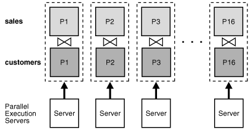
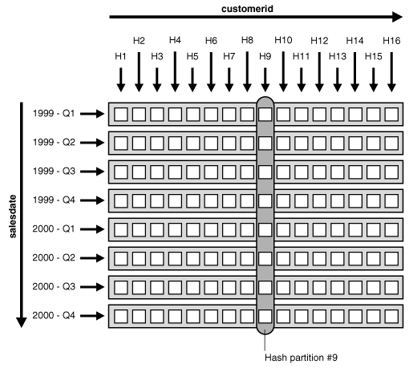
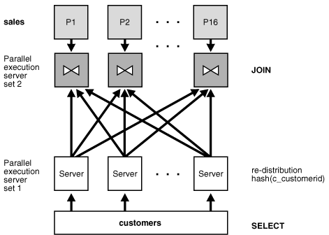

Partition-wise operations significantly reduce response time and improve the use of both CPU and memory resources.

Partition-wise joins can reduce query response time by minimizing the amount of data exchanged among parallel execution servers when joins execute in parallel. In Oracle Real Application Clusters (Oracle RAC) environments, partition-wise joins also avoid or at least limit the data traffic over the interconnect, which is the key to achieving good scalability for massive join operations. Parallel partition-wise joins are used commonly for processing large joins efficiently and fast. Partition-wise joins can be full or partial. Oracle Database decides which type of join to use.

In addition to parallel partition-wise joins, queries using the `SELECT` `DISTINCT` clause and SQL window functions can perform parallel partition-wise operations.

The following topics are discussed:

- Full Partition-Wise Joins

- Partial Partition-Wise Joins

**See Also:**

- [Partition-Wise Joins in a Data Warehouse](partition-warehouse.md) for information about parallel partition-wise operations in a data warehouse environment

- [Oracle Database Data Warehousing Guide](../dwhsg/data-warehouse-optimizations-techniques.md) for information about data warehousing and optimization techniques

### 3.2.1 Full Partition-Wise Joins

A full partition-wise join divides a large join into smaller joins between a pair of partitions from the two joined tables.

To use full partition-wise joins, you must equipartition both tables on their join keys, or use reference partitioning.

You can use various partitioning methods to equipartition both tables. These methods are described at a high level in the following topics:

- Querying a Full Partition-Wise Join

- Full Partition-Wise Joins: Single-Level - Single-Level

- Full Partition-Wise Joins: Composite - Single-Level

- Full Partition-Wise Joins: Composite - Composite

#### 3.2.1.1 Querying a Full Partition-Wise Join

You can query using a full partition-wise join.

Consider a large join between a sales table and a customer table on the column `cust_id`, as shown in Example 3-4. The query "find the records of all customers who bought more than 100 articles in Quarter 3 of 1999" is a typical example of a SQL statement performing such a join.

Such a large join is typical in data warehousing environments. In this case, the entire customer table is joined with one quarter of the sales data. In large data warehouse applications, this might mean joining millions of rows. The join method to use in that case is obviously a hash join. You can reduce the processing time for this hash join even more if both tables are equipartitioned on the `cust_id` column. This functionality enables a full partition-wise join.

When you execute a full partition-wise join in parallel, the granule of parallelism is a partition. Consequently, the degree of parallelism is limited to the number of partitions. For example, you require at least 16 partitions to set the degree of parallelism of the query to 16.

Example 3-4 Querying with a full partition-wise join

    SELECT c.cust_last_name, COUNT(*)
      FROM sales s, customers c
      WHERE s.cust_id = c.cust_id AND
            s.time_id BETWEEN TO_DATE('01-JUL-1999', 'DD-MON-YYYY') AND
            (TO_DATE('01-OCT-1999', 'DD-MON-YYYY'))
      GROUP BY c.cust_last_name HAVING COUNT(*) > 100;

#### 3.2.1.2 Full Partition-Wise Joins: Single-Level - Single-Level

A single-level to single-level full partition-wise join is the simplest method: two tables are both partitioned by the join column.

In the example, the `customers` and `sales` tables are both partitioned on the `cust_id` columns. This partitioning method enables full partition-wise joins when the tables are joined on `cust_id`, both representing the same customer identification number. This scenario is available for range-range, list-list, and hash-hash partitioning. Interval-range and interval-interval full partition-wise joins are also supported and can be compared to range-range.

In serial, this join is performed between pairs of matching hash partitions, one at a time. When one partition pair has been joined, the join of another partition pair begins. The join completes when all partition pairs have been processed. To ensure a good workload distribution, you should either have many more partitions than the requested degree of parallelism or use equisize partitions with as many partitions as the requested degree of parallelism. Using hash partitioning on a unique or almost-unique column, with the number of partitions equal to a power of 2, is a good way to create equisized partitions.

**Note:**

- A pair of matching hash partitions is defined as one partition with the same partition number from each table. For example, with full partition-wise joins based on hash partitioning, the database joins partition 0 of `sales` with partition 0 of `customers`, partition 1 of `sales` with partition 1 of `customers`, and so on.

- Reference partitioning is an easy way to co-partition two tables so that the optimizer can always consider a full partition-wise join if the tables are joined in a statement.

Parallel execution of a full partition-wise join is a straightforward parallelization of the serial execution. Instead of joining one partition pair at a time, partition pairs are joined in parallel by the query servers. Figure 3-1 illustrates the parallel execution of a full partition-wise join.

Figure 3-1 Parallel Execution of a Full Partition-wise Join

[Description of "Figure 3-1 Parallel Execution of a Full Partition-wise Join"](img_text/vldbg017.md)

The following example shows the execution plan for `sales` and `customers` co-partitioned by hash with the same number of partitions. The plan shows a full partition-wise join.

    explain plan for SELECT c.cust_last_name, COUNT(*)
    FROM sales s, customers c
    WHERE s.cust_id = c.cust_id AND
    s.time_id BETWEEN TO_DATE('01-JUL-1999', 'DD-MON-YYYY') AND
         (TO_DATE('01-OCT-1999', 'DD-MON-YYYY'))
    GROUP BY c.cust_last_name HAVING COUNT(*) > 100;

    -------------------------------------------------------------------------------------------------------------
    | Id  | Operation                    | Name      | Rows  | Bytes | Pstart| Pstop|    TQ  |IN-OUT| PQ Distrib|
    -------------------------------------------------------------------------------------------------------------
    |   0 | SELECT STATEMENT             |           |    46 |  1196 |       |      |        |      |           |
    |   1 |  PX COORDINATOR              |           |       |       |       |      |        |      |           |
    |   2 |   PX SEND QC (RANDOM)        | :TQ10001  |    46 |  1196 |       |      |  Q1,01 | P->S | QC (RAND) |
    |*  3 |    FILTER                    |           |       |       |       |      |  Q1,01 | PCWC |           |
    |   4 |     HASH GROUP BY            |           |    46 |  1196 |       |      |  Q1,01 | PCWP |           |
    |   5 |      PX RECEIVE              |           |    46 |  1196 |       |      |  Q1,01 | PCWP |           |
    |   6 |       PX SEND HASH           | :TQ10000  |    46 |  1196 |       |      |  Q1,00 | P->P | HASH      |
    |   7 |        HASH GROUP BY         |           |    46 |  1196 |       |      |  Q1,00 | PCWP |           |
    |   8 |         PX PARTITION HASH ALL|           | 59158 |  1502K|     1 |   16 |  Q1,00 | PCWC |           |
    |*  9 |          HASH JOIN           |           | 59158 |  1502K|       |      |  Q1,00 | PCWP |           |
    |  10 |           TABLE ACCESS FULL  | CUSTOMERS | 55500 |   704K|     1 |   16 |  Q1,00 | PCWP |           |
    |* 11 |           TABLE ACCESS FULL  | SALES     | 59158 |   751K|     1 |   16 |  Q1,00 | PCWP |           |
    -------------------------------------------------------------------------------------------------------------

    Predicate Information (identified by operation id):
    ---------------------------------------------------

       3 - filter(COUNT(SYS_OP_CSR(SYS_OP_MSR(COUNT(*)),0))>100)
       9 - access("S"."CUST_ID"="C"."CUST_ID")
      11 - filter("S"."TIME_ID"<=TO_DATE(' 1999-10-01 00:00:00', 'syyyy-mm-dd hh24:mi:ss') AND
    "S"."TIME_ID">=TO_DATE(' 1999-07-01
                  00:00:00', 'syyyy-mm-dd hh24:mi:ss'))

**Note:**

The `Cost (%CPU)` and `Time` columns were removed from the plan table output in this example.

In Oracle RAC environments running on massive parallel processing (MPP) platforms, placing partitions on nodes is critical to achieving good scalability. To avoid remote I/O, both matching partitions should have affinity to the same node. Partition pairs should be spread over all of the nodes to avoid bottlenecks and to use all CPU resources available on the system.

Nodes can host multiple pairs when there are more pairs than nodes. For example, with an 8-node system and 16 partition pairs, each node receives two pairs.

**See Also:**

[Oracle Real Application Clusters Administration and Deployment Guide](../racad/introduction-to-oracle-rac.md) for more information about data affinity

#### 3.2.1.3 Full Partition-Wise Joins: Composite - Single-Level

A composite to single-level full partition-wise join is a variation of the single-level - single-level method.

In this scenario, one table (typically the larger table) is composite partitioned on two dimensions, using the join columns as the subpartition key. In the example, the `sales` table is a typical example of a table storing historical data. Using range partitioning is a logical initial partitioning method for a table storing historical information.

For example, assume you want to partition the `sales` table into eight partitions by range on the column `time_id`. Also assume you have two years and that each partition represents a quarter. Instead of using range partitioning, you can use composite partitioning to enable a full partition-wise join while preserving the partitioning on `time_id`. For example, partition the `sales` table by range on `time_id` and then subpartition each partition by hash on `cust_id` using 16 subpartitions for each partition, for a total of 128 subpartitions. The `customers` table can use hash partitioning with 16 partitions.

When you use the method just described, a full partition-wise join works similarly to the one created by a single-level - single-level hash-hash method. The join is still divided into 16 smaller joins between hash partition pairs from both tables. The difference is that now each hash partition in the `sales` table is composed of a set of 8 subpartitions, one from each range partition.

Figure 3-2 illustrates how the hash partitions are formed in the `sales` table. Each cell represents a subpartition. Each row corresponds to one range partition, for a total of 8 range partitions. Each range partition has 16 subpartitions. Each column corresponds to one hash partition for a total of 16 hash partitions; each hash partition has 8 subpartitions. Hash partitions can be defined only if all partitions have the same number of subpartitions, in this case, 16.

Hash partitions are implicit in a composite table. However, Oracle does not record them in the data dictionary, and you cannot manipulate them with DDL commands as you can range or list partitions.

Figure 3-2 Range and Hash Partitions of a Composite Table

[Description of "Figure 3-2 Range and Hash Partitions of a Composite Table"](img_text/vldbg010.md)

The following example shows the execution plan for the full partition-wise join with the `sales` table range partitioned by `time_id`, and subpartitioned by hash on `cust_id`.

    ----------------------------------------------------------------------------------------------
    | Id  | Operation                            | Name      | Pstart| Pstop |IN-OUT| PQ Distrib |
    ----------------------------------------------------------------------------------------------
    |   0 | SELECT STATEMENT                     |           |       |       |      |            |
    |   1 |  PX COORDINATOR                      |           |       |       |      |            |
    |   2 |   PX SEND QC (RANDOM)                | :TQ10001  |       |       | P->S | QC (RAND)  |
    |*  3 |    FILTER                            |           |       |       | PCWC |            |
    |   4 |     HASH GROUP BY                    |           |       |       | PCWP |            |
    |   5 |      PX RECEIVE                      |           |       |       | PCWP |            |
    |   6 |       PX SEND HASH                   | :TQ10000  |       |       | P->P | HASH       |
    |   7 |        HASH GROUP BY                 |           |       |       | PCWP |            |
    |   8 |         PX PARTITION HASH ALL        |           |     1 |    16 | PCWC |            |
    |*  9 |          HASH JOIN                   |           |       |       | PCWP |            |
    |  10 |           TABLE ACCESS FULL          | CUSTOMERS |     1 |    16 | PCWP |            |
    |  11 |           PX PARTITION RANGE ITERATOR|           |     8 |     9 | PCWC |            |
    |* 12 |            TABLE ACCESS FULL         | SALES     |   113 |   144 | PCWP |            |
    ----------------------------------------------------------------------------------------------

    Predicate Information (identified by operation id):
    ---------------------------------------------------

       3 - filter(COUNT(SYS_OP_CSR(SYS_OP_MSR(COUNT(*)),0))>100)
       9 - access("S"."CUST_ID"="C"."CUST_ID")
      12 - filter("S"."TIME_ID"<=TO_DATE(' 1999-10-01 00:00:00', 'syyyy-mm-dd hh24:mi:ss') AND
    "S"."TIME_ID">=TO_DATE(' 1999-07-01
                  00:00:00', 'syyyy-mm-dd hh24:mi:ss'))

**Note:**

The `Rows`, `Cost (%CPU)`, `Time`, and `TQ` columns were removed from the plan table output in this example.

Composite - single-level partitioning is effective because it enables you to combine pruning on one dimension with a full partition-wise join on another dimension. In the previous example query, pruning is achieved by scanning only the subpartitions corresponding to Q3 of 1999, in other words, row number 3 in Figure 3-2. Oracle then joins these subpartitions with the customer table, using a full partition-wise join.

All characteristics of the single-level - single-level partition-wise join apply to the composite - single-level partition-wise join. In particular, for this example, these two points are common to both methods:

- The degree of parallelism for this full partition-wise join cannot exceed 16. Even though the `sales` table has 128 subpartitions, it has only 16 hash partitions.

- A partition is now a collection of subpartitions. For example, in Figure 3-2, store hash partition 9 of the `sales` table shown by the eight circled subpartitions, on the same node as hash partition 9 of the `customers` table.

#### 3.2.1.4 Full Partition-Wise Joins: Composite - Composite

You can use composite to composite full partition-wise joins for additional flexibility.

If needed, you can also partition the `customers` table by the composite method. For example, you partition it by range on a postal code column to enable pruning based on postal codes. You then subpartition it by hash on `cust_id` using the same number of partitions (16) to enable a partition-wise join on the hash dimension.

You can get full partition-wise joins on all combinations of partition and subpartition partitions: partition - partition, partition - subpartition, subpartition - partition, and subpartition - subpartition.

### 3.2.2 Partial Partition-Wise Joins

With partial partition-wise joins, only one table must be partitioned on the join key.

Oracle Database can perform partial partition-wise joins only in parallel. Unlike full partition-wise joins, partial partition-wise joins require you to partition only one table on the join key, not both tables. The partitioned table is referred to as the reference table. The other table may or may not be partitioned. Partial partition-wise joins are more common than full partition-wise joins.

To execute a partial partition-wise join, the database dynamically repartitions the other table based on the partitioning of the reference table. After the other table is repartitioned, the execution is similar to a full partition-wise join.

The performance advantage that partial partition-wise joins have over joins in nonpartitioned tables is that the reference table is not moved during the join operation. Parallel joins between nonpartitioned tables require both input tables to be redistributed on the join key. This redistribution operation involves exchanging rows between parallel execution servers. This is a CPU-intensive operation that can lead to excessive interconnect traffic in Oracle RAC environments. Partitioning large tables on a join key, either a foreign or primary key, prevents this redistribution every time the table is joined on that key. Of course, if you choose a foreign key to partition the table, which is the most common scenario, then select a foreign key that is involved in many queries.

To illustrate partial partition-wise joins, consider the previous `sales/customers` example. Assume that `customers` is not partitioned or is partitioned on a column other than `cust_id`. Because `sales` is often joined with `customers` on `cust_id`, and because this join dominates our application workload, partition `sales` on `cust_id` to enable partial partition-wise joins every time `customers` and `sales` are joined. As with full partition-wise joins, you have several alternatives:

- Partial Partition-Wise Joins: Single-Level Partitioning

- Partial Partition-Wise Joins: Composite

#### 3.2.2.1 Partial Partition-Wise Joins: Single-Level Partitioning

A single-level partial partition-wise join is the simplest method to enable a partial partition-wise join.

For example, you can enable a single-level partial partition-wise join to partition `sales` by hash on `cust_id`. The number of partitions determines the maximum degree of parallelism, because the partition is the smallest granule of parallelism for partial partition-wise join operations.

The parallel execution of a partial partition-wise join is illustrated in Figure 3-3, which assumes that both the degree of parallelism and the number of partitions of `sales` are 16. The execution involves two sets of query servers: one set, labeled set 1 in Figure 3-3, scans the `customers` table in parallel. The granule of parallelism for the scan operation is a range of blocks.

Rows from `customers` that are selected by the first set, in this case all rows, are redistributed to the second set of query servers by hashing `cust_id`. For example, all rows in `customers` that could have matching rows in partition `P1` of `sales` are sent to query server 1 in the second set. Rows received by the second set of query servers are joined with the rows from the corresponding partitions in `sales`. Query server number 1 in the second set joins all `customers` rows that it receives with partition `P1` of `sales`.

Figure 3-3 Partial Partition-Wise Join

[Description of "Figure 3-3 Partial Partition-Wise Join"](img_text/vldbg011.md)

The example below shows the execution plan for the partial partition-wise join between `sales` and `customers`.

    -----------------------------------------------------------------------------------------------
    | Id  | Operation                             | Name      | Pstart| Pstop |IN-OUT| PQ Distrib |
    -----------------------------------------------------------------------------------------------
    |   0 | SELECT STATEMENT                      |           |       |       |      |            |
    |   1 |  PX COORDINATOR                       |           |       |       |      |            |
    |   2 |   PX SEND QC (RANDOM)                 | :TQ10002  |       |       | P->S | QC (RAND)  |
    |*  3 |    FILTER                             |           |       |       | PCWC |            |
    |   4 |     HASH GROUP BY                     |           |       |       | PCWP |            |
    |   5 |      PX RECEIVE                       |           |       |       | PCWP |            |
    |   6 |       PX SEND HASH                    | :TQ10001  |       |       | P->P | HASH       |
    |   7 |        HASH GROUP BY                  |           |       |       | PCWP |            |
    |*  8 |         HASH JOIN                     |           |       |       | PCWP |            |
    |   9 |          PART JOIN FILTER CREATE      | :BF0000   |       |       | PCWP |            |
    |  10 |           PX RECEIVE                  |           |       |       | PCWP |            |
    |  11 |            PX SEND PARTITION (KEY)    | :TQ10000  |       |       | P->P | PART (KEY) |
    |  12 |             PX BLOCK ITERATOR         |           |       |       | PCWC |            |
    |  13 |              TABLE ACCESS FULL        | CUSTOMERS |       |       | PCWP |            |
    |  14 |          PX PARTITION HASH JOIN-FILTER|           |:BF0000|:BF0000| PCWC |            |
    |* 15 |           TABLE ACCESS FULL           | SALES     |:BF0000|:BF0000| PCWP |            |
    -----------------------------------------------------------------------------------------------

    Predicate Information (identified by operation id):
    ---------------------------------------------------

       3 - filter(COUNT(SYS_OP_CSR(SYS_OP_MSR(COUNT(*)),0))>100)
       8 - access("S"."CUST_ID"="C"."CUST_ID")
      15 - filter("S"."TIME_ID"<=TO_DATE(' 1999-10-01 00:00:00', 'syyyy-mm-dd hh24:mi:ss') AND
    "S"."TIME_ID">=TO_DATE(' 1999-07-01
                  00:00:00', 'syyyy-mm-dd hh24:mi:ss'))

This query runs in parallel, as displayed in the plan, because there are `PX` row sources. One table is partitioned, which is the `SALES` table. You can determine this because the `PX PARTITION HASH` row source contains a nonpartitioned table `CUSTOMERS` that is distributed through `PX SEND PARTITION` to a different worker set that performs the join.

**Note:**

The `Rows`, `Cost (%CPU)`, `Time`, and `TQ` columns were removed from the plan table output in this example.

**Note:**

This discussion is based on hash partitioning, but it also applies for range, list, and interval partial partition-wise joins.

Considerations for full partition-wise joins also apply to partial partition-wise joins:

- The degree of parallelism does not need to equal the number of partitions. In Figure 3-3, the query executes with two sets of 16 query servers. In this case, Oracle assigns 1 partition to each query server of the second set. Again, the number of partitions should always be a multiple of the degree of parallelism.

- In Oracle RAC environments on MPPs, each hash partition of `sales` should preferably have affinity to only one node to avoid remote I/Os. Also, spread partitions over all nodes to avoid bottlenecks and use all CPU resources available on the system. A node can host multiple partitions when there are more partitions than nodes.

  **See Also:**

  [Oracle Real Application Clusters Administration and Deployment Guide](../racad/introduction-to-oracle-rac.md) for more information about data affinity

#### 3.2.2.2 Partial Partition-Wise Joins: Composite

You can use composite partial partition-wise joins.

As with full partition-wise joins, the prime partitioning method for the `sales` table is to use the range method on column `time_id`. This is because `sales` is a typical example of a table that stores historical data. To enable a partial partition-wise join while preserving this range partitioning, subpartition `sales` by hash on column `cust_id` using 16 subpartitions for each partition. Both pruning and partial partition-wise joins can be used if a query joins `customers` and `sales` and if the query has a selection predicate on `time_id`.

When the `sales` table is composite partitioned, the granule of parallelism for a partial partition-wise join is a hash partition and not a subpartition. Refer to Figure 3-2 for an illustration of a hash partition in a composite table. Again, the number of hash partitions should be a multiple of the degree of parallelism. Also, on an MPP system, ensure that each hash partition has affinity to a single node. In the previous example, the eight subpartitions composing a hash partition should have affinity to the same node.

**Note:**

This discussion is based on range-hash, but it also applies for all other combinations of composite partial partition-wise joins.

The following example shows the execution plan for the query between `sales` and `customers` with sales range partitioned by `time_id` and subpartitioned by hash on `cust_id`.

    ---------------------------------------------------------------------------------------------
    | Id  | Operation                           | Name      | Pstart| Pstop |IN-OUT| PQ Distrib |
    ---------------------------------------------------------------------------------------------
    |   0 | SELECT STATEMENT                    |           |       |       |      |            |
    |   1 |  PX COORDINATOR                     |           |       |       |      |            |
    |   2 |   PX SEND QC (RANDOM)               | :TQ10002  |       |       | P->S | QC (RAND)  |
    |*  3 |    FILTER                           |           |       |       | PCWC |            |
    |   4 |     HASH GROUP BY                   |           |       |       | PCWP |            |
    |   5 |      PX RECEIVE                     |           |       |       | PCWP |            |
    |   6 |       PX SEND HASH                  | :TQ10001  |       |       | P->P | HASH       |
    |   7 |        HASH GROUP BY                |           |       |       | PCWP |            |
    |*  8 |         HASH JOIN                   |           |       |       | PCWP |            |
    |   9 |          PART JOIN FILTER CREATE    | :BF0000   |       |       | PCWP |            |
    |  10 |           PX RECEIVE                |           |       |       | PCWP |            |
    |  11 |            PX SEND PARTITION (KEY)  | :TQ10000  |       |       | P->P | PART (KEY) |
    |  12 |             PX BLOCK ITERATOR       |           |       |       | PCWC |            |
    |  13 |              TABLE ACCESS FULL      | CUSTOMERS |       |       | PCWP |            |
    |  14 |          PX PARTITION RANGE ITERATOR|           |     8 |     9 | PCWC |            |
    |  15 |           PX PARTITION HASH ALL     |           |     1 |    16 | PCWC |            |
    |* 16 |            TABLE ACCESS FULL        | SALES     |   113 |   144 | PCWP |            |
    ---------------------------------------------------------------------------------------------

    Predicate Information (identified by operation id):
    ---------------------------------------------------

       3 - filter(COUNT(SYS_OP_CSR(SYS_OP_MSR(COUNT(*)),0))>100)
       8 - access("S"."CUST_ID"="C"."CUST_ID")
      16 - filter("S"."TIME_ID"<=TO_DATE(' 1999-10-01 00:00:00', 'syyyy-mm-dd hh24:mi:ss') AND
    "S"."TIME_ID">=TO_DATE(' 1999-07-01
                  00:00:00', 'syyyy-mm-dd hh24:mi:ss'))

**Note:**

The `Rows`, `Cost (%CPU)`, `Time`, and `TQ` columns were removed from the plan table output in this example.
