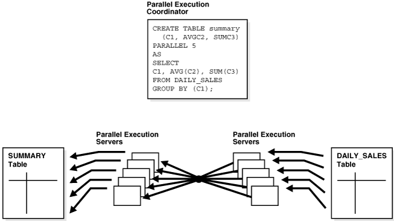
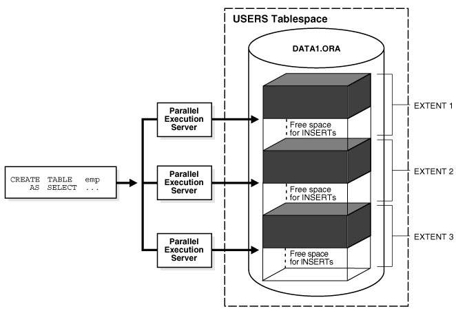

There are multiple types of parallelism.

This section discusses the types of parallelism in the following topics:

- About Parallel Queries

- About Parallel DDL Statements

- About Parallel DML Operations

- About Parallel Execution of Functions

- About Other Types of Parallelism

- Degree of Parallelism Rules for SQL Statements

### 8.5.1 About Parallel Queries

You can use parallel queries and parallel subqueries in `SELECT` statements and execute in parallel the query portions of DDL statements and DML statements (`INSERT`, `UPDATE`, and `DELETE`).

You can also query external tables in parallel.

The parallelization decision for SQL queries has two components: the decision to parallelize and the degree of parallelism (DOP). These components are determined differently for queries, DDL operations, and DML operations. To determine the DOP, Oracle Database looks at the reference objects:

- Parallel query looks at each table and index, in the portion of the query to be executed in parallel, to determine which is the reference table. The basic rule is to pick the table or index with the largest DOP.

- For parallel DML (`INSERT`, `UPDATE`, `MERGE`, and `DELETE`), the reference object that determines the DOP is the table being modified by an insert, update, or delete operation. Parallel DML also adds some limits to the DOP to prevent deadlock. If the parallel DML statement includes a subquery, the subquery's DOP is equivalent to that for the DML operation.

- For parallel DDL, the reference object that determines the DOP is the table, index, or partition being created, rebuilt, split, or moved. If the parallel DDL statement includes a subquery, the subquery's DOP is equivalent to the DDL operation.

This section contains the following topics:

- Parallel Queries on Index-Organized Tables

- Nonpartitioned Index-Organized Tables

- Partitioned Index-Organized Tables

- Parallel Queries on Object Types

- Rules for Parallelizing Queries

**See Also:**

- [Parallel Execution of SQL Statements](parallel-exec-intro.md) for an explanation of how the processes perform parallel queries

- Distributed Transaction Restrictions for examples of queries that reference a remote object

- Rules for Parallelizing Queries for information about the conditions for executing a query in parallel and the factors that determine the DOP

#### 8.5.1.1 Parallel Queries on Index-Organized Tables

There are several parallel scan methods that are supported on index-organized tables.

These parallel scan methods include:

- Parallel fast full scan of a nonpartitioned index-organized table

- Parallel fast full scan of a partitioned index-organized table

- Parallel index range scan of a partitioned index-organized table

You can use these scan methods for index-organized tables with overflow areas and for index-organized tables that contain LOBs.

#### 8.5.1.2 Nonpartitioned Index-Organized Tables

Parallel query on a nonpartitioned index-organized table uses parallel fast full scan.

Work is allocated by dividing the index segment into a sufficiently large number of block ranges and then assigning the block ranges to parallel execution servers in a demand-driven manner. The overflow blocks corresponding to any row are accessed in a demand-driven manner only by the process, which owns that row.

#### 8.5.1.3 Partitioned Index-Organized Tables

Both index range scan and fast full scan can be performed in parallel.

For parallel fast full scan, parallelization is the same as for nonpartitioned index-organized tables. Depending on the DOP, each parallel execution server gets one or more partitions, each of which contains the primary key index segment and the associated overflow segment, if any.

#### 8.5.1.4 Parallel Queries on Object Types

Parallel queries can be performed on object type tables and tables containing object type columns.

Parallel query for object types supports all of the features that are available for sequential queries on object types, including:

- Methods on object types

- Attribute access of object types

- Constructors to create object type instances

- Object views

- PL/SQL and Oracle Call Interface (OCI) queries for object types

There are no limitations on the size of the object types for parallel queries.

The following restrictions apply to using parallel query for object types:

- A `MAP` function is needed to execute queries in parallel for queries involving joins and sorts (through `ORDER` `BY`, `GROUP` `BY`, or set operations). Without a `MAP` function, the query is automatically executed serially.

- Parallel DML and parallel DDL are not supported with object types, and such statements are always performed serially.

In all cases where the query cannot execute in parallel because of any of these restrictions, the whole query executes serially without giving an error message.

#### 8.5.1.5 Rules for Parallelizing Queries

A SQL query can only be executed in parallel under certain conditions.

A `SELECT` statement can be executed in parallel only if one of the following conditions is satisfied:

- The query includes a statement level or object level parallel hint specification (`PARALLEL` or `PARALLEL_INDEX`).

- The schema objects referred to in the query have a `PARALLEL` declaration associated with them.

- Automatic Degree of Parallelism (Auto DOP) has been enabled.

- Parallel query is forced using the `ALTER` `SESSION` `FORCE` `PARALLEL` `QUERY` statement.

In addition, the execution plan should have at least one of the following:

- A full table scan

- An index range scan spanning multiple partitions

- An index fast full scan

- A parallel table function

**See Also:**

- [Automatic Degree of Parallelism](degree-parallel.md)for information about Auto DOP

- Degree of Parallelism Rules for SQL Statements for information about the rules for determining the degree of parallelism (DOP)

- [Oracle Database SQL Language Reference](../sqlrf/ALTER-SESSION.md) for more information about the `ALTER` `SESSION` SQL statement

### 8.5.2 About Parallel DDL Statements

Parallelism for DDL statements is introduced in this topic.

This section about parallelism for DDL statements contains the following topics:

- DDL Statements That Can Be Parallelized

- About Using CREATE TABLE AS SELECT in Parallel

- Recoverability and Parallel DDL

- Space Management for Parallel DDL

- Storage Space When Using Dictionary-Managed Tablespaces

- Free Space and Parallel DDL

- Rules for DDL Statements

- Rules for CREATE TABLE AS SELECT

#### 8.5.2.1 DDL Statements That Can Be Parallelized

You can execute DDL statements in parallel for tables and indexes that are nonpartitioned or partitioned.

The parallel DDL statements for nonpartitioned tables and indexes are:

- `CREATE` `INDEX`

- `CREATE` `TABLE` `AS` `SELECT`

- `ALTER` `TABLE` `MOVE`

- `ALTER` `INDEX` `REBUILD`

- `ALTER TABLE MODIFY`

The parallel DDL statements for partitioned tables and indexes are:

- `CREATE` `INDEX`

- `CREATE` `TABLE` `AS` `SELECT`

- `ALTER` `TABLE` {`MOVE|SPLIT|COALESCE}` `PARTITION`

- `ALTER` `INDEX` {`REBUILD|SPLIT`} `PARTITION`

  - This statement can be executed in parallel only if the (global) index partition being split is usable.

All of these DDL operations can be performed in `NOLOGGING` mode for either parallel or serial execution.

`The CREATE` `TABLE` statement for an index-organized table can be executed in parallel either with or without an `AS` `SELECT` clause.

Parallel DDL cannot occur on tables with object columns. Parallel DDL cannot occur on nonpartitioned tables with `LOB` columns.

#### 8.5.2.2 About Using CREATE TABLE AS SELECT in Parallel

Parallel execution enables you execute the query in parallel and create operations of creating a table as a subquery from another table or set of tables.

This parallel functionality can be extremely useful in the creation of summary or rollup tables.

Note that clustered tables cannot be created and populated in parallel.

Figure 8-4 illustrates creating a summary table from a subquery in parallel.

Figure 8-4 Creating a Summary Table in Parallel

[Description of "Figure 8-4 Creating a Summary Table in Parallel"](img_text/vldbg012.md)

#### 8.5.2.3 Recoverability and Parallel DDL

Parallel DDL is often used to create summary tables or do massive data loads that are standalone transactions, which do not always need to be recoverable.

By switching off Oracle Database logging, no undo or redo log is generated, so the parallel DML operation is likely to perform better, but becomes an all or nothing operation. In other words, if the operation fails, for whatever reason, you must redo the operation, it is not possible to restart it.

If you disable logging during parallel table creation (or any other parallel DDL operation), you should back up the tablespace containing the table after the table is created to avoid loss of the table due to media failure.

Use the `NOLOGGING` clause of the `CREATE` `TABLE`, `CREATE` `INDEX`, `ALTER` `TABLE`, and `ALTER` `INDEX` statements to disable undo and redo log generation.

#### 8.5.2.4 Space Management for Parallel DDL

Creating a table or index in parallel has space management implications.

These space management implications affect both the storage space required during a parallel operation and the free space available after a table or index has been created.

#### 8.5.2.5 Storage Space When Using Dictionary-Managed Tablespaces

When creating a table or index in parallel, each parallel execution server uses the values in the `STORAGE` clause of the `CREATE` statement to create temporary segments to store the rows.

A table created with a `NEXT` setting of 4 MB and a `PARALLEL` `DEGREE` of 16 consumes at least 64 megabytes (MB) of storage during table creation because each parallel server process starts with an extent of 4 MB. When the parallel execution coordinator combines the segments, some segments may be trimmed, and the resulting table may be smaller than the requested 64 MB.

#### 8.5.2.6 Free Space and Parallel DDL

When you create indexes and tables in parallel, each parallel execution server allocates a new extent and fills the extent with the table or index data.

For example, if you create an index with a DOP of 4, then the index has at least four extents initially. This allocation of extents is the same for rebuilding indexes in parallel and for moving, splitting, or rebuilding partitions in parallel.

Serial operations require the schema object to have at least one extent. Parallel creations require that tables or indexes have at least as many extents as there are parallel execution servers creating the schema object.

When you create a table or index in parallel, it is possible to create areas of free space. This occurs when the temporary segments used by the parallel execution servers are larger than what is needed to store the rows.

- If the unused space in each temporary segment is larger than the value of the `MINIMUM` `EXTENT` parameter set at the tablespace level, then Oracle Database trims the unused space when merging rows from all of the temporary segments into the table or index. The unused space is returned to the system free space and can be allocated for new extents, but it cannot be coalesced into a larger segment because it is not contiguous space (external fragmentation).

- If the unused space in each temporary segment is smaller than the value of the `MINIMUM` `EXTENT` parameter, then unused space cannot be trimmed when the rows in the temporary segments are merged. This unused space is not returned to the system free space; it becomes part of the table or index (internal fragmentation) and is available only for subsequent insertions or for updates that require additional space.

For example, if you specify a DOP of 3 for a `CREATE` `TABLE` `AS` `SELECT` statement, but there is only one data file in the tablespace, then internal fragmentation may occur, as shown in Figure 8-5. The areas of free space within the internal table extents of a data file cannot be coalesced with other free space and cannot be allocated as extents.

Figure 8-5 Unusable Free Space (Internal Fragmentation)

[Description of "Figure 8-5 Unusable Free Space (Internal Fragmentation)"](img_text/vldbg014.md)

**See Also:**

[Oracle Database SQL Tuning Guide](../tgsql/introduction-to-sql-tuning.md) for more information about creating tables and indexes in parallel

#### 8.5.2.7 Rules for DDL Statements

DDL operations can be executed in parallel under certain conditions.

DDL operations can be executed in parallel only if at least one of the following conditions is satisfied:

- A `PARALLEL` clause (declaration) is specified in the syntax. For `CREATE` `TABLE`, `CREATE` `INDEX` , `ALTER` `INDEX` `REBUILD`, and `ALTER` `INDEX` `REBUILD` `PARTITION`, the parallel declaration is stored in the data dictionary.

- Automatic Degree of Parallelism (Auto DOP) has been enabled.

- Parallel DDL is forced using the `ALTER` `SESSION` `FORCE` `PARALLEL` `DDL` statement.

**See Also:**

- [Automatic Degree of Parallelism](degree-parallel.md) for information about Auto DOP

- Degree of Parallelism Rules for SQL Statements for information about the rules for determining the degree of parallelism (DOP)

- [Oracle Database SQL Language Reference](../sqlrf/ALTER-SESSION.md) for more information about the `ALTER` `SESSION` SQL statement

#### 8.5.2.8 Rules for CREATE TABLE AS SELECT

The `CREATE` operation of the `CREATE` `TABLE` `AS` `SELECT` statement is parallelized based on the rules for parallelizing DDL statements.

In addition, a statement level `PARALLEL` hint specified in the `SELECT` part of the statement can also parallelize the DDL operation. For information about rules for parallelizing DDL statements, refer to Rules for DDL Statements.

When the `CREATE` operation of `CREATE` `TABLE` `AS` `SELECT` is parallelized, Oracle Database also parallelizes the scan operation if possible.

Even if the DDL part is not parallelized, the `SELECT` part can be parallelized based on the rules for parallelizing queries.

Automatic Degree of Parallelism (Auto DOP) parallelizes both the DDL and the query parts of the statement.

For information about the rules for determining the degree of parallelism (DOP), refer to Degree of Parallelism Rules for SQL Statements.

### 8.5.3 About Parallel DML Operations

Parallel DML operations are introduced in the topic.

Parallel DML (`PARALLEL` `INSERT`, `UPDATE`, `DELETE`, and `MERGE`) uses parallel execution mechanisms to speed up or scale up large DML operations against large database tables and indexes.

**Note:**

Although DML generally includes queries, in this chapter the term DML refers only to `INSERT`, `UPDATE`, `MERGE`, and `DELETE` operations.

This section discusses the following parallel DML topics:

- When to Use Parallel DML

- Enable Parallel DML Mode

- Rules for UPDATE, MERGE, and DELETE

- Rules for INSERT SELECT

- Transaction Restrictions for Parallel DML

- Rollback Segments

- Recovery for Parallel DML

- Space Considerations for Parallel DML

- Restrictions on Parallel DML

- Data Integrity Restrictions

- Trigger Restrictions

- Distributed Transaction Restrictions

- Examples of Distributed Transaction Parallelization

- Concurrent Execution of Union All

#### 8.5.3.1 When to Use Parallel DML

Parallel DML is useful in a decision support system (DSS) environment where the performance and scalability of accessing large objects are important. Parallel DML complements parallel query in providing you with both querying and updating capabilities for your DSS databases.

The overhead of setting up parallelism makes parallel DML operations not feasible for short OLTP transactions. However, parallel DML operations can speed up batch jobs running in an OLTP database.

Several scenarios where parallel DML is used include:

- Refreshing Tables in a Data Warehouse System

- Creating Intermediate Summary Tables

- Using Scoring Tables

- Updating Historical Tables

- Running Batch Jobs

##### 8.5.3.1.1 Refreshing Tables in a Data Warehouse System

In a data warehouse system, large tables must be refreshed (updated) periodically with new or modified data from the production system.

You can do this efficiently by using the `MERGE` statement.

##### 8.5.3.1.2 Creating Intermediate Summary Tables

In a DSS environment, many applications require complex computations that involve constructing and manipulating many large intermediate summary tables.

These summary tables are often temporary and frequently do not need to be logged. Parallel DML can speed up the operations against these large intermediate tables. One benefit is that you can put incremental results in the intermediate tables and perform parallel updates.

In addition, the summary tables may contain cumulative or comparative information which has to persist beyond application sessions; thus, temporary tables are not feasible. Parallel DML operations can speed up the changes to these large summary tables.

##### 8.5.3.1.3 Using Scoring Tables

Many DSS applications score customers periodically based on a set of criteria.

The scores are usually stored in large DSS tables. The score information is then used in making a decision, for example, inclusion in a mailing list.

This scoring activity queries and updates a large number of rows in the table. Parallel DML can speed up the operations against these large tables.

##### 8.5.3.1.4 Updating Historical Tables

Historical tables describe the business transactions of an enterprise over a recent time interval.

Periodically, the DBA deletes the set of oldest rows and inserts a set of new rows into the table. Parallel `INSERT` `SELECT` and parallel `DELETE` operations can speed up this rollover task.

Dropping a partition can also be used to delete old rows. However, the table has to be partitioned by date and with the appropriate time interval.

##### 8.5.3.1.5 Running Batch Jobs

Batch jobs executed in an OLTP database during off hours have a fixed time during which the jobs must complete. A good way to ensure timely job completion is to execute their operations in parallel.

As the workload increases, more computer resources can be added; the scaleup property of parallel operations ensures that the time constraint can be met.

#### 8.5.3.2 Enable Parallel DML Mode

A DML statement can be parallelized only if you have explicitly enabled parallel DML in the session or in the SQL statement.

To enable this mode in a session, run the following SQL statement:

    ALTER SESSION ENABLE PARALLEL DML;

To enable parallel DML mode in a specific SQL statement, include the `ENABLE_PARALLEL_DML` SQL hint. For example:

    INSERT /*+ ENABLE_PARALLEL_DML */ …

This mode is required because parallel DML and serial DML have different locking, transaction, and disk space requirements and parallel DML is disabled for a session by default.

When parallel DML is disabled, no DML is executed in parallel even if the `PARALLEL` hint is used.

When parallel DML is enabled in a session, all DML statements in this session are considered for parallel execution. When parallel DML is enabled in a SQL statement with the `ENABLE_PARALLEL_DML` hint, only that specific statement is considered for parallel execution. However, even if parallel DML is enabled, the DML operation may still execute serially if there are no parallel hints or no tables with a parallel attribute or if restrictions on parallel operations are violated.

The session's `PARALLEL` `DML` mode does not influence the parallelism of `SELECT` statements, DDL statements, and the query portions of DML statements. If this mode is not set, the DML operation is not parallelized, but scans or join operations within the DML statement may still be parallelized.

When the parallel DML mode has been enabled for a session, you can disable the mode for a specific SQL statement with the `DISABLE_PARALLEL_DML` SQL hint.

For more information, refer to Space Considerations for Parallel DML and Restrictions on Parallel DML.

#### 8.5.3.3 Rules for UPDATE, MERGE, and DELETE

An update, merge, or delete operation is parallelized only under certain conditions.

An `UPDATE`, `MERGE`, and `DELETE` operation is parallelized only if at least one of the following conditions is satisfied:

- The table being updated, merged, or deleted has a `PARALLEL` declaration set by a previous `CREATE` `TABLE` or `ALTER` `TABLE` statement.

- A statement level or object level `PARALLEL` hint is specified in the DML statement.

- Automatic Degree of Parallelism (Auto DOP) has been enabled.

- Parallel DML is forced using the `ALTER` `SESSION` `FORCE` `PARALLEL` `DML` statement.

If the statement contains subqueries or updatable views, then they may also be executed in parallel based on the rules for parallelizing queries. The decision to parallelize the `UPDATE`, `MERGE`, and `DELETE` portion is independent of the query portion, and vice versa. Statement level `PARALLEL` hints or Auto DOP parallelize both the DML and the query portions.

**See Also:**

- [Automatic Degree of Parallelism](degree-parallel.md) for information about Auto DOP

- [Limitation on the Degree of Parallelism](parallel-exec-tips.md) for possible limitations on update, merge, or delete operations

- Degree of Parallelism Rules for SQL Statements for information about the rules for determining the degree of parallelism (DOP)

- [Oracle Database SQL Language Reference](../sqlrf/ALTER-SESSION.md) for more information about the `ALTER` `SESSION` SQL statement

#### 8.5.3.4 Rules for INSERT SELECT

An insert operation is executed in parallel only under certain conditions.

An `INSERT` operation is executed in parallel only if at least one of the following conditions is satisfied:

- The table being inserted into (the reference object) has a `PARALLEL` declaration set by a previous `CREATE` `TABLE` or `ALTER` `TABLE` statement.

- A statement level or object level `PARALLEL` hint is specified after the `INSERT` in the DML statement.

- Automatic Degree of Parallelism (Auto DOP) has been enabled.

- Parallel DML is forced using the `ALTER` `SESSION` `FORCE` `PARALLEL` `DML` statement.

The decision to parallelize the `INSERT` operation is independent of the `SELECT` operation, and vice versa. The `SELECT` operation can be parallelized based on the rules for parallelizing queries. Statement level `PARALLEL` hints or Auto DOP parallelize both the `INSERT` and the `SELECT` operations.

**See Also:**

- [Automatic Degree of Parallelism](degree-parallel.md) for information about Auto DOP

- Degree of Parallelism Rules for SQL Statements for information about the rules for determining the degree of parallelism (DOP)

- [Oracle Database SQL Language Reference](../sqlrf/ALTER-SESSION.md) for more information about the `ALTER` `SESSION` SQL statement

#### 8.5.3.5 Transaction Restrictions for Parallel DML

To execute a DML operation in parallel, the parallel execution coordinator acquires parallel execution servers, and each parallel execution server executes a portion of the work under its own parallel process transaction.

Note the following conditions:

- Each parallel execution server creates a different parallel process transaction.

- If you use rollback segments instead of Automatic Undo Management, you may want to reduce contention on the rollback segments by limiting the number of parallel process transactions residing in the same rollback segment. Refer to [Oracle Database SQL Language Reference](../sqlrf/ROLLBACK.md) for more information.

The coordinator also has its own coordinator transaction, which can have its own rollback segment. To ensure user-level transactional atomicity, the coordinator uses a two-phase commit protocol to commit the changes performed by the parallel process transactions.

A session that is enabled for parallel DML may put transactions in the session in a special mode: If any DML statement in a transaction modifies a table in parallel, no subsequent serial or parallel query or DML statement can access the same table again in that transaction. The results of parallel modifications cannot be seen during the transaction.

Serial or parallel statements that attempt to access a table that has been modified in parallel within the same transaction are rejected with an error message.

If a PL/SQL procedure or block is executed in a parallel DML-enabled session, then this rule applies to statements in the procedure or block.

#### 8.5.3.6 Rollback Segments

If you use rollback segments instead of Automatic Undo Management, there are some restrictions when using parallel DML.

**See Also:**

[Oracle Database SQL Language Reference](../sqlrf/ROLLBACK.md) for information about restrictions for parallel DML and rollback segments

#### 8.5.3.7 Recovery for Parallel DML

The time required to roll back a parallel DML operation is roughly equal to the time it takes to perform the forward operation.

Oracle Database supports parallel rollback after transaction and process failures, and after instance and system failures. Oracle Database can parallelize both the rolling forward stage and the rolling back stage of transaction recovery.

**See Also:**

[Oracle Database Backup and Recovery User’s Guide](../bradv/introduction-backup-recovery.md) for details about parallel rollback

##### 8.5.3.7.1 Transaction Recovery for User-Issued Rollback

A user-issued rollback in a transaction failure due to statement error is performed in parallel by the parallel execution coordinator and the parallel execution servers.

The rollback takes approximately the same amount of time as the forward transaction.

##### 8.5.3.7.2 Process Recovery

Recovery from the failure of a parallel execution coordinator or parallel execution server is performed by the PMON process.

If a parallel execution server or a parallel execution coordinator fails, then PMON rolls back the work from that process and all other processes in the transaction roll back their changes.

##### 8.5.3.7.3 System Recovery

Recovery from a system failure requires a new startup.

Recovery is performed by the SMON process and any recovery server processes spawned by SMON. Parallel DML statements may be recovered using parallel rollback. If the initialization parameter `COMPATIBLE` is set to 8.1.3 or greater, Fast-Start On-Demand Rollback enables terminated transactions to be recovered, on demand, one block at a time.

#### 8.5.3.8 Space Considerations for Parallel DML

Parallel `UPDATE` uses the existing free space in the object, while direct-path `INSERT` gets new extents for the data.

Space usage characteristics may be different in parallel than serial execution because multiple concurrent child transactions modify the object.

#### 8.5.3.9 Restrictions on Parallel DML

There are several restrictions that apply to parallel DM.

The following restrictions apply to parallel DML (including direct-path `INSERT`):

- Intra-partition parallelism for `UPDATE`, `MERGE`, and `DELETE` operations require that the `COMPATIBLE` initialization parameter be set to 9.2 or greater.

- The `INSERT` `VALUES` statement is never executed in parallel.

- A transaction can contain multiple parallel DML statements that modify different tables, but after a parallel DML statement modifies a table, no subsequent serial or parallel statement (DML or query) can access the same table again in that transaction.

  - This restriction also exists after a serial direct-path `INSERT` statement: no subsequent SQL statement (DML or query) can access the modified table during that transaction.

  - Queries that access the same table are allowed before a parallel DML or direct-path `INSERT` statement, but not after.

  - Any serial or parallel statements attempting to access a table that has been modified by a parallel `UPDATE`, `DELETE`, or `MERGE`, or a direct-path `INSERT` during the same transaction are rejected with an error message.

- Parallel DML operations cannot be done on tables with triggers.

- Replication functionality is not supported for parallel DML.

- Parallel DML cannot occur in the presence of certain constraints: self-referential integrity, delete cascade, and deferred integrity. In addition, for direct-path `INSERT`, there is no support for any referential integrity.

- Parallel DML can be done on tables with object columns provided the object columns are not accessed.

- Parallel DML can be done on tables with `LOB` columns provided the table is partitioned. However, intra-partition parallelism is not supported.

  For non-partitioned tables with LOB columns, parallel `INSERT` operations are supported provided that the LOB columns are declared as SecureFiles LOBs. Parallel `UPDATE`, `DELETE`, and `MERGE` operations on such tables are not supported.

- A DML operation cannot be executed in parallel if it is in a distributed transaction or if the DML or the query operation is on a remote object.

- Clustered tables are not supported.

- Parallel `UPDATE`, `DELETE`, and `MERGE` operations are not supported for temporary tables.

- Parallel DML is not supported on a table with bitmap indexes if the table is not partitioned.

Violations of these restrictions cause the statement to execute serially without warnings or error messages (except for the restriction on statements accessing the same table in a transaction, which can cause error messages).

##### 8.5.3.9.1 Partitioning Key Restriction

You can only update the partitioning key of a partitioned table to a new value if the update does not cause the row to move to a new partition.

The update is possible if the table is defined with the row movement clause enabled.

##### 8.5.3.9.2 Function Restrictions

The function restrictions for parallel DML are the same as those for parallel DDL and parallel query.

See About Parallel Execution of Functions for more information.

#### 8.5.3.10 Data Integrity Restrictions

The interactions of integrity constraints and parallel DML statements are introduced in the topic.

This section contains following topics:

- NOT NULL and CHECK

- UNIQUE and PRIMARY KEY

- FOREIGN KEY (Referential Integrity)

- Delete Cascade

- Self-Referential Integrity

- Deferrable Integrity Constraints

##### 8.5.3.10.1 NOT NULL and CHECK

The integrity constraints for `NOT` `NULL` and `CHECK` are discussed in this topic.

`NOT` `NULL` and `CHECK` integrity constraints are allowed. They are not a problem for parallel DML because they are enforced on the column and row level, respectively.

##### 8.5.3.10.2 UNIQUE and PRIMARY KEY

The integrity constraints for `UNIQUE` and `PRIMARY` `KEY` are discussed in this topic.

`UNIQUE` and `PRIMARY` `KEY` integrity constraints are allowed.

##### 8.5.3.10.3 FOREIGN KEY (Referential Integrity)

Restrictions for referential integrity occur whenever a DML operation on one table could cause a recursive DML operation on another table.

These restrictions also apply when, to perform an integrity check, it is necessary to see simultaneously all changes made to the object being modified.

Table 8-1 lists all of the operations that are possible on tables that are involved in referential integrity constraints.

Table 8-1 Referential Integrity Restrictions

| DML Statement      | Issued on Parent | Issued on Child  | Self-Referential |
|:-------------------|:-----------------|:-----------------|:-----------------|
| `INSERT`           | (Not applicable) | Not parallelized | Not parallelized |
| `MERGE`            | (Not applicable) | Not parallelized | Not parallelized |
| `UPDATE` No Action | Supported        | Supported        | Not parallelized |
| `DELETE` No Action | Supported        | Supported        | Not parallelized |
| `DELETE` Cascade   | Not parallelized | (Not applicable) | Not parallelized |

##### 8.5.3.10.4 Delete Cascade

The delete cascade data integrity restrictions are discussed in this topic.

Deletion on tables having a foreign key with delete cascade is not parallelized because parallel execution servers attempt to delete rows from multiple partitions (parent and child tables).

##### 8.5.3.10.5 Self-Referential Integrity

DML on tables with self-referential integrity constraints is not parallelized if the referenced keys (primary keys) are involved.

For DML on all other columns, parallelism is possible.

##### 8.5.3.10.6 Deferrable Integrity Constraints

The deferrable integrity constraints are discussed in this topic.

If any deferrable constraints apply to the table being operated on, the DML operation is not executed in parallel.

#### 8.5.3.11 Trigger Restrictions

A DML operation is not executed in parallel if the affected tables contain enabled triggers that may get invoked as a result of the statement.

This implies that DML statements on tables that are being replicated are not parallelized.

Relevant triggers must be disabled to parallelize DML on the table. If you enable or disable triggers, then the dependent shared cursors are invalidated.

#### 8.5.3.12 Distributed Transaction Restrictions

The distributed transaction restrictions are discussed in this topic.

A DML operation cannot be executed in parallel if it is in a distributed transaction or if the DML or the query operation is on a remote object.

#### 8.5.3.13 Examples of Distributed Transaction Parallelization

Several examples of distributed transaction processing are shown in this topic.

In the first example, the DML statement queries a remote object. The DML operation is executed serially without notification because it references a remote object.

    INSERT /*+ APPEND PARALLEL (t3,2) */ INTO t3 SELECT * FROM t4@dblink;

In the next example, the DML operation is applied to a remote object. The `DELETE` operation is not parallelized because it references a remote object.

    DELETE /*+ PARALLEL (t1, 2) */ FROM t1@dblink;

In the last example, the DML operation is in a distributed transaction. The `DELETE` operation is not executed in parallel because it occurs in a distributed transaction (which is started by the `SELECT` statement).

    SELECT * FROM t1@dblink;
     DELETE /*+ PARALLEL (t2,2) */ FROM t2;
     COMMIT;

#### 8.5.3.14 Concurrent Execution of Union All

Set operators like `UNION` or `UNION` `ALL` consist of multiple queries (branches) combined to a single SQL statement.

Traditionally, set operators are processed in a sequential manner. Individual branches can be processed in serial or parallel, but only one branch at a time, one branch after another. While this approach satisfies many use cases, there are situations where the processing of multiple branches of a `UNION` or `UNION` `ALL` statement should occur concurrently. The most typical situation is when several or all branches are remote SQL statements. In this situation, concurrent processing on all participating remote systems is desired to speed up the overall processing time without increasing the workload of any participating system.

The default behavior of concurrent execution for `UNION` or `UNION` `ALL` statements is controlled by the setting of the `OPTIMIZER_FEATURES_ENABLE` initialization parameter. When set to `12.1.0.1` or higher, concurrent execution is enabled by default. Any statement where at least one branch of the statement is local and is considered being processed in parallel, the entire `UNION` or `UNION` `ALL` statement is also processed concurrently. The system calculates the DOP for every individual local branch of the statement and chooses the highest DOP for the execution of the entire `UNION` or `UNION` `ALL` statement. The system then works concurrently on as many branches as possible, using the chosen DOP both for parallelization of the branches that are processed in parallel, and as concurrent workers on serial and remote statements.

When the `OPTIMIZER_FEATURES_ENABLE` initialization parameter is set to a value less than `12.1.0.1`, concurrent execution of `UNION` or `UNION` `ALL` statements must be enabled explicitly by using the `PQ_CONCURRENT_UNION` hint.

However, unlike the sequential processing of one branch after another, the concurrent processing does not guarantee an ordered return of the results of the individual branches. If an ordered return of one branch after another is required, then you either must disable concurrent processing using the `NO_PQ_CONCURRENT_UNION` hint or you must augment the SQL statement to uniquely identify individual branches of the statement and to sort on this specified identifier.

`UNION` or `UNION` `ALL` statements that only consist of serial or remote branches are not processed concurrently unless specifically using the `PQ_CONCURRENT_UNION` hint. The DOP of this SQL statement is at most the number of serial and remote inputs.

Whether or not concurrent processing of a `UNION` or `UNION` `ALL` statement occurs can be easily identified with the execution plan of the SQL statements. When executed in parallel, the execution of serial and remote branches is managed with a row source identifiable as `PX` `SELECTOR`. Statements that are not processed concurrently show the query coordinator (`QC`) as coordinator of serial and remote branches.

In Example 8-4, the SQL statement consists of local and remote branches. The SQL statement loads information about gold and platinum customers from the local database, and the information about customers from three major cities from remote databases. Because the local select statements occur in parallel, this processing is automatically performed in parallel. Each serial branch is executed by only one parallel execution server process. Because each parallel execution server can execute one serial branch, they are executed concurrently.

Example 8-4 Explain Plan for UNION ALL

    SQL> EXPLAIN PLAN FOR INSERT INTO all_customer
      SELECT * FROM GOLD_customer UNION ALL
      SELECT * FROM PLATINUM_customer UNION ALL
      SELECT * FROM SF_customer@san_francisco UNION ALL
      SELECT * FROM LA_customer@los_angeles UNION ALL
      SELECT * FROM LV_customer@las_vegas;
    -------------------------------------------------------------------------------
    | Id | Operation              | Name          | TQ/Ins |IN-OUT | PQ Distrib|
    -------------------------------------------------------------------------------
    | 0 | INSERT STATEMENT         |              |        |       |           |
    | 1 |  LOAD TABLE CONVENTIONAL | ALL_CUSTOMER |        |       |           |
    | 2 |   PX COORDINATOR         |              |        |       |           |
    | 3 |    PX SEND QC (RANDOM)   | :TQ10003     |        | P->S  | QC (RAND) |
    | 4 |     UNION-ALL            |              |        | PCWP  |           |
    | 5 |      PX BLOCK ITERATOR   |              |        | PCWC  |           |
    | 6 |       TABLE ACCESS FULL  | GOLD_CUSTOMER|        | PCWP  |           |
    | 7 |      PX BLOCK ITERATOR   |              |        | PCWC  |           |
    | 8 |       TABLE ACCESS FULL  | PLATINUM_CUST|        | PCWP  |           |
    | 9 |      PX SELECTOR         |              |        | PCWP  |           |
    |10 |       REMOTE             | SF_CUSTOMER  |        | PCWP  |           |
    |11 |      PX SELECTOR         |              |        | PCWP  |           |
    |12 |       REMOTE             | LA_CUSTOMER  |        | PCWP  |           |
    |13 |      PX SELECTOR         |              |        | PCWP  |           |
    |14 |       REMOTE             | LV_CUSTOMER  |        | PCWP  |           |
    -------------------------------------------------------------------------------

### 8.5.4 About Parallel Execution of Functions

SQL statements can contain user-defined functions written in PL/SQL, in Java, or as external procedures in C that can appear as part of the `SELECT` list, `SET` clause, or `WHERE` clause.

When the SQL statement is parallelized, these functions are executed on a per-row basis by the parallel execution server process. Any PL/SQL package variables or Java static attributes used by the function are entirely private to each individual parallel execution process and are newly initialized when each row is processed, rather than being copied from the original session. Because of this process, not all functions generate correct results if executed in parallel.

User-written table functions can appear in the statement's `FROM` list. These functions act like source tables in that they produce row output. Table functions are initialized once during the statement at the start of each parallel execution process. All variables are entirely private to the parallel execution process.

This section contains the following topics:

- Functions in Parallel Queries

- Functions in Parallel DML and DDL Statements

#### 8.5.4.1 Functions in Parallel Queries

User functions can be executed in parallel in a SQL query statement, or a subquery in a DML or DDL statement.

In a `SELECT` statement or a subquery in a DML or DDL statement, a user-written function may be executed in parallel in any of the following cases:

- If it has been declared with the `PARALLEL_ENABLE` keyword

- If it is declared in a package or type and has a `PRAGMA` `RESTRICT_REFERENCES` clause that indicates all of `WNDS`, `RNPS`, and `WNPS`

- If it is declared with `CREATE` `FUNCTION` and the system can analyze the body of the PL/SQL code and determine that the code neither writes to the database nor reads or modifies package variables

Other parts of a query or subquery can sometimes execute in parallel even if a given function execution must remain serial.

**See Also:**

- [Oracle Database Development Guide](../adfns/coding-subprograms-and-packages.md) for information about the `PRAGMA` `RESTRICT_REFERENCES` clause

- [Oracle Database SQL Language Reference](../sqlrf/CREATE-FUNCTION.md) for information about the `CREATE` `FUNCTION` statement

#### 8.5.4.2 Functions in Parallel DML and DDL Statements

A user function can be executed in a parallel DML or DDL statement under certain conditions.

In a parallel DML or DDL statement, as in a parallel query, a user-written function may be executed in parallel in any of the following cases:

- If it has been declared with the `PARALLEL_ENABLE` keyword

- If it is declared in a package or type and has a `PRAGMA` `RESTRICT_REFERENCES` clause that indicates all of `RNDS`, `WNDS`, `RNPS`, and `WNPS`

- If it is declared with the `CREATE` `FUNCTION` statement and the system can analyze the body of the PL/SQL code and determine that the code neither reads nor writes to the database or reads or modifies package variables

For a parallel DML statement, any function call that cannot be executed in parallel causes the entire DML statement to be executed serially. For an `INSERT` `SELECT` or `CREATE` `TABLE` `AS` `SELECT` statement, function calls in the query portion are parallelized according to the parallel query rules described in this section. The query may be parallelized even if the remainder of the statement must execute serially, or vice versa.

### 8.5.5 About Other Types of Parallelism

An Oracle Database can use parallelism in multiple types of operations.

In addition to parallel SQL execution, Oracle Database can use parallelism for the following types of operations:

- Parallel recovery

- Parallel propagation (replication)

- Parallel load (external tables and the SQL\*Loader utility)

Like parallel SQL, parallel recovery, propagation, and external table loads are performed by a parallel execution coordinator and multiple parallel execution servers. Parallel load using SQL\*Loader, however, uses a different mechanism.

The behavior of the parallel execution coordinator and parallel execution servers may differ, depending on what kind of operation they perform (SQL, recovery, or propagation). For example, if all parallel execution servers in the pool are occupied and the maximum number of parallel execution servers has been started:

- In parallel SQL and external table loads, the parallel execution coordinator switches to serial processing.

- In parallel propagation, the parallel execution coordinator returns an error.

For a given session, the parallel execution coordinator coordinates only one kind of operation. A parallel execution coordinator cannot coordinate, for example, parallel SQL and parallel recovery or propagation at the same time.

**See Also:**

- [Oracle Database Utilities](../sutil/oracle-sql-loader.md) for information about parallel load and SQL\*Loader

- [Oracle Database Backup and Recovery User’s Guide](../bradv/introduction-backup-recovery.md) for information about parallel media recovery

- [Oracle Database Performance Tuning Guide](../tgdba/performance-tuning-overview.md) for information about parallel instance recovery

### 8.5.6 Degree of Parallelism Rules for SQL Statements

The parallelization decision for SQL statements has two components: the decision to parallelize and the degree of parallelism (DOP).

These components are determined differently for queries, DDL operations, and DML operations.

The decision to parallelize is discussed in the following sections:

- Rules for Parallelizing Queries

- Rules for DDL Statements

- Rules for CREATE TABLE AS SELECT

- Rules for UPDATE, MERGE, and DELETE

- Rules for INSERT SELECT

The degree of parallelism for various types of SQL statements can be determined by statement or object level `PARALLEL` hints, `PARALLEL` clauses, `ALTER` `SESSION` `FORCE` `PARALLEL` statements, automatic degree of parallelism (Auto DOP), or table or index `PARALLEL` declarations. When more than one of these methods are used, the Oracle Database uses precedence rules to determine which method is used to determine the DOP.

Table 8-2 shows the precedence rules for determining the degree of parallelism (DOP) for various types of SQL statements. In the table, the smaller priority number indicates that the method takes precedence over higher numbers. For example, priority (1) takes precedence over priority (2), priority (3), priority (4), and priority (5).

Table 8-2 Parallelization Priority Order

| Parallel Operation                                                                                                                                                   | Statement Level PARALLEL Hint | Object Level PARALLEL Hint | PARALLEL Clause | ALTER SESSION                           | Auto DOP     | Parallel Declaration                      |
|:---------------------------------------------------------------------------------------------------------------------------------------------------------------------|:------------------------------|:---------------------------|:----------------|:----------------------------------------|:-------------|:------------------------------------------|
| Parallel query table/index scan. For more information, refer to Rules for Parallelizing Queries.                                                                     | Priority (1)                  | Priority (2)               | N/A             | Priority (3) `FORCE` `PARALLEL` `QUERY` | Priority (4) | Priority (5)                              |
| Parallel `UPDATE` ,`DELETE`, or `MERGE`. For more information, refer to Rules for UPDATE, MERGE, and DELETE.                                                         | Priority (1)                  | Priority (2)               | N/A             | Priority (3) `FORCE` `PARALLEL` `DML`   | Priority (4) | Priority (5) of the target table          |
| `INSERT`operation of parallel `INSERT`... `SELECT` . For more information, refer to Rules for INSERT SELECT.                                                         | Priority (1)                  | Priority (2)               | N/A             | Priority (3) `FORCE` `PARALLEL` `DML`   | Priority (4) | Priority (5) of table being inserted into |
| `SELECT`operation of `INSERT` `SELECT` when `INSERT` is serial. For more information, refer to Rules for INSERT SELECT.                                              | Priority (1)                  | Priority (2)               | N/A             | Priority (3) `FORCE` `PARALLEL` `QUERY` | Priority (4) | Priority (5) of table being selected from |
| `CREATE`operation of parallel `CREATE` `TABLE` `AS` `SELECT` (partitioned or nonpartitioned table). For more information, refer to Rules for CREATE TABLE AS SELECT. | Priority (1)                  | N/A                        | Priority (4)    | Priority (2) `FORCE` `PARALLEL` `DDL`   | Priority (3) | N/A                                       |
| `SELECT`operation of `CREATE` `TABLE` `AS` `SELECT` when `CREATE` is serial. For more information, refer to Rules for CREATE TABLE AS SELECT.                        | Priority (1)                  | Priority (2)               | N/A             | Priority (3) `FORCE` `PARALLEL` `QUERY` | Priority (4) | Priority (5)                              |
| Other DDL operations. For more information, refer to Rules for DDL Statements.                                                                                       | N/A                           | N/A                        | Priority (3)    | Priority (1) `FORCE` `PARALLEL` `DDL`   | Priority (2) | N/A                                       |

**See Also:**

- [Oracle Database SQL Language Reference](../sqlrf/Comments.md) for information about the `PARALLEL` hint

- [Oracle Database SQL Language Reference](../sqlrf/parallel_clause.md) for information about the `PARALLEL` clause

- [Oracle Database SQL Language Reference](../sqlrf/ALTER-SESSION.md) for more information about the `ALTER` `SESSION` SQL statement
