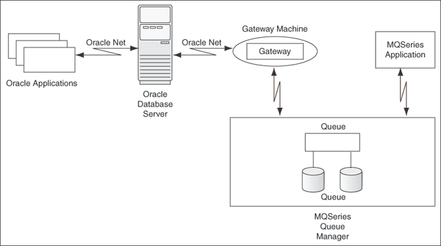

The following topics provide an overview of message queuing, WebSphere MQ, and the role of the gateway when accessing WebSphere MQ queues.

### Introduction to Message Queuing

Message queuing enables distributed applications to communicate asynchronously by sending messages between the applications.

The messages from the sending application are stored in a queue and are retrieved by the receiving application. The applications send or receive messages through a queue by sending a request to the message queuing system. Sending and receiving applications can use the same or different message queuing systems, allowing the message queuing system to handle the forwarding of the messages from the sender queue to the recipient queue.

Queued messages can be stored at intermediate nodes until the system is ready to forward them to the next node. At the destination node, the messages are stored in a queue until the receiving application retrieves them from the queue. Message delivery is guaranteed even if the network or application fails. This provides for a reliable communication channel between applications.

The complexity and details of the underlying model (of storing and forwarding messages between different environments) are handled by the message queuing system. By maintaining this level of abstraction, distributed applications can be developed without the need to worry about the details of how the information is transported.

Because the sending and receiving applications operate independently of one another, the sending application is less dependent on the availability of the remote application, the network between them, and the system on which the receiving application runs. This leads to a higher level of availability for the participating applications.

Messages and message queue operations can be configured by the applications to operate in specific modes. For example, a sending application can specify that queued messages should survive system crashes. As another example, the receiving application can specify a maximum waiting period for a receiving operation from a queue (in case no messages are available yet on the receiving queue).

### Introduction to WebSphere MQ

WebSphere MQ is a message queuing system based on the model of message queue clients and message queue servers.

The applications run either on the server node where the queue manager and queues reside, or on a remote client node. Applications can send or retrieve messages only from queues owned by the queue manager to which they are connected.

#### WebSphere MQ Terms

This table describes WebSphere MQ terms used in this guide.

Table 1-1 WebSphere MQ Terms

| Term                              | Description                                                                                                                                                                                                                                                                                                                             |
|:----------------------------------|:----------------------------------------------------------------------------------------------------------------------------------------------------------------------------------------------------------------------------------------------------------------------------------------------------------------------------------------|
| Message queues                    | Storage areas for messages exchanged between applications.                                                                                                                                                                                                                                                                              |
| Message queue interface (MQI)     | An application programming interface (API) for applications that want to send or receive messages through WebSphere MQ queues.                                                                                                                                                                                                          |
| WebSphere MQ client configuration | A WebSphere MQ configuration where the queue manager and message queues are located on a different (remote) system or node than the application software. Client applications connect to the remote queue manager using IBM software that provides the necessary networking software to connect to the remote queue manager.            |
| WebSphere MQ server configuration | A WebSphere MQ configuration where the queue manager and message queues are located on the same (local) system or node as the application software. Client applications connect to the local queue manager using MQI.                                                                                                                   |
| Queue manager                     | A WebSphere MQ feature that provides the message queuing facilities that applications use. It manages the queue definitions, configuration tables, and message queues. The queue manager also forwards messages from the sender queue to the remote recipient queues.                                                                   |
| Triggers                          | A WebSphere MQ feature that enables an application to be started automatically when a message event, such as the arrival of a message, occurs. Triggers can be used to invoke programs or transactions. For example, a trigger could cause an Oracle application to call the gateway to retrieve a WebSphere MQ message and process it. |

### Introduction to the Gateway

The Oracle Database Gateway for WebSphere MQ enables Oracle applications to integrate with other WebSphere MQ applications.

Oracle applications can send messages to other WebSphere MQ applications or receive messages from them. With the gateway, Oracle applications access WebSphere MQ message queues through remote procedure call (RPC) processing.

The gateway extends the RPC facilities that are available with the Oracle database and enables any client application to use PL/SQL to access messages in WebSphere MQ queues. The gateway provides PL/SQL procedures that are translated by the gateway into MQI calls. These procedures resemble the calls and types of MQI, but they are adapted to take full advantage of the transaction integration with the Oracle database.

Through WebSphere MQ, the gateway communicates with any other WebSphere MQ systems on various platforms, including mainframes, UNIX based systems, Microsoft Windows, and other desktop environments. The gateway does not require any Oracle software on the remote system. The gateway integrates with existing WebSphere MQ applications without any changes to those applications and enables users to exploit their investment in these applications while providing them with the ability to maximize on the benefits of message-oriented systems.

The gateway also provides a way to integrate these existing WebSphere MQ applications with new technology areas, such as network computing. Any Oracle application can invoke PL/SQL procedures, including applications that use the Oracle Application Server 11g.

**Related Topics**

- [The PGM, PGM_UTL8, and PGM_SUP Packages](database-gateway-webspheremq-pgm-packages.md)

#### Developing Gateway Applications

Using the Oracle Visual Workbench for Oracle Database Gateway for WebSphere MQ.

If you are developing applications that access WebSphere MQ through the gateway, use the Oracle Visual Workbench for Oracle Database Gateway for WebSphere MQ. Oracle Visual Workbench enables you to define an interface for accessing WebSphere MQ and define how to convert message data that is sent or retrieved from WebSphere MQ queues.

Visual Workbench generates PL/SQL code for the interface and data conversion. This generated code is called the message interface package (MIP). The MIP provides the underlying code to interact with the gateway, performs message data conversion, and provides an easy-to-use interface for Oracle applications to exchange messages with remote WebSphere MQ applications.

**See Also:**

Refer to the Oracle Procedural Gateway Visual Workbench for WebSphere MQ Installation and User's Guide for Microsoft Windows (32-Bit) for more information about Oracle Visual Workbench.

When necessary, the generated MIP code can be modified to use WebSphere MQ functions that are not supported by Visual Workbench or to enhance message data conversions.

**Related Topics**

- [The PGM, PGM_UTL8, and PGM_SUP Packages](database-gateway-webspheremq-pgm-packages.md)
- [UTL_RAW Package](database-gateway-webspheremq-utl-raw-packages.md)

#### Gateway Terms

This table describes gateway terms used in this guide.

Table 1-2 Oracle Database Gateway Terms

| Term                            | Description                                                                                                                                                                                                                                                                                                                                                                                                                                                                            |
|:--------------------------------|:---------------------------------------------------------------------------------------------------------------------------------------------------------------------------------------------------------------------------------------------------------------------------------------------------------------------------------------------------------------------------------------------------------------------------------------------------------------------------------------|
| Gateway initialization file     | A file containing parameters that determine the running of the gateway.                                                                                                                                                                                                                                                                                                                                                                                                                |
| Gateway remote procedures       | Remote procedures implemented by the gateway. These procedures are used to invoke WebSphere MQ operations.                                                                                                                                                                                                                                                                                                                                                                             |
| MIP (message interface package) | An Oracle PL/SQL package generated by Oracle Visual Workbench that serves as an interface between an existing WebSphere MQ application and an Oracle application. The MIP performs any necessary data conversion and invokes the gateway RPCs to perform appropriate WebSphere MQ operations. Refer to the Oracle Procedural Gateway Visual Workbench for WebSphere MQ Installation and User's Guide for Microsoft Windows (32-Bit) for more information about the generated packages. |
| Oracle database                 | Any Oracle database that communicates with the gateway. Oracle applications do not communicate directly with the gateway. Instead, they run PL/SQL code at an Oracle database to invoke the gateway procedures. The Oracle database can be on the same system as the gateway or on a different system.                                                                                                                                                                                 |
| Production Oracle database      | As used in this guide, the production database refers to any Oracle database that you use for production, for actual business and not for testing.                                                                                                                                                                                                                                                                                                                                     |
| PL/SQL stored procedure         | A compiled PL/SQL procedure that is stored in the Oracle database or is included with the gateway.                                                                                                                                                                                                                                                                                                                                                                                     |
| Remote procedure call           | A programming call that invokes a program on a system in response to a request from another system.                                                                                                                                                                                                                                                                                                                                                                                    |
| Oracle Visual Workbench         | An abbreviated term for the Oracle Visual Workbench for Oracle Database Gateway for WebSphere MQ.                                                                                                                                                                                                                                                                                                                                                                                      |

#### Advantages of Using the Gateway

This is a description of the advantages of using the gateway to access WebSphere MQ.

Using the gateway to access WebSphere MQ provides the following advantages:

- Transactional support

  The gateway and the Oracle database enable WebSphere MQ operations and Oracle database updates to be performed in a coordinated fashion. Oracle two-phase commit protection is extended to the WebSphere MQ environment without any special programming.

- Fast remote procedures

  The remote procedures implemented by the gateway are optimized for efficient processing of WebSphere MQ requests.

  The remote procedures to the gateway and WebSphere MQ are an optimized PL/SQL package that is precompiled in the gateway. Because there are no additional software layers on the target system, overhead is minimized.

- Location transparency

  Client applications need not be on a specific operating system. For example, your Oracle application can send WebSphere MQ messages to an application on IBM MVS. If the receiving application is moved to a different platform, then you do not need to change the platform of your Oracle application.

- Flexible interface

  Using the MIPs generated by the Visual Workbench, you can use the gateway to interface with the existing procedural logic or to integrate new procedural logic into an Oracle database environment.

- Oracle database integration

  The integration of the Oracle database with the gateway enables you to benefit from existing and future Oracle features.

- Wide selection of tools

  The gateway supports any tool or application that supports PL/SQL. This includes applications built with traditional Oracle tools, such as Oracle Developer, or applications built for intranet or Internet environments supported by Oracle Application Server 11g. The gateway also works with packaged Oracle applications, such as Oracle Financials, and with many third-party tools, such as Visual Basic, PowerBuilder, and Lotus Notes.

- Security

  The gateway is compatible with the WebSphere MQ security authorization mechanism.

#### Gateway Architecture

This is a description of the gateway architecture components in graphic format.

Figure 1-1 shows the components of the gateway architecture.

Figure 1-1 Components of the Gateway Architecture

[Description of "Figure 1-1 Components of the Gateway Architecture"](img_text/fig01_01.md)

#### Component Descriptions

This topic describes components of the gateway architecture.

##### Oracle Applications

The Oracle applications component.

Oracle applications connect to an Oracle database. They send data to and receive data from WebSphere MQ queues by invoking the gateway RPCs.

##### Oracle Database

The Oracle database component.

Oracle applications do not connect directly to the gateway, but connect indirectly through an Oracle database. The Oracle database communicates with a gateway in the normal Oracle server-to-server manner using Oracle Net. The gateway is a single process and does not start background processes. On UNIX platforms, a gateway process is started for each user session.

##### Oracle Net

The Oracle Net component.

Oracle Net provides client to server and server-to-gateway communication. It enables an Oracle application to communicate with the Oracle database, and it enables the Oracle database to communicate with the gateway.

If the Oracle database is not on the same system as the gateway, then you must install the correct Oracle networking software on the platform where the Oracle database is installed.

##### Gateway

The gateway component.

Oracle applications invoke the RPCs that are implemented by the gateway with PL/SQL. The gateway procedures map these RPCs to WebSphere MQ MQI calls to perform the corresponding WebSphere MQ operation.

The gateway is accessed through the Oracle database by using a database link name created by an Oracle `CREATE DATABASE LINK` statement. The database link is the construct used to identify Oracle databases.

##### WebSphere MQ Queue Manager

The WebSphere MQ queue manager component.

The WebSphere MQ server is where the WebSphere MQ queue manager and message queue are located. The WebSphere MQ server might, or might not, be on the same system as the gateway.

##### WebSphere MQ Application

The WebSphere MQ applications component.

WebSphere MQ applications connect directly to the WebSphere MQ queue manager by using WebSphere MQ MQI calls to perform the corresponding WebSphere MQ operation.

#### Gateway Structure

The gateway has some of the same components as an Oracle database.

The following components are included:

- A directory where the gateway software is installed

- A system identifier (SID)

- An initialization file similar to the Oracle database initialization parameter file

The gateway does not have control, redo, or database files, nor does it have the full set of subdirectories and other files associated with an Oracle database.

#### Gateway Operation

Each Oracle database user session that accesses a gateway creates an independent process on the host system that runs the gateway.

The gateway is not started in the same way as the Oracle database. It has no background processes and does not require a management utility such as Oracle Enterprise Manager. Each Oracle database user session that accesses a gateway creates an independent process on the host system that runs the gateway.

#### Communication

All communication between the Oracle database, gateway, and WebSphere MQ queues is handled through RPC calls to the gateway.

The PL/SQL code to do these calls is automatically generated by the Visual Workbench. For more information about communication between the gateway, the Oracle database, and WebSphere MQ, refer to:

**Related Topics**

- [The PGM, PGM_UTL8, and PGM_SUP Packages](database-gateway-webspheremq-pgm-packages.md)
