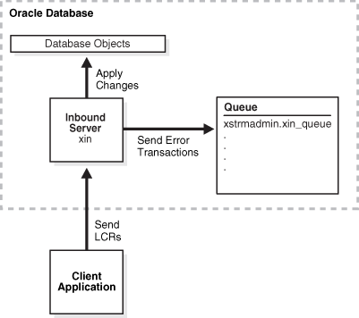

You can configure the Oracle Database components that are used by XStream.

- Preparing for XStream In
  Prerequisites must be met before configuring XStream In.
- Configuring XStream In
  The `CREATE_INBOUND` procedure in the `DBMS_XSTREAM_ADM` package creates an inbound server. You must create the client application that communicates with the inbound server and sends LCRs to the inbound server.

**See Also:**

- "[XStream Out Concepts](xstream-out-concepts.md)"

- "[XStream Use Cases](introduction-to-xstream.md)"

- [Oracle Call Interface Programmer's Guide](../lnoci/intro-to-oci-interface-for-XStream.md)

- [Oracle Database XStream Java API Reference](../stxjv/index.md)

**Parent topic:** [XStream In](xstream-in.md)

### 9.1 Preparing for XStream In

Prerequisites must be met before configuring XStream In.

- Configure an XStream Administrator
  An XStream administrator configures and manages XStream components in an XStream In environment.
- Set the Relevant Initialization Parameters
  Some initialization parameters are important for the configuration, operation, reliability, and performance of XStream inbound servers. Set these parameters appropriately.
- Configure the Streams pool
  The Streams pool is a portion of memory in the System Global Area (SGA) that is used by both Oracle Replication and XStream components. The Streams pool stores buffered queue LCRs in memory, and it provides memory for inbound servers.
- If Required, Specify Supplemental Logging at the Source Database
  In an XStream configuration in which an inbound server applies changes captured by a capture process in an XStream Out configuration, supplemental logging might be required at the source database on columns in the tables for which an inbound server applies changes.

**Parent topic:** Configuring XStream In

#### 9.1.1 Configure an XStream Administrator

An XStream administrator configures and manages XStream components in an XStream In environment.

You can configure an XStream administrator by granting a user the appropriate privileges. You must configure an XStream administrator in each Oracle database included in the XStream configuration.

If you are configuring XStream In in a multitenant container database (CDB), then configure the XStream administrator in the container that will run the inbound server. This container can be the CDB root, a pluggable database (PDB), an application root, or an application PDB. See "[XStream In and a Multitenant Environment](xstream-in-concepts.md)" for information about using XStream In in a CDB.

##### Prerequisites

Before configuring an XStream administrator, ensure that the following prerequisites are met:

- Ensure that you can log in to each database in the XStream configuration as an administrative user who can create users, grant privileges, and create tablespaces.

- Decide between the trusted user model and untrusted user model for security. See "[XStream Security Models](introduction-to-xstream.md)" for more information.

- Identify a user who will be the XStream administrator. Either create a new user with the appropriate privileges or grant these privileges to an existing user.

  Do not use the `SYS` or `SYSTEM` user as an XStream administrator, and ensure that the XStream administrator does not use the `SYSTEM` tablespace as its default tablespace.

- If a new tablespace is required for the XStream administrator, then ensure that there is enough disk space on each computer system in the XStream configuration for the tablespace. The recommended size of the tablespace is 25 MB.

- The user executing the subprograms in the `DBMS_XSTREAM_AUTH` package must have `SYSDBA` administrative privilege, and the user must exercise the privilege using `AS SYSDBA` at connect time.

##### Assumptions

This section makes the following assumptions:

- The user name of the XStream administrator is `xstrmadmin` for a non-CDB. In a CDB, when the XStream administrator is a common user, the user name of the XStream administrator is `c##xstrmadmin`. When the XStream administrator in a CDB is a local user in a container, the user name of the XStream administrator is `xstrmadmin`.

- The tablespace used by the XStream administrator is `xstream_tbs`.

##### To configure an XStream administrator:

1.  In SQL\*Plus, connect as an administrative user who can create users, grant privileges, and create tablespaces. Remain connected as this administrative user for all subsequent steps.

    **See Also:**

    [Oracle Database Administrator’s Guide](../admin/index.md) for information about connecting to a database in SQL\*Plus

2.  Either create a tablespace for the XStream administrator or use an existing tablespace.

    This tablespace stores any objects created in the XStream administrator's schema.

    For example, the following statement creates a new tablespace for the XStream administrator:

        CREATE TABLESPACE xstream_tbs DATAFILE '/usr/oracle/dbs/xstream_tbs.dbf'
          SIZE 25M REUSE AUTOEXTEND ON MAXSIZE UNLIMITED;

    If you are creating an XStream administrator as a common user in a CDB, then you must create the tablespace in the CDB root and in all containers. The tablespace is required in all containers because a common user must have access to the tablespace in any container.

3.  Create a new user to act as the XStream administrator or identify an existing user.

    For example, to create a user named `xstrmadmin` and specify that this user uses the `xstream_tbs` tablespace, run the following statement:

        CREATE USER xstrmadmin IDENTIFIED BY password
          DEFAULT TABLESPACE xstream_tbs
          QUOTA UNLIMITED ON xstream_tbs;

    If you are creating an XStream administrator in a CDB and the inbound server is in the CDB root, then the XStream administrator must be a common user.

    If you are creating an XStream administrator in a CDB and the inbound server is in a PDB, application root, or application PDB, then the XStream administrator can be a common user or a local user. Oracle recommends configuring a common user as the XStream administrator even when the inbound server is in a container other than the CDB root.

    To create a common user, include the `CONTAINER=ALL` clause in the `CREATE` `USER` statement when the current container is the CDB root:

        CREATE USER c##xstrmadmin IDENTIFIED BY password
          DEFAULT TABLESPACE xstream_tbs
          QUOTA UNLIMITED ON xstream_tbs
          CONTAINER=ALL;

    **Note:**

    Enter an appropriate password for the administrative user.

    **See Also:**

    [Oracle Database Security Guide](../dbseg/configuring-authentication.md) for guidelines about choosing passwords

4.  Grant `CREATE` `SESSION` privilege to the XStream administrator.

    If you created a new user to act as the XStream administrator, then grant this user `CREATE` `SESSION` privilege.

    For example, to grant `CREATE` `SESSION` privilege to user `xstrmadmin`, run the following statement:

        GRANT CREATE SESSION TO xstrmadmin;

    If you are creating an XStream administrator as a common user in a CDB, then grant `CREATE` `SESSION` privilege and `SET` `CONTAINER` privilege to the XStream administrator, and include the `CONTAINER=ALL` clause in the statement.

    For example, to grant these privileges to user `xstrmadmin` in a CDB, run the following statement:

        GRANT CREATE SESSION, SET CONTAINER TO c##xstrmadmin CONTAINER=ALL;

5.  Run the `GRANT_ADMIN_PRIVILEGE` procedure in the `DBMS_XSTREAM_AUTH` package.

    A user must have been explicitly granted `EXECUTE` privilege on a package to execute a subprogram in the package inside of a user-created subprogram, and a user must have explicit `READ` or `SELECT` privilege on a data dictionary view to query the view inside of a user-created subprogram. These privileges cannot be granted through a role. You can run the `GRANT_ADMIN_PRIVILEGE` procedure to grant such privileges to the XStream administrator, or you can grant them directly.

    Depending on the parameter settings for the `GRANT_ADMIN_PRIVILEGE` procedure, it can grant the appropriate privileges for a trusted or untrusted XStream administrator, and it can grant privileges in a non-CDB or a CDB. Table 9-1 describes key parameter settings for each case.

    Table 9-1 Key Parameter Settings for GRANT_ADMIN_PRIVILEGE

    | Type of XStream Administrator | grant_select_privileges Parameter Setting | container Parameter Setting |
    |:------------------------------|:------------------------------------------|:----------------------------|
    | Trusted in a non-CDB          | `TRUE`                                    | `CURRENT` (default)         |
    | Untrusted in a non-CDB        | `FALSE` (default)                         | `CURRENT` (default)         |
    | Trusted in a CDB              | `TRUE`                                    | `ALL` or `CURRENT`          |
    | Untrusted in a CDB            | `FALSE` (default)                         | `ALL` or `CURRENT`          |

    **Note:**

    - For any scenario, when the XStream administrator must manage both an XStream Out and an XStream In configuration on the database, specify `*` for the `privilege_type` parameter.

    - In a CDB, when `ALL` is specified for the `container` parameter, the current container must be the CDB root (`CDB$ROOT`).

    **See Also:**

    [Oracle Database PL/SQL Packages and Types Reference](../arpls/DBMS_XSTREAM_AUTH.md)

6.  If necessary, grant additional privileges to the XStream administrator.

    See "Granting Additional Privileges to the XStream Administrator".

7.  Repeat all of the previous steps at each Oracle database in the environment that will use XStream.

Example 9-1 Granting Privileges to a Trusted XStream Administrator in a Non-CDB Without Generating a Script

    BEGIN
       DBMS_XSTREAM_AUTH.GRANT_ADMIN_PRIVILEGE(
          grantee                 => 'xstrmadmin',
          privilege_type          => 'APPLY',
          grant_select_privileges => TRUE);
    END;
    /

Example 9-2 Granting Privileges to a Trusted XStream Administrator in a Non-CDB and Generating a Script

The directory specified in the `directory_name` parameter must exist and must be accessible to the current user.

    BEGIN
       DBMS_XSTREAM_AUTH.GRANT_ADMIN_PRIVILEGE(
          grantee                 => 'xstrmadmin',
          privilege_type          => 'APPLY',
          grant_select_privileges => TRUE,
          do_grants               => TRUE,
          file_name               => 'grant_xstrm_privs.sql',
          directory_name          => 'xstrm_dir');
    END;
    /

Example 9-3 Granting Privileges to an Untrusted XStream Administrator in a Non-CDB Without Generating a Script

    BEGIN
       DBMS_XSTREAM_AUTH.GRANT_ADMIN_PRIVILEGE(
          grantee                 => 'xstrmadmin',
          privilege_type          => 'APPLY',
          grant_select_privileges => FALSE);
    END;
    /

Example 9-4 Granting Privileges to a Trusted XStream Administrator in a CDB Without Generating a Script

In this example, the XStream administrator is a common user.

    BEGIN
       DBMS_XSTREAM_AUTH.GRANT_ADMIN_PRIVILEGE(
          grantee                 => 'c##xstrmadmin',
          privilege_type          => 'APPLY',
          grant_select_privileges => TRUE,
          container               => 'ALL');
    END;
    /

- Granting Additional Privileges to the XStream Administrator
  Additional privileges might be required for the XStream administrator.

**Parent topic:** Preparing for XStream In

##### 9.1.1.1 Granting Additional Privileges to the XStream Administrator

Additional privileges might be required for the XStream administrator.

Grant any of the following additional privileges to the XStream Administrator if necessary:

- If you plan to use Oracle Enterprise Manager Cloud Control to manage databases with XStream components, then the XStream administrator must be trusted and must be granted `DBA` role. You must also configure the XStream administrator to be an Oracle Enterprise Manager administrative user. Doing so grants additional privileges required by Oracle Enterprise Manager Cloud Control, such as the privileges required to run Oracle Enterprise Manager Cloud Control jobs. See the Oracle Enterprise Manager Cloud Control online help for information about creating Oracle Enterprise Manager administrative users.

- If no apply user is specified for an inbound server, then grant the XStream administrator the necessary privileges to perform DML and DDL changes on the apply objects owned by other users. If an apply user is specified, then the apply user must have these privileges. These privileges can be granted directly or through a role.

- If no apply user is specified for an inbound server, then grant the XStream administrator `EXECUTE` privilege on any PL/SQL subprogram owned by another user that is executed by an inbound server. These subprograms can be used in apply handlers or error handlers. If an apply user is specified, then the apply user must have these privileges. These privileges must be granted directly. They cannot be granted through a role.

- Grant the XStream administrator `EXECUTE` privilege on any PL/SQL function owned by another user that is specified in a custom rule-based transformation for a rule used by an inbound server. For an inbound server, if an apply user is specified, then the apply user must have these privileges. These privileges must be granted directly. They cannot be granted through a role.

- If the XStream administrator does not own the queue used by an inbound server and is not specified as the queue user for the queue when the queue is created, then the XStream administrator must be configured as a secure queue user of the queue if you want the XStream administrator to be able to enqueue LCRs into or dequeue LCRs from the queue. The XStream administrator might also need `ENQUEUE` or `DEQUEUE` privileges on the queue, or both.

- Grant the XStream administrator `EXECUTE` privilege on any object types that the XStream administrator might need to access. These privileges can be granted directly or through a role.

- If you are using Oracle Database Vault, then the following additional privileges are required:

  - The apply user for an inbound server must be authorized to apply changes to realms that include replicated database objects. The replicated database objects are the objects to which the inbound server applies changes.

    To authorize an apply user for a realm, run the `DVSYS.DBMS_MACADM.ADD_AUTH_TO_REALM` procedure and specify the realm and the apply user. For example, to authorize apply user `xstrmadmin` for the `sales` realm, run the following procedure:

        BEGIN
          DVSYS.DBMS_MACADM.ADD_AUTH_TO_REALM(
            realm_name  => 'sales',
            grantee     => 'xstrmadmin');
        END;
        /

  - The user who creates or alters an inbound server must be granted the `BECOME` `USER` system privilege.

    Granting the `BECOME` `USER` system privilege to the user who performs these actions is not required if Oracle Database Vault is not installed. You can revoke the `BECOME` `USER` system privilege from the user after the completing one of these actions, if necessary.

**See Also:**

[Oracle Database Vault Administrator’s Guide](../dvadm/index.md)

**Parent topic:** Configure an XStream Administrator

#### 9.1.2 Set the Relevant Initialization Parameters

Some initialization parameters are important for the configuration, operation, reliability, and performance of XStream inbound servers. Set these parameters appropriately.

The following requirements apply to XStream inbound servers:

- Ensure that the `PROCESSES` initialization parameter is set to a value large enough to accommodate the inbound server background processes and all of the other Oracle Database background processes.

- Ensure that the `SESSIONS` initialization parameter is set to a value large enough to accommodate the sessions used by the inbound server background processes and all of the other Oracle Database sessions.

**Parent topic:** Preparing for XStream In

#### 9.1.3 Configure the Streams pool

The Streams pool is a portion of memory in the System Global Area (SGA) that is used by both Oracle Replication and XStream components. The Streams pool stores buffered queue LCRs in memory, and it provides memory for inbound servers.

The following are considerations for configuring the Streams pool:

- At least 300 MB of memory is required for the Streams pool.

- The best practice is to set the `STREAMS_POOL_SIZE` initialization parameter explicitly to the desired Streams pool size.

- After XStream In is configured, you can use the `max_sga_size` apply parameter to control the amount of SGA memory allocated specifically to an inbound server.

- Ensure that there is enough space in the Streams pool at each database to run XStream components and to store LCRs and run the components properly.

- The Streams pool is initialized the first time an inbound server is started.

The Streams pool size is the value specified by the `STREAMS_POOL_SIZE` parameter, in bytes, if the following conditions are met:

- The `MEMORY_TARGET`, `MEMORY_MAX_TARGET`, and `SGA_TARGET` initialization parameters are all set to `0` (zero).

- The `STREAMS_POOL_SIZE` initialization parameter is set to a nonzero value.

The Automatic Shared Memory Management feature automatically manages the size of the Streams pool when the following conditions are met:

- The `MEMORY_TARGET` and `MEMORY_MAX_TARGET` initialization parameters are both set to `0` (zero).

- The `SGA_TARGET` initialization parameter is set to a nonzero value.

If you are using Automatic Shared Memory Management, and if the `STREAMS_POOL_SIZE` initialization parameter also is set to a nonzero value, then Automatic Shared Memory Management uses this value as a minimum for the Oracle Replication pool. If your environment needs a minimum amount of memory in the Oracle Replication pool to function properly, then you can set a minimum size. To view the current memory allocated to Oracle Replication pool by Automatic Shared Memory Management, query the `V$SGA_DYNAMIC_COMPONENTS` view. In addition, you can query the `V$STREAMS_POOL_STATISTICS` view to view the current usage of the Oracle Replication pool.

**See Also:**

- [Oracle Database PL/SQL Packages and Types Reference](../arpls/DBMS_APPLY_ADM.md) for more information about the `max_sga_size` apply parameter

- [Oracle Database Administrator’s Guide](../admin/managing-memory.md)

- [Oracle Database Reference](../refrn/SGA_TARGET.md)

**Parent topic:** Preparing for XStream In

#### 9.1.4 If Required, Specify Supplemental Logging at the Source Database

In an XStream configuration in which an inbound server applies changes captured by a capture process in an XStream Out configuration, supplemental logging might be required at the source database on columns in the tables for which an inbound server applies changes.

The required supplemental logging depends on the configuration of the inbound server you create.

**See Also:**

"[If Required, Configure Supplemental Logging](configuring-xstream-out.md)"

**Parent topic:** Preparing for XStream In

### 9.2 Configuring XStream In

The `CREATE_INBOUND` procedure in the `DBMS_XSTREAM_ADM` package creates an inbound server. You must create the client application that communicates with the inbound server and sends LCRs to the inbound server.

An inbound server in an XStream In configuration receives a stream of changes from a client application. The inbound server can apply these changes to database objects in an Oracle database, or it can process the changes in a customized way. A client application can attach to an inbound server and send row changes and DDL changes encapsulated in LCRs using the OCI or Java interface.

#### Prerequisites

Before configuring XStream In, ensure that the following prerequisite is met:

- Complete the tasks described in "Preparing for XStream In".

#### Assumptions for the Sample XStream In Configuration

This section makes the following assumptions:

- The name of the inbound server is `xin`.

- The inbound server applies all of the changes it receives from the XStream client application.

- The queue used by the inbound server is `xstrmadmin.xin_queue`.

Figure 9-1 provides an overview of this XStream In configuration.

Figure 9-1 Sample XStream In Configuration

[Description of "Figure 9-1 Sample XStream In Configuration"](img_text/xstrm072.md)

#### To create an inbound server:

1.  In SQL\*Plus, connect to the database that will run the inbound server as the XStream administrator.

    If you are configuring XStream In in a CDB, then connect to the container to which the inbound server will apply changes. The container can be the CDB root, a PDB, an application root, or an application PDB. An inbound server can apply changes only in its own container.

    **See Also:**

    - [Oracle Database Administrator’s Guide](../admin/index.md) for information about connecting to a database in SQL\*Plus

    - [Oracle Multitenant Administrator's Guide](../multi/administering-a-cdb-with-sql-plus.md) for information about connecting to a container in a CDB in SQL\*Plus

    - "[XStream In and a Multitenant Environment](xstream-in-concepts.md)" for information about using XStream In in a CDB

2.  Run the `CREATE_INBOUND` procedure.

    For example, the following `CREATE_INBOUND` procedure configures an inbound server named `xin`:

        BEGIN
          DBMS_XSTREAM_ADM.CREATE_INBOUND(
            server_name => 'xin',
            queue_name  => 'xin_queue');
        END;
        /

    Running this procedure performs the following actions:

    - Creates an inbound server named `xin`.

    - Sets the queue with the name `xin_queue` as the inbound server's queue, and creates this queue if it does not exist. This queue does not store LCRs sent by the client application. Instead, the queue stores error transactions if an LCR raises an error. The current user is the queue owner. In this example, the current user is the XStream administrator.

    - Sets the current user as the apply user for the inbound server. In this example, the current user is the XStream administrator. The client application must connect to the database as the apply user to interact with the inbound server.

    **Tip:**

    By default, an inbound server does not use rules or rule sets. Therefore, it processes all LCRs sent to it by the client application. To add rules and rule sets, use the `DBMS_XSTREAM_ADM` package or the `DBMS_RULE_ADM` package. See [Oracle Database PL/SQL Packages and Types Reference](../arpls/DBMS_XSTREAM_ADM.md).

3.  If necessary, create apply handlers for the inbound server.

    Apply handlers are optional. Apply handlers process LCRs sent to an inbound server in a customized way.

    **See Also:**

    "[LCR Processing Options for Inbound Servers](xstream-in-concepts.md)"

4.  Create and run the client application that will connect to the inbound server and send LCRs to it.

    **See Also:**

    "[Sample XStream Client Application](sample-xstream-client-application.md)" for a sample application

5.  If the inbound server is disabled, then start the inbound server.

    For example, enter the following:

        exec DBMS_APPLY_ADM.START_APPLY('xin');

    **See Also:**

    [Oracle Database PL/SQL Packages and Types Reference](../arpls/DBMS_XSTREAM_ADM.md)

**Parent topic:** Configuring XStream In
