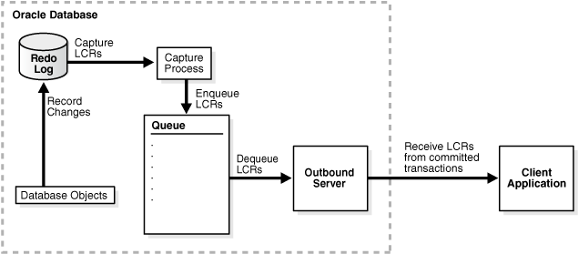
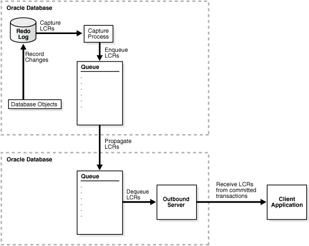
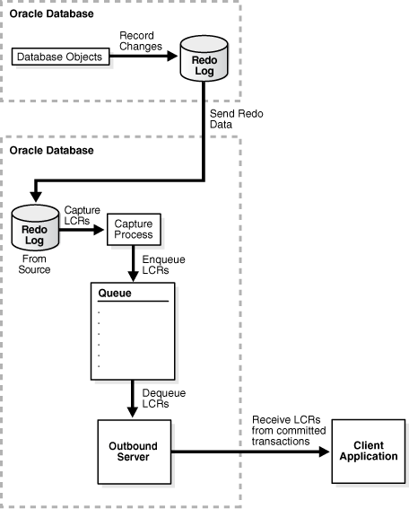
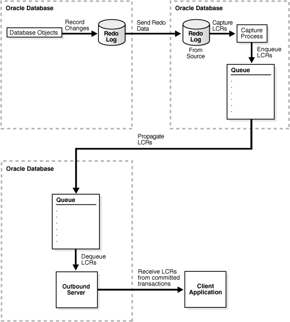
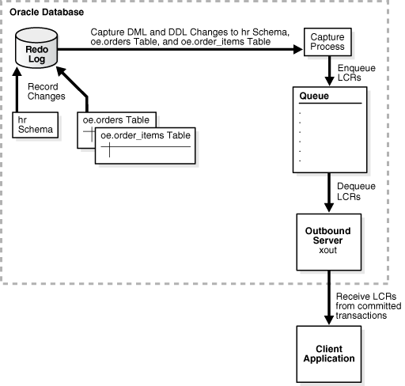
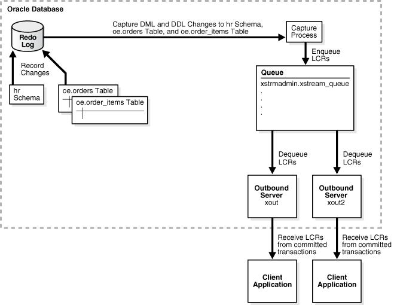
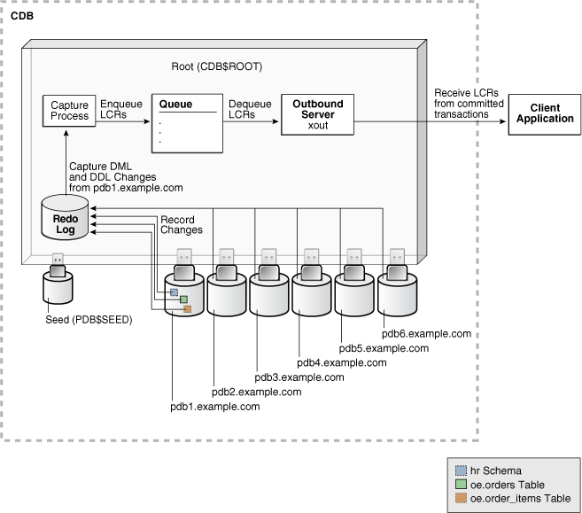
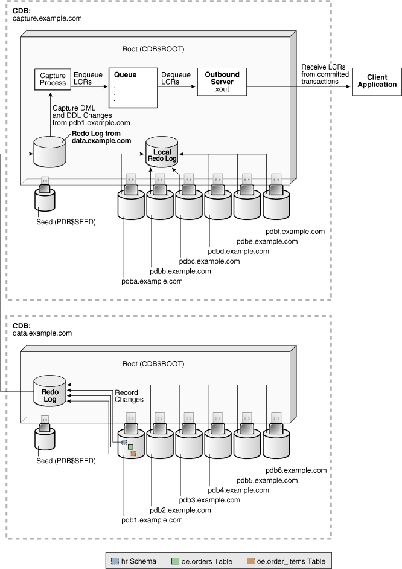

You can configure the Oracle Database components that are used by XStream Out.

- Preparing for XStream Out
  There are decisions to make and tasks to complete to prepare for an XStream Out configuration.
- Configuring XStream Out
  An outbound server in an XStream Out configuration streams Oracle database changes to a client application.

**See Also:**

- "[XStream Out Concepts](xstream-out-concepts.md)"

- "[XStream Use Cases](introduction-to-xstream.md)"

- [Oracle Call Interface Programmer's Guide](../lnoci/intro-to-oci-interface-for-XStream.md)

- [Oracle Database XStream Java API Reference](../stxjv/index.md)

**Parent topic:** [XStream Out](xstream-out.md)

### 4.1 Preparing for XStream Out

There are decisions to make and tasks to complete to prepare for an XStream Out configuration.

- Decide How to Configure XStream Out
  When you configure XStream Out, you must configure XStream components to capture database changes and send these changes to the outbound server in the form of logical change records (LCRs).
- Prerequisites for Configuring XStream Out
  Preparing for an XStream Out outbound server is similar to preparing for an Oracle Replication environment.

**Parent topic:** Configuring XStream Out

#### 4.1.1 Decide How to Configure XStream Out

When you configure XStream Out, you must configure XStream components to capture database changes and send these changes to the outbound server in the form of logical change records (LCRs).

These components include a capture process and at least one queue. The capture process can be a local capture process or a downstream capture process. For some configurations, you must also configure a propagation.

Local capture means that a capture process runs on the source database. The source database is the database where the changes were generated. Downstream capture means that a capture process runs on a database other than the source database. The primary reason to use downstream capture is to reduce the load on the source database, thereby improving its performance. The primary reason to use a local capture is because it is easier to configure and maintain.

The database that captures changes made to the source database is called the capture database. One of the following databases can be the capture database:

- Source database (local capture)

- Destination database (downstream capture)

- A third database (downstream capture)

If the database running the outbound server is not the capture database, then a propagation sends changes from the capture database to the database running the outbound server. If the database running the outbound server is the capture database, then this propagation between databases is not needed because the capture process and outbound server use the same queue.

You can configure the components in the following ways:

- Local capture and outbound server in the same database: The database objects, capture process, and outbound server are all in the same database. This configuration is the easiest to configure and maintain because all of the components are contained in one database. See Figure 4-1 for an overview of this configuration.

- Local capture and outbound server in different databases: The database objects and capture process are in one database, and the outbound server is in another database. A propagation sends LCRs from the source database to the outbound server database. This configuration is best when you want easy configuration and maintenance and when you want to optimize the performance of the outbound server database. See Figure 4-2 for an overview of this configuration.

- Downstream capture and outbound server in the same database: The database objects are in one database, and the capture process and outbound server are in another database. This configuration is best when you want to optimize the performance of the database with the database objects and want to offload change capture to another database. With this configuration, most of the components run on the database with the outbound server. See Figure 4-3 for an overview of this configuration.

- Downstream capture and outbound server in different databases: The database objects are in one database, the outbound server is in another database, and the capture process is in a third database. This configuration is best when you want to optimize the performance of both the database with the database objects and the database with the outbound server. With this configuration, the capture process runs on a third database, and a propagation sends LCRs from the capture database to the outbound server database. See Figure 4-4 for an overview of this configuration.

The following figures illustrate these different configurations.

Figure 4-1 Local Capture and Outbound Server in the Same Database

[Description of "Figure 4-1 Local Capture and Outbound Server in the Same Database"](img_text/xstrm075.md)

Figure 4-2 Local Capture and Outbound Server in Different Databases

[Description of "Figure 4-2 Local Capture and Outbound Server in Different Databases"](img_text/xstrm076.md)

Figure 4-3 Downstream Capture and Outbound Server in the Same Database

[Description of "Figure 4-3 Downstream Capture and Outbound Server in the Same Database"](img_text/xstrm077.md)

Figure 4-4 Downstream Capture and Outbound Server in Different Databases

[Description of "Figure 4-4 Downstream Capture and Outbound Server in Different Databases"](img_text/xstrm078.md)

If you decide to configure a downstream capture process, then you must decide which type of downstream capture process you want to configure. The following types are available:

- A real-time downstream capture process configuration means that redo transport services at the source database sends redo data to the downstream database, and a remote file server process (RFS) at the downstream database receives the redo data over the network and stores the redo data in the standby redo log, where the capture process captures changes in real-time.

- An archived-log downstream capture process configuration means that archived redo log files from the source database are copied to the downstream database, and the capture process captures changes in these archived redo log files. These log files can be transferred automatically using redo transport services, or they can be transferred manually using a method such as FTP.

The advantage of real-time downstream capture over archived-log downstream capture is that real-time downstream capture reduces the amount of time required to capture changes made to the source database. The time is reduced because the real-time downstream capture process does not need to wait for the redo log file to be archived before it can capture changes from it. You can configure multiple real-time downstream capture processes that capture changes from the same source database, but you cannot configure real-time downstream capture for multiple source databases at one downstream database.

The advantage of archived-log downstream capture over real-time downstream capture is that archived-log downstream capture allows downstream capture processes for multiple source databases at a downstream database. You can copy redo log files from multiple source databases to a single downstream database and configure multiple archived-log downstream capture processes to capture changes in these redo log files.

**See Also:**

"[Local Capture and Downstream Capture](xstream-out-concepts.md)"

**Parent topic:** Preparing for XStream Out

#### 4.1.2 Prerequisites for Configuring XStream Out

Preparing for an XStream Out outbound server is similar to preparing for an Oracle Replication environment.

The components used in an Oracle Replication environment to capture changes and send them to an apply process are the same components used to capture changes and send them to an outbound server. These components include a capture process and one or more queues. If the capture process runs on a different database than the outbound server, then a propagation is also required.

This section provides an overview of each task and specific information about completing the task for an XStream Out configuration.

- Configure an XStream Administrator on All Databases
  An XStream administrator configures and manages XStream components in an XStream Out environment.
- Granting Additional Privileges to the XStream Administrator
  Additional privileges might be required for the XStream administrator.
- If Required, Configure Network Connectivity and Database Links
  Network connectivity and database links are required when an XStream Out configuration includes multiple databases.
- Ensure That Each Source Database Is in ARCHIVELOG Mode
  Each source database that generates changes that will be captured by a capture process must be in `ARCHIVELOG` mode.
- Set the Relevant Initialization Parameters
  Some initialization parameters are important for the configuration, operation, reliability, and performance of the components in an XStream configuration. Set these parameters appropriately.
- Configure the Streams pool
  The Streams pool is a portion of memory in the System Global Area (SGA) that is used by both Oracle Replication and XStream components.
- If Required, Configure Supplemental Logging
  When you use a capture process to capture changes, supplemental logging must be specified for certain columns at a source database for changes to the columns to be applied successfully at a destination database.
- If Required, Configure Log File Transfer to a Downstream Database
  If you decided to use a local capture process, then log file transfer is not required. However, if you decided to use downstream capture that uses redo transport services to transfer archived redo log files to the downstream database automatically, then configure log file transfer from the source database to the capture database.
- If Required, Add Standby Redo Logs for Real-Time Downstream Capture
  If you decided to configure real-time downstream capture, then add standby redo logs to the capture database.

**Parent topic:** Preparing for XStream Out

##### 4.1.2.1 Configure an XStream Administrator on All Databases

An XStream administrator configures and manages XStream components in an XStream Out environment.

You can configure an XStream administrator by granting a user the appropriate privileges. You must configure an XStream administrator in each Oracle database included in the XStream configuration.

##### Prerequisites

Before configuring an XStream administrator, ensure that the following prerequisites are met:

- Ensure that you can log in to each database in the XStream configuration as an administrative user who can create users, grant privileges, and create tablespaces.

- Decide between the trusted user model and untrusted user model for security. See "[XStream Security Models](introduction-to-xstream.md)" for more information.

- Identify a user who will be the XStream administrator. Either create a new user with the appropriate privileges or grant these privileges to an existing user.

  Do not use the `SYS` or `SYSTEM` user as an XStream administrator, and ensure that the XStream administrator does not use the `SYSTEM` tablespace as its default tablespace.

- If a new tablespace is required for the XStream administrator, then ensure that there is enough disk space on each computer system in the XStream configuration for the tablespace. The recommended size of the tablespace is 25 MB.

- The user executing the subprograms in the `DBMS_XSTREAM_AUTH` package must have `SYSDBA` administrative privilege, and the user must exercise the privilege using `AS SYSDBA` at connect time.

##### Assumptions

This section makes the following assumptions:

- The user name of the XStream administrator is `xstrmadmin` for a non-CDB. The user name of the XStream administrator is `c##xstrmadmin` for a multitenant container database (CDB).

- The tablespace used by the XStream administrator is `xstream_tbs`.

##### To configure an XStream administrator:

1.  In SQL\*Plus, connect as an administrative user who can create users, grant privileges, and create tablespaces. Remain connected as this administrative user for all subsequent steps.

    If you are configuring an XStream administrator for XStream Out in a CDB, then connect to the root and configure the XStream administrator in the CDB root.

    **See Also:**

    - [Oracle Database Administrator’s Guide](../admin/index.md) for information about connecting to a database in SQL\*Plus

    - "[XStream Out and a Multitenant Environment](xstream-out-concepts.md)" for more information about XStream Out and CDBs

2.  Either create a tablespace for the XStream administrator or use an existing tablespace.

    This tablespace stores any objects created in the XStream administrator's schema.

    For example, the following statement creates a new tablespace for the XStream administrator:

        CREATE TABLESPACE xstream_tbs DATAFILE '/usr/oracle/dbs/xstream_tbs.dbf'
          SIZE 25M REUSE AUTOEXTEND ON MAXSIZE UNLIMITED;

    If you are creating an XStream administrator in a CDB, then you must create the tablespace in all of the containers in the CDB, including the CDB root, all pluggable databases (PDBs), all application roots, and all application containers. The tablespace is required in all containers because the XStream administrator must be a common user and so must have access to the tablespace in any container.

3.  Create a new user to act as the XStream administrator or identify an existing user.

    For example, to create a user named `xstrmadmin` and specify that this user uses the `xstream_tbs` tablespace, run the following statement:

        CREATE USER xstrmadmin IDENTIFIED BY password
          DEFAULT TABLESPACE xstream_tbs
          QUOTA UNLIMITED ON xstream_tbs;

    If you are creating an XStream administrator in a CDB, then the XStream administrator must be a common user. Therefore, include the `CONTAINER=ALL` clause in the `CREATE` `USER` statement:

        CREATE USER c##xstrmadmin IDENTIFIED BY password
          DEFAULT TABLESPACE xstream_tbs
          QUOTA UNLIMITED ON xstream_tbs
          CONTAINER=ALL;

    **Note:**

    Enter an appropriate password for the administrative user.

    **See Also:**

    [Oracle Database Security Guide](../dbseg/configuring-authentication.md) for guidelines about choosing passwords

4.  Grant `CREATE` `SESSION` privilege to the XStream administrator.

    If you created a new user to act as the XStream administrator, then grant this user `CREATE` `SESSION` privilege.

    For example, to grant `CREATE` `SESSION` privilege to user `xstrmadmin`, run the following statement:

        GRANT CREATE SESSION TO xstrmadmin;

    If you are creating an XStream administrator in a CDB, then grant `CREATE` `SESSION` privilege and `SET` `CONTAINER` privilege to the XStream administrator, and include the `CONTAINER=ALL` clause in the statement.

    For example, to grant these privileges to user `c##xstrmadmin` in a CDB, run the following statement:

        GRANT CREATE SESSION, SET CONTAINER TO c##xstrmadmin CONTAINER=ALL;

5.  Run the `GRANT_ADMIN_PRIVILEGE` procedure in the `DBMS_XSTREAM_AUTH` package.

    A user must have been explicitly granted `EXECUTE` privilege on a package to execute a subprogram in the package inside of a user-created subprogram, and a user must have explicit `READ` or `SELECT` privilege on a data dictionary view to query the view inside of a user-created subprogram. These privileges cannot be granted through a role. You can run the `GRANT_ADMIN_PRIVILEGE` procedure to grant such privileges to the XStream administrator, or you can grant them directly.

    Depending on the parameter settings for the `GRANT_ADMIN_PRIVILEGE` procedure, it can grant the appropriate privileges for a trusted or untrusted XStream administrator, and it can grant privileges in a non-CDB or a CDB. Table 4-1 describes key parameter settings for each case.

    Table 4-1 Key Parameter Settings for GRANT_ADMIN_PRIVILEGE

    | Type of XStream Administrator | grant_select_privileges Parameter Setting | container Parameter Setting |
    |:------------------------------|:------------------------------------------|:----------------------------|
    | Trusted in a non-CDB          | `TRUE`                                    | `CURRENT` (default)         |
    | Untrusted in a non-CDB        | `FALSE` (default)                         | `CURRENT` (default)         |
    | Trusted in a CDB              | `TRUE`                                    | `ALL`                       |
    | Untrusted in a CDB            | `FALSE` (default)                         | `ALL`                       |

    **Note:**

    - For any scenario, when the XStream administrator must manage both an XStream Out and an XStream In configuration on the database, specify `*` for the `privilege_type` parameter.

    - In a CDB, when `ALL` is specified for the `container` parameter, the current container must be the CDB root (`CDB$ROOT`).

    **See Also:**

    [Oracle Database PL/SQL Packages and Types Reference](../arpls/DBMS_XSTREAM_AUTH.md)

6.  If necessary, grant additional privileges to the XStream administrator.

    See "Granting Additional Privileges to the XStream Administrator".

7.  Repeat all of the previous steps at each Oracle database in the environment that will use XStream.

Example 4-1 Granting Privileges to a Trusted XStream Administrator in a Non-CDB Without Generating a Script

    BEGIN
       DBMS_XSTREAM_AUTH.GRANT_ADMIN_PRIVILEGE(
          grantee                 => 'xstrmadmin',
          privilege_type          => 'CAPTURE',
          grant_select_privileges => TRUE);
    END;
    /

Example 4-2 Granting Privileges to a Trusted XStream Administrator in a Non-CDB and Generating a Script

The directory specified in the `directory_name` parameter must exist and must be accessible to the current user.

    BEGIN
       DBMS_XSTREAM_AUTH.GRANT_ADMIN_PRIVILEGE(
          grantee                 => 'xstrmadmin',
          privilege_type          => 'CAPTURE',
          grant_select_privileges => TRUE,
          do_grants               => TRUE,
          file_name               => 'grant_xstrm_privs.sql',
          directory_name          => 'xstrm_dir');
    END;
    /

Example 4-3 Granting Privileges to an Untrusted XStream Administrator in a Non-CDB Without Generating a Script

    BEGIN
       DBMS_XSTREAM_AUTH.GRANT_ADMIN_PRIVILEGE(
          grantee                 => 'xstrmadmin',
          privilege_type          => 'CAPTURE',
          grant_select_privileges => FALSE);
    END;
    /

Example 4-4 Granting Privileges to a Trusted XStream Administrator in a CDB Without Generating a Script

    BEGIN
       DBMS_XSTREAM_AUTH.GRANT_ADMIN_PRIVILEGE(
          grantee                 => 'c##xstrmadmin',
          privilege_type          => 'CAPTURE',
          grant_select_privileges => TRUE,
          container               => 'ALL');
    END;
    /

**Parent topic:** Prerequisites for Configuring XStream Out

##### 4.1.2.2 Granting Additional Privileges to the XStream Administrator

Additional privileges might be required for the XStream administrator.

Grant any of the following additional privileges to the XStream administrator if necessary:

- If you plan to use Oracle Enterprise Manager Cloud Control to manage databases with XStream components, then the XStream administrator must be a trusted user and must be granted `DBA` role. You must also configure the XStream administrator to be an Oracle Enterprise Manager administrative user. Doing so grants additional privileges required by Oracle Enterprise Manager Cloud Control, such as the privileges required to run Oracle Enterprise Manager Cloud Control jobs. See the Oracle Enterprise Manager Cloud Control online help for information about creating Oracle Enterprise Manager administrative users.

- Grant the privileges for a remote XStream administrator to perform actions in the local database. Grant these privileges using the `GRANT_REMOTE_ADMIN_ACCESS` procedure in the `DBMS_XSTREAM_AUTH` package. Grant this privilege if a remote XStream administrator will use a database link that connects to the local XStream administrator to perform administrative actions. Specifically, grant these privileges if either of the following conditions is true:

  - You plan to configure a downstream capture process at a remote downstream database that captures changes originating at the local source database, and the downstream capture process will use a database link to perform administrative actions at the source database.

  - You plan to use a remote XStream administrator to set the instantiation system change number (SCN) values for replicated database objects at the local database.

- Grant the XStream administrator `EXECUTE` privilege on any PL/SQL function owned by another user that is specified in a custom rule-based transformation for a rule used by a capture process, propagation, or outbound server. For a capture process, if a capture user is specified, then the capture user must have these privileges. These privileges must be granted directly. They cannot be granted through a role.

- Grant the XStream administrator privileges to alter database objects where appropriate. For example, if the XStream administrator must create a supplemental log group for a table in another schema, then the XStream administrator must have the necessary privileges to alter the table. These privileges can be granted directly or through a role.

- If the XStream administrator does not own the queue used by a capture process, propagation, or outbound server, and is not specified as the queue user for the queue when the queue is created, then the XStream administrator must be configured as a secure queue user of the queue if you want the XStream administrator to be able to enqueue LCRs into or dequeue LCRs from the queue. The XStream administrator might also need `ENQUEUE` or `DEQUEUE` privileges on the queue, or both.

- Grant the XStream administrator `EXECUTE` privilege on any object types that the XStream administrator might need to access. These privileges can be granted directly or through a role.

- If you are using Oracle Database Vault, then the XStream administrator must be granted the `DV_XSTREAM_ADMIN` role to perform the following tasks: create a capture process, create an outbound server, and modify the capture user for a capture process. When the XStream administrator is not performing these tasks, you can revoke `DV_XSTREAM_ADMIN` role from the XStream administrator.

  In addition, the user who performs the following actions must be granted the `BECOME` `USER` system privilege:

  - Creates or alters a capture process

  - Creates or alters an outbound server

  Granting the `BECOME` `USER` system privilege to the user who performs these actions is not required if Oracle Database Vault is not installed. You can revoke the `BECOME` `USER` system privilege from the user after the completing one of these actions, if necessary.

  See [Oracle Database Vault Administrator’s Guide](../dvadm/index.md).

**Parent topic:** Prerequisites for Configuring XStream Out

##### 4.1.2.3 If Required, Configure Network Connectivity and Database Links

Network connectivity and database links are required when an XStream Out configuration includes multiple databases.

Network connectivity and database links are not required when all of the components run on the same database. These components include the capture process, queue, and outbound server.

You must configure network connectivity and database links if you decided to configure XStream in either of the following ways:

- The capture process and the outbound server will run on different databases.

- Downstream capture will be used.

See "Decide How to Configure XStream Out" for more information about these decisions.

If network connectivity is required, then configure your network and Oracle Net so that the databases can communicate with each other.

The following database links are required:

- When the capture process runs on a different database from the outbound server, create a database link from the capture database to the outbound server database. A propagation uses this database link to send changes from the capture database to the outbound server database.

- When you use downstream capture, create a database link from the capture database to the source database. The source database is the database that generates the redo data that the capture process uses to capture changes. The capture process uses this database link to perform administrative tasks at the source database.

The name of each database link must match the global name of the destination database, and each database link should be created in the XStream administrator's schema.

For example, assume that you want to create a database link in a configuration with the following characteristics:

- The global name of the source database is `dbs1.example.com`.

- The global name of the destination database is `dbs2.example.com`.

- The XStream administrator is `xstrmadmin` at each database.

Given these assumptions, the following statement creates a database link from `dbs1.example.com` to `dbs2.example.com`:

    CONNECT xstrmadmin@dbs1.example.com
    Enter password: password

    CREATE DATABASE LINK dbs2.example.com CONNECT TO xstrmadmin
       IDENTIFIED BY password USING 'dbs2.example.com';

**See Also:**

- [Oracle Database 2 Day DBA](../admqs/configuring-the-network-environment.md)

- [Oracle Database Administrator’s Guide](../admin/managing-a-distributed-database.md) for more information about database links

**Parent topic:** Prerequisites for Configuring XStream Out

##### 4.1.2.4 Ensure That Each Source Database Is in ARCHIVELOG Mode

Each source database that generates changes that will be captured by a capture process must be in `ARCHIVELOG` mode.

For downstream capture processes, the downstream database also must be in `ARCHIVELOG` mode if you plan to configure a real-time downstream capture process. The downstream database does not need to be in `ARCHIVELOG` mode if you plan to run only archived-log downstream capture processes on it.

If you are configuring XStream in an Oracle Real Application Clusters (Oracle RAC) environment, then the archived redo log files of all threads from all instances must be available to any instance running a capture process. This requirement pertains to both local and downstream capture processes.

**See Also:**

[Oracle Database Administrator’s Guide](../admin/managing-archived-redo-log-files.md)for instructions about running a database in `ARCHIVELOG` mode

**Parent topic:** Prerequisites for Configuring XStream Out

##### 4.1.2.5 Set the Relevant Initialization Parameters

Some initialization parameters are important for the configuration, operation, reliability, and performance of the components in an XStream configuration. Set these parameters appropriately.

The following requirements apply to XStream outbound servers:

- Ensure that the `PROCESSES` initialization parameter is set to a value large enough to accommodate the outbound server background processes and all of the other Oracle Database background processes.

- Ensure that the `SESSIONS` initialization parameter is set to a value large enough to accommodate the sessions used by the outbound server background processes and all of the other Oracle Database sessions.

**Parent topic:** Prerequisites for Configuring XStream Out

##### 4.1.2.6 Configure the Streams pool

The Streams pool is a portion of memory in the System Global Area (SGA) that is used by both Oracle Replication and XStream components.

The Streams pool stores buffered queue LCRs in memory, and it provides memory for capture processes and outbound servers.

The following are considerations for configuring the Streams pool:

- At least 300 MB of memory is required for the Streams pool.

- After XStream Out is configured, you can use the `max_sga_size` capture process parameter to control the amount of system global area (SGA) memory allocated specifically to a capture process.

  The sum of system global area (SGA) memory allocated for all components on a database must be less than the value set for the `STREAMS_POOL_SIZE` initialization parameter.

- After XStream Out is configured, you can use the `max_sga_size` apply parameter to control the amount of SGA memory allocated specifically to an outbound server.

- Ensure that there is enough space in the Streams pool at each database to run XStream components and to store LCRs and run the components properly.

- The Streams pool is initialized the first time an outbound server is started.

- The best practice is to set the `STREAMS_POOL_SIZE` initialization parameter explicitly to the desired Streams pool size.

The Automatic Shared Memory Management feature automatically manages the size of the Streams pool when the following conditions are met:

- The `MEMORY_TARGET` and `MEMORY_MAX_TARGET` initialization parameters are both set to `0` (zero).

- The `SGA_TARGET` initialization parameter is set to a nonzero value.

The Streams pool size is the value specified by the `STREAMS_POOL_SIZE` parameter, in bytes, if the following conditions are met:

- The `MEMORY_TARGET`, `MEMORY_MAX_TARGET`, and `SGA_TARGET` initialization parameters are all set to `0` (zero).

- The `STREAMS_POOL_SIZE` initialization parameter is set to a nonzero value.

If you are using Automatic Shared Memory Management, and if the `STREAMS_POOL_SIZE` initialization parameter also is set to a nonzero value, then Automatic Shared Memory Management uses this value as a minimum for the Oracle Replication pool. If your environment needs a minimum amount of memory in the Oracle Replication pool to function properly, then you can set a minimum size. To view the current memory allocated to Oracle Replication pool by Automatic Shared Memory Management, query the `V$SGA_DYNAMIC_COMPONENTS` view. In addition, you can query the `V$STREAMS_POOL_STATISTICS` view to view the current usage of the Oracle Replication pool.

**See Also:**

- [Oracle Database PL/SQL Packages and Types Reference](../arpls/DBMS_CAPTURE_ADM.md) for more information about the `max_sga_size` capture process parameter

- [Oracle Database Administrator’s Guide](../admin/managing-memory.md)

- [Oracle Database Reference](../refrn/SGA_TARGET.md)

**Parent topic:** Prerequisites for Configuring XStream Out

##### 4.1.2.7 If Required, Configure Supplemental Logging

When you use a capture process to capture changes, supplemental logging must be specified for certain columns at a source database for changes to the columns to be applied successfully at a destination database.

Supplemental logging places additional information in the redo log for these columns. A capture process captures this additional information and places it in logical change records (LCRs), and an XStream inbound server or client application might need this additional information to process changes properly.

- Required Supplemental Logging in an XStream Environment
  There are two types of supplemental logging: database supplemental logging and table supplemental logging.
- Specifying Table Supplemental Logging Using Unconditional Log Groups
  You can specify supplemental logging using unconditional log groups.
- Specifying Table Supplemental Logging Using Conditional Log Groups
  You can specify table supplemental logging using conditional log groups.
- Dropping a Supplemental Log Group
  To drop a conditional or unconditional supplemental log group, use the `DROP` `SUPPLEMENTAL` `LOG` `GROUP` clause in the `ALTER` `TABLE` statement.
- Specifying Database Supplemental Logging of Key Columns
  You have the option of specifying supplemental logging for all primary key, unique key, bitmap index, and foreign key columns in a source database.
- Dropping Database Supplemental Logging of Key Columns
  To drop supplemental logging for all primary key, unique key, bitmap index, and foreign key columns in a source database, issue the `ALTER` `DATABASE` `DROP` `SUPPLEMENTAL` `LOG` `DATA` statement.
- Procedures That Automatically Specify Supplemental Logging
  Some procedures in the `DBMS_CAPTURE_ADM` package automatically specify supplemental logging.

**Parent topic:** Prerequisites for Configuring XStream Out

###### 4.1.2.7.1 Required Supplemental Logging in an XStream Environment

There are two types of supplemental logging: database supplemental logging and table supplemental logging.

Database supplemental logging specifies supplemental logging for an entire database, while table supplemental logging enables you to specify log groups for supplemental logging of a particular table. If you use table supplemental logging, then you can choose between two types of log groups: unconditional log groups and conditional log groups.

Unconditional log groups log the before images of specified columns when the table is changed, regardless of whether the change affected any of the specified columns. Unconditional log groups are sometimes referred to as "always log groups." Conditional log groups log the before images of all specified columns only if at least one of the columns in the log group is changed.

Supplementing logging at the database level, unconditional log groups at the table level, and conditional log groups at the table level determine which old values are logged for a change.

If you plan to use one or more XStream inbound servers to apply LCRs captured by a capture process, then you must enable supplemental logging at the source database for the following types of columns in tables at the destination database:

- Any columns at the source database that are used in a primary key in tables for which changes are applied at a destination database must be unconditionally logged in a log group or by database supplemental logging of primary key columns.

- If the parallelism of any inbound server that will apply the changes is greater than 1, then any unique constraint column at a destination database that comes from multiple columns at the source database must be conditionally logged. Supplemental logging does not need to be specified if a unique constraint column comes from a single column at the source database.

- If the parallelism of any inbound server that will apply the changes is greater than 1, then any foreign key column at a destination database that comes from multiple columns at the source database must be conditionally logged. Supplemental logging does not need to be specified if the foreign key column comes from a single column at the source database.

- If the parallelism of any inbound server that will apply the changes is greater than 1, then any bitmap index column at a destination database that comes from multiple columns at the source database must be conditionally logged. Supplemental logging does not need to be specified if the bitmap index column comes from a single column at the source database.

- Any columns at the source database that are used as substitute key columns for an inbound server at a destination database must be unconditionally logged. You specify substitute key columns for a table using the `SET_KEY_COLUMNS` procedure in the `DBMS_APPLY_ADM` package.

- The columns specified in a column list for conflict resolution during apply must be conditionally logged if multiple columns at the source database are used in the column list at the destination database.

- Any columns at the source database that are used by a change handler, procedure DML handler, or error handler at a destination database must be unconditionally logged.

- Any columns at the source database that are used by a rule or a rule-based transformation must be unconditionally logged.

- Any columns at the source database that are specified in a value dependency virtual dependency definition at a destination database must be unconditionally logged.

- If you specify row subsetting for a table at a destination database, then any columns at the source database that are in the destination table or columns at the source database that are in the subset condition must be unconditionally logged. You specify a row subsetting condition for an inbound server using the `dml_condition` parameter in the `ADD_SUBSET_RULES` procedure in the `DBMS_XSTREAM_ADM` package.

If you do not use supplemental logging for these types of columns at a source database, then changes involving these columns might not apply properly at a destination database.

**Note:**

Columns of the following data types cannot be part of a supplemental log group: LOB, `LONG`, `LONG` `RAW`, user-defined types (including object types, `REF`s, varrays, nested tables), and Oracle-supplied types (including `Any` types, XML types, spatial types, and media types).

**Parent topic:** If Required, Configure Supplemental Logging

###### 4.1.2.7.2 Specifying Table Supplemental Logging Using Unconditional Log Groups

You can specify supplemental logging using unconditional log groups.

To specify an unconditional supplemental log group that only includes the primary key column(s) for a table, use an `ALTER` `TABLE` statement with the `PRIMARY` `KEY` option in the `ADD` `SUPPLEMENTAL` `LOG` `DATA` clause. For example, the following statement adds the primary key column of the `hr.regions` table to an unconditional log group with a system-generated name:

    ALTER TABLE hr.regions ADD SUPPLEMENTAL LOG DATA (PRIMARY KEY) COLUMNS;

To specify an unconditional supplemental log group that includes all of the columns in a table, use an `ALTER` `TABLE` statement with the `ALL` option in the `ADD` `SUPPLEMENTAL` `LOG` `DATA` clause. For example, the following statement adds all of the columns in the `hr.regions` table to an unconditional log group with a system-generated name:

    ALTER TABLE hr.regions ADD SUPPLEMENTAL LOG DATA (ALL) COLUMNS;

To specify an unconditional supplemental log group that contains columns that you select, use an `ALTER` `TABLE` statement with the `ALWAYS` specification for the `ADD` `SUPPLEMENTAL` `LOG` `GROUP` clause. These log groups can include key columns, if necessary.

For example, the following statement adds the `department_id` column and the `manager_id` column of the `hr.departments` table to an unconditional log group named `log_group_dep_pk`:

    ALTER TABLE hr.departments ADD SUPPLEMENTAL LOG GROUP log_group_dep_pk
      (department_id, manager_id) ALWAYS;

The `ALWAYS` specification makes this log group an unconditional log group.

**Parent topic:** If Required, Configure Supplemental Logging

###### 4.1.2.7.3 Specifying Table Supplemental Logging Using Conditional Log Groups

You can specify table supplemental logging using conditional log groups.

You can use the following options in the `ADD` `SUPPLEMENTAL` `LOG` `DATA` clause of an `ALTER` `TABLE` statement:

- The `FOREIGN` `KEY` option creates a conditional log group that includes the foreign key column(s) in the table.

- The `UNIQUE` option creates a conditional log group that includes the unique key column(s) and bitmap index column(s) in the table.

If you specify multiple options in a single `ALTER` `TABLE` statement, then a separate conditional log group is created for each option.

For example, the following statement creates two conditional log groups:

    ALTER TABLE hr.employees ADD SUPPLEMENTAL LOG DATA
      (UNIQUE, FOREIGN KEY) COLUMNS;

One conditional log group includes the unique key columns and bitmap index columns for the table, and the other conditional log group includes the foreign key columns for the table. Both log groups have a system-generated name.

**Note:**

Specifying the `UNIQUE` option does not enable supplemental logging of bitmap join index columns.

To specify a conditional supplemental log group that includes any columns you choose to add, you can use the `ADD` `SUPPLEMENTAL` `LOG` `GROUP` clause in the `ALTER` `TABLE` statement. To make the log group conditional, do not include the `ALWAYS` specification.

For example, suppose the `min_salary` and `max_salary` columns in the `hr.jobs` table are included in a column list for conflict resolution at a destination database. The following statement adds the `min_salary` and `max_salary` columns to a conditional log group named `log_group_jobs_cr`:

    ALTER TABLE hr.jobs ADD SUPPLEMENTAL LOG GROUP log_group_jobs_cr
      (min_salary, max_salary);

**Parent topic:** If Required, Configure Supplemental Logging

###### 4.1.2.7.4 Dropping a Supplemental Log Group

To drop a conditional or unconditional supplemental log group, use the `DROP` `SUPPLEMENTAL` `LOG` `GROUP` clause in the `ALTER` `TABLE` statement.

For example, to drop a supplemental log group named `log_group_jobs_cr`, run the following statement:

    ALTER TABLE hr.jobs DROP SUPPLEMENTAL LOG GROUP log_group_jobs_cr;

**Parent topic:** If Required, Configure Supplemental Logging

###### 4.1.2.7.5 Specifying Database Supplemental Logging of Key Columns

You have the option of specifying supplemental logging for all primary key, unique key, bitmap index, and foreign key columns in a source database.

You might choose this option if you configure a capture process to capture changes to an entire database. To specify supplemental logging for all primary key, unique key, bitmap index, and foreign key columns in a source database, issue the following SQL statement:

    ALTER DATABASE ADD SUPPLEMENTAL LOG DATA
       (PRIMARY KEY, UNIQUE, FOREIGN KEY) COLUMNS;

If your primary key, unique key, bitmap index, and foreign key columns are the same at all source and destination databases, then running this command at the source database provides the supplemental logging needed for primary key, unique key, bitmap index, and foreign key columns at all destination databases. When you specify the `PRIMARY` `KEY` option, all columns of a row's primary key are placed in the redo log file any time the table is modified (unconditional logging). When you specify the `UNIQUE` option, any columns in a row's unique key and bitmap index are placed in the redo log file if any column belonging to the unique key or bitmap index is modified (conditional logging). When you specify the `FOREIGN` `KEY` option, all columns of a row's foreign key are placed in the redo log file if any column belonging to the foreign key is modified (conditional logging).

You can omit one or more of these options. For example, if you do not want to supplementally log all of the foreign key columns in the database, then you can omit the `FOREIGN` `KEY` option, as in the following example:

    ALTER DATABASE ADD SUPPLEMENTAL LOG DATA
       (PRIMARY KEY, UNIQUE) COLUMNS;

In addition to `PRIMARY` `KEY`, `UNIQUE`, and `FOREIGN` `KEY`, you can also use the `ALL` option. The `ALL` option specifies that, when a row is changed, all the columns of that row (except for LOB, `LONG`, `LONG` `RAW`, user-defined type, and Oracle-supplied type columns) are placed in the redo log file (unconditional logging).

Supplemental logging statements are cumulative. If you issue two consecutive `ALTER` `DATABASE` `ADD` `SUPPLEMENTAL` `LOG` `DATA` statements, each with a different identification key, then both keys are supplementally logged.

**Note:**

Specifying the `UNIQUE` option does not enable supplemental logging of bitmap join index columns.

**See Also:**

[Oracle Database SQL Language Reference](../sqlrf/Data-Types.md) for information about data types

**Parent topic:** If Required, Configure Supplemental Logging

###### 4.1.2.7.6 Dropping Database Supplemental Logging of Key Columns

To drop supplemental logging for all primary key, unique key, bitmap index, and foreign key columns in a source database, issue the `ALTER` `DATABASE` `DROP` `SUPPLEMENTAL` `LOG` `DATA` statement.

For example, to drop database supplemental logging for all primary key, unique key, bitmap index, and foreign key columns, issue the following SQL statement:

    ALTER DATABASE DROP SUPPLEMENTAL LOG DATA
      (PRIMARY KEY, UNIQUE, FOREIGN KEY) COLUMNS;

**Note:**

Dropping database supplemental logging of key columns does not affect any existing table-level supplemental log groups.

**Parent topic:** If Required, Configure Supplemental Logging

###### 4.1.2.7.7 Procedures That Automatically Specify Supplemental Logging

Some procedures in the `DBMS_CAPTURE_ADM` package automatically specify supplemental logging.

The following procedures in the `DBMS_CAPTURE_ADM` package automatically specify supplemental logging:

- [`BUILD`](../arpls/DBMS_CAPTURE_ADM.md)

- [`PREPARE_GLOBAL_INSTANTIATION`](../arpls/DBMS_CAPTURE_ADM.md)

- [`PREPARE_SCHEMA_INSTANTIATION`](../arpls/DBMS_CAPTURE_ADM.md)

- [`PREPARE_TABLE_INSTANTIATION`](../arpls/DBMS_CAPTURE_ADM.md)

The [`BUILD`](../arpls/DBMS_CAPTURE_ADM.md) procedure automatically specifies database supplemental logging by running the `ALTER` `DATABASE` `ADD` `SUPPLEMENTAL` `LOG` `DATA` statement. In most cases, the [`BUILD`](../arpls/DBMS_CAPTURE_ADM.md) procedure is run automatically when a capture process is created.

The [`PREPARE_GLOBAL_INSTANTIATION`](../arpls/DBMS_CAPTURE_ADM.md), [`PREPARE_SCHEMA_INSTANTIATION`](../arpls/DBMS_CAPTURE_ADM.md), and [`PREPARE_TABLE_INSTANTIATION`](../arpls/DBMS_CAPTURE_ADM.md) procedures automatically specify supplemental logging of the primary key, unique key, bitmap index, and foreign key columns in the tables prepared for instantiation.

Certain procedures in the `DBMS_XSTREAM_ADM` package automatically run a procedure listed previously, including the `ADD_SUBSET_RULES`, `ADD_TABLE_RULES`, `ADD_SCHEMA_RULES`, and `ADD_GLOBAL_RULES` procedures.

**See Also:**

[Oracle Database PL/SQL Packages and Types Reference](../arpls/DBMS_CAPTURE_ADM.md) for more information about these procedures

**Parent topic:** If Required, Configure Supplemental Logging

##### 4.1.2.8 If Required, Configure Log File Transfer to a Downstream Database

If you decided to use a local capture process, then log file transfer is not required. However, if you decided to use downstream capture that uses redo transport services to transfer archived redo log files to the downstream database automatically, then configure log file transfer from the source database to the capture database.

See "Decide How to Configure XStream Out" for information about this decision.

**Tip:**

You can use Oracle Enterprise Manager Cloud Control to configure log file transfer and a downstream capture process. See the Oracle Enterprise Manager Cloud Control online help for instructions.

The steps in this section configure the source database to transfer its redo log files to the capture database and configure the capture database to accept these redo log files.

##### To configure log file transfer to a downstream database:

1.  Configure Oracle Net so that the source database can communicate with the downstream database.

    **See Also:**

    [Oracle Database Net Services Administrator's Guide](../netag/index.md)

2.  Configure authentication at both databases to support the transfer of redo data.

    Redo transport sessions are authenticated using either the Secure Sockets Layer (SSL) protocol or a remote login password file. If the source database has a remote login password file, then copy it to the appropriate directory on the downstream capture database system. The password file must be the same at the source database and the downstream capture database.

    **See Also:**

    [Oracle Data Guard Concepts and Administration](../sbydb/creating-oracle-data-guard-physical-standby.md) for detailed information about authentication requirements for redo transport

3.  At the source database, set the following initialization parameters to configure redo transport services to transmit redo data from the source database to the downstream database:

    - `LOG_ARCHIVE_DEST_``n` - Configure at least one `LOG_ARCHIVE_DEST_``n` initialization parameter to transmit redo data to the downstream database. Set the following attributes of this parameter in the following way:

      - `SERVICE` - Specify the network service name of the downstream database.

      - `ASYNC` or `SYNC` - Specify a redo transport mode.

        The advantage of specifying `ASYNC` is that it results in little or no effect on the performance of the source database. `ASYNC` is recommended to avoid affecting source database performance if the downstream database or network is performing poorly.

        The advantage of specifying `SYNC` is that redo data is sent to the downstream database faster than when `ASYNC` is specified. Also, specifying `SYNC` `AFFIRM` results in behavior that is similar to `MAXIMUM` `AVAILABILITY` standby protection mode. Note that specifying an `ALTER` `DATABASE` `STANDBY` `DATABASE` `TO` `MAXIMIZE` `AVAILABILITY` SQL statement has no effect on an XStream capture process.

      - `NOREGISTER` - Specify this attribute so that the location of the archived redo log files is not recorded in the downstream database control file.

      - `VALID_FOR` - Specify either `(ONLINE_LOGFILE,PRIMARY_ROLE)` or `(ONLINE_LOGFILE,ALL_ROLES)`.

      - `TEMPLATE` - If you are configuring an archived-log downstream capture process, then specify a directory and format template for archived redo logs at the downstream database. The `TEMPLATE` attribute overrides the `LOG_ARCHIVE_FORMAT` initialization parameter settings at the downstream database. The `TEMPLATE` attribute is valid only with remote destinations. Ensure that the format uses all of the following variables at each source database: `%t`, `%s`, and `%r`.

        Do not specify the `TEMPLATE` attribute if you are configuring a real-time downstream capture process.

      - `DB_UNIQUE_NAME` - The unique name of the downstream database. Use the name specified for the `DB_UNIQUE_NAME` initialization parameter at the downstream database.

      The following example is a `LOG_ARCHIVE_DEST_``n` setting that specifies the downstream database `dbs2` for a real-time downstream capture process:

          LOG_ARCHIVE_DEST_2='SERVICE=DBS2.EXAMPLE.COM ASYNC NOREGISTER
             VALID_FOR=(ONLINE_LOGFILES,PRIMARY_ROLE)
             DB_UNIQUE_NAME=dbs2'

      The following example is a `LOG_ARCHIVE_DEST_``n` setting that specifies the downstream database `dbs2` for an archived-log downstream capture process:

          LOG_ARCHIVE_DEST_2='SERVICE=DBS2.EXAMPLE.COM ASYNC NOREGISTER
             VALID_FOR=(ONLINE_LOGFILES,PRIMARY_ROLE)
             TEMPLATE=/usr/oracle/log_for_dbs1/dbs1_arch_%t_%s_%r.log
             DB_UNIQUE_NAME=dbs2'

      See "Decide How to Configure XStream Out" for information about the differences between real-time and archived-log downstream capture.

      **Tip:**

      If you are configuring an archived-log downstream capture process, then specify a value for the `TEMPLATE` attribute that keeps log files from a remote source database separate from local database log files. In addition, if the downstream database contains log files from multiple source databases, then the log files from each source database should be kept separate from each other.

    - `LOG_ARCHIVE_DEST_STATE_``n` - Set this initialization parameter that corresponds with the `LOG_ARCHIVE_DEST_``n` parameter for the downstream database to `ENABLE`.

      For example, if the `LOG_ARCHIVE_DEST_2` initialization parameter is set for the downstream database, then set the `LOG_ARCHIVE_DEST_STATE_2` parameter in the following way:

          LOG_ARCHIVE_DEST_STATE_2=ENABLE

    - `LOG_ARCHIVE_CONFIG` - Set the `DB_CONFIG` attribute in this initialization parameter to include the `DB_UNIQUE_NAME` of the source database and the downstream database.

      For example, if the `DB_UNIQUE_NAME` of the source database is `dbs1`, and the `DB_UNIQUE_NAME` of the downstream database is `dbs2`, then specify the following parameter:

          LOG_ARCHIVE_CONFIG='DG_CONFIG=(dbs1,dbs2)'

      By default, the `LOG_ARCHIVE_CONFIG` parameter enables a database to both send and receive redo.

    **See Also:**

    [Oracle Database Reference](../refrn/index.md) and [Oracle Data Guard Concepts and Administration](../sbydb/LOG_ARCHIVE_DEST_n-parameter-attributes.md) for more information about these initialization parameters

4.  At the downstream database, set the `DB_CONFIG` attribute in the `LOG_ARCHIVE_CONFIG` initialization parameter to include the `DB_UNIQUE_NAME` of the source database and the downstream database.

    For example, if the `DB_UNIQUE_NAME` of the source database is `dbs1`, and the `DB_UNIQUE_NAME` of the downstream database is `dbs2`, then specify the following parameter:

        LOG_ARCHIVE_CONFIG='DG_CONFIG=(dbs1,dbs2)'

    By default, the `LOG_ARCHIVE_CONFIG` parameter enables a database to both send and receive redo.

5.  If you reset any initialization parameters while the instance was running at a database in Step 3 or Step 4, then you might want to reset them in the initialization parameter file as well, so that the new values are retained when the database is restarted.

    If you did not reset the initialization parameters while the instance was running, but instead reset them in the initialization parameter file in Step 3 or Step 4, then restart the database. The source database must be open when it sends redo log files to the downstream database, because the global name of the source database is sent to the downstream database only if the source database is open.

When these steps are complete, you can add standby redo logs files at the downstream database if you want to configure a real-time downstream capture process. In this case, see the instructions in "If Required, Add Standby Redo Logs for Real-Time Downstream Capture".

**Parent topic:** Prerequisites for Configuring XStream Out

##### 4.1.2.9 If Required, Add Standby Redo Logs for Real-Time Downstream Capture

If you decided to configure real-time downstream capture, then add standby redo logs to the capture database.

See "Decide How to Configure XStream Out" for information about this decision.

The example in this section adds standby redo logs at a downstream database. Standby redo logs are required to configure a real-time downstream capture process. In the example, the source database is `dbs1.example.com` and the downstream database is `dbs2.example.com`

The steps in this section are required only if you are configuring real-time downstream capture. If you are configuring archived-log downstream capture, then do not complete the steps in this section.

##### To add standby redo logs for real-time downstream capture:

1.  Complete the steps in "If Required, Configure Log File Transfer to a Downstream Database".

2.  At the downstream database, set the following initialization parameters to configure archiving of the redo data generated locally:

    - Set at least one archive log destination in the `LOG_ARCHIVE_DEST_``n` initialization parameter either to a directory or to the fast recovery area on the computer system running the downstream database. Set the following attributes of this parameter in the following way:

      - `LOCATION` - Specify either a valid path name for a disk directory or, to use a fast recovery area, specify `USE_DB_RECOVERY_FILE_DEST`. This location is the local destination for archived redo log files written from the standby redo logs. Log files from a remote source database should be kept separate from local database log files. See [Oracle Database Backup and Recovery User’s Guide](../bradv/configuring-rman-client-basic.md) for information about configuring a fast recovery area.

      - `VALID_FOR` - Specify either `(ONLINE_LOGFILE,PRIMARY_ROLE)` or `(ONLINE_LOGFILE,ALL_ROLES)`.

      The following example is a `LOG_ARCHIVE_DEST_``n` setting for the locally generated redo data at the real-time downstream capture database:

          LOG_ARCHIVE_DEST_1='LOCATION=/home/arc_dest/local_rl_dbs2
             VALID_FOR=(ONLINE_LOGFILE,PRIMARY_ROLE)'

      A real-time downstream capture configuration should keep archived standby redo log files separate from archived online redo log files generated by the downstream database. Specify `ONLINE_LOGFILE` instead of `ALL_LOGFILES` for the redo log type in the `VALID_FOR` attribute to accomplish this.

      You can specify other attributes in the `LOG_ARCHIVE_DEST_``n` initialization parameter if necessary.

    - Set the `LOG_ARCHIVE_DEST_STATE_``n` initialization parameter that corresponds with the `LOG_ARCHIVE_DEST_``n` parameter previously set in this step to `ENABLE`.

      For example, if the `LOG_ARCHIVE_DEST_1` initialization parameter is set, then set the `LOG_ARCHIVE_DEST_STATE_1` parameter in the following way:

          LOG_ARCHIVE_DEST_STATE_1=ENABLE

3.  At the downstream database, set the following initialization parameters to configure the downstream database to receive redo data from the source database and write the redo data to the standby redo log at the downstream database:

    - Set at least one archive log destination in the `LOG_ARCHIVE_DEST_``n` initialization parameter either to a directory or to the fast recovery area on the computer system running the downstream database. Set the following attributes of this parameter in the following way:

      - `LOCATION` - Specify either a valid path name for a disk directory or, to use a fast recovery area, specify `USE_DB_RECOVERY_FILE_DEST`. This location is the local destination for archived redo log files written from the standby redo logs. Log files from a remote source database should be kept separate from local database log files. See [Oracle Database Backup and Recovery User’s Guide](../bradv/configuring-rman-client-basic.md) for information about configuring a fast recovery area.

      - `VALID_FOR` - Specify either `(STANDBY_LOGFILE,PRIMARY_ROLE)` or `(STANDBY_LOGFILE,ALL_ROLES)`.

      The following example is a `LOG_ARCHIVE_DEST_``n` setting for the redo data received from the source database at the real-time downstream capture database:

          LOG_ARCHIVE_DEST_2='LOCATION=/home/arc_dest/srl_dbs1
             VALID_FOR=(STANDBY_LOGFILE,PRIMARY_ROLE)'

      You can specify other attributes in the `LOG_ARCHIVE_DEST_``n` initialization parameter if necessary.

    - Set the `LOG_ARCHIVE_DEST_STATE_``n` initialization parameter that corresponds with the `LOG_ARCHIVE_DEST_``n` parameter previously set in this step to `ENABLE`.

      For example, if the `LOG_ARCHIVE_DEST_2` initialization parameter is set for the downstream database, then set the `LOG_ARCHIVE_DEST_STATE_2` parameter in the following way:

          LOG_ARCHIVE_DEST_STATE_2=ENABLE

    **See Also:**

    [Oracle Database Reference](../refrn/LOG_ARCHIVE_DEST_n.md)and[Oracle Data Guard Concepts and Administration](../sbydb/oracle-data-guard-redo-transport-services.md)for more information about these initialization parameters

4.  If you reset any initialization parameters while an instance was running at a database in Step 2 or Step 3, then you might want to reset them in the relevant initialization parameter file as well, so that the new values are retained when the database is restarted.

    If you did not reset the initialization parameters while an instance was running, but instead reset them in the initialization parameter file in Step 2 or Step 3, then restart the database. The source database must be open when it sends redo data to the downstream database, because the global name of the source database is sent to the downstream database only if the source database is open.

5.  Create the standby redo log files.

    **Note:**

    The following steps outline the general procedure for adding standby redo log files to the downstream database. The specific steps and SQL statements used to add standby redo log files depend on your environment. For example, in an Oracle Real Application Clusters (Oracle RAC) environment, the steps are different. See [Oracle Data Guard Concepts and Administration](../sbydb/oracle-data-guard-redo-transport-services.md) for detailed instructions about adding standby redo log files to a database.

    1.  In SQL\*Plus, connect to the source database `dbs1.example.com` as an administrative user.

        See [Oracle Database Administrator’s Guide](../admin/index.md) for information about connecting to a database in SQL\*Plus.

    2.  Determine the log file size used on the source database. The standby log file size must exactly match (or be larger than) the source database log file size. For example, if the source database log file size is 500 MB, then the standby log file size must be 500 MB or larger. You can determine the size of the redo log files at the source database (in bytes) by querying the `V$LOG` view at the source database.

        For example, query the `V$LOG` view:

            SELECT BYTES FROM V$LOG;

    3.  Determine the number of standby log file groups required on the downstream database.

        The number of standby log file groups must be at least one more than the number of online log file groups on the source database. For example, if the source database has two online log file groups, then the downstream database must have at least three standby log file groups.

        You can determine the number of source database online log file groups by querying the `V$LOG` view of the source database for a single instance database or by querying the `GV$LOG` view for a database cluster.

        For example, query the `GV$LOG` view:

            SELECT COUNT(GROUP#) FROM GV$LOG;

    4.  In SQL\*Plus, connect to the downstream database `dbs2.example.com` as an administrative user.

    5.  Use the SQL statement `ALTER` `DATABASE` `ADD` `STANDBY` `LOGFILE` to add the standby log file groups to the downstream database.

        For example, assume that the source database has two online redo log file groups and is using a log file size of 500 MB. In this case, use the following statements to create the appropriate standby log file groups:

            ALTER DATABASE ADD STANDBY LOGFILE GROUP 3
               ('/oracle/dbs/slog3a.rdo', '/oracle/dbs/slog3b.rdo') SIZE 500M;

            ALTER DATABASE ADD STANDBY LOGFILE GROUP 4
               ('/oracle/dbs/slog4.rdo', '/oracle/dbs/slog4b.rdo') SIZE 500M;

            ALTER DATABASE ADD STANDBY LOGFILE GROUP 5
               ('/oracle/dbs/slog5.rdo', '/oracle/dbs/slog5b.rdo') SIZE 500M;

    6.  Ensure that the standby log file groups were added successfully by running the following query:

            SELECT GROUP#, THREAD#, SEQUENCE#, ARCHIVED, STATUS
               FROM V$STANDBY_LOG;

        You output should be similar to the following:

                GROUP#    THREAD#  SEQUENCE# ARC STATUS
            ---------- ---------- ---------- --- ----------
                     3          0          0 YES UNASSIGNED
                     4          0          0 YES UNASSIGNED
                     5          0          0 YES UNASSIGNED

    7.  Ensure that log files from the source database are appearing in the location specified in the `LOCATION` attribute in Step 3. You might need to switch the log file at the source database to see files in the directory.

When these steps are complete, you are ready to configure a real-time downstream capture process.

**Tip:**

You can use Oracle Enterprise Manager Cloud Control to configure real-time downstream capture. See the Oracle Enterprise Manager Cloud Control online help for instructions.

**Parent topic:** Prerequisites for Configuring XStream Out

### 4.2 Configuring XStream Out

An outbound server in an XStream Out configuration streams Oracle database changes to a client application.

The client application attaches to the outbound server using the Oracle Call Interface (OCI) or Java interface to receive these changes.

Configuring an outbound server involves creating the components that send captured database changes to the outbound server. It also involves configuring the outbound server itself, which includes specifying the connect user that the client application will use to attach to the outbound server.

You can create an outbound server using the following procedures in the `DBMS_XSTREAM_ADM` package:

- The `CREATE_OUTBOUND` procedure creates an outbound server, a queue, and a capture process in a single database with one procedure call.

- The `ADD_OUTBOUND` procedure can create an outbound server, or it can add an outbound server to an existing XStream Out configuration. When you use this procedure on a database without an existing XStream Out configuration, it only creates an outbound server. You must create the capture process and queue separately, and they must exist before you run the `ADD_OUTBOUND` procedure. You can configure the capture process on the same database as the outbound server or on a different database.

In both cases, you must create the client application that communicates with the outbound server and receives LCRs from the outbound server.

If you require multiple outbound servers, then you can use the `CREATE_OUTBOUND` procedure to create the capture process that captures database changes for the first outbound server. Next, you can run the `ADD_OUTBOUND` procedure to add additional outbound servers that receive the same captured changes. The capture process can reside on the same database as the outbound servers or on a different database.

In addition, there are special considerations when you are configuring XStream Out in a CDB. This section provides instructions for creating outbound servers in a CDB.

**Tip:**

In an XStream Out configuration with multiple outbound servers, the best practice is to create one capture process that captures changes for all of the outbound servers.

- Configuring an Outbound Server Using CREATE_OUTBOUND
  The `CREATE_OUTBOUND` procedure in the `DBMS_XSTREAM_ADM` package creates a capture process, queue, and outbound server in a single database.
- Adding an Additional Outbound Server to a Capture Process Stream
  XStream Out configurations often require multiple outbound servers that process a stream of LCRs from a single capture process. You can add an additional outbound server to a database that already includes at least one outbound server.
- Configuring an Outbound Server Using ADD_OUTBOUND
  The `ADD_OUTBOUND` procedure in the `DBMS_XSTREAM_ADM` package creates an outbound server.
- Configuring XStream Out in a CDB
  When you configure XStream Out in a CDB, you must decide which database changes will be captured by XStream Out and sent to the client application.

**Parent topic:** Configuring XStream Out

#### 4.2.1 Configuring an Outbound Server Using CREATE_OUTBOUND

The `CREATE_OUTBOUND` procedure in the `DBMS_XSTREAM_ADM` package creates a capture process, queue, and outbound server in a single database.

Both the capture process and the outbound server use the queue created by the procedure. When you run the procedure, you provide the name of the new outbound server, while the procedure generates a name for the capture process and queue. If you want all of the components to run on the same database, then the `CREATE_OUTBOUND` procedure is the fastest and easiest way to create an outbound server.

##### Prerequisites

Before configuring XStream Out, ensure that the following prerequisites are met:

- Complete the tasks described in "Prerequisites for Configuring XStream Out".

##### Assumptions

This section makes the following assumptions:

- The capture process will be a local capture process, and it will run on the same database as the outbound server.

  The instructions in this section can only set up the local capture and outbound server on the same database configuration described in "Decide How to Configure XStream Out".

- The name of the outbound server is `xout`.

- Data manipulation language (DML) and data definition language (DDL) changes made to the `oe.orders` and `oe.order_items` tables are sent to the outbound server.

- DML and DDL changes made to the `hr` schema are sent to the outbound server.

Figure 4-5 provides an overview of this XStream Out configuration.

Figure 4-5 Sample XStream Out Configuration Created Using CREATE_OUTBOUND

[Description of "Figure 4-5 Sample XStream Out Configuration Created Using CREATE_OUTBOUND"](img_text/xstrm074.md)

##### To create an outbound server using the `CREATE_OUTBOUND` procedure:

1.  In SQL\*Plus, connect to the database as the XStream administrator.

    See [Oracle Database Administrator’s Guide](../admin/index.md) for information about connecting to a database in SQL\*Plus.

2.  Run the `CREATE_OUTBOUND` procedure.

    Given the assumptions for this section, run the following `CREATE_OUTBOUND` procedure:

        DECLARE
          tables  DBMS_UTILITY.UNCL_ARRAY;
          schemas DBMS_UTILITY.UNCL_ARRAY;
        BEGIN
            tables(1)  := 'oe.orders';
            tables(2)  := 'oe.order_items';
            schemas(1) := 'hr';
          DBMS_XSTREAM_ADM.CREATE_OUTBOUND(
            server_name     =>  'xout',
            table_names     =>  tables,
            schema_names    =>  schemas);
        END;
        /

    Running this procedure performs the following actions:

    - Configures supplemental logging for the `oe.orders` and `oe.order_items` tables and for all of the tables in the `hr` schema.

    - Creates a queue with a system-generated name that is used by the capture process and the outbound server.

    - Creates and starts a capture process with a system-generated name with rule sets that instruct it to capture DML and DDL changes to the `oe.orders` table, the `oe.order_items` table, and the `hr` schema.

    - Creates and starts an outbound server named `xout` with rule sets that instruct it to send DML and DDL changes to the `oe.orders` table, the `oe.order_items` table, and the `hr` schema to the client application.

    - Sets the current user as the connect user for the outbound server. In this example, the current user is the XStream administrator. The client application must connect to the database as the connect user to interact with the outbound server.

    **Note:**

    The `server_name` value cannot exceed 30 bytes.

    **Tip:**

    To capture and send all database changes to the outbound server, specify `NULL` (the default) for the `table_names` and `schema_names` parameters.

3.  Create and run the client application that will connect to the outbound server and receive the LCRs. See [Sample XStream Client Application](sample-xstream-client-application.md) for a sample application.

4.  To add one or more additional outbound servers that receive LCRs from the capture process created in Step 2, follow the instructions in "Adding an Additional Outbound Server to a Capture Process Stream".

When you run the client application, the outbound server is started automatically.

**See Also:**

[Oracle Database PL/SQL Packages and Types Reference](../arpls/DBMS_XSTREAM_ADM.md)

**Parent topic:** Configuring XStream Out

#### 4.2.2 Adding an Additional Outbound Server to a Capture Process Stream

XStream Out configurations often require multiple outbound servers that process a stream of LCRs from a single capture process. You can add an additional outbound server to a database that already includes at least one outbound server.

The additional outbound server uses the same queue as another outbound server to receive the LCRs from the capture process. When an XStream Out environment exists, use the `ADD_OUTBOUND` procedure in the `DBMS_XSTREAM_ADM` package to add another outbound server to a capture process stream.

##### Prerequisites

Before completing the steps in this section, configure an XStream Out environment that includes at least one outbound server. The following sections describe configuring and XStream Out environment:

- "Configuring an Outbound Server Using CREATE_OUTBOUND"

- "Configuring an Outbound Server Using ADD_OUTBOUND"

##### Assumptions

This section makes the following assumptions:

- The name of the outbound server is `xout2`.

- The queue used by the outbound server is `xstrmadmin.xstream_queue`.

- DML and DDL changes made to the `oe.orders` and `oe.order_items` tables are sent to the outbound server.

- DML and DDL changes made to the `hr` schema are sent to the outbound server.

- The source database for the database changes is `db1.example.com`.

Figure 4-6 provides an overview of this XStream Out configuration.

Figure 4-6 Sample XStream Out Configuration With an Additional Outbound Server

[Description of "Figure 4-6 Sample XStream Out Configuration With an Additional Outbound Server"](img_text/xstrm073.md)

##### To add another outbound server to a capture process stream using the `ADD_OUTBOUND` procedure:

1.  In SQL\*Plus, connect to the database that will run the additional outbound server as the XStream administrator.

    See [Oracle Database Administrator's Guide](../admin/index.md) for information about connecting to a database in SQL\*Plus.

2.  Determine the name of the queue used by an existing outbound server that receives LCRs from the capture process.

    Run the query in "[Displaying General Information About an Outbound Server](monitoring-xstream-out.md)" to determine the owner and name of the queue. This query also shows the name of the capture process and the source database name.

3.  Run the `ADD_OUTBOUND` procedure.

    Given the assumptions for this section, run the following `ADD_OUTBOUND` procedure:

        DECLARE
          tables  DBMS_UTILITY.UNCL_ARRAY;
          schemas DBMS_UTILITY.UNCL_ARRAY;
        BEGIN
            tables(1)  := 'oe.orders';
            tables(2)  := 'oe.order_items';
            schemas(1) := 'hr';
          DBMS_XSTREAM_ADM.ADD_OUTBOUND(
            server_name     =>  'xout2',
            queue_name      =>  'xstrmadmin.xstream_queue',
            source_database =>  'db1.example.com',
            table_names     =>  tables,
            schema_names    =>  schemas);
        END;
        /

    Running this procedure performs the following actions:

    - Creates an outbound server named `xout2`. The outbound server has rule sets that instruct it to send DML and DDL changes to the `oe.orders` table, the `oe.order_items` table, and the `hr` schema to the client application. The rules specify that these changes must have originated at the `db1.example.com` database. The outbound server dequeues LCRs from the queue `xstrmadmin.xstream_queue`.

    - Sets the current user as the connect user for the outbound server. In this example, the current user is the XStream administrator. The client application must connect to the database as the connect user to interact with the outbound server.

    **Note:**

    The `server_name` value cannot exceed 30 bytes.

    **Tip:**

    For the outbound server to receive all of the LCRs sent by the capture process, specify `NULL` (the default) for the `table_names` and `schema_names` parameters.

4.  If a client application does not exist, then create and run the client application that will connect to the outbound server and receive the LCRs. See [Sample XStream Client Application](sample-xstream-client-application.md) for a sample application.

When you run the client application, the outbound server is started automatically.

**See Also:**

[Oracle Database PL/SQL Packages and Types Reference](../arpls/DBMS_XSTREAM_ADM.md)

**Parent topic:** Configuring XStream Out

#### 4.2.3 Configuring an Outbound Server Using ADD_OUTBOUND

The `ADD_OUTBOUND` procedure in the `DBMS_XSTREAM_ADM` package creates an outbound server.

This procedure does not create the capture process or the queue. In a database without an existing XStream Out configuration, you must configure these components manually.

You can use the `ADD_OUTBOUND` procedure to set up any of the configurations described in "Decide How to Configure XStream Out". However, if you chose to configure local capture and outbound server on the same database, then it is usually easier to use the `CREATE_OUTBOUND` procedure to configure all of the components simultaneously. See "Configuring an Outbound Server Using CREATE_OUTBOUND".

This section includes an example that configures downstream capture and the outbound server in the same database.

##### Prerequisites

Before configuring XStream Out, ensure that the following prerequisites are met:

- Complete the tasks described in "Prerequisites for Configuring XStream Out".

  If you decide to use downstream capture, then you must configure log file transfer from the source database to a downstream database. See "If Required, Configure Log File Transfer to a Downstream Database".

  If you want to use real-time downstream capture, then you must also add the required standby redo logs. See "If Required, Add Standby Redo Logs for Real-Time Downstream Capture".

  The example in this section uses downstream capture. Therefore, log file transfer must be configured to complete the example.

##### Assumptions

This section makes the following assumptions:

- The name of the outbound server is `xout`.

- The queue used by the outbound server is `xstrmadmin.xstream_queue`.

- The source database is `db1.example.com`.

- The capture process and outbound server run on a different database than the source database. Therefore, downstream capture is configured.

- DML and DDL changes made to the `oe.orders` and `oe.order_items` tables are sent to the outbound server.

- DML and DDL changes made to the `hr` schema are sent to the outbound server.

Figure 4-7 provides an overview of this XStream Out configuration.

Figure 4-7 Sample XStream Out Configuration Created Using ADD_OUTBOUND

[Description of "Figure 4-7 Sample XStream Out Configuration Created Using ADD_OUTBOUND"](img_text/xstrm077.md)

##### To create an outbound server using the `ADD_OUTBOUND` procedure:

1.  In SQL\*Plus, connect to the database that will run the capture process (the capture database) as the XStream administrator.

    See [Oracle Database Administrator’s Guide](../admin/index.md) for information about connecting to a database in SQL\*Plus.

2.  Create the queue that will be used by the capture process.

    For example, run the following procedure:

        BEGIN
          DBMS_XSTREAM_ADM.SET_UP_QUEUE(
            queue_table => 'xstrmadmin.xstream_queue_table',
            queue_name  => 'xstrmadmin.xstream_queue');
        END;
        /

3.  Create the database link from the downstream capture database to the source database.

    In this example, create a database link from the downstream capture database to `db1.example.com`. For example, if the user `xstrmadmin` is the XStream administrator on both databases, then create the following database link:

        CREATE DATABASE LINK db1.example.com CONNECT TO xstrmadmin
           IDENTIFIED BY password USING 'db1.example.com';

    See "If Required, Configure Network Connectivity and Database Links".

    If you do not create the database link, then you must complete the following steps in source database:

    1.  Connect to the source database as the XStream administrator.

    2.  Run the `DBMS_CAPTURE_ADM.BUILD` procedure. For example:

            SET SERVEROUTPUT ON
            DECLARE
              scn  NUMBER;
            BEGIN
              DBMS_CAPTURE_ADM.BUILD(
                first_scn => scn);
              DBMS_OUTPUT.PUT_LINE('First SCN Value = ' || scn);
            END;
            /
            First SCN Value = 409391

        This procedure displays the valid first SCN value for the capture process that will be created in the downstream capture database. Make a note of the SCN value returned because you will use it when you create the capture process in Step 4.

    3.  Ensure that required supplemental logging is specified for the database objects at the source database.

        For this example, ensure that supplemental logging is configured for the `hr` schema, the `oe.orders` table, and the `oe.order_items` table in the `db1.example.com` database.

        See "If Required, Configure Supplemental Logging" for instructions about specifying supplemental logging.

    These steps are not required if you create the database link.

4.  While connected to the downstream capture database, create the capture process and add rules to it.

    For example, run the following procedure to create the capture process:

        BEGIN
          DBMS_CAPTURE_ADM.CREATE_CAPTURE(
            queue_name         => 'xstrmadmin.xstream_queue',
            capture_name       => 'xout_capture',
            capture_class      => 'xstream');
        END;
        /

    Add rules to the capture process's rule sets to capture changes to the `hr` schema, the `oe.orders` table, and the `oe.order_items` table.

    For example, run the following procedures to create the rules:

        BEGIN
          DBMS_XSTREAM_ADM.ADD_SCHEMA_RULES(
            schema_name     => 'hr',
            streams_type    => 'capture',
            streams_name    => 'xout_capture',
            queue_name      => 'xstrmadmin.xstream_queue',
            include_dml     => TRUE,
            include_ddl     => TRUE,
            source_database => 'db1.example.com');
        END;
        /

        BEGIN
          DBMS_XSTREAM_ADM.ADD_TABLE_RULES(
            table_name      =>  'oe.orders',
            streams_type    => 'capture',
            streams_name    => 'xout_capture',
            queue_name      => 'xstrmadmin.xstream_queue',
            include_dml     => TRUE,
            include_ddl     => TRUE,
            source_database => 'db1.example.com');
        END;
        /

        BEGIN
          DBMS_XSTREAM_ADM.ADD_TABLE_RULES(
            table_name      =>  'oe.order_items',
            streams_type    => 'capture',
            streams_name    => 'xout_capture',
            queue_name      => 'xstrmadmin.xstream_queue',
            include_dml     => TRUE,
            include_ddl     => TRUE,
            source_database => 'db1.example.com');
        END;
        /

    Do not start the capture process.

5.  Run the `ADD_OUTBOUND` procedure.

    Given the assumption for this section, run the following `ADD_OUTBOUND` procedure:

        DECLARE
          tables  DBMS_UTILITY.UNCL_ARRAY;
          schemas DBMS_UTILITY.UNCL_ARRAY;
        BEGIN
            tables(1)  := 'oe.orders';
            tables(2)  := 'oe.order_items';
            schemas(1) := 'hr';
          DBMS_XSTREAM_ADM.ADD_OUTBOUND(
            server_name     =>  'xout',
            queue_name      =>  'xstrmadmin.xstream_queue',
            source_database =>  'db1.example.com',
            table_names     =>  tables,
            schema_names    =>  schemas);
        END;
        /

    Running this procedure performs the following actions:

    - Creates an outbound server named `xout`. The outbound server has rule sets that instruct it to send DML and DDL changes to the `oe.orders` table, the `oe.order_items` table, and the `hr` schema to the client application. The rules specify that these changes must have originated at the `db1.example.com` database. The outbound server dequeues LCRs from the queue `xstrmadmin.xstream_queue`.

    - Sets the current user as the connect user for the outbound server. In this example, the current user is the XStream administrator. The client application must connect to the database as the connect user to interact with the outbound server.

    **Note:**

    The `server_name` value cannot exceed 30 bytes.

    **Tip:**

    For the outbound server to receive all of the LCRs sent by the capture process, specify `NULL` (the default) for the `table_names` and `schema_names` parameters.

6.  Create and run the client application that will connect to the outbound server and receive the LCRs. See [Sample XStream Client Application](sample-xstream-client-application.md) for a sample application.

    When you run the client application, the outbound server is started automatically.

7.  To add one or more additional outbound servers that receive LCRs from the capture process created in Step 4, follow the instructions in "Adding an Additional Outbound Server to a Capture Process Stream".

**See Also:**

[Oracle Database PL/SQL Packages and Types Reference](../arpls/DBMS_XSTREAM_ADM.md)

**Parent topic:** Configuring XStream Out

#### 4.2.4 Configuring XStream Out in a CDB

When you configure XStream Out in a CDB, you must decide which database changes will be captured by XStream Out and sent to the client application.

XStream Out can stream all database changes for all containers, including the CDB root and all PDBs, application roots, and application PDBs, or XStream Out can stream the changes from specific containers. In addition, you can configure XStream Out with local capture, or you can configure it with downstream capture to offload the work required to capture changes from the source database.

The following restrictions apply when you configure XStream Out in a CDB:

- The capture process and outbound server must be in the CDB root.

- The capture process and outbound server must be in the same CDB.

- Each container in the CDB must be open during XStream Out configuration.

- When changes made to an application root are captured, you must ensure that `ALTER PLUGGABLE DATABASE APPLICATION` statements are replicated only to other application roots.

In addition, ensure that you create the XStream administrator properly for a CDB.

**Note:**

When a container is created using a non-CDB, any XStream Out components from the non-CDB cannot be used in the container. You must drop and re-create the XStream Out components, including the capture process and outbound servers, in the CDB root.

- Configuring XStream Out with Local Capture in a CDB
  An example illustrates configuring XStream Out with local capture in a CDB.
- Configuring XStream Out with Downstream Capture in CDBs
  Using downstream capture, the XStream Out components can reside in databases other than the source database.

**Related Topics**

- [XStream Out and a Multitenant Environment](xstream-out-concepts.md)
- [System-Created Rules in a CDB and XStream Out](general-xstream-concepts.md)
- Configure an XStream Administrator on All Databases
- [Oracle Multitenant Administrator's Guide](../multi/overview-of-pdb-creation.md)

**Parent topic:** Configuring XStream Out

##### 4.2.4.1 Configuring XStream Out with Local Capture in a CDB

An example illustrates configuring XStream Out with local capture in a CDB.

##### Prerequisites

Before configuring XStream Out, ensure that all containers in the CDB are in open read/write mode during XStream Out configuration.

##### Assumptions

This section makes the following assumptions:

- The capture process will be a local capture process, and it will run on the same database as the outbound server.

- The name of the outbound server is `xout`.

- Data manipulation language (DML) and data definition language (DDL) changes made to the `oe.orders` and `oe.order_items` tables in PDB `pdb1.example.com` are sent to the outbound server.

- DML and DDL changes made to the `hr` schema in the PDB `pdb1.example.com` are sent to the outbound server.

Figure 4-8 provides an overview of this XStream Out configuration.

Figure 4-8 Sample XStream Out Configuration Created Using CREATE_OUTBOUND for a PDB

[Description of "Figure 4-8 Sample XStream Out Configuration Created Using CREATE_OUTBOUND for a PDB"](img_text/xstrm084.md)

##### To create an outbound server using the `CREATE_OUTBOUND` procedure:

1.  In SQL\*Plus, connect to the root in the CDB (not to the PDB `pdb1.example.com`) as the XStream administrator.

2.  Create the outbound server and other XStream components.

    1.  Ensure that all containers in the source CDB are in open read/write mode.

    2.  Run the `CREATE_OUTBOUND` procedure.

        Given the assumptions for this example, run the following `CREATE_OUTBOUND` procedure:

            DECLARE
              tables  DBMS_UTILITY.UNCL_ARRAY;
              schemas DBMS_UTILITY.UNCL_ARRAY;
            BEGIN
                tables(1)  := 'oe.orders';
                tables(2)  := 'oe.order_items';
                schemas(1) := 'hr';
              DBMS_XSTREAM_ADM.CREATE_OUTBOUND(
                server_name     =>  'xout',
                source_database =>  'pdb1.example.com',
                table_names     =>  tables,
                schema_names    =>  schemas);
            END;
            /

        **Note:**

        To capture changes in all containers in a CDB, including the CDB root, all PDBs, all application roots, and all application PDBs, and send those changes to the XStream client application, you can omit the `source_database` parameter when you run the `CREATE_OUTBOUND` procedure.

    3.  After the `CREATE_OUTBOUND` procedure completes successfully, optionally change the open mode of one or more containers if necessary.

    Running the procedure in Step b performs the following actions:

    - Configures supplemental logging for the `oe.orders` and `oe.order_items` tables and for all tables in the `hr` schema in the `pdb1.example.com` PDB.

    - Creates a queue with a system-generated name that is used by the capture process and the outbound server.

    - Creates and starts a capture process with a system-generated name with rule sets that instruct it to capture DML and DDL changes to the `oe.orders` table, the `oe.order_items` table, and the `hr` schema from the `pdb1.example.com` PDB.

    - Creates and starts an outbound server named `xout` with rule sets that instruct it to send DML and DDL changes to the `oe.orders` table, the `oe.order_items` table, and the `hr` schema to the client application.

    - Sets the current user as the connect user for the outbound server. In this example, the current user is the XStream administrator. The client application must connect to the database as the connect user to interact with the outbound server.

    **Note:**

    The `server_name` value cannot exceed 30 bytes.

    **Tip:**

    To capture and send all database changes from the `pdb1.example.com` database to the outbound server, specify `NULL` (the default) for the `table_names` and `schema_names` parameters.

3.  Create and run the client application that will connect to the outbound server in the root of the CDB and receive the LCRs.

    When you run the client application, the outbound server is started automatically.

**Related Topics**

- Prerequisites for Configuring XStream Out
- [Sample XStream Client Application](sample-xstream-client-application.md)

**Parent topic:** Configuring XStream Out in a CDB

##### 4.2.4.2 Configuring XStream Out with Downstream Capture in CDBs

Using downstream capture, the XStream Out components can reside in databases other than the source database.

When you have multiple CDBs, the source database can be in one CDB, and you can use downstream capture to capture the changes in another CDB.

##### Prerequisites

Before configuring XStream Out, the following prerequisites must be met:

- Ensure that all containers in the CDB are in open read/write mode during XStream Out configuration.

- This example uses downstream capture. Therefore, you must configure log file transfer from the source database to a downstream database.

- If you want to use real-time downstream capture, then you must also add the required standby redo logs.

##### Assumptions

This section makes the following assumptions:

- The name of the outbound server is `xout`.

- The queue used by the outbound server is `c##xstrmadmin.xstream_queue`.

- The source database is the PDB `pdb1.example.com` in the CDB `data.example.com`.

- The capture process runs in the CDB `capture.example.com`.

- The outbound server runs in the CDB `capture.example.com`.

- DML and DDL changes made to the `oe.orders` and `oe.order_items` tables from the PDB `pdb1.example.com` are sent to the outbound server.

- DML and DDL changes made to the `hr` schema from the PDB `pdb1.example.com` are sent to the outbound server.

The following figure gives an overview of this XStream Out configuration.

Figure 4-9 Sample XStream Out Configuration Using Multiple CDBs and Downstream Capture

[Description of "Figure 4-9 Sample XStream Out Configuration Using Multiple CDBs and Downstream Capture "](img_text/xstrm085.md)

##### To configure XStream Out with downstream capture in CDBs:

1.  In SQL\*Plus, connect to the root of the downstream capture CDB as the XStream administrator.

    In this example. the downstream capture CDB is `capture.example.com`.

2.  Create the queue that will be used by the capture process.

    For example, run the following procedure:

        BEGIN
          DBMS_XSTREAM_ADM.SET_UP_QUEUE(
            queue_table => 'c##xstrmadmin.xstream_queue_table',
            queue_name  => 'c##xstrmadmin.xstream_queue');
        END;
        /

3.  Optionally, create the database link from the root in the downstream capture CDB to the root in the source CDB.

    In this example, create a database link from the root in `capture.example.com` to the root in `data.example.com`. For example, if the user `c##xstrmadmin` is the XStream administrator on both databases, then create the following database link:

        CREATE DATABASE LINK data.example.com CONNECT TO c##xstrmadmin
           IDENTIFIED BY password USING 'data.example.com';

4.  Ensure that all containers in the source CDB are in open read/write mode.

5.  If you did not create the database link in Step 3, then you must complete additional steps in the root of the source CDB.

    These steps are not required if you created the database link in Step 3.

    Run the `BUILD` procedure and ensure that required supplemental logging is specified for the database objects in the source CDB:

    1.  Connect to the root in the source CDB as the XStream administrator.

    2.  Run the `DBMS_CAPTURE_ADM.BUILD` procedure. For example:

            SET SERVEROUTPUT ON
            DECLARE
              scn  NUMBER;
            BEGIN
              DBMS_CAPTURE_ADM.BUILD(
                first_scn => scn);
              DBMS_OUTPUT.PUT_LINE('First SCN Value = ' || scn);
            END;
            /
            First SCN Value = 409391

        This procedure displays the valid first SCN value for the capture process that will be created in the root in the `capture.example.com` CDB. Make a note of the SCN value returned because you will use it when you create the capture process in Step 6.

    3.  Ensure that required supplemental logging is specified for the database objects in the source CDB.

        For this example, ensure that supplemental logging is configured for the `hr` schema, the `oe.orders` table, and the `oe.order_items` table in the `pdb1.example.com` PDB.

6.  While connected to the root in the downstream capture CDB, create the capture process.

    For example, run the following procedure to create the capture process while connected as the XStream administrator to `capture.example.com`:

        BEGIN
          DBMS_CAPTURE_ADM.CREATE_CAPTURE(
            queue_name         => 'c##xstrmadmin.xstream_queue',
            capture_name       => 'real_time_capture',
            rule_set_name      => NULL,
            start_scn          => NULL,
            source_database    => NULL,
            use_database_link  => TRUE,
            first_scn          => NULL,
            logfile_assignment => 'implicit',
            source_root_name   => 'data.example.com',
            capture_class      => 'xstream');
        END;
        /

    If you did not create a database link in Step 3, then specify the SCN value returned by the `DBMS_CAPTURE_ADM.BUILD` procedure for the `first_scn` parameter.

    Do not start the capture process.

7.  After the capture process is created, optionally change the open mode of one or more PDBs if necessary.

8.  Run the `ADD_OUTBOUND` procedure.

    Given the assumption for this section, run the following `ADD_OUTBOUND` procedure:

        DECLARE
          tables  DBMS_UTILITY.UNCL_ARRAY;
          schemas DBMS_UTILITY.UNCL_ARRAY;
        BEGIN
            tables(1)  := 'oe.orders';
            tables(2)  := 'oe.order_items';
            schemas(1) := 'hr';
          DBMS_XSTREAM_ADM.ADD_OUTBOUND(
            server_name           =>  'xout',
            queue_name            =>  'c##xstrmadmin.xstream_queue',
            source_database       =>  'pdb1.example.com',
            table_names           =>  tables,
            schema_names          =>  schemas,
            source_root_name      => 'data.example.com',
            source_container_name => 'pdb1');
        END;
        /

    Running this procedure performs the following actions:

    - Creates an outbound server named `xout`. The outbound server has rule sets that instruct it to send DML and DDL changes to the `oe.orders` table, the `oe.order_items` table, and the `hr` schema to the client application. The rules specify that these changes must have originated at the PDB `pdb1.example.com` in the CDB `data.example.com`. The outbound server dequeues LCRs from the queue `c##xstrmadmin.xstream_queue`.

    - Sets the current user as the `connect_user` for the outbound server. In this example, the `current_user` is the XStream administrator. The client application must connect to the database as the `connect_user` to interact with the outbound server.

    **Note:**

    The `server_name` value cannot exceed 30 bytes.

9.  Create and run the client application that will connect to the outbound server and receive the LCRs.

    When you run the client application, the outbound server is started automatically at the downstream capture CDB.

**Related Topics**

- Prerequisites for Configuring XStream Out

**Parent topic:** Configuring XStream Out in a CDB
