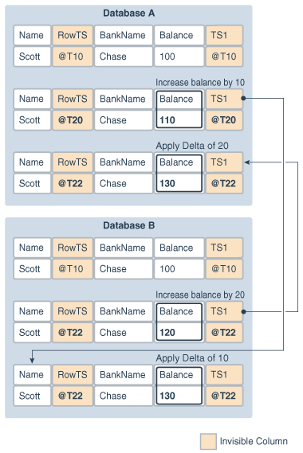
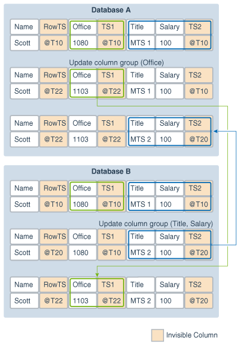

You can configure and manage Oracle GoldenGate automatic conflict detection and resolution in Oracle Database.

- About Oracle GoldenGate
  Oracle GoldenGate is a heterogeneous replication system with integrated support for replication between Oracle and other databases.
- About Automatic Conflict Detection and Resolution
  When Oracle GoldenGate replicates changes between Oracle databases, you can configure and manage Oracle GoldenGate automatic conflict detection and resolution in the Oracle databases.
- Configuring Automatic Conflict Detection and Resolution
  You can configure Oracle GoldenGate automatic conflict detection and resolution in Oracle Database with the `DBMS_GOLDENGATE_ADM` package. This is specific to Oracle GoldenGate version 12.3 and later. No CDR configuration parameters need to be specified in the Golden Gate replicat file, other than a `MAP` statement that includes the table to be replicated.
- Managing Automatic Conflict Detection and Resolution
  You can manage Oracle GoldenGate automatic conflict detection and resolution in Oracle Database with the `DBMS_GOLDENGATE_ADM` package.
- Monitoring Automatic Conflict Detection and Resolution
  You can monitor Oracle GoldenGate automatic conflict detection and resolution in an Oracle database by querying data dictionary views.

**Parent topic:** [Oracle GoldenGate Capabilities in Oracle Database](gg_capabilities.md)

### 13.1 About Oracle GoldenGate

Oracle GoldenGate is a heterogeneous replication system with integrated support for replication between Oracle and other databases.

Oracle GoldenGate is integrated with Oracle Database to capture DML and DDL changes from the redo logs and apply the changes at the target. Oracle GoldenGate provides capture, routing, transformation, and delivery of transactional data across Oracle databases or heterogeneous databases in real time.

When Oracle GoldenGate captures changes that originated at an Oracle database, each change is encapsulated in a row logical change record (LCR). A row LCR is a structured representation of a DML row change. Each row LCR includes the operation type, old column values, and new column values. Multiple row LCRs can be part of a single database transaction.

**See Also:**

- "[Row LCRs](general-xstream-concepts.md)"

- The Oracle GoldenGate documentation for more information about Oracle GoldenGate

**Parent topic:** Oracle GoldenGate Automatic Conflict Detection and Resolution

### 13.2 About Automatic Conflict Detection and Resolution

When Oracle GoldenGate replicates changes between Oracle databases, you can configure and manage Oracle GoldenGate automatic conflict detection and resolution in the Oracle databases.

**Note:**

The documentation in this book is for the automatic conflict detection and resolution feature that is specific to Oracle Database 12c Release 2 (12.2) and later, which is configured in an Oracle database. It also requires Oracle GoldenGate version 12.3 and later. There is also a general Oracle GoldenGate feature for conflict detection and resolution, which is called Oracle GoldenGate conflict detection and resolution (CDR). Oracle GoldenGate CDR is configured in the Replicat parameter file, and it is documented in the Oracle GoldenGate documentation.

You can configure only one of the following types of automatic conflict detection and resolution for a single table:

- The automatic conflict detection and resolution feature that is specific to Oracle Database 12c Release 2 (12.2)

- Oracle GoldenGate CDR

<!-- -->

- Automatic Conflict Detection and Resolution
  You can configure automatic conflict detection and resolution in an Oracle GoldenGate configuration that replicates tables between Oracle databases. To configure conflict detection and resolution for a table, call the `ADD_AUTO_CDR` procedure in the `DBMS_GOLDENGATE_ADM` package.
- Latest Timestamp Conflict Detection and Resolution
  With timestamp conflict detection, a conflict occurs when the timestamp in the old column list of the row logical change record (row LCR) differs from the timestamp for the corresponding row in the table.
- Delta Conflict Detection and Resolution
  With delta conflict detection, a conflict occurs when a value in the old column list of the row logical change record (row LCR) differs from the value for the corresponding row in the table.
- Column Groups
  A column group is a logical grouping of one or more columns in a replicated table. When you add a column group, conflict detection and resolution is performed on the columns in the column group separately from the other columns in the table.

**Parent topic:** Oracle GoldenGate Automatic Conflict Detection and Resolution

#### 13.2.1 Automatic Conflict Detection and Resolution

You can configure automatic conflict detection and resolution in an Oracle GoldenGate configuration that replicates tables between Oracle databases. To configure conflict detection and resolution for a table, call the `ADD_AUTO_CDR` procedure in the `DBMS_GOLDENGATE_ADM` package.

Automatic conflict detection and resolution does not require application changes for the following reasons:

- Oracle Database automatically creates and maintains invisible timestamp columns.

- Inserts, updates, and deletes use the delete tombstone log table to determine if a row was deleted.

- LOB column conflicts can be detected.

- Oracle Database automatically configures supplemental logging on required columns.

Supplemental logging is required to ensure that each row LCR has the information required to detect and resolve a conflict. Supplemental logging places additional information in the redo log for the columns of a table when a DML operation is performed on the table. When you configure a table for Oracle GoldenGate conflict detection and resolution, supplemental logging is configured automatically for all of the columns in the table.

**See Also:**

- [Oracle Database Utilities](../sutil/oracle-logminer-utility.md) for information about supplemental logging

- The Oracle GoldenGate documentation for more information about Oracle GoldenGate

**Parent topic:** About Automatic Conflict Detection and Resolution

#### 13.2.2 Latest Timestamp Conflict Detection and Resolution

With timestamp conflict detection, a conflict occurs when the timestamp in the old column list of the row logical change record (row LCR) differs from the timestamp for the corresponding row in the table.

When you run the `ADD_AUTO_CDR` procedure in the `DBMS_GOLDENGATE_ADM` package to configure a table for automatic Oracle GoldenGate conflict detection and resolution, a hidden timestamp column is added to the table. This hidden timestamp column records the time of a row change, and this information is used to detect and resolve conflicts.

When a row LCR is applied, a conflict can occur for an `INSERT`, `UPDATE`, or `DELETE` operation. The following table describes each type of conflict and how it is resolved with latest timestamp conflict detection and resolution.

Table 13-1 Latest Timestamp Conflict Detection and Resolution

| Operation | Conflict Detection                                                                                                                                                                                                                                                                                                                                                                                                                                                                                                                                          | Conflict Resolution                                                                                                                                                                                                                                                                                                                                                                                                                                                                                                                                                                                                                                                                                                                                                                                                                                                                                                                                                                |
|:----------|:------------------------------------------------------------------------------------------------------------------------------------------------------------------------------------------------------------------------------------------------------------------------------------------------------------------------------------------------------------------------------------------------------------------------------------------------------------------------------------------------------------------------------------------------------------|:-----------------------------------------------------------------------------------------------------------------------------------------------------------------------------------------------------------------------------------------------------------------------------------------------------------------------------------------------------------------------------------------------------------------------------------------------------------------------------------------------------------------------------------------------------------------------------------------------------------------------------------------------------------------------------------------------------------------------------------------------------------------------------------------------------------------------------------------------------------------------------------------------------------------------------------------------------------------------------------|
| `INSERT`  | A conflict is detected when the table has the same value for a key column as the new value in the row LCR.                                                                                                                                                                                                                                                                                                                                                                                                                                                  | If the timestamp of the row LCR is later than the timestamp in the table row, then the values in the row LCR replace the values in the table. If the timestamp of the row LCR is earlier than the timestamp in the table row, then the row LCR is discarded, and the table values are retained.                                                                                                                                                                                                                                                                                                                                                                                                                                                                                                                                                                                                                                                                                 |
| `UPDATE`  | A conflict is detected in each of the following cases: • There is a mismatch between the timestamp value in the row LCR and the timestamp value of the corresponding row in the table. • There is a mismatch between an old value in a column group in the row LCR does not match the column value in the corresponding table row. A column group is a logical grouping of one or more columns in a replicated table. • The table row does not exist. If the row is in the tombstone table, then this is referred to as an update-delete conflict. | If there is a value mismatch and the timestamp of the row LCR is later than the timestamp in the table row, then the values in the row LCR replace the values in the table. If there is a value mismatch and the timestamp of the row LCR is earlier than the timestamp in the table row, then the row LCR is discarded, and the table values are retained. If the table row does not exist and the timestamp of the row LCR is later than the timestamp in the tombstone table row, then the row LCR is converted from an `UPDATE` operation to an `INSERT` operation and inserted into the table. If the table row does not exist and the timestamp of the row LCR is earlier than the timestamp in the tombstone table row, then the row LCR is discarded. If the table row does not exist and there is no corresponding row in the tombstone table, then the row LCR is converted from an `UPDATE` operation to an `INSERT` operation and inserted into the table. |
| `DELETE`  | A conflict is detected in each of the following cases: • There is a mismatch between the timestamp value in the row LCR and the timestamp value of the corresponding row in the table. • The table row does not exist.                                                                                                                                                                                                                                                                                                                                | If the timestamp of the row LCR is later than the timestamp in the table, then delete the row from the table. If the timestamp of the row LCR is earlier than the timestamp in the table, then the row LCR is discarded, and the table values are retained. If the delete is successful, then log the row LCR by inserting it into the tombstone table. If the table row does not exist, then log the row LCR by inserting it into the tombstone table.                                                                                                                                                                                                                                                                                                                                                                                                                                                                                                                   |

**See Also:**

"Column Groups"

**Parent topic:** About Automatic Conflict Detection and Resolution

#### 13.2.3 Delta Conflict Detection and Resolution

With delta conflict detection, a conflict occurs when a value in the old column list of the row logical change record (row LCR) differs from the value for the corresponding row in the table.

To configure delta conflict detection and resolution for a table, run the `ADD_AUTO_CDR_DELTA_RES` procedure in the `DBMS_GOLDENGATE_ADM` package. The delta resolution method does not depend on a timestamp or an extra resolution column. With delta conflict resolution, the conflict is resolved by adding the difference between the new and old values in the row LCR to the value in the table. This resolution method is generally used for financial data such as an account balance. For example, if a bank balance is updated at two sites concurrently, then the converged value accounts for all debits and credits.

The following figure provides an example that illustrates delta conflict detection and resolution.

Figure 13-1 Delta Conflict Detection and Resolution

[Description of "Figure 13-1 Delta Conflict Detection and Resolution"](img_text/xstrm_3v_087a.md)

This example shows a row being replicated at database A and database B. The `Balance` column is designated as the column on which delta conflict resolution is performed, and the `TS1` column is the invisible timestamp column to track the time of each change to the `Balance` column. A change is made to the `Balance` value in the row in both databases at nearly the same time (`@T20` in database A and `@T22` in database B). These changes result in a conflict, and delta conflict resolution is used to resolve the conflict in the following way:

- At database A, the value of `Balance` was changed from `100` to `110`. Therefore, the value was increased by 10.

- At database B, the value of `Balance` was changed from `100` to `120`. Therefore, the value was increased by 20.

- To resolve the conflict at database A, the value of the difference between the new and old values in the row LCR to the value in the table. The difference between the new and old values in the LCR is 20 (120–100=20). Therefore, the current value in the table (110) is increased by 20 so that the value after conflict resolution is 130.

- To resolve the conflict at database B, the value of the difference between the new and old values in the row LCR to the value in the table. The difference between the new and old values in the LCR is 10 (110–100=10). Therefore, the current value in the table (120) is increased by 10 so that the value after conflict resolution is 130.

After delta conflict resolution, the value of the `Balance` column is the same for the row at database A and database B.

**Parent topic:** About Automatic Conflict Detection and Resolution

#### 13.2.4 Column Groups

A column group is a logical grouping of one or more columns in a replicated table. When you add a column group, conflict detection and resolution is performed on the columns in the column group separately from the other columns in the table.

When you configure a table for Oracle GoldenGate conflict detection and resolution with the `ADD_AUTO_CDR` procedure, all of the scalar columns in the table are added to a default column group. To define other column groups for the table, run the `ADD_AUTO_CDR_COLUMN_GROUP` procedure. Any columns in the table that are not part of a user-defined column group remain in the default column group for the table.

Column groups enable different databases to update different columns in the same row at nearly the same time without causing a conflict. When column groups are configured for a table, conflicts can be avoided even if different databases update the same row in the table. A conflict is not detected if the updates change the values of columns in different column groups. The following figure provides an example that illustrates column groups.

Figure 13-2 Column Groups

[Description of "Figure 13-2 Column Groups"](img_text/xstrm_3v_086a.md)

This example shows a row being replicated at database A and database B. The following two column groups are configured for the replicated table at each database:

- One column group includes the `Office` column. The invisible timestamp column for this column group is `TS1`.

- Another column group includes the `Title` and `Salary` columns. The invisible timestamp column for this column group is `TS2`.

These column groups enable database A and database B to update the same row at nearly the same time without causing a conflict. Specifically, the following changes are made:

- At database A, the value of `Office` was changed from `1080` to `1030`.

- At database B, the value of `Title` was changed from `MTS1` to `MTS2`.

Because the `Office` column and the `Title` column are in different column groups, the changes are replicated without a conflict being detected. The result is that values in the row are same at both databases after each change has been replicated.

##### Piecewise LOB Updates

A set of lob operations composed of `LOB WRITE`, `LOB ERASE`, and `LOB TRIM` is a piecewise LOB update. When a table that contains LOB columns is configured for conflict detection and resolution, each LOB column is placed in its own column group, and the column group has its own hidden timestamp column. The timestamp column is updated on the first piecewise LOB operation.

For a LOB column, a conflict is detected and resolved in the following ways:

- If the timestamp for the LOB’s column group is later than the corresponding LOB column group in the row, then the piecewise LOB update is applied.

- If the timestamp for the LOB’s column group is earlier than the corresponding LOB column group in the row, then the LOB in the table row is retained.

- If the row does not exist in the table, then an error is raised.

**Parent topic:** About Automatic Conflict Detection and Resolution

### 13.3 Configuring Automatic Conflict Detection and Resolution

You can configure Oracle GoldenGate automatic conflict detection and resolution in Oracle Database with the `DBMS_GOLDENGATE_ADM` package. This is specific to Oracle GoldenGate version 12.3 and later. No CDR configuration parameters need to be specified in the Golden Gate replicat file, other than a `MAP` statement that includes the table to be replicated.

- Configuring Latest Timestamp Conflict Detection and Resolution
  The `ADD_AUTO_CDR` procedure in the `DBMS_GOLDENGATE_ADM` package configures latest timestamp conflict detection and resolution. The `ADD_AUTO_CDR_COLUMN_GROUP` procedure adds optional column groups.
- Configuring Delta Conflict Detection and Resolution
  The `ADD_AUTO_CDR_DELTA_RES` procedure in the `DBMS_GOLDENGATE_ADM` package configures delta conflict detection and resolution.

**Parent topic:** Oracle GoldenGate Automatic Conflict Detection and Resolution

#### 13.3.1 Configuring Latest Timestamp Conflict Detection and Resolution

The `ADD_AUTO_CDR` procedure in the `DBMS_GOLDENGATE_ADM` package configures latest timestamp conflict detection and resolution. The `ADD_AUTO_CDR_COLUMN_GROUP` procedure adds optional column groups.

With latest timestamp conflict detection and resolution, a conflict is detected when the timestamp column of the row LCR does not match the timestamp of the corresponding table row. The row LCR is applied if its timestamp is later. Otherwise, the row LCR is discarded, and the table row is not changed. When you run the `ADD_AUTO_CDR` procedure, it adds an invisible timestamp column for each row in the specified table and configures timestamp conflict detection and resolution. When you use the `ADD_AUTO_CDR_COLUMN_GROUP` procedure to add one or more column groups, it adds a timestamp for the column group and configures timestamp conflict detection and resolution for the column group.

You can configure an Oracle GoldenGate administrator using the `GRANT_ADMIN_PRIVILEGE` procedure in the `DBMS_GOLDENGATE_ADM` package.

1.  Connect to each database as the Oracle GoldenGate administrator.
2.  Run the `ADD_AUTO_CDR` procedure and specify the table to configure for latest timestamp conflict detection and resolution.
3.  **Optional:** Run the `ADD_AUTO_CDR_COLUMN_GROUP` procedure and specify one or more column groups in the table.
4.  Repeat the previous steps in each Oracle database that replicates the table.

Example 13-1 Configuring Latest Timestamp Conflict Detection and Resolution for a Table

This example configures latest timestamp conflict detection and resolution for the `hr.employees` table.

    BEGIN
      DBMS_GOLDENGATE_ADM.ADD_AUTO_CDR(
        schema_name => 'hr',
        table_name  => 'employees');
    END;
    /

Example 13-2 Configuring Column Groups

This example configures the following column groups for timestamp conflict resolution on the `hr.employees` table:

- The `job_identifier_cg` column group includes the `job_id`, `department_id`, and `manager_id` columns.

- The `compensation_cg` column group includes the `salary` and `commission_pct` columns.

<!-- -->

    BEGIN
      DBMS_GOLDENGATE_ADM.ADD_AUTO_CDR_COLUMN_GROUP(
        schema_name       => 'hr',
        table_name        => 'employees',
        column_list       => 'job_id,department_id,manager_id',
        column_group_name => 'job_identifier_cg');
    END;
    /

    BEGIN
      DBMS_GOLDENGATE_ADM.ADD_AUTO_CDR_COLUMN_GROUP(
        schema_name       => 'hr',
        table_name        => 'employees',
        column_list       => 'salary,commission_pct',
        column_group_name => 'compensation_cg');
    END;
    /

**See Also:**

- "Automatic Conflict Detection and Resolution"

- "Latest Timestamp Conflict Detection and Resolution"

- "Column Groups"

- The Oracle GoldenGate documentation for more information about Oracle GoldenGate replication and configuring an Oracle GoldenGate administrator

**Parent topic:** Configuring Automatic Conflict Detection and Resolution

#### 13.3.2 Configuring Delta Conflict Detection and Resolution

The `ADD_AUTO_CDR_DELTA_RES` procedure in the `DBMS_GOLDENGATE_ADM` package configures delta conflict detection and resolution.

With delta conflict resolution, you specify one column for which conflicts are detected and resolved. The conflict is detected if the value of the column in the row LCR does not match the corresponding value in the table. The conflict is resolved by adding the difference between the new and old values in the row LCR to the value in the table.

You can configure an Oracle GoldenGate administrator using the `GRANT_ADMIN_PRIVILEGE` procedure in the `DBMS_GOLDENGATE_ADM` package.

1.  Connect to each database as the Oracle GoldenGate administrator.
2.  Run the `ADD_AUTO_CDR` procedure and specify the table to configure for latest timestamp conflict detection and resolution.
3.  Run the `ADD_AUTO_CDR_DELTA_RES` procedure and specify the column on which delta conflict detection and resolution is performed.
4.  Repeat the previous steps in each Oracle database that replicates the table.

Example 13-3 Configuring Delta Conflict Detection and Resolution for a Table

This example configures delta conflict detection and resolution for the `order_total` column in the `oe.orders` table.

    BEGIN
      DBMS_GOLDENGATE_ADM.ADD_AUTO_CDR(
        schema_name => 'oe',
        table_name  => 'orders');
    END;
    /

    BEGIN
      DBMS_GOLDENGATE_ADM.ADD_AUTO_CDR_DELTA_RES(
        schema_name => 'oe',
        table_name  => 'orders',
        column_name => 'order_total');
    END;
    /

**See Also:**

- "Automatic Conflict Detection and Resolution"

- "Delta Conflict Detection and Resolution"

- The Oracle GoldenGate documentation for more information about Oracle GoldenGate replication and configuring an Oracle GoldenGate administrator

**Parent topic:** Configuring Automatic Conflict Detection and Resolution

### 13.4 Managing Automatic Conflict Detection and Resolution

You can manage Oracle GoldenGate automatic conflict detection and resolution in Oracle Database with the `DBMS_GOLDENGATE_ADM` package.

- Altering Conflict Detection and Resolution for a Table
  The `ALTER_AUTO_CDR` procedure in the `DBMS_GOLDENGATE_ADM` package alters conflict detection and resolution for a table.
- Altering a Column Group
  The `ALTER_AUTO_CDR_COLUMN_GROUP` procedure alters a column group.
- Purging Tombstone Rows
  The `PURGE_TOMBSTONES` procedure removes tombstone rows that were recorded before a specified date and time. This procedure removes the tombstone rows for all tables configured for conflict resolution in the database.
- Removing Conflict Detection and Resolution From a Table
  The `REMOVE_AUTO_CDR` procedure in the `DBMS_GOLDENGATE_ADM` package removes automatic conflict detection and resolution from a table. This procedure also removes any column groups and delta conflict detection and resolution configured for the table.
- Removing a Column Group
  The `REMOVE_AUTO_CDR_COLUMN_GROUP` procedure removes a column group.
- Removing Delta Conflict Detection and Resolution
  The `REMOVE_AUTO_CDR_DELTA_RES` procedure in the `DBMS_GOLDENGATE_ADM` package removes delta conflict detection and resolution for a column.

**Parent topic:** Oracle GoldenGate Automatic Conflict Detection and Resolution

#### 13.4.1 Altering Conflict Detection and Resolution for a Table

The `ALTER_AUTO_CDR` procedure in the `DBMS_GOLDENGATE_ADM` package alters conflict detection and resolution for a table.

Oracle GoldenGate automatic conflict detection and resolution must be configured for the table.

1.  Connect to each database as the Oracle GoldenGate administrator.
2.  Run the `ALTER_AUTO_CDR` procedure and specify the table to configure for latest timestamp conflict detection and resolution.
3.  Repeat all of the previous steps in each Oracle database that replicates the table.

Example 13-4 Altering Conflict Detection and Resolution for a Table

This example alters conflict detection and resolution for the `hr.employees` table to specify that delete conflicts are tracked in a tombstone table.

    BEGIN
      DBMS_GOLDENGATE_ADM.ALTER_AUTO_CDR(
        schema_name       => 'hr',
        table_name        => 'employees',
        tombstone_deletes => TRUE);
    END;
    /

**See Also:**

- "Automatic Conflict Detection and Resolution"

- "Configuring Automatic Conflict Detection and Resolution"

- "Column Groups"

- The Oracle GoldenGate documentation for more information about Oracle GoldenGate

**Parent topic:** Managing Automatic Conflict Detection and Resolution

#### 13.4.2 Altering a Column Group

The `ALTER_AUTO_CDR_COLUMN_GROUP` procedure alters a column group.

1.  Connect to the inbound server database as the Oracle GoldenGate administrator.
2.  Run the `ALTER_AUTO_CDR_COLUMN_GROUP` procedure and specify one or more column groups in the table.
3.  Repeat all of the previous steps in each Oracle database that replicates the table.

Example 13-5 Altering a Column Group

This example removes the `manager_id` column from the `job_identifier_cg` column group for the `hr.employees` table.

    BEGIN
      DBMS_GOLDENGATE_ADM.ALTER_AUTO_CDR_COLUMN_GROUP(
        schema_name        => 'hr',
        table_name         => 'employees',
        column_group_name  => 'job_identifier_cg',
        remove_column_list => 'manager_id');
    END;
    /

**Note:**

If there is more than one column, then use a comma-separated list.

**See Also:**

- "Column Groups"

- "Configuring Latest Timestamp Conflict Detection and Resolution"

- The Oracle GoldenGate documentation for more information about Oracle GoldenGate.

**Parent topic:** Managing Automatic Conflict Detection and Resolution

#### 13.4.3 Purging Tombstone Rows

The `PURGE_TOMBSTONES` procedure removes tombstone rows that were recorded before a specified date and time. This procedure removes the tombstone rows for all tables configured for conflict resolution in the database.

It might be necessary to purge tombstone rows periodically to keep the tombstone log from growing too large over time.

1.  Connect to each database as the Oracle GoldenGate administrator.
2.  Run the `PURGE_TOMBSTONES` procedure and specify the date and time.

Example 13-6 Purging Tombstone Rows

This example purges all tombstone rows recorded before 3PM on December, 1, 2015 Eastern Standard Time. The timestamp must be entered in `TIMESTAMP WITH TIME ZONE` format.

    EXEC DBMS_GOLDENGATE_ADM.PURGE_TOMBSTONES('2015-12-01 15:00:00.000000 EST');

**See Also:**

- "Configuring Latest Timestamp Conflict Detection and Resolution"

- The Oracle GoldenGate documentation for more information about Oracle GoldenGate

**Parent topic:** Managing Automatic Conflict Detection and Resolution

#### 13.4.4 Removing Conflict Detection and Resolution From a Table

The `REMOVE_AUTO_CDR` procedure in the `DBMS_GOLDENGATE_ADM` package removes automatic conflict detection and resolution from a table. This procedure also removes any column groups and delta conflict detection and resolution configured for the table.

1.  Connect to each database as the Oracle GoldenGate administrator.
2.  Run the `REMOVE_AUTO_CDR` procedure and specify the table.
3.  Repeat all of the previous steps in each Oracle database that replicates the table.

Example 13-7 Removing Conflict Detection and Resolution for a Table

This example removes conflict detection and resolution for the `hr.employees` table.

    BEGIN
      DBMS_GOLDENGATE_ADM.REMOVE_AUTO_CDR(
        schema_name => 'hr',
        table_name  => 'employees');
    END;
    /

**See Also:**

- "Automatic Conflict Detection and Resolution"

- The Oracle GoldenGate documentation for more information about Oracle GoldenGate.

**Parent topic:** Managing Automatic Conflict Detection and Resolution

#### 13.4.5 Removing a Column Group

The `REMOVE_AUTO_CDR_COLUMN_GROUP` procedure removes a column group.

1.  Connect to each database as the Oracle GoldenGate administrator.
2.  Run the `REMOVE_AUTO_CDR_COLUMN_GROUP` procedure and specify the name of the column group.
3.  Repeat all of the previous steps in each Oracle database that replicates the table.

Example 13-8 Removing a Column Group

This example removes the `compensation_cg` column group from the `hr.employees` table.

    BEGIN
      DBMS_GOLDENGATE_ADM.REMOVE_AUTO_CDR_COLUMN_GROUP(
        schema_name       => 'hr',
        table_name        => 'employees',
        column_group_name => 'compensation_cg');
    END;
    /

**See Also:**

- "Column Groups"

- "Configuring Latest Timestamp Conflict Detection and Resolution"

- The Oracle GoldenGate documentation for more information about Oracle GoldenGate.

**Parent topic:** Managing Automatic Conflict Detection and Resolution

#### 13.4.6 Removing Delta Conflict Detection and Resolution

The `REMOVE_AUTO_CDR_DELTA_RES` procedure in the `DBMS_GOLDENGATE_ADM` package removes delta conflict detection and resolution for a column.

Delta conflict detection and resolution must be configured for the specified column.

1.  Connect to the inbound server database as the Oracle GoldenGate administrator.
2.  Run the `REMOVE_AUTO_CDR_DELTA_RES` procedure and specify the column.
3.  Repeat all of the previous steps in each Oracle database that replicates the table.

Example 13-9 Removing Delta Conflict Detection and Resolution for a Table

This example removes delta conflict detection and resolution for the `order_total` column in the `oe.orders` table.

    BEGIN
      DBMS_GOLDENGATE_ADM.REMOVE_AUTO_CDR_DELTA_RES(
        schema_name => 'oe',
        table_name  => 'orders',
        column_name => 'order_total');
    END;
    /

**See Also:**

- "Delta Conflict Detection and Resolution"

- "Configuring Delta Conflict Detection and Resolution"

- The Oracle GoldenGate documentation for more information about Oracle GoldenGate.

**Parent topic:** Managing Automatic Conflict Detection and Resolution

### 13.5 Monitoring Automatic Conflict Detection and Resolution

You can monitor Oracle GoldenGate automatic conflict detection and resolution in an Oracle database by querying data dictionary views.

- Displaying Information About the Tables Configured for Conflicts
  The `ALL_GG_AUTO_CDR_TABLES` view displays information about the tables configured for Oracle GoldenGate automatic conflict detection and resolution.
- Displaying Information About Conflict Resolution Columns
  The `ALL_GG_AUTO_CDR_COLUMNS` view displays information about the columns configured for Oracle GoldenGate automatic conflict detection and resolution.
- Displaying Information About Column Groups
  The `ALL_GG_AUTO_CDR_COLUMN_GROUPS` view displays information about the column groups configured for Oracle GoldenGate automatic conflict detection and resolution.

**Parent topic:** Oracle GoldenGate Automatic Conflict Detection and Resolution

#### 13.5.1 Displaying Information About the Tables Configured for Conflicts

The `ALL_GG_AUTO_CDR_TABLES` view displays information about the tables configured for Oracle GoldenGate automatic conflict detection and resolution.

1.  Connect to the database.
2.  Query the `ALL_GG_AUTO_CDR_TABLES` view.

Example 13-10 Displaying Information About the Tables Configured for Conflict Detection and Resolution

This query displays the following information about the tables that are configured for conflict detection and resolution:

- The table owner for each table

- The table name for each table

- The tombstone table used to store rows deleted for update-delete conflicts, if a tombstone table is configured for the table

- The hidden timestamp column used for conflict resolution for each table

<!-- -->

    COLUMN TABLE_OWNER FORMAT A15
    COLUMN TABLE_NAME FORMAT A15
    COLUMN TOMBSTONE_TABLE FORMAT A15
    COLUMN ROW_RESOLUTION_COLUMN FORMAT A25

    SELECT TABLE_OWNER,
           TABLE_NAME,
           TOMBSTONE_TABLE,
           ROW_RESOLUTION_COLUMN
      FROM ALL_GG_AUTO_CDR_TABLES
      ORDER BY TABLE_OWNER, TABLE_NAME;

Your output looks similar to the following:

    TABLE_OWNER     TABLE_NAME      TOMBSTONE_TABLE ROW_RESOLUTION_COLUMN
    --------------- --------------- --------------- -------------------------
    HR              EMPLOYEES       DT$_EMPLOYEES   CDRTS$ROW
    OE              ORDERS          DT$_ORDERS      CDRTS$ROW

**Related Topics**

- Configuring Automatic Conflict Detection and Resolution

**Parent topic:** Monitoring Automatic Conflict Detection and Resolution

#### 13.5.2 Displaying Information About Conflict Resolution Columns

The `ALL_GG_AUTO_CDR_COLUMNS` view displays information about the columns configured for Oracle GoldenGate automatic conflict detection and resolution.

The columns can be configured for row or column automatic conflict detection and resolution. The columns can be configured for latest timestamp conflict resolution in a column group. In addition, a column can be configured for delta conflict resolution.

1.  Connect to the database as the Oracle GoldenGate administrator.
2.  Query the `ALL_GG_AUTO_CDR_COLUMNS` view.

Example 13-11 Displaying Information About Column Groups

This query displays the following information about the tables that are configured for conflict detection and resolution:

- The table owner for each table

- The table name for each table

- If the column is in a column group, then the name of the column group

- The column name

- If the column is configured for latest timestamp conflict resolution, then the name of the hidden timestamp column for the column

<!-- -->

    COLUMN TABLE_OWNER FORMAT A10
    COLUMN TABLE_NAME FORMAT A10
    COLUMN COLUMN_GROUP_NAME FORMAT A17
    COLUMN COLUMN_NAME FORMAT A15
    COLUMN RESOLUTION_COLUMN FORMAT A23

    SELECT TABLE_OWNER,
           TABLE_NAME,
           COLUMN_GROUP_NAME,
           COLUMN_NAME,
           RESOLUTION_COLUMN
      FROM ALL_GG_AUTO_CDR_COLUMNS
      ORDER BY TABLE_OWNER, TABLE_NAME;

Your output looks similar to the following:

    TABLE_OWNE TABLE_NAME COLUMN_GROUP_NAME COLUMN_NAME     RESOLUTION_COLUMN
    ---------- ---------- ----------------- --------------- -----------------------
    HR         EMPLOYEES  COMPENSATION_CG   COMMISSION_PCT  CDRTS$COMPENSATION_CG
    HR         EMPLOYEES  COMPENSATION_CG   SALARY          CDRTS$COMPENSATION_CG
    HR         EMPLOYEES  JOB_IDENTIFIER_CG MANAGER_ID      CDRTS$JOB_IDENTIFIER_CG
    HR         EMPLOYEES  JOB_IDENTIFIER_CG JOB_ID          CDRTS$JOB_IDENTIFIER_CG
    HR         EMPLOYEES  JOB_IDENTIFIER_CG DEPARTMENT_ID   CDRTS$JOB_IDENTIFIER_CG
    HR         EMPLOYEES  IMPLICIT_COLUMNS$ PHONE_NUMBER    CDRTS$ROW
    HR         EMPLOYEES  IMPLICIT_COLUMNS$ LAST_NAME       CDRTS$ROW
    HR         EMPLOYEES  IMPLICIT_COLUMNS$ HIRE_DATE       CDRTS$ROW
    HR         EMPLOYEES  IMPLICIT_COLUMNS$ FIRST_NAME      CDRTS$ROW
    HR         EMPLOYEES  IMPLICIT_COLUMNS$ EMAIL           CDRTS$ROW
    HR         EMPLOYEES  IMPLICIT_COLUMNS$ EMPLOYEE_ID     CDRTS$ROW
    OE         ORDERS     IMPLICIT_COLUMNS$ ORDER_MODE      CDRTS$ROW
    OE         ORDERS     IMPLICIT_COLUMNS$ ORDER_ID        CDRTS$ROW
    OE         ORDERS     IMPLICIT_COLUMNS$ ORDER_DATE      CDRTS$ROW
    OE         ORDERS     IMPLICIT_COLUMNS$ CUSTOMER_ID     CDRTS$ROW
    OE         ORDERS     DELTA$            ORDER_TOTAL
    OE         ORDERS     IMPLICIT_COLUMNS$ PROMOTION_ID    CDRTS$ROW
    OE         ORDERS     IMPLICIT_COLUMNS$ ORDER_STATUS    CDRTS$ROW
    OE         ORDERS     IMPLICIT_COLUMNS$ SALES_REP_ID    CDRTS$ROW

In this output, the columns with `IMPLICIT_COLUMNS$` for the column group name are configured for row conflict detection and resolution, but they are not part of a column group. The columns with `DELTA$` for the column group name are configured for delta conflict detection and resolution, and these columns do not have a resolution column.

**Related Topics**

- Configuring Automatic Conflict Detection and Resolution

**Parent topic:** Monitoring Automatic Conflict Detection and Resolution

#### 13.5.3 Displaying Information About Column Groups

The `ALL_GG_AUTO_CDR_COLUMN_GROUPS` view displays information about the column groups configured for Oracle GoldenGate automatic conflict detection and resolution.

You can configure Oracle GoldenGate automatic conflict detection and resolution using the `ADD_AUTO_CDR` procedure in the `DBMS_GOLDENGATE_ADM` package. You can configure column groups using the `ADD_AUTO_CDR_COLUMN_GROUP` procedure in the `DBMS_GOLDENGATE_ADM` package.

1.  Connect to the database as the Oracle GoldenGate administrator.
2.  Query the `ALL_GG_AUTO_CDR_COLUMN_GROUPS` view.

Example 13-12 Displaying Information About Column Groups

This query displays the following information about the tables that are configured for conflict detection and resolution:

- The table owner

- The table name

- The name of the column group

- The hidden timestamp column used for conflict resolution for each column group

<!-- -->

    COLUMN TABLE_OWNER FORMAT A15
    COLUMN TABLE_NAME FORMAT A15
    COLUMN COLUMN_GROUP_NAME FORMAT A20
    COLUMN RESOLUTION_COLUMN FORMAT A25

    SELECT TABLE_OWNER,
           TABLE_NAME,
           COLUMN_GROUP_NAME,
           RESOLUTION_COLUMN
      FROM ALL_GG_AUTO_CDR_COLUMN_GROUPS
      ORDER BY TABLE_OWNER, TABLE_NAME;

Your output looks similar to the following:

    TABLE_OWNER     TABLE_NAME      COLUMN_GROUP_NAME    RESOLUTION_COLUMN
    --------------- --------------- -------------------- -------------------------
    HR              EMPLOYEES       COMPENSATION_CG      CDRTS$COMPENSATION_CG
    HR              EMPLOYEES       JOB_IDENTIFIER_CG    CDRTS$JOB_IDENTIFIER_CG

**Related Topics**

- Configuring Latest Timestamp Conflict Detection and Resolution

**Parent topic:** Monitoring Automatic Conflict Detection and Resolution
