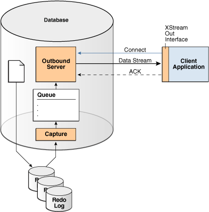
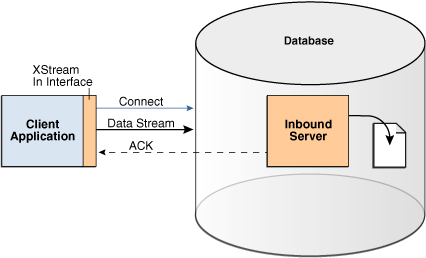

XStream enables information sharing with outstanding performance and usability.

- About XStream
  XStream consists of Oracle Database components and application programming interfaces (APIs) that enable client applications to receive data changes from an Oracle database and send data changes to an Oracle database.
- Purpose of XStream
  Some customers, especially Independent Software Vendors (ISVs) and partners, need access to the Oracle database as a platform for their own information sharing products, such as file-level replication, middle-tier caches or even to support replication between Oracle and non-Oracle data stores. XStream provides these customers with fast, real-time access to changes made in the Oracle database.
- XStream Use Cases
  There are several common XStream use cases.
- Prerequisites for XStream
  Meet prerequisites before using XStream.
- XStream Security Models
  With XStream, you can implement the security model that best fits with your organization's requirements.
- Tasks and Tools for XStream
  You perform common tasks with XStream and use a set of tools to complete these tasks.

**Parent topic:** [XStream General Concepts and Use Cases](xstream-general-concepts-and-use-cases.md)

### 1.1 About XStream

XStream consists of Oracle Database components and application programming interfaces (APIs) that enable client applications to receive data changes from an Oracle database and send data changes to an Oracle database.

These data changes can be shared between Oracle databases and other systems. The other systems include non-Oracle databases, non-RDBMS Oracle products, file systems, third party software applications, and so on. A client application is designed by the user for specific purposes and use cases.

XStream consists of two major features: XStream Out and XStream In. XStream Out provides Oracle Database components and APIs that enable you to share data changes made to an Oracle database with other systems. XStream Out can retrieve both data manipulation language (DML) and data definition language (DDL) changes from the redo log and send these changes to a client application that uses the APIs, as shown in the following figure.

Figure 1-1 XStream Out

[Description of "Figure 1-1 XStream Out"](img_text/xstrm082.md)

XStream In provides Oracle Database components and APIs that enable you to share data changes made to other systems with an Oracle database. XStream In can apply these changes to database objects in the Oracle database, as shown in the following figure.

Figure 1-2 XStream In

[Description of "Figure 1-2 XStream In"](img_text/xstrm083.md)

XStream uses the capture and apply features of the Oracle database. These features enable the following functionality for XStream:

- The logical change record (LCR) format for streaming database changes

  An LCR is a message with a specific format that describes a database change. If the change was a data manipulation language (DML) operation, then a row LCR encapsulates each row change resulting from the DML operation. One DML operation might result in multiple row changes, and so one DML operation might result in multiple row LCRs. If the change was a data definition language (DDL) operation, then a single DDL LCR encapsulates the DDL change.

- Rules and rule sets that control behavior, including inclusion and exclusion rules

  Rules enable the filtering of database changes at the database level, schema level, table level, and row/column level.

- Rule-based transformations that modify captured data changes

- Support for most data types in the database, including LOBs, `LONG`, `LONG` `RAW`, and `XMLType`

- Customized configurations, including multiple inbound streams to a single database instance, multiple outbound streams from a single database instance, multiple outbound streams from a single capture process, and so on

- Full-featured apply for XStream In, including apply parallelism for optimal performance, SQL generation, conflict detection and resolution, error handling, and customized apply with apply handlers

**Note:**

In both XStream Out and XStream In configurations, the client application must use a dedicated server connection.

**Related Topics**

- [Configuring XStream In](configuring-xstream-in.md)
- [Logical Change Records (LCRs)](general-xstream-concepts.md)
- [Rules and Rule Sets](general-xstream-concepts.md)
- [Oracle Database PL/SQL Packages and Types Reference](../arpls/DBMS_XSTREAM_ADM.md)

**Parent topic:** Introduction to XStream

### 1.2 Purpose of XStream

Some customers, especially Independent Software Vendors (ISVs) and partners, need access to the Oracle database as a platform for their own information sharing products, such as file-level replication, middle-tier caches or even to support replication between Oracle and non-Oracle data stores. XStream provides these customers with fast, real-time access to changes made in the Oracle database.

XStream is a programmatic interface that allows client applications to connect to the Oracle database and attach directly into the database capture or apply process. A client application can take advantage of a high performing capture mechanism by attaching to the XStream outbound server to directly access the stream of changes from an Oracle database. XStream Out streams logical change records (LCRs) to the client application in committed transaction order.

To apply changes to the Oracle database, a client application can hook directly into the XStream inbound server. The application provides the inbound server with LCRs in transactional order and can take advantage of the high performance of the database apply engine to apply the changes to the Oracle database.

**Parent topic:** Introduction to XStream

### 1.3 XStream Use Cases

There are several common XStream use cases.

XStream provides a flexible infrastructure for sharing information between Oracle data sources and non-Oracle data sources. You can use XStream to meet the data and informational sharing needs of various organizations.

Each XStream use case in this section contains three main elements:

- A general description of the use case as it applies to both XStream Out and XStream In

- A specific scenario for XStream Out

- A specific scenario for XStream In

In each XStream Out use case, the following components and actions send Oracle Database changes to a client application:

- A capture process captures data changes made to an Oracle database.

- XStream Out sends these changes, in the form of logical change records (LCRs), to an outbound server.

- The outbound server sends the LCRs to a client application.

How the client application processes the LCRs is different for each use case.

In each XStream In use case, the following components and actions send Oracle Database changes to an inbound server:

- A client application gathers data changes from an external data source and sends them to an inbound server in the form of LCRs.

- The inbound server receives the LCRs from a client application.

- The inbound server can apply the data changes to database objects in an Oracle database. The inbound server can also process the LCRs in a customized way.

How the client application gathers the data changes is different for each use case.

- Replicating Data Changes with Non-Oracle Databases
  Replication is generally used to improve availability and to improve performance by spreading the network load over multiple regions and servers.
- Using Files to Store Data Changes
  Some environments use files to store data changes.
- Sharing Data Changes with a Client-Side Memory Cache
  Some environments cache data in memory to improve performance.

**See Also:**

- "[Introduction to XStream Out](xstream-out-concepts.md)"

- "[Introduction to XStream In](xstream-in-concepts.md)"

**Parent topic:** Introduction to XStream

#### 1.3.1 Replicating Data Changes with Non-Oracle Databases

Replication is generally used to improve availability and to improve performance by spreading the network load over multiple regions and servers.

XStream enables you replicate data changes made to an Oracle database with other Oracle databases and with non-Oracle data sources.

You can configure a heterogeneous replication environment with XStream. Replication is generally used to improve availability and to improve performance by spreading the network load over multiple regions and servers. In a heterogeneous replication environment, data is replicated between databases from different vendors.

XStream Out can send data changes made to an Oracle database to a non-Oracle database. Specifically, the client application connects to the outbound server and receives changes made to tables within the Oracle database. The client application then applies the data changes in the LCRs to the non-Oracle database. The client application can process the LCRs in any customized way before applying them.

XStream In can receive data changes made to a non-Oracle database. Specifically, the client application gathers the data changes made to the non-Oracle database, formats these changes into LCRs, and sends these LCRs to an inbound server. The inbound server applies the changes in the LCRs to the Oracle database.

**Note:**

Oracle GoldenGate is a complete solution for replicating data between Oracle and non-Oracle databases. [Oracle GoldenGate documentation](https://docs.oracle.com/pls/topic/lookup?ctx=en/database/oracle/oracle-database/19/xstrm&id=ogg) for more information.

**Parent topic:** XStream Use Cases

#### 1.3.2 Using Files to Store Data Changes

Some environments use files to store data changes.

Typically, files store data changes for the following reasons:

- To process data changes in an environment that has no physical network or a limited physical network. For example, some locations do not have a physical network for security reasons.

- To process data changes in an environment that uses disconnected computing. For example, a salesperson might fill orders on a laptop at various locations without a network connection, and then update a primary database over the network once a day.

- To process data changes in an environment that uses satellite communications. In this case, a bulk transfer of files is more efficient than incremental changes over the network.

  XStream Out can send Oracle Database changes to a file in a file system. Specifically, the client application writes the data changes in LCRs to the file. The client application can process the LCRs in any customized way before writing them to the file, and the file can reside on the computer system running the client application or on a different computer system. Using SQL generation, the client application can also write the SQL statement required to perform the change encapsulated in a row LCR to a file.

  XStream In can send data changes from a file to an Oracle database. Specifically, the client application reads the data changes from the file and sends the changes, in the form of LCRs, to an inbound server.

  **See Also:**

  "[XStream and SQL Generation](general-xstream-concepts.md)"

<!-- -->

- XStream Demo That Replicates Database Changes Using Files
  A demo is available that creates sample client applications that perform file-based replication using the XStream APIs.

**Parent topic:** XStream Use Cases

##### 1.3.2.1 XStream Demo That Replicates Database Changes Using Files

A demo is available that creates sample client applications that perform file-based replication using the XStream APIs.

Specifically, at one database, the demo creates an XStream Out configuration that captures database changes and sends the LCRs to an outbound server. A client application attaches to the outbound server and writes the database changes to a file.

At a different database, the demo creates an XStream In client application that attaches to an inbound server, reads the changes in the file, and sends them in the form of LCRs to the inbound server. The inbound server applies the changes to the database objects at the destination database.

This demo is available in the following location:

    $ORACLE_HOME/rdbms/demo/xstream/fbr

**Parent topic:** Using Files to Store Data Changes

#### 1.3.3 Sharing Data Changes with a Client-Side Memory Cache

Some environments cache data in memory to improve performance.

Cached data can provide low response times and high throughput for systems that require the best possible performance. XStream can share data changes incrementally with a client side memory cache.

XStream Out can incrementally refresh a client-side memory cache by sending Oracle database changes to a memory cache. Specifically, the client application applies the data changes in the LCRs to the memory cache. The client application can process the LCRs in any customized way before applying them, and the memory cache can reside on the computer system running the client application or on a different computer system.

XStream In can incrementally retrieve data changes from a memory cache. Specifically, the client application retrieves the data changes and sends the changes, in the form of LCRs, to an inbound server. The memory cache can reside on the computer system running the client application or on a different computer system.

**Parent topic:** XStream Use Cases

### 1.4 Prerequisites for XStream

Meet prerequisites before using XStream.

This document assumes that you have the following skills:

- Knowledge of relational database concepts and Oracle Database concepts

  XStream includes components that run in an Oracle database. To use XStream successfully, you must be able to administer an Oracle Database.

  **See Also:**

  [Oracle Database Concepts](../cncpt/index.md) for information about this topic

- Knowledge of distributed databases

  An XStream environment can include multiple data sources, including Oracle databases and non-Oracle data sources. You should understand distributed database concepts before using XStream.

  **See Also:**

  [Oracle Database Administrator’s Guide](../admin/distributed-database-management.md) for information about this topic

- Knowledge of SQL and PL/SQL

  To administer an Oracle database and the XStream components running in an Oracle database, you must know how to use SQL and PL/SQL.

  **See Also:**

  [Oracle Database SQL Language Reference](../sqlrf/index.md), [Oracle Database PL/SQL Language Reference](../lnpls/index.md), and [Oracle Database PL/SQL Packages and Types Reference](../arpls/index.md) for information about this topic

- Knowledge of application programming

  XStream Out sends data changes to a client application for processing. XStream In receives data changes from a client application. You use the Oracle Call Interface (OCI) API or the Java API to create a client application that communicates with XStream.

  **See Also:**

  - [Oracle Call Interface Programmer's Guide](../lnoci/index.md) for information about the OCI API

  - [Oracle Database 2 Day + Java Developer's Guide](../tdpjd/index.md) and [Oracle Database Java Developer’s Guide](../jjdev/index.md) for information about the Java API

**Note:**

Using the XStream APIs requires purchasing a license for the Oracle GoldenGate product. See the [Oracle GoldenGate documentation](https://docs.oracle.com/pls/topic/lookup?ctx=en/database/oracle/oracle-database/19/xstrm&id=ogg) for more information.

**Parent topic:** Introduction to XStream

### 1.5 XStream Security Models

With XStream, you can implement the security model that best fits with your organization's requirements.

XStream supports two modes of security:

- XStream Trusted User Model

  An XStream administrator configured with the trusted user model can manage any XStream configuration, has more database privileges than an untrusted counterpart, and can monitor XStream with `DBA_` views.

  The trusted user model is easier to implement than the untrusted user model, especially in an environment with multiple XStream configurations.

- XStream Untrusted User Model

  An XStream administrator configured with the untrusted user model (also referred to as the minimum privilege model) can only manage XStream configurations owned by the untrusted user administrator. This model offers fine-grained administrative security because you can designate different untrusted user administrators to access different resources in the XStream environment. You can configure one or more XStream untrusted users and each of these users only has the minimum privileges required for the tasks that they are assigned. This strategy gives you the ability to isolate access and privileges to certain XStream resources. The untrusted administrator can monitor XStream with `ALL_` views

  For example, you might want to use the untrusted user model for situations where the capture process requires more privileges than the client process. You can then assign a different user for the client process that only has the privileges it requires.

  Government and commercial organizations implement a variety of software and hardware security architectures to protect and control access to data and applications. Compliance with industry-specific service level agreements (SLAs), audits, security laws and regulations may require a separation of duties and responsibilities, and controlled access to data. These types of security criteria and restrictions suit the untrusted user model where you can designate different users and privileges to secure resources.

**See Also :**

- "[XStream Out and Security](xstream-out-concepts.md)"

- "[XStream In and Security](xstream-in-concepts.md)"

- "[Configure an XStream Administrator on All Databases](configuring-xstream-out.md)"

- "[Configure an XStream Administrator](configuring-xstream-in.md)"

**Parent topic:** Introduction to XStream

### 1.6 Tasks and Tools for XStream

You perform common tasks with XStream and use a set of tools to complete these tasks.

- XStream Tasks
  You complete common tasks with XStream.
- XStream Tools
  You use a set of tools to complete tasks with XStream.

**Parent topic:** Introduction to XStream

#### 1.6.1 XStream Tasks

You complete common tasks with XStream.

The common tasks for XStream are the following:

- Configure XStream

  Configuring XStream involves preparing an Oracle Database for XStream, creating the Oracle Database components used by XStream, and creating one or more client applications that communicate with the Oracle Database.

  **See Also:**

  [Configuring XStream Out](configuring-xstream-out.md) and [Configuring XStream In](configuring-xstream-in.md) for information about this task

- Administer XStream

  Administering XStream involves managing the Oracle Database components used by XStream. It also involves managing the rules and rule sets used by these components. It might also require modifications to a client application.

  **See Also:**

  [Managing XStream Out](managing-xstream-out.md) and [Managing XStream In](managing-xstream-in.md) for information about this task

- Monitor XStream

  Monitoring XStream involves viewing Oracle Enterprise Manager Cloud Control pages related to XStream and querying data dictionary views related to XStream.

  **See Also:**

  The Oracle Enterprise Manager Cloud Control online help, [Monitoring XStream Out](monitoring-xstream-out.md) and [Monitoring XStream In](monitoring-xstream-in.md) for information about this task

**Parent topic:** Tasks and Tools for XStream

#### 1.6.2 XStream Tools

You use a set of tools to complete tasks with XStream.

Use the following tools to complete the tasks for XStream:

- SQL and PL/SQL

  You can use SQL and PL/SQL to configure, administer, and monitor XStream. SQL enables you to create an XStream administrator and monitor XStream using data dictionary views. Several Oracle-supplied PL/SQL packages enable you to configure and manage XStream.

  **See Also:**

  [Oracle Database SQL Language Reference](../sqlrf/index.md), [Oracle Database Reference](../refrn/index.md), [Oracle Database PL/SQL Language Reference](../lnpls/index.md), and [Oracle Database PL/SQL Packages and Types Reference](../arpls/index.md) for information about this topic

- Oracle Enterprise Manager Cloud Control

  You can use Oracle Enterprise Manager Cloud Control to manage and monitor XStream components. You can also use Oracle Enterprise Manager Cloud Control to view information about the LCRs that are streaming in an XStream configuration.

  See the Oracle Enterprise Manager Cloud Control online help for more information about this topic.

- The OCI API and Java API

  You can use the XStream OCI API and XStream Java API to create client application that communicate with XStream. These applications can work with XStream Out to stream LCRs out of an Oracle Database, and these applications can work with XStream In to stream LCRs into an Oracle Database.

  **See Also:**

  - [Oracle Call Interface Programmer's Guide](../lnoci/index.md) for information about the OCI API

  - [Oracle Database XStream Java API Reference](../stxjv/index.md) for information about the XStream Java API

  - [Oracle Database 2 Day + Java Developer's Guide](../tdpjd/index.md) and [Oracle Database Java Developer’s Guide](../jjdev/index.md) for information about the Java API

**Parent topic:** Tasks and Tools for XStream
