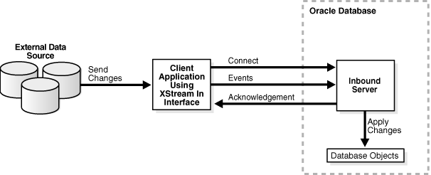

Become familiar with the concepts related to XStream In.

- Introduction to XStream In
  XStream In enables a remote client application to send information into an Oracle database from another system, such as a non-Oracle database or a file system.
- The Inbound Server
  With XStream In, an inbound server receives database changes from a client application.
- Position of LCRs and XStream In
  A client application streams LCRs to an XStream In inbound server.
- XStream In and Performance Considerations
  There are considerations for XStream In and performance.
- XStream In and Security
  Understand security related to the client application and XStream components, as well as the privileges required by the apply user for an inbound server.
- XStream In and Other Oracle Database Components
  XStream In can work with other Oracle Database components.

**Parent topic:** [XStream In](xstream-in.md)

### 8.1 Introduction to XStream In

XStream In enables a remote client application to send information into an Oracle database from another system, such as a non-Oracle database or a file system.

XStream In provides an efficient, transaction-based interface for sending information to an Oracle database from client applications. XStream In can consume the information coming into the Oracle database in several ways, including data replication, auditing, and change data capture. XStream In supports both OCI and Java interfaces.

When compared with OCI client applications that make DML changes to an Oracle database directly, XStream In is more efficient for near real-time, transaction-based, heterogeneous DML changes to Oracle databases.

XStream In uses the following Oracle Replication features:

- High performance processing of DML changes, optionally with parallelism

- Apply process features such as SQL generation, conflict detection and resolution, error handling, and customized processing with apply handlers

- Streaming network transmission of information with minimal network round-trips

- Rules, rule sets, and rule-based transformations

  When a custom rule-based transformation is specified on a rule used by an inbound server, the user who calls the transformation function is the apply user for the inbound server.

XStream In supports all of the data types that are supported by Oracle Replication, including LOBs, `LONG`, `LONG` `RAW`, and `XMLType`. A client application sends LOB and `XMLType` data to the inbound server in chunks. Several chunks comprise a single column value of LOB, `LONG`, `LONG` `RAW`, or `XMLType` data type.

**See Also:**

- [Oracle Call Interface Programmer's Guide](../lnoci/intro-to-oci-interface-for-XStream.md)

- [Oracle Database XStream Java API Reference](../stxjv/index.md)

**Parent topic:** XStream In Concepts

### 8.2 The Inbound Server

With XStream In, an inbound server receives database changes from a client application.

- Overview of Inbound Servers
  An inbound server is an optional Oracle background process that receives LCRs from a client application.
- Data Types Applied by Inbound Servers
  An inbound server supports most data types.
- LCR Processing Options for Inbound Servers
  An inbound server can either apply LCRs directly or send LCRs to an apply handler for processing. Your options for LCR processing depend on whether the LCR received by an inbound server is a row LCR or a DDL LCR.
- Inbound Servers and RESTRICTED SESSION
  Enabling and disabling restricted session affects inbound servers.
- Inbound Server Components
  An inbound server consists of the following subcomponents: a reader server, a coordinator process, and one or more apply servers.
- Considerations for Inbound Servers
  There are several considerations for inbound servers.
- The Error Queue for an Inbound Server
  The error queue contains all of the current apply errors for a database. If there are multiple inbound servers in a database, then the error queue contains the apply errors for each inbound server.

**Parent topic:** XStream In Concepts

#### 8.2.1 Overview of Inbound Servers

An inbound server is an optional Oracle background process that receives LCRs from a client application.

Specifically, a client application can attach to an inbound server and send row changes, DDL changes, and procedure calls encapsulated in LCRs.

An external client application connects to the inbound server using the OCI or the Java interface. After the connection is established, the client application acts as the capture agent for the inbound server by streaming LCRs to it.

A client application can create multiple sessions. Each session can attach to only one inbound server, and each inbound server can serve only one session at a time. However, different client application sessions can connect to different inbound servers or outbound servers. A client application can detach from the inbound server whenever necessary.

Figure 8-1 shows an inbound server configuration.

Figure 8-1 XStream In Inbound Server

[Description of "Figure 8-1 XStream In Inbound Server"](img_text/xstrm064.md)

**Note:**

An inbound server uses a queue that is not shown in Figure 8-1. An inbound server's queue is only used to store error transactions.

**Parent topic:** The Inbound Server

#### 8.2.2 Data Types Applied by Inbound Servers

An inbound server supports most data types.

When applying row LCRs resulting from DML changes to tables, an inbound server applies changes made to columns of the following data types:

- `VARCHAR2`

- `NVARCHAR2`

- `NUMBER`

- `FLOAT`

- `LONG`

- `DATE`

- `BINARY_FLOAT`

- `BINARY_DOUBLE`

- `TIMESTAMP`

- `TIMESTAMP` `WITH` `TIME` `ZONE`

- `TIMESTAMP` `WITH` `LOCAL` `TIME` `ZONE`

- `INTERVAL` `YEAR` `TO` `MONTH`

- `INTERVAL` `DAY` `TO` `SECOND`

- `RAW`

- `LONG` `RAW`

- `UROWID`

- `CHAR`

- `NCHAR`

- `CLOB` with `BASICFILE` or `SECUREFILE` storage

- `NCLOB` with `BASICFILE` or `SECUREFILE` storage

- `BLOB` with `BASICFILE` or `SECUREFILE` storage

- `XMLType` stored as `CLOB`, object relational, or as binary XML

- Object types

- Varrays

- `REF` data types

- The following Oracle-supplied types: `ANYDATA`, `SDO_GEOMETRY`, and media types

- `BFILE`

If XStream is replicating data for an object type, then the replication must be unidirectional, and all replication sites must agree on the names and data types of the attributes in the object type. You establish the names and data types of the attributes when you create the object type. For example, consider the following object type:

    CREATE TYPE cust_address_typ AS OBJECT
         (street_address     VARCHAR2(40),
          postal_code        VARCHAR2(10),
          city               VARCHAR2(30),
          state_province     VARCHAR2(10),
          country_id         CHAR(2));
    /

At all replication sites, `street_address` must be `VARCHAR2(40)`, `postal_code` must be `VARCHAR2(10)`, `city` must be `VARCHAR2(30)`, and so on.

**Note:**

- The maximum size of the `VARCHAR2`, `NVARCHAR2`, and `RAW` data types has been increased in Oracle Database 12c when the `COMPATIBLE` initialization parameter is set to `12.0.0` and the `MAX_STRING_SIZE` initialization parameter is set to `EXTENDED`.

- `XMLType` stored as a `CLOB` is deprecated in Oracle Database 12c Release 1 (12.1).

- For `BFILE`, only the data type structure is replicated and not the content of the `BFILE` that exists on the file system.

**See Also:**

[Oracle Database SQL Language Reference](../sqlrf/Data-Types.md) for information about data types

**Parent topic:** The Inbound Server

#### 8.2.3 LCR Processing Options for Inbound Servers

An inbound server can either apply LCRs directly or send LCRs to an apply handler for processing. Your options for LCR processing depend on whether the LCR received by an inbound server is a row LCR or a DDL LCR.

By default, an inbound server applies LCRs directly. The inbound server executes the change in the LCR on the database object identified in the LCR. The inbound server either successfully applies the change in the LCR or, if a conflict or an apply error is encountered, tries to resolve the error with a conflict handler or a user-specified procedure called an error handler.

If a conflict handler can resolve the conflict, then it either applies the LCR or it discards the change in the LCR. If an error handler can resolve the error, then it should apply the LCR, if appropriate. An error handler can resolve an error by modifying the LCR before applying it. If the conflict handler or error handler cannot resolve the error, then the inbound server places the transaction, and all LCRs associated with the transaction, into the error queue.

Instead of applying LCRs directly, you can process LCRs in a customized way with apply handlers. When you use an apply handler, an inbound server passes an LCR to a collection of SQL statements or to a user-defined PL/SQL procedure for processing. An apply handler can process the LCR in a customized way.

There are several types of apply handlers. This section uses the following categories to describe apply handlers:

Table 8-1 Characteristics of Apply Handlers

| Category                               | Description                                                                                                                                          |
|:---------------------------------------|:-----------------------------------------------------------------------------------------------------------------------------------------------------|
| Mechanism                              | The means by which the apply handler processes LCRs. The mechanism for an apply handler is either SQL statements or a user-defined PL/SQL procedure. |
| Type of LCR                            | The type of LCR processed by the apply handler. The LCR type is either row LCR, DDL LCR, or transaction control directive.                           |
| Scope                                  | The level at which the apply handler is set. The scope is either one operation on one table or all operations on all database objects.               |
| Number allowed for each inbound server | The number of apply handlers of a specific type allowed for each inbound server. The number allowed is either one or many.                           |

- Procedure DML Handlers
  A procedure DML handler uses a PL/SQL procedure to process row LCRs.
- Error Handlers
  An error handler is similar to a procedure DML handler. The difference between the two is that an error handler is invoked only if an apply error results when an inbound server tries to apply a row LCR for the specified operation on the specified table.
- DDL Handlers
  A DDL handler uses a PL/SQL procedure to process DDL LCRs.
- Precommit Handlers
  A precommit handler uses a PL/SQL procedure to process commit directive for transactions that include row LCRs.

**Parent topic:** The Inbound Server

##### 8.2.3.1 Procedure DML Handlers

A procedure DML handler uses a PL/SQL procedure to process row LCRs.

A procedure DML handler has the following characteristics:

- Mechanism: A user-defined PL/SQL procedure

- Type of LCR: Row LCR

- Scope: One operation on one table

- Number allowed for each inbound server: Many, but only one can be specified for the same operation on the same table

For each table associated with an inbound server, you can set a separate procedure DML handler to process each of the following types of operations in row LCRs:

- `INSERT`

- `UPDATE`

- `DELETE`

- `LOB_UPDATE`

A procedure DML handler is invoked when the inbound server receives a row LCR that performs the specified operation on the specified table. For example, the `hr.employees` table can have one procedure DML handler to process `INSERT` operations and a different procedure DML handler to process `UPDATE` operations. Alternatively, the `hr.employees` table can use the same procedure DML handler for each type of operation.

The PL/SQL procedure can perform any customized processing of row LCRs. For example, if you want each insert into a particular table at the source database to result in inserts into multiple tables at the destination database, then you can create a user-defined PL/SQL procedure that processes `INSERT` operations on the table to accomplish this. Procedure DML handlers can modify the column values in row LCRs.

**Parent topic:** LCR Processing Options for Inbound Servers

##### 8.2.3.2 Error Handlers

An error handler is similar to a procedure DML handler. The difference between the two is that an error handler is invoked only if an apply error results when an inbound server tries to apply a row LCR for the specified operation on the specified table.

An error handler has the following characteristics:

- Mechanism: A user-defined PL/SQL procedure

- Type of LCR: Row LCR

- Scope: One operation on one table

- Number allowed for each inbound server: Many, but only one can be specified for the same operation on the same table

**See Also:**

"Procedure DML Handlers"

**Parent topic:** LCR Processing Options for Inbound Servers

##### 8.2.3.3 DDL Handlers

A DDL handler uses a PL/SQL procedure to process DDL LCRs.

A DDL handler has the following characteristics:

- Mechanism: A user-defined PL/SQL procedure

- Type of LCR: DDL LCR

- Scope: All DDL LCRs received by the inbound server

- Number allowed for each inbound server: One

The user-defined PL/SQL procedure can perform any customized processing of DDL LCRs. For example, to log DDL changes before applying them, you can create a procedure that processes DDL operations to accomplish this.

**Parent topic:** LCR Processing Options for Inbound Servers

##### 8.2.3.4 Precommit Handlers

A precommit handler uses a PL/SQL procedure to process commit directive for transactions that include row LCRs.

A precommit handler has the following characteristics:

- Mechanism: A user-defined PL/SQL procedure

- Type of LCR: Commit directive for transactions that include row LCRs

- Scope: All row LCRs with commit directives received by the inbound server

- Number allowed for each inbound server: One

You can use a precommit handler to audit commit directives for LCRs. A commit directive is a transaction control directive that contains a `COMMIT`. A precommit handler is a user-defined PL/SQL procedure that can receive the commit information for a transaction and process the commit information in any customized way. A precommit handler works with a procedure DML handler.

For example, a precommit handler can improve performance by caching data for the length of a transaction. This data can include cursors, temporary LOBs, data from a message, and so on. The precommit handler can release or execute the objects cached by the handler when a transaction completes.

**Parent topic:** LCR Processing Options for Inbound Servers

#### 8.2.4 Inbound Servers and RESTRICTED SESSION

Enabling and disabling restricted session affects inbound servers.

When restricted session is enabled during system startup by issuing a `STARTUP` `RESTRICT` statement, inbound servers do not start, even if they were running when the database shut down. When the restricted session is disabled, each inbound server that was not stopped is started.

When restricted session is enabled in a running database by the SQL statement `ALTER` `SYSTEM` `ENABLE` `RESTRICTED` `SESSION`, it does not affect any running inbound servers. These inbound servers continue to run and send LCRs to an XStream client application. If a stopped inbound server is started in a restricted session, then the inbound server does not actually start until the restricted session is disabled.

**Parent topic:** The Inbound Server

#### 8.2.5 Inbound Server Components

An inbound server consists of the following subcomponents: a reader server, a coordinator process, and one or more apply servers.

An inbound server consists of the following subcomponents:

- A reader server that receives LCRs from an XStream client application. The reader server is a process that computes dependencies between logical change records (LCRs) and assembles LCRs into transactions. The reader server then returns the assembled transactions to the coordinator process.

  You can view the state of the reader server for an inbound server by querying the `V$XSTREAM_APPLY_READER` dynamic performance view.

- A coordinator process that gets transactions from the reader server and passes them to apply servers. The coordinator process name is `AP``nn`, where `nn` can include letters and numbers. The coordinator process is an Oracle background process.

  You can view the state of a coordinator process by querying the `V$XSTREAM_APPLY_COORDINATOR` dynamic performance view.

- One or more apply servers that apply LCRs to database objects as DML or DDL statements or that pass the LCRs to their appropriate apply handlers. Apply servers can also enqueue LCRs into the persistent queue portion of a queue specified by the `DBMS_APPLY_ADM.SET_ENQUEUE_DESTINATION` procedure. Each apply server is a process. If an apply server encounters an error, then it then tries to resolve the error with a user-specified conflict handler or error handler. If an apply server cannot resolve an error, then it rolls back the transaction and places the entire transaction, including all of its LCRs, in the error queue.

  When an apply server commits a completed transaction, this transaction has been applied. When an apply server places a transaction in the error queue and commits, this transaction also has been applied.

  You can view the state of each apply server for an inbound server by querying the `V$XSTREAM_APPLY_SERVER` dynamic performance view.

The reader server and the apply server process names are `AS``nn`, where `nn` can include letters and numbers. If a transaction being handled by an apply server has a dependency on another transaction that is not known to have been applied, then the apply server contacts the coordinator process and waits for instructions. The coordinator process monitors all of the apply servers to ensure that transactions are applied and committed in the correct order.

**See Also:**

- [Oracle Database Reference](../refrn/V-STREAMS_APPLY_READER.md) for more information about `V$XSTREAM_APPLY_READER` dynamic performance view

- [Oracle Database Reference](../refrn/V-STREAMS_APPLY_COORDINATOR.md) for more information about `V$XSTREAM_APPLY_COORDINATOR` dynamic performance view

- [Oracle Database Reference](../refrn/V-STREAMS_APPLY_SERVER.md) for more information about `V$XSTREAM_APPLY_SERVER` dynamic performance view

**Parent topic:** The Inbound Server

#### 8.2.6 Considerations for Inbound Servers

There are several considerations for inbound servers.

The following are considerations for XStream inbound servers:

- You can control a DML or DDL trigger's firing property using the `SET_TRIGGER_FIRING_PROPERTY` procedure in the `DBMS_DDL` package. This procedure lets you specify whether a trigger always fires, fires once, or fires for inbound server changes only. When a trigger is set to fire once, it fires for changes made by a user process, but it does not fire for changes made by an inbound server. A trigger's firing property works the same for apply processes and inbound servers.

- An inbound server ignores the setting for the `ignore_transaction` apply parameter because LCRs sent to the inbound server by the client application might not have transaction ID values.

- An inbound server ignores the setting for the `maximum_scn` apply parameter because LCRs sent to the inbound server by the client application might not have SCN values.

  **See Also:**

  [Oracle Database PL/SQL Packages and Types Reference](../arpls/DBMS_APPLY_ADM.md) for more information about apply parameters

**Parent topic:** The Inbound Server

#### 8.2.7 The Error Queue for an Inbound Server

The error queue contains all of the current apply errors for a database. If there are multiple inbound servers in a database, then the error queue contains the apply errors for each inbound server.

Trusted users can view apply errors by querying the `DBA_APPLY_ERROR` data dictionary view or by using Oracle Enterprise Manager Cloud Control. The `DBA_APPLY_ERROR` data dictionary view enables the trusted user to see information about apply errors for other users. Untrusted users can view apply errors by querying the `ALL_APPLY_ERROR` data dictionary view. This view shows only apply errors for the untrusted user.

Also, trusted users can view more detailed information about apply errors by querying the `DBA_APPLY_ERROR_MESSAGES` data dictionary view. Untrusted users can view more detailed information about apply errors by querying the `ALL_APPLY_ERROR_MESSAGES` data dictionary view. These views include information about the row that caused the error in an error transaction.

The error queue stores information about transactions that could not be applied successfully by the inbound server running in a database. A transaction can include many LCRs. When an unhandled error occurs during apply, an inbound server automatically moves all of the LCRs in the transaction that satisfy the inbound server's rule sets to the error queue.

You can correct the condition that caused an error and then reexecute the transaction that caused the error. For example, you might modify a row in a table to correct the condition that caused an error.

When the condition that caused the error has been corrected, you can either reexecute the transaction in the error queue using the `EXECUTE_ERROR` or `EXECUTE_ALL_ERRORS` procedure, or you can delete the transaction from the error queue using the `DELETE_ERROR` or `DELETE_ALL_ERRORS` procedure. These procedures are in the `DBMS_APPLY_ADM` package.

When you reexecute a transaction in the error queue, you can specify that the transaction be executed either by the user who originally placed the error in the error queue or by the user who is reexecuting the transaction. Also, the current tag for the inbound server is used when you reexecute a transaction in the error queue.

A reexecuted transaction uses any relevant apply handlers and conflict resolution handlers. If, to resolve the error, a row LCR in an error queue must be modified before it is executed, then you can configure a procedure DML handler to process the row LCR that caused the error in the error queue. In this case, the DML handler can modify the row LCR to avoid a repetition of the same error. The row LCR is passed to the DML handler when you reexecute the error containing the row LCR. For example, a procedure DML handler might modify one or more columns in the row LCR to avoid a repetition of the same error.

**Parent topic:** The Inbound Server

### 8.3 Position of LCRs and XStream In

A client application streams LCRs to an XStream In inbound server.

This section describes concepts related to the LCR positions for an inbound server.

Each position must be encoded in a format (such as base-16 encoding) that supports byte comparison. The position is essential to the total order of the transaction stream sent by client applications using the XStream In interface.

The following positions are important for inbound servers:

- The applied low position indicates that the LCRs less than or equal to this value have been applied.

  An LCR is applied by an inbound server when the LCR has either been executed, sent to an apply handler, or moved to the error queue.

- The spill position indicates that the LCRs with positions less than or equal to this value have either been applied or spilled from memory to hard disk.

- The applied high position indicates the highest position of an LCR that has been applied.

  When the `commit_serialization` apply parameter is set to `DEPENDENT_TRANSACTIONS` for an inbound server, an LCR with a higher commit position might be applied before an LCR with a lower commit position. When this happens, the applied high position is different from the applied low position.

- The processed low position is the higher value of either the applied low position or the spill position.

  The processed low position is the position below which the inbound server no longer requires any LCRs. This position corresponds with the oldest SCN for an Oracle Apply process that applies changes captured by a capture process.

  The processed low position indicates that the LCRs with positions less than or equal to this position have been processed by the inbound server. If the client re-attaches to the inbound server, then it must send only LCRs with positions greater than the processed low position because the inbound server discards any LCRs with positions less than or equal to the processed low position.

If the client application stops abnormally, then the connection between the client application and the inbound server is automatically broken. Upon restart, the client application retrieves the processed low position from the inbound server and instructs its capture agent to retrieve changes starting from this processed low position.

To limit the recovery time of a client application using the XStream In interface, the client application can send activity, such as empty transactions, periodically to the inbound server. Row LCRs can include commit transaction control directives. When there are no LCRs to send to the server, the client application can send a row LCR with a commit directive to advance the inbound server's processed low position. This activity acts as an acknowledgment so that the inbound server's processed low position is advanced.

After position 3, there are no relevant changes to send to the inbound server. If the inbound server restarts when the client application has processed all the changes up to position 101, then, after restarting, the client application must recheck all of the external database changes from position 4 forward. The rechecks are required because the inbound server's processed low position is 3.

Instead, assume that the client application sends commits to the inbound server periodically, even when there are no relevant changes to the `hr.employees` table:

| Position | Change                                                                                 | Client Application Activity                                                    |
|:---------|:---------------------------------------------------------------------------------------|:-------------------------------------------------------------------------------|
| 1        | Insert into the `hr.employees` table                                                   | Send row LCR including the change to the inbound server                        |
| 2        | Insert into the `oe.orders` table                                                      | None                                                                           |
| 3        | Commit                                                                                 | Send a row LCR with a commit directive to inbound server                       |
| 4        | Insert into the `oe.orders` table                                                      | None                                                                           |
| 5        | Update the `oe.orders` table                                                           | None                                                                           |
| 6        | Commit                                                                                 | None                                                                           |
| 7        | Commit                                                                                 | None                                                                           |
| ...      | ... (Activity on the external data source, but no changes to the `hr.employees` table) | Send several row LCRs, each one with a commit directive, to the inbound server |
| 100      | Insert into the `oe.orders` table                                                      | None                                                                           |
| 101      | Commit                                                                                 | Send a row LCR with a commit directive to the inbound server                   |

In this case, the inbound server moves its processed low position to 101 when it has processed all of the row LCRs sent by the client application. If the inbound server restarts, its processed low position is 101, and the client application does not need to check all of the changes back to position 3.

The sample applications in [Sample XStream Client Application](sample-xstream-client-application.md) include code that sends a row LCR with a commit directive to an inbound server. These commit directives are sometimes called "ping LCRs." Search for the word "ping" in the sample XStream client applications to find the parts of the applications that include this code.

Example 8-1 Advancing the Processed Low Position of an Inbound Server

Consider a client application and an external data source. The client application sends changes made to the `hr.employees` table to the inbound server for processing, but the external data source includes many other tables, including the `oe.orders` table.

Assume that the following changes are made to the external data source:

| Position | Change                                                                                 | Client Application Activity                              |
|:---------|:---------------------------------------------------------------------------------------|:---------------------------------------------------------|
| 1        | Insert into the `hr.employees` table                                                   | Send row LCR including the change to the inbound server  |
| 2        | Insert into the `oe.orders` table                                                      | None                                                     |
| 3        | Commit                                                                                 | Send a row LCR with a commit directive to inbound server |
| 4        | Insert into the `oe.orders` table                                                      | None                                                     |
| 5        | Update the `oe.orders` table                                                           | None                                                     |
| 6        | Commit                                                                                 | None                                                     |
| 7        | Commit                                                                                 | None                                                     |
| ...      | ... (Activity on the external data source, but no changes to the `hr.employees` table) | None                                                     |
| 100      | Insert into the `oe.orders` table                                                      | None                                                     |
| 101      | Commit                                                                                 | None                                                     |

The client application gets the changes from the external data source, generates appropriate LCRs, and sends the LCRs to the inbound server. Therefore, the inbound server receives the following LCRs:

- Row LCR for position 1

- Row LCR for position 3

**See Also:**

- "[Position Order in an LCR Stream](general-xstream-concepts.md)"

- "[Displaying the Position Information for an Inbound Server](monitoring-xstream-in.md)"

**Parent topic:** XStream In Concepts

### 8.4 XStream In and Performance Considerations

There are considerations for XStream In and performance.

- Optimizing XStream In Performance for Large Transactions
  For small transactions, XStream In does not begin to apply the logical change records (LCRs) until the inbound server receives a commit LCR for the transaction from the source. As a performance optimization, an inbound server can use eager apply to begin to apply large transactions before it receives the commit LCR.
- Avoiding Potential Bottlenecks in Transaction Tracking
  XStream In keeps track of the changes it is applying to the database to avoid reapplying transactions when an inbound server is restarted.
- Optimizing Transaction Apply Scheduling
  When the constraints on the target tables match the constraints on the source tables, you can optimize dependency computation by setting the `compute_lcr_dep_on_arrival` apply parameter for an inbound server to `Y`.

**Parent topic:** XStream In Concepts

#### 8.4.1 Optimizing XStream In Performance for Large Transactions

For small transactions, XStream In does not begin to apply the logical change records (LCRs) until the inbound server receives a commit LCR for the transaction from the source. As a performance optimization, an inbound server can use eager apply to begin to apply large transactions before it receives the commit LCR.

The `eager_size` apply parameter controls the minimum number of LCRs received by the inbound server before eager apply begins. When the number of LCRs in a transaction exceeds the value of the `eager_size` apply parameter, the inbound server begins to apply the LCRs. The default value for this parameter is 9500. You can modify the parameter value to optimize XStream In performance in your environment.

Large transactions may require additional apply servers to apply the LCRs. After eager apply starts for a transaction, an inbound server can automatically create additional apply servers to apply the LCRs. The `max_parallelism` apply parameter controls the maximum number of apply servers for an inbound server.

If an inbound server automatically creates additional apply servers, and some of them are idle for a period of time, then XStream In determines that they are no longer necessary and removes them automatically. However, the number of apply servers never goes below the value specified by the `parallelism` apply parameter. Any statistics for these apply servers are aggregated as apply server 0 (zero).

For an inbound server to use eager apply for large transactions, the value of the `eager_size` apply parameter must be less than the value of the `txn_lcr_spill_threshold` apply parameter. When the value of `txn_lcr_spill_threshold` is lower than `eager_size`, a transaction spills to disk before eager apply begins, and a an inbound server cannot use eager apply for a transaction that has spilled to disk.

**See Also:**

- [Oracle Database PL/SQL Packages and Types Reference](../arpls/DBMS_APPLY_ADM.md)

- "[Managing Eager Errors Encountered by an Inbound Server](managing-xstream-in.md)"

**Parent topic:** XStream In and Performance Considerations

#### 8.4.2 Avoiding Potential Bottlenecks in Transaction Tracking

XStream In keeps track of the changes it is applying to the database to avoid reapplying transactions when an inbound server is restarted.

When the `optimize_progress_table` apply parameter is set to `TRUE`, the default, XStream In tracks its progress in the redo log. Use of the redo log avoids the potential bottleneck and contention caused by DML changes in the progress table.

When the `optimize_progress_table` parameter is set to `FALSE`, XStream In uses a table for tracking. In high volume environments, this table can be a potential bottleneck.

The apply database must be in archive log mode before apply tracking can be done in the redo log. If the `optimize_progress_table` parameter is set to `TRUE` but the apply database is not in archive log mode, then the setting of `optimize_progress_table` is ignored and XStream In uses a table for tracking.

**See Also:**

[Oracle Database PL/SQL Packages and Types Reference](../arpls/DBMS_APPLY_ADM.md)

**Parent topic:** XStream In and Performance Considerations

#### 8.4.3 Optimizing Transaction Apply Scheduling

When the constraints on the target tables match the constraints on the source tables, you can optimize dependency computation by setting the `compute_lcr_dep_on_arrival` apply parameter for an inbound server to `Y`.

If the constraints do not match, then set this apply parameter to `N`, the default.

If this apply parameter is set to `Y`, then the dependencies are computed as the LCRs for the transaction are received. If this apply parameter is set to `N`, then the dependencies are computed only after all the LCRs for a committed transaction are received.

Regardless of `compute_lcr_dep_on_arrival` apply parameter setting, the before image of the key columns must be available in the LCRs received by the inbound server. Key columns include primary key columns, foreign key column, and unique constraint columns. In an XStream configuration in which an inbound server applies changes captured by a capture process in an XStream Out configuration, supplemental logging ensures that the required information is in the LCRs.

**See Also:**

- "[If Required, Configure Supplemental Logging](configuring-xstream-out.md)"

- [Oracle Database PL/SQL Packages and Types Reference](../arpls/DBMS_APPLY_ADM.md)

**Parent topic:** XStream In and Performance Considerations

### 8.5 XStream In and Security

Understand security related to the client application and XStream components, as well as the privileges required by the apply user for an inbound server.

- The XStream In Client Application and Security
  XStream In allows an application to send LCRs to an inbound server, and an inbound server can apply the database changes in the LCRs to the database.
- XStream In Component-Level Security
  All the components of the XStream In configuration run as the same user. This user is the apply user for the inbound server. This user can be either a trusted user with a high level of privileges or it can be an untrusted user that has only the privileges necessary for performing certain tasks.
- Privileges Required by the Apply User for an Inbound Server
  An inbound server applies LCRs in the security domain of its apply user.

**See Also:**

- "[XStream Security Models](introduction-to-xstream.md)"

- [Oracle Database PL/SQL Packages and Types Reference](../arpls/DBMS_XSTREAM_ADM.md)

**Parent topic:** XStream In Concepts

#### 8.5.1 The XStream In Client Application and Security

XStream In allows an application to send LCRs to an inbound server, and an inbound server can apply the database changes in the LCRs to the database.

Java and OCI client applications must connect to an Oracle database before attaching to an XStream inbound server created on that database. The connected user must be the same as the apply user configured for the inbound server. Otherwise, an error is raised.

The XStream Java layer API relies on Oracle JDBC security because XStream accepts the Oracle JDBC connection instance created by client applications in the XStream `attach` method in the `XStreamIn` class. The connected user is validated as an XStream user.

**See Also:**

- [Oracle Call Interface Programmer's Guide](../lnoci/intro-to-oci-interface-for-XStream.md) for information about the OCI interface for XStream

- [Oracle Database XStream Java API Reference](../stxjv/index.md) for information about the Java interface for XStream

**Parent topic:** XStream In and Security

#### 8.5.2 XStream In Component-Level Security

All the components of the XStream In configuration run as the same user. This user is the apply user for the inbound server. This user can be either a trusted user with a high level of privileges or it can be an untrusted user that has only the privileges necessary for performing certain tasks.

The security model of the XStream administrator also determines the data dictionary views that this user can query to monitor the XStream configuration. The trusted administrator can monitor XStream with `DBA_` views. The untrusted administrator can monitor XStream with `ALL_` views.

You create an XStream administrator using the `GRANT_ADMIN_PRIVILEGE` procedure in the `DBMS_XSTREAM_AUTH` package. When you run this procedure to create an XStream administrator for XStream In, the `privilege_type` parameter determines the type of privileges granted to the user:

- Specify `APPLY` for the `privilege_type` parameter if the XStream administrator manages only an XStream In configuration on the database.

- Specify `*` for the `privilege_type` parameter if the XStream administrator manages both an XStream Out and an XStream In configuration on the database.

The `GRANT_ADMIN_PRIVILEGE` procedure grants privileges for Oracle-supplied views and packages that are required to run components in an XStream In or XStream Out configuration. This procedure does not grant privileges on database objects owned by users. If such privileges are required, then they must be granted separately.

**See Also:**

"[Configure an XStream Administrator](configuring-xstream-in.md)" for detailed information about configuring an XStream administrator

**Parent topic:** XStream In and Security

#### 8.5.3 Privileges Required by the Apply User for an Inbound Server

An inbound server applies LCRs in the security domain of its apply user.

The inbound server receives LCRs from an XStream client application and applies the LCRs that satisfy the inbound server's rule sets. The apply user can apply LCRs directly to database objects. In addition, the apply user runs all custom rule-based transformations specified by the rules in these rule sets. The apply user also runs user-defined apply handlers. XStream In does not assume that the apply user for the inbound server is trusted.

The apply user must have the necessary privileges to apply changes, including the following privileges:

- The required privileges to apply data manipulation language (DML) changes to tables in other schemas (when the inbound server receives DML changes to tables in other schemas)

- The required privileges to apply data definition language (DDL) changes to the database (when the inbound server receives DDL changes)

- `EXECUTE` privilege on the rule sets used by the inbound server

- `EXECUTE` privilege on all custom rule-based transformation functions specified for rules in the positive rule set

- `EXECUTE` privilege on any apply handlers

An inbound server can be associated with only one user, but one user can be associated with many inbound servers.

Grant privileges to the apply user with the `DBMS_XSTREAM_AUTH` package by specifying `APPLY` for the `privilege_type` parameter in the `GRANT_ADMIN_PRIVILEGE` procedure.

**See Also:**

- "[Configure an XStream Administrator](configuring-xstream-in.md)"

- "[Changing the Apply User for an Inbound Server](managing-xstream-in.md)"

- [Oracle Database PL/SQL Packages and Types Reference](../arpls/DBMS_XSTREAM_AUTH.md) for more information about the `GRANT_ADMIN_PRIVILEGE` procedure

**Parent topic:** XStream In and Security

### 8.6 XStream In and Other Oracle Database Components

XStream In can work with other Oracle Database components.

- XStream In and Oracle Real Application Clusters
  You can configure an inbound server to apply changes in an Oracle Real Application Clusters (Oracle RAC) environment.
- XStream In and Flashback Data Archive
  Inbound servers can apply changes encapsulated in logical change records (LCRs) to tables in a flashback data archive.
- XStream In and Transportable Tablespaces
  You can import data into databases involved in an XStream replication environment using transportable tablespaces.
- XStream In and a Multitenant Environment
  A multitenant environment enables an Oracle database to contain a portable set of schemas, objects, and related structures that appears logically to an application as a separate database.

**Parent topic:** XStream In Concepts

#### 8.6.1 XStream In and Oracle Real Application Clusters

You can configure an inbound server to apply changes in an Oracle Real Application Clusters (Oracle RAC) environment.

The inbound server runs in the Oracle RAC instance where you connected. In the event that this instance fails, you can connect to a surviving instance and start the inbound server again.

**See Also:**

- The Inbound Server

- [Oracle Real Application Clusters Administration and Deployment Guide](../racad/index.md)

**Parent topic:** XStream In and Other Oracle Database Components

#### 8.6.2 XStream In and Flashback Data Archive

Inbound servers can apply changes encapsulated in logical change records (LCRs) to tables in a flashback data archive.

Inbound servers also support the following DDL statements:

- `CREATE` `FLASHBACK` `ARCHIVE`

- `ALTER` `FLASHBACK` `ARCHIVE`

- `DROP` `FLASHBACK` `ARCHIVE`

- `CREATE` `TABLE` with a `FLASHBACK` `ARCHIVE` clause

- `ALTER` `TABLE` with a `FLASHBACK` `ARCHIVE` clause

**See Also:**

- The Inbound Server

- [Oracle Database Development Guide](../adfns/flashback.md) for information about flashback data archive

**Parent topic:** XStream In and Other Oracle Database Components

#### 8.6.3 XStream In and Transportable Tablespaces

You can import data into databases involved in an XStream replication environment using transportable tablespaces.

The instructions in this section apply when the following conditions are met:

- The replication configuration is one in which an inbound server applies changes captured by a capture process in an XStream Out configuration.

- The data being imported with transportable tablespaces must be included in each database in the replication environment.

- After the import operation is complete, changes to the imported data will be replicated.

In addition, the rules should instruct the replication environment to avoid replicating tagged LCRs.

When these conditions are met, complete the following steps:

1.  Stop replication.
2.  Use transportable tablespaces to import the data into each database in the replication environment.
3.  Restart replication.

**See Also:**

[Oracle Database Administrator’s Guide](../admin/transporting-data.md) for more information about transportable tablespaces

**Parent topic:** XStream In and Other Oracle Database Components

#### 8.6.4 XStream In and a Multitenant Environment

A multitenant environment enables an Oracle database to contain a portable set of schemas, objects, and related structures that appears logically to an application as a separate database.

This self-contained collection is called a pluggable database (PDB). A multitenant container database (CDB) contains PDBs. It can also contain application containers. An application container is an optional component of a CDB that consists of an application root and all application PDBs associated with it. An application container stores data for one or more applications. An application container shares application metadata and common data. In a CDB, each of the following is a container: the CDB root, each PDB, each application root, and each application PDB.

In a CDB, the inbound server is restricted to receiving LCRs from one source database and only executing changes in the current container (one PDB, one application root, one application PDB, or the CDB root). A single inbound server cannot apply changes to more than one container in a CDB.

When the inbound server is in the CDB root, the apply user must be a common user. When the inbound server is in an application root, the apply user must be a common user or an application common user. When the inbound server is in a PDB or application PDB, the apply user can be a common user or a local user.

**Note:**

XStream does not synchronize changes done in the application root container. Do not use the XStream In replication to replicate operations done in the application root container. You can manually apply these changes in the application root containers in the target. Note that the operations done in the PDBs can still be replicated.

**Related Topics**

- [System-Created Rules and a Multitenant Environment](general-xstream-concepts.md)
- [Oracle Multitenant Administrator's Guide](../multi/multitenant-architecture.md)

**Parent topic:** XStream In and Other Oracle Database Components
