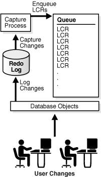
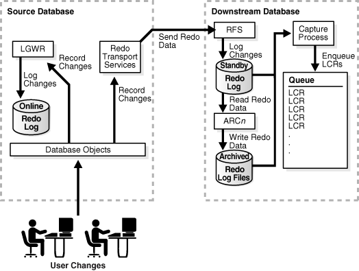
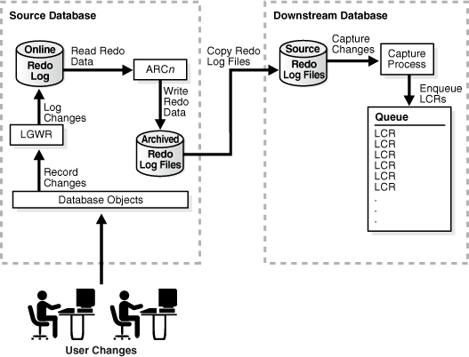
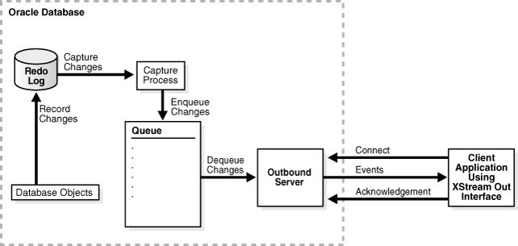

Become familiar with concepts related to XStream Out.

- Introduction to XStream Out
  XStream Out can capture transactions from the redo log of an Oracle database and send them efficiently to a client application.
- Capture Processes
  Become familiar with concepts related to capture processes.
- Outbound Servers
  With XStream Out, an outbound server sends database changes to a client application.
- Position of LCRs and XStream Out
  An XStream Out outbound server streams LCRs that were captured by a capture process to a client application. The position of an LCR identifies its placement in the stream of LCRs in a transaction.
- XStream Out and Distributed Transactions
  There are considerations for XStream Out and distributed transactions.
- XStream Out and Security
  Understand security related to the client application and XStream components, as well as the privileges required by the capture user and the connect user.
- XStream Out and Other Oracle Database Components
  XStream Out can work with other Oracle Database components.

**See Also:**

[Configuring XStream Out](configuring-xstream-out.md)

**Parent topic:** [XStream Out](xstream-out.md)

### 3.1 Introduction to XStream Out

XStream Out can capture transactions from the redo log of an Oracle database and send them efficiently to a client application.

XStream Out provides a transaction-based interface for streaming these changes to client applications. The client application can interact with other systems, including non-Oracle systems, such as non-Oracle databases or file systems.

In an XStream Out configuration, a capture process captures database changes and sends these changes to an outbound server. This section describes capture processes and outbound servers in detail.

XStream Out has both OCI and Java interfaces and supports most of the data types that are supported by Oracle Database, including LOBs, `LONG`, `LONG` `RAW`, and `XMLType`.

**See Also:**

- [Oracle Call Interface Programmer's Guide](../lnoci/intro-to-oci-interface-for-XStream.md)

- [Oracle Database XStream Java API Reference](../stxjv/index.md)

**Parent topic:** XStream Out Concepts

### 3.2 Capture Processes

Become familiar with concepts related to capture processes.

- Capture Process Overview
  A capture process is an optional Oracle background process that scans the database redo log to capture DML and DDL changes made to database objects.
- Data Types Captured by a Capture Process
  A capture process can capture changes made to columns of most data types.
- Types of DML Changes Captured by Capture Processes
  A capture process can capture different types of DML changes.
- Local Capture and Downstream Capture
  You can configure a capture process to run locally on a source database or remotely on a downstream database.
- Capture Processes and RESTRICTED SESSION
  Enabling and disabling restricted session affects capture processes.
- Capture Process Subcomponents
  The capture process subcomponents are a reader server, one or more preparer servers, and a builder server.
- Capture Process States
  The state of a capture process describes what the capture process is doing currently.
- Capture Process Parameters
  Capture process parameters control the way a capture process operates.
- Capture Process Checkpoints and XStream Out
  A checkpoint is information about the current state of a capture process that is stored persistently in the data dictionary of the database running the capture process.
- SCN Values Related to a Capture Process
  Specific system change number (SCN) values are important for a capture process.

**Parent topic:** XStream Out Concepts

#### 3.2.1 Capture Process Overview

A capture process is an optional Oracle background process that scans the database redo log to capture DML and DDL changes made to database objects.

The primary function of the redo log is to record all of the changes made to the database. A capture process captures database changes from the redo log, and the database where the changes were generated is called the source database for the capture process.

When a capture process captures a database change, it converts it into a specific message format called a logical change record (LCR). In an XStream Out configuration, the capture process sends these LCRs to an outbound server.

Figure 3-1 shows a capture process.

Figure 3-1 Capture Process

[Description of "Figure 3-1 Capture Process"](img_text/xstrm081.md)

A capture process can run on its source database or on a remote database. When a capture process runs on its source database, the capture process is a local capture process.

You can also capture changes for the source database by running the capture process on different server. When a capture process runs on a remote database, the capture process is called a downstream capture process, and the remote database is called the downstream database. The log files are written to the remote database and to the source database. In this configuration, the source logfiles must be available at the downstream capture database. The capture process on the remote database mines the logs from the source database and stages them locally. This configuration can be helpful when you want to offload the processing of capture changes from a production database to different, remote database.

**Parent topic:** Capture Processes

#### 3.2.2 Data Types Captured by a Capture Process

A capture process can capture changes made to columns of most data types.

When capturing the row changes resulting from DML changes made to tables, a capture process can capture changes made to columns of the following data types:

- `VARCHAR2`

- `NVARCHAR2`

- `NUMBER`

- `FLOAT`

- `LONG`

- `DATE`

- `BINARY_FLOAT`

- `BINARY_DOUBLE`

- `TIMESTAMP`

- `TIMESTAMP` `WITH` `TIME` `ZONE`

- `TIMESTAMP` `WITH` `LOCAL` `TIME` `ZONE`

- `INTERVAL` `YEAR` `TO` `MONTH`

- `INTERVAL` `DAY` `TO` `SECOND`

- `RAW`

- `LONG` `RAW`

- `UROWID`

- `CHAR`

- `NCHAR`

- `CLOB` with `BASICFILE` or `SECUREFILE` storage

- `NCLOB` with `BASICFILE` or `SECUREFILE` storage

- `BLOB` with `BASICFILE` or `SECUREFILE` storage

- `XMLType` stored as `CLOB`, object relational, or as binary XML

- Object types

- Varrays

- `REF` data types

- The following Oracle-supplied types: `ANYDATA`, `SDO_GEOMETRY`, and media types

- `BFILE`

If XStream is replicating data for an object type, then the replication must be unidirectional, and all replication sites must agree on the names and data types of the attributes in the object type. You establish the names and data types of the attributes when you create the object type. For example, consider the following object type:

    CREATE TYPE cust_address_typ AS OBJECT
         (street_address     VARCHAR2(40),
          postal_code        VARCHAR2(10),
          city               VARCHAR2(30),
          state_province     VARCHAR2(10),
          country_id         CHAR(2));
    /

At all replication sites, `street_address` must be `VARCHAR2(40)`, `postal_code` must be `VARCHAR2(10)`, `city` must be `VARCHAR2(30)`, and so on.

**Note:**

- The maximum size of the `VARCHAR2`, `NVARCHAR2`, and `RAW` data types has been increased in Oracle Database 12c when the `COMPATIBLE` initialization parameter is set to `12.0.0` and the `MAX_STRING_SIZE` initialization parameter is set to `EXTENDED`.

- `XMLType` stored as a `CLOB` is deprecated in Oracle Database 12c Release 1 (12.1).

- For `BFILE`, only the data type structure is replicated and not the content of the `BFILE` that exists on the file system.

<!-- -->

- ID Key LCRs
  An ID key LCR is a special type of row LCR. ID key LCRs enable an XStream client application to process changes to rows that include unsupported data types.
- ID Key LCRs Demo
  A demo is available that creates a sample client application that processes ID key LCRs.

**See Also:**

[Oracle Database SQL Language Reference](../sqlrf/Data-Types.md) for information about data types

**Parent topic:** Capture Processes

##### 3.2.2.1 ID Key LCRs

An ID key LCR is a special type of row LCR. ID key LCRs enable an XStream client application to process changes to rows that include unsupported data types.

XStream Out does not fully support the following data types in row LCRs:

- `ROWID`

- Nested tables

- The following Oracle-supplied types: `ANYTYPE`, `ANYDATASET`, URI types, `SDO_TOPO_GEOMETRY`, `SDO_GEORASTER`, and `Expression`.

These data type restrictions pertain to both ordinary (heap-organized) tables and index-organized tables.

ID key LCRs do not contain all of the columns for a row change. Instead, they contain the rowid of the changed row, a group of key columns to identify the row in the table, and the data for the scalar columns of the table that are supported by XStream Out. ID key LCRs do not contain data for columns of unsupported data types.

XStream Out can capture changes for tables that are not fully supported by setting the `CAPTURE_IDKEY_OBJECTS` capture process parameter to `Y`. An XStream client application can use ID key LCRs in the following ways:

- If the application does not require the data in the unsupported columns, then the application can process the values of the supported columns in the ID key LCRs normally.

- If the application requires the data in the unsupported columns, then the application can use the information in an ID key LCR to query the correct row in the database and consume the unsupported data for the row.

You can use the `DBA_XSTREAM_OUT_SUPPORT_MODE` view to display a list of local tables supported by ID key LCRs. This view shows the following types of XStream Out support for tables in the `SUPPORT_MODE` column:

- `FULL` for tables that are fully supported by XStream Out (without using ID key LCRs)

- `ID` `KEY` for tables that are supported only by using ID key LCRs

- `NONE` for tables that are not supported by XStream Out.

  Even ID key LCRs cannot be used to process changes to rows in tables that show `NONE` in the `DBA_XSTREAM_OUT_SUPPORT_MODE` view.

For example, run the following query to show XStream Out support for all of the tables in the database:

    COLUMN OWNER FORMAT A30
    COLUMN OBJECT_NAME FORMAT A30
    COLUMN SUPPORT_MODE FORMAT A12

    SELECT OWNER, OBJECT_NAME, SUPPORT_MODE
      FROM DBA_XSTREAM_OUT_SUPPORT_MODE
      ORDER BY OBJECT_NAME;

Your output is similar to the following:

    OWNER                          OBJECT_NAME                    SUPPORT_MODE
    ------------------------------ ------------------------------ ------------
    .
    .
    .

    IX                             ORDERS_QUEUETABLE              NONE
    OE                             ORDER_ITEMS                    FULL
    SH                             PLAN_TABLE                     FULL
    PM                             PRINT_MEDIA                    ID KEY
    .
    .
    .

**See Also:**

- [Oracle Database Reference](../refrn/DBA_XSTREAM_OUT_SUPPORT_MODE.md)

- "[Row LCRs](general-xstream-concepts.md)"

- "[Setting a Capture Process Parameter](managing-xstream-out.md)"

**Parent topic:** Data Types Captured by a Capture Process

##### 3.2.2.2 ID Key LCRs Demo

A demo is available that creates a sample client application that processes ID key LCRs.

Specifically, the client application attaches to an XStream outbound server and waits for LCRs from the outbound server. When the client application receives an ID key LCR, it can query the appropriate source database table using the rowid in the ID key LCR.

The demo is available in the following location in both OCI and Java code:

    $ORACLE_HOME/rdbms/demo/xstream/idkey

**Parent topic:** Data Types Captured by a Capture Process

#### 3.2.3 Types of DML Changes Captured by Capture Processes

A capture process can capture different types of DML changes.

When you specify that DML changes made to certain tables should be captured, a capture process captures the following types of DML changes made to these tables:

- `INSERT`

- `UPDATE`

- `DELETE`

- `MERGE`

- Piecewise operations

A capture process converts each `MERGE` change into an `INSERT` or `UPDATE` change. `MERGE` is not a valid command type in a row LCR.

**Parent topic:** Capture Processes

#### 3.2.4 Local Capture and Downstream Capture

You can configure a capture process to run locally on a source database or remotely on a downstream database.

A single database can have one or more capture processes that capture local changes and other capture processes that capture changes from a remote source database. That is, you can configure a single database to perform both local capture and downstream capture.

- Local Capture
  Local capture means that a capture process runs on the source database.
- Downstream Capture
  Downstream capture means that a capture process runs on a database other than the source database.

**Parent topic:** Capture Processes

##### 3.2.4.1 Local Capture

Local capture means that a capture process runs on the source database.

Figure 3-1 shows a database using local capture.

- The Source Database Performs All Change Capture Actions
  With local capture, the capture actions are performed at the source database.
- Advantages of Local Capture
  Local capture has several advantages.

**Parent topic:** Local Capture and Downstream Capture

###### 3.2.4.1.1 The Source Database Performs All Change Capture Actions

With local capture, the capture actions are performed at the source database.

If you configure local capture, then the following actions are performed at the source database:

- The `DBMS_CAPTURE_ADM.BUILD` procedure is run to extract (or build) the data dictionary to the redo log.

- Supplemental logging at the source database places additional information in the redo log. This information might be needed when captured changes are processed by an XStream client application. See "[If Required, Configure Supplemental Logging](configuring-xstream-out.md)".

- The first time a capture process is started at the database, Oracle Database uses the extracted data dictionary information in the redo log to create a LogMiner data dictionary, which is separate from the primary data dictionary for the source database. Additional capture processes can use this existing LogMiner data dictionary, or they can create new LogMiner data dictionaries.

- A capture process scans the redo log for changes using LogMiner.

- The rules engine evaluates changes based on the rules in one or more of the capture process rule sets.

- The capture process enqueues changes that satisfy the rules in its rule sets into a local `ANYDATA` queue.

- If the captured changes are shared with one or more outbound servers on other databases, then one or more propagations propagate these changes from the source database to the other databases.

**Parent topic:** Local Capture

###### 3.2.4.1.2 Advantages of Local Capture

Local capture has several advantages.

The following are the advantages of using local capture:

- Configuration and administration of the capture process is simpler than when downstream capture is used. When you use local capture, you do not need to configure redo data copying to a downstream database, and you administer the capture process locally at the database where the captured changes originated.

- A local capture process can scan changes in the online redo log before the database writes these changes to an archived redo log file. When you use an archived-log downstream capture process, archived redo log files are copied to the downstream database after the source database has finished writing changes to them, and some time is required to copy the redo log files to the downstream database. However, a real-time downstream capture process can capture changes in the online redo log sent from the source database.

- The amount of data being sent over the network is reduced, because the redo data is not copied to the downstream database. Even if captured LCRs are propagated to other databases, the captured LCRs can be a subset of the total changes made to the database, and only the LCRs that satisfy the rules in the rule sets for a propagation are propagated.

- Security might be improved because only the source (local) database can access the redo data. For example, if the capture process captures changes in the hr schema only, then, when you use local capture, only the source database can access the redo data to enqueue changes to the hr schema into the capture process queue. However, when you use downstream capture, the redo data is copied to the downstream database, and the redo data contains all of the changes made to the database, not just the changes made to a specific object or schema.

**Parent topic:** Local Capture

##### 3.2.4.2 Downstream Capture

Downstream capture means that a capture process runs on a database other than the source database.

The following types of downstream capture configurations are possible: real-time downstream capture and archived-log downstream capture. The `downstream_real_time_mine` capture process parameter controls whether a downstream capture process performs real-time downstream capture or archived-log downstream capture. A real-time downstream capture process and one or more archived-log downstream capture processes can coexist at a downstream database. With downstream capture, the redo log files of the source database must be available at the downstream database.

**Note:**

- References to "downstream capture processes" in this document apply to both real-time downstream capture processes and archived-log downstream capture processes. This document distinguishes between the two types of downstream capture processes when necessary.

- A downstream capture process only can capture changes from a single source database. However, multiple downstream capture processes at a single downstream database can capture changes from a single source database or multiple source databases.

- To configure XStream Out downstream capture, the source database must be an Oracle Database 10g Release 2 (10.2) or later and the capture database must be an Oracle Database 11g Release 2 (11.2.0.3) or later

<!-- -->

- Real-Time Downstream Capture
  The advantage of real-time downstream capture over archived-log downstream capture is that real-time downstream capture reduces the amount of time required to capture changes made at the source database.
- Archived-Log Downstream Capture
  The advantage of archived-log downstream capture over real-time downstream capture is that archived-log downstream capture allows downstream capture processes from multiple source databases at a downstream database.
- The Downstream Database Performs Most Change Capture Actions
  With downstream capture, most capture actions are performed at the downstream database.
- Advantages of Downstream Capture
  Downstream capture provides several advantages.
- Optional Database Link From the Downstream Database to the Source Database
  When you create or alter a downstream capture process, you optionally can specify the use of a database link from the downstream database to the source database.
- Operational Requirements for Downstream Capture with XStream Out
  Some operational requirements apply to downstream capture.

**Parent topic:** Local Capture and Downstream Capture

###### 3.2.4.2.1 Real-Time Downstream Capture

The advantage of real-time downstream capture over archived-log downstream capture is that real-time downstream capture reduces the amount of time required to capture changes made at the source database.

The time is reduced because the real-time downstream capture process does not need to wait for the redo log file to be archived before it can capture data from it.

A real-time downstream capture configuration works in the following way:

- Redo transport services sends redo data to the downstream database either synchronously or asynchronously. At the same time, the log writer process (LGWR) records redo data in the online redo log at the source database.

- A remote file server process (RFS) at the downstream database receives the redo data over the network and stores the redo data in the standby redo log.

- A log switch at the source database causes a log switch at the downstream database, and the `ARCH``n` process at the downstream database archives the current standby redo log file.

- The real-time downstream capture process captures changes from the standby redo log whenever possible and from the archived standby redo log files whenever necessary. A capture process can capture changes in the archived standby redo log files if it falls behind. When it catches up, it resumes capturing changes from the standby redo log.

Figure 3-2 Real-Time Downstream Capture

[Description of "Figure 3-2 Real-Time Downstream Capture"](img_text/xstrm047.md)

**Note:**

You can configure more than one real-time downstream capture process that captures changes from the same source database, but you cannot configure real-time downstream capture for multiple source databases at one downstream database.

**Parent topic:** Downstream Capture

###### 3.2.4.2.2 Archived-Log Downstream Capture

The advantage of archived-log downstream capture over real-time downstream capture is that archived-log downstream capture allows downstream capture processes from multiple source databases at a downstream database.

An archived-log downstream capture configuration means that archived redo log files from the source database are copied to the downstream database, and the capture process captures changes in these archived redo log files. You can copy the archived redo log files to the downstream database using redo transport services, the `DBMS_FILE_TRANSFER` package, file transfer protocol (FTP), or some other mechanism.

Figure 3-3 Archived-Log Downstream Capture

[Description of "Figure 3-3 Archived-Log Downstream Capture"](img_text/xstrm037.md)

You can copy redo log files from multiple source databases to a single downstream database and configure multiple archived-log downstream capture processes to capture changes in these redo log files.

**See Also:**

[Oracle Data Guard Concepts and Administration](../sbydb/oracle-data-guard-redo-transport-services.md) for more information about redo transport services

**Parent topic:** Downstream Capture

###### 3.2.4.2.3 The Downstream Database Performs Most Change Capture Actions

With downstream capture, most capture actions are performed at the downstream database.

If you configure either real-time or archived-log downstream capture, then the following actions are performed at the downstream database:

- The first time a downstream capture process is started at the downstream database, Oracle Database uses data dictionary information in the redo data from the source database to create a LogMiner data dictionary at the downstream database. The `DBMS_CAPTURE_ADM.BUILD` procedure is run at the source database to extract the source data dictionary information to the redo log at the source database. Next, the redo data is copied to the downstream database from the source database. Additional downstream capture processes for the same source database can use this existing LogMiner data dictionary, or they can create new LogMiner data dictionaries. Also, a real-time downstream capture process can share a LogMiner data dictionary with one or more archived-log downstream capture processes.

- A capture process scans the redo data from the source database for changes using LogMiner.

- The rules engine evaluates changes based on the rules in one or more of the capture process rule sets.

- The capture process enqueues changes that satisfy the rules in its rule sets into a local `ANYDATA` queue. The capture process formats the changes as LCRs.

In a downstream capture configuration, the following actions are performed at the source database:

- The `DBMS_CAPTURE_ADM.BUILD` procedure is run at the source database to extract the data dictionary to the redo log.

- Supplemental logging at the source database places additional information that might be needed for apply in the redo log. See "[If Required, Configure Supplemental Logging](configuring-xstream-out.md)".

In addition, the redo data must be copied from the computer system running the source database to the computer system running the downstream database. In a real-time downstream capture configuration, redo transport services sends redo data to the downstream database. Typically, in an archived-log downstream capture configuration, redo transport services copies the archived redo log files to the downstream database.

**Parent topic:** Downstream Capture

###### 3.2.4.2.4 Advantages of Downstream Capture

Downstream capture provides several advantages.

The following are the advantages of using downstream capture:

- Capturing changes uses fewer resources at the source database because the downstream database performs most of the required work.

- If you plan to capture changes originating at multiple source databases, then capture process administration can be simplified by running multiple archived-log downstream capture processes with different source databases at one downstream database. That is, one downstream database can act as the central location for change capture from multiple sources. In such a configuration, one real-time downstream capture process can run at the downstream database in addition to the archived-log downstream capture processes.

- Copying redo data to one or more downstream databases provides improved protection against data loss. For example, redo log files at the downstream database can be used for recovery of the source database in some situations.

- The ability to configure at one or more downstream databases multiple capture processes that capture changes from a single source database provides more flexibility and can improve scalability.

**Parent topic:** Downstream Capture

###### 3.2.4.2.5 Optional Database Link From the Downstream Database to the Source Database

When you create or alter a downstream capture process, you optionally can specify the use of a database link from the downstream database to the source database.

This database link must have the same name as the global name of the source database. Such a database link simplifies the creation and administration of a downstream capture process. You specify that a downstream capture process uses a database link by setting the `use_database_link` parameter to `TRUE` when you run the `CREATE_CAPTURE` or `ALTER_CAPTURE` procedure on the downstream capture process. The name of the database link must match the global name of the source database.

When a downstream capture process uses a database link to the source database, the capture process connects to the source database to perform the following administrative actions automatically:

- In certain situations, runs the `DBMS_CAPTURE_ADM.BUILD` procedure at the source database to extract the data dictionary at the source database to the redo log when a capture process is created.

- Obtains the first SCN for the downstream capture process if the first system change number (SCN) is not specified during capture process creation. The first SCN is needed to create a capture process.

If a downstream capture process does not use a database link, then you must perform these actions manually.

**Note:**

During the creation of a downstream capture process, if the `first_scn` parameter is set to `NULL` in the `CREATE_CAPTURE` procedure, then the use_database_link parameter must be set to `TRUE`. Otherwise, an error is raised.

**Parent topic:** Downstream Capture

###### 3.2.4.2.6 Operational Requirements for Downstream Capture with XStream Out

Some operational requirements apply to downstream capture.

The following are operational requirements for using downstream capture:

- The source database must be running at least Oracle Database 10g Release 2 (10.2).

- The XStream Out downstream capture database must be running Oracle Database 11g Release 2 (11.2.0.3) or later and the source database must be running Oracle Database 10g Release 2 (10.2) or later.

- The operating system on the source and downstream capture sites must be the same, but the operating system release does not need to be the same. In addition, the downstream sites can use a directory structure that is different from the source site.

- The hardware architecture on the source and downstream capture sites must be the same. For example, a downstream capture configuration with a source database on a 64-bit Sun system must have a downstream database that is configured on a 64-bit Sun system. Other hardware elements, such as the number of CPUs, memory size, and storage configuration, can differ in the source and downstream sites.

**Parent topic:** Downstream Capture

#### 3.2.5 Capture Processes and RESTRICTED SESSION

Enabling and disabling restricted session affects capture processes.

When you enable restricted session during system startup by issuing a `STARTUP` `RESTRICT` statement, capture processes do not start, even if they were running when the database shut down. When restricted session is disabled with an `ALTER` `SYSTEM` statement, each capture process that was running when the database shut down is started.

When restricted session is enabled in a running database by the SQL statement `ALTER` `SYSTEM` `ENABLE` `RESTRICTED` `SESSION` clause, it does not affect any running capture processes. These capture processes continue to run and capture changes. If a stopped capture process is started in a restricted session, then the capture process does not actually start until the restricted session is disabled.

**Parent topic:** Capture Processes

#### 3.2.6 Capture Process Subcomponents

The capture process subcomponents are a reader server, one or more preparer servers, and a builder server.

A capture process is an optional Oracle background process whose process name is `CP``nn`, where `nn` can include letters and numbers. A capture process captures changes from the redo log by using the infrastructure of LogMiner. XStream configures LogMiner automatically. You can create, alter, start, stop, and drop a capture process, and you can define capture process rules that control which changes a capture process captures.

The `parallelism` capture process parameter controls capture process parallelism. When capture process parallelism is 0 (zero), the default for XStream Out, the capture process does not use subcomponents to perform its work. Instead, the `CP``nn` process completes all of the tasks required to capture database changes.

When capture process parallelism is greater than 0, the capture process uses the underlying LogMiner process name is `MS``nn`, where `nn` can include letters and numbers. When capture process parallelism is 0 (zero), the capture process does not use this process.

When capture process parallelism is greater than 0, the capture process consists of the following subcomponents:

- One reader server that reads the redo log and divides the redo log into regions.

- One or more preparer servers that scan the regions defined by the reader server in parallel and perform prefiltering of changes found in the redo log. Prefiltering involves sending partial information about changes, such as schema and object name for a change, to the rules engine for evaluation, and receiving the results of the evaluation. You can control the number of preparer servers using the parallelism capture process parameter.

- One builder server that merges redo records from the preparer servers. These redo records either evaluated to `TRUE` during partial evaluation or partial evaluation was inconclusive for them. The builder server preserves the system change number (SCN) order of these redo records and passes the merged redo records to the capture process.

- The capture process (`CP``nn`) performs the following actions for each change when it receives merged redo records from the builder server:

  - Formats the change into an LCR

  - If the partial evaluation performed by a preparer server was inconclusive for the change in the LCR, then sends the LCR to the rules engine for full evaluation

  - Receives the results of the full evaluation of the LCR if it was performed

  - Discards the LCR if it satisfies the rules in the negative rule set for the capture process or if it does not satisfy the rules in the positive rule set

  - Enqueues the LCR into the queue associated with the capture process if the LCR satisfies the rules in the positive rule set for the capture process

Each reader server, preparer server, and builder server is a process.

**Parent topic:** Capture Processes

#### 3.2.7 Capture Process States

The state of a capture process describes what the capture process is doing currently.

You can view the state of a capture process by querying the `STATE` column in the `V$XSTREAM_CAPTURE` dynamic performance view.

**See Also:**

[Oracle Database Reference](../refrn/V-XSTREAM_CAPTURE.md)

**Parent topic:** Capture Processes

#### 3.2.8 Capture Process Parameters

Capture process parameters control the way a capture process operates.

For example, the parallelism capture process parameter controls the number of preparer servers used by a capture process, and the `time_limit` capture process parameter specifies the amount of time a capture process runs before it is shut down automatically. You set capture process parameters using the `DBMS_CAPTURE_ADM.SET_PARAMETER` procedure. After creation, a capture process is disabled so that you can set the capture process parameters for your environment before starting it for the first time.

**See Also:**

[Oracle Database PL/SQL Packages and Types Reference](../arpls/DBMS_CAPTURE_ADM.md)

**Parent topic:** Capture Processes

#### 3.2.9 Capture Process Checkpoints and XStream Out

A checkpoint is information about the current state of a capture process that is stored persistently in the data dictionary of the database running the capture process.

A capture process tries to record a checkpoint at regular intervals called checkpoint intervals.

- Required Checkpoint SCN
  The system change number (SCN) that corresponds to the lowest checkpoint for which a capture process requires redo data is the required checkpoint SCN.
- Maximum Checkpoint SCN
  The SCN that corresponds to the last physical checkpoint recorded by a capture process is the maximum checkpoint SCN.
- Checkpoint Retention Time
  The checkpoint retention time is the amount of time, in number of days, that a capture process retains checkpoints before purging them automatically.

**Parent topic:** Capture Processes

##### 3.2.9.1 Required Checkpoint SCN

The system change number (SCN) that corresponds to the lowest checkpoint for which a capture process requires redo data is the required checkpoint SCN.

The redo log file that contains the required checkpoint SCN, and all subsequent redo log files, must be available to the capture process. If a capture process is stopped and restarted, then it starts scanning the redo log from the SCN that corresponds to its required checkpoint SCN. The required checkpoint SCN is important for recovery if a database stops unexpectedly. Also, if the first SCN is reset for a capture process, then it must be set to a value that is less than or equal to the required checkpoint SCN for the captured process. You can determine the required checkpoint SCN for a capture process by querying the `REQUIRED_CHECKPOINT_SCN` column in the `ALL_CAPTURE` data dictionary view.

**Parent topic:** Capture Process Checkpoints and XStream Out

##### 3.2.9.2 Maximum Checkpoint SCN

The SCN that corresponds to the last physical checkpoint recorded by a capture process is the maximum checkpoint SCN.

The maximum checkpoint SCN can be lower than or higher than the required checkpoint SCN for a capture process. The maximum checkpoint SCN can also be 0 (zero) if the capture process is new and has not yet recorded a physical checkpoint.

**Parent topic:** Capture Process Checkpoints and XStream Out

##### 3.2.9.3 Checkpoint Retention Time

The checkpoint retention time is the amount of time, in number of days, that a capture process retains checkpoints before purging them automatically.

A capture process periodically computes the age of a checkpoint by subtracting the `NEXT_TIME` of the archived redo log file that corresponds to the checkpoint from `FIRST_TIME` of the archived redo log file containing the required checkpoint SCN for the capture process. If the resulting value is greater than the checkpoint retention time, then the capture process automatically purges the checkpoint by advancing its first SCN value. Otherwise, the checkpoint is retained.

You can use the `ALTER_CAPTURE` procedure in the `DBMS_CAPTURE_ADM` package to set the checkpoint retention time for a capture process. The `DBA_REGISTERED_ARCHIVED_LOG` view displays the `FIRST_TIME` and `NEXT_TIME` for archived redo log files, and the `REQUIRED_CHECKPOINT_SCN` column in the `ALL_CAPTURE` view displays the required checkpoint SCN for a capture process.

**See Also:**

[Oracle Database PL/SQL Packages and Types Reference](../arpls/DBMS_CAPTURE_ADM.md)

**Parent topic:** Capture Process Checkpoints and XStream Out

#### 3.2.10 SCN Values Related to a Capture Process

Specific system change number (SCN) values are important for a capture process.

You can query the `ALL_CAPTURE` data dictionary view to display these values for one or more capture processes.

- Captured SCN and Applied SCN
  The captured SCN is the SCN that corresponds to the most recent change scanned in the redo log by a capture process. The applied SCN for a capture process is the SCN of the most recent LCR processed by the relevant outbound server.
- First SCN and Start SCN
  The first SCN and start SCN are important for a capture process.

**Parent topic:** Capture Processes

##### 3.2.10.1 Captured SCN and Applied SCN

The captured SCN is the SCN that corresponds to the most recent change scanned in the redo log by a capture process. The applied SCN for a capture process is the SCN of the most recent LCR processed by the relevant outbound server.

All LCRs lower than the applied SCN have been processed by all outbound servers that process changes captured by the capture process. The applied SCN for a capture process is equivalent to the low-watermark SCN for an outbound server that processes changes captured by the capture process.

**Parent topic:** SCN Values Related to a Capture Process

##### 3.2.10.2 First SCN and Start SCN

The first SCN and start SCN are important for a capture process.

- First SCN
  The first SCN is the lowest SCN in the redo log from which a capture process can capture changes.
- Start SCN
  The start SCN is the SCN from which a capture process begins to capture changes.
- Start SCN Must Be Greater Than or Equal to First SCN
  If you specify a start SCN when you create or alter a capture process, then the start SCN specified must be greater than or equal to the first SCN for the capture process.

**Parent topic:** SCN Values Related to a Capture Process

###### 3.2.10.2.1 First SCN

The first SCN is the lowest SCN in the redo log from which a capture process can capture changes.

If you specify a first SCN during capture process creation, then the database must be able to access redo data from the SCN specified and higher.

The `DBMS_CAPTURE_ADM.BUILD` procedure extracts the source database data dictionary to the redo log. When you create a capture process, you can specify a first SCN that corresponds to this data dictionary build in the redo log. Specifically, the first SCN for the capture process being created can be set to any value returned by the following query:

    COLUMN FIRST_CHANGE# HEADING 'First SCN' FORMAT 999999999
    COLUMN NAME HEADING 'Log File Name' FORMAT A50

    SELECT DISTINCT FIRST_CHANGE#, NAME FROM V$ARCHIVED_LOG
      WHERE DICTIONARY_BEGIN = 'YES';

The value returned for the `NAME` column is the name of the redo log file that contains the SCN corresponding to the first SCN. This redo log file, and all subsequent redo log files, must be available to the capture process. If this query returns multiple distinct values for `FIRST_CHANGE#`, then the `DBMS_CAPTURE_ADM.BUILD` procedure has been run more than once on the source database. In this case, choose the first SCN value that is most appropriate for the capture process you are creating.

In some cases, the `DBMS_CAPTURE_ADM.BUILD` procedure is run automatically when a capture process is created. When this happens, the first SCN for the capture process corresponds to this data dictionary build.

**Parent topic:** First SCN and Start SCN

###### 3.2.10.2.2 Start SCN

The start SCN is the SCN from which a capture process begins to capture changes.

The start SCN is the SCN from which a capture process begins to capture changes. You can specify a start SCN that is different than the first SCN during capture process creation, or you can alter a capture process to set its start SCN. The start SCN does not need to be modified for normal operation of a capture process. Typically, you reset the start SCN for a capture process if point-in-time recovery must be performed on one of the destination databases that receive changes from the capture process. In these cases, the capture process can capture the changes made at the source database after the point-in-time of the recovery.

**Note:**

An existing capture process must be stopped before setting its start SCN.

**Parent topic:** First SCN and Start SCN

###### 3.2.10.2.3 Start SCN Must Be Greater Than or Equal to First SCN

If you specify a start SCN when you create or alter a capture process, then the start SCN specified must be greater than or equal to the first SCN for the capture process.

A capture process always scans any unscanned redo log records that have higher SCN values than the first SCN, even if the redo log records have lower SCN values than the start SCN. So, if you specify a start SCN that is greater than the first SCN, then the capture process might scan redo log records for which it cannot capture changes, because these redo log records have a lower SCN than the start SCN.

Scanning redo log records before the start SCN should be avoided if possible because it can take some time. Therefore, Oracle recommends that the difference between the first SCN and start SCN be as small as possible during capture process creation to keep the initial capture process startup time to a minimum.

**Note:**

When a capture process is started or restarted, it might need to scan redo log files with a `FIRST_CHANGE#` value that is lower than start SCN. Removing required redo log files before they are scanned by a capture process causes the capture process to abort. You can query the `ALL_CAPTURE` data dictionary view to determine the first SCN, start SCN, and required checkpoint SCN. A capture process needs the redo log file that includes the required checkpoint SCN, and all subsequent redo log files.

**Parent topic:** First SCN and Start SCN

### 3.3 Outbound Servers

With XStream Out, an outbound server sends database changes to a client application.

- Overview of Outbound Servers
  An outbound server is an optional Oracle background process that sends database changes to a client application.
- Data Types Supported by Outbound Servers
  Outbound servers support all of the data types that are supported by capture processes.
- Apply User for an Outbound Server
  The apply user for an outbound server is the user who receives LCRs from the outbound server's capture process.
- Outbound Servers and RESTRICTED SESSION
  Enabling and disabling restricted session affects outbound servers.
- Outbound Server Subcomponents
  An outbound server consists of a reader server, a coordinator process, and an apply server.
- Considerations for Outbound Servers
  There are several considerations for XStream outbound servers.
- Outbound Servers and Apply Parameters
  Apply parameters control the behavior of outbound servers.

**Parent topic:** XStream Out Concepts

#### 3.3.1 Overview of Outbound Servers

An outbound server is an optional Oracle background process that sends database changes to a client application.

Specifically, a client application can attach to an outbound server and extract database changes from LCRs. A client application attaches to the outbound server using OCI or Java interfaces.

A client application can create multiple sessions. Each session can attach to only one outbound server, and each outbound server can serve only one session at a time. However, different client application sessions can connect to different outbound servers or inbound servers.

Change capture can be performed on the same database as the outbound server or on a different database. When change capture is performed on a different database from the one that contains the outbound server, a propagation sends the changes from the change capture database to the outbound server database. Downstream capture is also a supported mode to reduce the load on the source database.

When both the outbound server and its capture process are enabled, data changes, encapsulated in row LCRs and DDL LCRs, are sent to the outbound server. The outbound server can publish LCRs in various formats, such as OCI and Java. The client application can process LCRs that are passed to it from the outbound server or wait for LCRs from the outbound server by using a loop.

An outbound server sends LOB, `LONG`, `LONG` `RAW`, and `XMLType` data to the client application in chunks. Several chunks comprise a single column value of LOB, `LONG`, `LONG` `RAW`, or `XMLType` data type.

Figure 3-4 shows an outbound server configuration.

Figure 3-4 XStream Out Outbound Server

[Description of "Figure 3-4 XStream Out Outbound Server"](img_text/xstrm063.md)

The client application can detach from the outbound server whenever necessary. When the client application re-attaches, the outbound server automatically determines where in the stream of LCRs the client application was when it detached. The outbound server starts sending LCRs from this point forward.

**See Also:**

"Capture Processes" for detailed information about capture processes

**Parent topic:** Outbound Servers

#### 3.3.2 Data Types Supported by Outbound Servers

Outbound servers support all of the data types that are supported by capture processes.

Outbound servers can send LCRs that include changes to columns of these data types to XStream client applications.

**See Also:**

"Data Types Captured by a Capture Process"

**Parent topic:** Outbound Servers

#### 3.3.3 Apply User for an Outbound Server

The apply user for an outbound server is the user who receives LCRs from the outbound server's capture process.

The apply user for an outbound server must match the capture user for the outbound server's capture process.

**See Also:**

"Privileges Required by the Capture User for a Capture Process"

**Parent topic:** Outbound Servers

#### 3.3.4 Outbound Servers and RESTRICTED SESSION

Enabling and disabling restricted session affects outbound servers.

When restricted session is enabled during system startup by issuing a `STARTUP` `RESTRICT` statement, outbound servers do not start, even if they were running when the database shut down. When the restricted session is disabled, each outbound server that was not stopped is started.

When restricted session is enabled in a running database by the SQL statement `ALTER` `SYSTEM` `ENABLE` `RESTRICTED` `SESSION`, it does not affect any running outbound servers. These outbound servers continue to run and send LCRs to an XStream client application. If a stopped outbound server is started in a restricted session, then the outbound server does not actually start until the restricted session is disabled.

**Parent topic:** Outbound Servers

#### 3.3.5 Outbound Server Subcomponents

An outbound server consists of a reader server, a coordinator process, and an apply server.

- A reader server that receives LCRs from the outbound server's capture process. The reader server is a process that computes dependencies between LCRs and assembles LCRs into transactions. The reader server then returns the assembled transactions to the coordinator process.

  You can view the state of the reader server for an outbound server by querying the `V$XSTREAM_APPLY_READER` dynamic performance view.

- A coordinator process that gets transactions from the reader server and passes them to apply servers. The coordinator process name is `AP``nn`, where `nn` can include letters and numbers. The coordinator process is an Oracle background process.

  You can view the state of a coordinator process by querying the `V$XSTREAM_APPLY_COORDINATOR` dynamic performance view.

- An apply server that sends LCRs to an XStream client application. The apply server is a process. If the apply server encounters an error, then it then it records information about the error in the `ALL_APPLY` view.

  You can view the state of the apply server for an outbound server by querying the `V$XSTREAM_APPLY_SERVER` dynamic performance view.

The reader server and the apply server process names are `AS``nn`, where `nn` can include letters and numbers.

**See Also:**

- [Oracle Database Reference](../refrn/V-STREAMS_APPLY_READER.md) for more information on `V$XSTREAM_APPLY_READER` dynamic performance view

- [Oracle Database Reference](../refrn/V-STREAMS_APPLY_COORDINATOR.md) for more information on `V$XSTREAM_APPLY_COORDINATOR` dynamic performance view

- [Oracle Database Reference](../refrn/V-STREAMS_APPLY_SERVER.md) for more information on `V$XSTREAM_APPLY_SERVER` dynamic performance view

**Parent topic:** Outbound Servers

#### 3.3.6 Considerations for Outbound Servers

There are several considerations for XStream outbound servers.

The following are considerations for outbound servers:

- LCRs processed by an outbound server must be LCRs that were captured by a capture process. An outbound server does not support LCRs that were constructed by applications.

- A single outbound server can process captured LCRs from only one source database. The source database is the database where the changes encapsulated in the LCRs were generated in the redo log.

- The source database for the changes captured by a capture process must be at 10.2.0 or higher compatibility level for these changes to be processed by an outbound server.

- The capture process for an outbound server must be running on an Oracle Database 11g Release 2 (11.2) or later database.

- A single capture process cannot capture changes for both an outbound server and an apply process. However, a single capture process can capture changes for multiple outbound servers.

- Automatic split and merge of a stream is possible when the capture process and the outbound server for the stream run on different databases. However, when the capture process and outbound server for a stream run on the same database, automatic split and merge of the stream is not possible.

- An outbound server's LCRs can spill from memory to hard disk if they have been in the buffered queue for a period of time without being processed, if there are a large number of LCRs in a transaction, or if there is not enough space in memory to hold all of the LCRs. An outbound server performs best when a minimum of LCRs spill from memory. You can control an outbound server's behavior regarding spilled LCRs using the `txn_age_spill_threshold` and `txn_lcr_spill_threshold` apply parameters.

- Instantiation SCNs are not required for database objects processed by an outbound server. If an instantiation SCN is set for a database object, then the outbound server only sends the LCRs for the database object with SCN values that are greater than the instantiation SCN value. If a database object does not have an instantiation SCN set, then the outbound server skips the instantiation SCN check and sends all LCRs for that database object. In both cases, the outbound server only sends LCRs that satisfy its rule sets.

**See Also:**

[Oracle Database PL/SQL Packages and Types Reference](../arpls/DBMS_APPLY_ADM.md) for information about apply parameters

**Parent topic:** Outbound Servers

#### 3.3.7 Outbound Servers and Apply Parameters

Apply parameters control the behavior of outbound servers.

You can use the following apply parameters with outbound servers:

- `apply_sequence_nextval`

- `disable_on_limit`

- `grouptransops`

- `ignore_transaction`

- `max_sga_size`

- `maximum_scn`

- `startup_seconds`

- `time_limit`

- `trace_level`

- `transaction_limit`

- `txn_age_spill_threshold`

- `txn_lcr_spill_threshold`

- `write_alert_log`

**See Also:**

[Oracle Database PL/SQL Packages and Types Reference](../arpls/DBMS_APPLY_ADM.md)

**Parent topic:** Outbound Servers

### 3.4 Position of LCRs and XStream Out

An XStream Out outbound server streams LCRs that were captured by a capture process to a client application. The position of an LCR identifies its placement in the stream of LCRs in a transaction.

- Additional LCR Attributes Related to Position in XStream Out
  In LCRs that were captured by a capture process, there is additional information related to LCR position.
- The Processed Low Position and Restartability for XStream Out
  The processed low position is a position below which all transactions have been processed by the client application.
- Streaming Network Transmission
  To minimize network latency, the outbound server streams LCRs to the client application with time-based acknowledgments. For example, the outbound server might send an acknowledgment every 30 seconds.

**See Also:**

"[Position Order in an LCR Stream](general-xstream-concepts.md)"

**Parent topic:** XStream Out Concepts

#### 3.4.1 Additional LCR Attributes Related to Position in XStream Out

In LCRs that were captured by a capture process, there is additional information related to LCR position.

LCRs that were captured by a capture process contain the following additional attributes related to LCR position:

- The `scn_from_position` attribute contains the SCN of the LCR.

- The `commit_scn_from_position` attribute contains the commit SCN of the transaction to which the LCR belongs.

**Note:**

The `scn_from_position` and `commit_scn_from_position` attributes are not present in explicitly captured row LCRs.

**See Also:**

[Oracle Database PL/SQL Packages and Types Reference](../arpls/Logical-Change-Record-TYPEs.md)

**Parent topic:** Position of LCRs and XStream Out

#### 3.4.2 The Processed Low Position and Restartability for XStream Out

The processed low position is a position below which all transactions have been processed by the client application.

If the outbound server or the client application stops abnormally, then the connection between the two is broken automatically. In this case, the client application must roll back all incomplete transactions.

The client application must maintain its processed low position to recover properly after either it or the outbound server (or both) are restarted. The processed low position indicates that the client application has processed all LCRs that are less than or equal to this value. The client application can update the processed low position for each transaction that it consumes.

When the client application attaches to the outbound server, the following conditions related to the processed low position are possible:

- The client application can pass a processed low position to the outbound server that is equal to or greater than the outbound server's processed low position. In this case, the outbound server resumes streaming LCRs from the first LCR that has a position greater than the client application's processed low position.

- The client application can pass a processed low position to the outbound server that is less than the outbound server's processed low position. In this case, the outbound server raises an error.

- The client application can pass `NULL` to the outbound server. In this case, the outbound server determines the processed low position automatically and starts streaming LCRs from the LCR that has a position greater than this processed low position. When this happens, the client application must suppress or discard each LCR with a position less than or equal to the client application's processed low position.

**See Also:**

"[Displaying the Processed Low Position for an Outbound Server](monitoring-xstream-out.md)"

**Parent topic:** Position of LCRs and XStream Out

#### 3.4.3 Streaming Network Transmission

To minimize network latency, the outbound server streams LCRs to the client application with time-based acknowledgments. For example, the outbound server might send an acknowledgment every 30 seconds.

This streaming protocol fully utilizes the available network bandwidth, and the performance is unaffected by the presence of a wide area network (WAN) separating the sender and the receiver. The outbound server extends the underlying Oracle Replication infrastructure, and the outbound server maintains the streaming performance rate.

Using OCI, you can control the time period of the interval by setting the `OCI_ATTR_XSTREAM_ACK_INTERVAL` attribute through the OCI client application. The default is 30 seconds.

Using Java, you can control the time period of the interval by setting the `batchInterval` parameter in the `attach` method in the `XStreamOut` class. The client application can specify this interval when it invokes the `attach` method.

If the interval is large, then the outbound server can stream out more LCRs for each acknowledgment interval. However, a longer interval delays how often the client application can send the processed low position to the outbound server. Therefore, a longer interval might mean that the processed low position maintained by the outbound server is not current. In this case, when the outbound server restarts, it must start processing LCRs at an earlier position than the one that corresponds to the processed low position maintained by the client application. Therefore, more LCRs might be retransmitted, and the client application must discard the ones that have been applied.

**Parent topic:** Position of LCRs and XStream Out

### 3.5 XStream Out and Distributed Transactions

There are considerations for XStream Out and distributed transactions.

You can perform distributed transactions using either of the following methods:

- Modify tables in multiple databases in a coordinated manner using database links.

- Use the XA interface, as exposed by the `DBMS_XA` supplied PL/SQL package or by the OCI or JDBC libraries. The XA interface implements X/Open Distributed Transaction Processing (DTP) architecture.

In an XStream Out configuration, changes made to the source database during a distributed transaction using either of the preceding methods are streamed to an XStream outbound server. The outbound server sends the changes in a transaction to the XStream client application after the transaction has committed.

However, the distributed transaction state is not replicated or sent. The client application does not inherit the in-doubt or prepared state of such a transaction. Also, XStream does not replicate or send the changes using the same global transaction identifier used at the source database for XA transactions.

XA transactions can be performed in two ways:

- Tightly coupled, where different XA branches share locks

- Loosely coupled, where different XA branches do not share locks

XStream supports replication of changes made by loosely coupled XA branches regardless of the `COMPATIBLE` initialization parameter value. XStream supports replication of changes made by tightly coupled branches on an Oracle RAC source database only if the `COMPATIBLE` initialization parameter is set to `11.2.0.0` or higher.

**See Also:**

- [Oracle Database Administrator’s Guide](../admin/distributed-database-concepts.md) for more information about distributed transactions

- [Oracle Database Development Guide](../adfns/xa.md) for more information about Oracle XA

**Parent topic:** XStream Out Concepts

### 3.6 XStream Out and Security

Understand security related to the client application and XStream components, as well as the privileges required by the capture user and the connect user.

- The XStream Out Client Application and Security
  There are security considerations for the client application because XStream Out allows it to receive LCRs.
- XStream Out Component-Level Security
  All the components of the XStream Out configuration run as the same XStream administrator. This user can be either a trusted user with a high level of privileges, or it can be an untrusted user that has only the privileges necessary for performing certain tasks.
- Privileges Required by the Capture User for a Capture Process
  Changes are captured in the security domain of the capture user for a capture process. The capture user captures all changes that satisfy the capture process rule sets. The capture user must have the necessary privileges to perform these actions.
- Privileges Required by the Connect User for an Outbound Server
  An outbound server sends LCRs to an XStream client application in the security domain of its connect user.

**See Also:**

- "[XStream Security Models](introduction-to-xstream.md)"

- [Oracle Database PL/SQL Packages and Types Reference](../arpls/DBMS_XSTREAM_ADM.md)

**Parent topic:** XStream Out Concepts

#### 3.6.1 The XStream Out Client Application and Security

There are security considerations for the client application because XStream Out allows it to receive LCRs.

After an XStream Out application receives LCRs, the application might save the contents of LCRs to a file or generate the SQL statements to execute the LCRs on a non-Oracle database.

Java and OCI client applications must connect to an Oracle database before attaching to an XStream outbound server created on that database. The connected user must be the same as the `connect_user` configured for the outbound server. Otherwise, an error is raised. XStream does not assume that the connected user to the outbound server is trusted.

The XStream Java layer API relies on Oracle JDBC security because XStream accepts the Oracle JDBC connection instance created by client application in the XStream `attach` method in the `XStreamOut` class. The connected user is validated as an XStream user.

**See Also:**

- [Oracle Call Interface Programmer's Guide](../lnoci/intro-to-oci-interface-for-XStream.md) for information about the OCI interface for XStream

- [Oracle Database XStream Java API Reference](../stxjv/index.md) for information about the Java interface for XStream

**Parent topic:** XStream Out and Security

#### 3.6.2 XStream Out Component-Level Security

All the components of the XStream Out configuration run as the same XStream administrator. This user can be either a trusted user with a high level of privileges, or it can be an untrusted user that has only the privileges necessary for performing certain tasks.

The security model of the XStream administrator also determines the data dictionary views that this user can query to monitor the XStream configuration. The trusted administrator can monitor XStream with `DBA_` views. The untrusted administrator can monitor XStream with `ALL_` views.

You create an XStream administrator using the `GRANT_ADMIN_PRIVILEGE` procedure in the `DBMS_XSTREAM_AUTH` package. When you run this procedure to create an XStream administrator for XStream Out, the `privilege_type` parameter determines the type of privileges granted to the user:

- Specify `CAPTURE` for the `privilege_type` parameter if the XStream administrator manages only an XStream Out configuration on the database.

- Specify `*` for the `privilege_type` parameter if the XStream administrator manages both an XStream Out and an XStream In configuration on the database.

The `GRANT_ADMIN_PRIVILEGE` procedure grants privileges for Oracle-supplied views and packages that are required to run components in an XStream Out or XStream In configuration. This procedure does not grant privileges on database objects owned by users. If such privileges are required, then they must be granted separately.

**See Also:**

"[Configure an XStream Administrator on All Databases](configuring-xstream-out.md)" for detailed information about configuring an XStream administrator

**Parent topic:** XStream Out and Security

#### 3.6.3 Privileges Required by the Capture User for a Capture Process

Changes are captured in the security domain of the capture user for a capture process. The capture user captures all changes that satisfy the capture process rule sets. The capture user must have the necessary privileges to perform these actions.

The capture user must have the following privileges:

- `EXECUTE` privilege on the rule sets used by the capture process

- `EXECUTE` privilege on all custom rule-based transformation functions specified for rules in the positive rule set

- Privileges to enqueue LCRs into the capture process queue

A capture process can be associated with only one user, but one user can be associated with many capture processes.

Grant privileges to the capture user with the `DBMS_XSTREAM_AUTH` package by specifying `CAPTURE` for the `privilege_type` parameter in the `GRANT_ADMIN_PRIVILEGE` procedure.

**See Also:**

- "[Configure an XStream Administrator on All Databases](configuring-xstream-out.md)"

- "[Changing the Capture User of an Outbound Server's Capture Process](managing-xstream-out.md)"

- [Oracle Database PL/SQL Packages and Types Reference](../arpls/DBMS_XSTREAM_AUTH.md) for more information about the `GRANT_ADMIN_PRIVILEGE` procedure

**Parent topic:** XStream Out and Security

#### 3.6.4 Privileges Required by the Connect User for an Outbound Server

An outbound server sends LCRs to an XStream client application in the security domain of its connect user.

The connect user sends LCRs that satisfy the outbound server's rule sets to the XStream client application. In addition, the connect user runs all custom rule-based transformations specified by the rules in these rule sets.

The connect user must have the following privileges:

- `EXECUTE` privilege on the rule sets used by the outbound server

- `EXECUTE` privilege on all custom rule-based transformation functions specified for rules in the positive rule set

A outbound server can be associated with only one user, but one user can be associated with many outbound servers.

**See Also:**

- "[XStream Security Models](introduction-to-xstream.md)"

- "[Changing the Connect User for an Outbound Server](managing-xstream-out.md)"

- [Oracle Database PL/SQL Packages and Types Reference](../arpls/DBMS_XSTREAM_ADM.md) `DBMS_XSTREAM_ADM` package "Security Model" for information about the security requirements for configuring and managing XStream

- [Oracle Call Interface Programmer's Guide](../lnoci/intro-to-oci-interface-for-XStream.md) for information about the OCI interface for XStream

**Parent topic:** XStream Out and Security

### 3.7 XStream Out and Other Oracle Database Components

XStream Out can work with other Oracle Database components.

- XStream Out and Oracle Real Application Clusters
  XStream Out can work with Oracle Real Application Clusters (Oracle RAC).
- XStream Out and Transparent Data Encryption
  XStream Out can work with Transparent Data Encryption.
- XStream Out and Flashback Data Archive
  XStream Out supports tables in a flashback data archive.
- XStream Out and Recovery Manager
  RMAN deletion policies can affect capture processes.
- XStream and Distributed Transactions
  XStream Out supports distributed transactions.
- XStream Out and a Multitenant Environment
  A multitenant environment enables a database to contain a portable set of schemas, objects, and related structures that appears logically to an application as a separate database.

**Parent topic:** XStream Out Concepts

#### 3.7.1 XStream Out and Oracle Real Application Clusters

XStream Out can work with Oracle Real Application Clusters (Oracle RAC).

- Capture Processes and Oracle Real Application Clusters
  A capture process can capture changes in an Oracle Real Application Clusters (Oracle RAC) environment.
- Queues and Oracle Real Application Clusters
  You can configure queues in an Oracle Real Application Clusters (Oracle RAC) environment.
- Propagations and Oracle Real Application Clusters
  A propagation can propagate LCRs from one queue to another in an Oracle Real Application Clusters (Oracle RAC) environment. A propagation job running on an instance propagates logical change records (LCRs) from any queue owned by that instance to destination queues.
- Outbound Servers and Oracle Real Application Clusters
  You can configure an outbound server in an Oracle Real Application Clusters (Oracle RAC) environment provided you have set `use_rac_service` to `Y` in the procedure `DBMS_CAPTURE_ADM.SET_PARAMETER`.

**Parent topic:** XStream Out and Other Oracle Database Components

##### 3.7.1.1 Capture Processes and Oracle Real Application Clusters

A capture process can capture changes in an Oracle Real Application Clusters (Oracle RAC) environment.

If you use one or more capture processes and Oracle RAC in the same environment, then all archived logs that contain changes to be captured by a capture process must be available for all instances in the Oracle RAC environment. In an Oracle RAC environment, a capture process reads changes made by all instances. Multiple outbound server processes that use the same capture process must run in the same Oracle RAC instance as the capture process.

You ensure that the capture process runs in the same Oracle RAC instance as its queue by setting the parameter `use_rac_service` to `Y` in the procedure `DBMS_CAPTURE_ADM.SET_PARAMETER`.

If the value for the capture process parameter `use_rac_service` is set to `Y`, then each capture process is started and stopped on the owner instance for its `ANYDATA` queue, even if the start or stop procedure is run on a different instance. Also, a capture process follows its queue to a different instance if the current owner instance becomes unavailable. The queue itself follows the rules for primary instance and secondary instance ownership.

If the value for the capture process parameter `use_rac_service` is set to `N`, then the capture process is started on the instance to which the client application connects. Stopping the capture process must be performed on the same instance where the capture process was started.

If the owner instance for a queue table containing a queue used by a capture process becomes unavailable, then queue ownership is transferred automatically to another instance in the cluster. In addition, if the capture process was enabled when the owner instance became unavailable, then the capture process is restarted automatically on the new owner instance. If the capture process was disabled when the owner instance became unavailable, then the capture process remains disabled on the new owner instance.

LogMiner supports the `LOG_ARCHIVE_DEST_``n` initialization parameter, and capture processes use LogMiner to capture changes from the redo log. If an archived log file is inaccessible from one destination, then a local capture process can read it from another accessible destination. On an Oracle RAC database, this ability also enables you to use cross instance archival (CIA) such that each instance archives its files to all other instances. This solution cannot detect or resolve gaps caused by missing archived log files. Hence, it can be used only to complement an existing solution to have the archived files shared between all instances.

In a downstream capture process environment, the source database can be a single instance database or a multi-instance Oracle RAC database. The downstream database can be a single instance database or a multi-instance Oracle RAC database, regardless of whether the source database is single instance or multi-instance.

**See Also:**

- "Capture Processes"

- [Oracle Database Reference](../refrn/ALL_QUEUE_TABLES.md) for more information about the `ALL_QUEUE_TABLES` data dictionary view

- [Oracle Real Application Clusters Administration and Deployment Guide](../racad/configuring-recovery-manager-and-archiving.md) for more information about configuring archived logs to be shared between instances

**Parent topic:** XStream Out and Oracle Real Application Clusters

##### 3.7.1.2 Queues and Oracle Real Application Clusters

You can configure queues in an Oracle Real Application Clusters (Oracle RAC) environment.

In an Oracle RAC environment, only the owner instance can have a buffer for a queue, but different instances can have buffers for different queues. A buffered queue is System Global Area (SGA) memory associated with a queue.

You set the capture process parameter `use_rac_service` to `Y` to specify ownership of the queue table or the primary and secondary instance for a given queue table.

XStream Out processes and jobs support primary instance and secondary instance specifications for queue tables. If `use_rac_service` is set to `Y`, you can use the specifications for queue tables and the secondary instance assumes ownership of a queue table when the primary instance becomes unavailable. The queue ownership is transferred back to the primary instance when it becomes available again.

If the owner instance for a queue table containing a destination queue for a propagation becomes unavailable, then queue ownership is transferred automatically to another instance in the cluster. If both the primary and secondary instance for a queue table containing a destination queue become unavailable, then queue ownership is transferred automatically to another instance in the cluster. In this case, if the primary or secondary instance becomes available again, then ownership is transferred back to one of them accordingly.

You can set primary and secondary instance specifications using the `ALTER_QUEUE_TABLE` procedure in the `DBMS_AQADM` package. The `ALL_QUEUE_TABLES` data dictionary view contains information about the owner instance for a queue table. A queue table can contain multiple queues. In this case, each queue in a queue table has the same owner instance as the queue table.

The `NETWORK_NAME` column in the `ALL_QUEUES` data dictionary view contains the network name for a queue service. Do not manage the services for queues in any way. Oracle manages them automatically.

**See Also:**

- [Oracle Database Reference](../refrn/ALL_QUEUE_TABLES.md) for more information about the `ALL_QUEUE_TABLES` data dictionary view

- [Oracle Database Advanced Queuing User's Guide](../adque/aq-performance-scalability.md) for more information about queues and Oracle RAC

- [Oracle Database PL/SQL Packages and Types Reference](../arpls/DBMS_AQADM.md) for more information about the `ALTER_QUEUE_TABLE` procedure

**Parent topic:** XStream Out and Oracle Real Application Clusters

##### 3.7.1.3 Propagations and Oracle Real Application Clusters

A propagation can propagate LCRs from one queue to another in an Oracle Real Application Clusters (Oracle RAC) environment. A propagation job running on an instance propagates logical change records (LCRs) from any queue owned by that instance to destination queues.

The information in this section only applies to XStream configurations that include propagations. In a typical XStream configuration, an outbound server and its capture process are configured on the same database, and propagation is not required. The information in this section does not apply to configurations that do not include propagation. However, it is possible to configure a capture process on one database and an outbound server on another database. In this case, a propagation sends LCRs from the capture process's queue to the outbound server's queue.

Before you can propagate LCRs in an Oracle RAC environment, you must set `use_rac_service` to `Y `in the procedure `DBMS_CAPTURE_ADM.SET_PARAMETER`.

Any propagation to an Oracle RAC database is made over database links. The database links must be configured to connect to the destination instance that owns the queue that will receive the LCRs.

A queue-to-queue propagation to a buffered destination queue uses a service to provide transparent failover in an Oracle RAC environment. That is, a propagation job for a queue-to-queue propagation automatically connects to the instance that owns the destination queue. The service used by a queue-to-queue propagation always runs on the owner instance of the destination queue. This service is created only for buffered queues in an Oracle RAC database. If you plan to use buffered messaging with an Oracle RAC database, then LCRs can be enqueued into a buffered queue on any instance. If LCRs are enqueued on an instance that does not own the queue, then the LCRs are sent to the correct instance, but it is more efficient to enqueue LCRs on the instance that owns the queue. You can use the service to connect to the owner instance of the queue before enqueuing LCRs into a buffered queue.

Because the queue service always runs on the owner instance of the queue, transparent failover can occur when Oracle RAC instances fail. When multiple queue-to-queue propagations use a single database link, the connect description for each queue-to-queue propagation changes automatically to propagate LCRs to the correct destination queue.

**Note:**

If a queue contains or will contain captured LCRs in an Oracle RAC environment, then use queue-to-queue propagations to propagate LCRs to an Oracle RAC destination database.

**Parent topic:** XStream Out and Oracle Real Application Clusters

##### 3.7.1.4 Outbound Servers and Oracle Real Application Clusters

You can configure an outbound server in an Oracle Real Application Clusters (Oracle RAC) environment provided you have set `use_rac_service` to `Y` in the procedure `DBMS_CAPTURE_ADM.SET_PARAMETER`.

Each outbound server is started and stopped on the owner instance for its `ANYDATA` queue, even if the start or stop procedure is run on a different instance. A coordinator process, its corresponding apply reader server, and its apply server run on a single instance. Multiple XStream Out processes that use the same capture process must run in the same Oracle RAC instance as the capture process.

If the owner instance for a queue table containing a queue used by an outbound server becomes unavailable, then queue ownership is transferred automatically to another instance in the cluster. Also, an outbound server will follow its queue to a different instance if the current owner instance becomes unavailable. The queue itself follows the rules for primary instance and secondary instance ownership. In addition, if the outbound server was enabled when the owner instance became unavailable, then the outbound server is restarted automatically on the new owner instance. If the outbound server was disabled when the owner instance became unavailable, then the outbound server remains disabled on the new owner instance.

**See Also:**

- "Outbound Servers"

- [Oracle Database Reference](../refrn/ALL_QUEUE_TABLES.md) for more information about the `ALL_QUEUE_TABLES` data dictionary view

**Parent topic:** XStream Out and Oracle Real Application Clusters

#### 3.7.2 XStream Out and Transparent Data Encryption

XStream Out can work with Transparent Data Encryption.

- Capture Processes and Transparent Data Encryption
  Capture processes can capture changes to columns that have been encrypted using Transparent Data Encryption.
- Propagations and Transparent Data Encryption
  A propagation can propagate row logical change records (row LCRs) that contain changes to columns that were encrypted using Transparent Data Encryption.
- Outbound Servers and Transparent Data Encryption
  An outbound server can process implicitly captured row logical change records (row LCRs) that contain columns encrypted using Transparent Data Encryption.

**See Also:**

[Oracle Database Advanced Security Guide](../asoag/asopart1.md) for information about Transparent Data Encryption

**Parent topic:** XStream Out and Other Oracle Database Components

##### 3.7.2.1 Capture Processes and Transparent Data Encryption

Capture processes can capture changes to columns that have been encrypted using Transparent Data Encryption.

A local capture process can capture changes to columns that have been encrypted using Transparent Data Encryption. A downstream capture process can capture changes to columns that have been encrypted only if the downstream database shares an encryption keystore (container for authentication and signing credentials) with the source database. A keystore can be shared through a network file system (NFS), or it can be copied from one computer system to another manually. When a keystore is shared with a downstream database, ensure that the `ENCRYPTION_WALLET_LOCATION` parameter in the `sqlnet.ora` file at the downstream database specifies the keystore location.

If you copy a keystore to a downstream database, then ensure that you copy the keystore from the source database to the downstream database whenever the keystore at the source database changes. Do not perform any operations on the keystore at the downstream database, such as changing the encryption key for a replicated table.

Encrypted columns in row logical change records (row LCRs) captured by a local or downstream capture process are decrypted when the row LCRs are staged in a buffered queue.

**Note:**

A capture process only supports encrypted columns if the redo logs used by the capture process were generated by a database with a compatibility level of 11.0.0 or higher. The compatibility level is controlled by the `COMPATIBLE` initialization parameter.

**Note:**

The `SQLNET.ENCRYPTION_WALLET_LOCATION sqlnet.ora` parameter is deprecated in Oracle Database 19c.

The `SQLNET.ENCRYPTION_WALLET_LOCATION` parameter defines the location of the software keystores for Transparent Data Encryption (TDE). To configure the software keystore location, instead of setting `SQLNET.ENCRYPTION_WALLET_LOCATION`, Oracle recommends that you set the `WALLET_ROOT` initialization parameter, and the `TDE_CONFIGURATION` dynamic initialization parameter.

**See Also:**

"Capture Processes"

**Parent topic:** XStream Out and Transparent Data Encryption

##### 3.7.2.2 Propagations and Transparent Data Encryption

A propagation can propagate row logical change records (row LCRs) that contain changes to columns that were encrypted using Transparent Data Encryption.

The information in this section only applies to XStream configurations that include propagations. In a typical XStream configuration, an outbound server and its capture process are configured on the same database, and propagation is not required. The information in this section does not apply to configurations that do not include propagation. However, it is possible to configure a capture process on one database and an outbound server on another database. In this case, a propagation sends LCRs from the capture process's queue to the outbound server's queue.

When a propagation propagates row LCRs with encrypted columns, the encrypted columns are decrypted while the row LCRs are transferred over the network. You can use the features of Oracle Advanced Security to encrypt data transfers over the network if necessary.

**See Also:**

[Oracle Database Security Guide](../dbseg/configuring-network-data-encryption-and-integrity.md) for information about configuring network data encryption

**Parent topic:** XStream Out and Transparent Data Encryption

##### 3.7.2.3 Outbound Servers and Transparent Data Encryption

An outbound server can process implicitly captured row logical change records (row LCRs) that contain columns encrypted using Transparent Data Encryption.

When row LCRs with encrypted columns are processed by an outbound server, the encrypted columns are decrypted. These row LCRs with decrypted columns are sent to the XStream client application.

When row LCRs with encrypted columns are stored in buffered queues, the columns are decrypted. When row LCRs spill to disk, XStream transparently encrypts any encrypted columns while the row LCRs are stored on disk.

**Note:**

For XStream Out to encrypt columns transparently, the encryption master key must be stored in the keystore on the local database, and the keystore must be open. The following statements set the master key and open the keystore:

    ALTER SYSTEM SET ENCRYPTION KEY IDENTIFIED BY key-password;

    ALTER SYSTEM SET ENCRYPTION WALLET OPEN IDENTIFIED BY key-password;

Because the same keystore needs to be available and open in any instance where columns are encrypted, make sure you copy the keystore to the downstream capture database. In the case of a downstream capture, you must also run the above commands on the downstream instance.

**See Also:**

"Outbound Servers"

**Parent topic:** XStream Out and Transparent Data Encryption

#### 3.7.3 XStream Out and Flashback Data Archive

XStream Out supports tables in a flashback data archive.

Capture processes can capture data manipulation language (DML) and data definition language (DDL) changes made to these tables. Outbound servers can process the captured LCRs.

XStream Out also support the following DDL statements:

- `CREATE` `FLASHBACK` `ARCHIVE`

- `ALTER` `FLASHBACK` `ARCHIVE`

- `DROP` `FLASHBACK` `ARCHIVE`

- `CREATE` `TABLE` with a `FLASHBACK` `ARCHIVE` clause

- `ALTER` `TABLE` with a `FLASHBACK` `ARCHIVE` clause

**Note:**

XStream Out does not capture changes made to internal tables used by a flashback data archive.

**See Also:**

- [Oracle Database Development Guide](../adfns/flashback.md) for information about flashback data archive

- "Capture Processes"

- "Outbound Servers"

**Parent topic:** XStream Out and Other Oracle Database Components

#### 3.7.4 XStream Out and Recovery Manager

RMAN deletion policies can affect capture processes.

Some RMAN deletion policies and commands delete archived redo log files. If one of these RMAN policies or commands is used on a database that generates redo log files for one or more capture processes, then ensure that the RMAN commands do not delete archived redo log files that are required by a capture process.

- RMAN and Local Capture Processes
  When a local capture process is configured, RMAN does not delete archived redo log files that are required by the local capture process unless there is space pressure in the fast recovery area.
- RMAN and Downstream Capture Processes
  When a downstream capture process captures database changes made at a source database, ensure that no RMAN deletion policy or command deletes an archived redo log file until after it is transferred from the source database to the downstream capture process database.

**See Also:**

- "Capture Processes"

- "[The Capture Process Is Missing Required Redo Log Files](troubleshooting-xstream-out.md)" for information about determining whether a capture process is missing required archived redo log files and for information correcting this problem

- "[Checking the Trace File and Alert Log for Problems](troubleshooting-xstream-out.md)"

- [Oracle Database Backup and Recovery User’s Guide](../bradv/index.md) and [Oracle Database Backup and Recovery Reference](../rcmrf/index.md) for more information about RMAN

**Parent topic:** XStream Out and Other Oracle Database Components

##### 3.7.4.1 RMAN and Local Capture Processes

When a local capture process is configured, RMAN does not delete archived redo log files that are required by the local capture process unless there is space pressure in the fast recovery area.

Specifically, RMAN does not delete archived redo log files that contain changes with system change number (SCN) values that are equal to or greater than the required checkpoint SCN for the local capture process. This is the default RMAN behavior for all RMAN deletion policies and `DELETE` commands, including `DELETE` `ARCHIVELOG` and `DELETE` `OBSOLETE`.

When there is not enough space in the fast recovery area to write a new log file, RMAN automatically deletes one or more archived redo log files. Oracle Database writes warnings to the alert log when RMAN automatically deletes an archived redo log file that is required by a local capture process.

When backups of the archived redo log files are taken on the local capture process database, Oracle recommends the following RMAN deletion policy:

    CONFIGURE ARCHIVELOG DELETION POLICY TO BACKED UP integer TIMES
       TO DEVICE TYPE deviceSpecifier;

This deletion policy requires that a log file be backed up `integer` times before it is considered for deletion.

When no backups of the archived redo log files are taken on the local capture process database, no specific deletion policy is recommended. By default, RMAN does not delete archived redo log files that are required by a local capture process.

**Parent topic:** XStream Out and Recovery Manager

##### 3.7.4.2 RMAN and Downstream Capture Processes

When a downstream capture process captures database changes made at a source database, ensure that no RMAN deletion policy or command deletes an archived redo log file until after it is transferred from the source database to the downstream capture process database.

The following are considerations for specific RMAN deletion policies and commands that delete archived redo log files:

- The RMAN command `CONFIGURE` `ARCHIVELOG` `DELETION` `POLICY` sets a deletion policy that determines when archived redo log files in the fast recovery area are eligible for deletion. The deletion policy also applies to all RMAN `DELETE` commands, including `DELETE` `ARCHIVELOG` and `DELETE` `OBSOLETE`.

  The following settings determine the behavior at the source database:

  - A deletion policy set `TO` `SHIPPED` `TO` `STANDBY` does not delete a log file until after it is transferred to a downstream capture process database that requires the file. These log files might or might not have been processed by the downstream capture process. Automatic deletion occurs when there is not enough space in the fast recovery area to write a new log file.

  - A deletion policy set `TO` `APPLIED` `ON` `STANDBY` does not delete a log file until after it is transferred to a downstream capture process database that requires the file and the source database marks the log file as applied. The source database marks a log file as applied when the minimum required checkpoint SCN of all of the downstream capture processes for the source database is greater than the highest SCN in the log file.

  - A deletion policy set to `BACKED` `UP` `integer` `TIMES` `TO` `DEVICE` `TYPE` requires that a log file be backed up `integer` times before it is considered for deletion. A log file can be deleted even if the log file has not been processed by a downstream capture process that requires it.

  - A deletion policy set `TO` `NONE` means that a log file can be deleted when there is space pressure on the fast recovery area, even if the log file has not been processed by a downstream capture process that requires it.

- The RMAN command `DELETE` `ARCHIVELOG` deletes archived redo log files that meet all of the following conditions:

  - The log files satisfy the condition specified in the `DELETE` `ARCHIVELOG` command.

  - The log files can be deleted according to the `CONFIGURE` `ARCHIVELOG` `DELETION` `POLICY`. For example, if the policy is set `TO` `SHIPPED` `TO` `STANDBY`, then this command does not delete a log file until after it is transferred to any downstream capture process database that requires it.

  This behavior applies when the database is mounted or open.

  If archived redo log files are not deleted because they contain changes required by a downstream capture process, then RMAN displays a warning message about skipping the delete operation for these files.

- The RMAN command `DELETE` `OBSOLETE` permanently purges the archived redo log files that meet all of the following conditions:

  - The log files are obsolete according to the retention policy.

  - The log files can be deleted according to the `CONFIGURE` `ARCHIVELOG` `DELETION` `POLICY`. For example, if the policy is set `TO` `SHIPPED` `TO` `STANDBY`, then this command does not delete a log file until after it is transferred to any downstream capture process database that requires it.

  This behavior applies when the database is mounted or open.

- The RMAN command `BACKUP` `ARCHIVELOG` `ALL` `DELETE` `INPUT` copies the archived redo log files and deletes the original files after completing the backup. This command does not delete the log file until after it is transferred to a downstream capture process database when the following conditions are met:

  - The database is mounted or open.

  - The log file is required by a downstream capture process.

  - The deletion policy is set `TO` `SHIPPED` `TO` `STANDBY`.

  If archived redo log files are not deleted because they contain changes required by a downstream capture process, then RMAN displays a warning message about skipping the delete operation for these files.

Oracle recommends one of the following RMAN deletion policies at the source database for a downstream capture process:

- When backups of the archived redo log files are taken on the source database, set the deletion policy to the following:

      CONFIGURE ARCHIVELOG DELETION POLICY TO SHIPPED TO STANDBY
         BACKED UP integer TIMES TO DEVICE TYPE deviceSpecifier;

- When no backups of the archived redo log files are taken on the source database, set the deletion policy to the following:

      CONFIGURE ARCHIVELOG DELETION POLICY TO SHIPPED TO STANDBY;

**Note:**

At a downstream capture process database, archived redo log files transferred from a source database are not managed by RMAN.

**Parent topic:** XStream Out and Recovery Manager

#### 3.7.5 XStream and Distributed Transactions

XStream Out supports distributed transactions.

You can perform distributed transactions using either of the following methods:

- Modify tables in multiple databases in a coordinated manner using database links.

- Use the XA interface, as exposed by the `DBMS_XA` supplied PL/SQL package or by the OCI or JDBC libraries. The XA interface implements X/Open Distributed Transaction Processing (DTP) architecture.

A capture process captures changes made to the source database during a distributed transaction using either of these two methods and sends the changes to an outbound server. An outbound server sends the changes in a transaction to a client application after the transaction has committed.

However, the distributed transaction state is not sent. The client application does not inherit the in-doubt or prepared state of such a transaction. Also, the outbound server does not send the changes using the same global transaction identifier used at the source database for XA transactions.

XA transactions can be performed in two ways:

- Tightly coupled, where different XA branches share locks

- Loosely coupled, where different XA branches do not share locks

XStream Out supports changes made by loosely coupled XA branches regardless of the `COMPATIBLE` initialization parameter value. XStream Out supports replication of changes made by tightly coupled branches on an Oracle RAC source database only if the `COMPATIBLE` initialization parameter set to `11.2.0.0` or higher.

**See Also:**

- [Oracle Database Administrator’s Guide](../admin/distributed-database-concepts.md) for more information about distributed transactions

- [Oracle Database Development Guide](../adfns/xa.md) for more information about Oracle XA

**Parent topic:** XStream Out and Other Oracle Database Components

#### 3.7.6 XStream Out and a Multitenant Environment

A multitenant environment enables a database to contain a portable set of schemas, objects, and related structures that appears logically to an application as a separate database.

This self-contained collection is called a pluggable database (PDB). A multitenant container database (CDB) contains PDBs. In a CDB, XStream Out functions much the same as it does in a non-CDB.

A CDB can also contain application containers. An application container is an optional component of a CDB that consists of an application root and all application PDBs associated with it. An application container stores data for one or more applications. An application container shares application metadata and common data. In a CDB, each of the following is a container: the CDB root, each PDB, each application root, and each application PDB.

The main differences in the way XStream Out functions in a CDB and non-CDB are:

- XStream Out must be configured only in the CDB root.

- XStream Out can see changes made to any container within the CDB.

- XStream Out capture rules can limit the LCRs to those that are needed for the client application. The system-generated capture rules select the appropriate LCRs based on the parameters that were passed to the `ADD_OUTBOUND` and `CREATE_OUTBOUND` procedures in the `DBMS_XSTREAM_ADM` package. You can use the `ADD_*_RULES` procedures in the same package for more fine-grained control over the rules used by the XStream Out components.

- The user who performs XStream Out tasks must be a common user.

##### Unplug and Plug Operations in an XStream Environment

When a PDB, application root, or application PDB involved with XStream Out is unplugged from its CDB and plugged into another CDB, any capture process or outbound server is not considered part of the container. You must configure the capture process and outbound server again in the other CDB.

If an outbound server is configured in a different database than the capture process, then unplug and plug operations have additional considerations.

For this example, assume the following:

- A CDB named `CDB1` contains PDB `PDB1`.

- A capture process is configured in `CDB1`, and it sends LCRs from `PDB1` to an outbound server in a CDB named `CDB2`.

- You unplug `PDB1` from `CDB1`, and then plug it into a CDB named `CDB3`.

To continue delivering LCRs from `PDB1` to the outbound server in `CDB2`, you must configure a new capture process in `CDB3` to capture and send LCRs to `CDB2`.

The rules used by the outbound server in database B must be altered to change references to the root of `CDB1` to the root of `CDB3`. In addition, if `PDB1` was given a different name in `CDB3`, then the rules must be altered to reflect the new PDB name.

##### Application Containers in an XStream Environment

When a CDB has one or more application containers, XStream Out must be configured in the CDB root, and XStream Out can capture changes made in any container in the CDB, including the application roots and application PDBs. Changes captured in an application container can be sent to containers of any type, including PDBs, application roots, and application PDBs.

When replicating changes from one application root to another application root, XStream can replicate `ALTER PLUGGABLE DATABASE APPLICATION` statements. To avoid errors, the target application root that applies the statements must have the same application installed as the source application root, and the application name must be identical in both application roots.

To avoid errors when replicating changes from an application root to a container that is not an application root, you must ensure that `ALTER PLUGGABLE DATABASE APPLICATION` statements are not replicated.

With the XStream OCI API, you can control whether `ALTER PLUGGABLE DATABASE APPLICATION` statements are replicated using the `OCIXStreamOutAttach` function and the `OCILCRHeaderGet` function. With the XStream Java API, you can control this behavior using the `mode` parameter in the `XStreamOut.attach` method.

**Related Topics**

- [System-Created Rules and a Multitenant Environment](general-xstream-concepts.md)
- [Configuring XStream Out in a CDB](configuring-xstream-out.md)
- [Oracle Multitenant Administrator's Guide](../multi/multitenant-architecture.md)

**Parent topic:** XStream Out and Other Oracle Database Components
