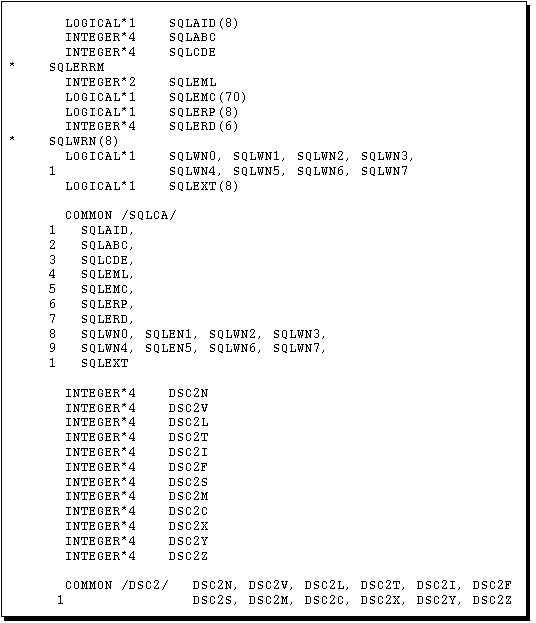
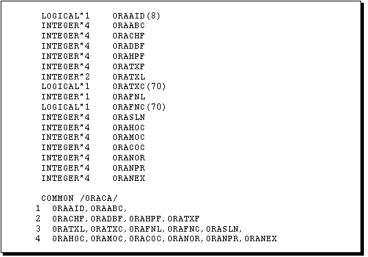

This chapter discusses error reporting and recovery as it applies to Pro\*FORTRAN. It supplements Chapter 8 of the [Programmer's Guide to the Oracle Precompilers](../zzpre/getting-acquainted.md).

You learn how to declare and use the SQLSTA status variable and the SQLCOD status variable, and how to include the SQL Communications Area (SQLCA). You also learn how to declare and enable the Oracle Communications Area (ORACA).

This chapter contains the following sections:

- Error Handling Alternatives

- About Using Status Variables when MODE={ANSI\|ANSI14}

- About Using the SQL Communications Area

- About Using the Oracle Communications Area

### 2.1 Error Handling Alternatives

The Pro\*FORTRAN Precompiler supports four status variables that serve as error handling mechanisms:

- SQLCOD

- SQLSTA

- SQLCA (using the WHENEVER statement)

- ORACA

The precompiler MODE option governs ANSI/ISO compliance. The availability of the SQLCOD, SQLSTA, and SQLCA variables depends on the MODE setting. You can declare and use the ORACA variable regardless of the MODE setting. For more information, see "About Using the Oracle Communications Area".

When MODE={ORACLE\|ANSI13}, you must declare the SQLCA status variable. SQLCOD and SQLSTA declarations are accepted (not recommended) but are not recognized as status variables. For more information, see "About Using the SQL Communications Area".

When MODE={ANSI\|ANSI14}, you can use any one, two, or all three of the SQLCOD, SQLSTA, and SQLCA variables. To determine which variable (or variable combination) is best for your application, see "About Using Status Variables when MODE={ANSI\|ANSI14}".

#### 2.1.1 SQLCOD and SQLSTA

SQLCOD stores error codes and the "not found" condition. It is retained only for compatibility with SQL-89 and has been removed in SQL:1999 and subsequent versions of the standard.

Unlike SQLCOD, SQLSTA stores error and warning codes and uses a standardized coding scheme. After executing a SQL statement, the Oracle server returns a status code to the SQLSTA variable currently in scope. The status code indicates whether a SQL statement executed successfully or raised an exception (error or warning condition). To promote interoperability (the ability of systems to exchange information easily), the SQL standard predefines all the common SQL exceptions.

#### 2.1.2 SQLCA

The SQLCA is a record-like, host-language data structure. Oracle updates the SQLCA after every executable SQL statement. (SQLCA values are undefined after a declarative statement.) By checking Oracle return codes stored in the SQLCA, your program can determine the outcome of a SQL statement. This can be done in two ways:

- implicit checking with the WHENEVER statement

- explicit checking of SQLCA variables

You can use WHENEVER statements, code explicit checks on SQLCA variables, or do both. Generally, using WHENEVER statements is preferable because it is easier, more portable, and ANSI-compliant.

#### 2.1.3 ORACA

When more information is needed about runtime errors than the SQLCA provides, you can use the ORACA, which contains cursor statistics, SQL statement data, option settings, and system statistics.

The ORACA is optional and can be declared regardless of the MODE setting. For more information about the ORACA status variable, see "About Using the Oracle Communications Area".

### 2.2 About Using Status Variables when MODE={ANSI\|ANSI14}

When MODE={ANSI\|ANSI14}, you must declare at least one -- you may declare two or all three -- of the following status variables:

- SQLCOD

- SQLSTA

- SQLCA

Your program can retrieve the outcome of the most recent executable SQL statement by checking SQLCOD or SQLSTA explicitly with your own code after checking executable SQL and PL/SQL statements. Your program can also check SQLCA implicitly (with the WHENEVER SQLERROR and WHENEVER SQLWARNING statements) or it can check the SQLCA variables explicitly.

**Note:**

When MODE={ORACLE\|ANSI13}, you must declare the SQLCA status variable. For more information, see Using the SQL Communications Area.

#### 2.2.1 Some Historical Information

The treatment of status variables and variable combinations by the Oracle Pro\*FORTRAN Precompiler has evolved beginning with Release 1.5.

#### 2.2.2 Release 1.5

Pro\*FORTRAN Release 1.5 presumed that there was a status variable SQLCOD whether or not it was declared in a Declare Section; in fact, the precompiler never noted whether SQLCOD was declared or not -- it just presumed it was. SQLCA would be used as a status variable only if there was an INCLUDE of the SQLCA.

#### 2.2.3 Release 1.6

Beginning with Pro\*FORTRAN Release 1.6, the precompiler no longer presumes that there is a SQLCOD status variable and it is not required. The precompiler requires that at least one of SQLCA, SQLCOD, or SQLSTA be declared.

SQLCOD is recognized as a status variable if and only if at least one of the following criteria is satisfied:

- It is declared in a Declare Section with exactly the right datatype.

- The precompiler finds no other status variable.

If the precompiler finds a SQLSTA declaration (of exactly the right type of course) in a Declare Section or finds an INCLUDE of the SQLCA, it will not presume SQLCOD is declared.

#### 2.2.4 Release 1.7

Because Pro\*FORTRAN Release 1.5 allowed the SQLCOD variable to be declared outside of a Declare Section while also declaring SQLCA, Pro\*FORTRAN Release 1.6 and greater is presented with a compatibility problem. A new option, ASSUME_SQLCODE={YES\|NO} (default NO), was added to fix this in Release 1.6.7 and is documented as a new feature in Release 1.7.

When ASSUME_SQLCODE=YES, and when SQLSTA and/or SQLCA are declared as a status variables, the precompiler presumes SQLCOD is declared whether or not it is declared in a Declare Section or of the proper type. This causes Releases 1.6.7 and later to act like Release 1.5 in this regard. For information about the precompiler option ASSUME_SQLCODE, see [ASSUME_SQLCODE](../zzpre/running-Oracle-precompilers.md).

#### 2.2.5 About Declaring Status Variables

This section describes how to declare SQLCOD and SQLSTA. For information about declaring the SQLCA status variable, see "About Declaring the SQLCA".

#### 2.2.6 Declaring SQLCOD

SQLCOD must be declared as a 4-byte integer variable either inside or outside the Declare Section, In the following example, SQLCOD is declared outside the Declare Section:

    * Declare host and indicator variables.
     EXEC SQL BEGIN DECLARE SECTION
     ...
     EXEC SQL END DECLARE SECTION
    * Declare status variable.
     INTEGER*4 SQLCOD

If declared outside the Declare Section, SQLCOD is recognized as a status variable only if ASSUME_SQLCODE=YES. When MODE={ORACLE\|ANSI13\|ANSI14}, declarations of the SQLCOD variable are ignored.

Access to a local SQLCOD is limited by its scope within your program. After every SQL operation, Oracle returns a status code to the SQLCOD currently in scope. So, your program can learn the outcome of the most recent SQL operation by checking SQLCOD explicitly, or implicitly with the WHENEVER statement.

When you declare SQLCOD instead of the SQLCA in a particular compilation unit, the precompiler allocates an internal SQLCA for that unit. Your host program cannot access the internal SQLCA.

#### 2.2.7 Declaring SQLSTA

SQLSTA must be declared as a five-character alphanumeric string inside the Declare Section, as shown in the following example:

    EXEC SQL BEGIN DECLARE SECTION
     ...
     CHARACTER*5 SQLSTA
     ...
     EXEC SQL END DECLARE SECTION

When MODE={ORACLE\|ANSI13}, SQLSTA declarations are ignored. Declaring the SQLCA is optional.

#### 2.2.8 Status Variable Combinations

When MODE={ANSI\|ANSI14}, the behavior of the status variables depends on the following:

- which variables are declared

- declaration placement (inside or outside the Declare Section)

- ASSUME_SQLCODE setting

The following tables describe the resulting behavior of each status variable combination when ASSUME_SQLCODE=NO and when ASSUME_SQLCODE=YES, respectively.

| Declare Section (IN/OUT/ --) SQLCODE | Declare Section (IN/OUT/ --) SQLSTA | Declare Section (IN/OUT/ --) SQLCA | Behavior                                                                                                                       |
|:-------------------------------------|:------------------------------------|:-----------------------------------|:-------------------------------------------------------------------------------------------------------------------------------|
| OUT                                  | na                                  | na                                 | SQLCOD is declared and is presumed to be a status variable.                                                                    |
| OUT                                  | na                                  | OUT                                | SQLCA is declared as a status variable, and SQLCOD is declared but is not recognized as a status variable.                     |
| OUT                                  | na                                  | IN                                 | This status variable configuration is not supported.                                                                           |
| OUT                                  | OUT                                 | na                                 | SQLCOD is declared and is presumed to be a status variable, and SQLSTA is declared but is not recognized as a status variable. |
| OUT                                  | OUT                                 | OUT                                | SQLCA is declared as a status variable, and SQLCOD and SQLSTA are declared but are not recognized as status variables.         |
| OUT                                  | OUT                                 | IN                                 | This status variable configuration is not supported.                                                                           |
| OUT                                  | IN                                  | na                                 | SQLSTA is declared as a status variable, and SQLCOD is declared but is not recognized as a status variable.                    |
| OUT                                  | IN                                  | OUT                                | SQLSTA and SQLCA are declared as status variables, and SQLCOD is declared but is not recognized as a status variable.          |
| OUT                                  | IN                                  | IN                                 | This status variable configuration is not supported.                                                                           |
| IN                                   | na                                  | na                                 | SQLCOD is declared as a status variable.                                                                                       |
| IN                                   | na                                  | OUT                                | SQLCOD and SQLCA are declared as a status variables.                                                                           |
| IN                                   | na                                  | IN                                 | This status variable configuration is not supported.                                                                           |
| IN                                   | OUT                                 | na                                 | SQLCOD is declared as a status variable, and SQLSTA is declared but is not recognized as a status variable.                    |
| IN                                   | OUT                                 | OUT                                | SQLCOD and SQLCA are declared as a status variables, and SQLSTA is declared but is not recognized as a status variable.        |
| IN                                   | OUT                                 | IN                                 | This status variable configuration is not supported.                                                                           |
| IN                                   | IN                                  | na                                 | SQLCOD and SQLSTA are declared as a status variables.                                                                          |
| IN                                   | IN                                  | OUT                                | SQLCOD, SQLSTA, and SQLCA are declared as a status variables.                                                                  |
| IN                                   | IN                                  | IN                                 | This status variable configuration is not supported.                                                                           |
| na                                   | na                                  | na                                 | This status variable configuration is not supported.                                                                           |
| na                                   | na                                  | OUT                                | SQLCA is declared as a status variable.                                                                                        |
| na                                   | na                                  | IN                                 | This status variable configuration is not supported.                                                                           |
| na                                   | OUT                                 | na                                 | This status variable configuration is not supported.                                                                           |
| na                                   | OUT                                 | OUT                                | SQLCA is declared as a status variable, and SQLSTA is declared but is not recognized as a status variable.                     |
| na                                   | OUT                                 | IN                                 | This status variable configuration is not supported.                                                                           |
| na                                   | IN                                  | na                                 | SQLSTA is declared as a status variable.                                                                                       |
| na                                   | IN                                  | OUT                                | SQLSTA and SQLCA are declared as status variables.                                                                             |
| na                                   | IN                                  | IN                                 | This status variable configuration is not supported.                                                                           |

| Declare Section (IN/OUT/ --) SQLCODE | Declare Section (IN/OUT/ --) SQLSTA | Declare Section (IN/OUT/ --) SQLCA | Behavior                                                                                                                                                              |
|:-------------------------------------|:------------------------------------|:-----------------------------------|:----------------------------------------------------------------------------------------------------------------------------------------------------------------------|
| OUT                                  | na                                  | na                                 | SQLCODE is declared and is presumed to be a status variable.                                                                                                          |
| OUT                                  | na                                  | OUT                                | SQLCA is declared as a status variable, and SQLCODE is declared and is presumed to be a status variable.                                                              |
| OUT                                  | na                                  | IN                                 | This status variable configuration is not supported.                                                                                                                  |
| OUT                                  | OUT                                 | na                                 | SQLCODE is declared and is presumed to be a status variable, and SQLSTA is declared but is not recognized as a status variable.                                       |
| OUT                                  | OUT                                 | OUT                                | SQLCA is declared as a status variable, SQLCODE is declared and is presumed to be a status variable, and SQLSTA is declared but is not recognized as status variable. |
| OUT                                  | OUT                                 | IN                                 | This status variable configuration is not supported.                                                                                                                  |
| OUT                                  | IN                                  | na                                 | SQLSTA is declared as a status variable, and SQLCODE is declared and is presumed to be a status variable.                                                             |
| OUT                                  | IN                                  | OUT                                | SQLSTA and SQLCA are declared as status variables, and SQLCODE is declared and is presumed to be a status variable.                                                   |
| OUT                                  | IN                                  | IN                                 | This status variable configuration is not supported.                                                                                                                  |
| IN                                   | na                                  | na                                 | SQLCODE is declared as a status variable.                                                                                                                             |
| IN                                   | na                                  | OUT                                | SQLCODE and SQLCA are declared as a status variables.                                                                                                                 |
| IN                                   | na                                  | IN                                 | This status variable configuration is not supported.                                                                                                                  |
| IN                                   | OUT                                 | na                                 | SQLCODE is declared as a status variable, and SQLSTA is declared but not as a status variable.                                                                        |
| IN                                   | OUT                                 | OUT                                | SQLCODE and SQLCA are declared as a status variables, and SQLSTA is declared but is not recognized as a status variable.                                              |
| IN                                   | OUT                                 | IN                                 | This status variable configuration is not supported.                                                                                                                  |
| IN                                   | IN                                  | na                                 | SQLCODE and SQLSTA are declared as a status variables.                                                                                                                |
| IN                                   | IN                                  | OUT                                | SQLCODE, SQLSTA, and SQLCA are declared as a status variables.                                                                                                        |
| IN                                   | IN                                  | IN                                 | This status variable configuration is not supported.                                                                                                                  |
| na                                   | na                                  | na                                 | This status variable configuration is not supported. SQLCODE must be declared either inside or outside the Declare Section when ASSUME_SQLCODE=YES.                   |
| na                                   | na                                  | OUT                                | This status variable configuration is not supported. SQLCODE must be declared either inside or outside the Declare Section when ASSUME_SQLCODE=YES.                   |
| na                                   | na                                  | IN                                 | This status variable configuration is not supported. SQLCODE must be declared either inside or outside the Declare Section when ASSUME_SQLCODE=YES.                   |
| na                                   | OUT                                 | na                                 | This status variable configuration is not supported. SQLCODE must be declared either inside or outside the Declare Section when ASSUME_SQLCODE=YES.                   |
| na                                   | OUT                                 | OUT                                | This status variable configuration is not supported. SQLCODE must be declared either inside or outside the Declare Section when ASSUME_SQLCODE=YES.                   |
| na                                   | OUT                                 | IN                                 | This status variable configuration is not supported. SQLCODE must be declared either inside or outside the Declare Section when ASSUME_SQLCODE=YES.                   |
| na                                   | IN                                  | na                                 | This status variable configuration is not supported. SQLCODE must be declared either inside or outside the Declare Section when ASSUME_SQLCODE=YES.                   |
| na                                   | IN                                  | OUT                                | This status variable configuration is not supported. SQLCODE must be declared either inside or outside the Declare Section when ASSUME_SQLCODE=YES.                   |
| na                                   | IN                                  | IN                                 | This status variable configuration is not supported. SQLCODE must be declared either inside or outside the Declare Section when ASSUME_SQLCODE=YES.                   |

### 2.3 About Using the SQL Communications Area

Oracle uses the SQL Communications Area (SQLCA) to store status information passed to your program at run time. The SQLCA is a record-like, FORTRAN data structure that is updated after each executable SQL statement, so it always reflects the outcome of the most recent SQL operation. To determine that outcome, you can check variables in the SQLCA explicitly with your own FORTRAN code or implicitly with the WHENEVER statement.

When MODE={ORACLE\|ANSI13}, the SQLCA is required; if the SQLCA is not declared, compile-time errors will occur. The SQLCA is optional when MODE={ANSI\|ANSI14}, but you cannot use the WHENEVER SQLWARNING statement without the SQLCA. So, if you want to use the WHENEVER SQLWARNING statement, you must declare the SQLCA.

When MODE={ANSI\|ANSI14}, you must declare either SQLSTA (see "Declaring SQLSTA") or SQLCOD (see "Declaring SQLCOD") or both. The SQLSTA status variable supports the SQLSTA status variable specified by the SQL standard. You can use the SQLSTA status variable with or without SQLCOD. For more information see [Error Handling and Diagnostics](../zzpre/error-handling-diagnostics.md).

#### 2.3.1 What's in the SQLCA?

The SQLCA contains runtime information about the execution of SQL statements, such as Oracle error codes, warning flags, event information, rows-processed count, and diagnostics.

Figure 2-1 shows all the variables in the SQLCA. However, SQLWN2, SQLWN5, SQLWN6, SQLWN7, and SQLEXT are not currently in use.

Figure 2-1 SQLCA Variable Declarations for Pro\*FORTRAN

[Description of "Figure 2-1 SQLCA Variable Declarations for Pro\*FORTRAN"](img_text/image002.md)

To ensure portability, LOGICAL variables are used in the SQLCA instead of CHARACTER variables. For a full description of the SQLCA, its fields, and the values its fields can store, see [Error Handling and Diagnostics](../zzpre/error-handling-diagnostics.md).

#### 2.3.2 About Declaring the SQLCA

To declare the SQLCA, simply include it (using an EXEC SQL INCLUDE statement) in your Pro\*FORTRAN source file outside the Declare Section as follows:

    * Include the SQL Communications Area (SQLCA).
     EXEC SQL INCLUDE SQLCA

Because it is a COMMON block, the SQLCA must be declared outside the Declare Section. Furthermore, the SQLCA must come before the CONNECT statement and the first executable FORTRAN statement.

You must declare the SQLCA in each subroutine and function that contains SQL statements. Every time a SQL statement in one of the subroutines or functions is executed, Oracle updates the SQLCA held in the COMMON block.

Ordinarily, only the order and datatypes of variables in a COMMON-list matter, not their names. However, you cannot rename the SQLCA variables because the precompiler generates code that refers to them. Thus, all declarations of the SQLCA must be identical.

When you precompile your program, the INCLUDE SQLCA statement is replaced by several variable declarations that allow Oracle to communicate with the program.

#### 2.3.3 Key Components of Error Reporting

The key components of Pro\*FORTRAN error reporting depend on several fields in the SQLCA.

#### 2.3.4 Status Codes

Every executable SQL statement returns a status code in the SQLCA variable SQLCDE, which you can check implicitly with WHENEVER SQLERROR or explicitly with your own FORTRAN code.

#### 2.3.5 Warning Flags

Warning flags are returned in the SQLCA variables SQLWN0 through SQLWN7, which you can check with WHENEVER SQLWARNING or with your own FORTRAN code. These warning flags are useful for detecting runtime conditions that are not considered errors by Oracle.

#### 2.3.6 Rows-Processed Count

The number of rows processed by the most recently executed SQL statement is recorded in the SQLCA variable SQLERD(3). For repeated FETCHes on an OPEN cursor, SQLERD(3) keeps a running total of the number of rows fetched.

#### 2.3.7 Parse Error Offset

Before executing a SQL statement, Oracle must parse it; that is, examine it to make sure it follows syntax rules and refers to valid database objects. If Oracle finds an error, an offset is stored in the SQLCA variable SQLERD(5), which you can check explicitly. The offset specifies the character position in the SQL statement at which the parse error begins. The first character occupies position zero. For example, if the offset is 9, the parse error begins at the tenth character.

If your SQL statement does not cause a parse error, Oracle sets SQLERD(5) to zero. Oracle also sets SQLERD(5) to zero if a parse error begins at the first character, which occupies position zero. So, check SQLERD(5) only if SQLCDE is negative, which means that an error has occurred.

#### 2.3.8 Error Message Text

The error code and message for Oracle errors are available in the SQLCA variable SQLEMC. For example, you might place the following statements in an error-handling routine:

    Handle SQL execution errors.
     WRITE (*, 10000) SQLEMC
    10000 FORMAT (1X, 70A1)
     EXEC SQL WHENEVER SQLERROR CONTINUE
     EXEC SQL ROLLBACK WORK RELEASE
     ...

At most, the first 70 characters of message text are stored. For messages longer than 70 characters, you must call the SQLGLM function, which is discussed next.

#### 2.3.9 About Getting the Full Text of Error Messages

The SQLCA can accommodate error messages of up to 70 characters in length. To get the full text of longer (or nested) error messages, you need the SQLGLM function. If connected to Oracle, you can call SQLGLM using the syntax

    CALL SQLGLM (MSGBUF, BUFLEN, MSGLEN)

where:

    MSGBUF

Is the buffer in which you want Oracle to store the error message. Oracle blank-pads to the end of this buffer.

    BUFLEN

Is an integer variable that specifies the maximum length of MSGBUF in bytes.

    MSGLEN

Is an integer variable in which Oracle stores the actual length of the error message.

The maximum length of an Oracle error message is 512 characters including the error code, nested messages, and message inserts such as table and column names. The maximum length of an error message returned by SQLGLM depends on the value you specify for BUFLEN. In the following example, you use SQLGLM to get an error message of up to 200 characters in length:

    * Declare variables for function call.
     LOGICAL*1 MSGBUF(200)
     INTEGER*4 BUFLEN
     INTEGER*4 MSGLEN
     DATA BUFLEN /200/
     EXEC SQL WHENEVER SQLERROR GO TO 9000
     ...
    * Handle SQL execution errors.
     9000 WRITE (*,9100)
     9100 FORMAT (1X, ' >>> Oracle error detected', /)
    * Get and display the full text of the error message.
     CALL SQLGLM (MSGBUF, BUFLEN, MSGLEN)
     WRITE (*, 9200) (MSGBUF(J), J = 1, MSGLEN)
     9200 FORMAT (1X, 200A1, /)
     ...

In the example, SQLGLM is called only when a SQL error has occurred. Always make sure SQLCOD is negative before calling SQLGLM. If you call SQLGLM when SQLCOD is zero, you get the message text associated with a prior SQL statement.

#### 2.3.10 About Using the WHENEVER Statement

By default, the Pro\*FORTRAN Precompiler ignores Oracle error and warning conditions and continues processing (if possible). To do automatic condition checking and error handling, you need the WHENEVER statement.

With the WHENEVER statement you can specify actions to be taken when Oracle detects an error, warning condition, or "not found" condition. These actions include continuing with the next statement, calling a subroutine, branching to a labeled statement, or stopping.

Code the WHENEVER statement using the following syntax:

    EXEC SQL WHENEVER <condition> <action>

You can have Oracle automatically check the SQLCA for any of the following conditions, which are described in [Error Handling and Diagnostics](../zzpre/error-handling-diagnostics.md):

- SQLWARNING

- SQLERROR

- NOT FOUND

When Oracle detects one of the preceding conditions, you can have your program take any of the following actions:

- CONTINUE

- DO subroutine_call

- GOTO statement_label

- STOP

When using the WHENEVER ... DO statement, the usual rules for entering and exiting a subroutine apply. However, passing parameters to the subroutine is not allowed. Furthermore, the subroutine must not return a value.

In the following example, WHENEVER SQLERROR DO statements are used to handle specific errors:

    EXEC SQL WHENEVER SQLERROR DO CALL INSERR
     EXEC SQL INSERT INTO EMP (EMPNO, ENAME, DEPTNO)
     VALUES (:MYEMPNO, :MYENAME, :MYDEPTNO)
     EXEC SQL WHENEVER SQLERROR DO CALL DELERR
     EXEC SQL DELETE FROM DEPT
     WHERE DEPTNO = :MYDEPTNO
     ...
    * Error-handling subroutines
     SUBROUTINE INSERR
    * Check for "duplicate key value" Oracle error.
     IF (SQLCDE .EQ. -1) THEN
     ...
    * Check for "value too large" Oracle error.
     ELSE IF (SQLCDE .EQ. -1401) THEN
     ...
     ELSE
     ...
     END IF
     ...
     SUBROUTINE DELERR
    * Check for the number of rows processed.
     IF (SQLERD(3) .EQ. 0) THEN
     ...
     ELSE
     ...
     END IF
     ...

Notice how the subroutines check variables in the SQLCA to determine a course of action. For more information about the WHENEVER conditions and actions, see [Error Handling and Diagnostics](../zzpre/error-handling-diagnostics.md).

#### 2.3.11 Scope

Because WHENEVER is a declarative statement, its scope is positional, not logical. It tests all executable SQL statements that follow it in the source file, not in the flow of program logic. So, code the WHENEVER statement before the first executable SQL statement you want to test.

A WHENEVER statement stays in effect until superseded by another WHENEVER statement checking for the same condition.

**Tip:**

You might want to place WHENEVER statements at the beginning of each program unit that contains SQL statements. That way, SQL statements in one program unit will not reference WHENEVER actions in another program unit, causing errors at compile or run time.

#### 2.3.12 Careless Usage: Examples

Careless use of the WHENEVER statement can cause problems. For example, the following code enters an infinite loop if the DELETE statement sets the NOT FOUND condition, because no rows meet the search condition:

    * Improper use of WHENEVER
     EXEC SQL WHENEVER NOT FOUND GOTO 7000
     6000 EXEC SQL FETCH EMPCUR INTO :MYENAME, :MYSAL
     ...
     GOTO 6000
     7000 EXEC SQL DELETE FROM EMP WHERE EMPNO = :MYEMPNO
     ...

In the next example, you handle the NOT FOUND condition properly by resetting the GOTO target:

    * Proper use of WHENEVER
     EXEC SQL WHENEVER NOT FOUND GOTO 7000
     6000 EXEC SQL FETCH EMPCUR INTO :MYENAME, :MYSAL
     ...
     GOTO 6000
     7000 EXEC SQL WHENEVER NOT FOUND GOTO 8000
     EXEC SQL DELETE FROM EMP WHERE EMPNO = :MYEMPNO
     ...
     8000 CONTINUE

Verify that all SQL statements governed by a WHENEVER ... GOTO statement can branch to the GOTO label. The following code results in a compilation error because the label 5000 in subroutine DELROW is not within the scope of the INSERT statement in subroutine INSROW:

    SUBROUTINE DELROW
     ...
     EXEC SQL WHENEVER SQLERROR GOTO 5000
     EXEC SQL DELETE FROM EMP WHERE DEPTNO = :MYDEPTNO
     ...
     5000 WRITE (*, 10000) SQLEMC
    10000 FORMAT (1X, 70A1)
     RETURN
     END
     SUBROUTINE INSROW
     ...
     EXEC SQL INSERT INTO EMP (EMPNO, ENAME, DEPTNO)
     VALUES (:MYEMPNO, :MYENAME, :MYDEPTNO)
     ...

### 2.4 About Using the Oracle Communications Area

The SQLCA handles standard SQL communications. The Oracle Communications Area (ORACA) is a similar structure that you can include in your program to handle Oracle-specific communications. When you need more runtime information than the SQLCA provides, use the ORACA.

Besides helping you to diagnose problems, the ORACA lets you monitor your program's use of Oracle resources such as the SQL Statement Executor and the cursor cache, an area of memory reserved for cursor management.

#### 2.4.1 What's in the ORACA?

The ORACA contains option settings, system statistics, and extended diagnostics. Figure 2-2 shows all the variables in the ORACA.

Figure 2-2 ORACA Variable Declarations for Pro\*FORTRAN

[Description of "Figure 2-2 ORACA Variable Declarations for Pro\*FORTRAN"](img_text/image003.md)

To ensure portability, LOGICAL variables are used in the ORACA instead of CHARACTER variables. For a full description of the ORACA, its fields, and the values its fields can store, see Chapter 8 of the [Programmer's Guide to the Oracle Precompilers](../zzpre/getting-acquainted.md).

#### 2.4.2 About Declaring the ORACA

To declare the ORACA, simply include it (using an EXEC SQL INCLUDE statement) in your Pro\*FORTRAN source file outside the Declare Section as follows:

    * Include the Oracle Communications Area (ORACA).
     EXEC SQL INCLUDE ORACA

Because it is a COMMON block, the ORACA must be declared outside the Declare Section. Furthermore, the ORACA must come before the CONNECT statement and the first executable FORTRAN statement.

You can redeclare the ORACA in any subroutine or function that contains SQL statements. Every time a SQL statement in the subroutine or function is executed, Oracle updates the ORACA held in COMMON.

Ordinarily, only the order and datatypes of variables in a COMMON-list matter, not their names. However, you cannot rename the ORACA variables because the precompiler generates code that refers to them. Thus, all declarations of the ORACA must be identical.

#### 2.4.3 About Enabling the ORACA

To enable the ORACA, you must set the ORACA precompiler option to YES on the command line or in a configuration file with

    ORACA=YES

or inline with

    * Enable the ORACA.
     EXEC ORACLE OPTION (ORACA=YES)

Then, you must choose appropriate runtime options by setting flags in the ORACA. Enabling the ORACA is optional because it adds to runtime overhead. The default setting is ORACA=NO.
