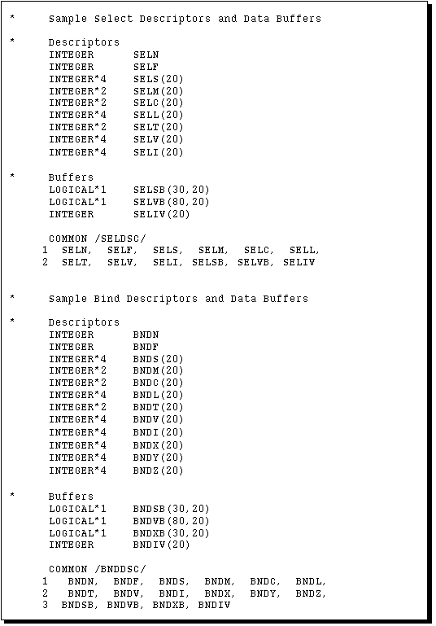
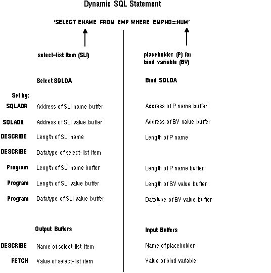
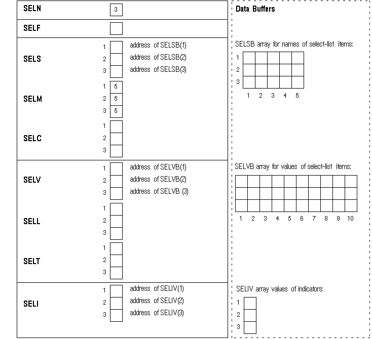
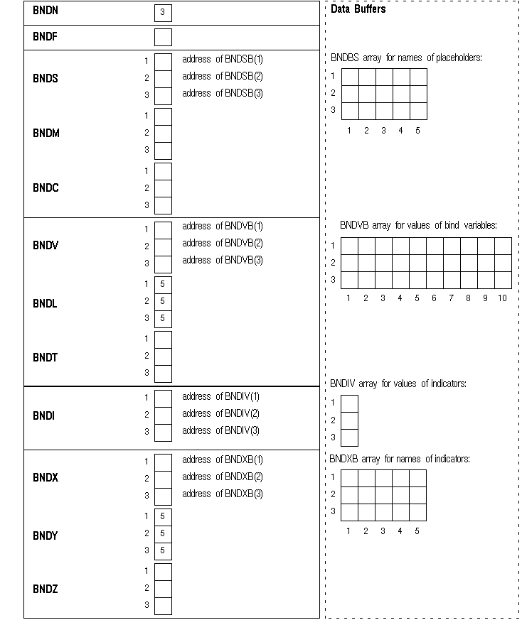
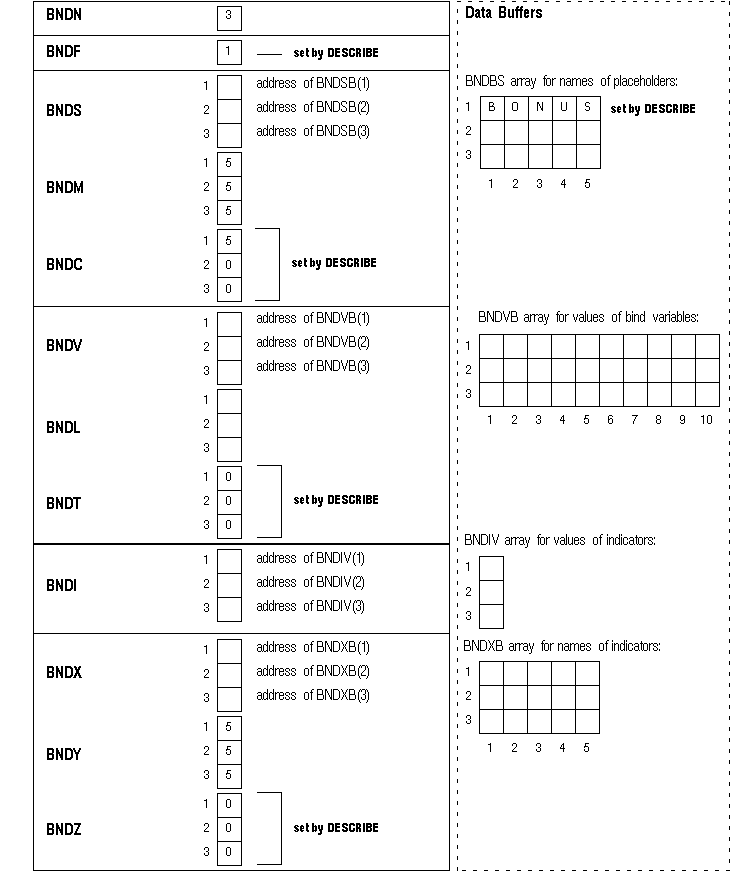
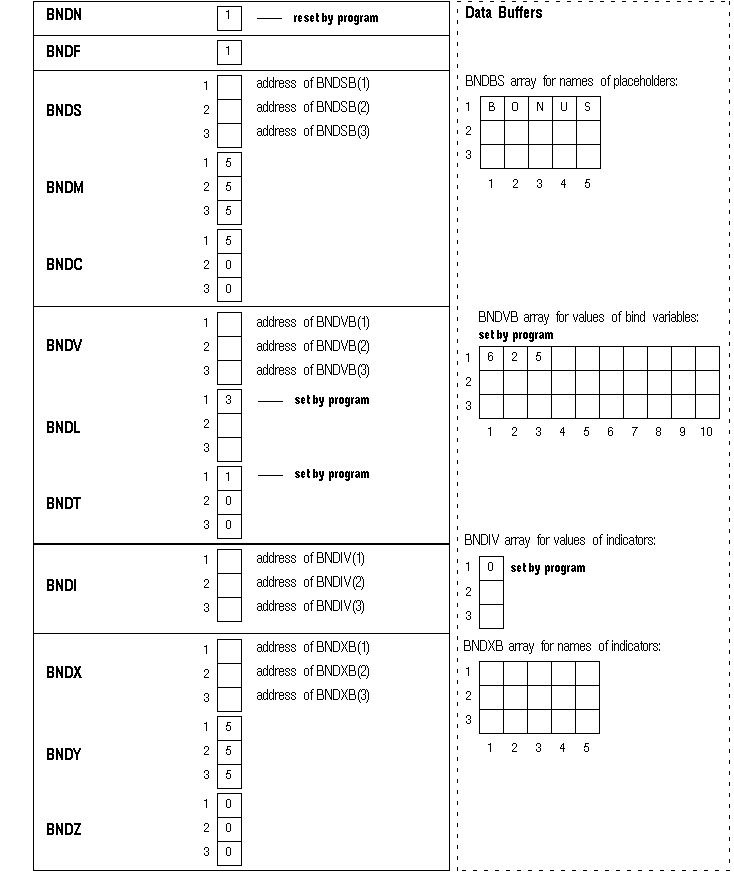
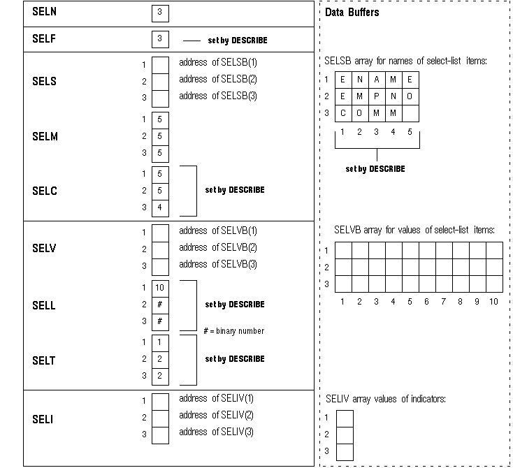
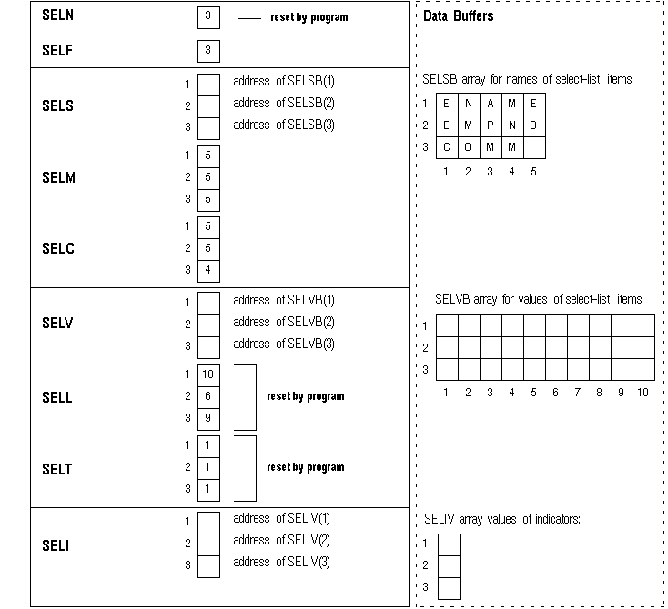
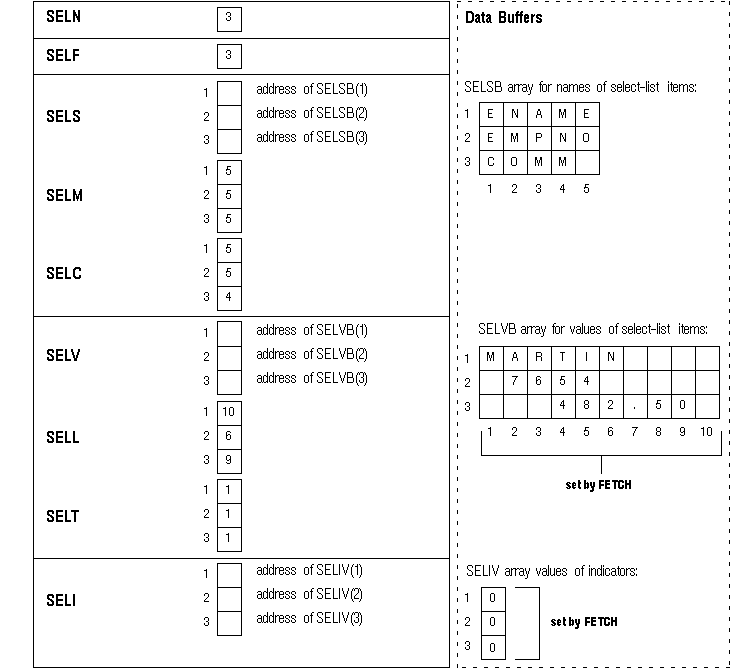

This chapter shows you how to implement dynamic SQL Method 4, which lets your program accept or build dynamic SQL statements that contain a varying number of host variables.

**Note:**

For a discussion of dynamic SQL Methods 1, 2, and 3, and an overview of Method 4, see [Using Dynamic SQL](../zzpre/using-dynamic-SQL.md).

This chapter contains the following sections:

- Meeting the Special Requirements of Method 4

- Understanding the SQL Descriptor Area (SQLDA)

- About Using the SQLDA Variables and Arrays

- Some Preliminaries

- The Basic Steps

- A Closer Look at Each Step

- Using Host Arrays with Method 4

- Sample Program 10: Dynamic SQL Method 4

### 4.1 Meeting the Special Requirements of Method 4

Before looking into the requirements of Method 4, you should feel comfortable with the terms select-list item and placeholder. Select-list items are the columns or expressions following the keyword SELECT in a query. For example, the following dynamic query contains three select-list items:

    SELECT ENAME, JOB, SAL + COMM FROM EMP WHERE DEPTNO = 20

Placeholders are dummy bind (input) variables that hold places in a SQL statement for actual bind variables. You do not declare placeholders and can name them anything you like. Placeholders for bind variables are most often used in the SET, VALUES, and WHERE clauses. For example, the following dynamic SQL statements each contain two placeholders:

    INSERT INTO EMP (EMPNO, DEPTNO) VALUES (:E, :D)
    DELETE FROM DEPT WHERE DEPTNO = :DNUM AND LOC = :DLOC

**Note:**

Placeholders cannot reference table or column names.

#### 4.1.1 What Makes Method 4 Special?

Unlike Methods 1, 2, and 3, dynamic SQL Method 4 lets your program

- accept or build dynamic SQL statements that contain an unknown number of select-list items or placeholders

- take explicit control over datatype conversion between Oracle and FORTRAN types

To add this flexibility to your program, you must give the Oracle runtime library additional information.

#### 4.1.2 What Information Does Oracle Need?

The Pro\*FORTRAN Precompiler generates calls to Oracle for all executable dynamic SQL statements. If a dynamic SQL statement contains no select-list items or placeholders, Oracle needs no additional information to execute the statement. The following DELETE statement falls into this category:

    * Dynamic SQL statement
     STMT = 'DELETE FROM EMP WHERE DEPTNO = 30'

However, most dynamic SQL statements contain select-list items or placeholders for bind variables, as shown in the following UPDATE statement:

    * Dynamic SQL statement with placeholders
     STMT = 'UPDATE EMP SET COMM = :C WHERE EMPNO = :E'

To execute a dynamic SQL statement that contains select-list items and/or placeholders for bind variables, Oracle needs information about the program variables that will hold output or input values. Specifically, Oracle needs the following information:

- the number of select-list items and the number of bind variables

- the length of each select-list item and bind variable

- the datatype of each select-list item and bind variable

- the memory address of each output variable that will store the value of a select-list item, and the address of each bind variable

For example, to write the value of a select-list item, Oracle needs the address of the corresponding output variable.

#### 4.1.3 Where Is the Information Stored?

All the information Oracle needs about select-list items or placeholders for bind variables, except their values, is stored in a program data structure called the SQL Descriptor Area (SQLDA).

Descriptions of select-list items are stored in a select SQLDA, and descriptions of placeholders for bind variables are stored in a bind SQLDA.

The values of select-list items are stored in output buffers; the values of bind variables are stored in input buffers. You use the library routine SQLADR to store the addresses of these data buffers in a select or bind SQLDA, so that Oracle knows where to write output values and read input values.

How do values get stored in these data buffers? Output values are FETCHed using a cursor, and input values are filled in by your program, typically from information entered interactively by the user.

#### 4.1.4 How Is the Information Obtained?

You use the DESCRIBE statement to help get the information Oracle needs. The DESCRIBE SELECT LIST statement examines each select-list item to determine its name, datatype, constraints, length, scale, and precision, then stores this information in the select SQLDA for your use. For example, you might use select-list names as column headings in a printout. DESCRIBE also stores the total number of select-list items in the SQLDA.

The DESCRIBE BIND VARIABLES statement examines each placeholder to determine its name and length, then stores this information in an input buffer and bind SQLDA for your use. For example, you might use placeholder names to prompt the user for the values of bind variables.

### 4.2 Understanding the SQL Descriptor Area (SQLDA)

This section describes the SQLDA data structure in detail. You learn how to declare it, what variables it contains, how to initialize them, and how to use them in your program.

#### 4.2.1 Purpose of the SQLDA

Method 4 is required for dynamic SQL statements that contain an unknown number of select-list items or placeholders for bind variables. To process this kind of dynamic SQL statement, your program must explicitly declare SQLDAs, also called descriptors (not to be confused with the CHARACTER variable descriptors generated by some FORTRAN compilers). Each descriptor is a named COMMON block, which you must copy or hard code into your program.

A select descriptor holds descriptions of select-list items and the addresses of output buffers where the names and values of select-list items are stored.

**Note:**

The name of a select-list item can be a column name, a column alias, or the text of an expression such as SAL + COMM.

A bind descriptor holds descriptions of bind variables and indicator variables and the addresses of input buffers where the names and values of bind variables and indicator variables are stored.

Remember, some descriptor variables contain addresses, not values. So, you must declare data buffers to hold the values. You decide the sizes of the required input and output buffers. Because FORTRAN does not support pointers, you must use the library subroutine SQLADR to get the addresses of input and output buffers. You learn how to call SQLADR in the section "About Using SQLADR".

#### 4.2.2 Multiple SQLDAs

If your program has more than one active dynamic SQL statement, each statement must have its own SQLDA(s). You can declare any number of SQLDAs with different names. For example, you might declare three select SQLDAs named SEL1, SEL2, and SEL3, so that you can FETCH from three concurrently open cursors. However, non-concurrent cursors can reuse SQLDAs.

#### 4.2.3 Naming Conventions

You can name select and bind descriptors anything you like. Typically, the names SEL and BND are used. The precompiler references descriptor variables by appending single-character suffixes to the descriptor name (see Table 4 - 1). You use the descriptor name in the DESCRIBE, OPEN, and FETCH statements.

For example, the statement

    * Open a cursor.
     EXEC SQL OPEN CUR1 USING DESCRIPTOR BND
    * Fetch select-list values.
     EXEC SQL FETCH CUR1 USING DESCRIPTOR SEL

fetches select-list values into output data buffers.

You decide the names and sizes of the required data buffers. The variable and buffer names shown in the following tables, respectively, are used in the following discussion. For example, the elements of descriptor array SELS address the elements of data buffer array SELSB.

| Suffix | Host Datatype     | Description                                         |
|:-------|:------------------|:----------------------------------------------------|
| N      | INTEGER var       | maximum number of select-list items or placeholders |
| F      | INTEGER var       | actual number of select-list items or placeholders  |
| S      | INTEGER\*4 var(n) | addresses of select-list or placeholder names       |
| M      | INTEGER\*2 var(n) | maximum lengths of select-list or placeholder names |
| C      | INTEGER\*2 var(n) | actual lengths of select-list or placeholder names  |
| L      | INTEGER\*4 var(n) | lengths of select-list or bind-variable values      |
| T      | INTEGER\*2 var(n) | datatypes of select-list or bind-variable values    |
| V      | INTEGER\*4 var(n) | addresses of select-list or bind-variable values    |
| I      | INTEGER\*4 var(n) | addresses of indicator-variable values (1)          |
| X (2)  | INTEGER\*4 var(n) | addresses of indicator-variable names (1)           |
| Y (2)  | INTEGER\*2 var(n) | maximum lengths of indicator-variable names (1)     |
| Z (2)  | INTEGER\*2 var(n) | actual lengths of indicator-variable names (1)      |

**Note:**

1\. Indicator-variable names apply only in a bind SQLDA.

2\. These suffixes apply only to bind variables.

| Buffer | Host Datatype       | Description               |
|:-------|:--------------------|:--------------------------|
| SELSB  | LOGICAL\*1 var(m,n) | select-list names         |
| SELVB  | LOGICAL\*1 var(m,n) | select-list names         |
| SELIV  | INTEGER\*2 var(n)   | indicator-variable values |
| BNDSB  | LOGICAL\*1 var(m,n) | placeholder names         |
| BNDVB  | LOGICAL\*1 var(m,n) | bind-variable values      |
| BNDXB  | LOGICAL\*1 var(m,n) | indicator-variable names  |
| BNDIV  | INTEGER\*2 var(n)   | indicator-variable names  |

**Note:**

There is no SELXB buffer because indicator-variable names cannot be associated with select-list items.

#### 4.2.4 About Declaring a SQLDA

To declare select and bind SQLDAs, you can hardcode them into your program using the sample SQLDA shown in Figure 4-1.

Figure 4-1 Sample Pro\*FORTRAN SQLDA Variables and Data Buffers

[Description of "Figure 4-1 Sample Pro\*FORTRAN SQLDA Variables and Data Buffers"](img_text/image004.md)

You can modify the array dimensions to suit your needs. The following example uses a parameter to specify array dimensions; which makes changing the dimensions easy:

    INTEGER SIZE
    * Set dimension of descriptor arrays.
     PARAMETER (SIZE = 25)
    * Declare select descriptor.
     INTEGER SELN
     INTEGER SELF
     INTEGER*4 SELV(SIZE)
     INTEGER*4 SELL(SIZE)
     ...

You might want to store the SQLDAs in files (named SELDSC and BNDDSC, for example), revise them as needed, then copy the files into your program with the INCLUDE statement as follows:

    * Declare select and bind SQLDAs.
     EXEC SQL INCLUDE SELDSC
     EXEC SQL INCLUDE BNDDSC

Because they are COMMON blocks, SQLDAs must be declared outside the Declare Section. How the data buffers are declared is up to you. You need not include them in the SQLDA COMMON blocks. For example, you might want to declare one large data buffer to store all names and values, then access them using byte offsets.

Figure 4-2 shows whether variables are set by SQLADR calls, DESCRIBE commands, FETCH commands, or program assignments.

Figure 4-2 How Variables Are Set

[Description of "Figure 4-2 How Variables Are Set"](img_text/image005.md)

### 4.3 About Using the SQLDA Variables and Arrays

This section explains the purpose and use of each SQLDA variable. In examples, the arbitrary SQLDA file names, descriptor names, and data buffer names given earlier are used.

#### 4.3.1 The N Variable

This variable specifies the maximum number of select-list items or placeholders that can be DESCRIBEd. For example, SELN determines the number of elements in the select descriptor arrays.

Before issuing a DESCRIBE command, you must set this variable to the dimension of the descriptor arrays. After the DESCRIBE, you must reset it to the actual number of variables DESCRIBEd, which is stored in the F variable.

#### 4.3.2 The F Variable

This is the actual number of select-list items or placeholders found by the DESCRIBE command.

The F variable is set by DESCRIBE. If the F variable is negative, the DESCRIBE command found too many select-list items or placeholders for the size of the descriptor. For example, if you set SELN to 10 but DESCRIBE finds 11 select-list items, SELF is set to -11. If this happens, you cannot process the SQL statement without reallocating the descriptor.

After the DESCRIBE command, you must set the N variable equal to the F variable.

#### 4.3.3 The S Array

This array contains the addresses of data buffers that store select-list or placeholder names as they appear in dynamic SQL statements.

You must set the elements of the S array using SQLADR before issuing the DESCRIBE command.

DESCRIBE directs Oracle to store the name of the Jth select-list item or placeholder in the buffer addressed by SELS(J) or BNDS(J). If the elements of SELS and BNDS address elements of data buffer arrays named SELSB and BNDSB, Oracle stores the Jth select-list or placeholder name in SELSB(J) or BNDSB(J).

#### 4.3.4 The M Array

This array contains the lengths of the data buffers that store select-list or placeholder names. The buffers are addressed by elements of the S array.

You must set the elements of the M array before issuing the DESCRIBE command. Each select-list or placeholder name buffer can have a different length.

#### 4.3.5 The C Array

This array contains the actual lengths of select-list or placeholder names. DESCRIBE sets the array of actual lengths to the number of characters in each select-list or placeholder name.

#### 4.3.6 The L Array

This array contains the lengths of select-list or bind-variable values stored in the data buffers.

#### 4.3.7 Select Descriptors

DESCRIBE sets the array of lengths to the maximum expected for each select-list item. However, you might want to reset some lengths before issuing a FETCH command. FETCH returns at most n characters, where n is the value of SELL(J) before the FETCH.

The format of the length differs among Oracle datatypes. For character select-list items, DESCRIBE sets SELL(J) to the maximum length in bytes of the select-list item. For NUMBER select-list items, scale and precision are returned respectively in the low and next-higher bytes of the variable. You can use the library subroutine SQLPRC to extract precision and scale values from SELL. See the section Extracting Precision and Scale.

You must reset SELL(J) to the required length of the data buffer before the FETCH. For example, when coercing a NUMBER to a FORTRAN CHARACTER string, set SELL(J) to the precision of the number plus two for the sign and decimal point. When coercing a NUMBER to a FORTRAN REAL, set SELL(J) to the length of REALs on your system. For more information about the lengths of coerced datatypes, see the section "Converting Data".

#### 4.3.8 Bind Descriptors

You must set the array of lengths before issuing the OPEN command.

Because Oracle accesses a data buffer indirectly, using the address in SELV(J) or BNDV(J), it does not know the length of the value in that buffer. If you want to change the length Oracle uses for the Jth select-list or bind-variable value, reset SELL(J) or BNDL(J) to the length you need. Each input or output buffer can have a different length.

#### 4.3.9 The T Array

This array contains the datatype codes of select-list or bind-variable values. These codes determine how Oracle data is converted when stored in the data buffers addressed by elements of SELV. This topic is covered in the section "Converting Data".

#### 4.3.10 Select Descriptors

DESCRIBE sets the array of datatype codes to the internal datatype (for example, VARCHAR2, CHAR, NUMBER, or DATE) of the items in the select list.

Before FETCHing, you might want to reset some datatypes because the internal format of Oracle datatypes can be difficult to handle. For display purposes, it is usually a good idea to coerce the datatype of select-list values to VARCHAR2. For calculations, you might want to coerce numbers from Oracle to FORTRAN format. See the section "Coercing Datatypes".

The high bit of SELT(J) is set to indicate the null/not null status of the Jth select-list column. You must always clear this bit before issuing an OPEN or FETCH command. You use the library subroutine SQLNUL to retrieve the datatype code and clear the null/not null bit. See the section "Handling Null/Not Null Datatypes".

You should change the Oracle NUMBER internal datatype to an external datatype compatible with that of the FORTRAN data buffer addressed by SELV(J).

#### 4.3.11 Bind Descriptors

DESCRIBE sets the array of datatype codes to zeros. You must reset the datatype code stored in each element before issuing the OPEN command. The code represents the external (FORTRAN) datatype of the data buffer addressed by BNDV(J). Often, bind-variable values are stored in character strings, so the datatype array elements are set to 1 (the VARCHAR2 datatype code).

To change the datatype of the Jth select-list or bind-variable value, reset SELT(J) or BNDT(J) to the datatype you want.

#### 4.3.12 The V Array

This array contains the addresses of data buffers that store select-list or bind-variable values. You must set the elements of the V array using SQLADR.

#### 4.3.13 Select Descriptors

You must set this array before issuing the FETCH command. The following statement

    * Fetch select-list values.
     EXEC SQL FETCH ... USING DESCRIPTOR SEL

directs Oracle to store FETCHed select-list values in the data buffers addressed by SELV(1) through SELV(SELN). If the elements of SELV address elements of a data buffer array named SELVB, Oracle stores the Jth select-list value in SELVB(J).

#### 4.3.14 Bind Descriptors

You must set this array before issuing the OPEN command. The following statement

    * Open cursor.
     EXEC SQL OPEN ... USING DESCRIPTOR BND

directs Oracle to execute the dynamic SQL statement using the bind-variable values addressed by BNDV(1) through BNDV(BNDN). If the elements of BNDV address elements of a data buffer array named BNDVB, Oracle finds the Jth bind-variable value in data buffer BNDVB(J).

#### 4.3.15 The I Array

This array contains the addresses of data buffers that store indicator-variable values.

You must set the elements of the I array using SQLADR.

#### 4.3.16 Select Descriptors

You must set this array before issuing the FETCH command. When Oracle executes the statement

    * Fetch select-list values.
     EXEC SQL FETCH ... USING DESCRIPTOR SEL

if the Jth returned select-list value is null, the buffer addressed by SELI(J) is set to -1. Otherwise, it is set to zero (the value is not null) or a positive integer (the value was truncated). For example, if the elements of SELI address elements of a data buffer array named SELIV, and the Jth returned select-list value is null, SELIV(J) is set to -1.

#### 4.3.17 Bind Descriptors

You must initialize this array and set the associated indicator variables before issuing the OPEN command. When Oracle executes the following statement

    * Open cursor.
     EXEC SQL OPEN ... USING DESCRIPTOR BND

the buffer addressed by BNDI(J) determines whether the Jth bind variable is a null. If the value of an indicator variable is -1, its associated host variable is null. For example, if the elements of BNDI address elements of a data buffer array named BNDIV, and the value of BNDIV(J) is -1, the value of the Jth bind variable is set to NULL.

#### 4.3.18 The X Array

This array contains the addresses of data buffers that store indicator-variable names. You can associate indicator-variable values with select-list items and bind variables. However, you can associate indicator-variable names only with bind variables. So, you can use the X array only with bind descriptors.

You must set the elements of the X array using SQLADR before issuing the DESCRIBE command.

DESCRIBE directs Oracle to store any indicator-variable names in the buffers addressed by BNDX(1) through BNDX(BNDN). If the elements of BNDX address elements of a data buffer array named BNDXB, Oracle stores the Jth indicator-variable name in BNDXB(J).

#### 4.3.19 The Y Array

This array contains the maximum lengths of the data buffers that store indicator-variable names. The buffers are addressed by elements of the X array. Like the X array, you can use the Y array only with bind descriptors.

You must set the elements BNDY(1) through BNDY(BNDN) before issuing the DESCRIBE command. Each indicator-variable name buffer can have a different length.

#### 4.3.20 The Z Array

This array contains the actual lengths of indicator-variable names. Like the X and Y arrays, you can use the Z array only with bind descriptors.

DESCRIBE sets the array of actual lengths to the number of characters in each indicator-variable name.

### 4.4 Some Preliminaries

You need a working knowledge of the following subjects to implement dynamic SQL Method 4:

- using the library subroutine SQLADR

- converting data

- coercing datatypes

- handling null/not null datatypes

#### 4.4.1 About Using SQLADR

You must call the library subroutine SQLADR to get the addresses of data buffers that store input and output values. You store the addresses in a select or bind SQLDA so that Oracle knows where to read bind-variable values or write select-list values.

Call SQLADR using the syntax

    CALL SQLADR (BUFF, ADDR)

where:

BUFF

Is a data buffer that stores the value or name of a select-list item, bind variable, or indicator variable.

ADDR

Is an integer variable that returns the address of the data buffer.

A call to SQLADR stores the address of BUFF in ADDR. In the following example, you use SQLADR to initialize the select descriptor arrays SELV, SELS, and SELI. Their elements address data buffers for select-list values, select-list names, and indicator values.

    * Initialize select descriptor arrays.
     DO 100 J = 1, SELN
     CALL SQLADR (SELVB(1, J), SELV(J))
     CALL SQLADR (SELSB(1, J), SELS(J))
     CALL SQLADR (SELIV(J), SELI(J))
    100 CONTINUE

#### 4.4.2 Restriction

You cannot use CHARACTER variables with SQLADR if your FORTRAN compiler generates descriptors for CHARACTER variables and passes the descriptor address (rather than the data address) to SQLADR. Check your FORTRAN compiler user's guide. In such cases, SQLADR gets the wrong address. Instead, use LOGICAL\*1 variables, because they always have simple addresses.

However, you can (cautiously) use SQLADR with CHARACTER variables if your compiler provides a built-in function to access the data address. For example, if your compiler provides a function named %REF, and X is a CHARACTER variable, you call SQLADR as follows:

    * Use %REF built-in function.
     CALL SQLADR (%REF(X), ...)

#### 4.4.3 Converting Data

This section provides more detail about the datatype descriptor array. In host programs that use neither datatype equivalencing nor dynamic SQL Method 4, the conversion between Oracle internal and external datatypes is determined at precompile time. By default, the precompiler assigns a specific external datatype to each host variable in the Declare Section. For example, the precompiler assigns the FLOAT external datatype to host variables of type REAL.

However, Method 4 lets you control data conversion and formatting. You specify conversions by setting datatype codes in the datatype descriptor array.

#### 4.4.4 Internal Datatypes

Internal datatypes specify the formats used by Oracle to store column values in database tables and the formats to represent pseudocolumn values.

When you issue a DESCRIBE SELECT LIST command, Oracle returns the internal datatype code for each select-list item to the SELT (datatype) descriptor array. For example, the datatype code for the Jth select-list item is returned to SELT(J).

The following table shows the Oracle internal datatypes and their codes.

| Oracle Internal Datatype | Code |
|:-------------------------|:-----|
| VARCHAR2                 | 1    |
| NUMBER                   | 2    |
| LONG                     | 8    |
| ROWID                    | 11   |
| DATE                     | 12   |
| RAW                      | 23   |
| LONG RAW                 | 24   |
| CHAR                     | 96   |
| MLSLABEL                 | 105  |

#### 4.4.5 External Datatypes

External datatypes specify the formats used to store values in input and output host variables.

The DESCRIBE BIND VARIABLES command sets the BNDT array of datatype codes to zeros. So, you must reset the codes before issuing the OPEN command. The codes tell Oracle which external datatypes to expect for the various bind variables. For the Jth bind variable, reset BNDT(J) to the external datatype you want.

The following table shows the Oracle external datatypes and their codes, as well as the corresponding FORTRAN datatypes:

| Name             | Code | FORTRAN Datatype               |
|:-----------------|:-----|:-------------------------------|
| VARCHAR2         | 1    | CHARACTER\*n when MODE != ANSI |
| NUMBER           | 2    | CHARACTER\*n                   |
| INTEGER          | 3    | INTEGER                        |
| FLOAT            | 4    | REAL                           |
| STRING (1)       | 5    | CHARACTER\*(n+1)               |
| VARNUM           | 6    | CHARACTER\*n                   |
| DECIMAL          | 7    | CHARACTER\*n                   |
| LONG             | 8    | CHARACTER\*n                   |
| VARCHAR (2)      | 9    | CHARACTER\*n                   |
| ROWID            | 11   | CHARACTER\*n                   |
| DATE             | 12   | CHARACTER\*n                   |
| VARRAW (2)       | 15   | CHARACTER\*n                   |
| RAW              | 23   | CHARACTER\*n                   |
| LONG RAW         | 24   | CHARACTER\*n                   |
| UNSIGNED         | 68   | INTEGER                        |
| DISPLAY          | 91   | CHARACTER\*n                   |
| LONG VARCHAR (2) | 94   | CHARACTER\*n                   |
| LONG VARRAW (2)  | 95   | CHARACTER\*n                   |
| CHARF            | 96   | CHARACTER\*n when MODE = ANSI  |
| CHARZ (1)        | 97   | CHARACTER\*(n+1)               |
| CURSOR           | 102  | SQLCURSOR                      |
| MLSLABEL         | 106  | CHARACTER\*n                   |

**Note:**

1\. For use in an EXEC SQL VAR statement only.

2\. Include the n-byte length field.

For more information about the Oracle datatypes and their formats, see [Meeting Program Requirements](../zzpre/meeting-program-requirements.md).

#### 4.4.6 PL/SQL Datatypes

PL/SQL provides a variety of predefined scalar and composite datatypes. A scalar type has no internal components. A composite type has internal components that can be manipulated individually. The following table shows the predefined PL/SQL scalar datatypes and their Oracle internal datatype equivalences.

| PL/SQL Datatype                                                                                             | Oracle Internal Datatype |
|:------------------------------------------------------------------------------------------------------------|:-------------------------|
| VARCHAR VARCHAR2                                                                                            | VARCHAR2                 |
| BINARY_INTEGER DEC DECIMAL DOUBLE PRECISION FLOAT INT INTEGER NATURAL NUMBER NUMERIC POSITIVE REAL SMALLINT | NUMBER                   |
| LONG                                                                                                        | LONG                     |
| ROWID                                                                                                       | ROWID                    |
| DATE                                                                                                        | DATE                     |
| RAW                                                                                                         | RAW                      |
| LONG RAW                                                                                                    | LONG RAW                 |
| CHAR CHARACTER STRING                                                                                       | CHAR                     |
| MLSLABEL                                                                                                    | MLSLABEL                 |

#### 4.4.7 Coercing Datatypes

For a select descriptor, DESCRIBE SELECT LIST can return any of the Oracle internal datatypes. Often, as in the case of character data, the internal datatype corresponds exactly to the external datatype you want to use. However, a few internal datatypes map to external datatypes that can be difficult to handle. So, you might want to reset some elements in the SELT descriptor array.

For example, you might want to reset NUMBER values to FLOAT values, which correspond to REAL values in FORTRAN. Oracle does any necessary conversion between internal and external datatypes at FETCH time. So, be sure to reset the datatypes after the DESCRIBE SELECT LIST but before the FETCH.

For a bind descriptor, DESCRIBE BIND VARIABLES does not return the datatypes of bind variables, only their number and names. Therefore, you must explicitly set the BNDT array of datatype codes to tell Oracle the external datatype of each bind variable. Oracle does any necessary conversion between external and internal datatypes at OPEN time.

When you reset datatype codes in the SELT or BNDT descriptor array, you are "coercing datatypes." For example, to coerce the Jth select-list value to VARCHAR2, use the following statement:

    * Coerce select-list value to VARCHAR2.
     SELT(J) = 1

When coercing a NUMBER select-list value to VARCHAR2 for display purposes, you must also extract the precision and scale bytes of the value and use them to compute a maximum display length. Then, before the FETCH, you must reset the appropriate element of the SELL (length) descriptor array to tell Oracle the buffer length to use. To specify the length of the Jth select-list value, set SELL(J) to the length you need.

For example, if DESCRIBE SELECT LIST finds that the Jth select-list item is of type NUMBER, and you want to store the returned value in a FORTRAN variable declared as REAL, simply set SELT(J) to 4 and SELL(J) to the length of REAL numbers on your system.

#### 4.4.8 Exceptions

In some cases, the internal datatypes that DESCRIBE SELECT LIST returns might not suit your purposes. Two examples of this are DATE and NUMBER. When you DESCRIBE a DATE select-list item, Oracle returns the datatype code 12 to the SELT array. Unless you reset the code before the FETCH, the date value is returned in its 7-byte internal format. To get the date in its default character format, you must change the datatype code from 12 to 1 (VARCHAR2), and increase the SELL value from 7 to 9.

Similarly, when you DESCRIBE a NUMBER select-list item, Oracle returns the datatype code 2 to the SELT array. Unless you reset the code before the FETCH, the numeric value is returned in its internal format, which is probably not what you want. So, change the code from 2 to 1 (VARCHAR2), 3 (INTEGER), 4 (FLOAT), or some other appropriate datatype.

#### 4.4.9 About Extracting Precision and Scale

The library subroutine SQLPRC extracts precision and scale. Normally, it is used after the DESCRIBE SELECT LIST, and its first argument is SELL(J). You call SQLPRC using the syntax

    CALL SQLPRC (LENGTH, PREC, SCALE)

where:

LENGTH

Is an integer variable that stores the length of an Oracle NUMBER value. The scale and precision of the value are stored in the low and next-higher bytes, respectively.

PREC

Is an integer variable that returns the precision of the NUMBER value. Precision is the number of significant digits. It is set to zero if the select-list item refers to a NUMBER of unspecified size. In this case, because the size is unspecified, you might want to assume the maximum precision, 38.

SCALE

Is an integer variable that returns the scale of the NUMBER value. Scale specifies where rounding will occur. For example, a scale of 2 means the value is rounded to the nearest hundredth (3.456 becomes 3.46); a scale of -3 means the number is rounded to the nearest thousand (3456 becomes 3000).

The following example shows how SQLPRC is used to compute maximum display lengths for NUMBER values that will be coerced to VARCHAR2:

    * Declare variables for function call.
     INTEGER PREC
     INTEGER SCALE
     EXEC SQL DESCRIBE SELECT LIST FOR S INTO SEL
     DO 1300 J = 1, SELN
     IF (SELT(J) .NE. 2) GOTO 1300
    * If datatype is NUMBER, extract precision and scale.
     CALL SQLPRC (SELL(J), PREC, SCALE)
    * If no precision was specified, assign a maximum.
     IF (PREC .NE. 0) GOTO 1100
     SELL(J) = 10
     GOTO 1300
     1100 CONTINUE
     SELL(J) = PREC
    * Allow for possible sign and decimal point.
     SELL(J) = SELL(J) + 2
     1300 CONTINUE
     ...

The SQLPRC subroutine returns zero as the precision and scale values for certain SQL datatypes. The SQLPR2 subroutine is similar to SQLPRC in that it has the same syntax and returns the same binary values, except for the datatypes shown in the following table.

| SQL Datatype     | Binary Precision      | Binary Scale |
|:-----------------|:----------------------|:-------------|
| FLOAT            | 126                   | -127         |
| FLOAT(n)         | n (range is 1 .. 126) | -127         |
| REAL             | 63                    | -127         |
| DOUBLE PRECISION | 126                   | -127         |

#### 4.4.10 About Handling Null/Not Null Datatypes

For every select-list column (not expression), DESCRIBE SELECT LIST returns a null/not null indication in the datatype array (SELT) of the select descriptor. If the Jth select-list column is constrained to be not null, the high-order bit of SELT(J) is clear; otherwise, it is set.

Before using the datatype in an OPEN or FETCH statement, if the null status bit is set, you must clear it. Never set the bit.

You can use the library subroutine SQLNUL to find out if a column allows nulls, and to clear the datatype's null status bit. You call SQLNUL using the syntax

    CALL SQLNUL (VALTYP, TYPCODE, NULSTAT)

where:

VALTYP

Is a 2-byte integer variable that stores the datatype code of a select-list column.

TYPCODE

Is a 2-byte integer variable that returns the datatype code of the select-list column with the high-order bit cleared.

NULSTAT

Is an integer variable that returns the null status of the select-list column. 1 means the column allows nulls; 0 means it does not.

The following example shows how to use SQLNUL:

    * Declare variable for subroutine call.
     INTEGER*2 DATYPE
     INTEGER NULLOK
     DO 1500 J = 1, SELN
    * Find out if column is NOT NULL, and
    * clear high-order bit.
     CALL SQLNUL (SELT(J), DATYPE, NULLOK)
     SELT(J) = DATYPE
    * If NULLOK equals 1, nulls are allowed.
     ...
     1500 CONTINUE
     ...

The first argument in the subroutine is the Jth element of the SELT datatype array before its null/not null bit is cleared. Though some systems let you use SELT(J) as the second argument too, it is poor programming practice to use the same variable as multiple arguments.

### 4.5 The Basic Steps

Method 4 can be used to process any dynamic SQL statement. In the example, a query is processed so that you can see how both input and output host variables are handled. Again, the arbitrary SQLDA file names, descriptor names, and data buffer names given earlier are used.

To process the dynamic query, our sample program performs the following:

1.  Declare a host string in the Declare Section to hold the query text.
2.  Declare select and bind descriptors.
3.  Set the maximum number of select-list items and placeholders that can be DESCRIBEd.
4.  Initialize the select and bind descriptors.
5.  Store the query text in the host string.
6.  PREPARE the query from the host string.
7.  DECLARE a cursor FOR the query.
8.  DESCRIBE the bind variables INTO the bind descriptor.
9.  Reset the number of placeholders to the number actually found by the DESCRIBE command.
10. Get values for the bind variables found by DESCRIBE.
11. OPEN the cursor USING the bind descriptor.
12. DESCRIBE the select list INTO the select descriptor.
13. Reset the number of select-list items to the number actually found by the DESCRIBE command.
14. Reset the length and datatype of each select-list item for display purposes.
15. FETCH a row from the database INTO data buffers using the select descriptor.
16. Process the select-list values returned by FETCH.
17. CLOSE the cursor when there are no more rows to FETCH.

**Note:**

If the dynamic SQL statement is not a query or contains a known number of select-list items or placeholders, then some of the steps are unnecessary.

### 4.6 A Closer Look at Each Step

This section discusses each step in more detail. Also, at the end of this chapter is a full-length program illustrating Method 4.

With Method 4, you use the following sequence of embedded SQL statements:

    EXEC SQL
     PREPARE <statement_name>
     FROM {:<host_string>|<string_literal>}
    EXEC SQL DECLARE <cursor_name> CURSOR FOR <statement_name>
    EXEC SQL
     DESCRIBE BIND VARIABLES FOR <statement_name>
     INTO <bind_descriptor_name>
    EXEC SQL
     OPEN <cursor_name>
     [USING DESCRIPTOR <bind_descriptor_name>]
    EXEC SQL
     DESCRIBE [SELECT LIST FOR] <statement_name>
     INTO <select_descriptor_name>
    EXEC SQL
     FETCH <cursor_name>
     USING DESCRIPTOR <select_descriptor_name>
    EXEC SQL CLOSE <cursor_name>

If the number of select-list items in a dynamic query is known, you can omit DESCRIBE SELECT LIST and use the following Method 3 FETCH statement:

    EXEC SQL FETCH <cursor_name> INTO <host_variable_list>

If the number of placeholders for bind variables in a dynamic SQL statement is known, you can omit DESCRIBE BIND VARIABLES and use the following Method 3 OPEN statement:

    EXEC SQL OPEN <cursor_name> [USING <host_variable_list>]

Next, you see how these statements allow your host program to accept and process a dynamic SQL statement using descriptors.

**Note:**

Several figures accompany the following discussion. To avoid cluttering the figures, it was necessary to confine descriptor arrays to 3 elements and to limit the maximum length of names and values to 5 and 10 characters, respectively.

#### 4.6.1 Declare a Host String

Your program needs a host variable to store the text of the dynamic SQL statement. The host variable (SELSTM in our example) must be declared as a character string.

    EXEC SQL BEGIN DECLARE SECTION
     ...
     CHARACTER*120 SELSTM
     EXEC SQL END DECLARE SECTION

#### 4.6.2 Declare the SQLDAs

Because the query in our example might contain an unknown number of select-list items or placeholders, you must declare select and bind descriptors. Instead of hard coding the SQLDAs, you use the INCLUDE statement to copy them into your program, as follows:

    EXEC SQL INCLUDE SELDSC
     EXEC SQL INCLUDE BNDDSC

#### 4.6.3 Set the Maximum Number to DESCRIBE

Next, you set the maximum number of select-list items or placeholders that can be DESCRIBEd, as follows:

    SELN = 3
    BNDN = 3

#### 4.6.4 Initialize the Descriptors

You must initialize several descriptor variables; some require the library subroutine SQLADR. In our example, you store the maximum lengths of name buffers in the M and Y arrays, and use SQLADR to store the addresses of value and name buffers in the V, S, I, and X arrays:

    * Initialize select descriptor arrays.
    * Store addresses of select-list value and name
    * buffers in SELV and SELS, addresses of indicator
    * value buffers in SELI, and maximum length of
    * select-list name buffers in SELM.
     DO 100 J = 1, SELN
     CALL SQLADR (SELVB(1, J), SELV(J))
     CALL SQLADR (SELSB(1, J), SELS(J))
     CALL SQLADR (SELIV(J), SELI(J))
     SELM(J) = 5
     100 CONTINUE
    * Initialize bind descriptor arrays.
    * Store addresses of bind-variable value and name
    * buffers in BNDV and BNDS, addresses of indicator
    * value and name buffers in BNDI and BNDX, and maximum
    * lengths of placeholder and indicator name buffers in
    * BNDM and BNDY.
     DO 200 J = 1, BNDN
     CALL SQLADR (BNDVB(1, J), BNDV(J))
     CALL SQLADR (BNDSB(1, J), BNDS(J))
     CALL SQLADR (BNDIV(J), BNDI(J))
     CALL SQLADR (BNDXB(1, J), BNDX(J))
     BNDM(J) = 5
     BNDY(J) = 5
     200 CONTINUE
     ...

Figure 4-3 and Figure 4-4represent the resulting descriptors.

Figure 4-3 Initialized Select Descriptor

[Description of "Figure 4-3 Initialized Select Descriptor"](img_text/image006.md)

Figure 4-4 Initialized Bind Descriptor

[Description of "Figure 4-4 Initialized Bind Descriptor"](img_text/image007.md)

#### 4.6.5 Store the Query Text in the Host String

Continuing our example, you prompt the user for a SQL statement, then store the input string in SELSTM as follows:

    WRITE (*, 1900)
     1900 FORMAT (' Enter query: ')
     READ (*, 2000) SELSTM
     2000 FORMAT (A120)

We assume the user entered the following string:

    SELECT ENAME, EMPNO, COMM FROM EMP WHERE COMM < :BONUS

#### 4.6.6 PREPARE the Query from the Host String

PREPARE parses the SQL statement and gives it a name. In our example, PREPARE parses the host string SELSTM and gives it the name DYNSTMT, as follows:

    EXEC SQL PREPARE DYNSTMT FROM :SELSTM

#### 4.6.7 DECLARE a Cursor

DECLARE CURSOR defines a cursor by giving it a name and associating it with a specific SELECT statement.

To declare a cursor for static queries, you use the following syntax:

    EXEC SQL DECLARE cursor_name CURSOR FOR SELECT ...

To declare a cursor for dynamic queries, you substitute the statement name given to the dynamic query by PREPARE for the static query. In our example, DECLARE CURSOR defines a cursor named EMPCUR and associates it with DYNSTMT, as follows:

    EXEC SQL DECLARE EMPCUR CURSOR FOR DYNSTMT

Note: You must declare a cursor for all dynamic SQL statements, not just queries. With non-queries, OPENing the cursor executes the dynamic SQL statement.

#### 4.6.8 DESCRIBE the Bind Variables

DESCRIBE BIND VARIABLES puts descriptions of bind variables into a bind descriptor. In our example, DESCRIBE readies BND as follows:

    EXEC SQL DESCRIBE BIND VARIABLES FOR DYNSTMT INTO BND

The DESCRIBE BIND VARIABLES statement must follow the PREPARE statement but precede the OPEN statement.

Figure 4-5 shows the bind descriptor in our example after the DESCRIBE. Notice that DESCRIBE has set BNDF to the actual number of placeholders found in the processed SQL statement.

Figure 4-5 Bind Descriptor after the DESCRIBE

[Description of "Figure 4-5 Bind Descriptor after the DESCRIBE"](img_text/image008.md)

#### 4.6.9 Reset Number of Placeholders

Next, you must reset the maximum number of placeholders to the number actually found by DESCRIBE, as follows:

    BNDN = BNDF

#### 4.6.10 Get Values for Bind Variables

Your program must get values for the bind variables in the SQL statement. How the program gets the values is up to you. For example, they can be hard coded, read from a file, or entered interactively.

In our example, a value must be assigned to the bind variable that replaces the placeholder BONUS in the query's WHERE clause. Prompt the user for the value, then process it as follows:

    CHARACTER*1 COLON
     COLON = ':'
    * BNDN was set equal to BNDF after the DESCRIBE.
     DO 500 J = 1, BNDN
    * Prompt user for value of bind variable.
     WRITE (*, 10200) (BNDSB(K,J), K = 1, BNDC(J)), COLON
    10200 FORMAT (1X, 'Enter value for ', 6A1)
    * Get value for bind variable.
     READ (*, 10300) (BNDVB(K,J), K = 1, 10)
    10300 FORMAT (10A1)
    * Find length of value by scanning backward for first
    * non-blank character.
     DO 200 K = 1, 10
     IF (BNDVB(BNDL(J),J) .NE. ' ') GOTO 300
     BNDL(J) = BNDL(J) - 1
     200 CONTINUE
    * Set datatype of bind variable to VARCHAR2 (code 1), and set
    * indicator variable to NOT NULL.
     300 BNDT(J) = 1
     BNDIV(J) = 0
     500 CONTINUE

Assuming that the user supplied a value of 625 for BONUS, Figure 4-6 shows the resulting bind descriptor.

Figure 4-6 Bind Descriptor After Assigning Values

[Description of "Figure 4-6 Bind Descriptor After Assigning Values"](img_text/image009.md)

#### 4.6.11 OPEN the Cursor

The OPEN statement for dynamic queries is similar to the one for static queries, except the cursor is associated with a bind descriptor. Values determined at run time and stored in buffers addressed by elements of the bind descriptor arrays are used to evaluate the SQL statement. With queries, the values are also used to identify the active set.

In our example, OPEN associates EMPCUR with BND as follows:

    EXEC SQL OPEN EMPCUR USING DESCRIPTOR BND

Remember, BND must not be prefixed with a colon.

Then, OPEN executes the SQL statement. With queries, OPEN also identifies the active set and positions the cursor at the first row.

#### 4.6.12 DESCRIBE the Select List

If the dynamic SQL statement is a query, the DESCRIBE SELECT LIST statement must follow the OPEN statement and must precede the FETCH statement.

DESCRIBE SELECT LIST puts descriptions of select-list items into a select descriptor. In our example, DESCRIBE readies SEL as follows:

    EXEC SQL DESCRIBE SELECT LIST FOR DYNSTMT INTO SEL

Accessing the Oracle data dictionary, DESCRIBE sets the length and datatype of each select-list value.

Figure 4-7 shows the select descriptor in our example after the DESCRIBE. Notice that DESCRIBE has set SELF to the actual number of items found in the query select list. If the SQL statement is not a query, SELF is set to zero.

Also notice that the NUMBER lengths are not usable yet. For columns defined as NUMBER, you must use the library subroutine SQLPRC to extract precision and scale. See the section "Coercing Datatypes".

Figure 4-7 Select Descriptor after the DESCRIBE

[Description of "Figure 4-7 Select Descriptor after the DESCRIBE"](img_text/image010.md)

#### 4.6.13 Reset Number of Select-List Items

Next, you must reset the maximum number of select-list items to the number actually found by DESCRIBE, as follows:

    SELN = SELF

#### 4.6.14 Reset Length/Datatype of Each Select-List Item

In our example, before fetching the select-list values, you reset some elements in the length and datatype arrays for display purposes.

    DO 500 J = 1, SELN
    * Clear null/not null bit.
     CALL SQLNUL (SELT(J), DATYPE, NULLOK)
     SELT(J) = DATYPE
    * If datatype is NUMBER, extract precision and scale.
     IF (SELT(J) .NE. 2) GOTO 400
     CALL SQLPRC (SELL(J), PREC, SCALE)
    * Allow for maximum precision.
     IF (PREC .NE. 0) GOTO 200
    * Although maximum precision is 38, we use 10 because
    * that is our buffer size.
     SELL(J) = 10
     GOTO 400
     200 CONTINUE
     SELL(J) = PREC
    * Allow for possible sign and decimal point.
     SELL(J) = SELL(J) + 2
    * Adjust length if it exceeds size of buffer. This
    * applies to character as well as numeric data.
     400 IF (SELL(J) .GT. 10) SELL(J) = 10
    * Coerce datatype to VARCHAR2.
     SELT(J) = 1
     500 CONTINUE

Figure 4-8 shows the resulting select descriptor. Notice that the NUMBER lengths are now usable and that all the datatypes are VARCHAR2. The lengths in SELL(2) and SELL(3) are 6 and 9 because we increased the DESCRIBEd lengths of 4 and 7 by two to allow for a possible sign and decimal point.

**Note:**

When the datatype code returned by DESCRIBE is 2 (NUMBER), it must be coerced to a compatible FORTRAN type. The FORTRAN type need not be CHARACTER. For example, you can coerce a NUMBER to a REAL by setting SELT(J) to 4, and SELL(J) to the length of REALs on your system.

Figure 4-8 Select Descriptor before the FETCH

[Description of "Figure 4-8 Select Descriptor before the FETCH"](img_text/image011.md)

#### 4.6.15 FETCH Rows from the Active Set

FETCH returns a row from the active set, stores select-list values in the data buffers, and advances the cursor to the next row in the active set. If there are no more rows, FETCH sets SQLCDE in the SQLCA, the SQLCODE variable, or the SQLSTATE variable to the "no data found" Oracle error code. In the following example, FETCH returns the values of columns ENAME, EMPNO, and COMM to SEL:

    EXEC SQL FETCH EMPCUR USING DESCRIPTOR SEL

Figure 4-9 shows the select descriptor in our example after the FETCH. Notice that Oracle has stored the select-list and indicator values in the data buffers addressed by the elements of SELV and SELI.

For output buffers of datatype 1, Oracle, using the lengths stored in SELL, left-justifies CHAR or VARCHAR2 data, and right-justifies NUMBER data.

The value 'MARTIN' was retrieved from a VARCHAR2(10) column in the EMP table. Using the length in SELL(1), Oracle left-justifies the value in a 10-byte field, filling the buffer.

The value 7654 was retrieved from a NUMBER(4) column and coerced to "7654." However, the length in SELL(2) was increased by two to allow for a possible sign and decimal point, so Oracle right-justifies the value in a 6-byte field.

The value 482.50 was retrieved from a NUMBER(7,2) column and coerced to "482.50." Again, the length in SELL(3) was increased by two, so Oracle right-justifies the value in a 9-byte field.

#### 4.6.16 Get and Process Select-List Values

After the FETCH, your program can process the select-list values returned by FETCH. In our example, values for columns ENAME, EMPNO, and COMM are processed.

#### 4.6.17 CLOSE the Cursor

CLOSE disables the cursor. In our example, CLOSE disables EMPCUR as follows:

    EXEC SQL CLOSE EMPCUR

Figure 4-9 Select Descriptor after the FETCH

[Description of "Figure 4-9 Select Descriptor after the FETCH"](img_text/image012.md)

### 4.7 Using Host Arrays with Method 4

To use input or output host arrays with Method 4, you must use the optional FOR clause to tell Oracle the size of your host array. For more information about the FOR clause, see [About Using the FOR Clause](../zzpre/using-host-arrays.md).

Set descriptor entries for the Jth select-list item or bind variable, but instead of addressing a single data buffer, SELV(J) or BNDV(J) addresses the first element of a data buffer array. Then use a FOR clause in the EXECUTE or FETCH statement, as appropriate, to tell Oracle the number of table elements you want to process.

This procedure is necessary, because Oracle has no other way of knowing the size of your host ARRAY.

In the following example, an input host array is used to DELETE rows from the EMP table. Note that EXECUTE can be used for non-queries with Method 4.

    * Use host arrays with Method 4.
     PROGRAM DYN4HA
     EXEC SQL BEGIN DECLARE SECTION
     CHARACTER*20 UID
     CHARACTER*20 PWD
     CHARACTER*60 STMT
     INTEGER*4 SIZE
     EXEC SQL END DECLARE SECTION
     EXEC SQL INCLUDE SQLCA
     CHARACTER*10 NAMES(5)
     INTEGER*2 NUMBERS(5)
     INTEGER*2 DEPTS(5)
     EXEC SQL INCLUDE BNDDSC
     EXEC SQL WHENEVER SQLERROR GOTO 9000
     UID = 'SCOTT'
     PWD = 'TIGER'
    * Log on to Oracle.
     EXEC SQL CONNECT :UID IDENTIFIED BY :PWD
     WRITE (*, 10000)
    10000 FORMAT (' Connected to Oracle')
     SIZE = 5
     STMT = 'INSERT INTO EMP (EMPNO, ENAME, DEPTNO)
     1 VALUES (:E, :N, :D)'
    * Prepare and describe the SQL statement.
     EXEC SQL PREPARE S FROM :STMT
     BNDN = 3
     EXEC SQL DESCRIBE BIND VARIABLES FOR S INTO BND
    * Initialize bind descriptor items.
     BNDN = BNDF
     CALL SQLADR(NUMBERS(1), BNDV(1))
     BNDL(1) = 2
     BNDT(1) = 3
     BNDI(1) = 0
    * %REF is used to pass the address of the data, not
    * of the FORTRAN compiler-generated descriptor of
    * CHARACTER variable NAMES. (See the section "Using
    * SQLADR" earlier in this chapter.)
     CALL SQLADR(%REF(NAMES(1)), BNDV(2))
     BNDL(2) = 10
     BNDT(2) = 1
     BNDI(2) = 0
     CALL SQLADR(DEPTS(1), BNDV(3))
     BNDL(3) = 2
     BNDT(3) = 3
     BNDI(3) = 0
     DO 110 I = 1, SIZE
     BNDM(I) = 0
     BNDY(I) = 0
     BNDX(I) = 0
     110 CONTINUE
    * Fill the data buffers. Normally, this data would
    * be entered interactively by the user, or read from
    * a file.
     NAMES(1) = 'TRUSDALE'
     NUMBERS(1) = 1014
     DEPTS(1) = 30
     NAMES(2) = 'WILKES'
     NUMBERS(2) = 1015
     DEPTS(2) = 30
     NAMES(3) = 'BERNSTEIN'
     NUMBERS(3) = 1016
     DEPTS(3) = 30
     NAMES(4) = 'FRAZIER'
     NUMBERS(4) = 1017
     DEPTS(4) = 30
     NAMES(5) = 'MCCOMB'
     NUMBERS(5) = 1018
     DEPTS(5) = 30
    * Do the INSERT.
     WRITE (*, 10020)
    10020 FORMAT(1X, 'Adding to Sales force ...')
     EXEC SQL FOR :SIZE EXECUTE S USING DESCRIPTOR BND
     EXEC SQL COMMIT RELEASE
     GOTO 150
    * Here if SQLERROR occurred.
     9000 CONTINUE
     WRITE (*, 10030) SQLEMC
    10030 FORMAT (1X, 70A1)
     EXEC SQL WHENEVER SQLERROR CONTINUE
     EXEC SQL ROLLBACK RELEASE
    * Here when ready to exit the program.
     150 CONTINUE
     STOP
     END

### 4.8 Sample Program 10: Dynamic SQL Method 4

This program shows the basic steps required to use dynamic SQL Method 4. After logging on to Oracle, the program prompts the user for a SQL statement, PREPAREs the statement, DECLAREs a cursor, checks for any bind variables using DESCRIBE BIND, OPENs the cursor, and DESCRIBEs any select-list items. If the input SQL statement is a query, the program FETCHes each row of data, then CLOSEs the cursor. Notice that a VARCHAR is used to store the dynamic SQL statement.

    PROGRAM DYN4
     EXEC SQL BEGIN DECLARE SECTION
     CHARACTER*20 UID
     CHARACTER*20 PWD
     VARCHAR *1024 STMT, STMTL, STMTA
     EXEC SQL END DECLARE SECTION
     CHARACTER*1 ANS
     EXEC SQL INCLUDE SQLCA
     EXEC SQL INCLUDE BNDDSC
     EXEC SQL INCLUDE SELDSC

    * INITIALIZE.
     CALL INIT

    * LOG ON TO ORACLE.
    10 PRINT *, 'ENTER USERNAME:'
     READ '(20A)', UID
     PRINT *, 'ENTER PASSWORD:'
     READ '(20A)', PWD
     EXEC SQL WHENEVER SQLERROR GOTO 8500
     EXEC SQL CONNECT :UID IDENTIFIED BY :PWD

     EXEC SQL WHENEVER SQLERROR GOTO 9000
     PRINT *,
     1'TO EXIT, TYPE NULL SQL STATEMENT (;) AT DSQL PROMPT.'

    * GET SQL STATEMENT FROM USER.
    100 CONTINUE
     CALL GETSQL (STMTA, STMTL)
     IF (STMTL .EQ. 0) GOTO 9500

    * PREPARE THE SQL STATEMENT, AND DECLARE A CURSOR FOR IT.
     EXEC SQL PREPARE S FROM :STMT
     EXEC SQL DECLARE C CURSOR FOR S

    * DESCRIBE THE BIND VARIABLES. FIRST, INITIALIZE BNDN TO
    * THE MAXIMUM NUMBER OF VARIABLES THAT CAN BE DESCRIBED.
     BNDN = 20
     EXEC SQL DESCRIBE BIND VARIABLES FOR S INTO BND
     IF (BNDF .GE. 0) GOTO 125
     PRINT *, 'TOO MANY BIND VARIABLE - TRY AGAIN...'
     GOTO 300

    * HAVE DESCRIBED BIND VARIABLES. GET VALUES FOR ANY
    * BIND VARIABLES.
    125 BNDN = BNDF
     IF (BNDN .GT. 0) CALL GETBND

    * OPEN CURSOR TO EXECUTE THE SQL STATEMENT.
     EXEC SQL OPEN C USING DESCRIPTOR BND

    * DESCRIBE THE SELECT-LIST ITEMS. FIRST, INITIALIZE SELN TO
    * THE MAXIMUM NUMBER OF ITEMS THAT CAN BE DESCRIBED.
     SELN = 20
     EXEC SQL DESCRIBE SELECT LIST FOR S INTO SEL
     IF (SELF .GE. 0) GOTO 150
     PRINT *, 'TOO MANY SELECT-LIST ITEMS. TRY AGAIN...'
     GOTO 300

    * HAVE DESCRIBED SELECT LIST. IF THIS IS A SELECT STATEMENT,
    * RESET LENGTHS AND DATATYPES OF FETCHED VALUES, AND OUTPUT
    * COLUMN HEADINGS.
    150 SELN = SELF
     IF (SELN .EQ. 0) GO TO 300
     CALL PRCOLH

    * FETCH EACH ROW, AND PRINT IT.
     EXEC SQL WHENEVER NOT FOUND GOTO 300
    200 EXEC SQL FETCH C USING DESCRIPTOR SEL
     CALL PRROW
     GOTO 200

    * THERE ARE NO MORE ROWS (ROW NOT FOUND), OR NON-SELECT
    * STATEMENT COMPLETED.
    300 EXEC SQL CLOSE C
     IF (SELN .EQ. 0) GOTO 310

    * THERE WERE SOME SELECT-LIST ITEMS, SO SQL STATEMENT
    * MUST BE A SELECT.
     PRINT *, SQLERD(3), ' ROW(S) SELECTED.'
     GOTO 100

    * THERE WERE NO SELECT-LIST ITEMS, SO SQL STATEMENT
    * CANNOT BE A SELECT.
    310 PRINT *, SQLERD(3), ' ROW(S) PROCESSED.'
     GOTO 100

    * A SQL EXECUTION ERROR (SQLERROR) OCCURRED.
    * CONNECT ERROR
    8500 PRINT '(70A1)', SQLEMC
     PRINT *, 'TRY AGAIN (Y OR N)?'
     READ '(A1)', ANS
     IF ((ANS .EQ. 'Y') .OR. (ANS .EQ. 'Y')) GOTO 10
     GOTO 9500

    * OTHER SQL ERRORS
    9000 PRINT '(70A1)', SQLEMC
     GOTO 100

    * NOW READY TO EXIT PROGRAM.
    9500 EXEC SQL WHENEVER SQLERROR CONTINUE
     EXEC SQL COMMIT WORK RELEASE
     PRINT *, 'HAVE A GOOD DAY.'
    9600 CONTINUE
     END

    *********************************************************
    * NAME: INIT (INITIALIZE)
    * FUNCTION: INITIALIZES THE BIND AND SELECT DESCRIPTORS.
    * RETURNS: NONE
    *********************************************************
     SUBROUTINE INIT

     EXEC SQL INCLUDE BNDDSC
     EXEC SQL INCLUDE SELDSC

    * INITIALIZE BIND DESCRIPTOR ITEMS.
     DO 100 I = 1, 20
     CALL SQLADR (BNDSB(1,I), BNDS(I))
     CALL SQLADR (BNDVB(1,I), BNDV(I))
     CALL SQLADR (BNDXB(1,I), BNDX(I))
     CALL SQLADR (BNDIV(I), BNDI(I))
     BNDM(I) = 30
     BNDY(I) = 30
    100 CONTINUE

    * INITIALIZE SELECT DESCRIPTOR ITEMS.
     DO 200 I = 1, 20
     CALL SQLADR (SELSB(1,I), SELS(I))
     CALL SQLADR (SELVB(1,I), SELV(I))
     CALL SQLADR (SELIV(I), SELI(I))
     SELM(I) = 30
    200 CONTINUE
     RETURN
     END

    *********************************************************
    * NAME: GETSQL (GET SQL STATEMENT FROM TERMINAL)
    * FUNCTION: ASKS THE USER TO TYPE IN A SQL STATEMENT.
    * RETURNS: SARR IS A STRING (LOGICAL*1) CONTAINING
    * THE SQL STATEMENT. SLEN IS THE NUMBER OF
    * CHARACTERS IN SARR. IF SLEN IS 0, THEN NO
    * SQL STATEMENT WAS ENTERED (DSQL USES THIS
    * TO INDICATE THAT USER WANTS TO LOG OFF).
    *********************************************************
     SUBROUTINE GETSQL (SARR, SLEN)

     LOGICAL*1 SARR(1)
     INTEGER*2 SLEN
     LOGICAL*1 INP(80)
     INTEGER INPL
     INTEGER CNTLIN

     CNTLIN = 0
     SLEN = 0
     PRINT *, 'DSQL>'
    50 READ '(80A1)', (INP(I), I = 1, 80)

    * FIND LENGTH OF SQL STATEMENT BY SCANNING BACKWARD FOR
    * FIRST NON-BLANK CHARACTER.
     INPL = 80
     DO 100 I = 1, 80
     IF (INP(INPL) .NE. ' ') GOTO 150
     INPL = INPL - 1
    100 CONTINUE

    * MOVE THIS PIECE OF THE SQL STATEMENT TO SQL STATEMENT
    * BUFFER.
    150 CONTINUE
     DO 200 I = 1, INPL
     SLEN = SLEN + 1
     IF (SLEN .GT. 1024) GOTO 1000
     SARR(SLEN) = INP(I)
    200 CONTINUE
     IF (SARR(SLEN) .EQ. ';') GOTO 1000
    * LINE NOT TERMINATED BY ';'. REQUEST CONTINUED LINE.
     CNTLIN = CNTLIN + 1
     WRITE (*, 10300) CNTLIN
    10300 FORMAT ('$', I5, ':')

     SLEN = SLEN + 1
     IF (SLEN .GT. 1024) GOTO 1000
     SARR(SLEN) = ' '
     GOTO 50
    1000 CONTINUE
     SLEN = SLEN - 1
     RETURN
     END

    *********************************************************
    * NAME: PRCOLH (PRINT COLUMN HEADINGS)
    * FUNCTION: RESETS LENGTH AND DATATYPE ARRAYS IN SELECT
    * DESCRIPTOR, AND PRINTS COLUMN HEADINGS FOR
    * SELECT-LIST ITEMS.
    * NOTES: FOR EXAMPLE, GIVEN THE STATEMENT
    *
    * SELECT TNAME, TABTYPE FROM TAB
    *
    * AND ASSUMING TNAME COLUMN IS 30 CHARACTERS
    * WIDE AND TABTYPE COLUMN IS 7 CHARACTERS WIDE,
    * PRCOLH PRINTS:
    *
    * TNAME TABTYPE
    * ----------------------------- -------
    *********************************************************
     SUBROUTINE PRCOLH

     EXEC SQL INCLUDE SELDSC
     LOGICAL*1 LINE(132)
     INTEGER LINESZ
     INTEGER PREC, SCALE, NULLOK
     INTEGER*2 DATYPE

     PREC = 26
     SCALE = 0
     LINESZ = 132
     L = 0

     DO 500 I = 1, SELN

    * SQLPRC IS USED TO EXTRACT PRECISION AND SCALE FROM THE
    * LENGTH (SELL(I)).

    * SQLNUL IS USED TO RESET HIGH ORDER BIT OF THE DATATYPE
    * AND TO CHECK IF THE COLUMN IS NOT NULL.

    * CHAR DATATYPES HAVE LENGTH, BUT ZERO PRECISION AND
    * SCALE. THE LENGTH IS THAT DEFINED AT CREATE TIME.

    * NUMBER DATATYPES HAVE PRECISION AND SCALE IF DEFINED
    * AT CREATE TIME. HOWEVER, IF THE COLUMN DEFINITION
    * WAS JUST NUMBER, THE PRECISION AND SCALE ARE ZERO,
    * SO WE DEFAULT THE COLUMN WIDTH TO 10.

    * RIGHT JUSTIFY COLUMN HEADING FOR NUMBERS.

     CALL SQLNUL (SELT(I), DATYPE, NULLOK)
     SELT(I) = DATYPE
     IF (SELT(I) .NE. 2) GOTO 150
     CALL SQLPRC (SELL(I), PREC, SCALE)

    * IF NO PRECISION, USE DEFAULT.
     IF (PREC .EQ. 0) PREC = 10
     SELL(I) = PREC

    * ADD 2 FOR POSSIBLE SIGN AND DECIMAL POINT.
     SELL(I) = SELL(I) + 2

    * BLANK-PAD COLUMN NAME TO RIGHT-JUSTIFY COLUMN HEADING.
     NBLANKS = SELL(I) - SELC(I)
     DO 130 J = 1, NBLANKS
     L = L + 1
     IF (L .GT. LINESZ - 1) GOTO 450
     LINE(L) = ' '
    130 CONTINUE
     GOTO 190

    * CHECK FOR LONG COLUMN, AND SET DATA BUFFER
    * LENGTH TO 240.
    150 IF (SELT(I) .NE. 8) GOTO 153
     SELL(I) = 240
     GOTO 190

    * CHECK FOR LONG RAW COLUMN, AND SET DATA BUFFER
    * LENGTH TO 240.
    153 IF (SELT(I) .NE. 24) GOTO 155
     SELL(I) = 240
     GOTO 190
    * CHECK FOR ROWID COLUMN, AND SET DATA BUFFER
    * LENGTH TO 18 (DISPLAY LENGTH).
    155 IF (SELT(I) .NE. 11) GOTO 160
     SELL(I) = 18
     GOTO 190

    * CHECK FOR DATE COLUMN, AND SET DATA BUFFER LENGTH
    * TO 9 (DEFAULT FORMAT IS DD-MON-YY).
    160 IF (SELT(I) .NE. 12) GOTO 165
     SELL(I) = 9
     GOTO 190

    * CHECK FOR RAW COLUMN, AND ADD 1 TO DATA BUFFER LENGTH.
    165 IF (SELT(I) .NE. 23) GOTO 190
     SELL(I) = SELL(I) + 1

    * COPY COLUMN NAME TO OUTPUT LINE.
    190 DO 200 J = 1, MIN (SELC(I), SELL(I))
     L = L + 1
     IF (L .GT. LINESZ - 1) GOTO 450
     LINE(L) = SELSB(J, I)
    200 CONTINUE

    * PAD COLUMN NAME WITH BLANKS PLUS 1 FOR INTER-COLUMN
    * SPACING. NOTE THAT NUMBER COLUMNS ARE RIGHT-JUSTIFIED
    * SO JUST ONE BLANK IS NEEDED FOR INTER-COLUMN SPACING.
     NBLANKS = 1
     IF (SELT(I) .EQ. 2) GOTO 210
     NBLANKS = MAX (SELL(I) - SELC(I) + 1, 1)
    210 DO 300 J = 1, NBLANKS
     L = L + 1
     IF (L .GT. LINESZ - 1) GOTO 450
     LINE(L) = ' '
    300 CONTINUE

    * EXCEPT FOR LONG RAW COLUMNS, COERCE COLUMN
    * DATATYPE TO VARCHAR2 TO SIMPLIFY PRINTING ROW.
    450 IF (SELT(I) .NE. 24) SELT(I) = 1
    500 CONTINUE

    * NOW READY TO PRINT THE HEADING LINE.
    1000 WRITE (*, 10100) (LINE(I), I = 1, L)
    10100 FORMAT (/, 1X, 132A1)

    * UNDERLINE THE COLUMN HEADINGS.
     L = 0
     DO 1500 I = 1, SELN
     NUNDER = SELL(I)
     DO 1250 J = 1, NUNDER
     L = L + 1
     IF (L .GT. LINESZ - 1) GOTO 2000
     LINE(L) = '-'
    1250 CONTINUE
     L = L + 1
     IF (L .GT. LINESZ - 1) GOTO 2000
     LINE(L) = ' '
    1500 CONTINUE

    * NOW READY TO PRINT THE UNDERLINE.
    2000 WRITE (*, 10200) (LINE(I), I = 1, L)
    10200 FORMAT (1X, 132A1)
     RETURN
     END

    *********************************************************
    * NAME: PRROW (PRINT ROW)
    * FUNCTION: PRINTS A SINGLE FETCHED ROW.
    *********************************************************
     SUBROUTINE PRROW
     EXEC SQL INCLUDE SELDSC
     LOGICAL*1 LINE(132)
     INTEGER LINESZ

     LINESZ = 132
     L = 0
     DO 500 I = 1, SELN

    * CHECK FOR NULL COLUMN. IF NULL, BLANK-PAD COLUMN.
     IF (SELIV(I) .GE. 0) GOTO 100
     DO 90 J = 1, SELL(I)
     L = L + 1
     IF (L .GT. LINESZ - 1) GOTO 1000
     LINE(L) = ' '
    90 CONTINUE
     GOTO 250

    * COLUMN DATATYPE IS VARCHAR2. COPY COLUMN VALUE TO
    * OUTPUT LINE.
    100 CONTINUE
     DO 200 J = 1, SELL(I)
     L = L + 1
     IF (L .GT. LINESZ - 1) GOTO 1000
     LINE(L) = SELVB(J, I)
    200 CONTINUE

    * APPEND ONE BLANK FOR INTER-COLUMN SPACING.
    250 CONTINUE
     L = L + 1
     IF (L .GT. LINESZ - 1) GOTO 1000
     LINE(L) = ' '
    500 CONTINUE

    * NOW READY TO PRINT THE LINE.
    1000 WRITE (*, 10100) (LINE(I), I = 1, L)
    10100 FORMAT (1X, 132A1)
     RETURN
     END

    *********************************************************
    * NAME: GETBND (GET BIND VARIABLES)
    * FUNCTION: USING THE DESCRIPTOR BND, SET UP BY
    * THE DESCRIBE BIND VARIABLES STATEMENT,
    * GETBND PROMPTS THE USER FOR VALUES OF BIND
    * VARIABLES.
    * RETURNS: BNDVB AND BNDL ARRAYS SET UP WITH VALUES
    * FOR BIND VARIABLES.
    *********************************************************
     SUBROUTINE GETBND
     EXEC SQL INCLUDE BNDDSC
     CHARACTER*1 CLN, SPC

     CLN = ':'
     SPC = ' '
     WRITE (*, 10100)
    10100 FORMAT (/, 'PLEASE ENTER VALUES OF BIND VARIABLES.', /)
     DO 500 I = 1, BNDN
     WRITE (*, 10200)(BNDSB(J, I), J = 1, BNDC(I)), CLN, SPC
    10200 FORMAT ('ENTER VALUE FOR ', 32A1)

    * GET VALUE FOR BIND VARIABLE.

     READ '(80A1)', (BNDVB(J, I), J = 1, 80)

    * FIND LENGTH OF VALUE BY SCANNING BACKWARD
    * FOR FIRST NON-BLANK CHARACTER.
     BNDL(I) = 80
     DO 200 J = 1, 80
     IF (BNDVB(BNDL(I), I) .NE. ' ') GOTO 300
     BNDL(I) = BNDL(I) - 1
    200 CONTINUE

    * SET DATATYPE OF BIND VARIABLE TO VARCHAR2, AND SET
    * INDICATOR VARIABLE TO NOT NULL.
    300 CONTINUE
     BNDT(I) = 1
     BNDIV(I) = 0
    500 CONTINUE
     RETURN
     END
