This appendix contains the following sections:

- Summary of Precompiler Directives and Embedded SQL Commands

- About The Command Descriptions

- How to Read Syntax Diagrams

- ALLOCATE (Executable Embedded SQL Extension)

- CLOSE (Executable Embedded SQL)

- COMMIT (Executable Embedded SQL)

- CONNECT (Executable Embedded SQL Extension)

- DECLARE CURSOR (Embedded SQL Directive)

- DECLARE DATABASE (Oracle Embedded SQL Directive)

- DECLARE STATEMENT (Embedded SQL Directive)

- DECLARE TABLE (Oracle Embedded SQL Directive)

- DELETE (Executable Embedded SQL)

- DESCRIBE (Executable Embedded SQL)

- EXECUTE ... END-EXEC (Executable Embedded SQL Extension)

- EXECUTE (Executable Embedded SQL)

- EXECUTE IMMEDIATE (Executable Embedded SQL)

- FETCH (Executable Embedded SQL)

- INSERT (Executable Embedded SQL)

- OPEN (Executable Embedded SQL)

- PREPARE (Executable Embedded SQL)

- ROLLBACK (Executable Embedded SQL)

- SAVEPOINT (Executable Embedded SQL)

- SELECT (Executable Embedded SQL)

- UPDATE (Executable Embedded SQL)

- VAR (Oracle Embedded SQL Directive)

- WHENEVER (Embedded SQL Directive)

This appendix contains descriptions of both SQL92 embedded SQL commands and directives and the Oracle embedded SQL extensions. These commands and directives are prefaced in your source code with the keywords, `EXEC SQL`. Rather than trying to memorize all of the SQL syntax, simply refer to this appendix, which includes the following:

- A summary of embedded SQL commands and directives

- A section about the command descriptions

- How to read syntax diagrams

- An alphabetic listing of the commands and directives

### E.1 Summary of Precompiler Directives and Embedded SQL Commands

Embedded SQL commands place DDL, DML, and Transaction Control statements within a procedural language program. Embedded SQL is supported by the Oracle Precompilers. Table E-1 provides a functional summary of the embedded SQL commands and directives.

The Type column in Table E-1 is displayed in the format, source/type, where source is either SQL92 standard SQL (S) or an Oracle extension (O) and type is either an executable (E) statement or a directive (D).

Table E-1 Summary of Embedded SQL Commands and Directives

| EXEC SQL Statement | Type | Purpose                                                                                                                                                                |
|:-------------------|:-----|:-----------------------------------------------------------------------------------------------------------------------------------------------------------------------|
| ALLOCATE           | O/E  | To allocate memory for a cursor variable.                                                                                                                              |
| CLOSE              | S/E  | To disable a cursor, releasing the resources it holds.                                                                                                                 |
| COMMIT             | S/E  | To end the current transaction, making all database change permanent (optionally frees resources and disconnects from the database)                                    |
| CONNECT            | O/E  | To log on to an Oracle instance.                                                                                                                                       |
| DECLARE CURSOR     | S/D  | To declare a cursor, associating it with a query.                                                                                                                      |
| DECLARE DATABASE   | O/D  | To declare an identifier for a nondefault database to be accessed in subsequent embedded SQL statements.                                                               |
| DECLARE STATEMENT  | S/D  | To assign a SQL variable name to a SQL statement.                                                                                                                      |
| DECLARE TABLE      | O/D  | To declare the table structure for semantic checking of embedded SQL statements by the Oracle Precompiler.                                                             |
| DELETE             | S/E  | To remove rows from a table or from a view's base table.                                                                                                               |
| DESCRIBE           | S/E  | To initialize a descriptor, a structure holding host variable descriptions.                                                                                            |
| EXECUTE...END-EXEC | O/E  | To execute an anonymous PL/SQL block.                                                                                                                                  |
| EXECUTE            | S/E  | To execute a prepared dynamic SQL statement.                                                                                                                           |
| EXECUTE IMMEDIATE  | S/E  | To prepare and execute a SQL statement with no host variables.                                                                                                         |
| FETCH              | S/E  | To retrieve rows selected by a query.                                                                                                                                  |
| INSERT             | S/E  | To add rows to a table or to a view's base table.                                                                                                                      |
| OPEN               | S/E  | To execute the query associated with a cursor.                                                                                                                         |
| PREPARE            | S/E  | To parse a dynamic SQL statement.                                                                                                                                      |
| ROLLBACK           | S/E  | To end the current transaction, discard all changes in the current transaction, and release all locks (optionally release resources and disconnect from the database). |
| SAVEPOINT          | S/E  | To identify a point in a transaction to which you can later roll back.                                                                                                 |
| SELECT             | S/E  | To retrieve data from one or more tables, views, or snapshots, assigning the selected values to host variables.                                                        |
| UPDATE             | S/E  | To change existing values in a table or in a view's base table.                                                                                                        |
| VAR                | O/D  | To override the default datatype and assign a specific Oracle datatype to a host variable.                                                                             |
| WHENEVER           | S/D  | To specify handling for error and warning conditions.                                                                                                                  |

### E.2 About The Command Descriptions

The directives, commands, and clauses appear alphabetically. The description of each contains the following sections:

| Heading                 | Meaning                                                                                                                                                                              |
|:------------------------|:-------------------------------------------------------------------------------------------------------------------------------------------------------------------------------------|
| Purpose                 | describes the basic uses of the command.                                                                                                                                             |
| Prerequisites           | lists privileges you must have and steps that you must take before using the command. Unless otherwise noted, most commands also require that the database be open by your instance. |
| Syntax                  | shows the keywords and parameters of the command.                                                                                                                                    |
| Keywords and Parameters | describes the purpose of each keyword and parameter.                                                                                                                                 |
| Usage Notes             | discusses how and when to use the command.                                                                                                                                           |
| Examples                | shows example statements of the command.                                                                                                                                             |
| Related Topics          | lists related commands, clauses, and sections of this manual.                                                                                                                        |

### E.3 How to Read Syntax Diagrams

Easy-to-understand syntax diagrams are used to illustrate embedded SQL syntax. They are line-and-arrow drawings that depict valid syntax. If you have never used them, do not worry. This section tells you all you need to know.

After you understand the logical flow of a syntax diagram, it becomes a helpful guide. You can verify or construct any embedded SQL statement by tracing through its syntax diagram.

Syntax diagrams use lines and arrows to show how commands, parameters, and other language elements are sequenced to form statements. Trace each diagram from left to right, in the direction shown by the arrows. The following symbols will guide you:

[Description of the illustration image017.eps](img_text/image017.md)

Commands and other keywords appear in uppercase. Parameters appear in lowercase. Operators, delimiters, and terminators appear as usual. Following the conventions defined in the Preface, a semicolon terminates statements.

If the syntax diagram has more than one path, you can choose any path to travel.

If you have the choice of more than one keyword, operator, or parameter, your options appear in a vertical list. In the following example, you can travel down the vertical line as far as you like, then continue along any horizontal line:

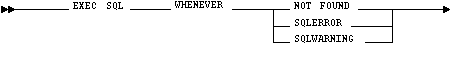
[Description of the illustration image018.eps](img_text/image018.md)

According to the diagram, all of the following statements are valid:

    EXEC SQL WHENEVER NOT FOUND ...
    EXEC SQL WHENEVER SQLERROR ...
    EXEC SQL WHENEVER SQLWARNING ...

#### E.3.1 Required Keywords and Parameters

Required keywords and parameters can appear singly or in a vertical list of alternatives. Single required keywords and parameters appear on the main path, that is, on the horizontal line you are currently traveling. In the following example, cursor is a required parameter:

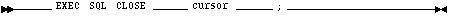
[Description of the illustration image019.eps](img_text/image019.md)

If there is a cursor named emp_cursor, then, according to the diagram, the following statement is valid:

    EXEC SQL CLOSE emp_cursor;

If any of the keywords or parameters in a vertical list appears on the main path, one of them is required. That is, you must choose one of the keywords or parameters, but not necessarily the one that appears on the main path. In the following example, you must choose one of the four actions:

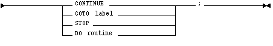
[Description of the illustration image020.eps](img_text/image020.md)

#### E.3.2 Optional Keywords and Parameters

If keywords and parameters appear in a vertical list the main path, they are optional. That is, you need not choose one of them. In the following example, instead of traveling down a vertical line, you can continue along the main path:

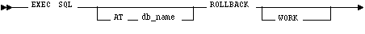
[Description of the illustration image021.eps](img_text/image021.md)

If there is a database named oracle2, then, according to the diagram, all of the following statements are valid:

    EXEC SQL ROLLBACK;
    EXEC SQL ROLLBACK WORK;
    EXEC SQL AT oracle2 ROLLBACK;

#### E.3.3 Syntax Loops

Loops let you repeat the syntax within them as many times as you like. In the following example, column_name is inside a loop. So, after choosing one column name, you can go back repeatedly to choose another.

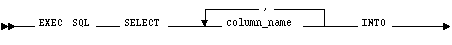
[Description of the illustration image022.eps](img_text/image022.md)

If `DEBIT`, `CREDIT`, and `BALANCE` are column names, then, according to the diagram, all of the following statements are valid:

    EXEC SQL SELECT DEBIT INTO ...
    EXEC SQL SELECT CREDIT, BALANCE INTO ...
    EXEC SQL SELECT DEBIT, CREDIT, BALANCE INTO ...

#### E.3.4 Multi-part Diagrams

Read a multi-part diagram as if all the main paths were joined end-to-end. The following example is a two-part diagram:

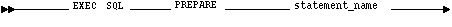
[Description of the illustration image023.eps](img_text/image023.md)

According to the diagram, the following statement is valid:

    EXEC SQL PREPARE sql_statement FROM :sql_string;

#### E.3.5 Database Objects

The names of Oracle objects, such as tables and columns, must not exceed 30 characters in length. The first character must be a letter, but the rest can be any combination of letters, numerals, dollar signs (\$), pound signs (#), and underscores (\_).

However, if an Oracle identifier is enclosed by quotation marks ("), it can contain any combination of legal characters, including spaces but excluding quotation marks.

Oracle identifiers are not case-sensitive except when enclosed by quotation marks.

### E.4 ALLOCATE (Executable Embedded SQL Extension)

#### E.4.1 Allocate Purpose

To allocate a cursor variable to be referenced in a PL/SQL block.

#### E.4.2 Allocate Prerequisites

A cursor variable of type `SQL_CURSOR` must be declared before allocating memory for the cursor variable.

#### E.4.3 Allocate Syntax

[Description of the illustration image024.eps](img_text/image024.md)

#### E.4.4 Allocate Keywords and Parameters

`:cursor_variable`

The cursor variable to be allocated.

#### E.4.5 Allocate Usage Notes

Whereas a cursor is static, a cursor variable is dynamic because it is not tied to a specific query. You can open a cursor variable for any type-compatible query.

Example

This partial example illustrates the use of the `ALLOCATE` command in a Pro\*C/C++ embedded SQL program:

    EXEC SQL BEGIN DECLARE SECTION;
     SQL_CURSOR emp_cv;
     struct{ ... } emp_rec;
    EXEC SQL END DECLARE SECTION;
    EXEC SQL ALLOCATE emp_cv;
    EXEC SQL EXECUTE
     BEGIN
     OPEN :emp_cv FOR SELECT * FROM emp;
     END;
    END-EXEC;
    for (;;)
    { EXEC SQL FETCH :emp_cv INTO :emp_rec;
    }

#### E.4.6 Allocate Related Topics

"CLOSE (Executable Embedded SQL)", "EXECUTE (Executable Embedded SQL)", and "FETCH (Executable Embedded SQL)"

### E.5 CLOSE (Executable Embedded SQL)

#### E.5.1 CLOSE Purpose

To disable a cursor, freeing the resources acquired by opening the cursor, and releasing parse locks.

#### E.5.2 CLOSE Prerequisites

The cursor or cursor variable must be open and `MODE=ANSI`.

#### E.5.3 CLOSE Syntax

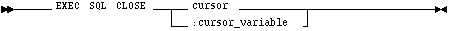
[Description of the illustration image025.eps](img_text/image025.md)

#### E.5.4 CLOSE Keywords and Parameters

`cursor`

A cursor to be closed.

`cursor_variable`

A cursor variable to be closed.

#### E.5.5 CLOSE Usage Notes

Rows cannot be fetched from a closed cursor. A cursor need not be closed to be reopened. The `HOLD_CURSOR` and `RELEASE_CURSOR` precompiler options alter the effect of the `CLOSE` command. For information on these options, see [Running the Oracle Precompilers](running-Oracle-precompilers.md).

#### E.5.6 CLOSE Example

This example illustrates the use of the `CLOSE` command:

    EXEC SQL CLOSE emp_cursor;

#### E.5.7 CLOSE Related Topics

"DECLARE CURSOR (Embedded SQL Directive)", "OPEN (Executable Embedded SQL)", and "PREPARE (Executable Embedded SQL)"

### E.6 COMMIT (Executable Embedded SQL)

#### E.6.1 COMMIT Purpose

To end your current transaction, making permanent all its changes to the database and optionally freeing all resources and disconnecting from the Oracle database.

#### E.6.2 COMMIT Prerequisites

To commit your current transaction, no privileges are necessary.

To manually commit a distributed in-doubt transaction that you originally committed, you must have `FORCE TRANSACTION` system privilege. To manually commit a distributed in-doubt transaction that was originally committed by another user, you must have `FORCE ANY TRANSACTION` system privilege.

If you are using Oracle in `DBMS MAC` mode, you can only commit an in-doubt transaction if your DBMS label matches the label the transaction's label and the creation label of the user who originally committed the transaction or if you satisfy one of the following criteria:

- If the transaction's label or the user's creation label is higher than your DBMS label, you must have `READUP` and `WRITEUP` system privileges.

- If the transaction's label or the user's creation label is lower than your DBMS label, you must have `WRITEDOWN` system privilege.

- If the transaction's label or the user's creation label is not comparable with your DBMS label, you must have `READUP`, `WRITEUP`, and `WRITEDOWN` system privileges.

#### E.6.3 COMMIT Syntax

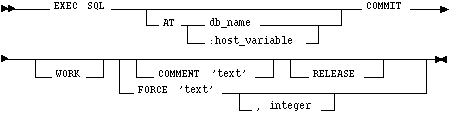
[Description of the illustration image026.eps](img_text/image026.md)

#### E.6.4 COMMIT Keyword and Parameters

`AT`

Identifies the database to which the `COMMIT` statement is issued. The database can be identified by either:

- db_name is a database identifier declared in a previous `DECLARE DATABASE` statement.

- :host_variable is a host variable whose value is a previously declared db_name.

If you omit this clause, Oracle issues the statement to your default database.

`WORK`

Is supported only for compliance with standard SQL. The statements `COMMIT` and `COMMIT WORK` are equivalent.

`COMMENT`

Specifies a comment to be associated with the current transaction. The 'text' is a quoted literal of up to 50 characters that Oracle stores in the data dictionary view `DBA_2PC_PENDING` along with the transaction ID if the transaction becomes in-doubt.

`RELEASE`

Frees all resources and disconnects the application from the Oracle database.

`FORCE`

Manually commits an in-doubt distributed transaction. The transaction is identified by the 'text' containing its local or global transaction ID. To find the IDs of such transactions, query the data dictionary view `DBA_2PC_PENDING`. You can also use the optional integer to explicitly assign the transaction a system change number (SCN). If you omit the integer, the transaction is committed using the current SCN.

#### E.6.5 COMMIT Usage Notes

Always explicitly commit or rollback the last transaction in your program by using the `COMMIT` or `ROLLBACK` command and the `RELEASE` option. Oracle automatically rolls back changes if the program terminates abnormally.

The `COMMIT` command has no effect on host variables or on the flow of control in the program. For more information on this command, see [Defining and Controlling Transactions](defining-controlling-transactions.md).

Example

This example illustrates the use of the embedded SQL `COMMIT` command:

    EXEC SQL AT sales_db COMMIT RELEASE;

#### E.6.6 COMMIT Related Topics

"ROLLBACK (Executable Embedded SQL)" and "SAVEPOINT (Executable Embedded SQL)"

### E.7 CONNECT (Executable Embedded SQL Extension)

#### E.7.1 CONNECT Purpose

To log on to an Oracle database.

#### E.7.2 CONNECT Prerequisites

You must have `CREATE SESSION` system privilege in the specified database.

If you are using Oracle in `DBMS MAC` mode, your operating system label must dominate both your creation label and the label at which you were granted `CREATE SESSION` system privilege. Your operating system label must also fall between the operating system equivalents of `DBHIGH` and `DBLOW`, inclusive.

If you are using Oracle in operating system `MAC` mode, your operating system label must match the label of the database to which you are connecting.

#### E.7.3 CONNECT Syntax

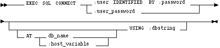
[Description of the illustration image027.eps](img_text/image027.md)

#### E.7.4 CONNECT Keyword and Parameters

:user :password

specifies your username and password separately.

:user_password

is a single host variable containing the Oracle username and password separated by a slash (/).

To allow Oracle to verify your connection through your operating system, specify "/" as the:user_password value.

`AT`

identifies the database to which the connection is made. The database can be identified by either:

db_name is a database identifier declared in a previous `DECLARE DATABASE` statement.

:host_variable is a host variable whose value is a previously declared db_name.

`USING`

specifies the SQL\*Net database specification string used to connect to a nondefault database. If you omit this clause, you are connected to your default database.

#### E.7.5 CONNECT Usage Notes

A program can have multiple connections, but can only connect once to your default database. For more information on this command, see [Meeting Program Requirements](meeting-program-requirements.md).

Example

The following example illustrate the use of `CONNECT`:

    EXEC SQL CONNECT :username
     IDENTIFIED BY :password

You can also use this statement in which the value of :userid is the value of :username and :password separated by a "/" such as 'AAAAA/BBBBB':

    EXEC SQL CONNECT :userid

#### E.7.6 CONNECT Related Topics

"COMMIT (Executable Embedded SQL)", "DECLARE DATABASE (Oracle Embedded SQL Directive)", and "ROLLBACK (Executable Embedded SQL)"

### E.8 DECLARE CURSOR (Embedded SQL Directive)

#### E.8.1 DECLARE CURSOR Purpose

To declare a cursor, giving it a name and associating it with a SQL statement or a PL/SQL block.

#### E.8.2 DECLARE CURSOR Prerequisites

If you associate the cursor with an identifier for a SQL statement or PL/SQL block, you must have declared this identifier in a previous `DECLARE` `STATEMENT` statement.

#### E.8.3 DECLARE CURSOR Syntax

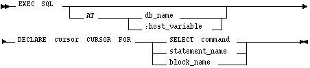
[Description of the illustration image028.eps](img_text/image028.md)

#### E.8.4 DECLARE CURSOR Keywords and Parameters

`AT`

identifies the database on which the cursor is declared. The database can be identified by either:

db_name is a database identifier declared in a previous DECLARE DATABASE statement.

:host_variable is a host variable whose value is a previously declared db_name.

If you omit this clause, Oracle declares the cursor on your default database.

cursor

is the name of the cursor to be declared.

`SELECT` command

is a `SELECT` statement to be associated with the cursor. The following statement cannot contain an `INTO` clause.

statement_name block_name

identifies a SQL statement or PL/SQL block to be associated with the cursor. The statement_name or block_name must be previously declared in a `DECLARE` `STATEMENT` statement.

#### E.8.5 DECLARE CURSOR Usage Notes

You must declare a cursor before referencing it in other embedded SQL statements. The scope of a cursor declaration is global within its precompilation unit and the name of each cursor must be unique in its scope. You cannot declare two cursors with the same name in a single precompilation unit.

You can reference the cursor in the `WHERE` clause of an `UPDATE` or `DELETE` statement using the `CURRENT` `OF` syntax, then the cursor has been opened with an OPEN statement and positioned on a row with a `FETCH` statement. For more information on this command, see [Meeting Program Requirements](meeting-program-requirements.md).

#### E.8.6 DECLARE CURSOR Example

This example illustrates the use of a `DECLARE CURSOR` statement:

    EXEC SQL DECLARE emp_cursor CURSOR
     FOR SELECT ename, empno, job, sal
     FROM emp
     WHERE deptno = :deptno
     FOR UPDATE OF sal

#### E.8.7 DECLARE CURSOR Related Topics

"CLOSE (Executable Embedded SQL)", "DECLARE DATABASE (Oracle Embedded SQL Directive)", "DECLARE STATEMENT (Embedded SQL Directive)", "DELETE (Executable Embedded SQL)", "FETCH (Executable Embedded SQL)", "OPEN (Executable Embedded SQL)", "PREPARE (Executable Embedded SQL)", "SELECT (Executable Embedded SQL)", and "UPDATE (Executable Embedded SQL) "

### E.9 DECLARE DATABASE (Oracle Embedded SQL Directive)

#### E.9.1 DECLARE DATABASE Purpose

To declare an identifier for a nondefault database to be accessed in subsequent embedded SQL statements.

#### E.9.2 DECLARE DATABASE Prerequisites

You must have access to a username on the nondefault database.

#### E.9.3 DECLARE DATABASE Syntax

[Description of the illustration image029.eps](img_text/image029.md)

#### E.9.4 DECLARE DATABASE Keywords and Parameters

db_name

is the identifier established for the nondefault database.

#### E.9.5 DECLARE DATABASE Usage Notes

You declare a db_name for a nondefault database so that other embedded SQL statements can refer to that database using the `AT` clause. Before issuing a `CONNECT` statement with an `AT` clause, you must declare a db_name for the nondefault database with a `DECLARE` `DATABASE` statement.

For more information on this command, see [Meeting Program Requirements](meeting-program-requirements.md).

#### E.9.6 DECLARE DATABASE Example

This example illustrates the use of a `DECLARE` `DATABASE` directive:

    EXEC SQL DECLARE oracle3 DATABASE

#### E.9.7 DECLARE DATABASE Related Topics

"COMMIT (Executable Embedded SQL)", "CONNECT (Executable Embedded SQL Extension)", "DECLARE CURSOR (Embedded SQL Directive)", "DECLARE STATEMENT (Embedded SQL Directive)", "DELETE (Executable Embedded SQL)", "EXECUTE (Executable Embedded SQL)", "EXECUTE IMMEDIATE (Executable Embedded SQL)", "INSERT (Executable Embedded SQL)", "SELECT (Executable Embedded SQL)", and "UPDATE (Executable Embedded SQL) "

### E.10 DECLARE STATEMENT (Embedded SQL Directive)

#### E.10.1 DECLARE STATEMENT Purpose

To declare an identifier for a SQL statement or PL/SQL block to be used in other embedded SQL statements.

#### E.10.2 DECLARE STATEMENT Prerequisites

None.

#### E.10.3 DECLARE STATEMENT Syntax

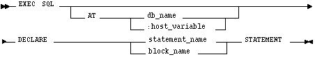
[Description of the illustration image030.eps](img_text/image030.md)

#### E.10.4 DECLARE STATEMENT Keywords and Parameters

`AT`

identifies the database on which the SQL statement or PL/SQL block is declared. The database can be identified by either:

db_name is a database identifier declared in a previous `DECLARE` `DATABASE` statement.

:host_variable is a host variable whose value is a previously declared db_name.

If you omit this clause, Oracle declares the SQL statement or PL/SQL block on your default database.

statement_name block_name

is the declared identifier for the statement.

#### E.10.5 DECLARE STATEMENT Usage Notes

You must declare an identifier for a SQL statement or PL/SQL block with a `DECLARE` `STATEMENT` statement only if a `DECLARE` `CURSOR` statement referencing the identifier appears physically (not logically) in the embedded SQL program before the `PREPARE` statement that parses the statement or block and associates it with its identifier.

The scope of a statement declaration is global within its precompilation unit, like a cursor declaration.For more information on this command, see [Meeting Program Requirements](meeting-program-requirements.md) and [Using Dynamic SQL](using-dynamic-SQL.md).

#### E.10.6 DECLARE STATEMENT Example I

This example illustrates the use of the `DECLARE STATEMENT` statement:

    EXEC SQL AT remote_db
     DECLARE my_statement STATEMENT
    EXEC SQL PREPARE my_statement FROM :my_string
    EXEC SQL EXECUTE my_statement

#### E.10.7 DECLARE STATEMENT Example II

In this example from a Pro\*C/C++ embedded SQL program, the `DECLARE` `STATEMENT` statement is required because the `DECLARE` `CURSOR` statement precedes the `PREPARE` statement:

    EXEC SQL DECLARE my_statement STATEMENT;
    EXEC SQL DECLARE emp_cursor CURSOR FOR my_statement;
    EXEC SQL PREPARE my_statement FROM :my_string;
    ...

#### E.10.8 DECLARE STATEMENT Related Topics

"CLOSE (Executable Embedded SQL)", "DECLARE DATABASE (Oracle Embedded SQL Directive)", "FETCH (Executable Embedded SQL)", "OPEN (Executable Embedded SQL)", and "PREPARE (Executable Embedded SQL)"

### E.11 DECLARE TABLE (Oracle Embedded SQL Directive)

#### E.11.1 DECLARE TABLE Purpose

To define the structure of a table or view, including each column's datatype, default value, and `NULL` or `NOT` `NULL` specification for semantic checking by the Oracle Precompilers.

#### E.11.2 DECLARE TABLE Prerequisites

None.

#### E.11.3 DECLARE TABLE Syntax

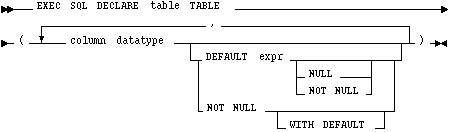
[Description of the illustration image031.eps](img_text/image031.md)

#### E.11.4 DECLARE TABLE Keywords and Parameters

table

is the name of the declared table.

column

is a column of the table.

datatype

is the datatype of a column.

`DEFAULT`

specifies the default value of a column.

`NULL`

specifies that a column can contain nulls.

`NOT` `NULL`

specifies that a column cannot contain nulls.

`WITH` `DEFAULT`

is supported for compatibility with the IBM DB2 database.

#### E.11.5 DECLARE TABLE Usage Notes

For information on using this command, see [Meeting Program Requirements](meeting-program-requirements.md).

#### E.11.6 DECLARE TABLE Example

The following statement declares the `PARTS` table with the `PARTNO`, `BIN`, and `QTY` columns:

    EXEC SQL DECLARE parts TABLE
     (partno NUMBER NOT NULL,
     bin NUMBER,
     qty NUMBER)

#### E.11.7 DECLARE TABLE Related Topics

None.

### E.12 DELETE (Executable Embedded SQL)

#### E.12.1 DELETE Purpose

To remove rows from a table or from a view's base table.

#### E.12.2 DELETE Prerequisites

For you to delete rows from a table, the table must be in your own schema or you must have `DELETE` privilege on the table.

For you to delete rows from the base table of a view, the owner of the schema containing the view must have `DELETE` privilege on the base table. Also, if the view is in a schema other than your own, you must be granted `DELETE` privilege on the view.

The `DELETE` `ANY` `TABLE` system privilege also enables delete rows from any table or any view's base table.

If you are using Oracle in `DBMS MAC` mode, your DBMS label must dominate the creation label of the table or view or you must meet one of the following criteria:

- If the creation label of the table or view is higher than your DBMS label, you must have `READUP` and `WRITEUP` system privileges.

- If the creation label of your table or view is not comparable to your DBMS label, you must have `READUP`, `WRITEUP`, and `WRITEDOWN` system privileges.

In addition, for each row to be deleted, your DBMS label must match the row's label or you must meet one of the following criteria:

- If the row's label is higher than your DBMS label, you must have `READUP` and `WRITEUP` system privileges.

- If the row's label is lower than your DBMS label, you must have `WRITEDOWN` system privilege.

- If the row label is not comparable to your DBMS label, you must have `READUP`, `WRITEUP`, and `WRITEDOWN` system privileges.

#### E.12.3 DELETE Syntax

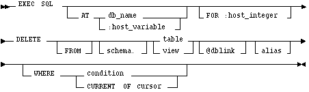
[Description of the illustration image032.eps](img_text/image032.md)

#### E.12.4 DELETE Keywords and Parameters

`AT`

identifies the database to which the `DELETE` statement is issued. The database can be identified by either:

db_name is a database identifier declared in a previous `DECLARE` `DATABASE` statement.

:host_variable is a host variable whose value is a previously declared db_name.

If you omit this clause, the `DELETE` statement is issued to your default database.

`FOR` :host_integer

limits the number of times the statement is executed if the `WHERE` clause contains array host variables. If you omit this clause, Oracle executes the statement once for each component of the smallest array.

schema

is the schema containing the table or view. If you omit schema, Oracle assumes the table or view is in your own schema.

table view

is the name of a table from which the rows are to be deleted. If you specify view, Oracle deletes rows from the view's base table.

dblink

is the complete or partial name of a database link to a remote database where the table or view is located. You can only delete rows from a remote table or view if you are using Oracle with the distributed option.

If you omit dblink, Oracle assumes that the table or view is located on the local database.

alias

is an alias assigned to the table. Aliases are generally used in `DELETE` statements with correlated queries.

`WHERE`

specifies which rows are deleted:

condition deletes only rows that satisfy the condition. This condition can contain host variables and optional indicator variables.

`CURRENT` `OF` deletes only the row most recently fetched by the cursor. The cursor cannot be associated with a `SELECT` statement that performs a join, unless its `FOR` `UPDATE` clause specifically locks only one table.

If you omit this clause entirely, Oracle deletes all rows from the table or view.

#### E.12.5 DELETE Usage Notes

The host variables in the `WHERE` clause must be either all scalars or all arrays. If they are scalars, Oracle executes the `DELETE` statement only once. If they are arrays, Oracle executes the statement once for each set of array components. Each execution may delete zero, one, or multiple rows.

Array host variables in the `WHERE` clause can have different sizes. In this case, the number of times Oracle executes the statement is determined by the smaller of the following values:

- the size of the smallest array

- the value of the :host_integer in the optional `FOR` clause

If no rows satisfy the condition, no rows are deleted and the `SQLCODE` returns a `NOT_FOUND` condition.

The cumulative number of rows deleted is returned through the SQLCA. If the `WHERE` clause contains array host variables, this value reflects the total number of rows deleted for all components of the array processed by the DELETE statement.

If no rows satisfy the condition, Oracle returns an error through the `SQLCODE` of the SQLCA. If you omit the `WHERE` clause, Oracle raises a warning flag in the fifth component of `SQLWARN` in the SQLCA. For more information on this command and the SQLCA, see [Error Handling and Diagnostics](error-handling-diagnostics.md).

You can use comments in a DELETE statement to pass instructions, or hints, to the Oracle optimizer. The optimizer uses hints to choose an execution plan for the statement.

#### E.12.6 DELETE Example

This example illustrates the use of the `DELETE` statement within a Pro\*C/C++ embedded SQL program:

    EXEC SQL DELETE FROM emp
     WHERE deptno = :deptno
     AND job = :job; ...
    EXEC SQL DECLARE emp_cursor CURSOR
     FOR SELECT empno, comm
     FROM emp;
    EXEC SQL OPEN emp_cursor;
    EXEC SQL FETCH c1
     INTO :emp_number, :commission;
    EXEC SQL DELETE FROM emp
     WHERE CURRENT OF emp_cursor;

#### E.12.7 DELETE Related Topics

"DECLARE DATABASE (Oracle Embedded SQL Directive)" and "DECLARE STATEMENT (Embedded SQL Directive)"

### E.13 DESCRIBE (Executable Embedded SQL)

#### E.13.1 DESCRIBE Purpose

To initialize a descriptor to hold descriptions of host variables for a dynamic SQL statement or PL/SQL block.

#### E.13.2 DESCRIBE Prerequisites

You must have prepared the SQL statement or PL/SQL block in a previous embedded SQL `PREPARE` statement.

#### E.13.3 DESCRIBE Syntax

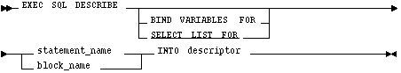
[Description of the illustration image033.eps](img_text/image033.md)

#### E.13.4 DESCRIBE Keywords and Parameters

`BIND VARIABLES`

initializes the descriptor to hold information about the input variables for the SQL statement or PL/SQL block.

`SELECT LIST`

initializes the descriptor to hold information about the select list of a `SELECT` statement.

The default is `SELECT LIST FO`R.

statement_name block_name

identifies a SQL statement or PL/SQL block previously prepared with a `PREPARE` statement.

descriptor

is the name of the descriptor to be initialized.

#### E.13.5 DESCRIBE Usage Notes

You must issue a `DESCRIBE` statement before manipulating the bind or select descriptor within an embedded SQL program.

You cannot describe both input variables and output variables into the same descriptor.

The number of variables found by a `DESCRIBE` statement is the total number of placeholders in the prepare SQL statement or PL/SQL block, rather than the total number of uniquely named placeholders. For more information on this command, see [Using Dynamic SQL](using-dynamic-SQL.md).

#### E.13.6 DESCRIBE Example

This example illustrates the use of the `DESCRIBE` statement in a Pro\*C embedded SQL program:

    EXEC SQL PREPARE my_statement FROM :my_string;
    EXEC SQL DECLARE emp_cursor
     FOR SELECT empno, ename, sal, comm
     FROM emp
     WHERE deptno = :dept_number
    EXEC SQL DESCRIBE BIND VARIABLES FOR my_statement
     INTO bind_descriptor;
    EXEC SQL OPEN emp_cursor
     USING bind_descriptor;
    EXEC SQL DESCRIBE SELECT LIST FOR my_statement
     INTO select_descriptor;
    EXEC SQL FETCH emp_cursor
     INTO select_descriptor;

#### E.13.7 DESCRIBE Related Topics

"PREPARE (Executable Embedded SQL)"

### E.14 EXECUTE ... END-EXEC (Executable Embedded SQL Extension)

#### E.14.1 EXECUTE ... END-EXEC Purpose

To embed an anonymous PL/SQL block into an Oracle Precompiler program.

#### E.14.2 EXECUTE ... END-EXEC Prerequisites

None.

#### E.14.3 EXECUTE ... END-EXEC Syntax

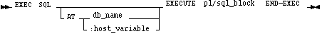
[Description of the illustration image034.eps](img_text/image034.md)

#### E.14.4 EXECUTE ... END-EXEC Keywords and Parameters

`AT`

identifies the database on which the PL/SQL block is executed. The database can be identified by either:

db_name is a database identifier declared in a previous `DECLARE` `DATABASE` statement.

:host_variable is a host variable whose value is a previously declared db_name.

If you omit this clause, the PL/SQL block is executed on your default database.

pl/sql_block

`END-EXEC`

must appear after the embedded PL/SQL block, regardless of which programming language your Oracle Precompiler program uses. Of course, the keyword `END-EXEC` must be followed by the embedded SQL statement terminator for the specific language.

#### E.14.5 EXECUTE ... END-EXEC Usage Notes

Since the Oracle Precompilers treat an embedded PL/SQL block like a single embedded SQL statement, you can embed a PL/SQL block anywhere in an Oracle Precompiler program that you can embed a SQL statement. For more information on embedding PL/SQL blocks in Oracle Precompiler programs, see [Using Embedded PL/SQL](using-embedded-PLSQL.md)

#### E.14.6 EXECUTE ... END-EXEC Example

Placing this `EXECUTE` statement in an Oracle Precompiler program embeds a PL/SQL block in the program:

    EXEC SQL EXECUTE
     BEGIN
     SELECT ename, job, sal
     INTO :emp_name:ind_name, :job_title, :salary
     FROM emp
     WHERE empno = :emp_number;
     IF :emp_name:ind_name IS NULL
     THEN RAISE name_missing;
     END IF;
     END;
    END-EXEC

#### E.14.7 EXECUTE ... END-EXEC Related Topics

"EXECUTE IMMEDIATE (Executable Embedded SQL)"

### E.15 EXECUTE (Executable Embedded SQL)

#### E.15.1 EXECUTE Purpose

To execute a `DELETE`, `INSERT`, or `UPDATE` statement or a PL/SQL block that has been previously prepared with an embedded SQL `PREPARE` statement.

#### E.15.2 EXECUTE Prerequisites

You must first prepare the SQL statement or PL/SQL block with an embedded SQL `PREPARE` statement.

#### E.15.3 EXECUTE Syntax

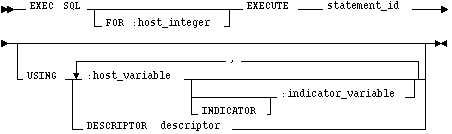
[Description of the illustration image035.eps](img_text/image035.md)

#### E.15.4 EXECUTE Keywords and Parameters

`FOR` :host_integer

limits the number of times the statement is executed when the `USING` clause contains array host variables If you omit this clause, Oracle executes the statement once for each component of the smallest array.

statement_id

is a precompiler identifier associated with the SQL statement or PL/SQL block to be executed. Use the embedded SQL `PREPARE` command to associate the precompiler identifier with the statement or PL/SQL block.

`USING`

specifies a list of host variables with optional indicator variables that Oracle substitutes as input variables into the statement to be executed. The host and indicator variables must be either all scalars or all arrays.

#### E.15.5 EXECUTE Usage Notes

For more information on this command, see [Using Dynamic SQL](using-dynamic-SQL.md).

#### E.15.6 EXECUTE Example

This example illustrates the use of the `EXECUTE` statement in a Pro\*C/C++ embedded SQL program:

    EXEC SQL PREPARE my_statement
     FROM :my_string;
    EXEC SQL EXECUTE my_statement
     USING :my_var;

#### E.15.7 EXECUTE Related Topics

"DECLARE DATABASE (Oracle Embedded SQL Directive)" and "PREPARE (Executable Embedded SQL)"

### E.16 EXECUTE IMMEDIATE (Executable Embedded SQL)

#### E.16.1 EXECUTE IMMEDIATE Purpose

To prepare and execute a `DELETE`, `INSERT`, or `UPDATE` statement or a PL/SQL block containing no host variables.

#### E.16.2 EXECUTE IMMEDIATE Prerequisites

None.

#### E.16.3 EXECUTE IMMEDIATE Syntax

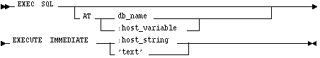
[Description of the illustration image036.eps](img_text/image036.md)

#### E.16.4 EXECUTE IMMEDIATE Keywords and Parameters

`AT`

identifies the database on which the SQL statement or PL/SQL block is executed. The database can be identified by either:

db_name is a database identifier declared in a previous `DECLARE` `DATABASE` statement.

:host_variable is a host variable whose value is a previously declared db_name.

If you omit this clause, the statement or block is executed on your default database.

:host_string

is a host variable whose value is the SQL statement or PL/SQL block to be executed.

text

is a quoted text literal containing the SQL statement or PL/SQL block to be executed.

The SQL statement can only be a `DELETE`, `INSERT`, or `UPDATE` statement.

#### E.16.5 EXECUTE IMMEDIATE Usage Notes

When you issue an `EXECUTE` `IMMEDIATE` statement, Oracle parses the specified SQL statement or PL/SQL block, checking for errors, and executes it. If any errors are encountered, they are returned in the `SQLCODE` component of the SQLCA.

For more information on this command, see [Using Dynamic SQL](using-dynamic-SQL.md).

#### E.16.6 EXECUTE IMMEDIATE Example

This example illustrates the use of the `EXECUTE` `IMMEDIATE` statement:

    EXEC SQL EXECUTE IMMEDIATE 'DELETE FROM emp WHERE empno = 9460'

#### E.16.7 EXECUTE IMMEDIATE Related Topics

"EXECUTE (Executable Embedded SQL)" and "PREPARE (Executable Embedded SQL)"

### E.17 FETCH (Executable Embedded SQL)

#### E.17.1 FETCH Purpose

To retrieve one or more rows returned by a query, assigning the select list values to host variables.

#### E.17.2 FETCH Prerequisites

You must first open the cursor with an the `OPEN` statement.

#### E.17.3 FETCH Syntax

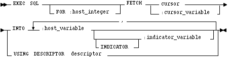
[Description of the illustration image037.eps](img_text/image037.md)

#### E.17.4 FETCH Keywords and Parameters

`FOR` :host_integer

limits the number of rows fetched if you are using array host variables. If you omit this clause, Oracle fetches enough rows to fill the smallest array.

cursor

is a cursor that is declared by a `DECLARE` `CURSOR` statement. The `FETCH` statement returns one of the rows selected by the query associated with the cursor.

:cursor_variable

is a cursor variable is allocated an `ALLOCATE` statement. The `FETCH` statement returns one of the rows selected by the query associated with the cursor variable.

`INTO`

specifies a list of host variables and optional indicator variables into which data is fetched. These host variables and indicator variables must be declared within the program.

`USING`

specifies the descriptor referenced in a previous `DESCRIBE` statement. Only use this clause with dynamic embedded SQL, method 4. Also, the `USING` clause does not apply when a cursor variable is used.

#### E.17.5 FETCH Usage Notes

The `FETCH` statement reads the rows of the active set and names the output variables which contain the results. Indicator values are set to -1 if their associated host variable is null. The first `FETCH` statement for a cursor also sorts the rows of the active set, if necessary.

The number of rows retrieved is specified by the size of the output host variables and the value specified in the `FOR` clause. The host variables to receive the data must be either all scalars or all arrays. If they are scalars, Oracle fetches only one row. If they are arrays, Oracle fetches enough rows to fill the arrays.

Array host variables can have different sizes. In this case, the number of rows Oracle fetches is determined by the smaller of the following values:

- The size of the smallest array

- The value of the :host_integer in the optional `FOR` clause

Of course, the number of rows fetched can be further limited by the number of rows that actually satisfy the query.

If a `FETCH` statement does not retrieve all rows returned by the query, the cursor is positioned on the next returned row. When the last row returned by the query has been retrieved, the next `FETCH` statement results in an error code returned in the `SQLCODE` element of the SQLCA.

Note that the `FETCH` command does not contain an `AT` clause. You must specify the database accessed by the cursor in the `DECLARE` `CURSOR` statement.

You can only move forward through the active set with `FETCH` statements. If you want to revisit any of the previously fetched rows, you must reopen the cursor and fetch each row in turn. If you want to change the active set, you must assign new values to the input host variables in the cursor's query and reopen the cursor.

#### E.17.6 FETCH Example

This example illustrates the `FETCH` command in a pseudo-code embedded SQL program:

    EXEC SQL DECLARE emp_cursor CURSOR FOR
     SELECT job, sal FROM emp WHERE deptno = 30;
    ...
    EXEC SQL WHENEVER NOT FOUND GOTO ...
    LOOP
     EXEC SQL FETCH emp_cursor INTO :job_title1, :salary1;
     EXEC SQL FETCH emp_cursor INTO :job_title2, :salary2;
    ...
    END LOOP;
    ...

#### E.17.7 FETCH Related Topics

"CLOSE (Executable Embedded SQL)", "DECLARE CURSOR (Embedded SQL Directive)", "OPEN (Executable Embedded SQL)", and "PREPARE (Executable Embedded SQL)"

### E.18 INSERT (Executable Embedded SQL)

#### E.18.1 INSERT Purpose

To add rows to a table or to a view's base table.

#### E.18.2 INSERT Prerequisites

For you to insert rows into a table, the table must be in your own schema or you must have `INSERT` privilege on the table.

For you to insert rows into the base table of a view, the owner of the schema containing the view must have `INSERT` privilege on the base table. Also, if the view is in a schema other than your own, you must have `INSERT` privilege on the view.

The `INSERT ANY TABLE` system privilege also enables insert rows into any table or any view's base table.

If you are using Oracle in `DBMS MAC` mode, your DBMS label must match the creation label of the table or view:

- If the creation label of the table or view is higher than your DBMS label, you must have `WRITEUP` system privileges.

- If the creation label of the table or view is lower than your DBMS label, you must have `WRITEDOWN` system privilege.

- If the creation label of your table or view is not comparable to your DBMS label, you must have `WRITEUP` and `WRITEDOWN` system privileges.

#### E.18.3 INSERT Syntax

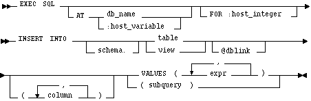
[Description of the illustration image038.eps](img_text/image038.md)

#### E.18.4 INSERT Keywords and Parameters

`AT`

identifies the database on which the `INSERT` statement is executed. The database can be identified by either:

db_name is a database identifier declared in a previous `DECLARE` `DATABASE` statement.

:host_variable is a host variable whose value is a previously declared db_name

If you omit this clause, the `INSERT` statement is executed on your default database.

`FOR` :host_integer

limits the number of times the statement is executed if the `VALUES` clause contains array host variables. If you omit this clause, Oracle executes the statement once for each component in the smallest array.

schema

is the schema containing the table or view. If you omit schema, Oracle assumes the table or view is in your own schema.

table view

is the name of the table into which rows are to be inserted. If you specify view, Oracle inserts rows into the view's base table.

dblink

is a complete or partial name of a database link to a remote database where the table or view is located. You can only insert rows into a remote table or view if you are using Oracle with the distributed option.

If you omit dblink, Oracle assumes that the table or view is on the local database.

column

is a column of the table or view. In the inserted row, each column in this list is assigned a value from the `VALUES` clause or the query.

If you omit one of the table's columns from this list, the column's value for the inserted row is the column's default value as specified when the table was created. If you omit the column list altogether, the `VALUES` clause or query must specify values for all columns in the table.

`VALUES`

specifies a row of values to be inserted into the table or view. Note that the expressions can be host variables with optional indicator variables. You must specify an expression in the `VALUES` clause for each column in the column list.

subquery

is a subquery that returns rows that are inserted into the table. The select list of this subquery must have the same number of columns as the column list of the `INSERT` statement.

#### E.18.5 INSERT Usage Notes

Any host variables that appear in the `WHERE` clause must be either all scalars or all arrays. If they are scalars, Oracle executes the `INSERT` statement once. If they are arrays, Oracle executes the `INSERT` statement once for each set of array components, inserting one row each time.

Array host variables in the `WHERE` clause can have different sizes. In this case, the number of times Oracle executes the statement is determined by the smaller of the following values:

- size of the smallest array

- the value of the :host_integer in the optional FOR clause.

For more information on this command, see [ Using Embedded SQL](using-embedded-SQL.md) .

#### E.18.6 INSERT Example I

This example illustrates the use of the embedded SQL `INSERT` command:

    EXEC SQL
     INSERT INTO emp (ename, empno, sal)
     VALUES (:ename, :empno, :sal);

#### E.18.7 INSERT Example II

This example shows an embedded SQL `INSERT` command with a subquery:

    EXEC SQL
     INSERT INTO new_emp (ename, empno, sal)
     SELECT ename, empno, sal FROM emp
     WHERE deptno = :deptno;

#### E.18.8 INSERT Related Topics

"DECLARE DATABASE (Oracle Embedded SQL Directive)"

### E.19 OPEN (Executable Embedded SQL)

#### E.19.1 OPEN Purpose

To open a cursor, evaluating the associated query and substituting the host variable names supplied by the `USING` clause into the `WHERE` clause of the query.

#### E.19.2 OPEN Prerequisites

You must declare the cursor with a `DECLARE` `CURSOR` embedded SQL statement before opening it.

#### E.19.3 OPEN Syntax

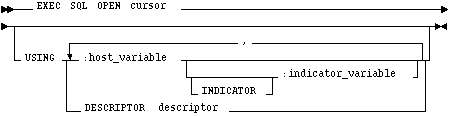
[Description of the illustration image039.eps](img_text/image039.md)

#### E.19.4 OPEN Keywords and Parameters

cursor

is the cursor to be opened.

`USING`

specifies the host variables to be substituted into the `WHERE` clause of the associated query.

:host_variable specifies a host variable with an optional indicator variable to be substituted into the statement associated with the cursor.

`DESCRIPTOR`

specifies a descriptor that describes the host variables to be substituted into the `WHERE` clause of the associated query. The descriptor must be initialized in a previous `DESCRIBE` statement.

The substitution is based on position. The host variable names specified in this statement can be different from the variable names in the associated query.

#### E.19.5 OPEN Usage Notes

The `OPEN` command defines the active set of rows and initializes the cursor just before the first row of the active set. The values of the host variables at the time of the `OPEN` are substituted in the statement. This command does not actually retrieve rows; rows are retrieved by the `FETCH` command.

After you have opened a cursor, its input host variables are not reexamined until you reopen the cursor. To change any input host variables and therefore the active set, you must reopen the cursor.

All cursors in a program are in a closed state when the program is initiated or when they have been explicitly closed using the `CLOSE` command.

You can reopen a cursor without first closing it. For more information on this command, see [ Using Embedded SQL](using-embedded-SQL.md) .

#### E.19.6 OPEN Example

This example illustrates the use of the `OPEN` command in a Pro\*C/C++ embedded SQL program:

    EXEC SQL DECLARE emp_cursor CURSOR FOR
     SELECT ename, empno, job, sal
     FROM emp
     WHERE deptno = :deptno;
    EXEC SQL OPEN emp_cursor;

#### E.19.7 OPEN Related Topics

"CLOSE (Executable Embedded SQL)". "DECLARE CURSOR (Embedded SQL Directive)", "FETCH (Executable Embedded SQL)", and "PREPARE (Executable Embedded SQL)"

### E.20 PREPARE (Executable Embedded SQL)

#### E.20.1 PREPARE Purpose

To parse a SQL statement or PL/SQL block specified by a host variable and associate it with an identifier.

#### E.20.2 PREPARE Prerequisites

None.

#### E.20.3 PREPARE Syntax

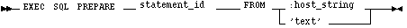
[Description of the illustration image040.eps](img_text/image040.md)

#### E.20.4 PREPARE Keywords and Parameters

statement_id

is the identifier to be associated with the prepared SQL statement or PL/SQL block. If this identifier was previously assigned to another statement or block, the prior assignment is superseded.

:host_string

is a host variable whose value is the text of a SQL statement or PL/SQL block to be prepared.

text

is a string literal containing a SQL statement or PL/SQL block to be prepared.

#### E.20.5 PREPARE Usage Notes

Any variables that appear in the :host_string or text are placeholders. The actual host variable names are assigned in the `USING` clause of the `OPEN` command (input host variables) or in the `INTO` clause of the `FETCH` command (output host variables).

A SQL statement is prepared only once, but can be executed any number of times.

#### E.20.6 PREPARE Example

This example illustrates the use of a `PREPARE` statement in a Pro\*C/C++ embedded SQL program:

    EXEC SQL PREPARE my_statement FROM :my_string;
    EXEC SQL EXECUTE my_statement;

#### E.20.7 PREPARE Related Topics

"CLOSE (Executable Embedded SQL)", "DECLARE CURSOR (Embedded SQL Directive)", "FETCH (Executable Embedded SQL)", and "OPEN (Executable Embedded SQL)"

### E.21 ROLLBACK (Executable Embedded SQL)

#### E.21.1 ROLLBACK Purpose

To undo work done in the current transaction.

You can also use this command to manually undo the work done by an in-doubt distributed transaction.

#### E.21.2 ROLLBACK Prerequisites

To roll back your current transaction, no privileges are necessary.

To manually roll back an in-doubt distributed transaction that you originally committed, you must have F`ORCE TRANSACTION` system privilege. To manually roll back an in-doubt distributed transaction originally committed by another user, you must have `FORCE ANY TRANSACTION` system privilege.

#### E.21.3 ROLLBACK Syntax

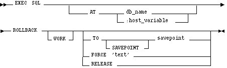
[Description of the illustration image041.eps](img_text/image041.md)

#### E.21.4 ROLLBACK Keywords and Parameters

`WORK`

is optional and is provided for ANSI compatibility.

`TO`

rolls back the current transaction to the specified savepoint. If you omit this clause, the `ROLLBACK` statement rolls back the entire transaction.

`FORCE`

manually rolls back an in-doubt distributed transaction. The transaction is identified by the text containing its local or global transaction ID. To find the IDs of such transactions, query the data dictionary view `DBA_2PC_PENDING`.

`ROLLBACK` statements with the `FORCE` clause are not supported in PL/SQL.

`RELEASE`

frees all resources and disconnects the application from the Oracle Server. The `RELEASE` clause is not allowed with `SAVEPOINT` and `FORCE` clauses.

#### E.21.5 ROLLBACK Usage Notes

A transaction (or a logical unit of work) is a sequence of SQL statements that Oracle treats as a single unit. A transaction begins with the first executable SQL statement after a `COMMIT`, `ROLLBACK` or connection to the database. A transaction ends with a `COMMIT` statement, a `ROLLBACK` statement, or disconnection (intentional or unintentional) from the database. Note that Oracle issues an implicit `COMMIT` statement before and after processing any data definition language statement.

Using the `ROLLBACK` command without the `TO SAVEPOINT` clause performs the following operations:

- ends the transaction

- undoes all changes in the current transaction

- erases all savepoints in the transaction

- releases the transaction's locks

Using the `ROLLBACK` command with the `TO SAVEPOINT` clause performs the following operations:

- rolls back just the portion of the transaction after the savepoint.

- loses all savepoints created after that savepoint. Note that the named savepoint is retained, so you can roll back to the same savepoint multiple times. Prior savepoints are also retained.

- releases all table and row locks acquired since the savepoint. Note that other transactions that have requested access to rows locked after the savepoint must continue to wait until the transaction is committed or rolled back. Other transactions that have not already requested the rows can request and access the rows immediately.

It is recommended that you explicitly end transactions in application programs using either a `COMMIT` or `ROLLBACK` statement. If you do not explicitly commit the transaction and the program terminates abnormally, Oracle rolls back the last uncommitted transaction.

#### E.21.6 ROLLBACK Example I

The following statement rolls back your entire current transaction:

    EXEC SQL ROLLBACK;

#### E.21.7 ROLLBACK Example II

The following statement rolls back your current transaction to savepoint SP5:

    EXEC SQL ROLLBACK TO SAVEPOINT sp5;

#### E.21.8 ROLLBACK Distributed Transactions

Oracle with the distributed option enables perform distributed transactions, or transactions that modify data on multiple databases. To commit or roll back a distributed transaction, you need only issue a `COMMIT` or `ROLLBACK` statement as you would any other transaction.

If there is a network failure during the commit process for a distributed transaction, the state of the transaction may be unknown, or in-doubt. After consultation with the administrators of the other databases involved in the transaction, you may decide to manually commit or roll back the transaction on your local database. You can manually roll back the transaction on your local database by issuing a `ROLLBACK` statement with the `FORCE` clause.

You cannot manually roll back an in-doubt transaction to a savepoint.

A `ROLLBACK` statement with a `FORCE` clause only rolls back the specified transaction. Such a statement does not affect your current transaction.

#### E.21.9 ROLLBACK Example III

The following statement manually rolls back an in-doubt distributed transaction:

    EXEC SQL
     ROLLBACK WORK
     FORCE '25.32.87';

#### E.21.10 ROLLBACK Related Topics

"COMMIT (Executable Embedded SQL)" and "SAVEPOINT (Executable Embedded SQL)"

### E.22 SAVEPOINT (Executable Embedded SQL)

#### E.22.1 SAVEPOINT Purpose

To identify a point in a transaction to which you can later roll back.

#### E.22.2 SAVEPOINT Prerequisites

None.

#### E.22.3 SAVEPOINT Syntax

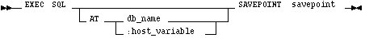
[Description of the illustration image042.eps](img_text/image042.md)

#### E.22.4 SAVEPOINT Keywords and Parameters

`AT`

identifies the database on which the savepoint is created. The database can be identified by either:

db_name is a database identifier declared in a previous `DECLARE` `DATABASE` statement.

:host_variable is a host variable whose value is a previously declared db_name.

If you omit this clause, the savepoint is created on your default database.

savepoint

is the name of the savepoint to be created.

#### E.22.5 SAVEPOINT Usage Notes

For more information on this command, see [Defining and Controlling Transactions](defining-controlling-transactions.md).

Example

This example illustrates the use of the embedded SQL `SAVEPOINT` command:

    EXEC SQL SAVEPOINT save3;

#### E.22.6 SAVEPOINT Related Topics

"COMMIT (Executable Embedded SQL)" and "ROLLBACK (Executable Embedded SQL)"

### E.23 SELECT (Executable Embedded SQL)

#### E.23.1 SELECT Purpose

To retrieve data from one or more tables, views, or snapshots, assigning the selected values to host variables.

#### E.23.2 SELECT Prerequisites

For you to select data from a table or snapshot, the table or snapshot must be in your own schema or you must have `READ or SELECT` privilege on the table or snapshot.

For you to select rows from the base tables of a view, the owner of the schema containing the view must have `READ or SELECT` privilege on the base tables. Also, if the view is in a schema other than your own, you must have `READ or SELECT` privilege on the view.

The `READ ANY TABLE or SELECT ANY TABLE` system privilege also enables select data from any table or any snapshot or any view's base table.

If you are using Oracle in `DBMS MAC` mode, your DBMS label must dominate the creation label of each queried table, view, or snapshot or you must have `READUP` system privileges.

The READ privilege cannot be used for SELECT ... FOR UPDATE operations.

#### E.23.3 SELECT Syntax

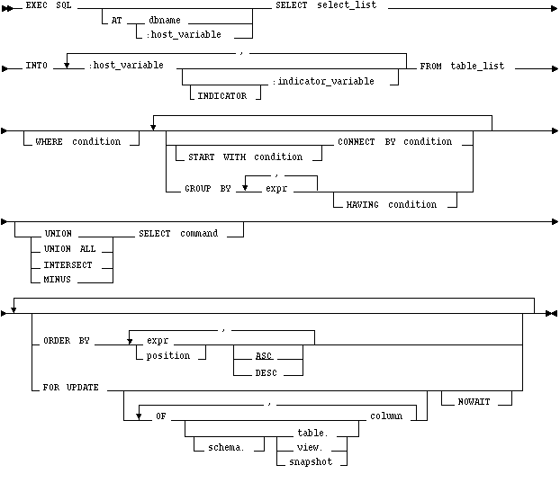
[Description of the illustration image043.eps](img_text/image043.md)

#### E.23.4 SELECT Keywords and Parameters

`AT`

identifies the database to which the `SELECT` statement is issued. The database can be identified by either:

db_name is a database identifier declared in a previous `DECLARE` `DATABASE` statement.

:host_variable is a host variable whose value is a previously declared db_name.

If you omit this clause, the `SELECT` statement is issued to your default database.

select_list

identical to the non-embedded `SELECT` command except that a host variables can be used in place of literals.

`INTO`

specifies output host variables and optional indicator variables to receive the data returned by the `SELECT` statement. Note that these variables must be either all scalars or all arrays, but arrays need not have the same size.

WHERE

restricts the rows returned to those for which the condition is `TRUE`. The condition can contain host variables, but cannot contain indicator variables. These host variables can be either scalars or arrays.

All other keywords and parameters are identical to the non-embedded SQL `SELECT` command.

#### E.23.5 SELECT Usage Notes

If no rows meet the `WHERE` clause condition, no rows are retrieved and Oracle returns an error code through the `SQLCODE` component of the SQLCA.

You can use comments in a `SELECT` statement to pass instructions, or hints, to the Oracle optimizer. The optimizer uses hints to choose an execution plan for the statement.

#### E.23.6 SELECT Example

This example illustrates the use of the embedded SQL `SELECT` command:

    EXEC SQL SELECT ename, sal + 100, job
     INTO :ename, :sal, :job
     FROM emp
     WHERE empno = :empno

#### E.23.7 SELECT Related Topics

"DECLARE CURSOR (Embedded SQL Directive)", "DECLARE DATABASE (Oracle Embedded SQL Directive)", "EXECUTE (Executable Embedded SQL)", "FETCH (Executable Embedded SQL)", and "PREPARE (Executable Embedded SQL)"

### E.24 UPDATE (Executable Embedded SQL)

#### E.24.1 UPDATE Purpose

To change existing values in a table or in a view's base table.

#### E.24.2 UPDATE Prerequisites

For you to update values in a table or snapshot, the table must be in your own schema or you must have `UPDATE` privilege on the table.

For you to update values in the base table of a view, the owner of the schema containing the view must have `UPDATE` privilege on the base table. Also, if the view is in a schema other than your own, you must have `UPDATE` privilege on the view.

The `UPDATE ANY TABL`E system privilege also enables update values in any table or any view's base table.

If you are using Oracle in `DBMS MAC` mode, your DBMS label must match the creation label of the table or view:

- If the creation label of the table or view is higher than your DBMS label, you must have `READUP` and `WRITEUP` system privileges

- If the creation label of the table or view is lower than your DBMS label, you must have `WRITEDOWN` system privilege.

- If the creation label of your table or view is not comparable to your DBMS label, you must have `READUP`, `WRITEUP`, and `WRITEDOWN` system privileges.

#### E.24.3 UPDATE Syntax

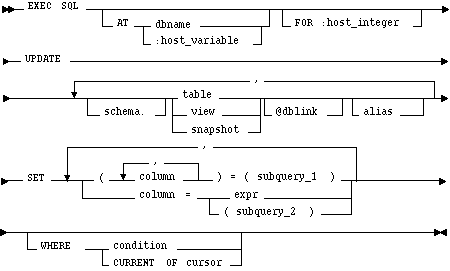
[Description of the illustration image044.eps](img_text/image044.md)

#### E.24.4 UPDATE Keywords and Parameters

`AT`

identifies the database to which the `UPDATE` statement is issued. The database can be identified by either:

db_name is a database identifier declared in a previous `DECLARE` `DATABASE` statement.

:host_variable is a host variable whose value is a previously declared db_name.

If you omit this clause, the `UPDATE` statement is issued to your default database.

`FOR` :host_integer

limits the number of times the `UPDATE` statement is executed if the `SET` and `WHERE` clauses contain array host variables. If you omit this clause, Oracle executes the statement once for each component of the smallest array.

schema

is the schema containing the table or view. If you omit schema, Oracle assumes the table or view is in your own schema.

table view

is the name of the table to be updated. If you specify view, Oracle updates the view's base table.

dblink

is a complete or partial name of a database link to a remote database where the table or view is located. You can only use a database link to update a remote table or view if you are using Oracle with the distributed option.

alias

is a name used to reference the table, view, or subquery elsewhere in the statement.

column

is the name of a column of the table or view that is to be updated. If you omit a column of the table from the `SET` clause, that column's value remains unchanged.

expr

is the new value assigned to the corresponding column. This expression can contain host variables and optional indicator variables.

subquery_1

is a subquery that returns new values that are assigned to the corresponding columns.

subquery_2

is a subquery that return a new value that is assigned to the corresponding column.

`WHERE`

specifies which rows of the table or view are updated:

condition updates only rows for which this condition is true. This condition can contain host variables and optional indicator variables.

`CURRENT OF` updates only the row most recently fetched by the cursor. The cursor cannot be associated with a `SELECT` statement that performs a join unless its `FOR` `UPDATE` clause explicitly locks only one table.

If you omit this clause entirely, Oracle updates all rows of the table or view.

#### E.24.5 UPDATE Usage Notes

Host variables in the `SET` and `WHERE` clauses must be either all scalars or all arrays. If they are scalars, Oracle executes the `UPDATE` statement only once. If they are arrays, Oracle executes the statement once for each set of array components. Each execution may update zero, one, or multiple rows.

Array host variables can have different sizes. In this case, the number of times Oracle executes the statement is determined by the smaller of the following values:

- the size of the smallest array

- the value of the :host_integer in the optional `FOR` clause

The cumulative number of rows updated is returned through the third element of the `SQLERRD` component of the SQLCA. When arrays are used as input host variables, this count reflects the total number of updates for all components of the array processed in the UPDATE statement. If no rows satisfy the condition, no rows are updated and Oracle returns an error message through the `SQLCODE` element of the SQLCA. If you omit the `WHERE` clause, all rows are updated and Oracle raises a warning flag in the fifth component of the `SQLWARN` element of the SQLCA.

You can use comments in an `UPDATE` statement to pass instructions, or hints, to the Oracle optimizer. The optimizer uses hints to choose an execution plan for the statement.

For more information on this command, see [ Using Embedded SQL](using-embedded-SQL.md) and [Defining and Controlling Transactions](defining-controlling-transactions.md).

#### E.24.6 UPDATE Examples

The following examples illustrate the use of the embedded SQL `UPDATE` command:

    EXEC SQL UPDATE emp
     SET sal = :sal, comm = :comm INDICATOR :comm_ind
     WHERE ename = :ename;

    EXEC SQL UPDATE emp
     SET (sal, comm) =
     (SELECT AVG(sal)*1.1, AVG(comm)*1.1
     FROM emp)
     WHERE ename = 'JONES';

#### E.24.7 UPDATE Related Topics

"DECLARE DATABASE (Oracle Embedded SQL Directive)"

### E.25 VAR (Oracle Embedded SQL Directive)

#### E.25.1 VAR Purpose

To perform host variable equivalencing, or to assign a specific Oracle external datatype to an individual host variable, overriding the default datatype assignment.

#### E.25.2 VAR Prerequisites

The host variable must be previously declared in the Declare Section of the embedded SQL program.

#### E.25.3 VAR Syntax

[Description of the illustration image045.eps](img_text/image045.md)

#### E.25.4 VAR Keywords and Parameters

host_variable

is the host variable to be assigned an Oracle external datatype.

datatype

is an Oracle external datatype recognized by the Oracle Precompilers (not an Oracle internal datatype). The datatype may include a length, precision, or scale. This external datatype is assigned to the host_variable. For a list of external datatypes, see [Meeting Program Requirements](meeting-program-requirements.md).

#### E.25.5 VAR Usage Notes

Host variable equivalencing is one kind of datatype equivalencing. Datatype equivalencing is useful for any of the following purposes:

- to automatically null-terminate a character host variable

- to store program data as binary data in the database

- to override default datatype conversion

#### E.25.6 VAR Example

This example equivalences the host variable `DEPT_NAME` to

the datatype `STRING` and the host variable `BUFFER` to the datatype `RAW(2000)`:

    EXEC SQL BEGIN DECLARE SECTION;
     ...
     dept_name CHARACTER(15); -- default datatype is CHAR
     EXEC SQL VAR dept_name IS STRING; -- reset to STRING
     ...
     buffer CHARACTER(200); -- default datatype is CHAR
     EXEC SQL VAR buffer IS RAW(200); -- refer to RAW
     ...
    EXEC SQL END DECLARE SECTION;

#### E.25.7 VAR Related Topics

None.

### E.26 WHENEVER (Embedded SQL Directive)

#### E.26.1 WHENEVER Purpose

To specify the action to be taken when an error or warning results from executing an embedded SQL program.

#### E.26.2 WHENEVER Prerequisites

None.

#### E.26.3 WHENEVER Syntax

The following syntax diagram shows how to construct a `WHENEVER` statement:

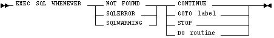
[Description of the illustration image046.eps](img_text/image046.md)

#### E.26.4 WHENEVER Keywords and Parameters

`NOT FOUND`

identifies any exception condition that returns an error code of +1403 to `SQLCODE` (or a +100 code when `MODE=ANSI`).

`SQLERROR`

identifies a condition that results in a negative return code.

`SQLWARNING`

identifies a non-fatal warning condition.

`CONTINUE`

indicates that the program should progress to the next statement.

`GOTO`

indicates that the program should branch to the statement named by label.

`STOP`

stops program execution.

`DO`

indicates that the program should call a host language routine. The syntax of routine depends on your host language. See your language-specific Supplement to the Oracle Precompilers Guide.

#### E.26.5 WHENEVER Usage Notes

The `WHENEVER` command allows your program to transfer control to an error handling routine in the event an embedded SQL statement results in an error or warning.

The scope of a `WHENEVER` statement is positional, rather than logical. A `WHENEVER` statement applies to all embedded SQL statements that textually follow it in the source file, not in the flow of the program logic. A `WHENEVER` statement remains in effect until it is superseded by another `WHENEVER` statement checking for the same condition.

For more information on this command, see [Defining and Controlling Transactions](defining-controlling-transactions.md). Do not confuse the `WHENEVER` embedded SQL command with the `WHENEVER` SQL\*Plus command.

#### E.26.6 WHENEVER Example

The following example illustrates the use of the `WHENEVER` command in a Pro\*C/C++ embedded SQL program:

    EXEC SQL WHENEVER NOT FOUND CONTINUE;
    ...
    EXEC SQL WHENEVER SQLERROR GOTO sql_error:
    ...
    sql_error:
     EXEC SQL WHENEVER SQLERROR CONTINUE;
     EXEC SQL ROLLBACK RELEASE;

#### E.26.7 WHENEVER Related Topics

None.
