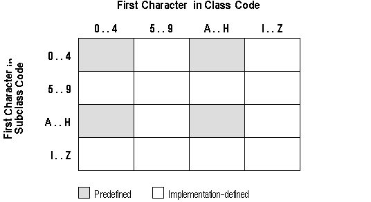
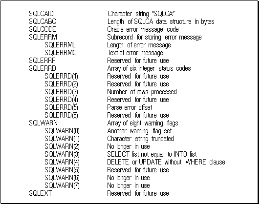
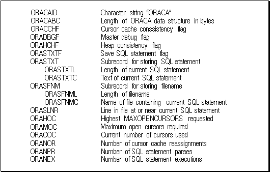

An application program must anticipate run-time errors and attempt to recover from them. This chapter provides an in-depth discussion of error reporting and recovery. You learn how to handle warnings and errors using the status variables SQLCODE, SQLSTATE, SQLCA (SQL Communications Area), and the `WHENEVER` statement. You also learn how to diagnose problems by using the status variable ORACA (Oracle Communications Area). The following topics are discussed:

- The Need for Error Handling

- Error Handling Alternatives

- About Using Status Variables when MODE={ANSI\|ANSI14}

- About Using the SQL Communications Area

- About Using the Oracle Communications Area

### 8.1 The Need for Error Handling

A significant part of every application program must be devoted to error handling. The main benefit of error handling is that it allows your program to continue operating in the presence of errors. Errors arise from design faults, coding mistakes, hardware failures, invalid user input, and many other sources

You cannot anticipate all possible errors, but you can plan to handle certain kinds of errors meaningful to your program. For the Oracle Precompilers, error handling means detecting and recovering from SQL statement execution errors.

You can also prepare to handle warnings such as "value truncated" and status changes such as "end of data." It is especially important to check for error and warning conditions after every data manipulation statement, because an `INSERT`, `UPDATE`, or `DELETE` statement might fail before processing all eligible rows in a table.

### 8.2 Error Handling Alternatives

The Oracle Precompilers provide four status variables that serve as error handling mechanisms:

- SQLCODE (SQLCOD in Pro\*FORTRAN)

- SQLSTATE (SQLSTA in Pro\*FORTRAN)

- SQLCA (using the WHENEVER statement)

- ORACA

The MODE option (described ) governs ANSI/ISO compliance. The availability of the SQLCODE, SQLSTATE, and SQLCA variables depends on the MODE setting. You can declare and use the ORACA variable regardless of the MODE setting. For more information, refer to About Using the Oracle Communications Area .

When `MODE={ORACLE|ANSI13}`, you must declare the SQLCA status variable. SQLCODE and SQLSTATE declarations are accepted (not recommended) but are not recognized as status variables. For more information, refer to About Using the SQL Communications Area.

When `MODE={ANSI|ANSI14}`, you can use any one, two, or all three of the SQLCODE, SQLSTATE, and SQLCA variables. To determine which variable (or variable combination) is best for your application, refer to About Using Status Variables when MODE={ANSI\|ANSI14}" .

#### 8.2.1 SQLCODE and SQLSTATE

With Release 1.5 of the Oracle Precompilers, the SQLCODE status variable was introduced as the SQL89 standard ANSI/ISO error reporting mechanism. The SQL92 standard listed SQLCODE as a deprecated feature and defined a new status variable, SQLSTATE (introduced with Release 1.6 of the Oracle Precompilers), as the preferred ANSI/ISO error reporting mechanism.

SQLCODE stores error codes and the "not found" condition. It is retained only for compatibility with SQL89 and is likely to be removed from future versions of the standard.

Unlike SQLCODE, SQLSTATE stores error and warning codes and uses a standardized coding scheme. After executing a SQL statement, the Oracle server returns a status code to the SQLSTATE variable currently in scope. The status code indicates whether a SQL statement executed successfully or raised an exception (error or warning condition). To promote interoperability (the ability of systems to exchange information easily), SQL92 predefines all the common SQL exceptions.

#### 8.2.2 SQLCA

The SQLCA is a record-like, host-language data structure. Oracle updates the SQLCA after every executable SQL statement. (SQLCA values are undefined after a declarative statement.) By checking Oracle return codes stored in the SQLCA, your program can determine the outcome of a SQL statement. This can be done in two ways:

- Implicit checking with the WHENEVER statement

- Explicit checking of SQLCA variables

You can use `WHENEVER` statements, code explicit checks on SQLCA variables, or do both. Generally, using `WHENEVER` statements is preferable because it is easier, more portable, and ANSI-compliant.

#### 8.2.3 ORACA

When more information is needed about run-time errors than the SQLCA provides, you can use the ORACA, which contains cursor statistics, SQL statement data, option settings, and system statistics.

The ORACA is optional and can be declared regardless of the MODE setting. For more information about the ORACA status variable, refer to "About Using the Oracle Communications Area.

### 8.3 About Using Status Variables when MODE={ANSI\|ANSI14}

When `MODE={ANSI|ANSI14},` you must declare at least one -- you may declare two or all three -- of the following status variables:

- SQLCODE

- SQLSTATE

- SQLCA

In Pro\*COBOL, you cannot declare SQLCODE if SQLCA is declared. Likewise, you cannot declare SQLCA if SQLCODE is declared. The field in the SQLCA data structure that stores the error code for Pro\*COBOL is also called SQLCODE, so errors will occur if both status variables are declared.

Your program can get the outcome of the most recent executable SQL statement by checking SQLCODE and SQLSTATE, SQLCODE or SQLSTATE explicitly with your own code after executable SQL and PL/SQL statements. Your program can also check SQLCA implicitly (with the `WHENEVER` SQLERROR and `WHENEVER` SQLWARNING statements) or it can check the SQLCA variables explicitly.

**Note:**

When `MODE={ORACLE|ANSI13},` you must declare the SQLCA status variable. For more information, refer to About Using the SQL Communications Area".

#### 8.3.1 Some Historical Information

The treatment of status variables and variable combinations by the Oracle Precompilers has evolved beginning with Release 1.5.

#### 8.3.2 Release 1.5

The Oracle Precompiler, Release 1.5, presumed there was a status variable SQLCODE whether it was declared in a Declare Section; in fact, the precompiler never bothered to note whether there was a declaration for SQLCODE or not -- it just presumed that the declaration exists. SQLCA would be used as a status variable only if there was an `INCLUDE` of the SQLCA.

#### 8.3.3 Release 1.6

Beginning with Oracle Precompilers, Release 1.6, the precompilers no longer presume that there is a SQLCODE status variable and it is not required. The precompiler requires that at least one of SQLCA, SQLCODE, or SQLSTATE be declared.

SQLCODE is recognized as a status variable if and only if at least one of the following criteria is satisfied:

- It is declared in a Declare Section with exactly the correct datatype.

- The precompiler finds no other status variable.

If the precompiler finds a SQLSTATE declaration (of exactly the correct type of course) in a Declare Section or finds an `INCLUDE` of the SQLCA, it will not presume SQLCODE is declared.

#### 8.3.4 Release 1.7

Because Release 1.5 of the Oracle Precompilers allowed the SQLCODE variable to be declared outside a Declare Section while declaring SQLCA at the same time, precompilers Release 1.6 and greater are presented with a compatibility problem. A new option, `ASSUME_SQLCODE={YES|NO} `(default NO), was added to fix this in Release 1.6.7 and is documented as a new feature in Release 1.7.

When A`SSUME_SQLCODE=YES,` and when SQLSTATE or SQLCA (Pro\*FORTRAN only) are declared as status variables, the precompiler presumes SQLCODE is declared irrepsective of whether it is declared in a Declare Section or of the proper type. This causes Releases 1.6.7 and later to act like Release 1.5 in this regard. For information about the precompiler option ASSUME_SQLCODE, refer to "ASSUME_SQLCODE" .

#### 8.3.5 About Declaring Status Variables

This section describes how to declare SQLCODE and SQLSTATE. For information about declaring the SQLCA status variable, refer to "Declaring the SQLCA".

#### 8.3.6 Declaring SQLCODE

SQLCODE (SQLCOD in Pro\*FORTRAN) must be declared as a 4-byte integer variable either inside or outside the Declare Section, as shown in Table 8-1.

Table 8-1 SQLCODE Declarations

| Language | SQLCODE Declaration     |
|:---------|:------------------------|
| COBOL    | SQLCODE PIC S9(9) COMP. |
| FORTRAN  | INTEGER\*4 SQLCOD       |

If declared outside the Declare Section, SQLCODE is recognized as a status variable only if ASSUME_SQLCODE=YES. SQLCODE declarations are ignored when `MODE={ORACLE|ANSI13}`.

**Warning:**

In Pro\*COBOL source files, donot declare SQLCODE if SQLCA is declared. Likewise, donot declare SQLCA if SQLCODE is declared. The status variable declared by the SQLCA structure is also called SQLCODE, so errors will occur if both error-reporting mechanisms are used.

By using host languages that allow both local and global declarations, you can declare more than one SQLCODE variable. Access to a local SQLCODE is limited by its scope within your program. After every SQL operation, Oracle returns a status code to the SQLCODE currently in scope. So, your program can learn the outcome of the most recent SQL operation by checking SQLCODE explicitly, or implicitly with the `WHENEVER` statement.

When you declare SQLCODE instead of the SQLCA in a particular compilation unit, the precompiler allocates an internal SQLCA for that unit. Your host program cannot access the internal SQLCA. If you declare the SQLCA and SQLCODE (not supported in Pro\*COBOL), Oracle returns the same status code to both after every SQL operation.

#### 8.3.7 Declaring SQLSTATE

SQLSTATE (SQLSTA in Pro\*FORTRAN) must be declared as a five-character alphanumeric string inside the Declare Section, as shown inTable 8-2. Declaring the SQLCA is optional.

Table 8-2 SQLSTATE Declarations

| Language | SQLSTATE Declaration |
|:---------|:---------------------|
| COBOL    | SQLSTATE PIC X(5).   |
| FORTRAN  | CHARACTER\*5 SQLSTA  |

When MODE={ORACLE\|ANSI13}, declarations of the SQLSTATE variable are ignored.

#### 8.3.8 Status Variable Combinations

When `MODE={ANSI|ANSI14}`, the behavior of the status variables depends on the following:

- Which variables are declared

- Declaration placement (inside or outside the Declare Section)

- ASSUME_SQLCODE setting

Table 8-3 and Table 8-4 describe the resulting behavior of each status variable combination when ASSUME_SQLCODE=NO and when ASSUME_SQLCODE=YES, respectively.

Table 8-3 Status Variable Combinations - SQLCODE = NO

| Declare Section (IN/OUT/ --) | Behavior |       |                                                                                                                                                                                                                 |
|:-----------------------------|:---------|:------|:----------------------------------------------------------------------------------------------------------------------------------------------------------------------------------------------------------------|
| SQLCODE                      | SQLSTATE | SQLCA |                                                                                                                                                                                                                 |
| OUT                          | --       | --    | SQLCODE is declared and is presumed to be a status variable.                                                                                                                                                    |
| OUT                          | --       | OUT   | In Pro\*COBOL, this status variable configuration is not supported. In Pro\*FORTRAN, SQLCA is declared as a status variable, and SQLCODE is declared but is not recognized as a status variable.                |
| OUT                          | --       | IN    | In Pro\*COBOL, this status variable configuration is not supported. In Pro\*FORTRAN, this status variable configuration is not supported.                                                                       |
| OUT                          | OUT      | --    | SQLCODE is declared and is presumed to be a status variable, and SQLSTATE is declared but is not recognized as a status variable.                                                                               |
| OUT                          | OUT      | OUT   | In Pro\*COBOL, this status variable configuration is not supported. In Pro\*FORTRAN, SQLCA is declared as a status variable, and SQLCODE and SQLSTATE are declared but are not recognized as status variables.  |
| OUT                          | OUT      | IN    | In Pro\*COBOL, this status variable configuration is not supported. In Pro\*FORTRAN, this status variable configuration is not supported.                                                                       |
| OUT                          | IN       | --    | SQLSTATE is declared as a status variable, and SQLCODE is declared but is not recognized as a status variable.                                                                                                  |
| OUT                          | IN       | OUT   | In Pro\*COBOL, this status variable configuration is not supported. In Pro\*FORTRAN, SQLSTATE and SQLCA are declared as status variables, and SQLCODE is declared but is not recognized as a status variable.   |
| OUT                          | IN       | IN    | In Pro\*COBOL, this status variable configuration is not supported. In Pro\*FORTRAN, this status variable configuration is not supported.                                                                       |
| IN                           | --       | --    | SQLCODE is declared as a status variable.                                                                                                                                                                       |
| IN                           | --       | OUT   | In Pro\*COBOL, this status variable configuration is not supported. In Pro\*FORTRAN, SQLCODE and SQLCA are declared as a status variables.                                                                      |
| IN                           | --       | IN    | In Pro\*COBOL, this status variable configuration is not supported. In Pro\*FORTRAN, this status variable configuration is not supported.                                                                       |
| IN                           | OUT      | --    | SQLCODE is declared as a status variable, and SQLSTATE is declared but not as a status variable.                                                                                                                |
| IN                           | OUT      | OUT   | In Pro\*COBOL, this status variable configuration is not supported. In Pro\*FORTRAN, SQLCODE and SQLCA are declared as a status variables, and SQLSTATE is declared but is not recognized as a status variable. |
| IN                           | OUT      | IN    | In Pro\*COBOL, this status variable configuration is not supported. In Pro\*FORTRAN, this status variable configuration is not supported.                                                                       |
| IN                           | IN       | --    | SQLCODE and SQLSTATE are declared as a status variables.                                                                                                                                                        |
| IN                           | IN       | OUT   | In Pro\*COBOL, this status variable configuration is not supported. In Pro\*FORTRAN, SQLCODE, SQLSTATE, and SQLCA are declared as a status variables.                                                           |
| IN                           | IN       | IN    | In Pro\*COBOL, this status variable configuration is not supported. In Pro\*FORTRAN, this status variable configuration is not supported.                                                                       |
| --                           | --       | --    | This status variable configuration is not supported.                                                                                                                                                            |
| --                           | --       | OUT   | SQLCA is declared as a status variable.                                                                                                                                                                         |
| --                           | --       | IN    | In Pro\*COBOL, SQLCA is declared as a status host variable. In Pro\*FORTRAN, this status variable configuration is not supported.                                                                               |
| --                           | OUT      | --    | This status variable configuration is not supported.                                                                                                                                                            |
| --                           | OUT      | OUT   | SQLCA is declared as a status variable, and SQLSTATE is declared but is not recognized as a status variable.                                                                                                    |
| --                           | OUT      | IN    | In Pro\*COBOL, SQLCA is declared as a status host variable, and SQLSTATE is declared but is not recognized as a status variable. In Pro\*FORTRAN, this status variable configuration is not supported.          |
| --                           | IN       | --    | SQLSTATE is declared as a status variable.                                                                                                                                                                      |
| --                           | IN       | OUT   | SQLSTATE and SQLCA are declared as status variables.                                                                                                                                                            |
| --                           | IN       | IN    | In Pro\*COBOL, SQLSTATE and SQLCA are declared as status host variables. In Pro\*FORTRAN, this status variable configuration is not supported.                                                                  |

Table 8-4 Status Variable Combinations - SQLCODE = YES

| Declare Section (IN/OUT/ --) | Behavior                      |                               |                                                                                                                                                                                                                                                              |
|:-----------------------------|:------------------------------|:------------------------------|:-------------------------------------------------------------------------------------------------------------------------------------------------------------------------------------------------------------------------------------------------------------|
| SQLCODE                      | SQLSTATE                      | SQLCA                         |                                                                                                                                                                                                                                                              |
| OUT                          | --                            | --                            | SQLCODE is declared and is presumed to be a status variable.                                                                                                                                                                                                 |
| OUT                          | --                            | OUT                           | In Pro\*COBOL, this status variable configuration is not supported. In Pro\*FORTRAN, SQLCA is declared as a status variable, and SQLCODE is declared and is presumed to be a status variable.                                                                |
| OUT                          | --                            | IN                            | In Pro\*COBOL, this status variable configuration is not supported. In Pro\*FORTRAN, this status variable configuration is not supported.                                                                                                                    |
| OUT                          | OUT                           | --                            | SQLCODE is declared and is presumed to be a status variable, and SQLSTATE is declared but is not recognized as a status variable.                                                                                                                            |
| OUT                          | OUT                           | OUT                           | In Pro\*COBOL, this status variable configuration is not supported. In Pro\*FORTRAN, SQLCA is declared as a status variable, SQLCODE is declared and is presumed to be a status variable, and SQLSTATE is declared but is not recognized as status variable. |
| OUT                          | OUT                           | IN                            | In Pro\*COBOL, this status variable configuration is not supported. In Pro\*FORTRAN, this status variable configuration is not supported.                                                                                                                    |
| OUT                          | IN                            | --                            | SQLSTATE is declared as a status variable, and SQLCODE is declared and is presumed to be a status variable.                                                                                                                                                  |
| OUT                          | IN                            | OUT                           | In Pro\*COBOL, this status variable configuration is not supported. In Pro\*FORTRAN, SQLSTATE and SQLCA are declared as status variables, and SQLCODE is declared and is presumed to be a status variable.                                                   |
| OUT                          | IN                            | IN                            | In Pro\*COBOL, this status variable configuration is not supported. In Pro\*FORTRAN, this status variable configuration is not supported.                                                                                                                    |
| IN                           | --                            | --                            | SQLCODE is declared as a status variable.                                                                                                                                                                                                                    |
| IN                           | --                            | OUT                           | In Pro\*COBOL, this status variable configuration is not supported. In Pro\*FORTRAN, SQLCODE and SQLCA are declared as a status variables.                                                                                                                   |
| IN                           | --                            | IN                            | In Pro\*COBOL, this status variable configuration is not supported. In Pro\*FORTRAN, this status variable configuration is not supported.                                                                                                                    |
| IN                           | OUT                           | --                            | SQLCODE is declared as a status variable, and SQLSTATE is declared but not as a status variable.                                                                                                                                                             |
| IN                           | OUT                           | OUT                           | In Pro\*COBOL, this status variable configuration is not supported. In Pro\*FORTRAN, SQLCODE and SQLCA are declared as a status variables, and SQLSTATE is declared but is not recognized as a status variable.                                              |
| IN                           | OUT                           | IN                            | In Pro\*COBOL, this status variable configuration is not supported. In Pro\*FORTRAN, this status variable configuration is not supported.                                                                                                                    |
| IN                           | IN                            | --                            | SQLCODE and SQLSTATE are declared as a status variables.                                                                                                                                                                                                     |
| IN                           | IN                            | OUT                           | In Pro\*COBOL, this status variable configuration is not supported. In Pro\*FORTRAN, SQLCODE, SQLSTATE, and SQLCA are declared as a status variables.                                                                                                        |
| IN                           | IN                            | IN                            | In Pro\*COBOL, this status variable configuration is not supported. In Pro\*FORTRAN, this status variable configuration is not supported.                                                                                                                    |
| -- -- -- -- -- -- -- -- --   | -- -- -- OUT OUT OUT IN IN IN | -- OUT IN -- OUT IN -- OUT IN | These status variable configurations are not supported. SQLCODE must be declared either inside or outside the Declare Section when ASSUME_SQLCODE=YES.                                                                                                       |

#### 8.3.9 Status Variable Values

This section describes the values for the SQLCODE and SQLSTATE status variables. For information about the SQLCA status variable, refer to "Key Components of Error Reporting".

#### 8.3.10 SQLCODE Values

After every SQL operation, Oracle returns a status code to the SQLCODE variable currently in scope. The status code, which indicates the outcome of the SQL operation, can be any of the following numbers:

0

Oracle executed the SQL statement without detecting an error or exception.

\> 0

Oracle executed the statement but detected an exception. This occurs when Oracle cannot find a row that meets the condition in your `WHERE` clause or when a `SELECT` `INTO` or `FETCH` returns no rows.

When `MODE={ANSI|ANSI14|ANSI13}, +100 `is returned to SQLCODE after an `INSERT` of no rows. This can happen when a subquery returns no rows to process.

\< 0

Oracle did not execute the statement because of a database, system, network, or application error. Such errors are irrecoverable. When they occur, the current transaction should, in most cases, be rolled back. Negative return codes correspond to error codes listed in [Oracle Database Error Messages](../errmg/index.md).

You can learn the outcome of the most recent SQL operation by checking SQLCODE explicitly with your own code or implicitly with the `WHENEVER` statement.

When you declare SQLCODE instead of the SQLCA in a particular precompilation unit, the precompiler allocates an internal SQLCA for that unit. Your host program cannot access the internal SQLCA. If you declare the SQLCA and SQLCODE (Pro\*FORTRAN only), Oracle returns the same status code to both after every SQL operation.

**Note:**

When `MODE={ORACLE|ANSI13},` declarations of SQLCODE are ignored.

#### 8.3.11 SQLSTATE Values

SQLSTATE status codes consist of a two-character class code followed by a three-character subclass code. Aside from class code 00 (successful completion), the class code denotes a category of exceptions. Aside from subclass code 000 (not applicable), the subclass code denotes a specific exception within that category. For example, the SQLSTATE value \`22012' consists of class code 22 (data exception) and subclass code 012 (division by zero).

Each of the five characters in a SQLSTATE value is a digit (0..9) or an uppercase Latin letter (A..Z). Class codes that begin with a digit in the range 0..4 or a letter in the range A..H are reserved for predefined conditions (those defined in SQL92). All other class codes are reserved for implementation-defined conditions. Within predefined classes, subclass codes that begin with a digit in the range 0..4 or a letter in the range A..H are reserved for predefined subconditions. All other subclass codes are reserved for implementation-defined subconditions. Figure 8-1 shows the coding scheme.

Figure 8-1 SQLSTATE Coding Scheme

[Description of "Figure 8-1 SQLSTATE Coding Scheme"](img_text/image010.md)

Table 8-5 shows the classes predefined by SQL92.

Table 8-5 Predefined SQL92 Classes

| Class | Condition                                         |
|:------|:--------------------------------------------------|
| 00    | successful completion                             |
| 01    | warning                                           |
| 02    | no data                                           |
| 07    | dynamic SQL error                                 |
| 08    | connection exception                              |
| 0A    | feature not supported                             |
| 21    | cardinality violation                             |
| 22    | data exception                                    |
| 23    | integrity constraint violation                    |
| 24    | invalid cursor state                              |
| 25    | invalid transaction state                         |
| 26    | invalid SQL statement name                        |
| 27    | triggered data change violation                   |
| 28    | invalid authorization specification               |
| 2A    | direct SQL syntax error or access rule violation  |
| 2B    | dependent privilege descriptors still exist       |
| 2C    | invalid character set name                        |
| 2D    | invalid transaction termination                   |
| 2E    | invalid connection name                           |
| 33    | invalid SQL descriptor name                       |
| 34    | invalid cursor name                               |
| 35    | invalid condition number                          |
| 37    | dynamic SQL syntax error or access rule violation |
| 3C    | ambiguous cursor name                             |
| 3D    | invalid catalog name                              |
| 3F    | invalid schema name                               |
| 40    | transaction rollback                              |
| 42    | syntax error or access rule violation             |
| 44    | with check option violation                       |
| HZ    | remote database access                            |

**Note:**

The class code HZ is reserved for conditions defined in International Standard ISO/IEC DIS 9579-2, Remote Database Access.

Table 8-6 shows how Oracle errors map to SQLSTATE status codes. In some cases, several Oracle errors map to the status code. In other cases, no Oracle error maps to the status code (so the last column is empty). Status codes in the range 60000 .. 99999 are implementation-defined.

Table 8-6 Oracle Error Mapping to SQLSTATE Status

| Code  | Condition                                                                             | Oracle Error                                                                                                                                                                                                                |
|:------|:--------------------------------------------------------------------------------------|:----------------------------------------------------------------------------------------------------------------------------------------------------------------------------------------------------------------------------|
| 00000 | successful completion                                                                 | ORA-00000                                                                                                                                                                                                                   |
| 01000 | warning                                                                               |                                                                                                                                                                                                                             |
| 01001 | cursor operation conflict                                                             |                                                                                                                                                                                                                             |
| 01002 | disconnect error                                                                      |                                                                                                                                                                                                                             |
| 01003 | null value eliminated in set function                                                 |                                                                                                                                                                                                                             |
| 01004 | string data - right truncation                                                        |                                                                                                                                                                                                                             |
| 01005 | insufficient item descriptor areas                                                    | SQL-02142                                                                                                                                                                                                                   |
| 01006 | privilege not revoked                                                                 |                                                                                                                                                                                                                             |
| 01007 | privilege not granted                                                                 |                                                                                                                                                                                                                             |
| 01008 | implicit zero-bit padding                                                             |                                                                                                                                                                                                                             |
| 01009 | search condition too long for info schema                                             |                                                                                                                                                                                                                             |
| 0100A | query expression too long for info schema                                             |                                                                                                                                                                                                                             |
| 02000 | no data                                                                               | ORA-01095 ORA-01403 ORA-0100                                                                                                                                                                                                |
| 07000 | dynamic SQL error                                                                     | SQL-02137 SQL-02139                                                                                                                                                                                                         |
| 07001 | using clause does not match parameter specs                                           |                                                                                                                                                                                                                             |
| 07002 | using clause does not match target specs                                              |                                                                                                                                                                                                                             |
| 07003 | cursor specification cannot be executed                                               |                                                                                                                                                                                                                             |
| 07004 | using clause required for dynamic parameters                                          |                                                                                                                                                                                                                             |
| 07005 | prepared statement not a cursor specification                                         |                                                                                                                                                                                                                             |
| 07006 | restricted datatype attribute violation                                               |                                                                                                                                                                                                                             |
| 07007 | using clause required for result fields                                               |                                                                                                                                                                                                                             |
| 07008 | invalid descriptor count                                                              | SQL-02126 SQL-02141                                                                                                                                                                                                         |
| 07009 | invalid descriptor index                                                              | SQL-02140                                                                                                                                                                                                                   |
| 08000 | connection exception                                                                  |                                                                                                                                                                                                                             |
| 08001 | SQL client unable to establish SQL connection                                         |                                                                                                                                                                                                                             |
| 08002 | connection name in use                                                                |                                                                                                                                                                                                                             |
| 08003 | connection does not exist                                                             | SQL-02121                                                                                                                                                                                                                   |
| 08004 | SQL server rejected SQL connection                                                    |                                                                                                                                                                                                                             |
| 08006 | connection failure                                                                    |                                                                                                                                                                                                                             |
| 08007 | transaction resolution unknown                                                        |                                                                                                                                                                                                                             |
| 0A000 | feature not supported                                                                 | ORA-03000 .. 03099                                                                                                                                                                                                          |
| 0A001 | multiple server transactions                                                          |                                                                                                                                                                                                                             |
| 21000 | cardinality violation                                                                 | ORA-01427 SQL-02112 ORA-01422                                                                                                                                                                                               |
| 22000 | data exception                                                                        |                                                                                                                                                                                                                             |
| 22001 | string data - right truncation                                                        | ORA-01401 ORA-01406 ORA-12899                                                                                                                                                                                               |
| 22002 | null value - no indicator parameter                                                   | ORA-01405 SQL-02124                                                                                                                                                                                                         |
| 22003 | numeric value out of range                                                            | ORA-01426 ORA-01438 ORA-01455 ORA-01457                                                                                                                                                                                     |
| 22005 | error in assignment                                                                   |                                                                                                                                                                                                                             |
| 22007 | invalid datetime format                                                               |                                                                                                                                                                                                                             |
| 22008 | datetime field overflow                                                               | ORA-01800 .. 01899                                                                                                                                                                                                          |
| 22009 | invalid time zone displacement value                                                  |                                                                                                                                                                                                                             |
| 22011 | substring error                                                                       |                                                                                                                                                                                                                             |
| 22012 | division by zero                                                                      | ORA-01476                                                                                                                                                                                                                   |
| 22015 | interval field overflow                                                               |                                                                                                                                                                                                                             |
| 22018 | invalid character value for cast                                                      |                                                                                                                                                                                                                             |
| 22019 | invalid escape character                                                              | ORA-00911 ORA-01425                                                                                                                                                                                                         |
| 22021 | character not in repertoire                                                           |                                                                                                                                                                                                                             |
| 22022 | indicator overflow                                                                    | ORA-01411                                                                                                                                                                                                                   |
| 22023 | invalid parameter value                                                               | ORA-01025 ORA-01488 ORA-04000 .. 04019                                                                                                                                                                                      |
| 22024 | unterminated C string                                                                 | ORA-01479 .. 01480                                                                                                                                                                                                          |
| 22025 | invalid escape sequence                                                               | ORA-01424                                                                                                                                                                                                                   |
| 22026 | string data - length mismatch                                                         |                                                                                                                                                                                                                             |
| 22027 | trim error                                                                            |                                                                                                                                                                                                                             |
| 23000 | integrity constraint violation                                                        | ORA-00001 ORA-01400 ORA-02290 .. 02299                                                                                                                                                                                      |
| 24000 | invalid cursor state                                                                  | ORA-01001 .. 01003 ORA-01410 ORA-06511 ORA-08006 SQL-02114 SQL-02117 SQL-02118 SQL-02122                                                                                                                                    |
| 25000 | invalid transaction state                                                             |                                                                                                                                                                                                                             |
| 26000 | invalid SQL statement name                                                            |                                                                                                                                                                                                                             |
| 27000 | triggered data change violation                                                       |                                                                                                                                                                                                                             |
| 28000 | invalid authorization specification                                                   |                                                                                                                                                                                                                             |
| 2A000 | direct SQL syntax error or access rule violation                                      |                                                                                                                                                                                                                             |
| 2B000 | dependent privilege descriptors still exist                                           |                                                                                                                                                                                                                             |
| 2C000 | invalid character set name                                                            |                                                                                                                                                                                                                             |
| 2D000 | invalid transaction termination                                                       |                                                                                                                                                                                                                             |
| 2E000 | invalid connection name                                                               |                                                                                                                                                                                                                             |
| 33000 | invalid SQL descriptor name                                                           | SQL-02138                                                                                                                                                                                                                   |
| 34000 | invalid cursor name                                                                   |                                                                                                                                                                                                                             |
| 35000 | invalid condition number                                                              |                                                                                                                                                                                                                             |
| 37000 | dynamic SQL syntax error or access rule violation                                     |                                                                                                                                                                                                                             |
| 3C000 | ambiguous cursor name                                                                 |                                                                                                                                                                                                                             |
| 3D000 | invalid catalog name                                                                  |                                                                                                                                                                                                                             |
| 3F000 | invalid schema name                                                                   |                                                                                                                                                                                                                             |
| 40000 | transaction rollback                                                                  | ORA-02091 .. 02092                                                                                                                                                                                                          |
| 40001 | serialization failure                                                                 |                                                                                                                                                                                                                             |
| 40002 | integrity constraint violation                                                        |                                                                                                                                                                                                                             |
| 40003 | statement completion unknown                                                          |                                                                                                                                                                                                                             |
| 42000 | syntax error or access rule violation                                                 | ORA-00022 ORA-00251 ORA-00900 .. 00999 ORA-01031 ORA-01490 .. 01493 ORA-01700 .. 01799 ORA-01900 .. 02099 ORA-02140 .. 02289 ORA-02420 .. 02424 ORA-02450 .. 02499 ORA-03276 .. 03299 ORA-04040 .. 04059 ORA-04070 .. 04099 |
| 44000 | with check option violation                                                           | ORA-01402                                                                                                                                                                                                                   |
| 60000 | system errors                                                                         | ORA-00370 .. 00429 ORA-00600 .. 00899 ORA-06430 .. 06449 ORA-07200 .. 07999 ORA-09700 .. 09999                                                                                                                              |
| 61000 | resource error                                                                        | ORA-00018 .. 00035 ORA-00050 .. 00068 ORA-02376 .. 02399 ORA-04020 .. 04039                                                                                                                                                 |
| 62000 | shared server and detached process errors                                             | ORA-00101 .. 00120 ORA-00440 .. 00569                                                                                                                                                                                       |
| 63000 | Oracle\*XA and two-task interface errors                                              | ORA-00150 .. 00159 SQL-02128 ORA-02700 .. 02899 ORA-03100 .. 03199 ORA-06200 .. 06249 SQL-02128                                                                                                                             |
| 64000 | control file, database file, and redo file errors; archival and media recovery errors | ORA-00200 .. 00369 ORA-01100 .. 01250                                                                                                                                                                                       |
| 65000 | PL/SQL errors                                                                         | ORA-06500 .. 06599                                                                                                                                                                                                          |
| 66000 | SQL\*Net driver errors                                                                | ORA-06000 .. 06149 ORA-06250 .. 06429 ORA-06600 .. 06999 ORA-12100 .. 12299 ORA-12500 .. 12599                                                                                                                              |
| 67000 | licensing errors                                                                      | ORA-00430 .. 00439                                                                                                                                                                                                          |
| 69000 | SQL\*Connect errors                                                                   | ORA-00570 .. 00599 ORA-07000 .. 07199                                                                                                                                                                                       |
| 72000 | SQL execute phase errors                                                              | ORA-01000 .. 01099 ORA-01400 .. 01489 ORA-01495 .. 01499 ORA-01500 .. 01699 ORA-02400 .. 02419 ORA-02425 .. 02449 ORA-04060 .. 04069 ORA-08000 .. 08190 ORA-12000 .. 12019 ORA-12300 .. 12499 ORA-12700 .. 21999            |
| 82100 | out of memory (could not allocate)                                                    | SQL-02100                                                                                                                                                                                                                   |
| 82101 | inconsistent cursor cache: unit cursor/global cursor mismatch                         | SQL-02101                                                                                                                                                                                                                   |
| 82102 | inconsistent cursor cache: no global cursor entry                                     | SQL-02102                                                                                                                                                                                                                   |
| 82103 | inconsistent cursor cache: out of range cursor cache reference                        | SQL-02103                                                                                                                                                                                                                   |
| 82104 | inconsistent host cache: no cursor cache available                                    | SQL-02104                                                                                                                                                                                                                   |
| 82105 | inconsistent cursor cache: global cursor not found                                    | SQL-02105                                                                                                                                                                                                                   |
| 82106 | inconsistent cursor cache: invalid Oracle cursor number                               | SQL-02106                                                                                                                                                                                                                   |
| 82107 | program too old for run-time library                                                  | SQL-02107                                                                                                                                                                                                                   |
| 82108 | invalid descriptor passed to run-time library                                         | SQL-02108                                                                                                                                                                                                                   |
| 82109 | inconsistent host cache: host reference is out of range                               | SQL-02109                                                                                                                                                                                                                   |
| 82110 | inconsistent host cache: invalid host cache entry type                                | SQL-02110                                                                                                                                                                                                                   |
| 82111 | heap consistency error                                                                | SQL-02111                                                                                                                                                                                                                   |
| 82112 | unable to open message file                                                           | SQL-02113                                                                                                                                                                                                                   |
| 82113 | code generation internal consistency failed                                           | SQL-02115                                                                                                                                                                                                                   |
| 82114 | reentrant code generator gave invalid context                                         | SQL-02116                                                                                                                                                                                                                   |
| 82115 | invalid hstdef argument                                                               | SQL-02119                                                                                                                                                                                                                   |
| 82116 | first and second arguments to sqlrcn both null                                        | SQL-02120                                                                                                                                                                                                                   |
| 82117 | invalid OPEN or PREPARE for this connection                                           |                                                                                                                                                                                                                             |
| 82118 | application context not found                                                         | SQL-02123                                                                                                                                                                                                                   |
| 82119 | connect error; can't get error text                                                   | SQL-02125                                                                                                                                                                                                                   |
| 82120 | precompiler/SQLLIB version mismatch.                                                  | SQL-02127                                                                                                                                                                                                                   |
| 82121 | FETCHed number of bytes is odd                                                        | SQL-02129                                                                                                                                                                                                                   |
| 82122 | EXEC TOOLS interface is not available                                                 | SQL-02130                                                                                                                                                                                                                   |
| 82123 | run-time context in use                                                               | SQL-02131                                                                                                                                                                                                                   |
| 82124 | unable to allocate run-time context                                                   | ORA-01422 SQL-02132                                                                                                                                                                                                         |
| 82125 | unable to initialize process for use with threads                                     | SQL-02133                                                                                                                                                                                                                   |
| 82126 | invalid run-time context                                                              | SQL-02134                                                                                                                                                                                                                   |
| 90000 | debug events                                                                          | ORA-10000 .. 10999                                                                                                                                                                                                          |
| 99999 | catch all                                                                             | all others                                                                                                                                                                                                                  |
| HZ000 | remote database access                                                                |                                                                                                                                                                                                                             |

### 8.4 About Using the SQL Communications Area

The SQL Communications area (SQLCA) is a record-like data structure. Its fields contain error, warning, and status information updated by Oracle whenever a SQL statement is executed. Thus, the SQLCA always reflects the outcome of the most recent SQL operation. To determine the outcome, you can check variables in the SQLCA.

In host languages that allow both local and global declarations, your program can have more than one SQLCA. For example, it might have one global SQLCA and several local ones. Access to a local SQLCA is limited by its scope within the program. Oracle returns information only to the "active" SQLCA.

Also note that, when your application uses SQL\*Net to access a combination of local and remote databases concurrently, all the databases write to one SQLCA. There is no different SQLCA for each database. For more information, refer to "[Concurrent Logons](meeting-program-requirements.md)" .

When `MODE={ORACLE|ANSI13}`, the SQLCA is required; if the SQLCA is not declared, compile-time errors will occur. The SQLCA is optional when `MODE={ANSI|ANSI14}`, but you cannot use the `WHENEVER` SQLWARNING statement without declaring SQLCA. So, if you want to use the `WHENEVER` SQLWARNING statement, you must declare the SQLCA.

If you declare SQLCODE instead of the SQLCA in a particular compilation unit, the precompiler allocates an internal SQLCA for that unit. Your host program cannot access the internal SQLCA. If you declare the SQLCA and SQLCODE (Pro\*FORTRAN only), Oracle returns the same status code to both after every SQL operation.

When `MODE={ANSI|ANSI14}`, you must declare either SQLSTATE (refer to SQLCODE and SQLSTATE The SQLSTATE status variable supports the SQLSTATE status variable specified by the SQL92 standard. You can use the SQLSTATE status variable with or without SQLCODE. refer to Table 8-3 and Table 8-4for more information.

#### 8.4.1 Declaring the SQLCA

To declare the SQLCA, simply include it (using an EXEC SQL `INCLUDE` statement) in your host-language source file as follows:

    * Include the Oracle Communications Area (ORACA).
     EXEC SQL INCLUDE ORACA
    EXEC SQL INCLUDE SQLCA;

The SQLCA is used if and only if there is an `INCLUDE` of the SQLCA.

When you precompile your program, the `INCLUDE` SQLCA statement is replaced by several variable declarations that allow Oracle to communicate with the program.

#### 8.4.2 About Declaring the SQLCA in Pro\*COBOL

In Pro\*COBOL, it makes no difference whether the `INCLUDE` is inside or outside of a Declare Section. For more information about declaring the SQLCA in Pro\*COBOL, see [Using the SQL Communications Area](../lnpcb/error-handling-and-diagnostics.md).

#### 8.4.3 About Declaring the SQLCA in Pro\*FORTRAN

In Pro\*FORTRAN, the SQLCA must be declared outside the Declare Section, because it is a COMMON block. Furthermore, the SQLCA must come before the `CONNECT` statement and the first executable FORTRAN statement.

You must declare the SQLCA in each subroutine and function that contains SQL statements. Every time a SQL statement in one of the subroutines or functions is executed, Oracle updates the SQLCA held in the COMMON block.

Ordinarily, only the order and datatypes of variables in a COMMON-list matter, not their names. However, you cannot rename the SQLCA variables because the precompiler generates code that refers to them. Thus, all declarations of the SQLCA must be identical. For more information about declaring the SQLCA in Pro\*FORTRAN, see [Using the SQL Communications Area](../zzfor/error-handling-and-diagnostics.md).

#### 8.4.4 What's in the SQLCA?

The SQLCA contains the following run-time information about the outcome of SQL statements:

- Oracle error codes

- Warning flags

- Event information

- Rows-processed count

- Diagnostics

Figure 8-2 shows all the variables in the SQLCA. To see the SQLCA structure and variable names in a particular host language, refer to your supplement to this Guide.

Figure 8-2 SQLCA Variables

[Description of "Figure 8-2 SQLCA Variables"](img_text/image011.md)

#### 8.4.5 Key Components of Error Reporting

Error reporting depends on variables in the SQLCA. This section highlights the key components of error reporting. The next section takes a close look at the SQLCA.

#### 8.4.6 Status Codes

Every executable SQL statement returns a status code to the SQLCA variable SQLCODE, which you can check implicitly with the `WHENEVER` statement or explicitly with your own code.

Status codes can be zero, less than zero, or greater than zero. Refer to Declaring SQLCODE" for complete SQLCODE descriptions.

#### 8.4.7 Warning Flags

Warning flags are returned in the SQLCA variables SQLWARN(0) through SQLWARN(7), which you can check implicitly or explicitly. These warning flags are useful for run-time conditions not considered errors by Oracle.

#### 8.4.8 Rows-Processed Count

The number of rows processed by the most recently executed SQL statement is returned in the SQLCA variable SQLERRD(3), which you can check explicitly.

Speaking strictly, this variable is not for error reporting, but it can help you avoid mistakes. For example, suppose you expect to delete about ten rows from a table. After the deletion, you check SQLERRD(3) and find that 75 rows were processed. To be safe, you might want to roll back the deletion and examine the search condition in your `WHERE` clause.

#### 8.4.9 Parse Error Offset

Before executing a SQL statement, Oracle must parse it, that is, examine it to make sure it follows syntax rules and refers to valid database objects. If Oracle finds an error, an offset is stored in the SQLCA variable SQLERRD(5), which you can check explicitly. The offset specifies the character position in the SQL statement at which the parse error begins. The first character occupies position zero. For example, if the offset is 9, the parse error begins at the tenth character.

By default, static SQL statements are checked for syntactic errors at precompile time. So, SQLERRD(5) is most useful for debugging dynamic SQL statements, which your program accepts or builds at run time.

Parse errors arise from missing, misplaced, or misspelled keywords, invalid options, nonexistent tables, and the like. For example, the dynamic SQL statement

    UPDATE EMP SET JIB = :job_title WHERE EMPNO = :emp_number

causes the parse error

    ORA-00904: invalid column name

because the column name JOB is misspelled. The value of SQLERRD(5) is 15 because the erroneous column name JIB begins at the sixteenth character.

If your SQL statement does not cause a parse error, Oracle sets SQLERRD(5) to zero. Oracle also sets SQLERRD(5) to zero if a parse error begins at the first character (which occupies position zero). So, check SQLERRD(5) only if SQLCODE is negative, which means that an error has occurred.

#### 8.4.10 Error Message Text

The error code and message for Oracle errors are available in the SQLCA variable SQLERRMC. At most, the first 70 characters of text are stored. To get the full text of messages longer than 70 characters, you use the SQLGLM function. Refer to "Getting the Full Text of Error Messages".

#### 8.4.11 SQLCA Structure

This section describes the structure of the SQLCA, its fields, and the values they can store.

#### 8.4.12 SQLCAID

This string field is initialized to "SQLCA" to identify the SQL Communications Area.

#### 8.4.13 SQLCABC

This integer field holds the length, in bytes, of the SQLCA structure.

#### 8.4.14 SQLCODE

This integer field holds the status code of the most recently executed SQL statement. The status code, which indicates the outcome of the SQL operation, can be any of the following numbers:

0

Oracle executed the statement without detecting an error or exception.

\> 0

Oracle executed the statement but detected an exception. This occurs when Oracle cannot find a row that meets your `WHERE`-clause search condition or when a `SELECT` `INTO` or `FETCH` returns no rows.

\< 0

When `MODE={ANSI|ANSI14|ANSI13}, +100 `is returned to SQLCODE after an INSERT of no rows. This can happen when a subquery returns no rows to process.

Oracle did not execute the statement because of a database, system, network, or application error. Such errors are irrecoverable. When they occur, the current transaction should, in most cases, be rolled back.

Negative return codes correspond to error codes listed in [Oracle Database Error Messages](../errmg/index.md).

#### 8.4.15 SQLERRM

This subrecord contains the following two fields:

SQLERRML

This integer field holds the length of the message text stored in SQLERRMC.

SQLERRMC

This string field holds the message text for the error code stored in SQLCODE and can store up to 70 characters. For the full text of messages longer than 70 characters, use the SQLGLM function.

Verify SQLCODE is negative

before you reference SQLERRMC. If you reference SQLERRMC when SQLCODE is zero, you get the message text associated with a prior SQL statement.

#### 8.4.16 SQLERRP

This string field is reserved for future use.

#### 8.4.17 SQLERRD

This array of binary integers has six elements. Descriptions of the fields in SQLERRD (called SQLERD in FORTRAN) follow:

SQLERRD(1)

This field is reserved for future use.

SQLERRD(2)

This field is reserved for future use.

SQLERRD(3)

This field holds the number of rows processed by the most recently executed SQL statement. However, if the SQL statement failed, the value of SQLERRD(3) is undefined, with one exception. If the error occurred during an array operation, processing stops at the row that caused the error, so SQLERRD(3) gives the number of rows processed successfully.

The rows-processed count is zeroed after an `OPEN` statement and incremented after a `FETCH` statement. For the `EXECUTE`, `INSERT`, `UPDATE`, `DELETE`, and `SELECT` `INTO` statements, the count reflects the number of rows processed successfully. The count does not include rows processed by an update or delete cascade. For example, if 20 rows are deleted because they meet WHERE-clause criteria, and 5 more rows are deleted because they now (after the primary delete) violate column constraints, the count is 20 not 25.

SQLERRD(4)

This field is reserved for future use.

SQLERRD(5)

This field holds an offset that specifies the character position at which a parse error begins in the most recently executed SQL statement. The first character occupies position zero.

SQLERRD(6)

This field is reserved for future use.

#### 8.4.18 SQLWARN

This array of single characters has eight elements. They are used as warning flags. Oracle sets a flag by assigning it a "W" (for warning) character value. The flags warn of exceptional conditions.

For example, a warning flag is set when Oracle assigns a truncated column value to an output host variable.

Also note that, while Figure 8-2 illustrates SQLWARN as an array, it is implemented in Pro\*COBOL as a group item with elementary PIC X items named SQLWARN0 through SQLWARN7. The Pro\*FORTRAN implementation is composed of the LOGICAL variables, SQLWN0 through SQLWN7.

Descriptions of the fields in SQLWARN follow:

SQLWARN(0)

This flag is set if another warning flag is set.

SQLWARN(1)

This flag is set if a truncated column value was assigned to an output host variable. This applies only to character data. Oracle truncates certain numeric data without setting a warning or returning a negative SQLCODE value.

To find out if a column value was truncated and by how much, check the indicator variable associated with the output host variable. The (positive) integer returned by an indicator variable is the original length of the column value. You can increase the length of the host variable accordingly.

SQLWARN(2)

This flag is set if one or more nulls were ignored in the evaluation of a SQL group function such as AVG, COUNT, or MAX. This behavior is expected because, except for COUNT(\*), all group functions ignore nulls. If necessary, you can use the SQL function NVL to temporarily assign values (zeros, for example) to the null column entries.

SQLWARN(3)

This flag is set if the number of columns in a query select list does not equal the number of host variables in the `INTO` clause of the `SELECT` or `FETCH` statement. The number of items returned is the lesser of the two.

SQLWARN(4)

This flag is set if every row in a table was processed by an `UPDATE` or `DELETE` statement without a WHERE clause. An update or deletion is called unconditional if no search condition restricts the number of rows processed. Such updates and deletions are unusual, so Oracle sets this warning flag. That way, you can roll back the transaction if necessary

SQLWARN(5)

This flag is set when an EXEC SQL CREATE {PROCEDURE\|FUNCTION\|PACKAGE\|PACKAGE BODY} statement fails because of a PL/SQL compilation error.

SQLWARN(6)

This flag is no longer in use.

SQLWARN(7)

This flag is no longer in use.

#### 8.4.19 SQLEXT

This string field is reserved for future use.

#### 8.4.20 PL/SQL Considerations

When your precompiler program executes an embedded PL/SQL block, not all fields in the SQLCA are set. For example, if the block fetches several rows, the rows-processed count, SQLERRD(3), is set to 1, not the actual number of rows fetched. So, you should rely only on the SQLCODE and SQLERRM fields in the SQLCA after executing a PL/SQL block.

#### 8.4.21 Getting the Full Text of Error Messages

The SQLCA can accommodate error messages up to 70 characters long. To get the full text of longer (or nested) error messages, you need the SQLGLM function. If connected to Oracle, you can call SQLGLM using the syntax

    SQLGLM(message_buffer, buffer_size, message_length);

where:

`message_buffer`

is the text buffer in which you want Oracle to store the error message (Oracle blank-pads to the end of this buffer).

`buffer_size`

is an integer variable that specifies the maximum size of the buffer in bytes.

`message_length`

is an integer variable in which Oracle stores the actual length of the error message.

The maximum length of an Oracle error message is 512 characters including the error code, nested messages, and message inserts such as table and column names. The maximum length of an error message returned by SQLGLM depends on the value you specify for buffer_size.

In the following example, you call SQLGLM to get an error message of up to 100 characters in length:

    -- declare variables for function call
    msg_buffer CHARACTER(100);
    buf_size INTEGER;
    msg_length INTEGER;
    set buf_size = 100;
    EXEC SQL WHENEVER SQLERROR DO sql_error;
    -- other statements
    ROUTINE sql_error
    BEGIN
     -- get full text of error message
     SQLGLM(msg_buffer, buf_size, msg_length);
     display contents of msg_buffer;
     exit program with an error
    END sql_error;

Notice that SQLGLM is called only when a SQL error has occurred. Always make sure SQLCODE is negative before calling SQLGLM. If you call SQLGLM when SQLCODE is zero, you get the message text associated with a prior SQL statement.

#### 8.4.22 Using the WHENEVER Statement

By default, precompiled programs ignore Oracle error and warning conditions and continue processing if possible. To perform automatic condition checking and error handling, use the `WHENEVER` statement.

With the `WHENEVER` statement, you can specify actions to be taken when Oracle detects an error, warning condition, or "not found" condition. These actions include continuing with the next statement, calling a routine, branching to a labeled statement, or stopping.

You code the `WHENEVER` statement by using the following syntax:

    EXEC SQL WHENEVER <condition> <action>;

You can have Oracle automatically check the SQLCA for any of the following conditions.

#### 8.4.23 SQLWARNING

SQLWARN(0) is set because Oracle returned a warning (one of the warning flags, SQLWARN(1) through SQLWARN(7), is also set) or SQLCODE has a positive value other than +1403. For example, SQLWARN(1) is set when Oracle assigns a truncated column value to an output host variable.

Declaring the SQLCA is optional when MODE={ANSI\|ANSI14}. To use WHENEVER SQLWARNING, however, you must declare the SQLCA.

#### 8.4.24 SQLERROR

SQLCODE has a negative value because Oracle returned an error.

#### 8.4.25 NOT FOUND

SQLCODE has a value of +1403 (+100 when `MODE={ANSI|ANSI14| ANSI13}`), because Oracle could not find a row that meets the search condition of a `WHERE` clause, or a `SELECT INTO` or `FETCH` returned no rows. When `MODE={ANSI|ANSI14|ANSI13}, +100` is returned to SQLCODE after an `INSERT` of no rows.

When Oracle detects one of the preceding conditions, you can have your program take any of the following actions.

#### 8.4.26 CONTINUE

Your program continues to run with the next statement if possible. This is the default action, equivalent to not using the `WHENEVER` statement. You can use it to "turn off" condition checking.

#### 8.4.27 DO

Your program transfers control to an internal routine. When the end of the routine is reached, control transfers to the statement that follows the failed SQL statement.

A routine is any functional program unit that can be invoked, such as a COBOL paragraph or `FORTRAN` subroutine. In this context, separately compiled programs, such as `COBOL` subroutines, are not routines.

The usual rules for entering and exiting a routine apply. However, passing parameters to the routine is not allowed. Furthermore, the routine must not return a value.

The parameter routine_call is a host language invocation, as in

    EXEC SQL -- COBOL
     WHENEVER <condition> DO PERFORM <paragraph_name> -- COBOL
    END-EXEC. -- COBOL

or

    EXEC SQL -- FORTRAN
     WHENEVER <condition> DO CALL <subroutine_name> -- FORTRAN

#### 8.4.28 GOTO

Your program branches to a labeled statement.

#### 8.4.29 STOP

Your program stops running and uncommitted work is rolled back.

Be careful. The `STOP` action displays no messages before logging off Oracle. In Pascal, the `STOP` action is illegal because Pascal has no equivalent command.

#### 8.4.30 Some Examples

If you want your program to

- go to close_cursor if a "no data found" condition occurs,

- continue with the next statement if a warning occurs, and

- go to error_handler if an error occurs

simply code the following `WHENEVER` statements before the first executable SQL statement:

    EXEC SQL WHENEVER NOT FOUND GOTO close_cursor;
    EXEC SQL WHENEVER SQLWARNING CONTINUE;
    EXEC SQL WHENEVER SQLERROR GOTO error_handler;

The following Pro\*C example uses `WHENEVER`...`DO` statements to handle specific errors:

    EXEC SQL WHENEVER SQLERROR DO handle_insert_error;
    EXEC SQL INSERT INTO EMP (EMPNO, ENAME, DEPTNO)
     VALUES (:emp_number, :emp_name, :dept_number);
    EXEC SQL WHENEVER SQLERROR DO handle_delete_error;
    EXEC SQL DELETE FROM DEPT WHERE DEPTNO = :dept_number;
    ...
    ROUTINE handle_insert_error;
     BEGIN
     IF sqlca.sqlcode = -1 THEN -- duplicate key value
     ...
     ELSEIF sqlca.sqlcode = -1401 THEN -- value too large
     ...
     ENDIF;
     ...
     END;
    ROUTINE handle_delete_error;
     BEGIN
     IF sqlca.sqlerrd(3) = 0 THEN -- no rows deleted
     ...
     ELSE
     ...
     ENDIF;
     ...
     END;
    ...

Notice how the procedures check variables in the SQLCA to determine a course of action.

#### 8.4.31 Scope

Because `WHENEVER` is a declarative statement, its scope is positional, not logical. It tests all executable SQL statements that follow it in the source file, not in the flow of program logic. Therefore, you should code the `WHENEVER` statement before the first executable SQL statement you want to test.

A `WHENEVER` statement stays in effect until superseded by another `WHENEVER` statement checking for the same condition.

In the example , the first `WHENEVER` SQLERROR statement is superseded by a second, and so applies only to the `CONNECT` statement. The second `WHENEVER` SQLERROR statement applies to both the UPDATE and DROP statements, despite the flow of control from step1 to step3.

    step1:
    EXEC SQL WHENEVER SQLERROR STOP;
    EXEC SQL CONNECT :username IDENTIFIED BY :password;
     ...
     GOTO step3;
    step2:
    EXEC SQL WHENEVER SQLERROR CONTINUE;
    EXEC SQL UPDATE EMP SET SAL = SAL * 1.10;
     ...
    step3:
     EXEC SQL DROP INDEX EMP_INDEX;
     ...

#### 8.4.32 Guidelines

The following guidelines will help you avoid some common pitfalls.

Placing the Statements. In general, code a `WHENEVER` statement before the first executable SQL statement in your program. This ensures that all ensuing errors are trapped because WHENEVER statements stay in effect to the end of a file.

Handling End-of-Data Conditions. Your program should be prepared to handle an end-of-data condition when using a cursor to fetch rows. If a `FETCH` returns no data, the program should branch to a labeled section of code where a `CLOSE` command is issued, as follows:

    SQL WHENEVER NOT FOUND GOTO no_more;
    ...
    no_more:
     ...
     EXEC SQL CLOSE my_cursor;
     ...

Avoiding Infinite Loops. If a `WHENEVER` SQLERROR `GOTO` statement branches to an error handling routine that includes an executable SQL statement, your program might enter an infinite loop if the SQL statement fails with an error. You can avoid this by coding `WHENEVER` SQLERROR `CONTINUE` before the SQL statement, as shown in the following example:

    EXEC SQL WHENEVER SQLERROR GOTO sql_error;
    ...
    sql_error:
     EXEC SQL WHENEVER SQLERROR CONTINUE;
     EXEC SQL ROLLBACK WORK RELEASE;
     ...

Without the `WHENEVER` SQLERROR `CONTINUE` statement, a `ROLLBACK` error would invoke the routine again, starting an infinite loop.

Careless use of `WHENEVER` can cause problems. For example, the following code enters an infinite loop if the `DELETE` statement sets `NOT` `FOUND` because no rows meet the search condition:

    -- improper use of WHENEVER
    ...
    EXEC SQL WHENEVER NOT FOUND GOTO no_more;
    LOOP
     EXEC SQL FETCH emp_cursor INTO :emp_name, :salary;
     ...
    ENDLOOP;
    no_more:
     EXEC SQL DELETE FROM EMP WHERE EMPNO = :emp_number;
     ...

In the next example, you handle the `NOT FOUND` condition properly by resetting the `GOTO` target:

    -- proper use of WHENEVER
    ...
    EXEC SQL WHENEVER NOT FOUND GOTO no_more;
    LOOP
     EXEC SQL FETCH emp_cursor INTO :emp_name, :salary;
     ...
    ENDLOOP;
    no_more:
     EXEC SQL WHENEVER NOT FOUND GOTO no_match;
     EXEC SQL DELETE FROM EMP WHERE EMPNO = :emp_number;
     ...
    no_match:
     ...

Maintaining Addressability. With host languages that allow local and global identifiers, make sure all SQL statements governed by a `WHENEVER` `GOTO` statement can branch to the `GOTO` label. The following code results in a compile-time error because labelA in FUNC1 is not within the scope of the INSERT statement in FUNC2:

    FUNC1
     BEGIN
     EXEC SQL WHENEVER SQLERROR GOTO labelA;
     EXEC SQL DELETE FROM EMP WHERE DEPTNO = :dept_number;
     ...
     labelA:
     ...
     END;
    FUNC2
     BEGIN
     EXEC SQL INSERT INTO EMP (JOB) VALUES (:job_title);
     ...
     END;

The label to which a `WHENEVER GOTO` statement branches must be in the same precompilation file as the statement.

Returning after an Error. If your program must return after handling an error, use the `DO` routine_call action. Alternatively, you can test the value of SQLCODE, as shown in the following example:

    EXEC SQL UPDATE EMP SET SAL = SAL * 1.10;
    IF sqlca.sqlcode < 0 THEN
     -- handle error
    EXEC SQL DROP INDEX EMP_INDEX;
    ...

Just make sure no `WHENEVER` `GOTO` or `WHENEVER` `STOP` statement is active.

#### 8.4.33 Getting the Text of SQL Statements

In many precompiler applications, it is convenient to know the text of the statement being processed, its length, and the SQL command (such as `INSERT` or `SELECT`) that it contains. This is especially true for applications that use dynamic SQL.

The routine SQLGLS, which is part of the SQLLIB run-time library, returns the following information:

- The text of the most recently parsed SQL statement

- The Length of the statement

- A Function code (refer to Table 8-8 for the SQL command used in the statement

You can call SQLGLS after issuing a static SQL statement. With dynamic SQL Method 1, you can call SQLGLS after the SQL statement is executed. With dynamic SQL Method 2, 3, or 4, you can call SQLGLS after the statement is prepared.

To call SQLGLS, you use the following syntax:

    SQLGLS(SQLSTM, STMLEN, SQLFC)

Table 8-7 shows the host-language datatypes available for the parameters in the SQLGLS argument list.

Table 8-7 SQLGLS Parameter Datatypes

| Parameter     | Language | Datatype       |
|:--------------|:---------|:---------------|
| SQLSTM        | COBOL    | PIC X(n)       |
| SQLSTM        | FORTRAN  | CHARACTER\*n   |
| STMLEN, SQLFC | COBOL    | PIC S9(9) COMP |
| STMLEN, SQLFC | FORTRAN  | INTEGER\*4     |

All parameters must be passed by reference. This is usually the default parameter passing convention; you need not take special action.

The parameter SQLSTM is a blank-padded (not null-terminated) character buffer that holds the returned text of the SQL statement. Your program must statically declare the buffer or dynamically allocate memory for it.

The length parameter STMLEN is a four-byte integer. Before calling SQLGLS, set this parameter to the actual size (in bytes) of the SQLSTM buffer. When SQLGLS returns, the SQLSTM buffer contains the SQL statement text blank padded to the length of the buffer. STMLEN returns the actual number of bytes in the returned statement text, not counting the blank padding. However, STMLEN returns a zero if an error occurred.

Some possible errors follow:

- No SQL statement was parsed.

- You passed an invalid parameter (for example, a negative length value).

- An internal exception occurred in SQLLIB.

The parameter SQLFC is a four-byte integer that returns the SQL function code for the SQL command in the statement. Table 8-8 shows the function code for each SQL command.

SQLGLS does not return statements that contain the following commands:

- CONNECT

- COMMIT

- ROLLBACK

- RELEASE

- FETCH

There are no SQL function codes for these statements.

Table 8-8 SQL Command Function Codes

| Code | SQL Function            | Code | SQL Function             |
|:-----|:------------------------|:-----|:-------------------------|
| 01   | CREATE TABLE            | 39   | AUDIT                    |
| 02   | SET ROLE                | 40   | NOAUDIT                  |
| 03   | INSERT                  | 41   | ALTER INDEX              |
| 04   | SELECT                  | 42   | CREATE EXTERNAL DATABASE |
| 05   | UPDATE                  | 43   | DROP EXTERNAL DATABASE   |
| 06   | DROP ROLE               | 44   | CREATE DATABASE          |
| 07   | DROP VIEW               | 45   | ALTER DATABASE           |
| 08   | DROP TABLE              | 46   | CREATE ROLLBACK SEGMENT  |
| 09   | DELETE                  | 47   | ALTER ROLLBACK SEGMENT   |
| 10   | CREATE VIEW             | 48   | DROP ROLLBACK SEGMENT    |
| 11   | DROP USER               | 49   | CREATE TABLESPACE        |
| 12   | CREATE ROLE             | 50   | ALTER TABLESPACE         |
| 13   | CREATE SEQUENCE         | 51   | DROP TABLESPACE          |
| 14   | ALTER SEQUENCE          | 52   | ALTER SESSION            |
| 15   | (not used)              | 53   | ALTER USER               |
| 16   | DROP SEQUENCE           | 54   | COMMIT                   |
| 17   | CREATE SCHEMA           | 55   | ROLLBACK                 |
| 18   | CREATE CLUSTER          | 56   | SAVEPOINT                |
| 19   | CREATE USER             | 57   | CREATE CONTROL FILE      |
| 20   | CREATE INDEX            | 58   | ALTER TRACING            |
| 21   | DROP INDEX              | 59   | CREATE TRIGGER           |
| 22   | DROP CLUSTER            | 60   | ALTER TRIGGER            |
| 23   | VALIDATE INDEX          | 61   | DROP TRIGGER             |
| 24   | CREATE PROCEDURE        | 62   | ANALYZE TABLE            |
| 25   | ALTER PROCEDURE         | 63   | ANALYZE INDEX            |
| 26   | ALTER TABLE             | 64   | ANALYZE CLUSTER          |
| 27   | EXPLAIN                 | 65   | CREATE PROFILE           |
| 28   | GRANT                   | 66   | DROP PROFILE             |
| 29   | REVOKE                  | 67   | ALTER PROFILE            |
| 30   | CREATE SYNONYM          | 68   | DROP PROCEDURE           |
| 31   | DROP SYNONYM            | 69   | (not used)               |
| 32   | ALTER SYSTEM SWITCH LOG | 70   | ALTER RESOURCE COST      |
| 33   | SET TRANSACTION         | 71   | CREATE SNAPSHOT LOG      |
| 34   | PL/SQL EXECUTE          | 72   | ALTER SNAPSHOT LOG       |
| 35   | LOCK TABLE              | 73   | DROP SNAPSHOT LOG        |
| 36   | (not used)              | 74   | CREATE SNAPSHOT          |
| 37   | RENAME                  | 75   | ALTER SNAPSHOT           |
| 38   | COMMENT                 | 76   | DROP SNAPSHOT            |

### 8.5 About Using the Oracle Communications Area

In the same way the SQLCA handles standard SQL communications; the Oracle Communications Area (ORACA) handles Oracle communications. When you need more information about run-time errors and status changes than the SQLCA provides, use the ORACA. It contains an extended set of diagnostic tools. However, use of the ORACA is optional because it adds to run-time overhead.

Besides helping you to diagnose problems, the ORACA lets you monitor your program's use of Oracle resources such as the SQL Statement Executor and the cursor cache.

In host languages that allow local and global declarations, your program can have more than one ORACA. For example, it might have one global ORACA and several local ones. Access to a local ORACA is limited by its scope within the program. Oracle returns information only to the "active" ORACA. The information is available only after a commit or rollback.

#### 8.5.1 Declaring the ORACA

To declare the ORACA, simply include it (using an EXEC SQL `INCLUDE` statement) in your host-language source file as follows:

    * Include the Oracle Communications Area (ORACA).
     EXEC SQL INCLUDE ORACA

The ORACA must be declared outside the Declare Section.

When you precompile your program, the `INCLUDE` ORACA statement is replaced by several program variable declarations. These declarations allow Oracle to communicate with your program.

#### 8.5.2 Enabling the ORACA

To enable the ORACA, you must specify the ORACA option, either on the command line with

    ORACA=YES

or inline with

    EXEC ORACLE OPTION (ORACA=YES);

Then, you must choose appropriate run-time options by setting flags in the ORACA.

#### 8.5.3 What's in the ORACA?

The ORACA contains option settings, system statistics, and extended diagnostics such as

- SQL statement text (you can specify when to save the text)

- name of the file in which an error occurred

- location of the error in a file

- cursor cache errors and statistics

Figure 8-3 shows all the variables in the ORACA. To see the ORACA structure and variable names in a particular host language, refer to your supplement to this Guide.

Figure 8-3 ORACA Variables

[Description of "Figure 8-3 ORACA Variables"](img_text/image012.md)

#### 8.5.4 Choosing Run-time Options

The ORACA includes several option flags. Setting these flags by assigning them nonzero values enables

- Save the text of SQL statements

- Enable DEBUG operations

- Check cursor cache consistency (the cursor cache is a continuously updated area of memory used for cursor management)

- Check heap consistency (the heap is an area of memory reserved for dynamic variables)

- Gather cursor statistics

The descriptions will help you choose the options you need.

#### 8.5.5 ORACA Structure

This section describes the structure of the ORACA, its fields, and the values they can store.

#### 8.5.6 ORACAID

This string field is initialized to "ORACA" to identify the Oracle Communications Area.

#### 8.5.7 ORACABC

This integer field holds the length, expressed in bytes, of the ORACA data structure.

#### 8.5.8 ORACCHF

If the master DEBUG flag (ORADBGF) is set, this flag lets you check the cursor cache for consistency before every cursor operation.

The Oracle run-time library does the consistency checking and might issue error messages, which are listed in [Oracle Database Error Messages](../errmg/index.md). They are returned to the SQLCA just like Oracle error messages.

This flag has the following settings:

- 0 — Disable cache consistency checking (the default).

- 1 — Enable cache consistency checking.

#### 8.5.9 ORADBGF

This master flag lets you choose all the DEBUG options. It has the following settings:

- 0 — Disable all DEBUG operations (the default).

- 1 — Enable all DEBUG operations.

#### 8.5.10 ORAHCHF

If the master DEBUG flag (ORADBGF) is set, this flag tells the Oracle run-time library to check the heap for consistency every time the precompiler dynamically allocates or frees memory. This is useful for detecting program bugs that upset memory.

This flag must be set before the `CONNECT` command is issued and, once set, cannot be cleared; subsequent change requests are ignored. It has the following settings:

- 0 — Disable heap consistency checking (the default).

- 1 — Enable heap consistency checking.

#### 8.5.11 ORASTXTF

This flag lets you specify when the text of the current SQL statement is saved. It has the following settings:

- 0 — Never save the SQL statement text (the default).

- 1 — Save the SQL statement text on SQLERROR only.

- 2 — Save the SQL statement text on SQLERROR or SQLWARNING.

- 3 — Always save the SQL statement text.

The SQL statement text is saved in the ORACA subrecord named ORASTXT.

#### 8.5.12 Diagnostics

The ORACA provides an enhanced set of diagnostics; the following variables help you to locate errors quickly.

#### 8.5.13 ORASTXT

This subrecord helps you find faulty SQL statements. It lets you save the text of the last SQL statement parsed by Oracle. It contains the following two fields:

ORASTXTL

This integer field holds the length of the current SQL statement.

ORASTXTC

This string field holds the text of the current SQL statement. At most, the first 70 characters of text are saved.

Statements parsed by the precompiler, such as `CONNECT`, `FETCH`, and `COMMIT`, are not saved in the ORACA.

#### 8.5.14 ORASFNM

This subrecord identifies the file containing the current SQL statement and so helps you find errors when multiple files are precompiled for one application. It contains the following two fields:

ORASFNML

This integer field holds the length of the filename stored in ORASFNMC.

ORASFNMC

This string field holds the filename. At most, the first 70 characters are stored.

#### 8.5.15 ORASLNR

This integer field identifies the line at (or near) which the current SQL statement can be found.

#### 8.5.16 Cursor Cache Statistics

The variables let you gather cursor cache statistics. They are automatically set by every `COMMIT` or `ROLLBACK` statement your program issues. Internally, there is a set of these variables for each `CONNECTed` database. The current values in the ORACA pertain to the database against which the last commit or rollback was executed.

#### 8.5.17 ORAHOC

This integer field records the highest value to which `MAXOPENCURSORS` was set during program execution.

#### 8.5.18 ORAMOC

This integer field records the maximum number of open Oracle cursors required by your program. This number can be higher than ORAHOC if `MAXOPENCURSORS` was set too low, which forced the precompiler to extend the cursor cache.

#### 8.5.19 ORACOC

This integer field records the current number of open Oracle cursors required by your program.

#### 8.5.20 ORANOR

This integer field records the number of cursor cache reassignments required by your program. This number shows the degree of "thrashing" in the cursor cache and should be kept as low as possible.

#### 8.5.21 ORANPR

This integer field records the number of SQL statement parses required by your program.

#### 8.5.22 ORANEX

This integer field records the number of SQL statement executions required by your program. The ratio of this number to the `ORANPR` number should be kept as high as possible. In other words, avoid unnecessary reparsing. For help, refer to [Performance Tuning](performance-tuning.md).

#### 8.5.23 An Example

The following program prompts for a department number, inserts the name and salary of each employee in that department into one of two tables, then displays diagnostic information from the ORACA:

    EXEC SQL BEGIN DECLARE SECTION;
     username CHARACTER(20);
     password CHARACTER(20);
     emp_name INTEGER;
     dept_number INTEGER;
     salary REAL;
    EXEC SQL END DECLARE SECTION;
    EXEC SQL INCLUDE SQLCA;
    EXEC SQL INCLUDE ORACA;
    display 'Username? ';
    read username;
    display 'Password? ';
    read password;
    EXEC SQL WHENEVER SQLERROR DO sql_error;
    EXEC SQL CONNECT :username IDENTIFIED BY :password;
    display 'Connected to Oracle';
    EXEC ORACLE OPTION (ORACA=YES);
    -- set flags in the ORACA
    set oraca.oradbgf = 1; -- enable debug operations
    set oraca.oracchf = 1; -- enable cursor cache consistency check
    set oraca.orastxtf = 3; -- always save the SQL statement
    display 'Department number? ';
    read dept_number;
    EXEC SQL DECLARE emp_cursor CURSOR FOR
     SELECT ENAME, SAL + NVL(COMM,0)
     FROM EMP
     WHERE DEPTNO = :dept_number;
    EXEC SQL OPEN emp_cursor;
    EXEC SQL WHENEVER NOT FOUND DO no_more;
    rLOOP
     EXEC SQL FETCH emp_cursor INTO :emp_name, :salary;
     IF salary < 2500 THEN
     EXEC SQL INSERT INTO PAY1 VALUES (:emp_name, :salary);
     ELSE
     EXEC SQL INSERT INTO PAY2 VALUES (:emp_name, :salary);
     ENDIF;
    ENDLOOP;
    ROUTINE no_more
    BEGIN
     EXEC SQL CLOSE emp_cursor;
     EXEC SQL WHENEVER SQLERROR CONTINUE;
     EXEC SQL COMMIT WORK RELEASE;
     display 'Last SQL statement: ', oraca.orastxt.orastxtc;
     display '... at or near line number: ', oraca.oraslnr;
     display
     display ' Cursor Cache Statistics';
     display '-------------------------------------------';
     display 'Maximum value of MAXOPENCURSORS ', oraca.orahoc;
     display 'Maximum open cursors required: ', oraca.oramoc;
     display 'Current number of open cursors: ', oraca.oracoc;
     display 'Number of cache reassignments: ', oraca.oranor;
     display 'Number of SQL statement parses: ', oraca.oranpr;
     display 'Number of SQL statement executions: ', oraca.oranex;
     exit program;
    END no_more;
    ROUTINE sql_error
    BEGIN
     EXEC SQL WHENEVER SQLERROR CONTINUE;
     EXEC SQL ROLLBACK WORK RELEASE;
     display 'Last SQL statement: ', oraca.orastxt.orastxtc;
     display '... at or near line number: ', oraca.oraslnr;
     display
     display ' Cursor Cache Statistics';
     display '-------------------------------------------';
     display 'Maximum value of MAXOPENCURSORS ', oraca.orahoc;
     display 'Maximum open cursors required: ', oraca.oramoc;
     display 'Current number of open cursors: ', oraca.oracoc;
     display 'Number of cache reassignments: ', oraca.oranor;
     display 'Number of SQL statement parses: ', oraca.oranpr;
     display 'Number of SQL statement executions: ', oraca.oranex;
     exit program with an error;
    END sql_error;
