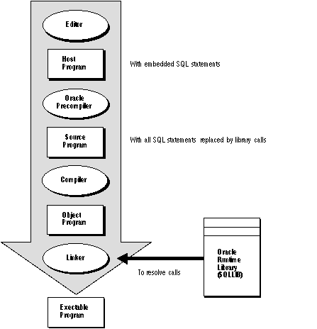
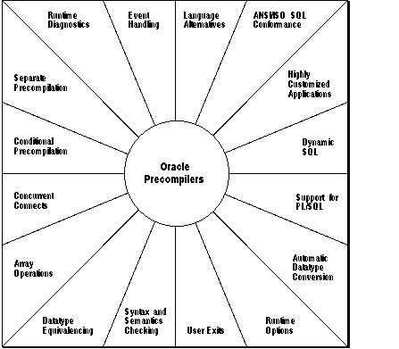

This chapter introduces you to the Oracle Precompilers. You look at their role in developing application programs that manipulate Oracle data and find out what they allow your applications to do. The following questions are answered:

- What Is an Oracle Precompiler?

- Why Use an Oracle Precompiler?

- Why Use SQL?

- Why Use PL/SQL?

- What Do the Oracle Precompilers Offer?

- Do the Oracle Precompilers Meet Industry Standards?

### 1.1 What Is an Oracle Precompiler?

An Oracle Precompiler is a programming tool that enables you to embed SQL statements in a high-level host program. As Figure 1-1 shows, the precompiler accepts the host program as input, translates the embedded SQL statements into standard Oracle run-time library calls, and generates a source program that you can compile, link, and execute.

Figure 1-1 Embedded SQL Program Development

[Description of "Figure 1-1 Embedded SQL Program Development"](img_text/image002.md)

#### 1.1.1 Language Alternatives

Two Oracle Precompilers are available (not on all systems); they support the following high-level languages:

- C/C++

- COBOL

Meant for different application areas and reflecting different design philosophies, these languages offer a broad range of programming solutions.

**Note:**

This guide is supplemented by companion books devoted to using precompilers with C/C++ and COBOL.

Pro\*FORTRAN and SQL\*Module for Ada are in "maintenance mode," which means that Version 1 of these products will not be enhanced with any additional features beyond those included with Release 1.6. However, Oracle will continue to issue patch releases as bugs are reported and corrected.

### 1.2 Why Use an Oracle Precompiler?

The Oracle Precompilers let you include the flexibility of SQL into your application programs. You can use SQL in popular high-level languages such as C and COBOL. A convenient, easy to use interface lets your application access Oracle directly.

Unlike many application development tools, the Oracle Precompilers let you create highly customized applications. For example, you can create user interfaces that incorporate the latest windowing and mouse technology. You can also create applications that run in the background without the need for user interaction.

Furthermore, with the Oracle Precompilers you can fine-tune your applications. They allow close monitoring of resource usage, SQL statement execution, and various run-time indicators. With this information, you can adjust program parameters for maximum performance.

### 1.3 Why Use SQL?

If you want to access and manipulate Oracle data, you need SQL. Whether you use SQL interactively or embedded in an application program depends on the job at hand. If the job requires the procedural processing power of C or COBOL, or must be done on a regular basis, use embedded SQL.

SQL has become the database language of choice because it is flexible, powerful, and easy to learn. Being nonprocedural, it lets you specify what you want done without specifying how to do it. A few English-like statements make it easy to manipulate Oracle data one row or many rows at a time.

You can execute any SQL (not SQL\*Plus) statement from an application program. For example, you can

- `CREATE`, `ALTER`, and `DROP` database tables dynamically

- `SELECT`, `INSERT`, `UPDATE`, and `DELETE` rows of data

- `COMMIT` or `ROLLBACK` transactions

Before embedding SQL statements in an application program, you can test them interactively using SQL\*Plus. Usually, only minor changes are required to switch from interactive to embedded SQL.

### 1.4 Why Use PL/SQL?

An extension to SQL, PL/SQL is a transaction processing language that supports procedural constructs, variable declarations, and robust error handling. Within the same PL/SQL block, you can use SQL and all the PL/SQL extensions.

The main advantage of embedded PL/SQL is better performance. Unlike SQL, PL/SQL enables group SQL statements logically and send them to Oracle in a block rather than one by one. This reduces network traffic and processing overhead.

For more information about PL/SQL including how to embed it in an application program, see [Running the Oracle Precompilers](running-Oracle-precompilers.md).

### 1.5 What Do the Oracle Precompilers Offer?

As Figure 1-2 shows, the Oracle Precompilers offer many features and benefits that help you to develop effective, reliable applications.

Figure 1-2 Features and Benefits

[Description of "Figure 1-2 Features and Benefits"](img_text/image003.md)

For example, the Oracle Precompilers allow you to

- program your application in any of six high-level languages

- confirm to the ANSI/ISO embedded SQL standard

- take advantage of dynamic SQL, an advanced programming technique that lets your program accept or build any valid SQL statement at run time

- design and develop highly customized applications

- convert automatically between Oracle internal datatypes and high-level language datatypes

- improve performance by embedding PL/SQL transaction processing blocks in your application program

- specify useful precompiler options and change their values during precompilation

- use datatype equivalencing to control the way Oracle interprets input data and formats output data

- precompile several program modules separately, then link them into one executable program

- check the syntax and semantics of embedded SQL data manipulation statements and PL/SQL blocks

- access Oracle databases on multiple nodes concurrently using SQL\*Net

- use arrays as input and output program variables

- precompile sections of code conditionally so that your host program can run in different environments

- interface with tools such as Oracle Forms and Oracle Reports through user exits written in a high-level language

- handle errors and warnings with the ANSI-approved status variables SQLSTATE and SQLCODE, and the SQL Communications Area (SQLCA) and WHENEVER statement

- use an enhanced set of diagnostics provided by the Oracle Communications Area (ORACA)

To sum it up, the Oracle Precompilers are full-featured tools that support a professional approach to embedded SQL programming.

### 1.6 Do the Oracle Precompilers Meet Industry Standards?

SQL has become the standard language for relational database management systems. This section describes how the Oracle Precompilers conform to the latest SQL standards established by the following organizations:

- American National Standards Institute (ANSI)

- International Standards Organization (ISO)

- U.S. National Institute of Standards and Technology (NIST)

Those organizations have adopted SQL as defined in the following publications:

- ANSI Document ANSI X3.135-1992, Database Language SQL

- International Standard ISO/IEC 9075:1992, Database Language SQL

- ANSI Document ANSI X3.168-1992, Database Language Embedded SQL

- NIST Federal Information Processing Standard FIPS PUB 127-2, Database Language SQL

#### 1.6.1 Requirements

ANSI X3.135-1992 (known informally as SQL92) specifies a "conforming SQL language" and, to allow implementation in stages, defines three language levels:

- Full SQL

- Intermediate SQL (a subset of Full SQL)

- Entry SQL (a subset of Intermediate SQL)

A conforming SQL implementation must support at least Entry SQL.

ANSI X3.168-1992 specifies the syntax and semantics for embedding SQL statements in application programs written in a standard programming language such as COBOL, FORTRAN, Pascal, or PL/I.

ISO/IEC 9075-1992 fully adopts the ANSI standards.

FIPS PUB 127-2, which applies to RDBMS software acquired for federal use, also adopts the ANSI standards. In addition, it specifies minimum sizing parameters for database constructs and requires a "FIPS Flagger" to identify ANSI extensions.

For copies of the ANSI standards, write to

American National Standards Institute 1430 Broadway New York, NY 10018, USA

For a copy of the ISO standard, write to the national standards office of any ISO participant. For a copy of the NIST standard, write to

National Technical Information ServiceU.S. Department of Commerce Springfield, VA 22161, USA

#### 1.6.2 Compliance

The Oracle Precompilers comply 100% with the ANSI, ISO, and NIST standards. As required, they support Entry SQL and provide a FIPS Flagger.

#### 1.6.3 FIPS Flagger

According to FIPS PUB 127-1, "an implementation that provides additional facilities not specified by this standard shall also provide an option to flag nonconforming SQL language or conforming SQL language that may be processed in a nonconforming manner." To meet this requirement, the Oracle Precompilers provide the FIPS Flagger, which flags ANSI extensions. An extension is any SQL element that violates ANSI format or syntax rules, except privilege enforcement rules. For a list of Oracle extensions to standard SQL, see the [Oracle Database SQL Language Reference](../sqlrf/Introduction-to-Oracle-SQL.md).

You can use the FIPS Flagger to identify

- nonconforming SQL elements that might have to be modified if you move the application to a conforming environment

- conforming SQL elements that might behave differently in another processing environment

Thus, the FIPS Flagger helps you develop portable applications.

#### 1.6.4 FIPS Option

An option named `FIPS` governs the FIPS Flagger. To enable the FIPS Flagger, you specify `FIPS=YES` inline or on the command line. For more information about the command-line option `FIPS`, see "[FIPS](running-Oracle-precompilers.md)".

#### 1.6.5 Certification

NIST tested the Oracle Precompilers for ANSI Entry SQL compliance using the SQL Test Suite, which consists of nearly 300 test programs. Specifically, the programs tested for conformance to the COBOL and FORTRAN embedded SQL standards. As a result, the Oracle Precompilers were certified 100% ANSI-compliant.

For more information about the tests, write to:

National Computer Systems Laboratory

Attn: Software Standards Testing Program

National Institute of Standards and Technology

Gaithersburg, MD 20899, USA
