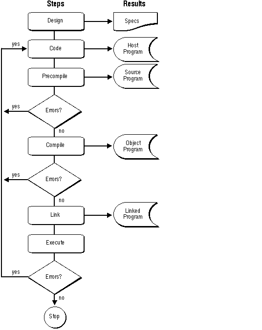

This chapter explains the following:

- Key Concepts of Embedded SQL Programming

- Steps in Developing an Embedded SQL Application

- A Sample Program

- Sample Tables

This chapter explains how embedded SQL programs function. You examine the special environment in which they operate and the impact of this environment on the design of your applications.

After covering the key concepts of embedded SQL programming and the steps you take in developing an application, this chapter uses a simple program to illustrate the main points.

### 2.1 Key Concepts of Embedded SQL Programming

This section lays the conceptual foundation on which later chapters build. It discusses the following topics:

- Embedded SQL Statements

- Executable versus Declarative Statements

- Embedded SQL Syntax

- Static versus Dynamic SQL Statements

- Embedded PL/SQL Blocks

- Host and Indicator Variables

- Oracle Datatypes

- Arrays

- Datatype Equivalencing

- Private SQL Areas\_ Cursors\_ and Active Sets

- Transactions

- Errors and Warnings

#### 2.1.1 Embedded SQL Statements

The term embedded SQL refers to SQL statements placed within an application program. Because the application program houses the SQL statements, it is called a host program, and the language in which it is written is called the host language. For example, with the Pro\*COBOL Precompiler you can embed SQL statements in a COBOL host program.

For example, to manipulate and query Oracle data, you use the `INSERT`, `UPDATE`, `DELETE`, and `SELECT` statements. `INSERT` adds rows of data to database tables, `UPDATE` modifies rows, `DELETE` removes unwanted rows, and `SELECT` retrieves rows that meet your search criteria.

The Oracle Precompilers support all Oracle statements. For example, the powerful `SET ROLE` statement lets you dynamically manage database privileges. A role is a named group of related system and object privileges, related system or object privileges granted to users or other roles. Role definitions are stored in the Oracle data dictionary. Your applications can use the `SET ROLE` statement to enable and disable roles as needed.

Only SQL statements--not SQL\*Plus statements--are valid in an application program. (SQL\*Plus has additional statements for setting environment parameters, editing, and report formatting.)

#### 2.1.2 Executable versus Declarative Statements

Embedded SQL includes all the interactive SQL statements plus others that allow you to transfer data between Oracle and a host program. There are two types of embedded SQL statements: executable and declarative.

Executable statements result in calls to the run-time library `SQLLIB`. You use them to connect to Oracle, to define, query, and manipulate Oracle data, to control access to Oracle data, and to process transactions. They can be placed wherever any other host-language executable statements can be placed.

Declarative statements, however, do not result in calls to `SQLLIB` and do not operate on Oracle data. You use them to declare Oracle objects, communications areas, and SQL variables. They can be placed wherever host-language declarations can be placed.

Table 2-1 groups the various embedded SQL statements and Table 2-2 groups the various executable SQL statements.

Table 2-1 Embedded SQL Statements

| Declarative SQL                                              | Description                    |
|:-------------------------------------------------------------|:-------------------------------|
| `STATEMENT`                                                  | PURPOSE                        |
| `ARRAYLEN`\*                                                 | To use host arrays with PL/SQL |
| `BEGIN` ` DECLARE` `SECTION`\* ` END` ` DECLARE` `SECTION`\* | To declare host variables      |
| `DECLARE`\*                                                  | To name Oracle objects         |
| `INCLUDE`\*                                                  | To copy in files               |
| `TYPE`\*                                                     | To equivalence datatypes       |
| `VAR`\*                                                      | To equivalence variables       |
| `WHENEVER`\*                                                 | To handle run-time errors      |

\*Has no interactive counterpart

Table 2-2 Executable SQL Statements and their Descriptions

| Executable SQL      | Descriptions                        |
|:--------------------|:------------------------------------|
| `STATEMENT`         | PURPOSE                             |
| `ALLOCATE`\*        | To define and control Oracle data   |
| `ALTER`             |                                     |
| `ANALYZE`           |                                     |
| `AUDIT`             |                                     |
| `COMMENT`           |                                     |
| `CONNECT`\*         |                                     |
| `CREATE`            |                                     |
| `DROP`              |                                     |
| `GRANT`             |                                     |
| `NOAUDIT`           |                                     |
| `RENAME`            |                                     |
| `REVOKE`            |                                     |
| `TRUNCATE`          |                                     |
| `CLOSE`\*           |                                     |
| `DELETE`            | To query and manipulate Oracle data |
| `EXPLAIN` `PLAN`    |                                     |
| `FETCH`\*           |                                     |
| `INSERT`            |                                     |
| `LOCK` `TABLE`      |                                     |
| `OPEN`\*            |                                     |
| `SELECT`            |                                     |
| `UPDATE`            |                                     |
| `COMMIT`            | To process transactions             |
| `ROLLBACK`          |                                     |
| `SAVEPOINT`         |                                     |
| `SET` `TRANSACTION` |                                     |
| `DESCRIBE`\*        | To use dynamic SQL                  |
| `EXECUTE`\*         |                                     |
| `PREPARE`\*         |                                     |
| `ALTER` `SESSION`   | To control sessions                 |
| `SET` `ROLE`        |                                     |

\*Has no interactive counterpart

#### 2.1.3 Embedded SQL Syntax

In your application program, you can freely intermix SQL statements with host-language statements and use host-language variables in SQL statements. The only special requirement for building SQL statements into your host program is that you begin them with the keywords EXEC SQL and end them with the SQL statement terminator for your host language. The precompiler translates all executable EXEC SQL statements into calls to the run-time library SQLLIB.

Most embedded SQL statements differ from their interactive counterparts only through the adding of a new clause or the use of program variables. Compare the following interactive and embedded ROLLBACK statements:

    ROLLBACK WORK; -- interactive
    EXEC SQL ROLLBACK WORK; -- embedded

For a summary of embedded SQL syntax, see the [Oracle Database SQL Language Reference](../sqlrf/Introduction-to-Oracle-SQL.md).

#### 2.1.4 Static versus Dynamic SQL Statements

Most application programs are designed to process static SQL statements and fixed transactions. In this case, you know the makeup of each SQL statement and transaction before run time. That is, you know which SQL commands will be issued, which database tables might be changed, which columns will be updated, and so on.

However, some applications are required to accept and process any valid SQL statement at run time. So, you might not know until then all the SQL commands, database tables, and columns involved.

Dynamic SQL is an advanced programming technique that lets your program accept or build SQL statements at run time and take explicit control over datatype conversion.

#### 2.1.5 Embedded PL/SQL Blocks

The Oracle Precompilers treat a PL/SQL block like a single embedded SQL statement. So, you can place a PL/SQL block anywhere in an application program that you can place a SQL statement. To embed PL/SQL in your host program, you simply declare the variables to be shared with PL/SQL and bracket the PL/SQL block with the keywords EXEC SQL EXECUTE and END-EXEC.

From embedded PL/SQL blocks, you can manipulate Oracle data flexibly and safely because PL/SQL supports all SQL data manipulation and transaction processing commands. For more information about PL/SQL, see [Using Embedded PL/SQL](using-embedded-PLSQL.md).

#### 2.1.6 Host and Indicator Variables

A host variable is a scalar or array variable declared in the host language and shared with Oracle, meaning that both your program and Oracle can reference its value. Host variables are the key to communication between Oracle and your program.

Your program uses input host variables to pass data to Oracle. Oracle uses output host variables to pass data and status information to your program. The program assigns values to input host variables; Oracle assigns values to output host variables.

Host variables can be used anywhere an expression can be used. But, in SQL statements, host variables must be prefixed with a colon (:) to set them apart from Oracle objects.

You can associate any host variable with an optional indicator variable. An indicator variable is an integer variable that "indicates" the value or condition of its host variable. You use indicator variables to assign nulls to input host variables and to detect nulls or truncated values in output host variables. A null is a missing, unknown, or inapplicable value.

In SQL statements, an indicator variable must be prefixed with a colon and appended to its associated host variable (unless, to improve readability, you precede the indicator variable with the optional keyword `INDICATOR`).

#### 2.1.7 Oracle Datatypes

Typically, a host program inputs data to Oracle, and Oracle outputs data to the program. Oracle stores input data in database tables and stores output data in program host variables. To store a data item, Oracle must know its datatype, which specifies a storage format and valid range of values.

Oracle recognizes two kinds of datatypes: internal and external. Internal datatypes specify how Oracle stores data in database columns. Oracle also uses internal datatypes to represent database pseudocolumns, which return specific data items but are not actual columns in a table.

External datatypes specify how data is stored in host variables. When your host program inputs data to Oracle, if necessary, Oracle converts between the external datatype of the input host variable and the internal datatype of the database column. When Oracle outputs data to your host program, if necessary, Oracle converts between the internal datatype of the database column and the external datatype of the output host variable.

#### 2.1.8 Arrays

The Oracle Precompilers let you define array host variables (called host arrays) and operate on them with a single SQL statement. Using the array `SELECT`, `FETCH`, `DELETE`, `INSERT`, and `UPDATE` statements, you can query and manipulate large volumes of data with ease.

#### 2.1.9 Datatype Equivalencing

The Oracle Precompilers add flexibility to your applications by letting you equivalence datatypes. That means you can customize the way Oracle interprets input data and formats output data.

On a variable-by-variable basis, you can equivalence supported host language datatypes to Oracle external datatypes.

#### 2.1.10 Private SQL Areas, Cursors, and Active Sets

To process a SQL statement, Oracle opens a work area called a private SQL area. The private SQL area stores information needed to execute the SQL statement. An identifier called a cursor lets you name a SQL statement, access the information in its private SQL area, and, to some extent, control its processing.

For static SQL statements, there are two types of cursors: implicit and explicit. Oracle implicitly declares a cursor for all data definition and data manipulation statements, including `SELECT` statements (queries) that return only one row. However, for queries that return more than one row, to process beyond the first row, you must explicitly declare a cursor (or use host arrays).

The set of rows retrieved is called the active set; its size depends on how many rows meet the query search condition. You use an explicit cursor to identify the row currently being processed, which is called the current row.

Imagine the set of rows being returned to a terminal screen. A screen cursor can point to the first row to be processed, then the next row, and so on. Similarly, an explicit cursor "points" to the current row in the active set, allowing your program to process the rows one at a time.

#### 2.1.11 Transactions

A transaction is a series of logically related SQL statements (two `UPDATE`s that credit one bank account and debit another, for example) that Oracle treats as a unit, so that all changes brought about by the statements are made permanent or undone at the same time. The current transaction consists of all data manipulation statements executed since the last data definition, `COMMIT`, or `ROLLBACK` statement was executed.

To help ensure the consistency of your database, the Oracle Precompilers let you define transactions by using the `COMMIT`, `ROLLBACK`, and `SAVEPOINT` statements. `COMMIT` makes permanent any changes made during the current transaction. `ROLLBACK` ends the current transaction and undoes any changes made since the transaction began. `SAVEPOINT` marks the current point in a transaction; used with `ROLLBACK`, it undoes part of a transaction.

#### 2.1.12 Errors and Warnings

When you execute an embedded SQL statement, it either succeeds or fails, and might result in an error or warning. You need a way to handle these results. The Oracle Precompilers provide four error handling mechanisms:

- `SQLCODE` status variable

- `SQLSTATE` status variable

- SQL Communications Area (SQLCA) and `WHENEVER` statement

- Oracle Communications Area (ORACA)

##### SQLCODE/SQLSTATE Status Variables

After executing a SQL statement, the Oracle Server returns a status code to a variable named `SQLCODE` or `SQLSTATE`. The status code indicates whether the SQL statement executed successfully or caused an error or warning condition.

##### SQLCA and WHENEVER Statement

The SQLCA is a data structure that defines program variables used by Oracle to pass run-time status information to the program. With the SQLCA, you can take different actions based on feedback from Oracle about work just attempted. For example, you can verify if a `DELETE` statement succeeded and if so, how many rows were deleted.

With the `WHENEVER` statement, you can specify actions to be taken automatically when Oracle detects an error or warning condition. These actions include continuing with the next statement, calling a subroutine, branching to a labeled statement, or stopping.

##### ORACA

When more information is needed about run-time errors than the SQLCA provides, you can use the ORACA. The ORACA is a data structure that handles Oracle communication. It contains cursor statistics, information about the current SQL statement, option settings, and system statistics.

### 2.2 Steps in Developing an Embedded SQL Application

Figure 2-1 walks you through the embedded SQL application development process.

Figure 2-1 Application Development Process

[Description of "Figure 2-1 Application Development Process"](img_text/image005.md)

As you can see, precompiling results in a source file that can be compiled normally. Although precompiling adds a step to the traditional development process, that step is well worth taking because it lets you write very flexible applications.

### 2.3 A Sample Program

A good way to get acquainted with embedded SQL is to look at a sample program example.

Handling errors with the `WHENEVER` statement, the following program connects to Oracle, prompts the user for an employee number, queries the database for the employee's name, salary, and commission, then displays the information and exits.

    -- declare host and indicator variables
    EXEC SQL BEGIN DECLARE SECTION;
     username CHARACTER(20);
     password CHARACTER(20);
     emp_number INTEGER;
     emp_name CHARACTER(10);
     salary REAL;
     commission REAL;
     ind_comm SMALLINT; -- indicator variable
    EXEC SQL END DECLARE SECTION;
    -- copy in the SQL Communications Area
    EXEC SQL INCLUDE SQLCA;
    display 'Username? ';
    read username;
    display 'Password? ';
    read password;
    -- handle processing errors
    EXEC SQL WHENEVER SQLERROR DO sql_error;
    -- log on to Oracle
    EXEC SQL CONNECT :username IDENTIFIED BY :password;
    display 'Connected to Oracle';
    display 'Employee number? ';
    read emp_number;
    -- query database for employee's name, salary, and commission
    -- and assign values to host variables
    EXEC SQL SELECT ENAME, SAL, COMM
     INTO :emp_name, :salary, :commission:ind_comm
     FROM EMP
     WHERE EMPNO = :emp_number;
    display 'Employee Salary Commission';
    display '-------- ------ ----------';
    -- display employee's name, salary, and commission (if not null)
    IF ind_comm = -1 THEN -- commission is null
     display emp_name, salary, 'Not applicable';
    ELSE
     display emp_name, salary, commission;
    ENDIF;
    -- release resources and log off the database
    EXEC SQL COMMIT WORK RELEASE;
    display 'Have a good day';
    exit program;
    ROUTINE sql_error
    BEGIN
     -- avoid an infinite loop if the rollback results in an error
     EXEC SQL WHENEVER SQLERROR CONTINUE;
     -- release resources and log off the database
     EXEC SQL ROLLBACK WORK RELEASE;
     display 'Processing error';
     exit program with an error;
    END sql_error;

### 2.4 Sample Tables

Most programming examples in this guide use two sample database tables: `DEPT` and `EMP`. Their definitions follow:

    CREATE TABLE DEPT
     (DEPTNO NUMBER(2),
     DNAME VARCHAR2(14),
     LOC VARCHAR2(13))
    CREATE TABLE EMP
     (EMPNO NUMBER(4) primary key,
     ENAME VARCHAR2(10),
     JOB VARCHAR2(9),
     MGR NUMBER(4),
     HIREDATE DATE,
     SAL NUMBER(7,2),
     COMM NUMBER(7,2),
     DEPTNO NUMBER(2))

#### 2.4.1 Sample Data

Respectively, the `DEPT` and `EMP` tables contain the following rows of data:

    DEPTNO DNAME LOC
    ------- ---------- ---------
    10 ACCOUNTING NEW YORK
    20 RESEARCH DALLAS
    30 SALES CHICAGO
    40 OPERATIONS BOSTON
    EMPNO ENAME JOB MGR HIREDATE SAL COMM DEPTNO
    ----- ------- --------- ------ --------- ------ ------ -------
     7369 SMITH CLERK 7902 17-DEC-80 800 20
     7499 ALLEN SALESMAN 7698 20-FEB-81 1600 300 30
     7521 WARD SALESMAN 7698 22-FEB-81 1250 500 30
     7566 JONES MANAGER 7839 02-APR-81 2975 20
     7654 MARTIN SALESMAN 7698 28-SEP-81 1250 1400 30
     7698 BLAKE MANAGER 7839 01-MAY-81 2850 30
     7782 CLARK MANAGER 7839 09-JUN-81 2450 10
     7788 SCOTT ANALYST 7566 19-APR-87 3000 20
     7839 KING PRESIDENT 17-NOV-81 5000 10
     7844 TURNER SALESMAN 7698 08-SEP-81 1500 30
     7876 ADAMS CLERK 7788 23-MAY-87 1100 20
     7900 JAMES CLERK 7698 03-DEC-81 950 30
     7902 FORD ANALYST 7566 03-DEC-81 3000 20
     7934 MILLER CLERK 7782 23-JAN-82 1300 10
