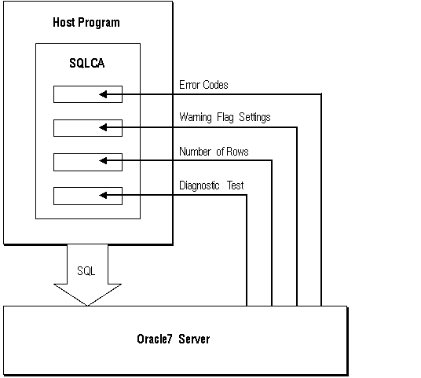
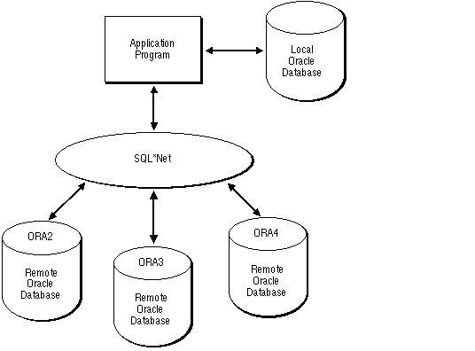
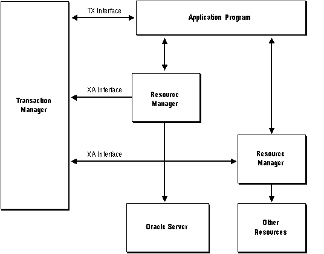

This chapter explains the following:

- The Declare Section

- INCLUDE Statements

- The SQLCA

- Oracle Datatypes

- Datatype Conversion

- Declaring and Referencing Host Variables

- Declaring and Referencing Indicator Variables

- Datatype Equivalencing

- Globalization Support

- Multibyte Globalization Support Character Sets

- Concurrent Logons

- Embedding OCI (Oracle Call Interface) Calls

- About Developing X/Open Applications

Passing data between Oracle and your application program requires host variables, datatype conversions, event handling, and access to Oracle. This chapter shows you how to meet these requirements. You learn the embedded SQL commands that declare variables, declare communication areas, and connect to an Oracle database. You also learn about the Oracle datatypes, Globalization Support (Globalization Support), data conversion, and how to take advantage of datatype equivalencing. The final two sections show you how to embed OCI calls in your program and how to develop X/Open applications.

### 3.1 The Declare Section

You must declare all program variables to be used in SQL statements (that is, all host variables) in the Declare Section. If you use an undeclared host variable in a SQL statement, the precompiler issues an error message. For a complete listing of error messages see [Oracle Database Error Messages](../errmg/index.md).

The Declare Section begins with the statement

    EXEC SQL BEGIN DECLARE SECTION;

and ends with the statement

    EXEC SQL END DECLARE SECTION;

In COBOL, the statement terminator is `END-EXEC`. In FORTRAN, it is a carriage return.

Between these two statements, only the following items are allowed:

- host-variable and indicator-variable declarations

- `EXEC SQL DECLARE` statements

- `EXEC SQL INCLUDE` statements

- `EXEC SQL VAR` statements

- `EXEC ORACLE` statements

- host-language comments

Multiple Declare Sections are allowed in each precompiled unit. Furthermore, a host program can contain several independently precompiled units.

#### 3.1.1 An Example

In the following example, you declare four host variables for use later in your program.

    EXEC SQL BEGIN DECLARE SECTION;
     emp_number INTEGER;
     emp_name CHARACTER(10);
     salary REAL;
     commission REAL;
    EXEC SQL END DECLARE SECTION;

For more information about declaring host variables, see "Declaring and Referencing Host Variables".

### 3.2 INCLUDE Statements

The `INCLUDE` statement lets you copy files into your host program. It is similar to the COBOL `COPY` command. An example follows:

    -- copy in the SQLCA file
    EXEC SQL INCLUDE SQLCA;

When you precompile your program, each `EXEC SQL INCLUDE` statement is replaced by a copy of the file named in the statement.

You can include any file. If a file contains embedded SQL, you must include it because only included files are precompiled. If you do not specify a file extension, the precompiler assumes the default extension for source files, which is language-dependent (see your host-language supplement to this Guide).

You can set a directory path for included files by specifying the precompiler option

    INCLUDE=<path>

where path defaults to the current directory. (In this context, a directory is an index of file locations.)

The precompiler searches first in the current directory, then in the directory specified by `INCLUDE`, and finally in a directory for standard `INCLUDE` files. So, you need not specify a directory path for standard files such as the SQLCA and ORACA. You must still use `INCLUDE` to specify a directory path for nonstandard files unless they are stored in the current directory.

If your operating system is case-sensitive (like UNIX for example), be sure to specify the same upper/lowercase filename under which the file is stored. The syntax for specifying a directory path is system-specific. Check your system-specific Oracle manuals.

### 3.3 The SQLCA

The SQLCA is a data structure that provides for diagnostic checking and event handling. At run time, the SQLCA holds status information passed to your program by Oracle. After executing a SQL statement, Oracle sets SQLCA variables to indicate the outcome, as illustrated in Figure 3-1.

Figure 3-1 Updating the SQLCA

[Description of "Figure 3-1 Updating the SQLCA"](img_text/image006.md)

Thus, you can verify if an `INSERT`, `UPDATE`, or `DELETE` statement succeeded and if so, how many rows were affected. Or, if the statement failed, you can get more information about what happened.

When `MODE={ANSI13|ORACLE}`, you must declare the SQLCA by hardcoding it or by copying it into your program with the `INCLUDE` statement. "[About Using the SQL Communications Area](error-handling-diagnostics.md)" shows you how to declare and use the SQLCA.

### 3.4 Oracle Datatypes

Oracle recognizes two kinds of datatypes: internal and external. Internal datatypes specify how Oracle stores data in database columns. Oracle also uses internal datatypes to represent database pseudocolumns. An external datatype specifies how data is stored in a host variable.

At precompile time, each host variable in the Declare Section is associated with an external datatype code. At run time, the datatype code of every host variable used in a SQL statement is passed to Oracle. Oracle uses the codes to convert between internal and external datatypes.

**Note:**

You can override default datatype conversions by using dynamic SQL Method 4 or datatype equivalencing. For information about dynamic SQL Method 4, see "[Using Method 4](using-dynamic-SQL.md)". For information about datatype equivalencing, see "Datatype Equivalencing".

#### 3.4.1 Internal Datatypes

Table 3-1 lists the internal datatypes that Oracle uses for database columns and pseudocolumns.

Table 3-1 Column and Pseudo Column Datatypes

| Name         | Code | Description                                      |
|:-------------|:-----|:-------------------------------------------------|
| `CHAR`       | 96   | \<= 255-byte, fixed-length string                |
| `DATE`       | 12   | 7-byte, fixed-length date/time value             |
| `LONG`       | 8    | \<= 2147483647-byte, variable-length string      |
| `LONG` `RAW` | 24   | \<= 2147483647-byte, variable-length binary data |
| `MLSLABEL`   | 105  | \<= 5-byte, variable-length binary label         |
| `NUMBER`     | 2    | fixed or floating point number                   |
| `RAW`        | 23   | \<= 255-byte, variable-length binary data        |
| `ROWID`      | 11   | fixed-length binary value                        |
| `VARCHAR2`   | 1    | \<= 2000-byte, variable-length string            |

These internal datatypes can be quite different from host-language datatypes. For example, the `NUMBER` datatype was designed for portability, precision (no rounding error), and correct collating. No host language has an equivalent datatype.

Brief descriptions of the internal datatypes follow. For more information, see [Data Types](../sqlrf/Data-Types.md).

#### 3.4.2 CHAR

You use the `CHAR` datatype to store fixed-length character data. How the data is represented internally depends on the database character set. The `CHAR` datatype takes an optional parameter that lets you specify a maximum width up to 255 bytes. The syntax follows:

    CHAR[(maximum_width)]

You cannot use a constant or variable to specify the maximum width; you must use an integer literal. If you do not specify the maximum width, it defaults to 1. Remember, you specify the maximum width of a `CHAR`(n) column in bytes, not characters. So, if a `CHAR`(n) column stores multibyte (2-byte) characters, its maximum width is less than n/2 characters.

#### 3.4.3 DATE

You use the `DATE` datatype to store dates and times in 7-byte, fixed-length fields. The date portion defaults to the first day of the current month; the time portion defaults to midnight.

Internally, `DATE`s are stored in a binary format. When converting a `DATE` column value to a character string in your program, Oracle uses the default format mask for your session. If you need other date/time information such as the date in Julian days, use the `TO_CHAR` function with a format mask. Always convert `DATE` column values to and from character strings using (external) character datatypes such as `VARCHAR2` or `STRING`.

#### 3.4.4 LONG

You use the `LONG` datatype to store variable-length character strings. `LONG` columns can store text, arrays of characters, or even short documents. The `LONG` datatype is like the `VARCHAR2` datatype, except the maximum width of a `LONG` column is 2147483647 bytes or two gigabytes.

You can use `LONG` columns in `UPDATE`, `INSERT`, and (most) `SELECT` statements, but not in expressions, function calls, or SQL clauses such as `WHERE`, `GROUP` `BY`, and `CONNECT` `BY`. Only one `LONG` column is allowed in each database table and that column cannot be indexed.

#### 3.4.5 LONG RAW

You use the `LONG` `RAW` datatype to store variable-length binary data or byte strings. The maximum width of a `LONG` `RAW` column is 2147483647 bytes or two gigabytes.

`LONG` `RAW` data is like `LONG` data, except that Oracle assumes nothing about the meaning of `LONG` `RAW` data and does no character set conversions when you transmit `LONG` `RAW` data from one system to another. The restrictions that apply to `LONG` data also apply to `LONG` `RAW` data.

#### 3.4.6 MLSLABEL

You use the `MLSLABEL` datatype to store variable-length, binary operating system labels. Oracle uses labels to control access to data.

You can use the `MLSLABEL` datatype to define a database column. You can insert any valid operating system label into a column of type `MLSLABEL`. If the label is in text format, Oracle converts it to a binary value automatically. The text string can be up to 255 bytes long. However, the internal length of an `MLSLABEL` value is between 2 and 5 bytes.

You can also select values from a `MLSLABEL` column into a character variable. Oracle converts the internal binary value to a `VARCHAR2` value automatically.

#### 3.4.7 NUMBER

You use the `NUMBER` datatype to store fixed or floating point numbers of virtually any size. You can specify precision, which is the total number of digits, and scale, which determines where rounding occurs.

The maximum precision of a `NUMBER` value is 38; the magnitude range is 1.0E-129 to 9.99E125. Scale can range from -84 to 127. For example, a scale of -3 means the number is rounded to the nearest thousand (3456 becomes 3000). A scale of 2 means the value is rounded to the nearest hundredth (3.456 becomes 3.46).

When you specify precision and scale, Oracle does extra integrity checks before storing the data. If a value exceeds the precision, Oracle issues an error message; if a value exceeds the scale, Oracle rounds the value.

#### 3.4.8 RAW

You use the `RAW` datatype to store binary data or byte strings (a sequence of graphics characters, for example). `RAW` data is not interpreted by Oracle.

The `RAW` datatype takes a required parameter that lets you specify a maximum width up to 255 bytes. The syntax follows:

    RAW(maximum_width)

You cannot use a constant or variable to specify the maximum width; you must use an integer literal.

`RAW` data is like `CHAR` data, except that Oracle assumes nothing about the meaning of `RAW` data and does no character set conversions (from 7-bit ASCII to EBCDIC Code Page 500 for example) when you transmit `RAW` data from one system to another.

#### 3.4.9 ROWID

Internally, every table in an Oracle database has a pseudocolumn named `ROWID`, which stores binary values called rowids. `ROWID`s uniquely identify rows and provide the fastest way to access particular rows.

#### 3.4.10 VARCHAR2

You use the `VARCHAR2` datatype to store variable-length character strings. How the strings are represented internally depends on the database character set, which might be 7-bit ASCII or EBCDIC Code Page 500 for example.

The maximum width of a `VARCHAR2` database column is 2000 bytes. To define a `VARCHAR2` column, you use the syntax

    VARCHAR2(maximum_width)

where maximum_width is an integer literal in the range 1 .. 2000.

You specify the maximum width of a `VARCHAR2`(n) column in bytes, not characters. So, if a `VARCHAR2`(n) column stores multibyte (2-byte) characters, its maximum width is less than n/2 characters.

#### 3.4.11 SQL Pseudocolumns and Functions

SQL recognizes the pseudocolumns in Table 3-2, which return specific data items:

Table 3-2 Pseudo Column Datatypes

| Pseudocolumn | Internal Datatype |
|:-------------|:------------------|
| `CURRVAL`    | `NUMBER`          |
| `LEVEL`      | `NUMBER`          |
| `NEXTVAL`    | `NUMBER`          |
| `ROWID`      | `ROWID`           |
| `ROWLABEL`   | `MLSLABEL`        |
| `ROWNUM`     | `NUMBER`          |

Pseudocolumns are not actual columns in a table. However, pseudocolumns are treated like columns, so their values must be SELECTed from a table. Sometimes it is convenient to select pseudocolumn values from a dummy table.

In addition, SQL recognizes the parameterless functions in Table 3-3, which also return specific data items.

Table 3-3 Parameterless Function Datatypes

| Function  | Internal Datatype |
|:----------|:------------------|
| `SYSDATE` | `DATE`            |
| `UID`     | `NUMBER`          |
| `USER`    | `VARCHAR2`        |

You can refer to SQL pseudocolumns and functions in `SELECT`, `INSERT`, `UPDATE`, and `DELETE` statements. In the following example, you use `SYSDATE` to compute the number of months since an employee was hired:

    EXEC SQL SELECT MONTHS_BETWEEN(SYSDATE, HIREDATE)
     INTO :months_of_service
     FROM EMP
     WHERE EMPNO = :emp_number;

Brief descriptions of the SQL pseudocolumns and functions follow. For details, see the [Oracle Database SQL Language Reference](../sqlrf/Introduction-to-Oracle-SQL.md).

CURRVAL returns the current number in a specified sequence. Before you can reference `CURRVAL`, you must use `NEXTVAL` to generate a sequence number.

LEVEL returns the level number of a node in a tree structure. The root is level 1, children of the root are level 2, grandchildren are level 3, and so on.

`LEVEL` is used in the `SELECT` `CONNECT` `BY` statement to incorporate some or all the rows of a table into a tree structure. In an `ORDER` `BY` or `GROUP` `BY` clause, `LEVEL` segregates the data at each level in the tree.

You specify the direction in which the query walks the tree (down from the root or up from the branches) with the PRIOR operator. In the `START` `WITH` clause, you specify a condition that identifies the root of the tree.

NEXTVAL returns the next number in a specified sequence. After creating a sequence, you can use it to generate unique sequence numbers for transaction processing. In the following example, you use the sequence named partno to assign part numbers:

    EXEC SQL INSERT INTO PARTS
     VALUES (partno.NEXTVAL, :description, :quantity, :price);

If a transaction generates a sequence number, the sequence is incremented when you commit or rollback the transaction. A reference to `NEXTVAL` stores the current sequence number in `CURRVAL`.

ROWID returns a row address in hexadecimal.

ROWNUM returns a number indicating the sequence in which a row was selected from a table. The first row selected has a `ROWNUM` of 1, the second row has a `ROWNUM` of 2, and so on. If a `SELECT` statement includes an `ORDER` `BY` clause, `ROWNUM`s are assigned to the selected rows before the sort is done.

You can use `ROWNUM` to limit the number of rows returned by a `SELECT` statement. Also, you can use `ROWNUM` in an `UPDATE` statement to assign unique values to each row in a table. Using `ROWNUM` in the `WHERE` clause does not stop the processing of a `SELECT` statement; it just limits the number of rows retrieved. The only meaningful use of `ROWNUM` in a WHERE clause is

    ... WHERE ROWNUM < constant;

because the value of `ROWNUM` increases only when a row is retrieved. The following search condition can never be met because the first four rows are not retrieved:

    ... WHERE ROWNUM = 5;

SYSDATE returns the current date and time.

UID returns the unique ID number assigned to an Oracle user.

USER returns the username of the current Oracle user.

#### 3.4.12 ROWLABEL Column

SQL also recognizes the special column `ROWLABEL`, which Oracle creates for every database table. Like other columns, `ROWLABEL` can be referenced in SQL statements. `ROWLABEL` returns the operating system label for a row.

A common use of `ROWLABEL` is to filter query results. For example, the following statement counts only those rows with a security level higher than "unclassified":

    EXEC SQL SELECT COUNT(*) INTO :head_count FROM EMP
     WHERE ROWLABEL > 'UNCLASSIFIED';

#### 3.4.13 External Datatypes

As Table 3-4 shows, the external datatypes include all the internal datatypes plus several datatypes found in other supported host languages. For example, the `STRING` external datatype refers to a C null-terminated string, and the `DECIMAL` datatype refers to COBOL packed decimals. You use the datatype names in datatype equivalencing, and you use the datatype codes in dynamic SQL Method 4.

Table 3-4 External Datatypes

| Name             | Code | Description                                                                                                |
|:-----------------|:-----|:-----------------------------------------------------------------------------------------------------------|
| `CHAR`           | 1 96 | \<= 65535-byte, variable-length character string \<=65535-byte, fixed-length character string (see note 1) |
| `CHARF`          | 96   | \<= 65535-byte, fixed-length character string                                                              |
| `CHARZ`          | 97   | \<= 65535-byte, fixed-length, null-terminated string (see note 2)                                          |
| `DATE`           | 12   | 7-byte, fixed-length date/time value                                                                       |
| `DECIMAL`        | 7    | COBOL packed decimal                                                                                       |
| `DISPLAY`        | 91   | COBOL numeric character string                                                                             |
| `FLOAT`          | 4    | 4-byte or 8-byte floating-point number                                                                     |
| `INTEGER`        | 3    | 2-byte or 4-byte signed integer                                                                            |
| `LONG`           | 8    | \<= 2147483647-byte, fixed-length string                                                                   |
| `LONG` `RAW`     | 24   | \<= 217483647-byte, fixed-length binary data (see note 3)                                                  |
| `LONG` `VARCHAR` | 94   | \<= 217483643-byte, variable-length string (see note 3)                                                    |
| `LONG` `VARRAW`  | 95   | \<= 217483643-byte, variable-length binary data                                                            |
| `MLSLABEL`       | 106  | 2..5-byte, variable-length binary data                                                                     |
| `NUMBER`         | 2    | integer or floating-point number                                                                           |
| `RAW`            | 23   | \<= 65535-byte, fixed-length binary data (see note 2)                                                      |
| `ROWID`          | 11   | (typically) 13-byte, fixed-length binary value                                                             |
| `STRING`         | 5    | \<= 65535-byte, variable-length, null-terminated character string (see note 2)                             |
| `UNSIGNED`       | 68   | 2-byte or 4-byte unsigned integer                                                                          |
| `VARCHAR`        | 9    | \<= 65533-byte, variable-length character string (see note 3)                                              |
| `VARCHAR2`       | 1    | \<= 65535-byte, variable-length character string (see note 2)                                              |
| `VARNUM`         | 6    | variable-length binary number                                                                              |
| `VARRAW`         | 15   | \<= 65533-byte, variable-length binary data (see note 3)                                                   |

**Note:**

1.  `CHAR` is datatype 1 when `MODE={ORACLE|ANSI13|ANSI14}` and datatype 96 when `MODE=ANSI`.

2.  Maximum size is 32767 (32K) on some platforms.

3.  Do not include the n-byte length field in an `EXEC SQL VAR` statement.

#### 3.4.14 CHAR

CHAR behavior depends on the settings of the options DBMS and MODE.

#### 3.4.15 CHARF

When MODE=ANSI, Oracle assigns the CHAR datatype to all character host variables. You use the CHAR datatype to store fixed-length character strings. On most platforms, the maximum length of a CHAR value is 65535 (64K) bytes. See [Table 6-4](running-Oracle-precompilers.md) for more information about the relationship between the DBMS and MODE options.

On Input. Oracle reads the number of bytes specified for the input host variable, does not strip trailing blanks, then stores the input value in the target database column.

If the input value is longer than the defined width of the database column, Oracle generates an error. If the input value is all-blank, Oracle treats it like a character value.

On Output. Oracle returns the number of bytes specified for the output host variable, blank-padding if necessary, then assigns the output value to the target host variable. If a null is returned, Oracle fills the host variable with blanks.

If the output value is longer than the declared length of the host variable, Oracle truncates the value before assigning it to the host variable. If an indicator variable is available, Oracle sets it to the original length of the output value.

#### 3.4.16 CHARZ

You use the `CHARZ` datatype to store fixed-length, null-terminated character strings. On most platforms, the maximum length of a `CHARZ` value is 65,535 bytes. You should not need this external type in Pro\*COBOL or Pro\*FORTRAN.

On input, the `CHARZ` and `STRING` datatypes work the same way. You must null-terminate the input value. The null terminator serves only to delimit the string; it is not part of the data.

On output, the `CHARZ` and `CHAR` datatypes work the same way. Oracle appends a null terminator to the output value, which is also blank-padded if necessary.

#### 3.4.17 DATE

You use the `DATE` datatype to store dates and times in 7-byte, fixed-length fields. As Table 3-5 shows, the century, year, month, day, hour (in 24-hour format), minute, and second are stored in that order from left to right.

Table 3-5 DATE Datatype Example

| Byte                              | 1       | 2    | 3     | 4   | 5    | 6      | 7      |
|:----------------------------------|:--------|:-----|:------|:----|:-----|:-------|:-------|
| Meaning                           | Century | Year | Month | Day | Hour | Minute | Second |
| Example 17-OCT-1994 at 1:23:12 PM | 119     | 194  | 10    | 17  | 14   | 24     | 13     |

The century and year bytes are in excess-100 notation. The hour, minute, and second are in excess-1 notation. Dates before the Common Era (B.C.E.) are less than 100. The epoch is January 1, 4712 B.C.E. For this date, the century byte is 53 and the year byte is 88. The hour byte ranges from 1 to 24. The minute and second bytes range from 1 to 60. The time defaults to midnight (1, 1, 1).

#### 3.4.18 DECIMAL

With Pro\*COBOL, you use the `DECIMAL` datatype to store packed decimal numbers for calculation. In COBOL, the host variable must be a signed COMP-3 field with an implied decimal point. If significant digits are lost during data conversion, Oracle fills the host variable with asterisks.

#### 3.4.19 DISPLAY

With Pro\*COBOL, you use the `DISPLAY` datatype to store numeric character data. The `DISPLAY` datatype refers to a COBOL "DISPLAY SIGN LEADING SEPARATE" number, which typically requires n + 1 bytes of storage for PIC S9(n), and n + d + 1 bytes of storage for PIC S9(n)V9(d).

#### 3.4.20 FLOAT

You use the `FLOAT` datatype to store numbers that have a fractional part or that exceed the capacity of the `INTEGER` datatype. The number is represented using the floating-point format of your computer and typically requires 4 or 8 bytes of storage. You must specify a length for input and output host variables.

Oracle can represent numbers with greater precision than floating point implementations because the internal format of Oracle numbers is decimal.

**Note:**

In SQL statements, when comparing `FLOAT` values, use the SQL function `ROUND` because `FLOAT` stores binary (not decimal) numbers; so, fractions do not convert exactly.

#### 3.4.21 INTEGER

You use the `INTEGER` datatype to store numbers that have no fractional part. An integer is a signed, 2- or 4-byte binary number. The order of the bytes in a word is system-dependent. You must specify a length for input and output host variables. On output, if the column value is a floating point number, Oracle truncates the fractional part.

#### 3.4.22 LONG

You use the `LONG` datatype to store fixed-length character strings. The `LONG` datatype is like the `VARCHAR2` datatype, except that the maximum length of a `LONG` value is 2147483647 bytes (two gigabytes).

#### 3.4.23 LONG RAW

You use the `LONG` `RAW` datatype to store fixed-length, binary data or byte strings. The maximum length of a `LONG` `RAW` value is 2147483647 bytes (two gigabytes).

`LONG` `RAW` data is like `LONG` data, except that Oracle assumes nothing about the meaning of `LONG` `RAW` data and does no character set conversions when you transmit `LONG` `RAW` data from one system to another.

#### 3.4.24 LONG VARCHAR

You use the `LONG` `VARCHAR` datatype to store variable-length character strings. `LONG` `VARCHAR` variables have a 4-byte length field followed by a string field. The maximum length of the string field is 2147483643 bytes. In an `EXEC SQL VAR` statement, do not include the 4-byte length field.

#### 3.4.25 LONG VARRAW

You use the `LONG VARRAW` datatype to store binary data or byte strings. `LONG` `VARRAW` variables have a 4-byte length field followed by a data field. The maximum length of the data field is 2147483643 bytes. In an `EXEC` `SQL` `VAR` statement, do not include the 4-byte length field.

#### 3.4.26 MLSLABEL

You use the `MLSLABEL` datatype to store variable-length, binary operating system labels. Oracle uses labels to control access to data. You can use the `MLSLABEL` datatype to define a column. You can insert any valid operating system label into a column of type `MLSLABEL`.

On Input. Oracle translates the input value into a binary label, which must be a valid operating system label. If the label is invalid, Oracle issues an error message. If the label is valid, Oracle stores it in the target database column.

On Output. Oracle converts the binary label to a character string, which can be of type `CHAR`, `CHARZ`, `STRING`, `VARCHAR`, or `VARCHAR2`.

#### 3.4.27 NUMBER

You use the `NUMBER` datatype to store fixed or floating point Oracle numbers. You can specify precision and scale. The maximum precision of a `NUMBER` value is 38; the magnitude range is 1.0E-129 to 9.99E125. Scale can range from -84 to 127.

`NUMBER` values are stored in variable-length format, starting with an exponent byte and followed by up to 20 mantissa bytes. The high-order bit of the exponent byte is a sign bit, which is set for positive numbers. The low-order 7 bits represent the exponent, which is a base-100 digit with an offset of 65.

Each mantissa byte is a base-100 digit in the range 1 .. 100. For positive numbers, 1 is added to the digit. For negative numbers, the digit is subtracted from 101, and, unless there are 20 mantissa bytes, a byte containing 102 is appended to the data bytes. Each mantissa byte can represent two decimal digits. The mantissa is normalized and leading zeros are not stored. You can use up to 20 data bytes for the mantissa but only 19 are guaranteed accurate. The 19 bytes, each representing a base-100 digit, allow a maximum precision of 38 digits.

On output, the host variable contains the number as represented internally by Oracle. To accommodate the largest possible number, the output host variable must be 21 bytes long. Only the bytes used to represent the number are returned. Oracle does not blank-pad or null-terminate the output value. If you need to know the length of the returned value, use the `VARNUM` datatype instead. Normally, there is little reason to use this datatype.

#### 3.4.28 RAW

You use the `RAW` datatype to store fixed-length binary data or byte strings. On most platforms, the maximum length of a `RAW` value is 65535 bytes. `RAW` data is like `CHAR` data, except that Oracle assumes nothing about the meaning of `RAW` data and does no character set conversions when you transmit RAW data from one system to another.

#### 3.4.29 ROWID

You use the `ROWID` datatype to store binary rowids in (typically 13-byte) fixed-length fields. The field size is port-specific. So, check your system-specific Oracle manuals. You can use `VARCHAR2` host variables to store rowids in a readable format. When you select or fetch a rowid into a `VARCHAR2` host variable, Oracle converts the binary value to an 18-byte character string and returns it in the format

    BBBBBBBB.RRRR.FFFF

where BBBBBBBB is the block in the database file, RRRR is the row in the block (the first row is 0), and FFFF is the database file. These numbers are hexadecimal. For example, the rowid

    0000000E.000A.0007

points to the 11th row in the 15th block in the 7th database file.

Typically, you fetch a rowid into a `VARCHAR2` host variable, then compare the host variable to the `ROWID` pseudocolumn in the `WHERE` clause of an `UPDATE` or `DELETE` statement. That way, you can identify the latest row fetched by a cursor.

**Note:**

If you need full portability or your application communicates with a non-Oracle database through Transparent Gateway, specify a maximum length of 256 (not 18) bytes when declaring the `VARCHAR2` host variable. If your application communicates with a non-Oracle data source through Oracle Open Gateway, specify a maximum length of 256 bytes. Though you can assume nothing about its contents, the host variable will behave normally in SQL statements.

#### 3.4.30 STRING

The `STRING` datatype is like the `VARCHAR2` datatype, except that a `STRING` value is always null-terminated.

On Input. Oracle uses the specified length to limit the scan for a null terminator. If a null terminator is not found, Oracle generates an error. If you do not specify a length, Oracle assumes the maximum length, which is 65535 on most platforms.

The minimum length of a `STRING` value is 2 bytes. If the first character is a null terminator and the specified length is 2, Oracle inserts a null unless the column is defined as `NOT` `NULL`. An all-blank or nullterminated value is stored intact.

On Output. Oracle appends a null byte to the last character returned. If the string length exceeds the specified length, Oracle truncates the output value and appends a null byte.

#### 3.4.31 UNSIGNED

You use the `UNSIGNED` datatype to store unsigned integers. An unsigned integer is a binary number of 2 or 4 bytes. The order of the bytes in a word is system-dependent. You must specify a length for input and output host variables. On output, if the column value is a floating point number, Oracle truncates the fractional part. You should not need this external type in Pro\*COBOL or Pro\*FORTRAN.

#### 3.4.32 VARCHAR

You use the `VARCHAR` datatype to store variable-length character strings. `VARCHAR` variables have a 2-byte length field followed by a \<= 65533-byte string field. However, for `VARCHAR` array elements, the maximum length of the string field is 65530 bytes. When you specify the length of a `VARCHAR` variable, be sure to include 2 bytes for the length field. For longer strings, use the `LONG` `VARCHAR` datatype. In an `EXEC` `SQL` `VAR` statement, do not include the 2-byte length field.

#### 3.4.33 VARCHAR2

When `MODE=ORACLE`, Oracle assigns the `VARCHAR2` datatype to all character host variables. You use the `VARCHAR2` datatype to store variable-length character strings. On most platforms, the maximum length of a `VARCHAR2` value is 65535 bytes.

You specify the maximum length of a `VARCHAR2`(n) value in bytes, not characters. So, if a `VARCHAR2`(n) variable stores multibyte characters, its maximum length is less than n characters.

On Input. Oracle reads the number of bytes specified for the input host variable, strips any trailing blanks, then stores the input value in the target database column. Be careful. An uninitialized host variable can contain nulls. So, always blank-pad a character input host variable to its declared length. (COBOL PIC X(n) and FORTRAN CHARACTER\*n variables do this automatically.)

If the input value is longer than the defined width of the database column, Oracle generates an error. If the input value is all-blank, Oracle treats it like a null.

Oracle can convert a character value to a `NUMBER` column value if the character value represents a valid number. Otherwise, Oracle generates an error.

On Output. Oracle returns the number of bytes specified for the output host variable, blank-padding if necessary, then assigns the output value to the target host variable. If a null is returned, Oracle fills the host variable with blanks.

If the output value is longer than the declared length of the host variable, Oracle truncates the value before assigning it to the host variable. If an indicator variable is available, Oracle sets it to the original length of the output value.

Oracle can convert `NUMBER` column values to character values. The length of the character host variable determines precision. If the host variable is too short for the number, scientific notation is used. For example, if you select the column value abcdefg89 into a host variable of length 6, Oracle returns the value "1.2E08" to the host variable.

#### 3.4.34 VARNUM

The `VARNUM` datatype is like the `NUMBER` datatype, except that the first byte of a `VARNUM` variable stores the length of the value. On input, you must set the first byte of the host variable to the length of the value. On output, the host variable contains the length followed by the number as represented internally by Oracle. To accommodate the largest possible number, the host variable must be 22 bytes long. After selecting a column value into a `VARNUM` host variable, you can check the first byte to get the length of the value.

#### 3.4.35 VARRAW

You use the `VARRAW` datatype to store variable-length binary data or byte strings. The `VARRAW` datatype is like the RAW datatype, except that `VARRAW` variables have a 2-byte length field followed by a \<=65533-byte data field. For longer strings, use the `LONG` `VARRAW` datatype. In an `EXEC` `SQL` `VAR` statement, do not include the 2-byte length field. To get the length of a `VARRAW` variable, simply refer to its length field.

### 3.5 Datatype Conversion

At precompile time, an external datatype is assigned to each host variable in the Declare Section. For example, the precompiler assigns the `INTEGER` external datatype to integer host variables. At run time, the datatype code of every host variable used in a SQL statement is passed to Oracle. Oracle uses the codes to convert between internal and external datatypes.

Before assigning a selected column (or pseudocolumn) value to an output host variable, if necessary, Oracle converts the internal datatype of the column to the datatype of the host variable. Likewise, before assigning or comparing the value of an input host variable to a database column, if necessary, Oracle converts the external datatype of the host variable to the internal datatype of the column.

However, the datatype of the host variable must be compatible with that of the database column. It is your responsibility to make sure that values are convertible. For example, if you try to convert the string value "YESTERDAY" to a `DATE` column value, you get an error.

Conversions between internal and external datatypes follow the usual data conversion rules. For instance, you can convert a `CHAR` value of "1234" to a 2-byte integer. But, you cannot convert a `CHAR` value of "65543" (number too large) or "10F" (number not decimal) to a 2-byte integer. Likewise, you cannot convert a string value that contains alphabetic characters to a `NUMBER` value.

Number conversion follows the conventions specified by Globalization Support (Globalization Support) parameters in the Oracle initialization file. For example, your system might be configured to recognize a comma (,) instead of a period (.) as the decimal character.

Table 3-6 shows the supported conversions between internal and external datatypes.

**Note:**

Legend:

- On input, host string must be in Oracle 'BBBBBBBB.RRRR.FFFF' format.

  I = input only On output, column value is returned in same format.

  O = output only

- On input, host string must be the default DATE character format.

  I/O = input or output On output, column value is returned in same format

- On input, host string must be in hexadecimal format. On output, column value is returned in same format.

- On output, column value must represent a valid number.

- On input, length must be less than or equal to 2000.

- On input, column value is stored in hexadecimal format. On output, column value must be in hexadecimal format.

- On input, host string must be a valid operating system label in text format. On output, column value is returned in same format.

- On input, host string must be a valid operating system label in raw format. On output, column value is returned in same format.

Table 3-6 Conversion Between Internal and External Datatypes

| External         | Internal — CHAR | Internal — DATE | Internal — LONG | Internal — LONG RAW | Internal — MLSLABEL | Internal — NUMBER | Internal — RAW | Internal — ROWID | Internal — VARCHAR2 |
|:-----------------|:----------------|:----------------|:----------------|:--------------------|:--------------------|:------------------|:---------------|:-----------------|:--------------------|
| `CHAR`           | I/O             | I/O             | I/O             | I                   | I/O                 | I/O               | I/O            | I/O              | I/O                 |
| `CHARF`          | I/O             | I/O             | I/O             | I                   | I/O                 | I/O               | I/O            | I/O              | I/O                 |
| `CHARZ`          | I/O             | I/O             | I/O             | I                   | I/O                 | I/O               | I/O            | I/O              | I/O                 |
| `DATE`           | I/O             | I/O             | I               |                     |                     |                   |                |                  | I/O                 |
| `DECIMAL`        | I/O             |                 | I               |                     |                     | I/O               |                |                  | I/O                 |
| `DISPLAY`        | I/O             |                 | I               |                     |                     | I/O               |                |                  | I/O                 |
| `FLOAT`          | I/O             |                 | I               |                     |                     | I/O               |                |                  | I/O                 |
| `INTEGER`        | I/O             |                 | I               |                     |                     | I/O               |                |                  | I/O                 |
| `LONG`           | I/O             | I/O             | I/O             | I                   | I/O                 | I/O               | I/O            | I/O              | I/O                 |
| `LONG` `RAW`     | O               |                 | I               | I/O                 |                     |                   | I/O            |                  | O                   |
| `LONG` `VARCHAR` | I/O             | I/O             | I/O             | I                   | I/O                 | I/O               | I/O            | I/O              | I/O                 |
| `LONG` `VARRAW`  | I/O             |                 | I               | I/O                 |                     |                   | I/O            |                  | I/O                 |
| `MLSLABEL`       | I/O             |                 | I/O             |                     | I/O                 |                   |                |                  | I/O                 |
| `NUMBER`         | I/O             |                 | I               |                     |                     | I/O               |                |                  | I/O                 |
| `RAW`            | I/O             |                 | I               | I/O                 |                     |                   | I/O            |                  | I/O                 |
| `ROWID`          | I               |                 | I               |                     |                     |                   |                | I/O              | I                   |
| `STRING`         | I/O             | I/O             | I/O             | I                   | I/O                 | I/O               | I/O            | I/O              | I/O                 |
| `UNSIGNED`       | I/O             |                 | I               |                     |                     | I/O               |                |                  | I/O                 |
| `VARCHAR`        | I/O             | I/O             | I/O             | I                   | I/O                 | I/O               | I/O            | I/O              | I/O                 |
| `VARCHAR2`       | I/O             | I/O             | I/O             | I                   | I/O                 | I/O               | I/O            | I/O              | I/O                 |
| `VARNUM`         | I/O             |                 | I               |                     |                     | I/O               |                |                  | I/O                 |
| `VARRAW`         | I/O             |                 | I               | I/O                 |                     |                   | I/O            |                  | I/O                 |

#### 3.5.1 DATE Values

When you select a `DATE` column value into a character host variable, Oracle must convert the internal binary value to an external character value. So, Oracle implicitly calls the SQL function `TO_CHAR`, which returns a character string in the default date format. The default is set by the Oracle initialization parameter Globalization `Support_DATE_FORMAT`. To get other information such as the time or Julian date, you must explicitly call `TO_CHAR` with a format mask.

A conversion is also necessary when you insert a character host value into a `DATE` column. Oracle implicitly calls the SQL function `TO_DATE`, which expects the default date format. To insert dates in other formats, you must explicitly call `TO_DATE` with a format mask.

#### 3.5.2 RAW and LONG RAW Values

When you select a `RAW` or `LONG` `RAW` column value into a character host variable, Oracle must convert the internal binary value to an external character value. In this case, Oracle returns each binary byte of `RAW` or `LONG` `RAW` data as a pair of characters. Each character represents the hexadecimal equivalent of a nibble (half a byte). For example, Oracle returns the binary byte 11111111 as the pair of characters "FF". The SQL function `RAWTOHEX` performs the same conversion.

A conversion is also necessary when you insert a character host value into a `RAW` or `LONG` `RAW` column. Each pair of characters in the host variable must represent the hexadecimal equivalent of a binary byte. If a character does not represent the hexadecimal value of a nibble, Oracle issues the following error message:

    ORA-01465: invalid hex number

### 3.6 Declaring and Referencing Host Variables

Every program variable used in a SQL statement must be declared as a host variable. You declare a host variable in the Declare Section according to the rules of the host language. Normal scoping rules apply. Host variable names can be any length, but only the first 31 characters are significant. For ANSI/ISO compliance, a host variable name must be \<= 18 characters long, begin with a letter, and not contain consecutive or trailing underscores.

The external datatype of a host variable and the internal datatype of its source or target database column need not be the same, but they must be compatible. Table 3-6 shows the compatible datatypes between which Oracle converts automatically when necessary.

The Oracle Precompilers support most built-in host language datatypes. For a list of supported datatypes, see your host-language supplement. User-defined datatypes are not supported. Datatype equivalencing is discussed in the next section.

Although references to a user-defined structure are not allowed, the Pro\*COBOL Precompiler lets you reference individual elements of the structure as if they were host variables. You can use such references wherever host variables are allowed.

#### 3.6.1 Some Examples

In the following example, you declare three host variables, then use a `SELECT` statement to search the database for an employee number matching the value of host variable emp_number. When a matching row is found, Oracle sets output host variables dept_number and emp_name to the values of columns `DEPTNO` and `ENAME` in that row.

    -- declare host variables
    EXEC SQL BEGIN DECLARE SECTION;
     emp_number INTEGER;
     emp_name CHARACTER(10);
     dept_number INTEGER;
    EXEC SQL END DECLARE SECTION;
    ...
    display 'Employee number? ';
    read emp_number;
    EXEC SQL SELECT DEPTNO, ENAME INTO :dept_number, :emp_name
     FROM EMP
     WHERE EMPNO = :emp_number;

For more information about using host variables, see "[About Using Host Variables](using-embedded-SQL.md)".

#### 3.6.2 VARCHAR Variables

You can use the `VARCHAR` pseudotype to declare variable-length character strings. (A pseudotype is a datatype not native to your host language.) Recall that `VARCHAR` variables have a 2-byte length field followed by a string field. For example, the Pro\*COBOL Precompiler expands the `VARCHAR` declaration

    EXEC SQL BEGIN DECLARE SECTION END-EXEC.
     01 ENAME PIC X(20) VARYING.
     EXEC SQL END DECLARE SECTION END-EXEC.

into the following COBOL group item with array and length members:

    01 ENAME.
     05 ENAME-LEN PIC S9(4) COMP.
     05 ENAME-ARR PIC X(20).

To get the length of a `VARCHAR`, you simply refer to its length field. You need not use a string function or character-counting algorithm.

For more information about `VARCHAR`s, see your host-language supplement to this Guide.

#### 3.6.3 Host Variable Guidelines

The following guidelines apply to declaring and referencing host variables. A host variable must be

- declared explicitly in the Declare Section

- prefixed with a colon (:) in SQL statements and PL/SQL blocks

- of a datatype supported by the host language

- of a datatype compatible with that of its source or target database column

A host variable must not be

- subscripted

- prefixed with a colon in host language statements

- used to identify a column, table, or other Oracle object

- used in data definition statements such as ALTER and CREATE

- an Oracle reserved word (refer to [Oracle Reserved Words\_ Keywords\_ and Namespaces](Oracle-reserved-words-keywords-namespaces.md))

A host variable can be

- used anywhere an expression can be used in a SQL statement

- associated with an indicator variable

### 3.7 Declaring and Referencing Indicator Variables

You can associate every host variable with an optional indicator variable. An indicator variable must be defined in the Declare Section as a 2-byte integer and, in SQL statements, must be prefixed with a colon and must directly follows its host variable unless you use the keyword `INDICATOR`.

#### 3.7.1 INDICATOR Keyword

To improve readability, you can precede any indicator variable with the optional keyword `INDICATOR`. You must still prefix the indicator variable with a colon. The correct syntax is

    :<host_variable> INDICATOR :<indicator_variable>

which is equivalent to

    :<host_variable>:<indicator_variable>

You can use both forms of expression in your host program.

#### 3.7.2 An Example

Typically, you use indicator variables to assign nulls to input host variables and detect nulls or truncated values in output host variables. In the example, you declare three host variables and one indicator variable, then use a `SELECT` statement to search the database for an employee number matching the value of host variable emp_number. When a matching row is found, Oracle sets output host variables salary and commission to the values of columns `SAL` and `COMM` in that row and stores a return code in indicator variable ind_comm. The next statement uses ind_comm to select a course of action.

    EXEC SQL BEGIN DECLARE SECTION;
     emp_number INTEGER;
     salary REAL;
     commission REAL;
     ind_comm SMALLINT; -- indicator variable
    EXEC SQL END DECLARE SECTION;
     pay REAL; -- not used in a SQL statement
    display 'Employee number? ';
    read emp_number;
    EXEC SQL SELECT SAL, COMM
     INTO :salary, :commission:ind_comm
     FROM EMP
     WHERE EMPNO = :emp_number;
    IF ind_comm = -1 THEN -- commission is null
     set pay = salary;
    ELSE
     set pay = salary + commission;
    ENDIF;

For more information, see "[About Using Indicator Variables](using-embedded-SQL.md)".

#### 3.7.3 Indicator Variable Guidelines

The following guidelines apply to declaring and referencing indicator variables. An indicator variable must be

- declared explicitly in the Declare Section as a 2-byte integer

- prefixed with a colon (:) in SQL statements

- appended to its host variable in SQL statements and PL/SQL blocks (unless preceded by the keyword `INDICATOR`)

An indicator variable must not be

- prefixed with a colon in host language statements

- appended to its host variable in host language statements

- an Oracle reserved word

### 3.8 Datatype Equivalencing

Datatype equivalencing lets you customize the way Oracle interprets input data and the way Oracle formats output data. On a variable-by- variable basis, you can equivalence supported host language datatypes to the Oracle external datatypes.

#### 3.8.1 Why Equivalence Datatypes?

Datatype equivalencing is useful in several ways. For example, suppose you want to use a null-terminated host string in a COBOL program. You can declare a PIC X host variable, then equivalence it to the external datatype `STRING`, which is always null-terminated.

You can use datatype equivalencing when you want Oracle to store but not interpret data. For example, if you want to store an integer host array in a `LONG` `RAW` database column, you can equivalence the host array to the external datatype `LONG` `RAW`.

Also, you can use datatype equivalencing to override default datatype conversions. Unless Globalization Support parameters in the Oracle initialization file specify otherwise, if you select a `DATE` column value into a character host variable, Oracle returns a 9-byte string formatted as follows:

    DD-MON-YY

However, if you equivalence the character host variable to the `DATE` external datatype, Oracle returns a 7-byte value in the internal format.

#### 3.8.2 Host Variable Equivalencing

By default, the Oracle Precompilers assign a specific external datatype to every host variable. (These default assignments are tabulated in your supplement to this Guide.) You can override the default assignments by equivalencing host variables to Oracle external datatypes in the Declare Section. This is called host variable equivalencing.

The syntax you use is:

    EXEC SQL VAR <host_variable>
     IS <ext_type_name> [({<length> | <precision>,<scale>})];

where, `host_variable` is an input or output host variable (or host array) declared earlier in the Declare Section. The `VARCHAR` and `VARRAW` external datatypes have a 2-byte length field followed by an n-byte data field, where n lies in the range 1 .. 65533. So, if type_name is `VARCHAR` or `VARRAW`, host_variable must be at least 3 bytes long.

The `LONG` `VARCHAR` and `LONG` `VARRAW` external datatypes have a 4-byte length field followed by an n-byte data field, where n lies in the range 1 .. 2147483643. So, if type_name is `LONG` `VARCHAR` or `LONG` `VARRAW`, host_variable must be at least 5 bytes long.

`ext_type_name` is the name of a valid external datatype such as `RAW` or `STRING`.

`length` is an integer literal specifying a valid length in bytes. The value of length must be large enough to accommodate the external datatype.

When type_name is `DECIMAL` or `DISPLAY`, you must specify precision and scale instead of length. When type_name is `VARNUM`, `ROWID`, or `DATE`, you cannot specify length because it is predefined. For other external datatypes, length is optional. It defaults to the length of host_variable.

When specifying length, if type_name is `VARCHAR`, `VARRAW`, `LONG` `VARCHAR`, or `LONG` `VARRAW`, use the maximum length of the data field. The precompiler accounts for the length field. If type_name is `LONG` `VARCHAR` or `LONG` `VARRAW` and the data field exceeds 65533 bytes, put "-1" in the length field.

precision and scale are integer literals that represent, respectively, the number of significant digits and the point at which rounding will occur. For example, a scale of 2 means the value is rounded to the nearest hundredth (3.456 becomes 3.46); a scale of -3 means the number is rounded to the nearest thousand (3456 becomes 3000).

You can specify a precision of 1 .. 99 and a scale of -84 .. 99. However, the maximum precision and scale of a database column are 38 and 127, respectively. So, if precision exceeds 38, you cannot insert the value of host_variable into a database column. However, if the scale of a column value exceeds 99, you cannot select or fetch the value into host_variable.

Specify precision and scale only when type_name is `DECIMAL` or `DISPLAY`.

Table 3-7 shows which parameters to use with each external datatype.

#### 3.8.3 An Example

Suppose you want to select employee names from the `EMP` table, then pass them to a routine that expects null-terminated strings. You need not explicitly null-terminate the names. Simply equivalence a host variable to the `STRING` external datatype, as follows:

    EXEC SQL BEGIN DECLARE SECTION;
     ...
     emp_name CHARACTER(11);
     EXEC SQL VAR emp_name IS STRING (11);
    EXEC SQL END DECLARE SECTION;

The width of the `ENAME` column is 10 characters, so you allocate the new emp_name 11 characters to accommodate the null terminator. (Here, length is optional because it defaults to the length of the host variable.) When you select a value from the `ENAME` column into emp_name, Oracle null-terminates the value for you.

Table 3-7 External Datatype Parameters

| External Datatype | Length                | Precision | Scale    | Default Length              |
|:------------------|:----------------------|:----------|:---------|:----------------------------|
| `CHAR`            | optional              | n/a       | n/a      | declared length of variable |
| `CHARZ`           | optional              | n/a       | n/a      | declared length of variable |
| `DATE`            | n/a                   | n/a       | n/a      | 7 bytes                     |
| `DECIMAL`         | n/a                   | required  | required | none                        |
| `DISPLAY`         | n/a                   | required  | required | none                        |
| `FLOAT`           | optional (4 or 8)     | n/a       | n/a      | declared length of variable |
| `INTEGER`         | optional (1, 2, or 4) | n/a       | n/a      | declared length of variable |
| `LONG`            | optional              | n/a       | n/a      | declared length of variable |
| `LONG` `RAW`      | optional              | n/a       | n/a      | declared length of variable |
| `LONG` `VARCHAR`  | required (see note 1) | n/a       | n/a      | none                        |
| `LONG` `VARRAW`   | required (see note 1) | n/a       | n/a      | none                        |
| `MLSLABEL`        | required              | n/a       | n/a      | none                        |
| `NUMBER`          | n/a                   | n/a       | n/a      | not available               |
| `STRING`          | optional              | n/a       | n/a      | declared length of variable |
| `RAW`             | optional              | n/a       | n/a      | declared length of variable |
| `ROWID`           | n/a                   | n/a       | n/a      | 13 bytes (see note 2)       |
| `UNSIGNED`        | optional (1, 2, or 4) | n/a       | n/a      | declared length of variable |
| `VARCHAR`         | required              | n/a       | n/a      | none                        |
| `VARCHAR2`        | optional              | n/a       | n/a      | declared length of variable |
| `VARNUM`          | n/a                   | n/a       | n/a      | 22 bytes                    |
| `VARRAW`          | optional              | n/a       | n/a      | none                        |

**Note:**

1.  If the data field exceeds 65,533 bytes, pass -1.

2.  This length is typical but the default is port-specific.

#### 3.8.4 About Using the CHARF Datatype Specifier

You can use the datatype specifier `CHARF` in `VAR` and `TYPE` statements to equivalence host-language datatypes to the fixed-length ANSI datatype `CHAR`--regardless of the DBMS setting.

When `MODE=ANSI`, specifying the datatype `CHAR` in a `TYPE` statement equivalences the host-language datatype to the fixed-length ANSI datatype `CHAR` (Oracle external datatype code 96). However, when `MODE=ORACLE`, the host-language datatype is equivalenced to the variable-length datatype `VARCHAR2` (code 1), which might not be what you want.

However, you can always equivalence host-language datatypes to the fixed-length ANSI datatype `CHAR`. Simply specify the datatype `CHARF` in the `VAR` statement. If you use `CHARF`, the host-language datatype is equivalenced to the fixed-length ANSI datatype `CHAR` even when `MODE=ORACLE`.

#### 3.8.5 Guidelines

To input `VARNUM` or `DATE` values, you must use the Oracle internal format. Keep in mind that Oracle uses the internal format to output `VARNUM` and `DATE` values.

After selecting a column value into a `VARNUM` host variable, you can check the first byte to get the length of the value. Table 3-8 gives some examples of returned `VARNUM` values.

Table 3-8 Examples of VARNUM Values Returned

| Decimal Value | VARNUM Value Length Byte | VARNUM Value Exponent Byte | VARNUM Value Mantissa Bytes | VARNUM Value Terminator Byte |
|:--------------|:-------------------------|:---------------------------|:----------------------------|:-----------------------------|
| 0             | 1                        | 128                        | na                          | na                           |
| 5             | 2                        | 193                        | 6                           | na                           |
| -5            | 3                        | 62                         | 96                          | 102                          |
| 2767          | 3                        | 194                        | 28, 68                      | na                           |
| -2767         | 4                        | 61                         | 74, 34                      | 102                          |
| 100000        | 2                        | 195                        | 11                          | na                           |
| abcdefg       | 5                        | 196                        | 2, 24, 46, 68               | na                           |

Convert `DATE` values to a character format such as "DD-MON-YY" because, normally, that is how your program outputs (displays for example) or inputs them.

If no Oracle external datatype suits your needs exactly, use a `VARCHAR2`-based or `RAW`-based external datatype.

### 3.9 Globalization Support

Although the widely-used 7- or 8-bit ASCII and EBCDIC character sets are adequate to represent the Roman alphabet, some Asian languages, such as Japanese, contain thousands of characters. These languages require 16 bits (two bytes) to represent each character. How does Oracle deal with such dissimilar languages?

Oracle provides Globalization Support (Globalization Support), which lets you process single-byte and multibyte character data and convert between character sets. It also lets your applications run in different language environments. With Globalization Support, number and date formats adapt automatically to the language conventions specified for a user session. Thus, Globalization Support allows users around the world to interact with Oracle in their native languages.

You control the operation of language-dependent features by specifying various Globalization Support parameters. You can set default parameter values in the Oracle initialization file. Table 3-9 shows what each Globalization Support parameter specifies.

Table 3-9 Globalization Support Parameters

| Globalization Support Parameter          | Specifies ...                         |
|:-----------------------------------------|:--------------------------------------|
| Globalization Support_LANGUAGE           | language-dependent conventions        |
| Globalization Support_TERRITORY          | territory-dependent conventions       |
| Globalization Support_DATE_FORMAT        | date format                           |
| Globalization Support_DATE_LANGUAGE      | language for day and month names      |
| Globalization Support_NUMERIC_CHARACTERS | decimal character and group separator |
| Globalization Support_CURRENCY           | local currency symbol                 |
| Globalization Support_ISO_CURRENCY       | ISO currency symbol                   |
| Globalization Support_SORT               | sort sequence                         |

The main parameters are Globalization Support_LANGUAGE and Globalization Support_TERRITORY. Globalization Support_LANGUAGE specifies the default values for language-dependent features, which include

- language for Server messages

- language for day and month names

- sort sequence

Globalization Support_TERRITORY specifies the default values for territory-dependent features, which include

- date format

- decimal character

- group separator

- local currency symbol

- ISO currency symbol

You can control the operation of language-dependent Globalization Support features for a user session by specifying the parameter Globalization Support_LANG as follows:

    Globalization Support_LANG = <language>_<territory>.<character set>

where language specifies the value of Globalization Support_LANGUAGE for the user session, territory specifies the value of Globalization Support_TERRITORY, and character set specifies the encoding scheme used for the terminal. An encoding scheme (usually called a character set or code page) is a range of numeric codes that corresponds to the set of characters a terminal can display. It also includes codes that control communication with the terminal.

You define Globalization Support_LANG as an environment variable (or the equivalent on your system). For example, on UNIX using the C shell, you might define Globalization Support_LANG as follows:

    setenv Globalization Support_LANG French_France.WE8ISO8859P1

To change the values of Globalization Support parameters during a session, you use the `ALTER` `SESSION` statement as follows:

    ALTER SESSION SET <Globalization Support_parameter> = <value>

The Oracle Precompilers fully support all the Globalization Support features that allow your applications to process multilingual data stored in an Oracle database. For example, you can declare foreign-language character variables and pass them to string functions such as `INSTRB`, `LENGTHB`, and `SUBSTRB`. These functions have the same syntax as the `INSTR`, `LENGTH`, and `SUBSTR` functions, respectively, but operate on a each-byte basis rather than a in each-character basis.

You can use the functions Globalization Support_INITCAP, Globalization Support_LOWER, and Globalization Support_UPPER to handle special instances of case conversion. And, you can use the function Globalization SupportSORT to specify WHERE-clause comparisons based on linguistic rather than binary ordering. You can even pass Globalization Support parameters to the `TO_CHAR`, `TO_DATE`, and TO_NUMBER functions.

### 3.10 Multibyte Globalization Support Character Sets

The Pro\*COBOL Precompiler extends support for multibyte Globalization Support character sets through

- recognition of multibyte character strings by the precompiler in embedded SQL statements.

- the ANSI standard COBOL PIC N datatype declaration clause, which instructs the precompiler to interpret host character variables as strings of double-byte characters.

Oracle supports multibyte strings through the precompiler run-time library, SQLLIB.

#### 3.10.1 Character Strings in Embedded SQL

A multibyte Globalization Support character string in an embedded SQL statement consists of a character literal that identifies the string as a multibyte string, followed by the string enclosed in single quotes.

For example, an embedded SQL statement like

    EXEC SQL
     SELECT empno INTO :emp_num FROM emp
     WHERE ename=N'Kuroda'
     END-EXEC.

contains a multibyte character string, since the N character literal preceding the string "Kuroda" identifies it as a multibyte string.

#### 3.10.2 Dynamic SQL

Because dynamic SQL statements are not processed at precompile time, and Oracle does not process multibyte Globalization Support strings itself, you cannot embed multibyte Globalization Support strings in dynamic SQL statements.

#### 3.10.3 Embedded DDL

Columns storing multibyte Globalization Support data cannot be used in embedded data definition language (DDL) statements. This restriction cannot be enforced when precompiling, so the use of extended column types, such as NCHAR, within embedded DDL statements results in an execution error rather than a precompile error.

#### 3.10.4 Multibyteultibyte Globalization Support Host Variables

The Pro\*COBOL Precompiler uses the ANSI standard PIC N clause to declare host variables for multibyte character data. Variables declared using the PIC N clause are recognized as string variables of double-byte characters.

- Globalization Support_LOCAL

- VARCHAR

For more information about these options, see [Running the Oracle Precompilers](running-Oracle-precompilers.md).

#### 3.10.5 Restrictions

Tables Disallowed.

Host variables declared using the PIC N datatype must not be tables.

No Odd Byte Widths. Oracle `CHAR` columns should not be used to store multibyte Globalization Support characters. A run-time error is generated if data with an odd number of bytes is fetched from a single-byte column into a multibyte Globalization Support (PIC N) host variable.

No Host Variable Equivalencing. multibyte Globalization Support character variables cannot be equivalenced using an `EXEC` `SQL` `VAR` statement.

No Dynamic SQL. Dynamic SQL is not available for Globalization Support multibyte character string host variables in Pro\*COBOL.

#### 3.10.6 Blank Padding

When a Pro\*COBOL character variable is defined as a multibyte Globalization Support variable, the following blank padding and blank stripping rules apply, depending on the external datatype of the variable. See [External Datatypes](../lnpcb/datatypes-and-host-variables.md).

CHARF. This is the default character type when a multibyte character string is defined. Input data is stripped of any trailing double-byte spaces. However, if a string consists only of double-byte spaces, a single double-byte space is left in the buffer to act as a sentinel.

Output host variables are blank padded with double-byte spaces.

VARCHAR. On input, host variables are not stripped of trailing double-byte spaces. The length component is assumed to be the length of the data in characters, not bytes.

On output, the host variable is not blank padded at all. The length of the buffer is set to the length of the data in characters, not bytes.

STRING/LONG VARCHAR. These host variables are not supported for Globalization Support data, since they can only be specified using dynamic SQL or datatype equivalencing, neither of which is supported for Globalization Support data.

#### 3.10.7 Indicator Variables

You can use indicator variables with multibyte Globalization Support character variables as use you would with any other variable, except column length values are expressed in characters instead of bytes. For a list of possible values, see "[About Using Indicator Variables](using-embedded-SQL.md)".

### 3.11 Concurrent Logons

The Oracle Precompilers support distributed processing through SQL\*Net. Your application can concurrently access any combination of local and remote databases or make multiple connections to the same database. In Figure 3-2, an application program communicates with one local and three remote Oracle databases. ORA2, ORA3, and ORA4 are simply logical names used in CONNECT statements.

Figure 3-2 Connecting through SQL\*Net

[Description of "Figure 3-2 Connecting through SQL\*Net"](img_text/image007.md)

By eliminating the boundaries in a network between different machines and operating systems, SQL\*Net provides a distributed processing environment for Oracle tools. This section shows you how the Oracle Precompilers support distributed processing through SQL\*Net. You learn how your application can

- access other databases directly or indirectly

- concurrently access any combination of local and remote databases

- make multiple connections to the same database

#### 3.11.1 Some Preliminaries

The communicating points in a network are called nodes. SQL\*Net lets you transmit information (SQL statements, data, and status codes) over the network from one node to another.

A protocol is a set of rules for accessing a network. The rules establish such things as procedures for recovering after a failure and formats for transmitting data and checking errors.

The SQL\*Net syntax for connecting to the default database in the local domain is simply to use the service name for the database.

If the service name is not in the default (local) domain, you must use a global specification (all domains specified). For example:

    HR.XX.ORACLE.COM

#### 3.11.2 Default Databases and Connections

Each node has a default database. If you specify a node but no database in your `CONNECT` statement, you connect to the default database on the named local or remote node. If you specify no database and no node, you connect to the default database on the current node. Although it is unnecessary, you can specify the default database and current node in your `CONNECT` statement.

A default connection is made using a `CONNECT` statement without an AT clause. The connection can be to any default or nondefault database at any local or remote node. SQL statements without an AT clause are executed against the default connection. Conversely, a nondefault connection is made by a `CONNECT` statement that has an AT clause. A SQL statement with an AT clause is executed against the nondefault connection.

All database names must be unique, but two or more database names can specify the same connection. That is, you can have multiple connections to any database on any node.

#### 3.11.3 Explicit Logons

Usually, you establish a connection to Oracle as follows:

    EXEC SQL CONNECT :userid IDENTIFIED BY :password

Or, you might use

    EXEC SQL CONNECT :usr_pwd;

where usr_pwd contains username/password.

You can also log on automatically as shown. If you do not specify a database and node, you are connected to the default database at the current node. If you want to connect to a different database, you must explicitly identify that database.

With explicit logons, you connect to another database directly, giving the connection a name that will be referenced in SQL statements. You can connect to several databases at the same time and to the same database multiple times.

#### 3.11.4 Single Explicit Logons

In the following example, you connect to a single nondefault database at a remote node:

**Note:**

For simplicity in demonstrating this feature, this example does not perform the password management techniques that a deployed system normally uses. In a production environment, follow the Oracle Database password management guidelines, and disable any sample accounts. See [Oracle Database Security Guide](../dbseg/managing-security-for-application-developers.md) for password management guidelines and other security recommendations.

    -- Declare necessary host variables.
    EXEC SQL BEGIN DECLARE SECTION;
     username CHARACTER(10);
     password CHARACTER(10);
     db_string CHARACTER(20);
    EXEC SQL END DECLARE SECTION;
    set username = 'scott';
    set password = 'tiger';
    set db_string = 'd:newyork-nondef';
    -- Assign a unique name to the database connection.
    EXEC SQL DECLARE db_name DATABASE;
    -- Connect to the nondefault database
    EXEC SQL CONNECT :username IDENTIFIED BY :password
     AT db_name USING :db_string;

The identifiers in this example serve the following purposes:

- The host variables username and password identify a valid user.

- The host variable db_string contains the SQL\*Net syntax for logging on to a nondefault database at a remote node using the DECnet protocol.

- The undeclared identifier db_name names a nondefault connection; it is an identifier used by Oracle, not a host or program variable.

The USING clause specifies the network, computer, and database to be associated with db_name. Later, SQL statements using the AT clause (with db_name) are executed at the database specified by db_string.

Alternatively, you can use a character host variable in the AT clause, as the following example shows:

    EXEC SQL BEGIN DECLARE SECTION;
     username CHARACTER(10);
     password CHARACTER(10);
     db_name CHARACTER(10);
     db_string CHARACTER(20);
    EXEC SQL END DECLARE SECTION;
    set username = 'scott';
    set password = 'tiger';
    set db_name = 'oracle1';
    set db_string = 'd:newyork-nondef';
    -- connect to the nondefault database
    EXEC SQL CONNECT :username IDENTIFIED BY :password
     AT :db_name USING :db_string;
    ...

If db_name is a host variable, the DECLARE DATABASE statement is not needed. Only if db_name is an undeclared identifier must you execute a DECLARE db_name DATABASE statement before executing a CONNECT ... AT db_name statement.

SQL Operations. If granted the privilege, you can execute any SQL data manipulation statement at the nondefault connection. For example, you might execute the following sequence of statements:

    EXEC SQL AT db_name SELECT ...
    EXEC SQL AT db_name INSERT ...
    EXEC SQL AT db_name UPDATE ...

In the next example, db_name is a host variable:

    EXEC SQL AT :db_name DELETE ...

If db_name is a host variable, all database tables referenced by the SQL statement must be defined in DECLARE TABLE statements.

Cursor Control. Cursor control statements such as OPEN, FETCH, and CLOSE are exceptions--they never use an AT clause. If you want to associate a cursor with an explicitly identified database, use the AT clause in the DECLARE CURSOR statement, as follows:

    EXEC SQL AT :db_name DECLARE emp_cursor CURSOR FOR ...
    EXEC SQL OPEN emp_cursor ...
    EXEC SQL FETCH emp_cursor ...
    EXEC SQL CLOSE emp_cursor;

If db_name is a host variable, its declaration must be within the scope of all SQL statements that refer to the declared cursor. For example, if you open the cursor in one subprogram, then fetch from it in another, you must declare db_name globally or pass it to each subprogram.

When opening, closing, or fetching from the cursor, you do not use the AT clause. The SQL statements are executed at the database named in the AT clause of the DECLARE CURSOR statement or at the default database if no AT clause is used in the cursor declaration.

The AT :host_variable clause enables change the connection associated with a cursor. However, you cannot change the association while the cursor is open. Consider the following example:

    EXEC SQL AT :db_name DECLARE emp_cursor CURSOR FOR ...
    set db_name = 'oracle1';
    EXEC SQL OPEN emp_cursor;
    EXEC SQL FETCH emp_cursor INTO ...
    set db_name = 'oracle2';
    EXEC SQL OPEN emp_cursor; -- illegal, cursor still open
    EXEC SQL FETCH emp_cursor INTO ...

This is illegal because emp_cursor is still open when you try to execute the second OPEN statement. Separate cursors are not maintained for different connections; there is only one emp_cursor, which must be closed before it can be reopened for another connection. To debug the last example, simply close the cursor before reopening it, as follows:

    EXEC SQL CLOSE emp_cursor; -- close cursor first
    set db_name = 'oracle2';
    EXEC SQL OPEN emp_cursor;
    EXEC SQL FETCH emp_cursor INTO ...

Dynamic SQL. Dynamic SQL statements are similar to cursor control statements in that some never use the AT clause. For dynamic SQL Method 1, you must use the AT clause if you want to execute the statement at a nondefault connection. An example follows:

    EXEC SQL AT :db_name EXECUTE IMMEDIATE :sql_stmt;

For Methods 2, 3, and 4, you use the AT clause only in the DECLARE STATEMENT statement if you want to execute the statement at a nondefault connection. All other dynamic SQL statements such as PREPARE, DESCRIBE, OPEN, FETCH, and CLOSE never use the AT clause. The next example shows Method 2:

    EXEC SQL AT :db_name DECLARE sql_stmt STATEMENT;
    EXEC SQL PREPARE sql_stmt FROM :sql_string;
    EXEC SQL EXECUTE sql_stmt;

The following example shows Method 3:

    EXEC SQL AT :db_name DECLARE sql_stmt STATEMENT;
    EXEC SQL PREPARE sql_stmt FROM :sql_string;
    EXEC SQL DECLARE emp_cursor CURSOR FOR sql_stmt;
    EXEC SQL OPEN emp_cursor ...
    EXEC SQL FETCH emp_cursor INTO ...
    EXEC SQL CLOSE emp_cursor;

You need not use the AT clause when connecting to a remote database unless you open two or more connections simultaneously (in which case the AT clause is needed to identify the active connection). To make the default connection to a remote database, use the following syntax:

    EXEC SQL CONNECT :username IDENTIFIED BY :password
     USING :db-string;

#### 3.11.5 Multiple Explicit Logons

You can use the AT db_name clause for multiple explicit logons, just as you would for a single explicit logon. In the following example, you connect to two nondefault databases concurrently:

    EXEC SQL BEGIN DECLARE SECTION;
     username CHARACTER(10);
     password CHARACTER(10);
     db_string1 CHARACTER(20);
     db_string2 CHARACTER(20);
    EXEC SQL END DECLARE SECTION;
    ...
    set username = 'scott';
    set password = 'tiger';
    set db_string1 = 'New_York';
    set db_string2 = 'Boston';
    -- give each database connection a unique name
    EXEC SQL DECLARE db_name1 DATABASE;
    EXEC SQL DECLARE db_name2 DATABASE;
    -- connect to the two nondefault databases
    EXEC SQL CONNECT :username IDENTIFIED BY :password
     AT db_name1 USING :db_string1;
    EXEC SQL CONNECT :username IDENTIFIED BY :password
     AT db_name2 USING :db_string2;

The undeclared identifiers db_name1 and db_name2 are used to name the default databases at the two nondefault nodes so that later SQL statements can refer to the databases by name.

Alternatively, you can use a host variable in the AT clause, as the following example shows:

    EXEC SQL BEGIN DECLARE SECTION;
     username CHARACTER(10);
     password CHARACTER(10);
     db_name CHARACTER(10);
     db_string CHARACTER(20);
    EXEC SQL END DECLARE SECTION;
    ...
    set username = 'scott';
    set password = 'tiger';
    FOR EACH nondefault database
     -- get next database name and SQL*Net string
     display 'Database Name? ';
     read db_name;
     display 'SQL*Net String? ';
     read db_string;
     -- connect to the nondefault database
     EXEC SQL CONNECT :username IDENTIFIED BY :password
     AT :db_name USING :db_string;
    ENDFOR;

You can also use this method to make multiple connections to the same database, as the following example shows:

    set username = 'scott';
    set password = 'tiger';
    set db_string = 'd:newyork-nondef';
    FOR EACH nondefault database
     -- get next database name
     display 'Database Name? ';
     read db_name;
     -- connect to the nondefault database
     EXEC SQL CONNECT :username IDENTIFIED BY :password
     AT :db_name USING :db_string;
    ENDFOR;

You must use different database names for the connections, even if they use the same SQL\*Net string.

#### 3.11.6 Implicit Logons

Implicit logons are supported through the Oracle distributed database option, which does not require explicit logons. For example, a distributed query allows a single SELECT statement to access data on one or more nondefault databases.

The distributed query facility depends on database links, which assign a name to a CONNECT statement rather than to the connection itself. At run time, the embedded SELECT statement is executed by the specified Oracle Server, which connects implicitly to the nondefault database(s) to get the required data.

#### 3.11.7 Single Implicit Logons

In the next example, you connect to a single nondefault database. First, your program executes the following statement to define a database link (database links are usually established interactively by the DBA or user):

    EXEC SQL CREATE DATABASE LINK db_link
     CONNECT TO username IDENTIFIED BY password
     USING 'd:newyork-nondef';

Then, the program can query the nondefault EMP table using the database link, as follows:

    EXEC SQL SELECT ENAME, JOB INTO :emp_name, :job_title
     FROM emp@db_link
     WHERE DEPTNO = :dept_number;

The database link is not related to the database name used in the AT clause of an embedded SQL statement. It simply tells Oracle where the nondefault database is located, the path to it, and the Oracle username and password to use. The database link is stored in the data dictionary until it is explicitly dropped.

In our example, the default Oracle Server logs on to the nondefault database through SQL\*Net using the database link db_link. The query is submitted to the default server, but is "forwarded" to the nondefault database for execution.

To make referencing the database link easier, you can create a synonym as follows (again, this is usually done interactively):

    EXEC SQL CREATE SYNONYM emp FOR emp@db_link;

Then, your program can query the nondefault EMP table, as follows:

    EXEC SQL SELECT ENAME, JOB INTO :emp_name, :job_title
     FROM emp
     WHERE DEPTNO = :dept_number;

This provides location transparency for emp.

#### 3.11.8 Multiple Implicit Logons

In the following example, you connect to two nondefault databases concurrently. First, you execute the following sequence of statements to define two database links and create two synonyms:

    EXEC SQL CREATE DATABASE LINK db_link1
     CONNECT TO username1 IDENTIFIED BY password1
     USING 'd:newyork-nondef';
    EXEC SQL CREATE DATABASE LINK db_link2
     CONNECT TO username2 IDENTIFIED BY password2
     USING 'd:chicago-nondef';
    EXEC SQL CREATE SYNONYM emp FOR emp@db_link1;
    EXEC SQL CREATE SYNONYM dept FOR dept@db_link2;

Then, your program can query the nondefault EMP and DEPT tables, as follows:

    EXEC SQL SELECT ENAME, JOB, SAL, LOC
     FROM emp, dept
     WHERE emp.DEPTNO = dept.DEPTNO AND DEPTNO = :dept_number;

Oracle executes the query by performing a join between the nondefault EMP table at db_link1 and the nondefault DEPT table at db_link2.

### 3.12 Embedding OCI (Oracle Call Interface) Calls

The Oracle Precompilers let you embed OCI calls in your host program. Just take the following steps:

1.  Declare the OCI Logon Data Area (LDA) outside the Declare Section.
2.  Connect to Oracle using the embedded SQL statement `CONNECT`, not the OCI call `OLOG`.
3.  Call the Oracle run-time library routine `SQLLDA` to store the connect information in the LDA.

That way, the Oracle Precompiler and the OCI "know" that they are working together. However, there is no sharing of Oracle cursors.

You need not worry about declaring the OCI Host Data Area (HDA) because the Oracle run-time library manages connections and maintains the HDA for you.

#### 3.12.1 About Setting Up the LDA

You set up the LDA by issuing the OCI call

    SQLLDA(lda);

where lda identifies the LDA data structure. The format of this call is language-dependent. If the `CONNECT` statement fails, the lda_rc field in the lda is set to 1012 to indicate the error.

#### 3.12.2 Remote and Multiple Connections

A call to SQLLDA sets up an LDA for the connection used by the most recently executed SQL statement. To set up the different LDAs needed for additional connections, just call SQLLDA with a different lda after each `CONNECT`. In the following example, you connect to two nondefault databases concurrently:

    EXEC SQL BEGIN DECLARE SECTION;
     username CHARACTER(10);
     password CHARACTER(10);
     db_string1 CHARACTER(20);
     db_string2 CHARACTER(20);
    EXEC SQL END DECLARE SECTION;
    lda1 INTEGER(32);
    lda2 INTEGER(32);
    set username = 'SCOTT';
    set password = 'TIGER';
    set db_string1 = 'D:NEWYORK-NONDEF1';
    set db_string2 = 'D:CHICAGO-NONDEF2';
    -- give each database connection a unique name
    EXEC SQL DECLARE db_name1 DATABASE;
    EXEC SQL DECLARE db_name2 DATABASE;
    -- connect to first nondefault database
    EXEC SQL CONNECT :username IDENTIFIED BY :password
     AT db_name1 USING :db_string1;
    -- set up first LDA for OCI use
    SQLLDA(lda1);
    -- connect to second nondefault database
    EXEC SQL CONNECT :username IDENTIFIED BY :password
     AT db_name2 USING :db_string2;
    -- set up second LDA for OCI use
    SQLLDA(lda2);

Remember, do not declare db_name1 and db_name2 in the Declare Section because they are not host variables. You use them only to name the default databases at the two nondefault nodes so that later SQL statements can refer to the databases by name.

### 3.13 About Developing X/Open Applications

X/Open applications run in a distributed transaction processing (DTP) environment. In an abstract model, an X/Open application calls on resource managers (RMs) to provide a variety of services. For example, a database resource manager provides access to data in a database. Resource managers interact with a transaction manager (TM), which controls all transactions for the application.

Figure 3-3 shows one way that components of the DTP model can interact to provide efficient access to data in an Oracle database. The DTP model specifies the XA interface between resource managers and the transaction manager. Oracle supplies an XA-compliant library, which you must link to your X/Open application. Also, you must specify the native interface between your application program and the resource managers.

Figure 3-3 Hypothetical DTP Model

[Description of "Figure 3-3 Hypothetical DTP Model"](img_text/image008.md)

The DTP model that specifies how a transaction manager and resource managers interact with an application program is described in the X/Open guide Distributed Transaction Processing Reference Model and related publications, which you can obtain by writing to

X/Open Company Ltd.1010 El Camino Real, Suite 380Menlo Park, CA 94025

For instructions on using the XA interface, see your Transaction Processing (TP) Monitor user's guide.

#### 3.13.1 Oracle-Specific Issues

You can use the Oracle Precompilers to develop applications that comply with the X/Open standards. However, you must meet the following requirements.

#### 3.13.2 About Connecting to Oracle

The X/Open application does not establish and maintain connections to a database. Instead, the transaction manager and the XA interface, which is supplied by Oracle, handle database connections and disconnections transparently. So, normally an X/Open-compliant application does not execute `CONNECT` statements.

#### 3.13.3 Transaction Control

The X/Open application must not execute statements such as `COMMIT`, `ROLLBACK`, `SAVEPOINT`, and `SET` `TRANSACTION` that affect the state of global transactions. For example, the application must not execute the `COMMIT` statement because the transaction manager handles commits. Also, the application must not execute SQL data definition statements such as `CREATE`, `ALTER`, and `RENAME` because they issue an implicit commit.

The application can execute an internal `ROLLBACK` statement if it detects an error that prevents further SQL operations. However, this might change in later versions of the XA interface.

#### 3.13.4 OCI Calls

If you want your X/Open application to issue OCI calls, you must use the run-time library routine SQLLD2, which sets up an LDA for a specified connection established through the XA interface. Note that OCOM, OCON, OCOF, ORLON, OLON, OLOG, and OLOGOF cannot be issued by an X/Open application.

#### 3.13.5 Linking

To get XA functionality, you must link the XA library to your X/Open application object modules. For instructions, see your system-specific Oracle manuals.
