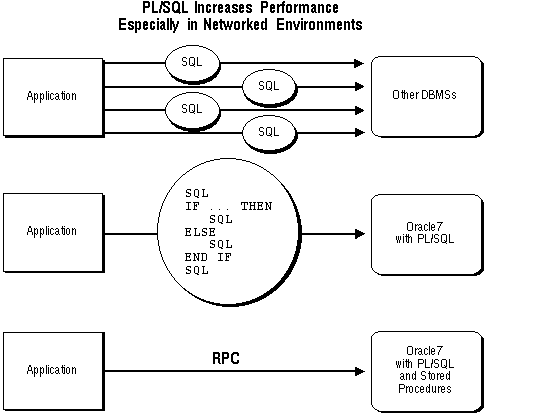
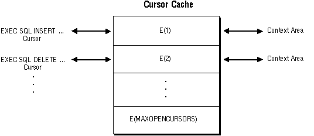

This appendix contains the following sections:

- What Causes Poor Performance?

- How Can Performance be Improved?

- Using Host Arrays

- Using Embedded PL/SQL

- Optimizing SQL Statements

- About Using Indexes

- Taking Advantage of Row-Level Locking

- About Eliminating Unnecessary Parsing

This appendix shows you some simple, easy-to-apply methods for improving the performance of your applications. Using these methods, you can often reduce processing time by 25% or more.

### C.1 What Causes Poor Performance?

One cause of poor performance is high Oracle communication overhead. Oracle must process SQL statements one at a time. Thus, each statement results in another call to Oracle and higher overhead. In a networked environment, SQL statements must be sent over the network, adding to network traffic. Heavy network traffic can slow down your application significantly.

Another cause of poor performance is inefficient SQL statements. Because SQL is so flexible, you can get the same result with two different statements, but one statement might be less efficient. For example, the following two `SELECT` statements return the same rows (the name and number of every department having at least one employee):

    EXEC SQL SELECT DNAME, DEPTNO
     FROM DEPT
     WHERE DEPTNO IN (SELECT DEPTNO FROM EMP);
    EXEC SQL SELECT DNAME, DEPTNO
     FROM DEPT
     WHERE EXISTS
     (SELECT DEPTNO FROM EMP WHERE DEPT.DEPTNO = EMP.DEPTNO);

However, the first statement is slower because it does a time-consuming full scan of the `EMP` table for every department number in the `DEPT` table. Even if the `DEPTNO` column in `EMP` is indexed, the index is not used because the subquery lacks a `WHERE` clause naming `DEPTNO`.

A third cause of poor performance is unnecessary parsing and binding. Recall that before executing a SQL statement, Oracle must parse and bind it. Parsing means examining the SQL statement to make sure it follows syntax rules and refers to valid database objects. Binding means associating host variables in the SQL statement with their addresses so that Oracle can read or write their values.

Many applications manage cursors poorly. This results in unnecessary parsing and binding, which adds noticeably to processing overhead.

### C.2 How Can Performance be Improved?

If you are unhappy with the performance of your precompiled programs, there are several ways you can reduce overhead.

You can greatly reduce Oracle communication overhead, especially in networked environments, by:

- Using host arrays

- Using embedded PL/SQL

You can reduce processing overhead --sometimes dramatically-- by:

- Optimizing SQL statements

- Using indexes

- Taking advantage of row-level locking

- Eliminating unnecessary parsing

### C.3 Using Host Arrays

Host arrays can boost performance because they let you manipulate an entire collection of data with a single SQL statement. For example, suppose you want to insert salaries for 300 employees into the `EMP` table. Without arrays your program must do 300 individual inserts--one for each employee. With arrays, only one `INSERT` is necessary. Consider the following statement:

    EXEC SQL INSERT INTO EMP (SAL) VALUES (:salary);

If salary is a simple host variable, Oracle executes the `INSERT` statement once, inserting a single row into the `EMP` table. In that row, the `SAL` column has the value of salary. To insert 300 rows this way, you must execute the `INSERT` statement 300 times.

However, if salary is a host array of size 300, Oracle inserts all 300 rows into the `EMP` table at once. In each row, the `SAL` column has the value of an element in the salary array.

For more information, see [Using Host Arrays](using-host-arrays.md)

### C.4 Using Embedded PL/SQL

As Figure C-1 shows, if your application is database-intensive, you can use control structures to group SQL statements in a PL/SQL block, then send the entire block to Oracle. This can drastically reduce communication between your application and Oracle.

Also, you can use PL/SQL subprograms to reduce calls from your application to Oracle. For example, to execute ten individual SQL statements, ten calls are required, but to execute a subprogram containing ten SQL statements, only one call is required.

Unlike anonymous blocks, PL/SQL subprograms can be compiled separately and stored in an Oracle database. When called, they are passed to the PL/SQL engine immediately. Moreover, only one copy of a subprogram need be loaded into memory for execution by multiple users.

Figure C-1 PL/SQL Boosts Performance

[Description of "Figure C-1 PL/SQL Boosts Performance"](img_text/image015.md)

PL/SQL can also cooperate with Oracle application development tools such as Oracle Forms and Oracle Reports. By adding procedural processing power to these tools, PL/SQL boosts performance. Using PL/SQL, a tool can do any computation quickly and efficiently without calling on Oracle. This saves time and reduces network traffic. For more information, see [Using Embedded PL/SQL](using-embedded-PLSQL.md) and the [Oracle Database PL/SQL Language Reference](../lnpls/overview.md).

### C.5 Optimizing SQL Statements

For every SQL statement, the Oracle optimizer generates an execution plan, which is a series of steps that Oracle takes to execute the statement. These steps are determined by rules given in the[ Oracle Database Advanced Application Developer's Guide](../adfns/fundamentals.md). Following these rules will help you write optimal SQL statements.

#### C.5.1 Optimizer Hints

For every SQL statement, the Oracle optimizer generates an execution plan, which is a series of steps that Oracle takes to execute the statement. In some cases, you can suggest to Oracle the way to optimize a SQL statement. These suggestions, called hints, let you influence decisions made by the optimizer.

Hints are not directives; they merely help the optimizer do its job. Some hints limit the scope of information used to optimize a SQL statement, while others suggest overall strategies. You can use hints to specify the:

- Optimization approach for a SQL statement

- Access path for each referenced table

- Join order for a join

- Method used to join tables

#### C.5.2 Giving Hints

You give hints to the optimizer by placing them in a C-style comment immediately after the verb in a `SELECT`, `UPDATE`, or `DELETE` statement. You can choose rule-based or cost-based optimization. With cost-based optimization, hints help maximize throughput or response time. In the following example, the `ALL_ROWS` hint helps maximize query throughput:

    EXEC SQL SELECT /*+ ALL_ROWS (cost-based) */ EMPNO, ENAME, SAL
     INTO :emp_number, :emp_name, :salary -- host arrays
     FROM EMP
     WHERE DEPTNO = :dept_number;

The plus sign (+), which must immediately follow the comment opener, indicates that the comment contains one or more hints. Notice that the comment can contain remarks and hints.

For more information about optimizer hints, see [Performance and Scalability](../adfns/performance-and-scalability.md).

#### C.5.3 Trace Facility

You can use the SQL trace facility and the `EXPLAIN` `PLAN` statement to identify SQL statements that might be slowing down your application. The trace facility generates statistics for every SQL statement executed by Oracle. From these statistics, you can determine which statements take the most time to process. Then, you can concentrate your tuning efforts on those statements.

The `EXPLAIN` `PLAN` statement shows the execution plan for each SQL statement in your application. You can use the execution plan to identify inefficient SQL statements.

### C.6 About Using Indexes

Using rowids, an index associates each distinct value in a table column with the rows containing that value. An index is created with the `CREATE INDEX` statement.

You can use indexes to boost the performance of queries that return less than 15% of the rows in a table. A query that returns 15% or more of the rows in a table is executed faster by a full scan, that is, by reading all rows sequentially. Any query that names an indexed column in its `WHERE` clause can use the index. For guidelines that help you choose which columns to index, see [Performance and Scalability](../adfns/performance-and-scalability.md).

### C.7 Taking Advantage of Row-Level Locking

By default, Oracle locks data at the row level rather than the table level. Row-level locking allows multiple users to access different rows in the same table concurrently. The resulting performance gain is significant.

You can specify table-level locking, but it lessens the effectiveness of the transaction processing option. For more information about table locking, see "[About Using the LOCK TABLE Statement](defining-controlling-transactions.md)".

Applications that do online transaction processing benefit most from row-level locking. If your application relies on table-level locking, modify it to take advantage of row-level locking. In general, avoid explicit table-level locking.

### C.8 About Eliminating Unnecessary Parsing

Eliminating unnecessary parsing requires correct handling of cursors and selective use of the following cursor management options:

- `MAXOPENCURSORS`

- `HOLD_CURSOR`

- `RELEASE_CURSOR`

These options affect implicit and explicit cursors, the cursor cache, and private SQL areas.

You can use the ORACA to get cursor cache statistics. See "[About Using the Oracle Communications Area](error-handling-diagnostics.md)".

#### C.8.1 About Handling Explicit Cursors

Recall that there are two types of cursors: implicit and explicit. Oracle implicitly declares a cursor for all data definition and data manipulation statements. However, for queries that return more than one row, you must explicitly declare a cursor (or use host arrays). You use the `DECLARE CURSOR` statement to declare an explicit cursor. How you handle the opening and closing of explicit cursors affects performance.

If you need to reevaluate the active set, simply reopen the cursor. The `OPEN` statement will use any new host-variable values. You can save processing time if you do not close the cursor first.

To make performance tuning easier, the precompiler lets you reopen an already open cursor. However, this is an Oracle extension to the ANSI/ISO embedded SQL standard. So, when `MODE=ANSI`, you must close a cursor before reopening it.

Only `CLOSE` a cursor when you want to free the resources (memory and locks) acquired by opening the cursor. For example, your program should close all cursors before exiting.

#### C.8.2 Cursor Control

In general, there are three ways to control an explicitly declared cursor:

- Use the `DECLARE`, `OPEN`, and `CLOSE` statements

- Use the `PREPARE`, `DECLARE`, `OPEN`, and `CLOSE` statements

- `COMMIT` closes the cursor when `MODE=ANSI`

With the first way, beware of unnecessary parsing. The `OPEN` statement does the parsing, but only if the parsed statement is unavailable because the cursor was closed or never opened. Your program should `DECLARE` the cursor, reopen it every time the value of a host variable changes, and `CLOSE` it only when the SQL statement is no longer needed.

With the second way (dynamic SQL Methods 3 and 4), the `PREPARE` statement does the parsing, and the parsed statement is available until a `CLOSE` statement is executed. Your program should prepare the SQL statement and `DECLARE` the cursor, reopen the cursor every time the value of a host variable changes, rePREPARE the SQL statement and reopen the cursor if the SQL statement changes, and `CLOSE` the cursor only when the SQL statement is no longer needed.

When possible, avoid placing `OPEN` and `CLOSE` statements in a loop; this is a potential cause of unnecessary reparsing of the SQL statement. In the next example, both the `OPEN` and `CLOSE` statements are inside the outer `while` loop. When `MODE=ANSI`, the `CLOSE` statement must be positioned as shown, because ANSI requires a cursor to be closed before being reopened.

    EXEC SQL DECLARE emp_cursor CURSOR FOR
     SELECT ename, sal from emp where sal > :salary and
     sal <= :salary + 1000;
    salary = 0;
    while (salary < 5000)
    {
     EXEC SQL OPEN emp_cursor;
     while (SQLCODE==0)
     {
     EXEC SQL FETCH emp_cursor INTO ....
     ...
     }
     salary += 1000;
     EXEC SQL CLOSE emp_cursor;
    }

With `MODE=ORACLE`, however, a `CLOSE` statement can execute without the cursor being opened. By placing the `CLOSE` statement outside the outer `while` loop, you can avoid possible reparsing at each iteration of the `OPEN` statement.

    ...
    while (salary < 5000)
    {
     EXEC SQL OPEN emp_cursor;
     while (sqlca.sqlcode==0)
     {
     EXEC SQL FETCH emp_cursor INTO ....
     ...
     }
     salary += 1000;
    }
    EXEC SQL CLOSE emp_cursor;

#### C.8.3 About Using the Cursor Management Options

A SQL statement need be parsed only once unless you change its makeup. For example, you change the makeup of a query by adding a column to its select list or `WHERE` clause. The `HOLD_CURSOR`, `RELEASE_CURSOR`, and `MAXOPENCURSORS` options give you some control over how Oracle manages the parsing and reparsing of SQL statements. Declaring an explicit cursor gives you maximum control over parsing.

#### C.8.4 Private SQL Areas and Cursor Cache

When a data manipulation statement is executed, its associated cursor is linked to an entry in the cursor cache. The cursor cache is a continuously updated area of memory used for cursor management. The cursor cache entry is in turn linked to a private SQL area.

The private SQL area, a work area created dynamically at run time by Oracle, contains the parsed SQL statement, the addresses of host variables, and other information needed to process the statement. An explicit cursor lets you name a SQL statement, access the information in its private SQL area, and, to some extent, control its processing.

Figure C-2 represents the cursor cache after your program has done an insert and a delete.

Figure C-2 Cursors Linked through the Cursor Cache

[Description of "Figure C-2 Cursors Linked through the Cursor Cache"](img_text/image016.md)

#### C.8.5 Resource Use

The maximum number of open cursors in each user session is set by the Oracle initialization parameter `OPEN_CURSORS`.

`MAXOPENCURSORS` specifies the initial size of the cursor cache. If a new cursor is needed and there are no free cache entries, Oracle tries to reuse an entry. Its success depends on the values of `HOLD_CURSOR` and `RELEASE_CURSOR` and, for explicit cursors, on the status of the cursor itself.

If the value of `MAXOPENCURSORS` is less than the number of cache entries actually needed, Oracle uses the first cache entry marked as reusable. For example, suppose the cache entry E(1) for an `INSERT` statement is marked as reusable, and the number of cache entries already equals `MAXOPENCURSORS`. If the program executes a new statement, cache entry E(1) and its private SQL area might be reassigned to the new statement. To reexecute the `INSERT` statement, Oracle would have to reparse it and reassign another cache entry.

Oracle allocates an additional cache entry if it cannot find one to reuse. For example, if `MAXOPENCURSORS=8` and all eight entries are active, a ninth is created. If necessary, Oracle keeps allocating additional cache entries until it runs out of memory or reaches the limit set by `OPEN_CURSORS`. This dynamic allocation adds to processing overhead.

Thus, specifying a low value for `MAXOPENCURSORS` saves memory but causes potentially expensive dynamic allocations and deallocations of new cache entries. Specifying a high value for `MAXOPENCURSORS` assures speedy execution but uses more memory.

#### C.8.6 Infrequent Execution

Sometimes, the link between an infrequently executed SQL statement and its private SQL area should be temporary.

When `HOLD_CURSOR=NO` (the default), after Oracle executes the SQL statement and the cursor is closed, the precompiler marks the link between the cursor and cursor cache as reusable. The link is reused as soon as the cursor cache entry to which it points is needed for another SQL statement. This frees memory allocated to the private SQL area and releases parse locks. However, because a prepared cursor must remain active, its link is maintained even when `HOLD_CURSOR=NO`.

When `RELEASE_CURSOR=YES`, after Oracle executes the SQL statement and the cursor is closed, the private SQL area is automatically freed and the parsed statement lost. This might be necessary if, for example, `MAXOPENCURSORS` is set low at your site to conserve memory.

If a data manipulation statement precedes a data definition statement and they reference the same tables, specify `RELEASE_CURSOR=YES` for the data manipulation statement. This avoids a conflict between the parse lock obtained by the data manipulation statement and the exclusive lock required by the data definition statement.

When `RELEASE_CURSOR=YES`, the link between the private SQL area and the cache entry is immediately removed and the private SQL area freed. Even if you specify `HOLD_CURSOR=YES`, Oracle must still reallocate memory for a private SQL area and reparse the SQL statement before executing it because `RELEASE_CURSOR=YES` overrides `HOLD_CURSOR=YES`.

Nonetheless, when `RELEASE_CURSOR=YES`, the reparse might not require extra processing because Oracle caches the parsed representations of SQL statements and PL/SQL blocks in its Shared SQL Cache. Even if its cursor is closed, the parsed representation remains available until it is aged out of the cache.

#### C.8.7 Frequent Execution

The links between a frequently executed SQL statement and its private SQL area should be maintained, because the private SQL area contains all the information needed to execute the statement. Maintaining access to this information makes subsequent execution of the statement much faster.

When `HOLD_CURSOR=YES`, the link between the cursor and cursor cache is maintained after Oracle executes the SQL statement. Thus, the parsed statement and allocated memory remain available. This is useful for SQL statements that you want to keep active because it avoids unnecessary reparsing.

When `HOLD_CURSOR=YES` and `RELEASE_CURSOR=NO` (the default), the link between the cache entry and the private SQL area is maintained after Oracle executes the SQL statement and is not reused unless the number of open cursors exceeds the value of `MAXOPENCURSORS`. This is useful for SQL statements that are executed often because the parsed statement and allocated memory remain available.

Using the defaults, `HOLD_CURSOR=YES` and `RELEASE_CURSOR=NO`, after executing a SQL statement with an earlier Oracle version, its parsed representation remains available. With Oracle database version 7, under similar conditions, the parsed representation remains available only until it is aged out of the Shared SQL Cache. Normally, this is not a problem, but you might get unexpected results if the definition of a referenced object changes before the SQL statement is reparsed.

#### C.8.8 Parameter Interactions

Table C-1 shows how `HOLD_CURSOR` and `RELEASE_CURSOR` interact. Notice that `HOLD_CURSOR=NO` overrides `RELEASE_CURSOR=NO` and that `RELEASE_CURSOR=YES` overrides `HOLD_CURSOR=YES`.

Table C-1 HOLD_CURSOR RELEASE_CURSOR Interactions

| HOLD_CURSOR | RELEASE_CURSOR | Links are:          |
|:------------|:---------------|:--------------------|
| NO          | NO             | marked as reusable  |
| YES         | NO             | maintained          |
| NO          | YES            | removed immediately |
| YES         | YES            | removed immediately |
