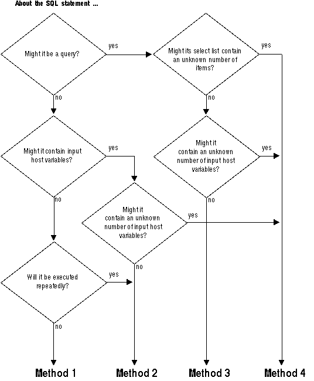

This chapter describes the following sections:

- What Is Dynamic SQL?

- Advantages and Disadvantages of Dynamic SQL

- When to Use Dynamic SQL

- Requirements for Dynamic SQL Statements

- How Dynamic SQL Statements Are Processed

- Methods for Using Dynamic SQL

- About Using Method 1

- About Using Method 2

- About Using Method 3

- Using Method 4

- About Using the DECLARE STATEMENT Statement

- About Using PL/SQL

This chapter shows you how to use dynamic SQL, an advanced programming technique that adds flexibility and functionality to your applications. After weighing the advantages and disadvantages of dynamic SQL, you learn four methods from simple to complex for writing programs that accept and process SQL statements "on the fly" at run time. You learn the requirements and limitations of each method and how to choose the right method for a given job.

### 10.1 What Is Dynamic SQL?

Most database applications do a specific job. For example, a simple program might prompt the user for an employee number, then update rows in the EMP and DEPT tables. In this case, you know the makeup of the `UPDATE` statement at precompile time. That is, you know which tables might be changed, the constraints defined for each table and column, which columns might be updated, and the datatype of each column.

However, some applications must accept (or build) and process a variety of SQL statements at run time. For example, a general-purpose report writer must build different `SELECT` statements for the various reports it generates. In this case, the statement's makeup is unknown until run time. Such statements can, and probably will, change from execution to execution. They are aptly called dynamic SQL statements.

Unlike static SQL statements, dynamic SQL statements are not embedded in your source program. Instead, they are stored in character strings input to or built by the program at run time. They can be entered interactively or read from a file.

### 10.2 Advantages and Disadvantages of Dynamic SQL

Host programs that accept and process dynamically defined SQL statements are more versatile than plain embedded SQL programs. Dynamic SQL statements can be built interactively with input from users having little or no knowledge of SQL.

For example, your program might simply prompt users for a search condition to be used in the `WHERE` clause of a `SELECT`, `UPDATE`, or `DELETE` statement. A more complex program might allow users to choose from menus listing SQL operations, table and view names, column names, and so on. Thus, dynamic SQL lets you write highly flexible applications.

However, some dynamic queries require complex coding, the use of special data structures, and more run-time processing. While you might not notice the added processing time, you might find the coding difficult unless you fully understand dynamic SQL concepts and methods.

### 10.3 When to Use Dynamic SQL

In practice, static SQL will meet nearly all your programming needs. Use dynamic SQL only if you need its open-ended flexibility. Its use is suggested when one or more of the following items is unknown at precompile time:

- Text Of The Sql Statement (Commands, Clauses, And So On)

- The Number Of Host Variables

- The Datatypes Of Host Variables

- References To Database Objects Such As Columns, Indexes, Sequences, Tables, Usernames, And Views

### 10.4 Requirements for Dynamic SQL Statements

To represent a dynamic SQL statement, a character string must contain the text of a valid SQL statement, but not contain the EXEC SQL clause, host-language delimiters or statement terminator, or any of the following embedded SQL commands:

- `CLOSE`

- `DECLARE`

- `DESCRIBE`

- `EXECUTE`

- `FETCH`

- `INCLUDE`

- `OPEN`

- `PREPARE`

- `WHENEVER`

In most cases, the character string can contain dummy host variables. They hold places in the SQL statement for actual host variables. Because dummy host variables are just placeholders, you do not declare them and can name them anything you like. For example, Oracle makes no distinction between the following two strings:

    'DELETE FROM EMP WHERE MGR = :mgr_number AND JOB = :job_title'
    'DELETE FROM EMP WHERE MGR = :m AND JOB = :j'

### 10.5 How Dynamic SQL Statements Are Processed

Typically, an application program prompts the user for the text of a SQL statement and the values of host variables used in the statement. Then Oracle parses the SQL statement. That is, Oracle examines the SQL statement to make sure it follows syntax rules and refers to valid database objects. Parsing also involves checking database access rights, reserving needed resources, and finding the optimal access path.

Next, Oracle binds the host variables to the SQL statement. That is, Oracle gets the addresses of the host variables so that it can read or write their values.

Then Oracle executes the SQL statement. That is, Oracle does what the SQL statement requested, such as deleting rows from a table.

The SQL statement can be executed repeatedly using new values for the host variables.

### 10.6 Methods for Using Dynamic SQL

This section introduces four methods you can use to define dynamic SQL statements. It briefly describes the capabilities and limitations of each method, then offers guidelines for choosing the right method. Later sections describe how to use the methods. In addition, you can find sample host-language programs in your supplement to this Guide.

The four methods are increasingly general. That is, Method 2 encompasses Method 1, Method 3 encompasses Methods 1 and 2, and so on. However, each method is most useful for handling a certain kind of SQL statement, as Table 10-1 shows.

Table 10-1 Dynamic SQL Method Applicability

| Method | Kind of SQL Statement                                                  |
|:-------|:-----------------------------------------------------------------------|
| 1      | nonquery without input host variables                                  |
| 2      | nonquery with known number of input host variables                     |
| 3      | query with known number of select-list items and input host variables  |
| 4      | query with unknown number of select-list items or input host variables |

The term select-list item includes column names and expressions.

#### 10.6.1 Method 1

This method lets your program accept or build a dynamic SQL statement, then immediately execute it using the` EXECUTE` `IMMEDIATE` command. The SQL statement must not be a query (`SELECT` statement) and must not contain any placeholders for input host variables. For example, the following host strings qualify:

    'DELETE FROM EMP WHERE DEPTNO = 20'
    'GRANT SELECT ON EMP TO scott'

With Method 1, the SQL statement is parsed every time it is executed (unless you specify `HOLD_CURSOR`=`YES`).

#### 10.6.2 Method 2

This method lets your program accept or build a dynamic SQL statement, then process it using the `PREPARE` and `EXECUTE `commands .The SQL statement must not be a query. The number of placeholders for input host variables and the datatypes of the input host variables must be known at precompile time. For example, the following host strings fall into this category:

    'INSERT INTO EMP (ENAME, JOB) VALUES (:emp_name, :job_title)'
    'DELETE FROM EMP WHERE EMPNO = :emp_number'

With Method 2, the SQL statement is parsed just once (unless you specify `RELEASE_CURSOR`=`YES`), but it can be executed many times with different values for the host variables. SQL data definition statements such as `CREATE` are executed when they are `PREPARE`d.

#### 10.6.3 Method 3

This method lets your program accept or build a dynamic query, then process it using the PREPARE command with the `DECLARE`,` OPEN`, `FETCH`, and `CLOSE `cursor commands. The number of select-list items, the number of placeholders for input host variables, and the datatypes of the input host variables must be known at precompile time. For example, the following host strings qualify:

    'SELECT DEPTNO, MIN(SAL), MAX(SAL) FROM EMP GROUP BY DEPTNO'
    'SELECT ENAME, EMPNO FROM EMP WHERE DEPTNO = :dept_number'

#### 10.6.4 Method 4

This method lets your program accept or build a dynamic SQL statement, then process it using descriptors (discussed in "Using Method 4"). The number of select-list items, the number of placeholders for input host variables, and the datatypes of the input host variables can be unknown until run time. For example, the following host strings fall into this category:

    'INSERT INTO EMP (<unknown>) VALUES (<unknown>)'
    'SELECT <unknown> FROM EMP WHERE DEPTNO = 20'

Method 4 is required for dynamic SQL statements that contain an unknown number of select-list items or input host variables.

#### 10.6.5 Guidelines

With all four methods, you must store the dynamic SQL statement in a character string, which must be a host variable or quoted literal. When you store the SQL statement in the string, omit the keywords EXEC SQL and the statement terminator.

With Methods 2 and 3, the number of placeholders for input host variables and the datatypes of the input host variables must be known at precompile time.

Each succeeding method imposes fewer constraints on your application, but is more difficult to code. As a rule, use the simplest method you can. However, if a dynamic SQL statement is to be executed repeatedly by Method 1, use Method 2 instead to avoid reparsing for each execution.

Method 4 provides maximum flexibility, but requires complex coding and a full understanding of dynamic SQL concepts. In general, use Method 4 only if you cannot use Methods 1, 2, or 3. The decision logic in Figure 10-1 will help you choose the correct method.

#### 10.6.6 Avoiding Common Errors

If you use a character array to store the dynamic SQL statement, blank-pad the array before storing the SQL statement. That way, you clear extraneous characters. This is especially important when you reuse the array for different SQL statements. As a rule, always initialize (or reinitialize) the host string before storing the SQL statement.

Do not null-terminate the host string. Oracle does not recognize the null terminator as an end-of-string sentinel. Instead, Oracle treats it as part of the SQL statement.

If you use a `VARCHAR` variable to store the dynamic SQL statement, make sure the length of the `VARCHAR` is set (or reset) correctly before you execute the PREPARE or `EXECUTE` `IMMEDIATE` statement.

`EXECUTE` resets the SQLWARN warning flags in the SQLCA. So, to catch mistakes such as an unconditional update (caused by omitting a `WHERE` clause), check the SQLWARN flags after executing the `PREPARE` statement but before executing the `EXECUTE` statement.

Figure 10-1 Choosing the Right Method

[Description of "Figure 10-1 Choosing the Right Method"](img_text/image013.md)

### 10.7 About Using Method 1

The simplest kind of dynamic SQL statement results only in "success" or "failure" and uses no host variables. Some examples follow:

    'DELETE FROM table_name WHERE column_name = constant'
    'CREATE TABLE table_name ...'
    'DROP INDEX index_name'
    'UPDATE table_name SET column_name = constant'
    'GRANT SELECT ON table_name TO username'
    'REVOKE RESOURCE FROM username'

#### 10.7.1 The EXECUTE IMMEDIATE Statement

Method 1 parses, then immediately executes the SQL statement using the `EXECUTE` `IMMEDIATE` command. The command is followed by a character string (host variable or literal) containing the SQL statement to be executed, which cannot be a query.

The syntax of the `EXECUTE` `IMMEDIATE` statement follows:

    EXEC SQL EXECUTE IMMEDIATE { :host_string | string_literal };

In the following example, you use the host variable sql_stmt to store SQL statements input by the user:

    EXEC SQL BEGIN DECLARE SECTION;
     ...
     sql_stmt CHARACTER(120);
    EXEC SQL END DECLARE SECTION;
    ...
    LOOP
     display 'Enter SQL statement: ';
     read sql_stmt;
     IF sql_stmt is empty THEN
     exit loop;
     ENDIF;
     -- sql_stmt now contains the text of a SQL statement
     EXEC SQL EXECUTE IMMEDIATE :sql_stmt;
    ENDLOOP;

You can also use string literals, as the following example shows:

    EXEC SQL EXECUTE IMMEDIATE 'REVOKE RESOURCE FROM MILLER';

Because EXECUTE IMMEDIATE parses the input SQL statement before every execution, Method 1 is best for statements that are executed only once. Data definition statements usually fall into this category.

#### 10.7.2 An Example

The following program prompts the user for a search condition to be used in the `WHERE` clause of an `UPDATE` statement, then executes the statement using Method 1:

    EXEC SQL BEGIN DECLARE SECTION;
     username CHARACTER(20);
     password CHARACTER(20);
     update_stmt CHARACTER(120);
    EXEC SQL END DECLARE SECTION;
     search_cond CHARACTER(40);
    EXEC SQL INCLUDE SQLCA;
    display 'Username? ';
    read username;
    display 'Password? ';
    read password;
    EXEC SQL WHENEVER SQLERROR GOTO sql_error;
    EXEC SQL CONNECT :username IDENTIFIED BY :password;
    display 'Connected to Oracle';
    set update_stmt = 'UPDATE EMP SET COMM = 500 WHERE ';
    display 'Enter a search condition for the following statement:';
    display update_stmt;
    read search_cond;
    concatenate update_stmt, search_cond;
    EXEC SQL EXECUTE IMMEDIATE :update_stmt;
    EXEC SQL COMMIT WORK RELEASE;
    exit program;
    sql_error:
     EXEC SQL WHENEVER SQLERROR CONTINUE;
     EXEC SQL ROLLBACK WORK RELEASE;
     display 'Processing error';
     exit program with an error;

### 10.8 About Using Method 2

What Method 1 does in one step, Method 2 does in two. The dynamic SQL statement, which cannot be a query, is first `PREPARE`d (named and parsed), then executed.

With Method 2, the SQL statement can contain placeholders for input host variables and indicator variables. You can `PREPARE` the SQL statement once, then `EXECUTE` it repeatedly using different values of the host variables. Also, you need not rePREPARE the SQL statement after a `COMMIT` or `ROLLBACK` (unless you log off and reconnect).

Note that you can use `EXECUTE` for nonqueries with Method 4.

The syntax of the `PREPARE` statement follows:

    EXEC SQL PREPARE statement_name
     FROM { :host_string | string_literal };

`PREPARE` parses the SQL statement and gives it a name.

The statement_name is an identifier used by the precompiler, not a host or program variable, and should not be declared in the Declare Section. It simply designates the `PREPAREd` statement you want to `EXECUTE`.

The syntax of the `EXECUTE` statement is

    EXEC SQL EXECUTE statement_name [USING host_variable_list];

where host_variable_list stands for the following syntax:

    :host_variable1[:indicator1] [, host_variable2[:indicator2], ...]

`EXECUTE` executes the parsed SQL statement, using the values supplied for each input host variable. In the following example, the input SQL statement contains the placeholder n:

    EXEC SQL BEGIN DECLARE SECTION;
     ...
     emp_number INTEGER;
     delete_stmt CHARACTER(120);
    EXEC SQL END DECLARE SECTION;
     search_cond CHARACTER(40);
    ...
    set delete_stmt = 'DELETE FROM EMP WHERE EMPNO = :n AND ';
    display 'Complete the following statement's search condition:';
    display delete_stmt;
    read search_cond;
    concatenate delete_stmt, search_cond;
    EXEC SQL PREPARE sql_stmt FROM :delete_stmt;
    LOOP
     display 'Enter employee number: ';
     read emp_number;
     IF emp_number = 0 THEN
     exit loop;
     EXEC SQL EXECUTE sql_stmt USING :emp_number;
    ENDLOOP;

With Method 2, you must know the datatypes of input host variables at precompile time. In the last example, emp_number was declared as type `INTEGER`. It could also have been declared as type `CHARACTER` or `REAL`, because Oracle supports all these datatype conversions to the `NUMBER` datatype.

#### 10.8.1 The USING Clause

When the SQL statement is `EXECUTEd`, input host variables in the `USING` clause replace corresponding placeholders in the `PREPAREd` dynamic SQL statement.

Every placeholder in the PREPAREd dynamic SQL statement must correspond to a host variable in the `USING` clause. So, if the same placeholder appears two or more times in the `PREPAREd` statement, each appearance must correspond to a host variable in the `USING` clause. If one of the host variables in the `USING` clause is an array, all must be arrays.

The names of the placeholders need not match the names of the host variables. However, the order of the placeholders in the `PREPAREd` dynamic SQL statement must match the order of corresponding host variables in the `USING` clause.

To specify nulls, you can associate indicator variables with host variables in the `USING` clause. For more information, refer to "[About Using Indicator Variables](using-embedded-SQL.md)".

#### 10.8.2 An Example

The following program prompts the user for a search condition to be used in the `WHERE` clause of an `UPDATE` statement, then prepares and executes the statement using Method 2. Notice that the `SET` clause of the `UPDATE` statement contains a placeholder (c).

    EXEC SQL BEGIN DECLARE SECTION;
     username CHARACTER(20);
     password CHARACTER(20);
     sql_stmt CHARACTER(80);
     empno INTEGER VALUE 1234;
     deptno1 INTEGER VALUE 97;
     deptno2 INTEGER VALUE 99;
    EXEC SQL END DECLARE SECTION;
    EXEC SQL INCLUDE SQLCA;
    EXEC ORACLE OPTION (ORACA=YES);
    EXEC SQL WHENEVER SQLERROR GOTO sql_error;
    display 'Username? ';
    read username;
    display 'Password? ';
    read password;
    EXEC SQL CONNECT :username IDENTIFIED BY :password;
    display 'Connected to Oracle';
    set sql_stmt =
     'INSERT INTO EMP (EMPNO, DEPTNO) VALUES (:v1, :v2)';
    display "V1 = ", empno, "V2 = ", deptno1;
    EXEC SQL PREPARE S FROM :sql_stmt;
    EXEC SQL EXECUTE S USING :empno, :deptno1;
    set empno = empno + 1;
    display "V1 = ", empno, "V2 = ", deptno2;
    EXEC SQL EXECUTE S USING :empno, :deptno2;
    set sql_stmt =
     'DELETE FROM EMP WHERE DEPTNO = :v1 OR DEPTNO = :v2")';
    display "V1 = ", deptno1, "V2 = ", deptno2;
    EXEC SQL PREPARE S FROM :sql_stmt;
    EXEC SQL EXECUTE S USING :deptno1, :deptno2;
    EXEC SQL COMMIT WORK RELEASE;
    exit program;
    sql_error:
     EXEC SQL WHENEVER SQLERROR CONTINUE;
     display 'Processing error';
     EXEC SQL ROLLBACK WORK RELEASE;
     exit program with an error;

### 10.9 About Using Method 3

Method 3 is similar to Method 2 but combines the `PREPARE` statement with the statements needed to define and manipulate a cursor. This allows your program to accept and process queries. In fact, if the dynamic SQL statement is a query, you must use Method 3 or 4.

For Method 3, the number of columns in the query select list and the number of placeholders for input host variables must be known at precompile time. However, the names of database objects such as tables and columns need not be specified until run time (they cannot duplicate the names of host variables). Clauses that limit, group, and sort query results (such as `WHERE`, `GROUP` `BY`, and `ORDER` `BY`) can also be specified at run time.

With Method 3, you use the following sequence of embedded SQL statements:

    PREPARE statement_name FROM { :host_string | string_literal };
    DECLARE cursor_name CURSOR FOR statement_name;
    OPEN cursor_name [USING host_variable_list];
    FETCH cursor_name INTO host_variable_list;
    CLOSE cursor_name;

Now let us look at what each statement does.

#### 10.9.1 PREPARE

`PREPARE` parses the dynamic SQL statement and gives it a name. In the following example, `PREPARE` parses the query stored in the character string select_stmt and gives it the name sql_stmt:

    set select_stmt = 'SELECT MGR, JOB FROM EMP WHERE SAL < :salary';
    EXEC SQL PREPARE sql_stmt FROM :select_stmt;

Commonly, the query `WHERE` clause is input from a terminal at run time or is generated by the application.

The identifier sql_stmt is not a host or program variable, but must be unique. It designates a particular dynamic SQL statement.

#### 10.9.2 DECLARE

`DECLARE` defines a cursor by giving it a name and associating it with a specific query. The cursor declaration is local to its precompilation unit. Continuing our example, `DECLARE` defines a cursor named emp_cursor and associates it with sql_stmt, as follows:

    EXEC SQL DECLARE emp_cursor CURSOR FOR sql_stmt;

The identifiers sql_stmt and emp_cursor are not host or program variables, but must be unique. If you declare two cursors using the same statement name, the precompiler considers the two cursor names synonymous. For example, if you execute the statements

    EXEC SQL PREPARE sql_stmt FROM :select_stmt;
    EXEC SQL DECLARE emp_cursor FOR sql_stmt;
    EXEC SQL PREPARE sql_stmt FROM :delete_stmt;
    EXEC SQL DECLARE dept_cursor FOR sql_stmt;

when you OPEN emp_cursor, you will process the dynamic SQL statement stored in delete_stmt, not the one stored in select_stmt.

#### 10.9.3 OPEN

`OPEN` allocates an Oracle cursor, binds input host variables, and executes the query, identifying its active set. OPEN also positions the cursor on the first row in the active set and zeroes the rows-processed count kept by the third element of SQLERRD in the SQLCA. Input host variables in the USING clause replace corresponding placeholders in the `PREPAREd` dynamic SQL statement.

In our example, `OPEN` allocates emp_cursor and assigns the host variable salary to the `WHERE` clause, as follows:

    EXEC SQL OPEN emp_cursor USING :salary;

#### 10.9.4 FETCH

`FETCH` returns a row from the active set, assigns column values in the select list to corresponding host variables in the `INTO` clause, and advances the cursor to the next row. When no more rows are found, `FETCH` returns the "no data found" Oracle error code to SQLCODE in the SQLCA.

In our example, FETCH returns a row from the active set and assigns the values of columns MGR and JOB to host variables mgr_number and job_title, as follows:

    EXEC SQL FETCH emp_cursor INTO :mgr_number, :job_title;

#### 10.9.5 CLOSE

`CLOSE` disables the cursor. After you `CLOSE` a cursor, you can no longer `FETCH` from it. In our example, the `CLOSE` statement disables emp_cursor, as follows:

    EXEC SQL CLOSE emp_cursor;

#### 10.9.6 An Example

The following program prompts the user for a search condition to be used in the `WHERE` clause of a query, then prepares and executes the query using Method 3.

    EXEC SQL BEGIN DECLARE SECTION;
     username CHARACTER(20);
     password CHARACTER(20);
     dept_number INTEGER;
     emp_name CHARACTER(10);
     salary REAL;
     select_stmt CHARACTER(120);
    EXEC SQL END DECLARE SECTION;
     search_cond CHARACTER(40);
    EXEC SQL INCLUDE SQLCA;
    display 'Username? ';
    read username;
    display 'Password? ';
    read password;
    EXEC SQL WHENEVER SQLERROR GOTO sql_error;
    EXEC SQL CONNECT :username IDENTIFIED BY :password;
    display 'Connected to Oracle';
    set select_stmt = 'SELECT ENAME,SAL FROM EMP WHERE ';
    display 'Enter a search condition for the following statement:';
    display select_stmt;
    read search_cond;
    concatenate select_stmt, search_cond;
    EXEC SQL PREPARE sql_stmt FROM :select_stmt;
    EXEC SQL DECLARE emp_cursor CURSOR FOR sql_stmt;
    EXEC SQL OPEN emp_cursor;
    EXEC SQL WHENEVER NOT FOUND GOTO no_more;
    display 'Employee Salary';
    display '-------- ------';
    LOOP
     EXEC SQL FETCH emp_cursor INTO :emp_name, :salary;
     display emp_name, salary;
    ENDLOOP;
    no_more:
     EXEC SQL CLOSE emp_cursor;
     EXEC SQL COMMIT WORK RELEASE;
     exit program;
    sql_error:
     EXEC SQL WHENEVER SQLERROR CONTINUE;
     EXEC SQL ROLLBACK WORK RELEASE;
     exit program with an error;

### 10.10 Using Method 4

The implementation of Method 4 is very language-dependent. Therefore, this section only gives an overview. For details, see your host-language supplement.

There is a kind of dynamic SQL statement that your program cannot process using Method 3. When the number of select-list items or placeholders for input host variables is unknown until run time, your program must use a descriptor. A descriptor is an area of memory used by your program and Oracle to hold a complete description of the variables in a dynamic SQL statement.

Recall that for a multirow query, you `FETCH` selected column values `INTO` a list of declared output host variables. If the select list is unknown, the host-variable list cannot be established at precompile time by the `INTO` clause. For example, you know the following query returns two column values:

    SELECT ENAME, EMPNO FROM EMP WHERE DEPTNO = :dept_number;

However, if you let the user define the select list, you might not know how many column values the query will return.

#### 10.10.1 Need for the SQLDA

To process this kind of dynamic query, your program must issue the `DESCRIBE` `SELECT` `LIST` command and declare a data structure called the SQL Descriptor Area (SQLDA). Because it holds descriptions of columns in the query select list, this structure is also called a select descriptor.

Likewise, if a dynamic SQL statement contains an unknown number of placeholders for input host variables, the host-variable list cannot be established at precompile time by the `USING` clause.

To process the dynamic SQL statement, your program must issue the `DESCRIBE` `BIND` `VARIABLES` command and declare another kind of SQLDA called a bind descriptor to hold descriptions of the placeholders for the input host variables. (Input host variables are also called bind variables.)

If your program has more than one active SQL statement (it might have OPENed two or more cursors, for example), each statement must have its own SQLDA(s). However, non-concurrent cursors can reuse SQLDAs. There is no set limit on the number of SQLDAs in a program.

#### 10.10.2 The DESCRIBE Statement

DESCRIBE initializes a descriptor to hold descriptions of select-list items or input host variables.

If you supply a select descriptor, the `DESCRIBE` `SELECT` `LIST` statement examines each select-list item in a `PREPAREd` dynamic query to determine its name, datatype, constraints, length, scale, and precision. It then stores this information in the select descriptor.

If you supply a bind descriptor, the `DESCRIBE` `BIND` `VARIABLES` statement examines each placeholder in a `PREPAREd` dynamic SQL statement to determine its name, length, and the datatype of its associated input host variable. It then stores this information in the bind descriptor for your use. For example, you might use placeholder names to prompt the user for the values of input host variables.

#### 10.10.3 What Is a SQLDA?

A SQLDA is a host-program data structure that holds descriptions of select-list items or input host variables.

SQLDA variables are not defined in the Declare Section.

Though SQLDAs differ among host languages, a generic select SQLDA contains the following information about a query select list:

- Maximum number of columns that can be described

- Actual number of columns found by describe

- Addresses of buffers to store column values

- Lengths of column values

- Datatypes of column values

- addresses of indicator-variable values

- Addresses of buffers to store column names

- Sizes of buffers to store column names

- Current lengths of column names

A generic bind SQLDA contains the following information about the input host variables in a SQL statement:

- Maximum number of placeholders that can be described

- Actual number of placeholders found by describe

- Addresses of input host variables

- Lengths of input host variables

- Datatypes of input host variables

- Addresses of indicator variables

- Addresses of buffers to store placeholder names

- Sizes of buffers to store placeholder names

- Current lengths of placeholder names

- Addresses of buffers to store indicator-variable names

- Sizes of buffers to store indicator-variable names

- Current lengths of indicator-variable names

To see the SQLDA structure and variable names in a particular host language, refer to your host-language supplement.

#### 10.10.4 Implementing Method 4

With Method 4, you generally use the following sequence of embedded SQL statements:

    EXEC SQL PREPARE statement_name
     FROM { :host_string | string_literal };
    EXEC SQL DECLARE cursor_name CURSOR FOR statement_name;
    EXEC SQL DESCRIBE BIND VARIABLES FOR statement_name
     INTO bind_descriptor_name;
    EXEC SQL OPEN cursor_name
     [USING DESCRIPTOR bind_descriptor_name];
    EXEC SQL DESCRIBE [SELECT LIST FOR] statement_name
     INTO select_descriptor_name;
    EXEC SQL FETCH cursor_name
     USING DESCRIPTOR select_descriptor_name;
    EXEC SQL CLOSE cursor_name;

Select and bind descriptors need not work in tandem. If the number of columns in a query select list is known, but the number of placeholders for input host variables is unknown, you can use the Method 4 `OPEN` statement with the following Method 3 `FETCH` statement:

    EXEC SQL FETCH emp_cursor INTO host_variable_list;

Conversely, if the number of placeholders for input host variables is known, but the number of columns in the select list is unknown, you can use the following Method 3 `OPEN` statement with the Method 4 `FETCH` statement:

    EXEC SQL OPEN cursor_name [USING host_variable_list];

Note that `EXECUTE` can be used for nonqueries with Method 4.

To learn how these statements allow your program to process dynamic SQL statements using descriptors, see your host-language supplement.

### 10.11 About Using the DECLARE STATEMENT Statement

With Methods 2, 3, and 4, you might need to use the statement

    EXEC SQL [AT db_name] DECLARE statement_name STATEMENT;

where db_name and statement_name are identifiers used by the precompiler, not host or program variables.

`DECLARE` `STATEMENT` declares the name of a dynamic SQL statement so that the statement can be referenced by `PREPARE`, `EXECUTE`, `DECLARE` `CURSOR`, and `DESCRIBE`. It is required if you want to execute the dynamic SQL statement at a nondefault database. An example using Method 2 follows:

    EXEC SQL AT remote_db DECLARE sql_stmt STATEMENT;
    EXEC SQL PREPARE sql_stmt FROM :sql_string;
    EXEC SQL EXECUTE sql_stmt;

In the example, remote_db tells Oracle where to `EXECUTE` the SQL statement.

With Methods 3 and 4, `DECLARE` `STATEMENT` is also required if the DECLARE `CURSOR` statement precedes the PREPARE statement, as shown in the following example:

    EXEC SQL DECLARE sql_stmt STATEMENT;
    EXEC SQL DECLARE emp_cursor CURSOR FOR sql_stmt;
    EXEC SQL PREPARE sql_stmt FROM :sql_string;

The usual sequence of statements is

    EXEC SQL PREPARE sql_stmt FROM :sql_string;
    EXEC SQL DECLARE emp_cursor CURSOR FOR sql_stmt;

#### 10.11.1 Usage of Host Arrays

Usage of host arrays in static and dynamic SQL is similar. For example, to use input host arrays with dynamic SQL Method 2, use the syntax

    EXEC SQL EXECUTE statement_name USING host_array_list;

where host_array_list contains one or more host arrays. With Method 3, use the following syntax:

    OPEN cursor_name USING host_array_list;

To use output host arrays with Method 3, use the following syntax:

    FETCH cursor_name INTO host_array_list;

With Method 4, you must use the optional FOR clause to tell Oracle the size of your input or output host array. To learn how this is done, see your host-language supplement.

### 10.12 About Using PL/SQL

The Oracle Precompilers treat a PL/SQL block like a single SQL statement. So, like a SQL statement, a PL/SQL block can be stored in a string host variable or literal. When you store the PL/SQL block in the string, omit the keywords EXEC SQL `EXECUTE`, the keyword END-EXEC, and the statement terminator.

However, there are two differences in the way the precompiler handles SQL and PL/SQL:

- The precompiler treats all PL/SQL host variables as input host variables whether they serve as input or output host variables (or both) inside the PL/SQL block.

- You cannot FETCH from a PL/SQL block because it might contain any number of SQL statements.

#### 10.12.1 With Method 1

If the PL/SQL block contains no host variables, you can use Method 1 to `EXECUTE` the PL/SQL string in the usual way.

#### 10.12.2 With Method 2

If the PL/SQL block contains a known number of input and output host variables, you can use Method 2 to `PREPARE` and `EXECUTE` the PL/SQL string in the usual way.

You must put all host variables in the USING clause. When the PL/SQL string is `EXECUTEd`, host variables in the USING clause replace corresponding placeholders in the `PREPAREd` string. Though the precompiler treats all PL/SQL host variables as input host variables, values are assigned correctly. Input (program) values are assigned to input host variables, and output (column) values are assigned to output host variables.

Every placeholder in the `PREPAREd` PL/SQL string must correspond to a host variable in the `USING` clause. So, if the same placeholder appears two or more times in the `PREPAREd` string, each appearance must correspond to a host variable in the USING clause.

#### 10.12.3 With Method 3

Methods 2 and 3 are the same except that Method 3 allows `FETCHing`. Since you cannot `FETCH` from a PL/SQL block, use Method 2 instead.

#### 10.12.4 With Method 4

If the PL/SQL block contains an unknown number of input or output host variables, you must use Method 4.

To use Method 4, you set up one bind descriptor for all the input and output host variables. Executing `DESCRIBE` `BIND` `VARIABLES` stores information about input and output host variables in the bind descriptor. Because the precompiler treats all PL/SQL host variables as input host variables, executing `DESCRIBE` `SELECT` `LIST` has no effect.

The use of bind descriptors with Method 4 is detailed in your host-language supplement.

**Note:**

In dynamic SQL Method 4, a host array cannot be bound to a PL/SQL procedure with a parameter of type "table."

#### 10.12.5 Caution

Do not use ANSI-style comments (- - ...) in a PL/SQL block that will be processed dynamically because end-of-line characters are ignored. As a result, ANSI-style comments extend to the end of the block, not just to the end of a line. Instead, use C-style comments (/\* ... \*/).
