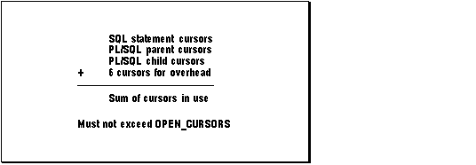

This chapter contains the following sections:

- Advantages of PL/SQL

- About Embedding PL/SQL Blocks

- About Using Host Variables

- About Using Indicator Variables

- About Using Host Arrays

- About Using Cursors

- Stored Subprograms

- About Using Dynamic PL/SQL

This chapter shows you how to improve performance by embedding PL/SQL transaction processing blocks in your program.

### 5.1 Advantages of PL/SQL

This section looks at some of the features and benefits offered by PL/SQL, such as

- Better Performance

- Integration with Oracle

- Cursor FOR Loops

- Subprograms

- Parameter Modes

- Packages

- PL/SQL Tables

- User-defined Records

#### 5.1.1 Better Performance

PL/SQL can help you reduce overhead, improve performance, and increase productivity. For example, without PL/SQL, Oracle must process SQL statements one at a time. Each SQL statement results in another call to the Server and consequently, a higher overhead. However, with PL/SQL, you can send an entire block of SQL statements to the Server. This minimizes communication between your application and Oracle.

#### 5.1.2 Integration with Oracle

PL/SQL is tightly integrated with the Oracle Server. For example, most PL/SQL datatypes are native to the Oracle data dictionary. Furthermore, you can use the `%TYPE` attribute to base variable declarations on column definitions stored in the data dictionary, as the following example shows:

    job_title emp.job%TYPE;

That way, you need not know the exact datatype of the column. Furthermore, if a column definition changes, the variable declaration changes accordingly and automatically. This provides data independence, reduces maintenance costs, and allows programs to adapt as the database changes.

#### 5.1.3 Cursor FOR Loops

With PL/SQL, you need not use the `DECLARE`, `OPEN`, `FETCH`, and `CLOSE` statements to define and manipulate a cursor. Instead, you can use a cursor `FOR` loop, which implicitly declares its loop index as a record, opens the cursor associated with a given query, repeatedly fetches data from the cursor into the record, then closes the cursor. An example follows:

    DECLARE
     ...
    BEGIN
     FOR emprec IN (SELECT empno, sal, comm FROM emp) LOOP
     IF emprec.comm / emprec.sal > 0.25 THEN ...
     ...
     END LOOP;
    END;

Notice that you use dot notation to reference fields in the record.

#### 5.1.4 Subprograms

PL/SQL has two types of subprograms called procedures and functions, which aid application development by letting you isolate operations. Generally, you use a procedure to perform an action and a function to compute a value.

Procedures and functions provide extensibility. That is, they let you tailor the PL/SQL language to suit your needs. For example, if you need a procedure that creates a new department, just write your own as follows:

    PROCEDURE create_dept
     (new_dname IN CHAR(14),
     new_loc IN CHAR(13),
     new_deptno OUT NUMBER(2)) IS
    BEGIN
     SELECT deptno_seq.NEXTVAL INTO new_deptno FROM dual;
     INSERT INTO dept VALUES (new_deptno, new_dname, new_loc);
    END create_dept;

When called, this procedure accepts a new department name and location, selects the next value in a department-number database sequence, inserts the new number, name, and location into the dept table, then returns the new number to the caller.

You can store subprograms in the database (using `CREATE` `FUNCTION` and `CREATE` `PROCEDURE`) that can be called from multiple applications without needing to be recompiled each time.

#### 5.1.5 Parameter Modes

You use parameter modes to define the behavior of formal parameters. There are three parameter modes: `IN` (the default), `OUT`, and `IN OUT`. An `7IN` parameter lets you pass values to the subprogram being called. An `OUT` parameter lets you return values to the caller of a subprogram. An `IN OUT` parameter lets you pass initial values to the subprogram being called and return updated values to the caller.

The datatype of each actual parameter must be convertible to the datatype of its corresponding formal parameter. [Table 3-6](meeting-program-requirements.md) shows the legal conversions between datatypes.

#### 5.1.6 Packages

PL/SQL lets you bundle logically related types, program objects, and subprograms into a package. Packages can be compiled and stored in an Oracle database, where their contents can be shared by multiple applications.

Packages usually have two parts: a specification and a body. The specification is the interface to your applications; it declares the types, constants, variables, exceptions, cursors, and subprograms available for use. The body defines cursors and subprograms and so implements the specification. In the following example, you "package" two employment procedures:

    PACKAGE emp_actions IS -- package specification
     PROCEDURE hire_employee (empno NUMBER, ename CHAR, ...);
     PROCEDURE fire_employee (emp_id NUMBER);
    END emp_actions;
    PACKAGE BODY emp_actions IS -- package body
     PROCEDURE hire_employee (empno NUMBER, ename CHAR, ...) IS
     BEGIN
     INSERT INTO emp VALUES (empno, ename, ...);
     END hire_employee;
     PROCEDURE fire_employee (emp_id NUMBER) IS
     BEGIN
     DELETE FROM emp WHERE empno = emp_id;
     END fire_employee;
    END emp_actions;

Only the declarations in the package specification are visible and accessible to applications. Implementation details in the package body are hidden and inaccessible.

#### 5.1.7 PL/SQL Tables

PL/SQL provides a composite datatype named `TABLE`. Objects of type `TABLE` are called PL/SQL tables, which are modelled as (but not the same as) database tables. PL/SQL tables have only one column and use a primary key to give you array-like access to rows. The column can belong to any scalar type (such as `CHAR`, `DATE`, or `NUMBER`), but the primary key must belong to type `BINARY_INTEGER`.

You can declare PL/SQL table types in the declarative part of any block, procedure, function, or package. In the following example, you declare a `TABLE` type called NumTabTyp:

    DECLARE
     TYPE NumTabTyp IS TABLE OF NUMBER
     INDEX BY BINARY_INTEGER;
     ...
    BEGIN
     ...
    END;

After you define type NumTabTyp, you can declare PL/SQL tables of that type, as the next example shows:

    num_tab NumTabTyp;

The identifier num_tab represents an entire PL/SQL table.

You reference rows in a PL/SQL table using array-like syntax to specify the primary key value. For example, you reference the ninth row in the PL/SQL table named num_tab as follows:

    num_tab(9) ...

#### 5.1.8 User-defined Records

You can use the `%ROWTYPE` attribute to declare a record that represents a row in a database table or a row fetched by a cursor. However, you cannot specify the datatypes of fields in the record or define fields of your own. The composite datatype `RECORD` lifts those restrictions.

Objects of type `RECORD` are called records. Unlike PL/SQL tables, records have uniquely named fields, which can belong to different datatypes. For example, suppose you have different kinds of data about an employee such as name, salary, hire date, and so on. This data is dissimilar in type but logically related. A record that contains such fields as the name, salary, and hire date of an employee would let you treat the data as a logical unit.

You can declare record types and objects in the declarative part of any block, procedure, function, or package. In the following example, you declare a `RECORD` type called DeptRecTyp:

    DECLARE
     TYPE DeptRecTyp IS RECORD
     (deptno NUMBER(4) NOT NULL := 10, -- must initialize
     dname CHAR(9),
     loc CHAR(14));

Notice that the field declarations are like variable declarations. Each field has a unique name and specific datatype. You can add the `NOT` `NULL` option to any field declaration and so prevent the assigning of nulls to that field. However, you must initialize `NOT` `NULL` fields.

After you define type DeptRecTyp, you can declare records of that type, as the next example shows:

    dept_rec DeptRecTyp;

The identifier dept_rec represents an entire record.

You use dot notation to reference individual fields in a record. For example, you reference the dname field in the dept_rec record as follows:

    dept_rec.dname ...

### 5.2 About Embedding PL/SQL Blocks

The Oracle Precompilers treat a PL/SQL block like a single embedded SQL statement. So, you can place a PL/SQL block anywhere in a host program that you can place a SQL statement.

To embed a PL/SQL block in your host program, simply bracket the PL/SQL block with the keywords `EXEC` `SQL` `EXECUTE` and `END-EXEC` as follows:

    EXEC SQL EXECUTE
     DECLARE
     ...
     BEGIN
     ...
     END;
    END-EXEC;

The keyword `END-EXEC` must be followed by the statement terminator for your host language.

When your program embeds PL/SQL blocks, you must specify the precompiler option `SQLCHECK=SEMANTICS` because PL/SQL must be parsed by Oracle. To connect to Oracle, you must also specify the option `USERID`. For more information, see "[About Using the Precompiler Options](running-Oracle-precompilers.md)".

### 5.3 About Using Host Variables

Host variables are the key to communication between a host language and a PL/SQL block. Host variables can be shared with PL/SQL, meaning that PL/SQL can set and reference host variables.

For example, you can prompt a user for information and use host variables to pass that information to a PL/SQL block. Then, PL/SQL can access the database and use host variables to pass the results back to your host program.

Inside a PL/SQL block, host variables are treated as global to the entire block and can be used anywhere within the block wherever a PL/SQL variable is allowed. However, character host variables cannot exceed 255 characters in length. Like host variables in a SQL statement, host variables in a PL/SQL block must be prefixed with a colon. The colon sets host variables apart from PL/SQL variables and database objects.

#### 5.3.1 An Example

The following example illustrates the use of host variables with PL/SQL. The program prompts the user for an employee number, then displays the job title, hire date, and salary of that employee.

    EXEC SQL BEGIN DECLARE SECTION;
     username CHARACTER(20);
     password CHARACTER(20);
     emp_number INTEGER;
     job_title CHARACTER(20);
     hire_date CHARACTER(9);
     salary REAL;
    EXEC SQL END DECLARE SECTION;
    EXEC SQL INCLUDE SQLCA;
    display 'Username? ';
    read username;
    display 'Password? ';
    read password;
    EXEC SQL WHENEVER SQLERROR DO sql_error;
    EXEC SQL CONNECT :username IDENTIFIED BY :password;
    display 'Connected to Oracle';
    LOOP
     display 'Employee Number (0 to end)? ';
     read emp_number;
     IF emp_number = 0 THEN
     EXEC SQL COMMIT WORK RELEASE;
     display 'Exiting program';
     exit program;
     ENDIF;
     ---------------- begin PL/SQL block -----------------
     EXEC SQL EXECUTE
     BEGIN
     SELECT job, hiredate, sal
     INTO :job_title, :hire_date, :salary
     FROM emp
     WHERE empno = :emp_number;
     END;
     END-EXEC;
     ---------------- end PL/SQL block -----------------
     display 'Number Job Title Hire Date Salary';
     display '------------------------------------';
     display emp_number, job_title, hire_date, salary;
    ENDLOOP;
    ...
    ROUTINE sql_error
    BEGIN
     EXEC SQL WHENEVER SQLERROR CONTINUE;
     EXEC SQL ROLLBACK WORK RELEASE;
     display 'Processing error';
     exit program with an error;
    END sql_error;

Notice that the host variable emp_number is set before the PL/SQL block is entered, and the host variables job_title, hire_date, and salary are set inside the block.

#### 5.3.2 A More Complex Example

In the example, you prompt the user for a bank account number, transaction type, and transaction amount, then debit or credit the account. If the account does not exist, you raise an exception. When the transaction is complete, you display its status.

    EXEC SQL BEGIN DECLARE SECTION;
     username CHARACTER(20);
     password CHARACTER(20);
     acct_num INTEGER;
     trans_type CHARACTER(1);
     trans_amt REAL;
     status CHARACTER(80);
    EXEC SQL END DECLARE SECTION;
    EXEC SQL INCLUDE SQLCA;
    display 'Username? ';
    read username;
    display 'Password? ';
    read password;
    EXEC SQL WHENEVER SQLERROR DO sql_error;
    EXEC SQL CONNECT :username IDENTIFIED BY :password;
    display 'Connected to Oracle';
    LOOP
     display 'Account Number (0 to end)? ';
     read acct_num;
     IF acct_num = 0 THEN
     EXEC SQL COMMIT WORK RELEASE;
     display 'Exiting program';
     exit program;
     ENDIF;
     display 'Transaction Type - D)ebit or C)redit? '
     read trans_type;
     display 'Transaction Amount? '
     read trans_amt;
     --------------------- begin PL/SQL block -------------------
     EXEC SQL EXECUTE
     DECLARE
     old_bal NUMBER(9,2);
     err_msg CHAR(70);
     nonexistent EXCEPTION;
     BEGIN
     :trans_type := UPPER(:trans_type);
     IF :trans_type = 'C' THEN -- credit the account
     UPDATE accts SET bal = bal + :trans_amt
     WHERE acctid = :acct_num;
     IF SQL%ROWCOUNT = 0 THEN -- no rows affected
     RAISE nonexistent;
     ELSE
     :status := 'Credit applied';
     END IF;
     ELSIF :trans_type = 'D' THEN -- debit the account
     SELECT bal INTO old_bal FROM accts
     WHERE acctid = :acct_num;
     IF old_bal >= :trans_amt THEN -- enough funds
     UPDATE accts SET bal = bal - :trans_amt
     WHERE acctid = :acct_num;
     :status := 'Debit applied';
     ELSE
     :status := 'Insufficient funds';
     END IF;
     ELSE
     :status := 'Invalid type: ' || :trans_type;
     END IF;
     COMMIT;
     EXCEPTION
     WHEN NO_DATA_FOUND OR nonexistent THEN
     :status := 'Nonexistent account';
     WHEN OTHERS THEN
     err_msg := SUBSTR(SQLERRM, 1, 70);
     :status := 'Error: ' || err_msg;
     END;
     END-EXEC;
     ------------------- end PL/SQL block -----------------------
     display 'Status: ', status;
    ENDLOOP;
    ROUTINE sql_error
    BEGIN
     EXEC SQL WHENEVER SQLERROR CONTINUE;
     EXEC SQL ROLLBACK WORK RELEASE;
     display 'Processing error';
     exit program with an error;
    END sql_error;

#### 5.3.3 VARCHAR Pseudotype

Recall from [Meeting Program Requirements](meeting-program-requirements.md) that you can use the `VARCHAR` pseudotype to declare variable-length character strings. If the `VARCHAR` is an input host variable, you must tell Oracle what length to expect. So, set the length field to the actual length of the value stored in the string field.

If the `VARCHAR` is an output host variable, Oracle automatically sets the length field. However, to use a `VARCHAR` output host variable in your PL/SQL block, you must initialize the length field before entering the block. So, set the length field to the declared (maximum) length of the `VARCHAR`, as shown in the following example:

    EXEC SQL BEGIN DECLARE SECTION;
     emp_number INTEGER;
     emp_name VARCHAR(10);
     salary REAL;
     ...
    EXEC SQL END DECLARE SECTION;
    ...
    set emp_name.len = 10; -- initialize length field
    EXEC SQL EXECUTE
     BEGIN
     SELECT ename, sal INTO :emp_name, :salary
     FROM emp
     WHERE empno = :emp_number;
     ...
     END;
    END-EXEC;

### 5.4 About Using Indicator Variables

PL/SQL does not need indicator variables because it can manipulate nulls. For example, within PL/SQL, you can use the `IS NULL` operator to test for nulls, as follows:

    IF variable IS NULL THEN ...

You can use the assignment operator (`:=`) to assign nulls, as follows:

    variable := NULL;

However, host languages need indicator variables because they cannot manipulate nulls. Embedded PL/SQL meets this need by letting you use indicator variables to

- accept nulls input from a host program

- output nulls or truncated values to a host program

When used in a PL/SQL block, indicator variables are subject to the following rules:

- You cannot refer to an indicator variable by itself; it must be appended to its associated host variable.

- If you refer to a host variable with its indicator variable, you must always refer to it that way in the same block.

In the following example, the indicator variable ind_comm appears with its host variable commission in the `SELECT` statement, so it must appear that way in the `IF` statement:

    EXEC SQL EXECUTE
     BEGIN
     SELECT ename, comm
     INTO :emp_name, :commission:ind_comm FROM emp
     WHERE empno = :emp_number;
     IF :commission:ind_comm IS NULL THEN ...
     ...
     END;
    END-EXEC;

Notice that PL/SQL treats :commission:ind_comm like any other simple variable. Though you cannot refer directly to an indicator variable inside a PL/SQL block, PL/SQL checks the value of the indicator variable when entering the block and sets the value correctly when exiting the block.

#### 5.4.1 Handling Nulls

When entering a block, if an indicator variable has a value of `-1`, PL/SQL automatically assigns a null to the host variable. When exiting the block, if a host variable is null, PL/SQL automatically assigns a value of -1 to the indicator variable. In the next example, if handsel had a value of -1 before the PL/SQL block was entered, the salary_missing exception is raised. An exception is a named error condition.

    EXEC SQL EXECUTE
     BEGIN
     IF :salary:ind_sal IS NULL THEN
     RAISE salary_missing;
     END IF;
     ...
     END;
    END-EXEC;

#### 5.4.2 Handling Truncated Values

PL/SQL does not raise an exception when a truncated string value is assigned to a host variable. However, if you use an indicator variable, PL/SQL sets it to the original length of the string. In the following example, the host program will be able to tell, by checking the value of ind_name, if a truncated value was assigned to emp_name:

    EXEC SQL EXECUTE
     DECLARE
     ...
     new_name CHAR(10);
     BEGIN
     ...
     :emp_name:ind_name := new_name;
     ...
     END;
    END-EXEC;

### 5.5 About Using Host Arrays

You can pass input host arrays and indicator arrays to a PL/SQL block. They can be indexed by a PL/SQL variable of type `BINARY_INTEGER` or by a host variable compatible with that type. Normally, the entire host array is passed to PL/SQL, but you can use the `ARRAYLEN` statement (discussed later) to specify a smaller array dimension.

Furthermore, you can use a subprogram call to assign all the values in a host array to rows in a PL/SQL table. Given that the array subscript range is m .. n, the corresponding PL/SQL table index range is always 1 .. (n - m + 1). For example, if the array subscript range is 5 .. 10, the corresponding PL/SQL table index range is 1 .. (10 - 5 + 1) or 1 .. 6.

**Note:**

The Oracle Precompilers do not check your usage of host arrays. For instance, no index range checking is done.

In the example , you pass a host array named salary to a PL/SQL block, which uses the host array in a function call. The function is named median because it finds the middle value in a series of numbers. Its formal parameters include a PL/SQL table named num_tab. The function call assigns all the values in the actual parameter salary to rows in the formal parameter num_tab.

    EXEC SQL BEGIN DECLARE SECTION;
     ...
     salary (100) REAL;
     median_salary REAL;
    EXEC SQL END DECLARE SECTION;
    -- populate the host array
    EXEC SQL EXECUTE
     DECLARE
     TYPE NumTabTyp IS TABLE OF REAL
     INDEX BY BINARY_INTEGER;
     n BINARY_INTEGER;
     ...
     FUNCTION median (num_tab NumTabTyp, n INTEGER)
     RETURN REAL IS
     BEGIN
     -- compute median
     END;
     BEGIN
     n := 100;
     :median_salary := median(:salary, n);
     ...
     END;
    END-EXEC;

You can also use a subprogram call to assign all row values in a PL/SQL table to corresponding elements in a host array.

Table 5-1 shows the legal conversions between row values in a PL/SQL table and elements in a host array. For example, a host array of type `LONG` is compatible with a PL/SQL table of type `VARCHAR2`, `LONG`, `RAW`, or `LONG RAW`. Notably, it is not compatible with a PL/SQL table of type `CHAR`.

Table 5-1 Legal Conversions: PL/SQL Table Row and Host Array Elements

| PL/SQL Table     | CHAR | DATE | LONG | LONG RAW | NUMBER | RAW | ROWID | VARCHAR2 |
|:-----------------|:-----|:-----|:-----|:---------|:-------|:----|:------|:---------|
| `CHARF`          | \_/  |      |      |          |        |     |       |          |
| `CHARZ`          | \_/  |      |      |          |        |     |       |          |
| `DATE`           |      | \_/  |      |          |        |     |       |          |
| `DECIMAL`        |      |      |      |          | \_/    |     |       |          |
| `DISPLAY`        |      |      |      |          | \_/    |     |       |          |
| `FLOAT`          |      |      |      |          | \_/    |     |       |          |
| `INTEGER`        |      |      |      |          | \_/    |     |       |          |
| `LONG`           | \_/  |      | \_/  |          |        |     |       |          |
| `LONG` `VARCHAR` |      |      | \_/  | \_/      |        | \_/ |       | \_/      |
| `LONG` `VARRAW`  |      |      |      | \_/      |        | \_/ |       |          |
| `NUMBER`         |      |      |      |          | \_/    |     |       |          |
| `RAW`            |      |      |      | \_/      |        | \_/ |       |          |
| `ROWID`          |      |      |      |          |        |     | \_/   |          |
| `STRING`         |      |      | \_/  | \_/      |        | \_/ |       | \_/      |
| `UNSIGNED`       |      |      |      |          | \_/    |     |       |          |
| `VARCHAR`        |      |      | \_/  | \_/      |        | \_/ |       | \_/      |
| `VARCHAR2`       |      |      | \_/  | \_/      |        | \_/ |       | \_/      |
| `VARNUM`         |      |      |      |          | \_/    |     |       |          |
| `VARRAW`         |      |      |      | \_/      |        | \_/ |       |          |

#### 5.5.1 ARRAYLEN Statement

Suppose you must pass an input host array to a PL/SQL block for processing. By default, when binding such a host array, the Oracle Precompilers use its declared dimension. However, you might not want to process the entire array. In that case, you can use the `ARRAYLEN` statement to specify a smaller array dimension. `ARRAYLEN` associates the host array with a host variable, which stores the smaller dimension. The statement syntax is

    EXEC SQL ARRAYLEN host_array (dimension);

where dimension is a 4-byte, integer host variable, not a literal or an expression.

The `ARRAYLEN` statement must appear in the Declare Section along with, but somewhere after, the declarations of host_array and dimension. You cannot specify an offset into the host array. However, you might be able to use host-language features for that purpose.

In the following example, you use `ARRAYLEN` to override the default dimension of a host array named bonus:

    EXEC SQL BEGIN DECLARE SECTION;
     bonus (100) REAL;
     my_dim INTEGER;
     EXEC SQL ARRAYLEN bonus (my_dim);
    EXEC SQL END DECLARE SECTION;
    -- populate the host array
    ...
    set my_dim = 25; -- set smaller array dimension
    EXEC SQL EXECUTE
     DECLARE
     TYPE NumTabTyp IS TABLE OF REAL
     INDEX BY BINARY_INTEGER;
     median_bonus REAL;
     FUNCTION median (num_tab NumTabTyp, n INTEGER)
     RETURN REAL IS
     BEGIN
     -- compute median
     END;
     BEGIN
     median_bonus := median(:bonus, :my_dim);
     ...
     END;
    END-EXEC;

Only 25 array elements are passed to the PL/SQL block because `ARRAYLEN` downsizes the host array from 100 to 25 elements. As a result, when the PL/SQL block is sent to Oracle for execution, a much smaller host array is sent along. This saves time and, in a networked environment, reduces network traffic.

### 5.6 About Using Cursors

Every embedded SQL statement is assigned a cursor, either explicitly by you in a `DECLARE` `CURSOR` statement or implicitly by the precompiler. Internally, the Oracle Precompilers maintain a cache, called the cursor cache, to control the execution of embedded SQL statements. When executed, every SQL statement is assigned an entry in the cursor cache. This entry is linked to a private SQL area in your Program Global Area (PGA) within Oracle.

Various precompiler options, including `MAXOPENCURSORS`, `HOLD_CURSOR`, and `RELEASE_CURSOR`, let you manage the cursor cache to improve performance. For example, `RELEASE_CURSOR` controls what happens to the link between the cursor cache and private SQL area. If you specify `RELEASE_CURSOR``=YES`, the link is removed after Oracle executes the SQL statement. This frees memory allocated to the private SQL area and releases parse locks.

For purposes of cursor cache management, an embedded PL/SQL block is treated just like a SQL statement. At run time, a cursor, called a parent cursor, is associated with the entire PL/SQL block. A corresponding entry is made to the cursor cache, and this entry is linked to a private SQL area in the PGA.

Each SQL statement inside the PL/SQL block also requires a private SQL area in the PGA. So, PL/SQL manages a separate cache, called the child cursor cache, for these SQL statements. Their cursors are called child cursors. Because PL/SQL manages the child cursor cache, you do not have direct control over child cursors.

The maximum number of cursors your program can use simultaneously is set by the Oracle initialization parameter `OPEN_CURSORS`.Figure 5-1 shows you how to calculate the maximum number of cursors in use.

Figure 5-1 Maximum Cursors in Use

[Description of "Figure 5-1 Maximum Cursors in Use"](img_text/image009.md)

If your program exceeds the limit imposed by `OPEN_CURSORS`, you get the following Oracle error:

    ORA-01000: maximum open cursors exceeded

You can avoid this error by specifying the `RELEASE_CURSOR``=YES` and `HOLD_CURSOR``=NO` options. If you do not want to precompile the entire program with `RELEASE_CURSOR` set to `YES`, simply reset it to `NO` after each PL/SQL block, as follows:

    EXEC ORACLE OPTION (RELEASE_CURSOR=YES);
    -- first embedded PL/SQL block
     EXEC ORACLE OPTION (RELEASE_CURSOR=NO);
    -- embedded SQL statements
     EXEC ORACLE OPTION (RELEASE_CURSOR=YES);
    -- second embedded PL/SQL block
     EXEC ORACLE OPTION (RELEASE_CURSOR=NO);
    -- embedded SQL statements

#### 5.6.1 An Alternative

The `MAXOPENCURSORS` option specifies the initial size of the cursor cache. For example, when `MAXOPENCURSORS=1`0, the cursor cache can hold up to 10 entries. If a new cursor is needed, there are no free cache entries, and `HOLD_CURSOR=NO`, the precompiler tries to reuse an entry. If you specify a very low value for `MAXOPENCURSORS`, the precompiler is forced to reuse the parent cursor more often. All the child cursors are released as soon as the parent cursor is reused.

### 5.7 Stored Subprograms

Unlike anonymous blocks, PL/SQL subprograms (procedures and functions) can be compiled separately, stored in an Oracle database, and invoked. A subprogram explicitly created using an Oracle tool such as SQL\*Plus is called a stored subprogram. Once compiled and stored in the data dictionary, it is a database object, which can be reexecuted without being recompiled.

When a subprogram within a PL/SQL block or stored subprogram is sent to Oracle by your application, it is called an inline subprogram. Oracle compiles the inline subprogram and caches it in the System Global Area (SGA), but does not store the source or object code in the data dictionary.

Subprograms defined within a package are considered part of the package, and so are called packaged subprograms. Stored subprograms not defined within a package are called standalone subprograms.

#### 5.7.1 Creating Stored Subprograms

You can embed the SQL statements `CREATE` `FUNCTION`, `CREATE` `PROCEDURE`, and `CREATE` `PACKAGE` in a host program, as the following example shows:

    EXEC SQL CREATE
     FUNCTION sal_ok (salary REAL, title CHAR)
     RETURN BOOLEAN AS
     min_sal REAL;
     max_sal REAL;
     BEGIN
     SELECT losal, hisal INTO min_sal, max_sal
     FROM sals
     WHERE job = title;
     RETURN (salary >= min_sal) AND
     (salary <= max_sal);
     END sal_ok;
    END-EXEC;

Notice that the embedded `CREATE`` {FUNCTION | PROCEDURE | PACKAGE}` statement is a hybrid. Like all other embedded `CREATE` statements, it begins with the keywords `EXEC SQL` (not `EXEC SQL EXECUTE`). But, unlike other embedded `CREATE` statements, it ends with the PL/SQL terminator `END-EXEC`.

In the example, you create a package that contains a procedure named get_employees, which fetches a batch of rows from the emp table. The batch size is determined by the caller of the procedure, which might be another stored subprogram or a client application program.

The procedure declares three PL/SQL tables as `OUT` formal parameters, then fetches a batch of employee data into the PL/SQL tables. The matching actual parameters are host arrays. When the procedure finishes, it automatically assigns all row values in the PL/SQL tables to corresponding elements in the host arrays.

    EXEC SQL CREATE OR REPLACE PACKAGE emp_actions AS
     TYPE CharArrayTyp IS TABLE OF VARCHAR2(10)
     INDEX BY BINARY_INTEGER;
     TYPE NumArrayTyp IS TABLE OF FLOAT
     INDEX BY BINARY_INTEGER;
     PROCEDURE get_employees(
     dept_number IN INTEGER,
     batch_size IN INTEGER,
     found IN OUT INTEGER,
     done_fetch OUT INTEGER,
     emp_name OUT CharArrayTyp,
     job-title OUT CharArrayTyp,
     salary OUT NumArrayTyp);
     END emp_actions;
    END-EXEC;
    EXEC SQL CREATE OR REPLACE PACKAGE BODY emp_actions AS
     CURSOR get_emp (dept_number IN INTEGER) IS
     SELECT ename, job, sal FROM emp
     WHERE deptno = dept_number;
     PROCEDURE get_employees(
     dept_number IN INTEGER,
     batch_size IN INTEGER,
     found IN OUT INTEGER,
     done_fetch OUT INTEGER,
     emp_name OUT CharArrayTyp,
     job_title OUT CharArrayTyp,
     salary OUT NumArrayTyp) IS
     BEGIN
     IF NOT get_emp%ISOPEN THEN
     OPEN get_emp(dept_number);
     END IF;
     done_fetch := 0;
     found := 0;
     FOR i IN 1..batch_size LOOP
     FETCH get_emp INTO emp_name(i),
     job_title(i), salary(i);
     IF get_emp%NOTFOUND THEN
     CLOSE get_emp;
     done_fetch := 1;
     EXIT;
     ELSE
     found := found + 1;
     END IF;
     END LOOP;
     END get_employees;
     END emp_actions;
    END-EXEC;

You specify the `REPLACE` clause in the `CREATE` statement to redefine an existing package without having to drop the package, re-create it, and regrant privileges on it. For the full syntax of the `CREATE` statement see the [Oracle Database SQL Language Reference](../sqlrf/Introduction-to-Oracle-SQL.md).

If an embedded `CREATE {FUNCTION|PROCEDURE|PACKAGE}` statement fails, Oracle generates a warning, not an error.

#### 5.7.2 Calling a Stored Subprogram

To invoke (call) a stored subprogram from your host program, you must use an anonymous PL/SQL block. In the following example, you call a standalone procedure named raise_salary:

    EXEC SQL EXECUTE
     BEGIN
     raise_salary(:emp_id, :increase);
     END;
    END-EXEC;

Notice that stored subprograms can take parameters. In this example, the actual parameters emp_id and increase are host variables.

In the next example, the procedure raise_salary is stored in a package named emp_actions, so you must use dot notation to fully qualify the procedure call:

    EXEC SQL EXECUTE
     BEGIN
     emp_actions.raise_salary(:emp_id, :increase);
     END;
    END-EXEC;

An actual IN parameter can be a literal, host variable, host array, PL/SQL constant or variable, PL/SQL table, PL/SQL user-defined record, subprogram call, or expression. However, an actual OUT parameter cannot be a literal, subprogram call, or expression.

In the Pro\*C example, three of the formal parameters are PL/SQL tables, and the corresponding actual parameters are host arrays. The program calls the stored procedure get_employees repeatedly, displaying each batch of employee data, until no more data is found.

    #include <stdio.h>
    #include <string.h>
    typedef char asciz;
    EXEC SQL BEGIN DECLARE SECTION;
     /* Define type for null-terminated strings */
     EXEC SQL TYPE asciz IS STRING(20);
     asciz username[20];
     asciz password[20];
     int dept_no; /* which department to query */
     char emp_name[10][21];
     char job[10][21];
     float salary[10];
     int done_flag;
     int array_size;
     int num_ret; /* number of rows returned */
     int SQLCODE;
    EXEC SQL END DECLARE SECTION;
    EXEC SQL INCLUDE sqlca;
    int print_rows(); /* produces program output */
    int sql_error(); /* handles NOLOGGING errors */
    main()
    {
     int i;
     /* Connect to Oracle. */
     strcpy(username, "SCOTT");
     strcpy(password, "TIGER");
     EXEC SQL WHENEVER SQLERROR DO sql_error();
     EXEC SQL CONNECT :username IDENTIFIED BY :password;
     printf("\nConnected to Oracle as user: %s\n", username);
     printf("enter department number: ");
     scanf("%d", &dept_no);
     fflush(stdin);
     /* Set the array size. */
     array_size = 10;
     done_flag = 0;
     num_ret = 0;
     /* Array fetch loop - ends when done_flag is true. */
     for (;;)
     {
     EXEC SQL EXECUTE
     BEGIN emp_actions.get_employees
     (:dept_no, :array_size, :num_ret,
     :done_flag, :emp_name, :job, :salary);
     END;
     END-EXEC;
     print_rows(num_ret);
     if (done_flag)
     break;
     }
     /* Disconnect from the database. */
     EXEC SQL COMMIT WORK RELEASE;
     exit(0);
    }
    print_rows(n)
    int n;
    {
     int i;
     if (n == 0)
     {
     printf("No rows retrieved.\n");
     return;
     }
     printf("\n\nGot %d row%c\n", n, n == 1 ? '\0' : 's');
     printf("%-20.20s%-20.20s%s\n", "Ename", "Job", "Salary");
     for (i = 0; i < n; i++)
     printf("%20.20s%20.20s%6.2f\n",
     emp_name[i], job[i], salary[i]);
    }
    sql_error()
    {
     EXEC SQL WHENEVER SQLERROR CONTINUE;
     printf("\nOracle error detected:");
     printf("\n% .70s \n", sqlca.sqlerrm.sqlerrmc);
     EXEC SQL ROLLBACK WORK RELEASE;
     exit(1);
    }

Remember, the datatype of each actual parameter must be convertible to the datatype of its corresponding formal parameter. Also, before a stored subprogram exits, all OUT formal parameters must be assigned values. Otherwise, the values of corresponding actual parameters are indeterminate.

#### 5.7.3 Remote Access

PL/SQL lets you access remote databases through database links. Typically, database links are established by your DBA and stored in the Oracle data dictionary. A database link tells Oracle where the remote database is located, the path to it, and what Oracle username and password to use. In the following example, you use the database link dallas to call the raise_salary procedure:

    EXEC SQL EXECUTE
     BEGIN
     raise_salary@dallas(:emp_id, :increase);
     END;
    END-EXEC;

You can create synonyms to provide location transparency for remote subprograms, as the following example shows:

    CREATE PUBLIC SYNONYM raise_salary FOR raise_salary@dallas;

#### 5.7.4 Getting Information about Stored Subprograms

In [Meeting Program Requirements](meeting-program-requirements.md), you learned how to embed OCI calls in your host program. After calling the library routine `SQLLDA` to set up the LDA, you can use the OCI call `ODESSP` to get useful information about a stored subprogram. When you call `ODESSP`, you must pass it a valid LDA and the name of the subprogram. For packaged subprograms, you must also pass the name of the package. `ODESSP` returns information about each subprogram parameter such as its datatype, size, position, and so on.

You can also use the procedure describe_procedure in package DBMS_DESCRIBE, which is supplied with Oracle.

### 5.8 About Using Dynamic PL/SQL

Recall that the Oracle Precompilers treat an entire PL/SQL block like a single SQL statement. Therefore, you can store a PL/SQL block in a string host variable. Then, if the block contains no host variables, you can use dynamic SQL Method 1 to execute the PL/SQL string. Or, if the block contains a known number of host variables, you can use dynamic SQL Method 2 to prepare and execute the PL/SQL string. If the block contains an unknown number of host variables, you must use dynamic SQL Method 4. For more information, refer to [Using Dynamic SQL](using-dynamic-SQL.md).

#### 5.8.1 Restriction

In dynamic SQL Method 4, a host array cannot be bound to a PL/SQL procedure with a parameter of type `TABLE`.
