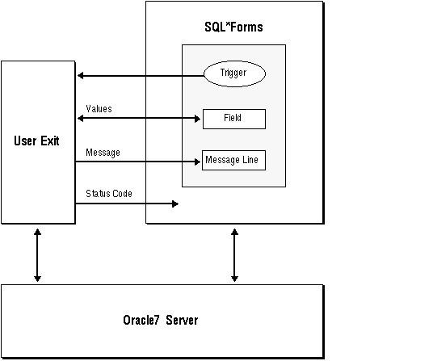

This chapter contains the following:

- What Is a User Exit?

- Why Write a User Exit?

- Developing a User Exit

- Writing a User Exit

- Calling a User Exit

- Passing Parameters to a User Exit

- Returning Values to a Form

- An Example

- About Precompiling and Compiling a User Exit

- About Using the GENXTB Utility

- About Linking a User Exit into SQL\*Forms

- Guidelines for SQL\*Forms User Exits

- EXEC TOOLS Statements

This chapter focuses on writing user exits for your SQL\*Forms and Oracle Forms applications. First, you learn the EXEC IAF statements that allow a SQL\*Forms application to interface with user exits. Then, you learn how to write and link a SQL\*Forms user exit. You also learn how to use EXEC TOOLS statements with Oracle Forms. (SQL\*Forms does not support EXEC TOOLS.) That way, you can use EXEC IAF statements to enhance your existing applications and EXEC TOOLS statements to build new applications. The following topics are covered:

- Common uses for user exits

- Writing a user exit

- Passing values between SQL\*Forms and a user exit

- Implementing a user exit

- Calling a user exit

- Guidelines for SQL\*Forms user exits

- Using EXEC TOOLS statements with Oracle Forms

This chapter is supplemental. For more information about user exits, see the SQL\*Forms Designer's Reference, the Oracle Forms Reference Manual, Vol. 2, and your system-specific Oracle manuals.

### 11.1 What Is a User Exit?

A user exit is a host-language subroutine written by you and called by SQL\*Forms to do special-purpose processing. You can embed SQL commands and PL/SQL blocks in your user exit, then precompile it as you would a host program.

When called by a SQL\*Forms trigger, the user exit runs, then returns a status code to SQL\*Forms (refer to Figure 11-1). Your user exit can display messages on the SQL\*Forms status line, get and put field values, manipulate Oracle data, do high-speed computations and table lookups -- even log on to different databases.

Figure 11-1 SQL\*Forms

[Description of "Figure 11-1 SQL\*Forms "](img_text/image014.md)

### 11.2 Why Write a User Exit?

SQL\*Forms Version 3 enables use PL/SQL blocks in triggers. So, in most cases, instead of calling a user exit, you can use the procedural power of PL/SQL. If the need arises, you can call user exits from a PL/SQL block with the `USER_EXIT` function.

User exits are harder to write and implement than SQL, PL/SQL, or SQL\*Forms commands. So, you will probably use them only to do processing that is beyond the scope of SQL, PL/SQL, and SQL\*Forms. Some common uses follow:

- Operations more quickly or easily performed in third generation languages like C and FORTRAN (for example, numeric integration)

- Controlling real time devices or processes (for example, issuing a sequence of instructions to a printer or graphics device)

- Data manipulations that need extended procedural capabilities (for example, recursive sorting)

- Special file I/O operations

### 11.3 Developing a User Exit

This section outlines the way to develop a SQL\*Forms user exit; later sections go into more detail. For information about EXEC TOOLS statements, which are available with Oracle Forms, see EXEC TOOLS Statements''

To incorporate a user exit into a form, you take the following steps:

1\. Write the user exit in a supported host language.

2\. Precompile the source code.

3\. Compile the modified source code.

4\. Use the GENXTB utility to create a database table, IAPXTB.

5\. Use the GENXTB form in SQL\*Forms to insert your user exit information into the database table.

6\. Use the GENXTB utility to read the information from the table and create an IAPXIT source module. Then, compile the source module.

7\. Create a new IAP (the SQL\*Forms component that runs a form) by linking the standard IAP object modules, your user exit object module, and the IAPXIT object module created in step 6.

8\. In the form, define a trigger to call the user exit.

9\. Instruct operators to use the new IAP when running the form. This is unnecessary if the new IAP replaces the standard one. For details, refer to your system-specific Oracle manuals.

### 11.4 Writing a User Exit

You can use the following kinds of statements to write your SQL\*Forms user exit:

- host-language

- EXEC SQL

- EXEC ORACLE

- EXEC IAF GET

- EXEC IAF PUT

This section focuses on the EXEC IAF `GET` and `PUT` statements, which let you pass values between SQL\*Forms and a user exit.

#### 11.4.1 Requirements for Variables

The variables used in EXEC IAF statements must correspond to field names used in the form definition. If a field reference is ambiguous because you did not specify a block name, you get an error. An invalid or ambiguous reference to a form field generates an error.

Host variables must be named in the user exit Declare Section and must be prefixed with a colon (:) in EXEC IAF statements.

**Note:**

: Indicator variables are not allowed in EXEC IAF `GET` and `PUT` statements.

#### 11.4.2 The IAF GET Statement

This statement allows your user exit to "get" values from fields on a form and assign them to host variables. The user exit can then use the values in calculations, data manipulations, updates, and so on. The syntax of the `GET` statement follows:

    EXEC IAF GET field_name1, field_name2, ...
     INTO :host_variable1, :host_variable2, ...;

where field_name can be any of the following SQL\*Forms variables:

- field

- block.field

- system variable

- global variable

- host variable (prefixed with a colon) containing the value of a field, block.field, system variable, or global variable

If field_name is not qualified, it must be unique.

The following example shows how a user exit GETs a field value and assigns it to a host variable:

    EXEC IAF GET employee.job INTO :new_job;

All field values are character strings. If it can, `GET` converts a field value to the datatype of the corresponding host variable. If an illegal or unsupported datatype conversion is attempted, an error is generated.

In the last example, a constant is used to specify block.field. You can also use a host string to specify block and field names, as follows:

    set blkfld = 'employee.job';
    EXEC IAF GET :blkfld INTO :new_job;

Unless the field is unique, the host string must contain the full block.field reference with intervening period. For example, the following usage is invalid:

    set blk = 'employee';
    set fld = 'job';
    EXEC IAF GET :blk.:fld INTO :new_job;

You can mix explicit and stored field names in a `GET` statement field list, but not in a single field reference. For example, the following usage is invalid:

    set fld = 'job';
    EXEC IAF GET employee.:fld INTO :new_job;

#### 11.4.3 The IAF PUT Statement

This statement allows your user exit to put the values of constants and host variables into fields on a form. Thus, the user exit can display on the SQL\*Forms screen any value or message you like. The syntax of the `PUT` statement follows:

    EXEC IAF PUT field_name1, field_name2, ...
     VALUES (:host_variable1, :host_variable2, ...);

where field_name can be any of the following SQL\*Forms variables:

- field

- block.field

- system variable

- global variable

- host variable (prefixed with a colon) containing the value of a field, block.field, system variable, or global variable

The following example shows how a user exit PUTs the values of a numeric constant, string constant, and host variable into fields on a form:

    EXEC IAF PUT employee.number, employee.name, employee.job
     VALUES (7934, 'MILLER', :new_job);

Like `GET`, `PUT` lets you use a host string to specify block and field names, as follows:

    set blkfld = 'employee.job';
    EXEC IAF PUT :blkfld VALUES (:new_job);

On character-mode terminals, a value `PUT` into a field is displayed when the user exit returns, rather than when the assignment is made, provided the field is on the current display page. On block-mode terminals, the value is displayed the next time a field is read from the device.

If a user exit changes the value of a field several times, only the last change takes effect.

### 11.5 Calling a User Exit

You call a user exit from a SQL\*Forms trigger using a packaged procedure named `USER_EXIT` (supplied with SQL\*Forms). The syntax you use is

    USER_EXIT(user_exit_string [, error_string]);

where user_exit_string contains the name of the user exit plus optional parameters and error_string contains an error message issued by SQL\*Forms if the user exit fails. For example, the following trigger command calls a user exit named `LOOKUP`:

    USER_EXIT('LOOKUP');

Notice that the user exit string is enclosed by single (not double) quotes.

### 11.6 Passing Parameters to a User Exit

When you call a user exit, SQL\*Forms passes it the following parameters automatically:

- Command Line is the user exit string.

- Command Line Length is the length (in characters) of the user exit string.

- Error Message is the error string (failure message) if one is defined.

- Error Message Length is the length of the error string.

- In-Query is a Boolean value indicating whether the exit was called in normal or query mode.

However, the user exit string enables pass additional parameters to the user exit. For example, the following trigger command passes two parameters and an error message to the user exit `LOOKUP`:

    USER_EXIT('LOOKUP 2025 A', 'Lookup failed');

You can use this feature to pass field names to the user exit, as the following example shows:

    USER_EXIT('CONCAT firstname, lastname, address');

However, it is up to the user exit, not SQL\*Forms, to parse the user exit string.

### 11.7 Returning Values to a Form

When a user exit returns control to SQL\*Forms, it must also return a code indicating whether it succeeded, failed, or suffered an irrecoverable error. The return code is an integer constant generated by precompiler (refer to this section: An Example). The three results have the following meanings:

Success: The user exit encountered no errors. SQL\*Forms proceeds to the success label or the next step, unless the Reverse Return Code switch is set by the calling trigger step.

Failure: The user exit detected an error, such as an invalid value in a field. An optional message passed by the exit appears on the message line at the bottom of the SQL\*Forms screen and on the Display Error screen. SQL\*Forms responds as it does to a SQL statement that affects no rows.

Fatal error: The user exit detected a condition that makes further processing impossible, such as an execution error in a SQL statement. An optional error message passed by the exit appears on the SQL\*Forms Display Error screen. SQL\*Forms responds as it does to an irrecoverable SQL error.

If a user exit changes the value of a field, then returns a failure or fatal error code, SQL\*Forms does not discard the change. Nor does SQL\*Forms discard changes when the Reverse Return Code switch is set and a success code is returned.

#### 11.7.1 The IAP Constants

The precompiler generates three symbolic constants for use as return codes. They are prefixed with IAP. For example, the three constants might be IAPSUCC, IAPFAIL, and IAPFTL.

#### 11.7.2 Using the SQLIEM Function

By calling the function SQLIEM, your user exit can specify an error message that SQL\*Forms will display on the message line if the trigger step fails or on the Display Error screen if the step causes an irrecoverable error. The specified message replaces any message defined for the step.

The syntax of the SQLIEM function call is

    SQLIEM (error_message, message_length);

where error_message and message_length are character and integer variables, respectively. The Oracle Precompilers generate the appropriate external function declaration for you. You pass both parameters by reference; that is, you pass their addresses, not their values. SQLIEM is a SQL\*Forms function; it cannot be called from other Oracle tools.

#### 11.7.3 Using WHENEVER

You can use the `WHENEVER` statement in an exit to detect invalid datatype conversions (SQLERROR), truncated values `PUT` into form fields (SQLWARNING), and queries that return no rows (`NOT` `FOUND`).

### 11.8 An Example

The following example shows how a typical user exit is coded. Notice that, like a host program, the user exit has a Declare Section and a SQLCA.

    -- subroutine MYEXIT
    EXEC SQL BEGIN DECLARE SECTION;
     field1 CHARACTER(20);
     field2 CHARACTER(20);
     value1 CHARACTER(20);
     value2 CHARACTER(20);
     result_val CHARACTER(20);
    EXEC SQL END DECLARE SECTION;
     errmsg CHARACTER(80);
     errlen INTEGER;
    EXEC SQL INCLUDE SQLCA;
    EXEC SQL WHENEVER SQLERROR GOTO sqlerror;
    -- get field values from form
    EXEC IAF GET :field1, :field2 INTO :value1, :value2;
    -- manipulate values to obtain result_val
    -- put result_val into form field
    EXEC IAF PUT result VALUES (:result_val);
    return(IAPSUCC); -- trigger step succeeded
    sqlerror:
     set errmsg = CONCAT('MYEXIT: ', sqlca.sqlerrm.sqlerrmc);
     set errlen = LENGTH(errmsg);
     sqliem(errmsg, errlen); -- pass error message to SQL*Forms
     return(IAPFAIL); -- trigger step failed

For a complete host-language example, see your host -language supplement.

### 11.9 About Precompiling and Compiling a User Exit

User exits are precompiled like standalone host programs. Refer to [Running the Oracle Precompilers](running-Oracle-precompilers.md)

For instructions on compiling a user exit, see your system-specific Oracle manuals.

### 11.10 About Using the GENXTB Utility

The IAP program table IAPXTB in module IAPXIT contains an entry for each user exit linked into IAP. IAPXTB tells IAP the name, location, and host language of each user exit. When you add a new user exit to IAP, you must add a corresponding entry to IAPXTB.

IAPXTB is derived from a database table, also named IAPXTB. You can modify the database table by running the GENXTB form on the operating system command line, as follows:

    RUNFORM GENXTB username/password

A form is displayed that enables you to enter the following information for each user exit you define:

- exit name

- host-language code (`COB`, `FOR`, `PAS`, or `PLI`)

- date created

- date last modified

- comments

After modifying the IAPXTB database table, use the GENXTB utility to read the table and create an Assembler or C source program that defines the module IAPXIT and the IAPXTB program table it contains. The source language used depends on your operating system. The syntax you use to run the GENXTB utility is

    GENXTB username/password outfile

where outfile is the name you give the Assembler or source program that GENXTB creates.

### 11.11 About Linking a User Exit into SQL\*Forms

Before running a form that calls a user exit, you must link the user exit into IAP. The user exit can be linked into your standard version of IAP or into a special version for those forms that call the exit.

To produce a new executable copy of IAP, link your user exit object module, the standard IAP modules, the IAPXIT module, and any modules needed from the Oracle and host-language link libraries. The details of linking are system-dependent, so check your system-specific Oracle manuals.

### 11.12 Guidelines for SQL\*Forms User Exits

The guidelines in this section will help you avoid some common pitfalls.

#### 11.12.1 Naming the Exit

The name of your user exit cannot be an Oracle reserved word. Also avoid using names that conflict with the names of SQL\*Forms commands, function codes, and externally defined names used by SQL\*Forms.

SQL\*Forms converts the name of a user exit to upper case before searching for the exit. Therefore, the exit name must be in upper case in your source code if your host language is case-sensitive.

The name of the user exit entry point in the source code becomes the name of the user exit itself. The exit name must be a valid file name for your host language and operating system.

#### 11.12.2 Connecting to Oracle

User exits communicate with Oracle through the connection made by SQL\*Forms. However, a user exit can establish additional connections to any database through SQL\*Net. For more information, refer to [Concurrent Logons](meeting-program-requirements.md)".

#### 11.12.3 Issuing I/O Calls

SQL\*Forms I/O routines might conflict with host-language printer I/O routines. If they do, your user exit will be unable to issue printer I/O calls. File I/O is supported but screen I/O is not.

#### 11.12.4 Using Host Variables

Restrictions on the use of host variables in a standalone program also apply to user exits. Host variables must be named in the user exit Declare Section and must be prefixed with a colon in EXEC SQL and EXEC IAF statements. However, the use of host arrays is not allowed in EXEC IAF statements.

#### 11.12.5 Updating Tables

Generally, a user exit should not `UPDATE` database tables associated with a form. For example, suppose an operator updates a record in the SQL\*Forms work space, then a user exit `UPDATEs` the corresponding row in the associated database table. When the transaction is `COMMITted`, the record in the SQL\*Forms work space is applied to the table, overwriting the user exit `UPDATE`.

#### 11.12.6 Issuing Commands

Avoid issuing a `COMMIT` or `ROLLBACK` command from your user exit because Oracle will commit or roll back work begun by the SQL\*Forms operator, not just work done by the user exit. Instead, issue the `COMMIT` or `ROLLBACK` from the SQL\*Forms trigger. This also applies to data definition commands (such as `ALTER` `and CREATE`) because they issue an implicit `COMMIT` before and after executing.

### 11.13 EXEC TOOLS Statements

EXEC `TOOLS` statements support the basic Oracle Toolset (Oracle Forms, Oracle Reports, and Oracle Graphics) by providing a generic way to handle get, set, and exception callbacks from user exits. The following discussion focuses on Oracle Forms but the same concepts apply to Oracle Reports and Oracle Graphics.

Besides EXEC SQL, EXEC ORACLE, and host language statements, you can use the following EXEC TOOLS statements to write an Oracle Forms user exit:

- `SET`

- `GET`

- `SET CONTEXT`

- `GET CONTEXT`

- `MESSAGE`

The EXEC `TOOLS` `GET` and `SET` statements replace the EXEC IAF `GET` and `PUT` statements used with SQL\*Forms. Unlike IAF GET and `PUT`, `TOOLS` `GET` and `SET` accept indicator variables. The EXEC `TOOLS` `MESSAGE` statement replaces the message-handling function SQLIEM. The EXEC `TOOLS` `SET` `CONTEXT` and `GET` `CONTEXT` statements are new and not available with SQL\*Forms, Version 3.

**Note:**

COBOL and FORTRAN do not have a pointer datatype, so you cannot use the `SET` `CONTEXT` and `GET` `CONTEXT` statements in a Pro\*COBOL or Pro\*FORTRAN program.

#### 11.13.1 EXEC TOOLS SET

The EXEC `TOOLS` `SET` statement passes values from your user exit to Oracle Forms. Specifically, it assigns the values of host variables and constants to Oracle Forms variables and items. The values are displayed after the user exit returns control to the form.

To code the EXEC `TOOLS` `SET` statement, you use the syntax

    EXEC TOOLS SET form_variable[, ...]
     VALUES ({:host_variable[:indicator] | constant}[, ...]);

where form_variable is an Oracle Forms field, parameter, system variable, or global variable, or a host variable (prefixed with a colon) containing the name of one of the foregoing items.

In the following Pro\*C example, your user exit passes an employee name (with optional indicator) to Oracle Forms:

    EXEC SQL BEGIN DECLARE SECTION;
     ...
     char ename[20];
     short ename_ind;
    EXEC SQL END DECLARE SECTION;
    ...
    strcpy(ename, "MILLER");
    ename_ind = 0;
    EXEC TOOLS SET emp.ename VALUES (:ename:ename_ind);

In this example, emp.ename is an Oracle Forms block.field.

#### 11.13.2 EXEC TOOLS GET

The EXEC `TOOLS` `GET` statement passes values from Oracle Forms to your user exit. Specifically, it assigns the values of Oracle Forms variables and items to host variables. As soon as the values are passed, the user exit can use them for any purpose.

To code the EXEC `TOOLS` `GET` statement, you use the syntax

    EXEC TOOLS GET form_variable[, ...]
     INTO :host_variable[:indicator][, ...];

where form_variable is an Oracle Forms field, parameter, system variable, or global variable, or a host variable containing the name of one of the foregoing items.

In the following example, Oracle Forms passes an employee name from the block.field emp.ename to your user exit:

    EXEC SQL BEGIN DECLARE SECTION;
     ...
     char ename[20];
    EXEC SQL END DECLARE SECTION;
    ...
    EXEC TOOLS GET emp.ename INTO :ename;

#### 11.13.3 EXEC TOOLS SET CONTEXT

The EXEC `TOOLS` `SE`T `CONTEXT` statement lets you save context information from one user exit call to another. `SET` `CONTEXT` names a host-language pointer variable that you can reference later in an EXEC `TOOLS` `GET` `CONTEXT` statement. The pointer variable points to the block of memory in which the context information is stored. With the `SET` `CONTEXT` statement, you need not declare a global variable to hold the information.

To code the EXEC `TOOLS` `SET` `CONTEXT` statement, use the syntax

    EXEC TOOLS SET CONTEXT :host_pointer_variable
     [IDENTIFIED] BY context_name;

where the optional keyword IDENTIFIED can be used to improve readability and context_name is an undeclared identifier or a character host variable that names the context area.

In the following example, your user exit saves context information for later use:

    EXEC SQL BEGIN DECLARE SECTION;
     ...
     char context1[30];
    EXEC SQL END DECLARE SECTION;
    ...
    strcpy(context1, "This is context1");
    EXEC TOOLS SET CONTEXT :context1 BY my_app1;

In this example, the context name my_app1 is an undeclared identifier. Note that in C, when a char array is used as an argument, the array name is synonymous with a pointer to that array.

#### 11.13.4 EXEC TOOLS GET CONTEXT

The EXEC `TOOLS` `GET` `CONTEXT` statement retrieves the value of a host-language pointer variable into your user exit. The pointer variable points to a block of memory in which context information is stored.

To code the EXEC `TOOLS` `GET` `CONTEXT` statement, use the syntax

    EXEC TOOLS GET CONTEXT context_name INTO :host_pointer_variable;

where context_name is an undeclared identifier or a character host variable that names the context area.

In the following Pro\*C example, your user exit retrieves a pointer to context information saved earlier:

    EXEC SQL BEGIN DECLARE SECTION;
     ...
     char *ctx_ptr;
    EXEC SQL END DECLARE SECTION;
    ...
    EXEC TOOLS GET CONTEXT my_app1 INTO :ctx_ptr;

In this example, the context name my_app1 is an undeclared identifier.

#### 11.13.5 EXEC TOOLS MESSAGE

The EXEC `TOOLS` `MESSAGE` statement passes a message from your user exit to Oracle Forms. The message is displayed on the Oracle Forms message line after the user exit returns control to the form.

To code the EXEC `TOOLS` `MESSAGE` statement, you use the syntax

    EXEC TOOLS MESSAGE message_text [severity_code];

where message_text is a quoted string or a character host variable, and the optional severity_code is an integer constant or host variable. The `MESSAGE` statement does not accept indicator variables.

In the following Pro\*C example, your user exit passes an error message and severity code to Oracle Forms:

    EXEC TOOLS MESSAGE 'Bad field name! Please reenter.' 15;
